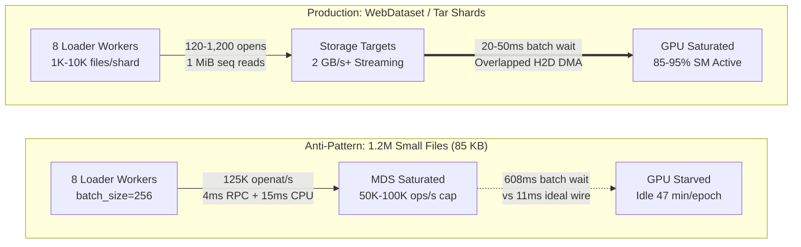
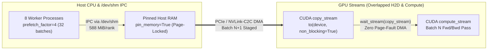

# 13.6 Data loading, small files and metadata

| Field | Value |
|---|---|
| Level | Advanced |
| Priority tier | 2 |
| Lab venue | GCP / GKE + Local Python Verification Lab (`code/part13/data_loading_small_files_lab.py`) |
| Part | Part 13: AI storage |
| Primary sources | NVIDIA Zero-to-Hero Volume 15 (`chapter-09-metadata-small-files-and-data-loading.md`, `labs/lab-04-troubleshoot-checkpoint-and-data-loading-bottlenecks.md`); Legacy Volume 06 (`03-ai-storage-data-pipelines-masterclass.md`); *AI Systems Performance Engineering* |
| Coverage file | `planning/coverage/chapters/13-06.md` |
| Claim & number ledger | `planning/ledgers/13-06.md` |

## Why this matters for AI infrastructure

Datasets containing millions of independent small files can consume over `80%` of training wall-clock time on I/O and metadata overhead even when the parallel filesystem fabric and GPU Tensor Cores have massive unused bandwidth. Consider a classic ImageNet training run over `1,200,000` (`1.2M`) small JPEG images averaging `85 KB` (`100 KB` rounded). For every single file, the storage client and CPU data loader must execute `stat()` (`2.0 ms` Metadata Server plus NIC round-trip), `open()` (`1.0 ms` RPC and server lookup), `read()` (`0.5 ms` syscall), `close()` (`0.5 ms` RPC), CPU image decode via `PIL` (`5.0 ms`), and CPU augmentation (`10.0 ms`), totaling `19.0 ms` per sample (`4.0 ms` metadata/syscall overhead plus `15.0 ms` CPU preprocessing). At a batch size of `256` (`4,688` batches per epoch), a single serial worker takes `256 * 19.0 ms = 4,864 ms` per batch, and `8` parallel workers still require `608 ms` per batch—whereas streaming `256 * 85 KB = 21.76 MB` over a `2 GB/s` (`2,000 MB/s`) storage link takes an ideal `10.88 ms` (`11 ms`) per batch. That `597 ms` per-batch overhead (`608 ms - 11 ms`) wastes `2,798,736 ms` (`2,798.74 s`, or roughly `2,800 seconds` / `46.65` to `47 minutes`) per epoch during which the GPU sits idle waiting for data.

At cluster scale, the failure mode is even more dramatic. When a `64`-node (`512`-GPU) or `256`-GPU job launches a PyTorch `DataLoader` over `14,000,000` (`14M`) raw `20 KB` `.png` files, `strace -c` on a worker process reveals `85.12%` of system time spent in `stat` (`4.521 s` across `10,000` calls, `452 usecs/call`), `10.05%` in `openat` (`0.534 s` across `5,000` calls, `106 usecs/call`), and `4.02%` in `close` (`0.213 s` across `5,000` calls, `42 usecs/call`), leaving only `0.81%` in `read` (`0.043 s` across `5,000` calls, `8 usecs/call`). In total, `99.19%` of kernel I/O time goes to metadata RPCs; the Metadata Server (`MDS`) hits `100%` CPU utilization above its `50,000–100,000` ops/sec ceiling (for example, `267,500` `openat` calls in `2.140 s` = `125,000` opens/sec), storage throughput collapses to `5 GB/s` on a `400 GB/s` parallel filesystem (`1.25%` bandwidth utilization), and GPU SM activity drops from `95%` to `30%`. Eliminating this bottleneck requires co-designing four layers:
1. **Dataset repackaging and sequential I/O layout:** Consolidating millions of tiny files into large sequential shards—`.tar` archives (`10,000` files/shard -> `120` opens, `10,000x` reduction, batch wait `600 ms -> 50 ms`), `WebDataset` (`1,000` files/shard -> `1,200` opens, reducing `256`-GPU batch stalls from `30,000 ms` [`30 s`] to `20 ms`, a `1,500x` gain, or `50,000` files per `1 GB` shard cutting `14M` `stat` calls by `50,000x` to `280` shards), chunked `HDF5` (`(1200000, 224, 224, 3)` `uint8` = `180.63 GB` with `(64, 224, 224, 3)` = `9.63 MB` chunks), or columnar `Parquet` / `Arrow` / `TFRecord`—while tuning block read-ahead (`128 KB -> 4,096 KB` / `4 MiB`, `32x`) so `1 MiB` sequential reads replace `4 KB` random reads (`256x` fewer syscalls per GiB).
2. **PyTorch `DataLoader` pipelining and `/dev/shm` sizing:** Configuring `num_workers`, `prefetch_factor` (`2` default vs `4` or `8`), `persistent_workers=True`, and `pin_memory=True` paired with a dedicated `torch.cuda.Stream()` (`batch.to(device, non_blocking=True)`) to overlap Host-to-Device (`H2D`) DMA with GPU compute, while sizing container shared memory (`/dev/shm` `emptyDir: {medium: Memory, sizeLimit: 400Gi}`) so `num_workers * prefetch_factor` queued batches (`8 * 4 = 32` batches = `588.0 MiB` per rank, `4,704.0 MiB` = `4.59375 GiB` across `8` GPUs) never crash on Docker's `64 MiB` `/dev/shm` default.
3. **Isolating DataLoader wait and offloading multimodal preprocessing to NVIDIA `DALI`:** Separating pure Python transform overhead (`num_workers=0`) from `H2D` copy stalls (Nsight Systems `Copy` lane / `torch.cuda.Event`) to cut GPU I/O wait from `30%` to `5%` (`6.0x` wait reduction and up to a `6.0x` step-rate increase when I/O-bound), and moving JPEG/video decoding (`nvJPEG`) plus fused GPU augmentations into an `nvidia.dali.pipeline.Pipeline` (or hardware decompression on Grace Blackwell's `LZ4`/`Snappy`/`Deflate` Decompression Engine over `900 GB/s` bidirectional `NVLink-C2C`) to cut host CPU utilization from `800%` (`8` cores) to `200%` (`2` cores, `4.0x` reduction / `75.0%` CPU savings) without incurring Host-Device-Host (`D2H`/`H2D`) ping-pong copies.
4. **Offline LLM dataset curation with NVIDIA `NeMo Curator`:** Running distributed text cleansing, deduplication, and tokenization ahead of training via `DocumentDataset` on sharded `JSONL`/`Parquet` and compiling the output into memory-mapped `.bin` token files with `.idx` byte-offset indices (`2.0 GB` `.bin` + `6.0 MB` `.idx` for `1,000,000,000` `uint16` tokens across `500,000` documents, `0.3%` index overhead) for `O(1)` slice reads and optional offline pre-shuffled multi-epoch copies (`4` copies = `8.024 GB`).

## Prerequisites and outcomes

### Prerequisites
- Familiarity with Linux NVMe block queues (`blk-mq`, `none` / `mq-deadline`), OS page cache behavior, and `O_DIRECT` from Chapters 13.1–13.3.
- Understanding of parallel filesystems (`Lustre`, `BeeGFS`, `WekaFS`, `VAST Data`, `DeepSeek 3FS`), Metadata Servers (`MDS`), Object Storage Targets (`OST`/`OSS`), and `GPUDirect Storage` (`GDS` / `cuFile`) from Chapters 13.4–13.5.
- Basic working knowledge of PyTorch training loops (`Dataset`, `DataLoader`, `DistributedSampler`) and CUDA streams.

### Outcomes
After completing this chapter, you will be able to:
1. Quantify small-file metadata amplification (`stat`, `openat`, `read`, `close` vs decode/augment) using `strace -c`, `lctl get_param llite.*.stats`, and per-batch wait timers (`wait_time > gpu_time` and Lab 04's `wait_time > 500 ms` threshold), and explain why warm-to-cold page-cache decay drops open rates from `2,410` to `820` opens/sec (`2.94x`) and throughput from `189.1` to `68.7 MB/s` (`2.75x`).
2. Repackage millions of small files into sequential shards (`.tar`, `WebDataset`, chunked `HDF5`, `Parquet`/`TFRecord`) and calculate the exact reduction in `MDS` RPCs (`1,000x` to `50,000x`), batch assembly latency (`600 ms -> 50 ms`, `91.7%` reduction, or `30,000 ms -> 20 ms` across `256` GPUs), and read syscall counts (`1 MiB` sequential vs `4 KB` random = `256x` reduction).
3. Tune PyTorch `DataLoader` (`num_workers`, `prefetch_factor`, `persistent_workers=True`, `pin_memory=True`) with asynchronous `copy_stream` `H2D` staging, compute exact `/dev/shm` and `ulimit -l` (`memlock`) requirements across `8`-GPU nodes, and isolate Python transform cost (`num_workers=0`) from `H2D` copy stalls to drive GPU I/O wait from `30%` down to `5%` (`6.0x` reduction).
4. Design fused GPU data pipelines with **NVIDIA `DALI`** (`800% -> 200%` host CPU utilization) that avoid the `D2H`/`H2D` bounce anti-pattern, and build memory-mapped `.bin` + `.idx` LLM token datasets with **NVIDIA `NeMo Curator`** that support `O(1)` document lookup.

---

## 1. The Small-File Metadata Bottleneck: Quantifying Why GPUs Starve

### 1.1 The Library Catalog Analogy and Per-File Syscall Anatomy

Imagine reading `10,000` single pages from `10,000` separate books scattered across a massive library. If every page requires walking to the front desk to ask the librarian for the call number (a **Metadata Lookup** on the `MDS`), walking to a shelf to read one page (a **Data Read** on an `OST`/`OSS`), and returning the book before requesting the next one, `99%` of your elapsed time is spent walking to the front desk and less than `1%` is spent reading. Packing those `10,000` pages into a single sequential binder ahead of time reduces `10,000` librarian lookups to `1` lookup followed by continuous sequential reading.

In a distributed filesystem (`Lustre`, `BeeGFS`, `NFS`, or `CephFS`), opening and reading a tiny file incurs four distinct POSIX/RPC round-trips before a single pixel or token is decoded on the CPU:



| Pipeline Regime | Files / Shards per Epoch (`1.2M` samples) | Per-Sample Cost Breakdown | Batch Assembly Latency (`B=256`, `8` workers) | Epoch I/O Overhead (`4,688` batches) | `MDS` Load & GPU Utilization Impact |
|---|---|---|---|---|---|
| **Raw Small Files (`85 KB` JPEGs)** | `1,200,000` files (`1.2M` `stat` + `open` + `close`) | `stat` `2.0 ms` + `open` `1.0 ms` + `read` `0.5 ms` + `close` `0.5 ms` (`4.0 ms` I/O) + decode `5.0 ms` + augment `10.0 ms` (`15.0 ms` CPU) = **`19.0 ms`** | `4,864 ms` serial (`1` worker); **`608 ms`** across `8` workers (vs **`10.88 ms`** / `~11 ms` ideal at `2 GB/s`) | **`597 ms`/batch** overhead = **`2,798.74 s`** (`~2,800 s` / **`46.65–47 min`**) wasted per epoch | `125,000` opens/sec saturates `50K–100K` `MDS`; GPU waits `600 ms` for `100 ms` work (**`85.71%` / `~86%` GPU idle**) |
| **`.tar` Shards (`10,000` files/shard)** | **`120` `.tar` shards** (`10,000x` fewer opens) | Amortized `0.0004 ms` metadata/sample + sequential `1 MiB` buffered reads + CPU/GPU decode | **`50 ms`** per batch (`12.0x` faster than `600 ms` baseline; **`91.7%` reduction**) | `< 180 s` (`< 3 min`) before compute overlap; `0 s` exposed when overlapped with `100 ms` GPU step | `< 50` opens/sec; `MDS` idle (`< 5 ms` latency); GPU compute overlapped |
| **`WebDataset` Shards (`1,000` files/shard)** | **`1,200` `.tar` shards** (`1,000x` fewer opens) | Streaming `.tar` iterator (`wds.WebDataset`) with shard-level shuffle and parallel worker decode | **`20 ms`** per batch on a `256`-GPU cluster (down from **`30,000 ms` / `30 s`**, a **`1,500x` gain**) | Fully hidden behind GPU forward/backward pass (`prefetch_queue` `5–20` batches deep) | GPU utilization jumps from **`30%` to `85%+`** across `256` GPUs |
| **Large `WebDataset` (`50,000 x 20 KB` PNGs)** | **`280` `1 GB` shards** for `14,000,000` PNGs (`50,000x` fewer `stat` calls) | Eliminates `85.12%` `stat` + `10.05%` `openat` + `4.02%` `close` (`99.19%` metadata syscall waste) | Sequential `2 MiB` block streaming saturating parallel storage targets | Eliminates `100%` `MDS` CPU bottleneck and `5 GB/s` (`1.25%` of `400 GB/s`) throughput cap | GPU SM activity recovers from **`30%` back to `95%`** |

Let us verify the exact arithmetic for the `1,200,000`-image (`85 KB` average) ImageNet scenario:
1. **Per-sample latency (`19.0 ms`):**
```text
Metadata \& Syscall Time = 2.0 ms (\texttt(stat)) + 1.0 ms (\texttt(open)) + 0.5 ms (\texttt(read)) + 0.5 ms (\texttt(close)) = 4.0 ms
```
```text
CPU Preprocessing Time = 5.0 ms (PIL decode) + 10.0 ms (albumentations) = 15.0 ms
```
```text
Total per File = 4.0 ms + 15.0 ms = 19.0 ms
```
2. **Batches per epoch and batch assembly time (`batch_size = 256`):**
```text
Batches per Epoch = ceil((1,200,000) / (256) ) = 4,688 batches
```
```text
Serial Batch Time (1 worker) = 256 x 19.0 ms = 4,864 ms
```
```text
Parallel Batch Time (8 workers) = (4,864 ms) / (8) = 608 ms
```
3. **Ideal wire time vs actual overhead over a `2 GB/s` (`2,000 MB/s`) storage link:**
```text
Ideal Batch Transfer Time = (256 x 85 KB) / (2 GB/s) = (21,760,000 B) / (2 x 10^9 B/s) = 10.88 ms ~= 11 ms
```
```text
Overhead per Batch = 608 ms - 11 ms = 597 ms
```
```text
Epoch Wasted Time = 4,688 x 597 ms = 2,798,736 ms = 2,798.74 s ~= 2,800 s ~= 46.65 to 47 minutes
```

When GPU compute takes `100 ms` per batch (`gpu_time = 100 ms`) while the loader stalls for roughly `600 ms` (`wait_time` oscillating across `580 ms`, `620 ms`, `590 ms`, `600 ms`), the data loader is **`6.0x` slower** than the GPU. Every training step stretches to `600 ms + 100 ms = 700 ms`, leaving the GPU active for only `100 / 700 = 14.29%` of the step and **idle for `85.71%` (`~86%`)** of wall-clock time.

### 1.2 Diagnosing Metadata Saturation: `strace -c`, Warm-to-Cold Cache Decay, and `mdtest`

How do you prove to a training team that their job is bottlenecked on metadata IOPS rather than storage bandwidth? Three diagnostic measurements isolate the root cause immediately:

1. **System-call profiling (`strace -e openat -c` and `strace -c -p <PID>`):**
   Attaching `strace` briefly to a data-loader worker exposes both the absolute file-open rate and the fraction of kernel time consumed by metadata syscalls:
   - In the ImageNet `openat` trace, `267,500` `openat` calls complete in `2.140` seconds (`8 usecs/call`, `45.23%` of traced syscall time, `1,234` errors), which equals:
```text
Open Rate = (267,500 calls) / (2.140 s) = 125,000 opens/sec (125K ops/sec)
```
     Because a typical parallel filesystem `MDS` handles `50,000–100,000` ops/sec (`50K–100K` ops/sec), a single client generating `125,000` opens/sec exceeds the `50,000` ops/sec lower bound by **`2.5x`** and saturates even a `100,000` ops/sec `MDS`.
   - In the `14,000,000` x `20 KB` `.png` computer-vision incident, `strace -c -p <PID>` records `5.311` seconds of syscall time across `10,000` `stat` calls and `5,000` `openat`/`close`/`read` calls:

| Syscall | `% time` | `seconds` | `usecs/call` | `calls` | Role in Data Pipeline |
|---|---|---|---|---|---|
| `stat` | **`85.12%`** | `4.521000` | `452` | `10,000` | Path resolution, inode attribute & permission lookup on `MDS` |
| `openat` | **`10.05%`** | `0.534000` | `106` | `5,000` | File descriptor allocation & `MDS` layout capability fetch |
| `close` | **`4.02%`** | `0.213000` | `42` | `5,000` | Descriptor release & lock/lease cleanup RPC |
| `read` | **`0.81%`** | `0.043000` | `8` | `5,000` | Actual `20 KB` payload transfer from storage target (`OST`/`OSS`) |
| **Total Metadata (`stat`+`openat`+`close`)** | **`99.19%`** | `5.268000` | — | `20,000` | Pure metadata overhead starving the `400 GB/s` array at `5 GB/s` (`1.25%`) |

2. **Warm-to-cold page-cache and dentry-cache decay across an epoch:**
   A insidious trap in small-file benchmarking is testing only the first `1,000` or `2,000` samples (which hit warm Linux dentry/inode caches in host RAM) and assuming the entire `1.2M`-file epoch will run at that speed. When `InstrumentedDataset` logs `opens/sec` and `MB/s` across sample indices, performance collapses once the working set exceeds cached dentries and page cache:

| Sample Index (`Idx`) | Measured File-Open Rate (`opens/sec`) | Achieved Read Throughput (`MB/s`) | Cache Regime & Diagnostic Interpretation |
|---|---|---|---|
| `Idx 0` | `2,350 opens/sec` | `185.2 MB/s` | Initial warm directory/dentry cache burst |
| `Idx 1000` | `2,410 opens/sec` | `189.1 MB/s` | Peak warm-cache rate (`2,410` opens/s on a single node) |
| `Idx 2000` | `2,320 opens/sec` | `192.5 MB/s` | Sustained warm cache before eviction onset |
| `Idx 10000` | `1,850 opens/sec` | `154.3 MB/s` | Cache warmth begins dropping (`-23.2%` open rate vs peak) |
| `Idx 50000` | **`820 opens/sec`** | **`68.7 MB/s`** | Cold cache: open rate drops **`2.94x`** (`2,410 / 820`) and throughput drops **`2.75x`** (`189.1 / 68.7`) |

3. **Stress-testing `MDS` limits before production with `mdtest`:**
   Rather than waiting for a training job to stall, storage architects benchmark `MDS` `stat`/`create`/`delete` capacity across deeply nested directory trees using `mdtest` (from the IOR suite):
   - Running `mpirun -np 128 mdtest -d /mnt/lustre/metadata_stress_test -i 5 -b 10 -z 3 -L -I 100000 -y -u -t` creates a directory tree of depth `-z 3` with branching factor `-b 10` and places files only at leaf directories (`-L`), producing `10^3 = 1,000` leaf directories. With `-I 100000` items per leaf directory, each of the `-i 5` iterations stresses the `MDS` across `1,000 x 100,000 = 100,000,000` (`100M`) metadata entries across `128` MPI ranks (`-u` unique directory per task, `-y` sync, `-t` time unique dir overhead).

---

## 2. Dataset Repackaging and Sequential Storage Layouts

### 2.1 `.tar` Archives, `WebDataset`, `HDF5`, and Columnar Shards (`Parquet` / `TFRecord`)

Because small-file overhead is dominated by per-file `MDS` RPCs and random disk seeks, the mandatory production fix is **Dataset Repackaging**: serializing thousands of individual samples into large contiguous shard files (`100 MB` to `10 GB` per shard) so the storage client issues one `open()` followed by large (`1 MiB` to `2 MiB`) sequential reads.

| Format | Optimal Shard / Chunk Sizing | Open-Call Reduction (`1.2M` files) | Random vs Sequential Access | Strengths & Operational Trade-Offs |
|---|---|---|---|---|
| **Raw `.tar` Shards (`TarDataset`)** | `10,000` files/shard (`~850 MB–1 GB`/shard) | `1,200,000 -> 120` opens (**`10,000x` reduction**) | Sequential scan (`tarfile.open(..., 'r\|')` streaming or indexed `getmembers()`) | Zero external dependencies; reduces batch wait from `600 ms` to `50 ms` (`12.0x` speedup, `91.7%` wait reduction). Naive `tar.getmembers()` scans headers on init unless indexed. |
| **`WebDataset` (`.tar` + `__key__`)** | `1,000–50,000` samples/shard (`~100 MB–1 GB`/shard) | `1,200,000 -> 1,200` opens (`1,000x`); `14M -> 280` opens (`50,000x`) | Pure streaming `IterableDataset` (`wds.WebDataset(resampled=True)`) | Industry standard for multi-node vision/multimodal training; built-in shard + in-memory shuffle buffer; cuts `256`-GPU batch wait from `30 s` to `20 ms` (`1,500x`). |
| **`HDF5` (`h5py`)** | Single file or multi-file with chunks `(64, 224, 224, 3)` = **`9.63 MB`/chunk** | `1,200,000 -> 1` open (`1,200,000x` reduction) | Fast chunked or `mmap` random access (`images_dset[idx]`) | Stores structured multi-array data (`images` `(1200000, 224, 224, 3)` `uint8` = **`180.63 GB`** + `labels` `(1200000,)` `int32` = **`4.80 MB`**). Watch for file locking during concurrent writes and SWMR/multi-worker handle rules (open `h5py.File` lazily inside worker `__getitem__`, never in `__init__` before `fork`). |
| **`Parquet` / `Arrow` / `TFRecord`** | `128 MB–1 GB` row-group / shard files striped across `4–8` `OST`s | `1,000x–50,000x` reduction | Sequential row-group streaming + column projection | Ideal for tabular, text (`JSONL` replacement), and multimodal metadata; supports `LZ4`/`Snappy`/`Zstd` compression. Striping across `4` `OST`s at `500 MB/s` each yields `2.0 GB/s` per file. |
| **Megatron / NeMo `.bin` + `.idx`** | Multi-GB contiguous `.bin` token array + `.idx` offset/length table | `1` `.bin` + `1` `.idx` open per shard | `O(1)` random document/sequence slice via `np.memmap` | Zero runtime tokenization or JSON parsing; `1B` `uint16` tokens = `2.0 GB` `.bin` + `6.0 MB` `.idx` (`0.3%` index overhead). |

### 2.2 Sequential vs Random Read Math and Kernel Read-Ahead Tuning

Even after repackaging into large shards, storage throughput depends on the block size issued to the kernel and underlying NVMe or parallel filesystem:
- **Syscall reduction (`1 MiB` vs `4 KB`):** Reading `1 GiB` (`1,024 MiB` = `1,048,576 KB`) of training data in `4 KB` chunks requires:
```text
(1,048,576 KB) / (4 KB) = 262,144 read syscalls
```
  Reading that same `1 GiB` in `1 MiB` (`1,024 KB`) contiguous blocks requires only `1,024` read syscalls—a **`256x` reduction** in syscall and I/O submission overhead.
- **Linux block `read_ahead_kb` (`128 KB -> 4,096 KB`):** By default, `/sys/block/<device>/queue/read_ahead_kb` is typically set to `128 KB`. When streaming multi-gigabyte `WebDataset`, `Parquet`, or `.bin` shards sequentially, raising read-ahead to `4,096 KB` (`4 MiB`, a **`32x` increase**) via `blockdev --setra 8192 /dev/nvme0n1` (`8,192` `512`-byte sectors = `4 MiB`) pipelines block fetches ahead of the Python worker thread.
- **Handling unavoidable random reads (`pread()` and `io_uring`):** When a workload genuinely requires random reads (such as RAG vector retrieval or random `.bin` sequence sampling across cold shards), standard OS read-ahead wastes bandwidth by fetching unused adjacent blocks. Instead, applications should issue concurrent positional reads via `pread()` across worker threads or submit batched asynchronous rings using Linux **`io_uring`** with pre-registered buffers and polling—and, at extreme scale (as in DeepSeek's `3FS`), combine `O_DIRECT` + `io_uring` + `RDMA` to bypass the kernel page cache entirely.
- **Filesystem mount hygiene (`noatime`):** Every file or shard read updates the inode's access timestamp (`atime`) by default, turning pure read workloads into hidden metadata write traffic. Mounting local `XFS` NVMe caches and network `NFS` mounts with `noatime` (and `rsize=1048576,wsize=1048576,noatime,async,actimeo=60,lookupcache=pos` on `NFS`) eliminates access-time write-backs.

---

## 3. PyTorch `DataLoader` Architecture, Memory Pinning, and `/dev/shm` Sizing

### 3.1 Multi-Process Prefetching, `pin_memory=True`, and Dedicated CUDA Copy Streams

Once storage delivers bytes rapidly, the bottleneck shifts to the host CPU and PCIe/`NVLink-C2C` transfer path into GPU High Bandwidth Memory (`HBM`). Because Python's Global Interpreter Lock (`GIL`) serializes bytecode execution inside a single process, PyTorch's `DataLoader` spawns `num_workers` separate OS worker processes. Each worker independently reads a shard/sample, decodes and augments it, collates `batch_size` samples into a batch tensor, and places the batch into an inter-process shared-memory queue (`/dev/shm`).



| `DataLoader` / CUDA Mechanism | Recommended Setting | Architectural Role | Failure Mode if Misconfigured |
|---|---|---|---|
| **`num_workers`** | `4–8` per GPU (up to `8–16` on `72`-core Grace CPU) | Spawns independent processes to bypass the Python `GIL` for file reads, decompression, and transforms | `num_workers=0` runs synchronously on the main loop thread; too many workers (`> CPU cores`) cause context-switch and disk thrashing |
| **`prefetch_factor`** | `2` (default) -> **`4` or `8`** for bursty I/O | Each worker pre-loads `prefetch_factor` batches ahead; total queued batches = **`num_workers * prefetch_factor`** | Queue drains to `0` during storage jitter, stalling the GPU; overly large values (`> 50` queued batches) exhaust `/dev/shm` and host RAM |
| **`persistent_workers`** | **`True`** | Keeps worker processes, imported C++/Rust libraries, and open shard file handles alive across epoch boundaries | `False` tears down and `fork`/`spawn`s all `num_workers * 8` processes at every epoch start, causing multi-second epoch-boundary stalls |
| **`pin_memory`** | **`True`** (paired with high `ulimit -l` / `memlock`) | Copies collated batches into page-locked (pinned) host memory so the GPU DMA engine can transfer directly without an extra pageable-to-pinned CPU copy | Pageable memory forces synchronous driver staging copies; insufficient container `memlock` causes `cudaErrorMemoryAllocation` |
| **Dedicated `copy_stream`** | `torch.cuda.Stream()` + `.to(device, non_blocking=True)` | Overlaps `Batch N+1` `H2D` DMA transfer on `copy_stream` while `compute_stream` executes `Batch N` kernels (`compute_stream.wait_stream(copy_stream)`) | Calling `.to(device)` on the default stream or without `pin_memory=True` serializes `H2D` copies in front of compute kernels |

Let us calculate the exact in-flight memory footprint for the canonical `DataLoader` configuration (`batch_size=32`, RGB images of shape `(3, 224, 224)` in `float32` [`4` bytes], `num_workers=8`, `prefetch_factor=4`):
1. **Bytes per sample and per batch:**
```text
Bytes per Sample = 3 x 224 x 224 x 4 B = 602,112 B ~= 588 KiB
```
```text
Bytes per Batch  (B=32) = 32 x 602,112 B = 19,267,584 B = 18.375 MiB
```
2. **Queued batches and shared/pinned memory per GPU rank (`num_workers=8, prefetch_factor=4`):**
```text
Queued Batches per Rank = num_workers x prefetch_factor = 8 x 4 = 32 batches
```
```text
In-Flight Queue Memory per Rank = 32 x 18.375 MiB = 588.0 MiB  (616,562,688 B)
```
   (By contrast, the default `prefetch_factor=2` queues `8 x 2 = 16` batches = `294.0 MiB` per rank.)
3. **Node-wide `/dev/shm` footprint across an `8`-GPU training node:**
```text
Node In-Flight Queue Memory (8 GPUs) = 8 x 588.0 MiB = 4,704.0 MiB = 4.59375 GiB
```
   Because Docker and containerd default `/dev/shm` to **`64 MiB`**, even a single rank with `num_workers=8, prefetch_factor=4` (`588.0 MiB`) overflows `/dev/shm` by `9.19x` and crashes with `RuntimeError: DataLoader worker (pid ...) is killed by signal: Bus error`. In Kubernetes, production `8`-GPU training pods always mount an in-memory `emptyDir` at `/dev/shm` (for example, `medium: Memory, sizeLimit: 400Gi`) to accommodate both PyTorch `DataLoader` worker IPC queues and `NCCL` shared-memory communication buffers.

### 3.2 Isolating Python DataLoader Cost vs `H2D` Copy Cost (`30% -> 5%` Wait = `6x` Speedup)

When `next(data_iterator)` stalls the training loop, that measured elapsed time conflates three separate subsystems: background storage/CPU worker preparation, shared-memory IPC/collation, and Host-to-Device (`H2D`) `memcpy`. You isolate them using a three-step diagnostic procedure:
1. **Benchmark the isolated DataLoader (`100` batches with GPU compute disabled):** Time how long `for i, batch in enumerate(loader):` takes to yield `100` batches without running `model(batch)`. (Keep in mind that disabling GPU kernels also removes CPU-side CUDA kernel-launch overhead, so isolated CPU loader throughput can appear slightly faster than during a live training run.)
2. **Separate Python transform cost (`num_workers=0`) from worker scheduling:** Temporarily set `num_workers=0` to disable background multiprocessing and time the synchronous `__getitem__` + `collate_fn` loop directly. If per-sample latency is high here, replace pure-Python text loops or slow transforms with C++/Rust vectorized bindings (such as Hugging Face `tokenizers` in Rust or batched `collate_fn` tensor operations).
3. **Separate `H2D` transfer cost (`torch.cuda.Event` or Nsight Systems `Copy` lane):** Wrap `.to(device, non_blocking=True)` in `torch.cuda.Event(enable_timing=True)` markers or inspect the `Copy` stream lane in Nsight Systems (`nsys profile --trace=cuda,nvtx,osrt,gds`). If the `Copy` lane stalls compute, enable `pin_memory=True`, stage transfers on a separate `copy_stream`, or use `GPUDirect Storage` (`GDS` / `cuFileReadAsync`) to DMA directly into GPU `HBM`.

When storage and pipeline profiling reveals that GPUs spend **`30%`** of wall-clock time waiting for data, eliminating these bottlenecks to reduce GPU I/O wait down to **`5%`** cuts the I/O stall fraction by **`6.0x`** (`30% / 5% = 6.0x`, recovering `25` percentage points of active GPU time)—and on an I/O-throttled pipeline where step time is dominated by data wait, reducing per-step data wait by `6.0x` increases training steps per second proportionally (`6.0x`).

### 3.3 Scaling Out Workers and Shards as You Scale Out GPUs

Scaling compute without scaling the ingestion pipeline shifts the bottleneck immediately onto storage and CPU workers:
- **Aggregate cluster bandwidth math:** If `1` GPU requires `200 MB/s` of training samples, an `8`-GPU node requires **`1.6 GB/s`**, and a `72`-GPU NVIDIA Grace Blackwell `GB200`/`GB300` `NVL72` rack requires **`14.4 GB/s`** (`14–20 GB/s`). On high-core-count hosts such as the `72`-core NVIDIA Grace CPU in `GB200`/`GB300`, you can provision more `DataLoader` workers per rank, provided you monitor disk utilization (targeting near `100%` storage link efficiency with healthy CPU headroom).
- **Multi-GPU scaling efficiency check:** Always establish a `1`-GPU baseline (`samples/sec`) before scaling to `8` GPUs on a node and then multi-node. If `8` GPUs deliver only a **`5.0x`** speedup over `1` GPU instead of `8.0x`, the system is operating at only **`62.5%` scaling efficiency** (`5.0 / 8.0 = 62.5%`), signaling an I/O or communication bottleneck that must be profiled with `nsys` before scaling further.
- **Node-local shard partitioning (`100 TB` across `10` nodes):** To eliminate redundant network reads when a dataset exceeds host RAM, presplit a **`100 TB`** dataset across **`10` nodes** so each node stages a unique **`10 TB`** shard on its local NVMe RAID-0 cache (`hostPath: /mnt/nvme_raid_0/ai_scratch`) and coordinates per-rank slicing via `DistributedSampler`.

---

## 4. Multimodal GPU Preprocessing with NVIDIA `DALI` and Hardware Decompression

### 4.1 Offloading JPEG/Video Decode and Augmentations (`800% -> 200%` CPU Utilization)

In computer vision, video, and multimodal training, even after repackaging `1.2M` files into `WebDataset` `.tar` shards, CPU image decoding (`PIL` / `libjpeg-turbo`) and geometric/color augmentations (`RandomResizedCrop`, flip, color jitter, normalization) readily saturate every host CPU core. In a representative object-detection pipeline reading images and video, `top` shows host CPU utilization pegged at **`800%`** (`8` full CPU cores at `100%`), while the GPU still suffers periodic starvation gaps.

**NVIDIA Data Loading Library (`DALI`)** eliminates this CPU bottleneck by executing the data pipeline as a declarative, C++-backed static computation graph (`nvidia.dali.pipeline.Pipeline` with `define_graph()`) that offloads decoding and augmentations onto the GPU's hardware media engines (`nvJPEG` / `NVDEC`) and CUDA cores:
- **CPU reduction (`4.0x` / `75.0%` savings):** Moving JPEG/video decoding and augmentations to `DALI` drops host CPU utilization from **`800%` (`8` cores) down to `200%` (`2` cores)**—a **`4.0x` reduction** (`75.0%` CPU savings), leaving those `2` CPU cores solely responsible for reading sequential shard bytes from storage.
- **Hardware decompression on Blackwell (`LZ4`, `Snappy`, `Deflate`) and `NVLink-C2C` (`900 GB/s`):** Modern NVIDIA Blackwell GPUs include an on-die **Decompression Engine** that unpacks **`LZ4`**, **`Snappy`**, and **`Deflate`** compressed batches in hardware without consuming Streaming Multiprocessor (`SM`) compute cycles, fed over the **`900 GB/s`** bidirectional Grace-to-Blackwell **`NVLink-C2C`** interconnect.

### 4.2 Avoiding the `DALI` Host-Device-Host (`D2H`/`H2D`) Ping-Pong Anti-Pattern

Where you place `DALI` operators in the graph determines whether you achieve a massive speedup or a regression:
- **The Ping-Pong Anti-Pattern (`67.5 ms`/batch):** If a team uses `DALI` only to decode compressed JPEGs on the GPU (`1.5 ms` compressed `H2D` + `4.0 ms` `nvJPEG` GPU decode) and immediately copies the uncompressed raw pixel tensors back to host RAM (`12.0 ms` `D2H` copy) to run legacy CPU augmentations (`38.0 ms`) before copying the augmented batch back to the GPU (`12.0 ms` `H2D` copy), the batch takes **`67.5 ms`**—wasting `24.0 ms` on redundant `D2H`/`H2D` PCIe traffic.
- **The Fused GPU Preprocessing Graph (`8.0 ms`/batch):** Keeping the decoded tensor on `device="gpu"` inside `DALI` (or fusing transforms on the GPU with `torchvision.transforms.v2` / CUDA kernels) so resize, crop, mirror, and normalization run directly in GPU memory after `nvJPEG` decode takes only `1.5 ms (H2D compressed) + 4.0 ms (GPU decode) + 2.5 ms (GPU fused augment) =` **`8.0 ms`** per batch—an **`11.5x` speedup** over the `92.0 ms` CPU-only pipeline (`42.0 ms` CPU decode + `38.0 ms` CPU augment + `12.0 ms` `H2D`) and an **`8.44x` speedup** over the ping-pong `DALI` anti-pattern.

---

## 5. Offline LLM Dataset Curation with NVIDIA `NeMo Curator` (`.bin` + `.idx`) and Continuous Profiling

### 5.1 From Raw `JSONL`/`Parquet` to Memory-Mapped `.bin` + `.idx` Token Shards

In Large Language Model (`LLM`) pretraining, feeding raw text files or millions of unindexed `JSONL` blobs into an online training loop is an operational anti-pattern: on-the-fly string cleaning, Unicode normalization, and regex/BPE tokenization burn massive CPU cycles while producing variable-length sequences that cause padding waste and straggler ranks.

**NVIDIA `NeMo Curator`** shifts all heavy text and multimodal curation **offline** ahead of the training run:
1. **Distributed offline curation (`DocumentDataset`):** `NeMo Curator` distributes text extraction, heuristic quality filtering, exact and fuzzy MinHash deduplication, PII redaction, synthetic data generation, and BPE/SentencePiece tokenization across multi-node CPU/GPU clusters reading and writing sharded **`JSONL`** or **`Parquet`** files via `DocumentDataset`.
2. **Compilation to memory-mapped `.bin` + `.idx` (`MMapIndexedDataset`):** Downstream dataset builders convert the tokenized shards into pairs of contiguous binary files used by `Megatron-LM` and `NeMo`:
   - **`.bin` (contiguous token array):** Stores packed integer token IDs (`uint16` for vocabularies `< 65,536` or `int32` for larger vocabularies) back-to-back with zero delimiters or padding. For **`1,000,000,000` (`1B`) `uint16` tokens** (`2` bytes/token), the `.bin` file is exactly **`2.0 GB`** (`2,000,000,000` bytes).
   - **`.idx` (byte-offset and length index):** Stores a fixed-width header plus an `O(1)` lookup table of `(byte_offset, token_length)` per document (`8`-byte `uint64` byte offset + `4`-byte `uint32` length = `12` bytes/document). Across **`500,000` documents**, the `.idx` file is only **`6.0 MB`** (`0.3%` index overhead on top of the `2.0 GB` `.bin` file, for a `2.006 GB` combined shard).
3. **`O(1)` pointer arithmetic and multi-epoch offline pre-shuffling:**
   Consider three sample documents with `uint16` (`2`-byte) token sequences of lengths `6`, `5`, and `8` tokens (`19` tokens = **`38` bytes** total in `.bin`):
   - Document `0` (`6` tokens): `byte_offset = 0`, `byte_length = 12`
   - Document `1` (`5` tokens): `byte_offset = 12`, `byte_length = 10`
   - Document `2` (`8` tokens): `byte_offset = 22`, `byte_length = 16`
   When a `DataLoader` worker requests `doc_id = 2`, it reads entry `2` from the memory-mapped `.idx` array (`offset = 22, len = 8`) and slices `bin_mmap[22 : 38]` directly in **`O(1)`** time without parsing or scanning Documents `0` or `1`. Furthermore, to avoid runtime random-shuffle I/O penalties across `N` training epochs, teams with sufficient disk capacity often store **`N` offline pre-shuffled copies** of the `.bin` + `.idx` dataset (for example, `4` pre-shuffled epoch copies of a `2.006 GB` shard = **`8.024 GB`**), converting multi-epoch random access into pure sequential streaming. Note that `NeMo`'s online `.bin`/`.idx` reader still runs on the CPU via `mmap` unless explicitly paired with `GPUDirect Storage` (`GDS` / `cuFile`).

### 5.2 Continuous Profiling and Diagnosing Compute vs Communication vs I/O

Because hardware, driver, `NCCL`, and `PyTorch` updates shift pipeline balance over time, production AI teams run an iterative **Run -> Measure -> Tune** workflow:
1. **Establish `1`-GPU -> `8`-GPU -> multi-node baselines:** Track `samples/sec` and scaling efficiency (`8` GPUs achieving only `5.0x` throughput = `62.5%` efficiency).
2. **System timeline profiling (`nsys profile --trace=cuda,nvtx,osrt,gds`):** Inspect GPU compute lanes, `H2D` `Copy` lanes, `cuFile` (`GDS`) tracepoints, and `NCCL` collective gaps. Gaps at the start of every step indicate **DataLoader / I/O starvation**; gaps during backward-pass `AllReduce` indicate **communication bottlenecks**.
3. **Kernel-level drill-down (`ncu`):** If kernels are active without gaps yet slow, use Nsight Compute (`ncu`) to check SM utilization and memory-stall counters (for instance, an `NCCL` kernel running at **`60%` SM utilization** with high memory stalls when accidentally routed over `PCIe` jumping to **`90%` SM busy** once pinned to `NVLink`).
4. **The batch-size perturbation test (Compute-Bound vs Communication-Bound):** Suppose backward-pass gradient `AllReduce` achieves **`60 GB/s`** on a **`100 GB/s`** NIC. Because gradient `AllReduce` volume depends on **model parameter count** rather than batch size, **halve the batch size** (halving compute while keeping communication bytes constant):
   - If achieved NIC bandwidth **stays pegged at `60 GB/s`**, the GPUs finished compute faster but the network could not go any faster -> **Communication-Bound**.
   - If achieved NIC bandwidth **drops from `60 GB/s` to `40 GB/s`**, the GPUs were not finishing backward compute fast enough to keep the NIC fed -> **Compute-Bound** (confirm by doubling batch size and observing `AllReduce` percentage shrink relative to compute time).

---

## Commands and configurations that matter

### 1. Diagnosing Small-File Open Rates, Batch Wait, and Lustre/Kernel Metadata Stats

```bash
# 1. Count file-open rate and syscall breakdown on a running training script (untested here)
# If openat calls/sec exceeds 50,000-100,000 ops/sec, the Metadata Server (MDS) is saturated.
strace -e openat -c python3 train.py 2>&1

# Attach to an active DataLoader worker PID to compare stat/openat/close vs read % time (untested here)
strace -c -p <PID_OF_PYTHON_WORKER>

# 2. Query Lustre client-side metadata open statistics and NVMe read-ahead / scheduler (untested here)
lctl get_param llite.*.stats | grep "^  open:"
cat /sys/block/nvme0n1/queue/scheduler
cat /sys/block/nvme0n1/queue/read_ahead_kb
# Increase NVMe sequential read-ahead from default 128 KB (256 sectors) to 4,096 KB (8,192 sectors = 4 MiB) (untested here)
sudo blockdev --setra 8192 /dev/nvme0n1
```

### 2. Benchmarking Sequential Reads (`fio`) and Metadata Stress (`mdtest`)

```bash
# 1. Simulate 32 PyTorch DataLoader workers streaming 2 MiB blocks with O_DIRECT (untested here)
# Working set (500G) must exceed host RAM to benchmark true parallel filesystem throughput rather than page cache.
fio --name=ai_dataset_read_sim \
    --directory=/mnt/weka/ai_datasets/benchmarks \
    --rw=read \
    --bs=2M \
    --size=500G \
    --numjobs=32 \
    --iodepth=128 \
    --ioengine=libaio \
    --direct=1 \
    --group_reporting

# 2. Stress-test Metadata Server (MDS) across 128 MPI ranks, 1,000 leaf dirs (-b 10 -z 3 -L), 100K files/dir (untested here)
mpirun -np 128 mdtest \
    -d /mnt/lustre/metadata_stress_test \
    -i 5 \
    -b 10 -z 3 -L \
    -I 100000 \
    -y -u -t
```

### 3. Repackaging into `.tar` Shards, `WebDataset`, and Chunked `HDF5`

```bash
# 1. Repackage 10,000 small JPEG files into a single sequential .tar shard (10,000x fewer open() calls) (untested here)
find /dataset/imagenet -name "*.jpg" | sort | sed -n '1,10000p' | tar -cf shard-000000.tar -T -

# 2. Repackage Lab 04's 10,000 synthetic 100 KB files into 100 tar shards of 100 files each (untested here)
for shard in $(seq 0 99); do
    seq $((shard*100+1)) $((shard*100+100)) | xargs -I{} echo "images/img-{}.bin" | tar -cf "images-${shard}.tar" -T -
done
```

```python
# 3. Build and stream 1,000-sample WebDataset shards + chunked HDF5 + tuned PyTorch DataLoader (untested here)
import glob
import h5py
import numpy as np
import torch
from torch.utils.data import DataLoader
import webdataset as wds


def build_webdataset_shards(image_glob: str, shard_pattern: str = "dataset-%06d.tar") -> None:
    """Pack raw JPEGs into 1,000-sample WebDataset tar shards (1.2M files -> 1,200 shards)."""
    with wds.ShardWriter(shard_pattern, maxcount=1000) as sink:
        for idx, img_path in enumerate(sorted(glob.glob(image_glob))):
            with open(img_path, "rb") as f:
                img_bytes = f.read()
            sink.write({"__key__": f"{idx:08d}", "jpg": img_bytes, "cls": idx % 1000})


def build_chunked_hdf5(h5_path: str, num_samples: int = 1_200_000) -> None:
    """Create a chunked HDF5 dataset with (64, 224, 224, 3) = 9.63 MB image chunks."""
    with h5py.File(h5_path, "w") as h5f:
        h5f.create_dataset(
            "images",
            shape=(num_samples, 224, 224, 3),
            dtype="uint8",
            chunks=(64, 224, 224, 3),
        )
        h5f.create_dataset(
            "labels",
            shape=(num_samples,),
            dtype="int32",
            chunks=(64,),
        )


def run_overlapped_dataloader_loop(dataset, model: torch.nn.Module, device: str = "cuda:0") -> None:
    """Overlap pinned-memory H2D DMA on a dedicated copy_stream with GPU compute_stream."""
    loader = DataLoader(
        dataset,
        batch_size=32,
        num_workers=8,
        pin_memory=True,
        persistent_workers=True,
        prefetch_factor=4,
    )
    copy_stream = torch.cuda.Stream(device=device)
    compute_stream = torch.cuda.current_stream(device=device)

    for batch in loader:
        with torch.cuda.stream(copy_stream):
            batch_gpu = batch.to(device, non_blocking=True)
        with torch.cuda.stream(compute_stream):
            compute_stream.wait_stream(copy_stream)
            _ = model(batch_gpu)
```

### 4. Kubernetes Pod Specification with `400Gi` `/dev/shm` and `GPUDirect Storage` (`cufile.json`)

```yaml
# k8s-dataloader-gds-pod.yaml (untested here)
apiVersion: v1
kind: Pod
metadata:
  name: llm-training-worker-rank-0
spec:
  runtimeClassName: nvidia
  containers:
  - name: pytorch-trainer
    image: nvcr.io/nvidia/pytorch:24.07-py3
    env:
    - name: CUFILE_ENV_PATH_JSON
      value: "/etc/cufile.json"
    volumeMounts:
    - name: pfs-datasets
      mountPath: /workspace/datasets
    - name: local-nvme-cache
      mountPath: /mnt/nvme_cache
    - name: dshm
      mountPath: /dev/shm
    - name: gds-config
      mountPath: /etc/cufile.json
      subPath: cufile.json
    resources:
      limits:
        nvidia.com/gpu: 8
  volumes:
  - name: pfs-datasets
    persistentVolumeClaim:
      claimName: weka-dataset-pvc-1tb
  - name: local-nvme-cache
    hostPath:
      path: /mnt/nvme_raid_0/ai_scratch
      type: Directory
  - name: dshm
    emptyDir:
      medium: Memory
      sizeLimit: 400Gi  # Prevents Bus error when 8 GPUs * 8 workers * prefetch_factor=4 queue batches in /dev/shm
  - name: gds-config
    configMap:
      name: gds-configmap
```

---

## How it fails

| Failure Mode | Observable Symptom | Root-Cause Diagnosis | Production Fix |
|---|---|---|---|
| **1. Metadata Server (`MDS`) Saturation from Millions of Small Files** | Storage array throughput sits at `150 MB/s` (expected `2 GB/s`) or `5 GB/s` (expected `400 GB/s`); GPU SM utilization drops to `30–40%`; `MDS` CPU is `100%`. | `strace -c -p <PID>` shows `85.12%` `stat` + `10.05%` `openat` + `4.02%` `close` (`99.19%` metadata) and `openat` rate (`80,000–125,000` opens/s) exceeding the `50K–100K` ops/sec `MDS` limit. | Mandatory repackaging into `.tar`, `WebDataset` (`1,000–50,000` files/shard), `HDF5`, or `Parquet`/`TFRecord`, cutting open calls from `1.2M–14M` down to `120–1,200`. |
| **2. Warm-Cache Microbenchmark Illusion / Cold-Cache Collapse** | Job runs fast on a `100`-file or `2,000`-file smoke test (`2,410` opens/s, `189.1 MB/s`) but stalls (`600 ms`/batch wait vs `100 ms` GPU time) at `Idx 50000` on the `1M+`-file dataset. | Once the working set exceeds Linux page/dentry cache RAM, every `stat`/`open`/`read` misses cache; open rate drops `2.94x` to `820` opens/s (`68.7 MB/s`). | Always benchmark with `fio --direct=1` (`size > Host RAM`) or drop caches (`echo 3 > /proc/sys/vm/drop_caches`) before measuring Epoch 1; repackage into large sequential shards and stage to local NVMe. |
| **3. Container `/dev/shm` Exhaustion (`Bus error` in DataLoader Workers)** | Training crashes shortly after start with `RuntimeError: DataLoader worker (pid ...) is killed by signal: Bus error` or `No space left on device`. | `8` GPUs x `num_workers=8` x `prefetch_factor=4` queues `256` batches (`4,704 MiB = 4.59 GiB` for `(32, 3, 224, 224)` `float32`), overflowing Docker's `64 MiB` `/dev/shm` default. | Mount an in-memory `emptyDir` (`medium: Memory, sizeLimit: 400Gi`) at `/dev/shm` in Kubernetes (or pass `--shm-size=64g` in Docker) and raise `ulimit -l` (`memlock`) for `pin_memory=True`. |
| **4. CPU Decode Saturation & `DALI` `D2H`/`H2D` Ping-Pong** | `top` shows `800%` CPU utilization (`8` cores at `100%`) per rank while GPUs stall; switching only JPEG decode to `DALI` gives negligible speedup (`67.5 ms`/batch). | Decoding on GPU (`nvJPEG`) and copying raw uncompressed pixels back to CPU (`D2H`) for CPU augmentations before copying back to GPU (`H2D`) wastes `24.0 ms`/batch on PCIe bounce traffic. | Keep decoded tensors on `device="gpu"` inside `nvidia.dali.pipeline.Pipeline` (`define_graph()`) or fuse GPU transforms (`8.0 ms`/batch, `11.5x` faster than CPU-only and `8.44x` faster than ping-pong), dropping CPU load from `800%` to `200%`. |
| **5. Cascading Uninterruptible Sleep (`D`-State) Storage Hang** | `4` nodes in a `64`-node DDP job drop off; `top` shows load average `500+` with `0%` CPU; `htop` shows hundreds of `python3` processes in `D` state that ignore `kill -9`. | `dmesg` shows `task python3:12345 blocked for more than 120 seconds` in `rpc_wait_bit_killable [sunrpc]` and `ibstat`/`ibv_devinfo` shows a downed link or `symbol_error_counter > 1000` on the storage fabric. | Hard-reset wedged nodes (`ipmitool chassis power reset`), replace the faulty AOC cable, and mount read-only dataset volumes with bounded/soft RPC timeouts so network partitions fail fast instead of locking kernel threads in `D` state. |
| **6. NUMA / PCIe Locality Skew Across Multi-GPU Workers** | Ranks `0–3` assemble batches in `10 ms` while Ranks `4–7` on the same node take `500 ms`, throttling synchronous `DDP` `AllReduce` to the slowest rank. | `DataLoader` workers for Ranks `4–7` are scheduled on the wrong CPU socket/NUMA domain, crossing the inter-socket UPI/Infinity Fabric link to reach the storage NIC and GPU PCIe root complex. | Bind each rank's process and `DataLoader` worker affinity to the GPU's local NUMA node (`numactl --cpunodebind=... --membind=...` or `torchrun` NUMA binding) and verify NIC-to-GPU topology via `nvidia-smi topo -m`. |

---

## Hands-on lab

### Venue and Scope
- **Environment:** Local Python Verification Lab (`code/part13/data_loading_small_files_lab.py`, stdlib-only, runnable anywhere in `< 1` second) paired with the GCP / GKE `Lab 04` synthetic `10,000`-file vs `100`-shard `.tar` benchmark workflow.
- **Objective:** Deterministically verify all `26` quantitative models in `code/part13/data_loading_small_files.py`:
  1. ImageNet `1.2M`-file per-sample latency (`4.0 ms` metadata + `15.0 ms` CPU = `19.0 ms`), `8`-worker batch latency (`608 ms` vs `10.88 ms` / `11 ms` ideal wire time), and `46.65`–`47` minutes of wasted GPU time per epoch;
  2. `strace` `125,000` `openat`/sec saturation (`267,500` calls in `2.14 s`), `14M` x `20 KB` `.png` syscall breakdown (`85.12%` `stat`, `10.05%` `openat`, `4.02%` `close`, `0.81%` `read` = `99.19%` metadata), and warm-to-cold cache decay (`2,410 -> 820` opens/s = `2.94x`);
  3. Dataset repackaging into `.tar` (`10,000` files/shard -> `120` opens, `600 ms -> 50 ms` = `91.7%` Lab 04 improvement), `WebDataset` (`1,000` files/shard -> `1,200` opens, `256`-GPU batch wait `30,000 ms -> 20 ms` = `1,500x` speedup), and chunked `HDF5` (`180.63 GB` total, `9.63 MB` chunks);
  4. PyTorch `DataLoader` queue and `/dev/shm` sizing (`num_workers=8, prefetch_factor=4` -> `32` batches = `588.0 MiB`/rank, `4,704.0 MiB = 4.59375 GiB` across `8` GPUs) and `30% -> 5%` GPU I/O wait reduction (`6.0x`);
  5. NVIDIA `DALI` CPU offload (`800% -> 200%` CPU = `4.0x` reduction, `8.0 ms` fused GPU graph vs `67.5 ms` ping-pong vs `92.0 ms` CPU-only) and NVIDIA `NeMo Curator` `.bin` + `.idx` `O(1)` slice lookup (`2.0 GB` `.bin` + `6.0 MB` `.idx` for `1B` `uint16` tokens).

### Step 1: Run the Local Verification Lab (Tested Here)

```bash
python3 -B code/part13/data_loading_small_files_lab.py
```

Expected output:

```text
[PASS] 1. ImageNet 1.2M small-file per-sample cost is 4.0 ms metadata/syscall + 15.0 ms CPU decode/augment = 19.0 ms total
[PASS] 2. ImageNet 1.2M files at batch_size=256 yields 4,688 batches/epoch, 4,864 ms serial batch time, and 608 ms across 8 workers
[PASS] 3. Ideal 256 x 85 KB batch over a 2 GB/s link takes 10.88 ms (~11 ms), leaving 597 ms overhead/batch and ~2,798.74 s (~46.65 min) lost per epoch
[PASS] 4. strace with 267,500 openat calls in 2.14 s equals 125,000 opens/sec (8 usecs/call), exceeding the 50K-100K ops/sec MDS ceiling by 2.5x
[PASS] 5. Vol 06 14M x 20 KB PNG strace spends 85.12% in stat, 10.05% in openat, 4.02% in close, and only 0.81% in read (99.19% metadata)
[PASS] 6. Vol 06 14M x 20 KB PNG workload achieves only 1.25% of a 400 GB/s array (5 GB/s), and 50,000-file 1 GB tar shards cut stat calls by 50,000x to 280 shards
[PASS] 7. Loader batch wait of 600 ms vs 100 ms GPU compute makes the loader 6.0x slower than GPU and leaves the GPU idle 85.71% (~86%) of the step
[PASS] 8. Cold-cache eviction drops open rate from 2,410 to 820 opens/sec (2.94x) and throughput from 189.1 to 68.7 MB/s (2.75x)
[PASS] 9. Repackaging 1.2M files into 10,000-file tar shards cuts opens by 10,000x (to 120) and batch wait from 600 ms to 50 ms (12.0x speedup, 91.7% Lab 04 improvement)
[PASS] 10. Repackaging 1.2M files into 1,000-file WebDataset shards cuts opens by 1,000x (to 1,200) and 256-GPU batch stall from 30,000 ms to 20 ms (1,500x speedup)
[PASS] 11. Lab 04 synthetic 10,000-file dataset repackaged into 100-file tar shards produces 100 shards (100x open reduction)
[PASS] 12. HDF5 dataset of (1200000, 224, 224, 3) uint8 occupies 180.63 GB with 9.63 MB chunks for (64, 224, 224, 3) and 4.8 MB for int32 labels
[PASS] 13. Reading 1 GiB in 1 MiB sequential blocks requires 1,024 syscalls vs 262,144 for 4 KB random blocks (256x reduction), and read_ahead_kb 128 KB -> 4,096 KB is 32x
[PASS] 14. mdtest with branch factor -b 10, depth -z 3 (-L leaf-only), and -I 100000 items creates 1,000 leaf directories and 100,000,000 items per iteration
[PASS] 15. PyTorch DataLoader with batch_size=32, shape=(3,224,224) float32 uses 602,112 B/sample and 19,267,584 B (18.375 MiB) per batch
[PASS] 16. DataLoader with num_workers=8 and prefetch_factor=4 queues 32 batches (588.0 MiB/rank, 4,704.0 MiB = 4.59375 GiB across 8 GPUs), overflowing default 64 MiB /dev/shm
[PASS] 17. Default PyTorch prefetch_factor=2 with num_workers=8 queues 16 batches (294.0 MiB/rank, 2,352.0 MiB across 8 GPUs)
[PASS] 18. Reducing GPU I/O wait from 30% to 5% cuts I/O stall time by 6.0x (recovering 25 pct pts of GPU time and yielding a 6.0x step-rate gain when I/O-bound)
[PASS] 19. 8 GPUs achieving only a 5.0x throughput speedup operate at 62.5% scaling efficiency
[PASS] 20. At 200 MB/s per GPU, 8 GPUs need 1.6 GB/s, a 72-GPU GB200/GB300 NVL72 rack needs 14.4 GB/s, and a 100 TB dataset presplit across 10 nodes uses 10 TB/node
[PASS] 21. NVIDIA DALI drops host CPU utilization from 800% (8 cores) to 200% (2 cores), a 4.0x reduction (75.0% CPU savings)
[PASS] 22. Fused GPU DALI pipeline (8.0 ms) outperforms CPU-only (92.0 ms, 11.5x) and avoids the D2H/H2D ping-pong DALI anti-pattern (67.5 ms, 8.44x)
[PASS] 23. Grace Blackwell NVLink-C2C provides 900 GB/s bidirectional bandwidth and hardware Decompression Engine supports LZ4, Snappy, and Deflate
[PASS] 24. NeMo Curator .bin + .idx simulator performs exact O(1) byte-offset lookup for document 2 (offset 22 bytes, length 8 uint16 tokens, 38 bytes total)
[PASS] 25. 1B uint16 tokens across 500,000 documents produce a 2.0 GB .bin file and a 6.0 MB .idx file (0.3% index overhead)
[PASS] 26. Storing 4 offline pre-shuffled epoch copies of a 2.006 GB .bin+.idx dataset requires 8.024 GB on disk to eliminate runtime shuffle overhead

Summary: 26 passed, 0 failed (out of 26 checks)
```

---

## Common first mistakes

1. **Benchmarking only 1,000 samples on a warm OS page cache:** Running a quick `10`-batch test hits warm Linux dentry and page caches (`2,410` opens/sec, `189.1 MB/s`) and hides the `2.94x` open-rate collapse (`820` opens/sec, `68.7 MB/s`) that strikes once the job advances past `Idx 50000` on cold storage.
2. **Raising `num_workers` on a metadata-bound raw small-file dataset:** Increasing `num_workers` from `4` to `32` across `256` GPUs when reading `1.2M` raw JPEGs simply multiplies the `openat`/`stat` storm against the `MDS` (`> 100,000` ops/sec), worsening tail latency instead of fixing the underlying file-count problem.
3. **Increasing `prefetch_factor` without expanding `/dev/shm`:** Raising `prefetch_factor=4` or `8` with `num_workers=8` across `8` GPUs allocates `4.59 GiB+` of shared-memory tensors and crashes inside Docker's default `64 MiB` `/dev/shm` unless `emptyDir: {medium: Memory}` is configured.
4. **Opening an `h5py.File` handle inside `Dataset.__init__` before worker `fork`:** HDF5 file handles are not fork-safe across multiple `DataLoader` worker processes; always open `self.h5_file = h5py.File(...)` lazily inside `__getitem__` (or `worker_init_fn`) per worker process.
5. **Using `DALI` only for GPU JPEG decode and bouncing raw pixels back to CPU (`D2H`):** Returning decoded tensors to host memory for CPU augmentations incurs `24.0 ms`/batch of `D2H` + `H2D` PCIe copies (`67.5 ms` total vs `8.0 ms` when augmentations stay fused on the GPU).
6. **Tokenizing raw `JSONL` strings inside the online LLM training loop:** Running Python regex/BPE tokenization per sample during training starves GPUs and creates uneven sequence lengths; always pre-tokenize offline with `NeMo Curator` into memory-mapped `.bin` + `.idx` shards.

---

## Exercises

1. **Small-File Batch Wait and Epoch Overhead Math:** An ImageNet dataset has `1,200,000` files averaging `85 KB`. Each file incurs `stat` (`2.0 ms`), `open` (`1.0 ms`), `read` (`0.5 ms`), `close` (`0.5 ms`), CPU decode (`5.0 ms`), and CPU augment (`10.0 ms`). For `batch_size = 256`, `num_workers = 8`, and a `2 GB/s` storage link: (a) calculate the per-file metadata/syscall time, per-file CPU time, total per-file time, serial batch time (`1` worker), `8`-worker parallel batch time, and ideal wire batch time; (b) compute the per-batch overhead (`ms`) and total wasted epoch time (`seconds` and `minutes`) across all `4,688` batches; and (c) if GPU compute per batch is `100 ms` while loader wait is `600 ms`, calculate the loader slowdown factor and the percentage of each step the GPU sits idle.
2. **`strace` Syscall Profiling and `mdtest` Sizing:** (a) A `strace -e openat -c` capture records `267,500` `openat` calls in `2.140` seconds; calculate the open rate (`opens/sec`), average `usecs/call`, and overload ratio against a `50,000` ops/sec `MDS`. (b) On a `14,000,000` x `20 KB` `.png` dataset driving only `5 GB/s` on a `400 GB/s` array, `strace -c` records `4.521 s` in `stat` (`10,000` calls), `0.534 s` in `openat` (`5,000` calls), `0.213 s` in `close` (`5,000` calls), and `0.043 s` in `read` (`5,000` calls). Compute the percentage of time spent in metadata syscalls vs `read`, the array bandwidth utilization percentage, and the number of `1 GB` (`50,000`-file) `WebDataset` shards needed to repackage the dataset. (c) How many leaf directories and total metadata items per iteration does `mdtest -b 10 -z 3 -L -I 100000` create?
3. **Dataset Repackaging (`.tar`, `WebDataset`, `HDF5`) and Block Read-Ahead Math:** (a) For `1,200,000` files, compare the number of shard opens and open-reduction factors for `10,000`-file `.tar` shards vs `1,000`-file `WebDataset` shards, calculate the `Lab 04` wait improvement percentage when batch wait drops from `600 ms` to `50 ms`, and calculate the speedup factor when a `256`-GPU cluster's batch stall drops from `30,000 ms` (`30 s`) to `20 ms`. (b) For an uncompressed `HDF5` dataset of shape `(1200000, 224, 224, 3)` `uint8` with chunk shape `(64, 224, 224, 3)` and `int32` labels `(1200000,)`, compute total image dataset size (`GB`), single chunk size (`MB`), and label dataset size (`MB`). (c) Calculate the read syscall reduction factor when switching from `4 KB` random reads to `1 MiB` sequential reads over `1 GiB`, and the multiplier when raising `read_ahead_kb` from `128 KB` to `4,096 KB`.
4. **PyTorch `DataLoader` Queue Footprint and `/dev/shm` Sizing:** Consider an `8`-GPU training node where each rank runs a `DataLoader` with `batch_size = 32`, tensor shape `(3, 224, 224)` in `float32` (`4` bytes), and `num_workers = 8`. (a) Calculate the bytes per sample, MiB per batch, queued batches per rank, in-flight MiB per rank, and total node-wide in-flight MiB and GiB across all `8` GPUs for both `prefetch_factor = 2` (default) and `prefetch_factor = 4`. (b) Verify whether `prefetch_factor = 4` fits inside Docker's default `64 MiB` `/dev/shm` and Kubernetes's `400 GiB` `emptyDir: Memory`.
5. **Isolating GPU I/O Wait, Scaling Efficiency, and NVIDIA `DALI` Graph Fusion:** (a) If tuning `DataLoader` workers, `pin_memory=True`, and `copy_stream` reduces GPU I/O wait from `30%` down to `5%`, calculate the I/O wait reduction factor, the percentage points of GPU time recovered, and the step-rate speedup on an I/O-bound pipeline. Also compute the scaling efficiency when `8` GPUs achieve a `5.0x` speedup, and the required cluster read bandwidth (`GB/s`) at `200 MB/s` per GPU for an `8`-GPU node and a `72`-GPU `GB200`/`GB300` `NVL72` rack. (b) In an object-detection pipeline where `DALI` cuts host CPU usage from `800%` to `200%`, compute the active CPU cores before/after, CPU reduction factor, and CPU savings percentage. Compare batch preprocessing times across CPU-only (`42.0 ms` decode + `38.0 ms` augment + `12.0 ms` `H2D`), ping-pong `DALI` (`1.5 ms` `H2D` + `4.0 ms` GPU decode + `12.0 ms` `D2H` + `38.0 ms` CPU augment + `12.0 ms` `H2D`), and fused GPU `DALI` (`1.5 ms` `H2D` + `4.0 ms` GPU decode + `2.5 ms` GPU augment).
6. **`NeMo Curator` `.bin` + `.idx` Memory-Mapped Offset and Pre-Shuffling Math:** (a) Three tokenized documents have `uint16` (`2`-byte) token counts of `6`, `5`, and `8` tokens. Calculate the total `.bin` byte size and the exact `(byte_offset, token_length)` stored in `.idx` for Document `2`. (b) For an LLM corpus of `1,000,000,000` (`1B`) `uint16` tokens across `500,000` documents (`12` bytes per `.idx` entry), calculate the `.bin` size (`GB`), `.idx` size (`MB`), index overhead percentage, single-copy total size (`GB`), and total disk space (`GB`) required to store `4` offline pre-shuffled epoch copies.

---

## Interview angles

1. **The `256`-GPU ImageNet Stall (`30 s` Batch Wait with Idle Network and `30%` GPU Utilization):**
   - *Trap:* Proposing a faster network fabric (`400G` InfiniBand) or adding more storage capacity targets (`OST`s) when the storage network already has `40%+` unused bandwidth.
   - *Senior Answer:* Diagnose small-file metadata saturation (`1.2M` `85–100 KB` JPEGs across `256` GPUs generating `100K+` `openat`/`stat` RPCs/sec against a `50K` ops/sec `MDS`). Mandate repackaging into `1,200` `WebDataset` `.tar` shards of `1,000` images each (`1,000x` fewer opens), dropping per-batch latency from `30 s` to `20 ms` (`1,500x` gain) and raising GPU utilization from `30%` to `85%+`.
2. **When Switching from `HDF5` to `WebDataset` Does *Not* Improve Throughput:**
   - *Trap:* Treating `WebDataset` as a silver bullet that always speeds up training regardless of current queue depth.
   - *Senior Answer:* If a single-node or modest-scale job training on chunked/memory-mapped `HDF5` already achieves `80%+` GPU utilization and the `DataLoader` `prefetch_queue` depth is consistently `> 5` batches (`5–20` target), the GPU is **compute-bound**, not I/O-bound. Switching to `WebDataset` helps multi-node shard streaming and avoids `HDF5` concurrent locking, but it will not make a compute-bound GPU run faster unless the prefetch queue frequently drops to `0`.
3. **Why Increasing `num_workers` and `prefetch_factor` Crashes Kubernetes Pods with `Bus error`:**
   - *Trap:* Blaming GPU `HBM` Out-Of-Memory (`CUDA OOM`) when a PyTorch worker dies with `SIGBUS`.
   - *Senior Answer:* Explain that PyTorch `DataLoader` workers pass collated tensor batches to the main process via POSIX shared memory (`/dev/shm`), queuing `num_workers * prefetch_factor` batches per rank (`32` batches = `588 MiB`/rank, or `4.59 GiB` across `8` GPUs for `(32, 3, 224, 224)` `float32`). Because container runtimes default `/dev/shm` to `64 MiB`, workers hit `SIGBUS` when `mmap`-backed shared memory pages cannot be allocated. Fix by mounting `emptyDir: {medium: Memory, sizeLimit: 400Gi}` at `/dev/shm`.
4. **Why Naive `DALI` Integration Can Fail to Speed Up Vision Training:**
   - *Trap:* Using `DALI` only as a drop-in replacement for `PIL` JPEG decoding and returning NumPy/CPU tensors to existing CPU `albumentations` transforms.
   - *Senior Answer:* Quantify the `D2H`/`H2D` bounce penalty (`12.0 ms` `D2H` + `38.0 ms` CPU augment + `12.0 ms` `H2D` = `67.5 ms`/batch vs `8.0 ms`/batch for a fully fused GPU pipeline). All downstream resize, crop, flip, and normalization operators must remain on `device="gpu"` until the tensor is consumed by the model's forward pass.

---

## Checkpoint questions (20)

<details>
<summary><strong>1. In the 1.2M-file (85 KB) ImageNet benchmark, how does the 19.0 ms per-file cost break down between storage metadata/syscalls and CPU preprocessing?</strong></summary>

Storage metadata and syscalls take **`4.0 ms`** (`stat()` `2.0 ms` + `open()` `1.0 ms` + `read()` `0.5 ms` + `close()` `0.5 ms`), while CPU preprocessing takes **`15.0 ms`** (`PIL` image decode `5.0 ms` + `albumentations` augmentation `10.0 ms`), totaling **`19.0 ms`** per file.
</details>

<details>
<summary><strong>2. For batch_size=256 across 1,200,000 files (4,688 batches/epoch), why does an 8-worker DataLoader still waste ~47 minutes per epoch on a 2 GB/s storage link?</strong></summary>

A serial worker takes `256 * 19.0 ms = 4,864 ms` per batch, and `8` parallel workers take `4,864 / 8 = 608 ms` per batch. Streaming `256 * 85 KB = 21.76 MB` over a `2 GB/s` link takes an ideal `10.88 ms` (`~11 ms`), leaving **`597 ms` of overhead per batch** (`608 - 11 ms`). Over `4,688` batches, `4,688 * 597 ms = 2,798,736 ms = 2,798.74 s` (`~2,800 s` or **`46.65–47 minutes`**) of wasted GPU wait time per epoch.
</details>

<details>
<summary><strong>3. What openat rate did strace record during the ImageNet small-file stall (267,500 calls in 2.140 s), and why does that break a parallel filesystem Metadata Server (MDS)?</strong></summary>

`267,500 / 2.140 s =` **`125,000` opens/sec** (`8 usecs/call`), which exceeds a typical parallel filesystem `MDS` capacity of **`50,000–100,000` ops/sec** by `1.25x` to `2.5x` from a single client workload.
</details>

<details>
<summary><strong>4. In the Volume 06 14M x 20 KB PNG incident, what percentage of syscall time was spent in stat, openat, close, and read?</strong></summary>

Out of `5.311 s` traced by `strace -c`, **`85.12%`** (`4.521 s`, `452 usecs/call`) was spent in `stat`, **`10.05%`** (`0.534 s`, `106 usecs/call`) in `openat`, **`4.02%`** (`0.213 s`, `42 usecs/call`) in `close`, and only **`0.81%`** (`0.043 s`, `8 usecs/call`) in `read`—meaning **`99.19%`** of kernel I/O time was metadata overhead, throttling a `400 GB/s` array to `5 GB/s` (`1.25%`).
</details>

<details>
<summary><strong>5. How does warm-to-cold page and dentry cache decay affect file-open rate and throughput between Idx 1000 and Idx 50000?</strong></summary>

At `Idx 1000` (warm cache), the loader achieves **`2,410` opens/sec** and **`189.1 MB/s`**. By `Idx 50000` (cold cache after cache eviction), performance drops to **`820` opens/sec** (a **`2.94x`** drop) and **`68.7 MB/s`** (a **`2.75x`** drop).
</details>

<details>
<summary><strong>6. If each training batch waits 600 ms for the DataLoader while GPU forward/backward compute takes 100 ms, what is the GPU idle percentage?</strong></summary>

Total step time is `600 ms + 100 ms = 700 ms`. The loader is **`6.0x` slower** than GPU compute, leaving the GPU active for `100 / 700 = 14.29%` and **idle for `85.71%` (`~86%`)** of the time.
</details>

<details>
<summary><strong>7. How much do 10,000-file .tar shards and 1,000-file WebDataset shards reduce open() calls on a 1,200,000-file dataset, and what batch latencies do they achieve?</strong></summary>

Packing `10,000` files per `.tar` shard reduces `1,200,000` opens to **`120` opens** (`10,000x` reduction) and cuts batch wait from `600 ms` to **`50 ms`** (`12.0x` speedup, `91.7%` wait reduction). Packing `1,000` files per `WebDataset` shard reduces `1,200,000` opens to **`1,200` opens** (`1,000x` reduction) and cuts `256`-GPU cluster batch stalls from `30,000 ms` (`30 s`) down to **`20 ms`** (`1,500x` speedup).
</details>

<details>
<summary><strong>8. What are the storage dimensions and chunk size of the HDF5 ImageNet dataset in Chapter 13.6, and what concurrency rule applies to h5py in PyTorch DataLoaders?</strong></summary>

The `images` dataset of shape `(1200000, 224, 224, 3)` `uint8` occupies **`180.63 GB`** with `(64, 224, 224, 3)` chunks of **`9.63 MB`** each, plus `labels` `(1200000,)` `int32` occupying **`4.80 MB`**. Because `h5py` file handles are not fork-safe, `h5py.File` must be opened lazily inside each worker process (`__getitem__` or `worker_init_fn`) rather than in `__init__`.
</details>

<details>
<summary><strong>9. By what factor do read syscalls drop when reading 1 GiB in 1 MiB sequential blocks instead of 4 KB random blocks, and how do you tune NVMe read-ahead on Linux?</strong></summary>

Reading `1 GiB` (`1,048,576 KB`) in `1 MiB` (`1,024 KB`) blocks requires `1,024` syscalls vs `262,144` syscalls for `4 KB` blocks—a **`256x` reduction**. You increase NVMe sequential read-ahead from the `128 KB` default to `4,096 KB` (`4 MiB`, `32x`) using `sudo blockdev --setra 8192 /dev/nvme0n1` (or writing `4096` to `/sys/block/nvme0n1/queue/read_ahead_kb`).
</details>

<details>
<summary><strong>10. When random reads cannot be avoided, why should you disable large OS read-ahead and use pread() or Linux io_uring?</strong></summary>

On purely random reads, OS read-ahead wastes storage bandwidth and pollutes the page cache by fetching adjacent blocks that will never be read. Using multi-threaded `pread()` or batched asynchronous `io_uring` with pre-registered buffers and polling (paired with `O_DIRECT`, as in DeepSeek's `3FS`) minimizes per-syscall kernel overhead and hides random NVMe latency.
</details>

<details>
<summary><strong>11. How many batches does a PyTorch DataLoader keep queued per rank when num_workers=8 and prefetch_factor=4, and how much /dev/shm memory does that require across an 8-GPU node for (32, 3, 224, 224) float32 batches?</strong></summary>

It queues `num_workers * prefetch_factor = 8 * 4 =` **`32` batches per rank**. Each `(32, 3, 224, 224)` `float32` batch is `19,267,584` bytes (`18.375 MiB`), so `32` batches require **`588.0 MiB` per rank** and **`4,704.0 MiB` (`4.59375 GiB`) across `8` GPUs** on the node.
</details>

<details>
<summary><strong>12. How do pin_memory=True, persistent_workers=True, and a separate CUDA copy_stream work together to hide Host-to-Device (H2D) transfer latency?</strong></summary>

`pin_memory=True` stages collated batches in page-locked host RAM so the GPU DMA engine can execute truly asynchronous `.to(device, non_blocking=True)` transfers on a dedicated `copy_stream` while the GPU's `compute_stream` executes `Batch N` forward/backward kernels (`compute_stream.wait_stream(copy_stream)`). `persistent_workers=True` keeps worker processes alive across epochs so queues stay full at epoch boundaries.
</details>

<details>
<summary><strong>13. How do you experimentally isolate pure Python DataLoader transform overhead from Host-to-Device (H2D) memcpy stalls?</strong></summary>

First, set `num_workers=0` and time the iterator pull with GPU compute disabled to measure pure synchronous Python `__getitem__` and `collate_fn` cost without worker scheduling. Second, measure `H2D` transfer time separately using `torch.cuda.Event` timers around `.to("cuda")` or by inspecting the `Copy` stream lanes in Nsight Systems (`nsys`).
</details>

<details>
<summary><strong>14. If profiling shows GPUs spend 30% of their time waiting on data I/O and tuning reduces that wait to 5%, what is the reduction in I/O wait and the step-rate speedup on an I/O-bound pipeline?</strong></summary>

Reducing GPU I/O wait from `30%` to `5%` cuts I/O stall time by **`6.0x`** (`30% / 5%`), recovers `25` percentage points of GPU compute utilization, and increases training steps per second proportionally by up to **`6.0x`** when step rate is bounded by data wait.
</details>

<details>
<summary><strong>15. At 200 MB/s of training data per GPU, how much aggregate read bandwidth do an 8-GPU node and a 72-GPU Grace Blackwell GB200/GB300 NVL72 rack require?</strong></summary>

An `8`-GPU node requires `8 * 200 MB/s =` **`1.6 GB/s`**, and a `72`-GPU `GB200`/`GB300` `NVL72` rack requires `72 * 200 MB/s =` **`14.4 GB/s`** (`14–20 GB/s` practical envelope).
</details>

<details>
<summary><strong>16. How much did NVIDIA DALI reduce host CPU utilization in the multimodal object-detection pipeline, and what hardware engines accelerate decoding and decompression on Blackwell?</strong></summary>

`DALI` reduced host CPU utilization from **`800%` (`8` full cores) down to `200%` (`2` cores)**—a **`4.0x` reduction** (`75.0%` CPU savings). It leverages hardware `nvJPEG` / `NVDEC` media decoders, the **`900 GB/s`** bidirectional Grace-to-Blackwell `NVLink-C2C` interconnect, and Blackwell's on-die hardware **Decompression Engine** (`LZ4`, `Snappy`, `Deflate`).
</details>

<details>
<summary><strong>17. Why does a fused GPU DALI graph (8.0 ms/batch) outperform a decode-only DALI pipeline that returns images to the CPU for augmentations (67.5 ms/batch)?</strong></summary>

Decoding on GPU (`1.5 ms` `H2D` + `4.0 ms` decode) and copying uncompressed raw pixels back to the CPU (`12.0 ms` `D2H`) for CPU augmentations (`38.0 ms`) before copying back to the GPU (`12.0 ms` `H2D`) wastes `24.0 ms` on `D2H`/`H2D` bounce copies and `38.0 ms` on CPU transforms (`67.5 ms` total). Keeping resize, crop, and normalization fused on the GPU (`2.5 ms`) completes the entire batch in **`8.0 ms`** (`8.44x` faster than ping-pong and `11.5x` faster than `92.0 ms` CPU-only).
</details>

<details>
<summary><strong>18. How does NVIDIA NeMo Curator structure preprocessed LLM datasets for Megatron-LM / NeMo training, and how does .bin + .idx achieve O(1) document lookup?</strong></summary>

`NeMo Curator` cleanses, deduplicates, and tokenizes raw text offline via `DocumentDataset` (on sharded `JSONL`/`Parquet`) and compiles tokens into a contiguous **`.bin`** data file paired with a memory-mapped **`.idx`** index file storing `(byte_offset, token_length)` per document. A worker looks up `doc_id` in `.idx` in `O(1)` time and slices `.bin[byte_offset : byte_offset + byte_length]` directly via `mmap` pointer arithmetic.
</details>

<details>
<summary><strong>19. In Lab 04, what numeric thresholds in the diagnostic script flag a DATA LOADING bottleneck versus a CHECKPOINT WRITE bottleneck?</strong></summary>

An average or per-batch wait time of **`wait_time > 500 ms` (`0.5 s`)** (or `wait_time > gpu_time`) flags a **DATA LOADING** bottleneck, whereas a checkpoint save duration of **`ckpt_time > 10 s`** flags a **CHECKPOINT WRITE** bottleneck (`ckpt_time > 1 s` flags visible GPU idle time during checkpointing).
</details>

<details>
<summary><strong>20. How do you use the batch-size perturbation test to prove whether a 60 GB/s AllReduce on a 100 GB/s NIC is communication-bound or compute-bound?</strong></summary>

Because gradient `AllReduce` byte volume depends on model parameter count rather than batch size, **halve the batch size** (halving compute while keeping communication volume constant). If achieved NIC bandwidth stays at **`60 GB/s`**, the network is the bottleneck (**communication-bound**). If achieved NIC bandwidth drops (for example, to **`40 GB/s`**), the GPUs were not finishing compute fast enough to keep the NIC busy (**compute-bound**).
</details>

---

## Sources and review notes

### Primary Sources
1. **Migrated from `nvidia-devops`:**
   - `nvidia-zero-to-hero/volume-15/chapter-09-metadata-small-files-and-data-loading.md` — *Chapter 09: Metadata, Small Files, and Data Loading* (library catalog analogy; ImageNet `1,200,000` x `85 KB` small-file math: `2 ms` `stat` + `1 ms` `open` + `0.5 ms` `read` + `0.5 ms` `close` + `5 ms` decode + `10 ms` augment = `19 ms`/file, `4,864 ms` serial vs `608 ms` `8`-worker vs `11 ms` ideal at `2 GB/s` = `597 ms`/batch overhead and `2,800 s` / `47 min` lost per epoch; `strace -e openat -c` `267,500` calls in `2.140 s` = `125K` opens/sec vs `50K–100K` `MDS` capacity; `InstrumentedDataset` warm-to-cold cache decay from `2,410` to `820` opens/sec; `600 ms` batch wait vs `100 ms` GPU work = `6x` slower loader and `86%` GPU idle; repackaging into `120` `.tar` shards [`10,000x` reduction, `600 ms -> 50 ms`], `1,200` `WebDataset` shards [`1,000x` reduction, `256`-GPU `30 s -> 20 ms`, `85%+` GPU util], and chunked `HDF5` `(1200000, 224, 224, 3)` with `(64, 224, 224, 3)` chunks; production checklist and troubleshooting table).
   - `nvidia-zero-to-hero/volume-15/labs/lab-04-troubleshoot-checkpoint-and-data-loading-bottlenecks.md` — *Lab 04: Troubleshoot Checkpoint and Data-Loading Bottlenecks* (`10,000` x `100 KB` synthetic dataset with `batch_size=256, num_workers=4`, `prefetch_queue` background monitor, `wait > 500 ms` data-loading threshold and `ckpt_time > 10 s` checkpoint threshold, repackaging into `100` tar shards `images-0.tar..images-99.tar`, and before/after improvement percentage formula).
   - `volume-06/03-ai-storage-data-pipelines-masterclass.md` — *AI Storage and Data Pipelines Masterclass* (`fio` `bs=2M, size=500G, numjobs=32, iodepth=128, direct=1` sequential read benchmark; `mpirun -np 128 mdtest -i 5 -b 10 -z 3 -L -I 100000 -y -u -t` metadata stress test; Kubernetes Pod YAML with `emptyDir: {medium: Memory, sizeLimit: 400Gi}` at `/dev/shm` and `/etc/cufile.json`; Scenario A `D`-state hang in `rpc_wait_bit_killable` after `120` seconds with load average `500+` and `symbol_error_counter > 1000`; Scenario B `14,000,000` x `20 KB` `.png` `strace -c` breakdown [`85.12%` `stat`, `10.05%` `openat`, `4.02%` `close`, `0.81%` `read`], `5 GB/s` on a `400 GB/s` array, and `50,000`-file `1 GB` `WebDataset` shard fix).
2. **Book Corpus (`tools/study_rag`):**
   - *AI Systems Performance Engineering* (`ai-systems-performance-engineering`, Chapter 5: *GPU-Based Storage I/O Optimizations*) — Fast storage and data locality (`8` GPUs x `200 MB/s` = `1.6 GB/s`, `72`-GPU `GB200`/`GB300` `NVL72` rack = `14–20 GB/s`, `100 TB` dataset presplit across `10` nodes = `10 TB`/node with `DistributedSampler`); Sequential vs Random Read Patterns (`1 MiB` vs `4 KB` chunks, `read_ahead_kb` `128 KB -> 4 MiB` via `blockdev --setra`, `XFS` `noatime`, `pread()` and `io_uring`, `NFS` `rsize=1048576,wsize=1048576,noatime,async,actimeo=60,lookupcache=pos`, Lustre `4` `OST`s x `500 MB/s` = `2 GB/s`); Monitoring Storage I/O and isolating `DataLoader` (`num_workers=0` vs `Copy` lane / `torch.cuda.Event`, reducing GPU I/O wait from `30%` to `5%` for a `6x` step-rate gain); Tuning the Data Pipeline (`batch_size=32`, `(3, 224, 224)` `float32`, `num_workers=8`, `pin_memory=True`, `persistent_workers=True`, `prefetch_factor=4` vs `2`, `copy_stream` + `wait_stream`); Multimodal Data Processing with NVIDIA `DALI` (`800% -> 200%` CPU utilization, `nvJPEG`, Blackwell Decompression Engine `LZ4`/`Snappy`/`Deflate`, `900 GB/s` `NVLink-C2C`, avoiding `D2H`/`H2D` bounce copies); Creating High-Quality LLM Datasets with NVIDIA `NeMo Curator` (`DocumentDataset` `JSONL`/`Parquet` -> `.bin` + `.idx` memory-mapped token shards and `N` pre-shuffled epoch copies); and Continuous Profiling and Tuning Workflow (`8` GPUs at `5x` = `62.5%` efficiency, `ncu` `60% -> 90%` SM busy on `NVLink`, and `60 GB/s` `AllReduce` on `100 GB/s` NIC batch-size perturbation test).

