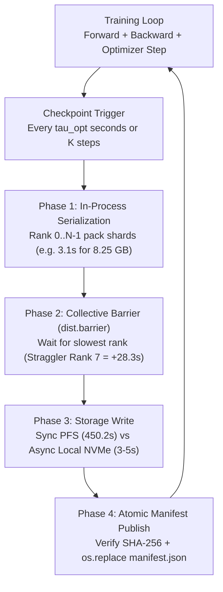
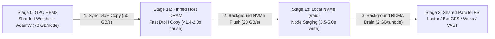
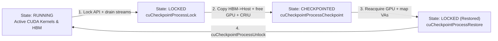

# 13.7 Checkpoint architecture and recovery

| Field | Value |
|---|---|
| Level | Advanced |
| Priority tier | 2 |
| Lab venue | GCP / GKE + Local Python Verification Lab (`code/part13/checkpoint_architecture_lab.py`) |
| Part | Part 13: AI storage |
| Primary sources | NVIDIA Zero-to-Hero Volume 15 (`chapter-08-checkpoint-architecture-and-recovery.md`); Volume 13 (`chapter-09-checkpointing-and-recovery.md`, `chapter-01-why-distributed-training-exists.md`, `chapter-08-nccl-collectives-and-communication-paths.md`, `chapter-12-volume-13-summary.md`, `index.md`, `labs/lab-01..04`); *AI Systems Performance Engineering*; *NVIDIA DGX SuperPOD with DGX GB300 Reference Architecture* |
| Coverage file | `planning/coverage/chapters/13-07.md` |
| Claim & number ledger | `planning/ledgers/13-07.md` |

## Why this matters for AI infrastructure

In large-scale distributed training across `1,000` to `10,000+` GPUs, hardware failures are not an edge case; they are a mathematical certainty. Over a `30`-day (`3`-month) pretraining campaign on `1,024` or `2,048` GPUs, the probability that at least one component—an HBM3 memory stack developing an uncorrectable double-bit ECC error (`Xid 48` or `Xid 63`), a GPU falling off the bus (`Xid 79`), an InfiniBand or RoCE optic flapping, a power supply tripping, or a Linux kernel OOM killer terminating a worker—approaches `100%`. Because collective operations in `NCCL` (`All-Reduce`, `All-Gather`, `Reduce-Scatter`, `All-to-All`) are synchronous across every rank in the communicator, a single failed rank blocks the entire job until the collective watchdog times out (`NCCL WARN Watchdog caught network down`). Without a durable, validated checkpoint, a single node failure wipes out days or weeks of GPU compute time worth millions of dollars.

Yet the act of saving the checkpoint can easily become the single largest bottleneck in the cluster. Consider two real-world failure modes of naive checkpoint design:
1. **The Checkpoint Pause:** Suppose a distributed training run writes a `500 GB` checkpoint every `30` to `60` minutes, and synchronous writes to a congested shared filesystem stall the training loop for `481.5` seconds (`~8` minutes, comprising `3.1 s` serialization, `28.3 s` waiting at `dist.barrier()` for a straggler on Rank `7`, and `450.2 s` writing `8.25 GB` at `18.33 MB/s`). If you save every `30` minutes and pause for `5` minutes, your GPUs sit completely idle for `16%` (`16.7%`) of the day. Over `1,000` planned checkpoints at `8` minutes (`480 s`) per checkpoint, you burn `8,000` minutes (`133.33` hours, or `~133` hours—over `20%` of a `500`-hour run) waiting on disk writes.
2. **Storage Capacity Bloating and Silent Corruption:** Saving a `100 GB` checkpoint every `30` minutes (`48` times per day) for a `30`-day month generates `144 TB` of checkpoints; saving `1,000` checkpoints of `500 GB` each consumes `500 TB`. Worse, if a worker is killed mid-write (`kill -9` or node reboot during `torch.save`), or if an engineer saves only `model.state_dict()` while omitting AdamW momentum/variance buffers (`optimizer.state_dict()`), the learning-rate scheduler step, or the random number generator (`RNG`) state, the resumed job either crashes with a `RuntimeError: size mismatch` or—far more dangerously—continues running without an error while its training loss spikes and silently diverges from the uninterrupted trajectory.

Modern AI storage and platform engineers solve these challenges with a five-part checkpoint architecture:
- **Sharded parallel writes** (`FSDP` `SHARDED_STATE_DICT`, DeepSpeed/ZeRO universal checkpoints, and PyTorch Distributed Checkpoint `DCP`) where every rank writes its own `7.66–8.75 GB` shard in parallel (`2.8 s` across `128` GPUs at a `400 GB/s` parallel filesystem ceiling) instead of gathering `1,120 GB` onto Rank `0` (`268.8 s` / `~269 s`).
- **Principled interval scheduling via the Young-Daly formula** (`tau_opt = \sqrt(2 * T_write * M) - T_write`) calibrated to measured cluster Mean Time Between Failures (`MTBF` $M$) and write duration `T_write`.
- **Two-stage asynchronous checkpointing** that copies GPU `HBM` shards to pinned host `DRAM` in `< 1–2` seconds (or local NVMe `/raid` in `3–5` seconds), immediately releases the GPUs to compute the next forward pass, and flushes shards to the shared parallel filesystem (`Lustre`, `BeeGFS`, `WekaFS`, `VAST`) or object storage in a background CPU thread or process—cutting `1,000`-checkpoint GPU stall time from `133.33` hours down to `1.39` hours (`~1.4` hours, a `96.0x` reduction).
- **Topology-agnostic `N -> M` dynamic resharding and atomic manifest commits** so that when Slurm or Kubernetes drains a failed node and restarts a `64`-GPU job onto `48` healthy GPUs, `torch.distributed.checkpoint` (`DCP`) recomputes shard boundaries from global tensor metadata without manual conversion.
- **In-memory and transparent driver-level checkpointing** (`NVIDIA Mission Control` autonomous recovery on `DGX SuperPOD GB300` and `cuda-checkpoint` + `CRIU` via `cuCheckpointProcessLock` / `Checkpoint` / `Restore` / `Unlock`) for sub-minute fault tolerance and live job migration.

## Prerequisites and outcomes

### Prerequisites
- Understanding of local NVMe RAID staging (`/raid`, `/local-nvme`), `GPUDirect Storage` (`GDS`), and parallel filesystems (`Lustre` OST striping via `lfs setstripe -c -1`, `BeeGFS`, `WekaFS`, and `VAST`) from Chapters 13.1–13.5.
- Familiarity with dataset serialization and metadata bottlenecks from Chapter 13.6.
- Working knowledge of `PyTorch` distributed training (`torchrun`, `DistributedDataParallel` / `DDP`, `FullyShardedDataParallel` / `FSDP`, `ZeRO` stages `1..3`, and `NCCL` collectives) from Part 9.

### Outcomes
After completing this chapter, you will be able to:
1. Calculate the exact byte footprint of a model's active training state (`16 bytes/param`) versus its persistent mixed-precision `AdamW` checkpoint state (`14 bytes/param` or `12 bytes/param`) across `7B`, `70B`, `175B`, and `400B` models, and prove why distributed sharded writes beat naive gather-to-rank-0 by two orders of magnitude (`2.8 s` vs `268.8 s` for a `70B` model on `128` GPUs).
2. Instrument the three synchronous checkpoint phases (`serialization`, `collective barrier sync`, and `storage write`), isolate straggler ranks via `dist.all_gather` batch-time profiling, and compute optimal checkpoint intervals using both Young's first-order approximation (`tau_Young = \sqrt(2 * T_write * M)`) and Daly's higher-order correction (`tau_Daly = \sqrt(2 * T_write * M) - T_write`).
3. Architect a **two-stage asynchronous checkpoint pipeline** (`GPU HBM` `->` pinned `Host DRAM` `->` local `NVMe` `->` shared `PFS` / object store) with host-memory OOM guards, atomic `.tmp`-to-final directory publication, `SHA-256` manifest validation, and tiered retention (`keep_recent=5` plus `100`-epoch milestones).
4. Execute **topology-agnostic `N -> M` checkpoint resharding** (`64` GPUs `->` `48` GPUs after node drain, or `4` GPUs `->` `8` GPUs on scale-out) using `torch.distributed.checkpoint` (`DCP`), and contrast framework-level checkpoints against transparent driver-level GPU state snapshots using `cuda-checkpoint` and `CRIU`.

---

## 1. Anatomy of a Training Checkpoint and Byte Footprint Math

Why does distributed training—and distributed checkpointing—exist in the first place? As GPU `VRAM` capacity has grown linearly (`80 GB` `HBM3` on an `A100` or `H100`), foundation model parameter counts have grown exponentially. A single `GPT-3` (`175B` parameters) stored in `FP32` (`4` bytes/parameter) requires:

```text
175 x 10^9 x 4 bytes = 700 GB of model weights alone
```

That weight tensor alone exceeds a single `80 GB` `H100` GPU's capacity by **`8.75x`** before allocating a single byte for gradients, optimizer states, or activations. Compute scaling imposes an equally hard wall: a single `GPT-3` (`175B`) training step at global batch size `2048` and sequence length `2048` requires approximately `2 x 175 x 10^9 x 2048 x 2048 ~= 1.46 x 10^18 FLOPs` (or `6 PD` when including backward pass). Even at `1.46 \times 10^{18}` FLOPs on a single `A100` delivering `312 TFLOPS` (`FP32` tensor operations), one step takes `1.46 x 10^18 / (312 x 10^12) ~= 4,679.49 seconds` (`~4,679 s` or **`78` minutes**); across `128` `A100` GPUs, that step drops `128x` to **`36.56` seconds (`~37` seconds)**.

### 1.1 The Five Mandatory Components of a Deterministic Checkpoint

A production training checkpoint is not merely a dump of the neural network's weights. To resume a multi-GPU training job at step $t$ so that step $t+1$ produces the exact same loss trajectory as an uninterrupted control run, the checkpoint must capture five distinct state domains:

| Component | State Dict / API Key | What It Stores | What Breaks If Omitted |
|---|---|---|---|
| **1. Model Parameters** | `model_state_dict` (`model.state_dict()`) | Working weights (`BF16`/`FP16`, `2 B/param`) and/or `FP32` master weights (`4 B/param`) | Model reverts to random initialization (`total loss of training progress`) |
| **2. Optimizer State** | `optimizer_state_dict` (`optimizer.state_dict()`) | `AdamW` first moment `m_t` (`FP32`, `4 B/param`), second moment `v_t` (`FP32`, `4 B/param`), and step count | Optimizer restarts "cold" with zero momentum/variance on mid-training weights, causing an **immediate loss spike** after resume |
| **3. LR Scheduler State** | `scheduler_state_dict` (`scheduler.state_dict()`) | Current warmup/cosine-decay step index and base learning rates | Learning rate resets to initial warmup or wrong decay value, destabilizing gradients |
| **4. RNG State** | `rng_state` (`torch.get_rng_state()`, `torch.cuda.get_rng_state_all()`, `numpy`, `python`) | Per-rank CPU and CUDA pseudorandom generator states | Dropout masks and stochastic operations differ after resume, causing **silent trajectory divergence** without throwing an error |
| **5. Data Loader & Step Metadata** | `dataloader_state` (`StatefulDataLoader`), `epoch`, `global_step` | Exact dataset shard cursor, sample offset, and `DistributedSampler` epoch seed | Training replays already-seen batches (overfitting on repeated data) or skips unseen shards |

### 1.2 Active Training Memory (`16 B/param`) vs Persistent Checkpoint State (`14 B/param`)

Platform engineers must distinguish between the **active per-step training memory** residing in GPU `HBM` and the **persistent checkpoint state** written to storage:

1. **Full `FP32` or Mixed-Precision Active Training State (`16 bytes/parameter`):**
   - In classic `FP32` accounting (`V13 Ch. 01` and `Ch. 09`), a model holds `4 B` `FP32` weights + `4 B` `FP32` gradients + `8 B` `FP32` `Adam` optimizer states (`4 B` momentum $m$ + `4 B` variance $v$) = **`16 bytes/parameter`**.
   - In standard mixed-precision `BF16`/`FP16` training with `FP32` master weights, the active state during the backward/optimizer step is also **`16 bytes/parameter`**: `2 B` `BF16` working weights + `2 B` `BF16` gradients + `4 B` `FP32` master copy of weights + `4 B` `FP32` `AdamW` momentum $m$ + `4 B` `FP32` `AdamW` variance $v$ = **`16 bytes/parameter`** (before adding activations and temporary communication buffers).
   - For a **`7B`-parameter model** (`V13 Ch. 01`), this static state requires `28 GB` (`FP32` weights) + `28 GB` (`FP32` gradients) + `56 GB` (`Adam` momentum + variance) = **`112.0 GB`**, plus **`60–80 GB`** of activations (at batch size `4` across `~120` layers) and **`5–10 GB`** of temporary NCCL/framework buffers, totaling **`180–190 GB`**—well beyond a single `80 GB` `A100`/`H100` (`79,456 MiB` used of `79,559 MiB` with only `103 MiB` free before throwing `RuntimeError: CUDA out of memory. Tried to allocate 2.45 GiB`).
2. **Persistent Mixed-Precision Checkpoint State (`14 bytes/parameter` vs `12 bytes/parameter`):**
   - Because checkpoints are triggered at the step boundary *after* `optimizer.step()` and `optimizer.zero_grad()`, transient **gradients (`2 B/param` in `BF16` or `4 B/param` in `FP32`) do not need to be written to disk**.
   - When the checkpoint serializes both the `BF16`/`FP16` working model weights (`2 B/param`) and the `FP32` optimizer state (`4 B` `FP32` master weights + `4 B` `FP32` momentum $m$ + `4 B` `FP32` variance $v$ = `12 B/param`), the persistent checkpoint payload is exactly **`14 bytes/parameter`**.
   - If the framework stores only the `FP32` master weights (`4 B`) plus `FP32` momentum (`4 B`) and variance (`4 B`) and reconstructs the `BF16` working weights by casting on load, the checkpoint payload shrinks to **`12 bytes/parameter`**. Conversely, if a framework serializes full `16 B/param` buffers (`V13 Ch. 09` worked example), a `70B` model produces `1,120.0 GB` (`~1.09 TB`, or `~1.2 TB` including metadata and staging buffers).

| Model Scale (`\Phi`) | `FP32` Weights Only (`4 B/p`) | Minimal Checkpoint (`12 B/p`) | Standard Mixed-Precision Checkpoint (`14 B/p`) | Full `16 B/p` Payload (`V13 Ch. 09`) | Target FSDP World Size ($N$) | Per-GPU Shard at `14 B/p` | Per-GPU Shard at `16 B/p` |
|---|---|---|---|---|---|---|---|
| **`7B`** | `28.0 GB` | `84.0 GB` | **`98.0 GB`** | **`112.0 GB`** | `4` GPUs | `24.50 GB` | `28.00 GB` |
| **`70B`** | `280.0 GB` | `840.0 GB` | **`980.0 GB`** | **`1,120.0 GB`** (`~1.09 TB`) | `128` GPUs | **`7.65625 GB`** | **`8.75000 GB`** |
| **`175B` (`GPT-3`)** | `700.0 GB` (`8.75x` `80 GB`) | `2,100.0 GB` | **`2,450.0 GB`** (`2.45 TB`) | **`2,800.0 GB`** (`2.80 TB`) | `128` GPUs | `19.14063 GB` | `21.87500 GB` |
| **`400B`** | `1,600.0 GB` | `4,800.0 GB` | **`5,600.0 GB`** (`5.60 TB`) | **`6,400.0 GB`** (`6.40 TB`) | `2,048` GPUs | **`2.73438 GB`** | **`3.12500 GB`** |

---

## 2. The Checkpoint Lifecycle: Gather-to-Rank-0 vs Sharded Writes and Stragglers

When training with `FullyShardedDataParallel` (`FSDP`, `--sharding-strategy FULL_SHARD`), `ZeRO-3`, or `3D` parallelism (`Tensor` + `Pipeline` + `Data Parallelism` in `Megatron-LM`), no single GPU holds the full model or optimizer state at rest. Before each layer's forward or backward pass, `FSDP` issues an `All-Gather` to reconstruct that layer's weights temporarily, computes, and frees the non-local slices, keeping only its `1/N` shard. How you serialize that sharded state determines whether checkpointing takes `3` seconds or `8` minutes.

### 2.1 Why `FULL_STATE_DICT` (Gather-to-Rank-0) Collapses at Scale

In `FSDP`, setting `StateDictType.FULL_STATE_DICT` forces all $N$ ranks to `All-Gather` or send their parameter and optimizer shards onto Rank `0` before Rank `0` writes a single monolithic file. Let us trace the exact math for a **`70B`-parameter model** (`1,120.0 GB` payload at `16 B/param`) training across **`128` `H100` GPUs**:
- **Naive Gather-to-Rank-0 (`FULL_STATE_DICT`):**
  1. **Network gather bottleneck:** All `1,120 GB` must flow into Rank `0`'s node. Even at a generous `25 GB/s` effective inbound rate to that single node (and assuming `CPU` offloading is enabled with `offload_to_cpu=True` and `rank0_only=True` so Rank `0` does not immediately suffer a `GPU` or `Host RAM` OOM), gathering takes:
```text
t_gather = (1,120 GB) / (25 GB/s) = 44.8 seconds ~= 45 s
```
  2. **Single-writer storage bottleneck:** Rank `0` now writes `1,120 GB` from a single host to storage at `5 GB/s`:
```text
t_write,rank0 = (1,120 GB) / (5 GB/s) = 224.0 seconds
```
  3. **Total cluster stall:** `44.8 s + 224.0 s = 268.8 seconds` (**`~269 s` or `4.5` minutes**) during which all `128` `H100` GPUs sit `100%` idle.
- **Distributed Sharded Write (`SHARDED_STATE_DICT` / `DCP`):**
  1. **Per-GPU payload:** Each of the `128` GPUs writes only its own local shard:
```text
S_shard = (1,120 GB) / (128) = 8.75 GB per GPU
```
  2. **Parallel filesystem aggregate ceiling:** Suppose each GPU writer can push `5 GB/s` (`8.75 GB / 5 GB/s = 1.75 s` ideal), creating an uncapped aggregate demand of `128 x 5 GB/s = 640 GB/s`. If the shared parallel filesystem (`Lustre`, `BeeGFS`, `WekaFS`, or `VAST`) has an aggregate write ceiling of **`400 GB/s`**, writes queue at the storage targets and each GPU's effective write rate becomes:
```text
B_eff,per-GPU = (400 GB/s) / (128) = 3.125 GB/s ~= 3.1 GB/s
```
  3. **Realistic sharded write duration:**
```text
t_sharded = (8.75 GB) / (3.125 GB/s) = 2.8 seconds
```
  Even when capped by the `400 GB/s` filesystem ceiling, distributed sharded writing (`2.8 s`) is **`96.0x` faster** (`two orders of magnitude`) than gathering to Rank `0` (`268.8 s`).

### 2.2 The Three Checkpoint Phases and Straggler Amplification



| Phase | Operation | Healthy Target | Degraded Field Example (`V15 Ch. 08`) | Root Cause of Degradation |
|---|---|---|---|---|
| **Phase 1: Serialization** | Pack `model`, `optimizer`, `scheduler`, and `rng` tensors into byte buffers | **`< 5.0 s`** (`3.1 s` for `8.25 GB`) | `3.1 s` (`8.25 GB` shard) | Single-threaded Python pickling or unpinned host memory allocation |
| **Phase 2: Synchronization** | `dist.barrier()` ensures no rank mutates weights or races ahead during snapshot | **`< 1.0 s`** | **`28.3 s`** (Rank `7` is `28.3 s` behind) | Compute/dataloader straggler (`NUMA` cross-socket contention, thermal throttling, or `PCIe` fallback) |
| **Phase 3: Storage Write** | Persist serialized shard bytes to storage | **`1.4–5.0 s`** (async `DRAM` / local `NVMe` or `400 GB/s` `PFS`) | **`450.2 s`** (`18.33 MB/s` effective rate) | Synchronous write to unstriped or congested shared storage (`1` `OST` / `NAS` bottleneck) |
| **Phase 4: Publication** | Write `manifest.json` and mark checkpoint complete | **`< 0.5 s`** (atomic `os.replace`) | Torn/partial `.pt` file on crash | In-place overwrite without `.tmp` staging directory or `fsync` |
| **Total GPU Idle Pause** | Sum of blocking phases (`Phase 1 + Phase 2 + Phase 3`) | **`< 5–10 s`** | **`481.6 s`** (`481.5 s` reported = `8+ min`) | Straggler wait (`28.3 s`) + synchronous slow shared-storage write (`450.2 s`) |

Notice how **Phase 2 (`dist.barrier()`)** converts any compute or dataloader straggler into a cluster-wide checkpoint stall. Before triggering a checkpoint, every rank should aggregate its average per-batch step time via `dist.all_gather` so Rank `0` can log whether any rank exceeds a `15%` variance threshold (`numactl` misalignment, thermal clock throttling in `nvidia-smi -q -d PERFORMANCE`, or an `NVLink`-to-`PCIe` `PIX` fallback in `nvidia-smi topo -m`).

---

## 3. Optimal Checkpoint Frequency: The Young-Daly Equation

How often should a cluster save a checkpoint? Checkpointing every `5` minutes wastes massive GPU time on write overhead; checkpointing every `24` hours risks losing an entire day of thousand-GPU progress when a node fails. Platform engineers solve this optimization problem analytically using the **Young-Daly equation**.

### 3.1 Cluster MTBF Scaling (`M_cluster = M_node / N`)

If a single GPU server has a Mean Time Between Failures of `M_node` hours and a synchronous training job spans $N$ nodes (where any single node failure interrupts the job), the cluster's effective `MTBF` $M$ scales inversely with $N$:

```text
M = \frac(M_node)(N)
```

For example, if an individual `8`-GPU node experiences a job-interrupting hardware or software fault once every `8,192` hours (`~11.2` months), a **`1,024`-node cluster** has an aggregate cluster `MTBF` of:

```text
M = (8,192 hours) / (1,024 nodes) = 8.0 hours = 28(,800 seconds)
```

Similarly, a `2,048`-GPU cluster with a per-GPU effective `MTBF` of `12,288` hours has an aggregate cluster `MTBF` of `12,288 / 2,048 = 6.0 hours` (`21,600` seconds).

### 3.2 Deriving Young's First-Order Formula and Daly's Higher-Order Correction

Let `tau` be the compute interval between checkpoints, `T_write` (`T_c`) be the blocking time required to write a checkpoint, and $M$ be the cluster `MTBF` (`M >> T_write`).
1. **Fraction of time spent writing checkpoints:** In each cycle of length `tau + T_write`, the fraction of time lost to writing is approximately `T_write / tau`.
2. **Expected lost rework per failure:** Failures occur at rate $1 / M$. When a failure strikes uniformly inside an interval of length `tau`, the expected amount of compute work lost since the last valid checkpoint is `tau / 2`. Thus, the fraction of time lost to recomputing work after crashes is `(tau / 2) / M = tau / (2M)`.
3. **Minimizing total wasted time:** Minimizing total fractional overhead `f(tau) = \frac(T_write)(tau) + (tau) / (2M)` with respect to `tau` (`(df) / (dtau) = -\frac(T_write)(tau^2) + (1) / (2M) = 0`) yields **Young's first-order optimal checkpoint interval**:

```text
tau_Young = \sqrt(2 * T_write * M)
```

 accounting for higher-order terms (including the probability that a failure occurs *during* the checkpoint write `T_write` itself), **John T. Daly's formula** subtracts `T_write`:

```text
tau_Daly = \sqrt(2 * T_write * M) - T_write
```

### 3.3 Worked Production Examples (`1,024` GPUs and `2,048` GPUs)

Let us apply both formulas to three concrete production scenarios verified in `code/part13/checkpoint_architecture.py`:

| Scenario | Cluster Scale | Cluster `MTBF` ($M$) | Blocking Write Cost (`T_write`) | Young Interval (`tau_Young = \sqrt(2 M T_write)`) | Daly Interval (`tau_Daly = tau_Young - T_write`) | Steady-State Write Overhead (`T_write / (tau_Daly + T_write)`) | Practical Operational Target |
|---|---|---|---|---|---|---|---|
| **Case A: Synchronous PFS Write (`V13 Ch. 09`)** | `1,024` GPUs | `8.0 h` (`28,800 s`) | `180.0 s` (`3.0 min`) | **`3,219.94 s`** (`~3,220 s` = `53.67 min`) | **`3,039.94 s`** (`~3,040 s` = **`50.67 min`**) | **`5.59%`** | Save every **`45–50` minutes** |
| **Case B: `400B` Model on `2,048` GPUs (`V13 Ch. 09`)** | `2,048` GPUs | `6.0 h` (`21,600 s`) | `240.0 s` (`4.0 min`) | **`3,219.94 s`** (`~3,220 s` = `53.67 min`) | **`2,979.94 s`** (`~2,980 s` = **`49.67 min`**) | **`7.45%`** | Round down to **`30–40` minutes** (safety margin for non-exponential failure clustering) |
| **Case C: Async Local NVMe Staging (`V15 Ch. 08`)** | `1,024` GPUs | `8.0 h` (`28,800 s`) | **`5.0 s`** (`0.083 min`) | **`536.66 s`** (`8.94 min`) | **`531.66 s`** (**`8.86 min`**) | **`0.93%`** | Save every **`9–15` minutes** (bounded only by background PFS drain time) |

Look closely at the contrast between **Case A** and **Case C**:
- When a checkpoint write blocks GPUs for `T_write = 180 s`, you can only afford to checkpoint every **`50.67` minutes** (`3,039.94 s`), which still costs **`5.59%`** of cluster compute time in write pauses and exposes the job to `tau_Daly / 2 = 1(,519.97 s)` (`25.33` minutes) of average lost rework per crash.
- When **asynchronous staging** reduces the blocking GPU pause from `180 s` down to **`5.0 s`**, `tau_Daly` drops `5.7x` to **`531.66` seconds (`8.86` minutes)** while steady-state write overhead plunges `6.0x` from `5.59%` to **`0.93%`**, and average rework lost per crash drops to just `265.83` seconds (`4.43` minutes).

---

## 4. Two-Stage Asynchronous Checkpointing and Storage Bandwidth Tiers

How do we reduce the blocking GPU pause of a multi-terabyte checkpoint from `450+` seconds down to `1.4–5.0` seconds? By decoupling the **critical-path snapshot** (which must block the GPUs so weights and optimizer states are not mutated mid-copy) from the **durable storage flush** (which can run in the background while GPUs compute subsequent batches).

### 4.1 The Two-Stage Asynchronous Pipeline (`GPU HBM` `->` `Host DRAM` `->` `Local NVMe` `->` `Shared PFS`)



| Pipeline Stage | Source `->` Destination | Representative Bandwidth (Per `8`-GPU Node) | Duration for `70 GB` Node Payload (`8 x 8.75 GB`) | Does It Block GPU Math? | Failure / Protection Domain |
|---|---|---|---|---|---|
| **Synchronous Baseline** | `GPU HBM` `->` `Host` `->` `Shared PFS` | `2.0 GB/s` per node (congested shared storage) | **`35.0 s`** (`450.2 s` at `18.33 MB/s`/rank) | **YES (`100%` blocking)** | Immediate multi-node durability, but catastrophic GPU idle waste |
| **Async Stage 1a (In-Memory Snapshot)** | `GPU HBM` `->` Pinned `Host DRAM` (`DtoH`) | **`50.0 GB/s`** (`PCIe Gen4/5` or `NVLink-C2C`) | **`1.40 s`** (`< 1–2 s`) | **YES (only `1.4 s` pause)** | Survives soft rank crash (`NVIDIA Mission Control` in-memory restart); lost if node power-cycles before Stage 1b/2 |
| **Async Stage 1b (Local NVMe Staging)** | Pinned `Host DRAM` `->` Local `NVMe` (`/raid` or `/local-nvme`) | **`20.0 GB/s`** (`4–8` striped NVMe drives) | **`3.50 s`** (`3–5 s`) | **NO** (or `3–5 s` if written directly from `torch.save`) | Survives process restart and OOM on the same node; lost if physical node is drained/replaced |
| **Async Stage 2 (Durable PFS Drain)** | Local `NVMe` / `Host DRAM` `->` Shared `PFS` (`/shared-storage`) | **`2.0 GB/s`** per node (background thread/process) | **`35.0 s`** (`70–500 s` depending on PFS load) | **NO (`0 s` GPU stall)** | Survives full node hardware failure and Slurm/K8s rescheduling onto a new node |

### 4.2 Guarding Against the Asynchronous Host-RAM OOM Killer

While asynchronous checkpointing eliminates GPU idle stalls (`25.0x` pause reduction from `35.0 s` to `1.4 s` in the `70 GB`/node model above, and `96.0x` reduction from `480 s` to `5.0 s` in the `1,000`-checkpoint `V15 Ch. 08` scenario), it introduces a **new CPU-side failure mode** that synchronous checkpointing does not have: **Host `DRAM` exhaustion (`Linux OOM Killer`)**.

Suppose an `8`-GPU training node has **`512.0 GB`** of physical host `DRAM`, and the `8` training worker processes plus dataloader queues already consume **`180.0 GB`** of resident set size (`RSS`). Each asynchronous checkpoint allocates **`70.0 GB`** (`8 x 8.75 GB`) of pinned host memory to stage the `DtoH` snapshot:
- **Single in-flight snapshot (`1 x 70 GB`):** Total host memory is `180.0 + 70.0 = 250.0 GB <= 512.0 GB` (**Safe**).
- **Unbounded overlapping snapshots (`5 x 70 GB`):** If the shared storage layer degrades (for instance, an `OST` failure slows Stage 2 writes from `90 s` to `12` minutes) and the training script naively fires new asynchronous checkpoints without waiting for the previous background flush to finish, `5` queued snapshots consume `5 x 70.0 GB = 350.0 GB`, pushing host memory to:
```text
180.0 GB + 350.0 GB = 530.0 GB > 512.0 GB
```
  The Linux kernel immediately invokes the OOM killer (`[Node 3] dmesg: Out of memory: Killed process 1234 (python)`), crashing the entire training job.

**Production engineering rule:** An asynchronous checkpointer must enforce a **single-in-flight semaphore** (`if prev_flush_future is not None: prev_flush_future.result()`) before allocating the next `DtoH` buffer, pre-allocate a reusable pinned staging buffer pool at job startup, and free (`del` / `os.remove()`) local staging buffers immediately upon Stage 2 completion.

### 4.3 NVIDIA DGX SuperPOD GB300 Storage Bandwidth Guidelines and Autonomous Recovery

When designing the shared parallel filesystem that absorbs Stage 2 checkpoint flushes and serves recovery reads for an **NVIDIA DGX SuperPOD with DGX GB300 systems** (`Grace Blackwell Ultra`), platform architects size the High-Performance Storage (`HPS` over `NVMe` and `RDMA`) against NVIDIA's two official workload tiers (`Standard` for single-modality LLM/fine-tuning where working sets fit in local memory cache, and `Enhanced` for large multimodal and multi-billion/trillion-parameter models requiring frequent high-bandwidth I/O and checkpointing):

| DGX SuperPOD GB300 Scale | Standard Tier Aggregate Read | Standard Tier Aggregate Write | Enhanced Tier Aggregate Read | Enhanced Tier Aggregate Write |
|---|---|---|---|---|
| **Single Scalable Unit (`1 SU`)** | **`90 GB/s`** | **`45 GB/s`** | **`280 GB/s`** | **`140 GB/s`** |
| **Four Scalable Units (`4 SU`)** | **`360 GB/s`** | **`180 GB/s`** | **`1,120 GB/s`** (`1.12 TB/s`) | **`560 GB/s`** |

On top of the physical `RDMA` storage fabric, the **NVIDIA Mission Control** software stack on `DGX GB300 SuperPOD` integrates **Base Command Manager (`BCM`)**, **NVIDIA Run:ai** (orchestrating Slurm and Kubernetes), **Network Manager eXperience (`NMX`)** for `NVLink` Switch trays, and a built-in **autonomous recovery engine** with **In-Memory Checkpointing**. When a rank or process fails due to a transient error, Mission Control automatically restarts failed processes/ranks directly from the most recent valid in-memory or staged checkpoint and migrates workloads onto healthy nodes without human intervention.

---

## 5. Topology-Agnostic Resharding (`PyTorch DCP`), Atomic Commits, and Retention

What happens after a hardware failure actually takes down a node? Suppose a `64`-GPU `FSDP` training job (`8` nodes x `8` GPUs) experiences an uncorrectable double-bit ECC error (`Xid 48` or `Xid 63` in `nvidia-smi -q -d ECC`). The Slurm health epilog drains the faulty node (`scontrol update nodename=gpu-node-05 state=drain reason="GPU ECC Errors"`) and resubmits the job onto the remaining **`48` healthy GPUs** (`6` nodes)—or conversely, an elastic `4`-GPU job scales out to `8` GPUs when spare capacity becomes available.

### 5.1 Why Legacy Per-Rank Shards Fail on Cluster Resize (`64` GPUs `->` `48` GPUs)

If the job saved its checkpoint by having each rank call `torch.save(local_shard, f"rank_{rank}.pt")` without global layout metadata, the checkpoint is **hard-coded to the `64`-rank world size** that wrote it (`shard_0` through `shard_63`). When the `48`-GPU replacement job attempts to load the checkpoint, ranks `0..47` either throw an immediate crash:

```text
RuntimeError: Number of shards in checkpoint (64) does not match world size (48)
```

or—if loaded naively by rank index—silently drop `shards 48..63` (`25%` of the model's parameters).

### 5.2 PyTorch Distributed Checkpoint (`DCP` / `torch.distributed.checkpoint`) `N -> M` Resharding

Modern frameworks—**PyTorch Distributed Checkpoint (`torch.distributed.checkpoint` / `DCP` with `DTensor`)** and **DeepSpeed Universal Checkpointing**—decouple the **physical storage shards** written at save time ($N$ ranks) from the **logical tensor topology** requested at load time ($M$ ranks). Alongside the binary shard files, `DCP` writes a global `.metadata` file recording every tensor's global shape, data type, and the exact global index range `[s_i, e_i)` owned by each saved chunk.

When resuming a `1D`-sharded tensor of $G$ elements saved across $N$ source ranks (`src_chunk` $= G / N$) onto $M$ destination ranks (`dst_chunk` $= G / M$), the `DCP` `LoadPlanner` computes the interval intersection between destination rank `r_dst \in [0, M)` owning `[d_start, d_end) = [r_dst * dst_chunk, (r_dst + 1) * dst_chunk)` and each source rank `r_src \in [0, N)` owning `[s_start, s_end) = [r_src * src_chunk, (r_src + 1) * src_chunk)`:

```text
[g_start, g_end) = [max(d_start, s_start), \, min(d_end, s_end)) \quad whenever  g_end > g_start
```

Let us trace our two concrete production resharding scenarios verified in `code/part13/checkpoint_architecture.py`:
1. **Elastic Scale-Down After Node Drain (`N = 64` `->` `M = 48` GPUs on `G = 19,200` parameters):**
   - Each of the `64` saved shards holds `19,200 / 64 = 300` elements.
   - Each of the `48` new ranks requires `19,200 / 48 = 400` elements.
   - Destination Rank `0` ($[0, 400)$) reads all `300` elements from Source Shard `0` ($[0, 300)$) plus the first `100` elements (`[0:100]`) from Source Shard `1` ($[300, 600)$). Destination Rank `1` ($[400, 800)$) reads the remaining `200` elements (`[100:300]`) from Source Shard `1` plus the first `200` elements (`[0:200]`) from Source Shard `2`. Across all `48` destination ranks, the planner generates **`96` exact slice copies** totaling `19,200` elements with zero data loss or duplication.
2. **Elastic Scale-Out (`N = 4` `->` `M = 8` GPUs on $G = 800$ parameters):**
   - Each of the `4` saved shards holds `200` elements; each of the `8` new ranks reads an exact `100`-element half-slice (`8` slice copies total).

### 5.3 Atomic Checkpoint Publication, `SHA-256` Manifests, Parallel Restore (`RTO`), and Retention

To prevent a crash mid-checkpoint from leaving a corrupted, half-written directory that breaks automated recovery, production checkpointers enforce four storage invariants:
1. **Two-Phase Atomic Directory Rename (`.tmp` `->` final):** Ranks never write directly into `/shared-storage/ckpt-step-1000/`. Instead, all ranks write their shards into a staging directory `/shared-storage/.ckpt-step-1000.tmp/`, call `os.fsync()` on each shard file descriptor, and synchronize at `dist.barrier()`. Rank `0` then writes `manifest.json` (`"completed": true`, required state keys, and per-shard `SHA-256` digests) and executes a POSIX atomic `os.replace()` to rename the staging directory to `/shared-storage/ckpt-step-1000/`.
2. **Parallel Collective Restore (`RTO` Optimization):** During recovery, if `128` GPUs serialize reads through a single unstriped file on `1` `OST` at `2.0 GB/s`, reading a **`500 GB`** checkpoint takes `500 / 2.0 = 250.0 seconds`, plus `10.0 s` deserialization and `5.0 s` distribution = **`265.0` seconds (`4.42` minutes)**. By striping the checkpoint directory across **`8` `OSTs`** (`lfs setstripe -c -1` on Lustre or `--numtargets=8` on BeeGFS) with `GPUDirect Storage` (`GDS`), each `OST` serves `62.5 GB` (`500 GB / 8`) in parallel at `2.0 GB/s` per `OST` = **`16.0 GB/s` aggregate read bandwidth**. Read time drops **`8.0x`** from `250.0 s` to **`31.25` seconds (`~31 s`)**, cutting total Recovery Time Objective (`RTO`) to **`46.25` seconds**.
3. **Tiered Checkpoint Retention (`keep_recent=5` + Milestones):** Because `1,000` checkpoints of `500 GB` consume `500 TB` (and saving `100 GB` every `30` minutes for `30` days consumes `144 TB`), an automated retention hook runs after every validated commit: it preserves a rolling window of the **last `5` checkpoints** (for sub-hour crash recovery) plus **periodic milestones** (every `100` epochs/steps: `100, 200, 300, ...` for downstream evaluation and ablation), and unlinks intermediate checkpoints before storage occupancy crosses `85–90%`.

---

## 6. Transparent Driver-Level GPU Checkpointing: `cuda-checkpoint` and `CRIU`

Framework-level checkpoints (`torch.save`, `FSDP`, `DCP`) are portable across world sizes and model code changes, but they require cooperation from the Python training script at step boundaries. What if a cluster scheduler (`Slurm` or `Kubernetes`) needs to **preempt, live-migrate, or snapshot a running CUDA process transparently** without modifying application code?

On Linux, NVIDIA provides the **`cuda-checkpoint`** utility and **CUDA Driver API** hooks that integrate with **CRIU (`Checkpoint/Restore in Userspace`)** to snapshot and restore the complete CPU + GPU state of a running process.



| CUDA Driver API Call | Process Transition | Exact Driver & Hardware Mechanics | Operational Requirement / Constraint |
|---|---|---|---|
| `cuCheckpointProcessLock` | `RUNNING` `->` `LOCKED` | Locks all CUDA driver entry points inside the target process and drains all outstanding GPU kernel/stream work to completion | Profile lock wait time with `Nsight Systems` markers |
| `cuCheckpointProcessCheckpoint` | `LOCKED` `->` `CHECKPOINTED` | Copies active GPU device memory (`HBM`) into **driver-managed host memory allocations** and releases physical GPU contexts/resources so `CRIU` can dump the entire process | Does **not** use `GDS` direct storage DMA; suspend time is bounded by `active_hbm_gb / host_link_gb_s` (e.g., `64 GB / 50 GB/s = 1.28 s`) |
| `cuCheckpointProcessRestore` | `CHECKPOINTED` `->` `LOCKED` | Reacquires physical GPUs (can remap to different physical GPUs of the **same chip architecture**), maps device memory back to its **original virtual addresses**, and restores CUDA contexts/streams | Requires **GPU Persistence Mode** enabled (`nvidia-smi -pm 1`) or `cuInit` |
| `cuCheckpointProcessUnlock` | `LOCKED` `->` `RUNNING` | Unlocks CUDA driver entry points and allows application threads and kernels to resume execution | Orthogonal to PyTorch `DCP`; complements framework checkpoints for fast preemption and live node migration |

---

## Commands and configurations that matter

### 1. Instrumenting Checkpoint Phases, Straggler Detection, and Two-Stage Async Staging (`untested here`)

```python
# Complete production pattern: straggler check + two-stage async local-NVMe-to-PFS checkpoint
# (untested here — requires multi-GPU PyTorch distributed environment and /local-nvme + /shared-storage)
import hashlib
import json
import os
import shutil
import threading
import time
import torch
import torch.distributed as dist

_active_flush_thread = None

def detect_straggler_before_checkpoint(batch_times, warn_ratio=1.15):
    local_avg = sum(batch_times) / max(len(batch_times), 1)
    world_size = dist.get_world_size()
    gathered = [torch.zeros(1, device="cuda") for _ in range(world_size)]
    dist.all_gather(gathered, torch.tensor([local_avg], device="cuda"))
    if dist.get_rank() == 0:
        times = [t.item() for t in gathered]
        fastest, slowest = min(times), max(times)
        if slowest > fastest * warn_ratio:
            slow_rank = times.index(slowest)
            print(f"WARNING: Rank {slow_rank} straggling ({slowest:.3f}s vs {fastest:.3f}s min)")

def save_checkpoint_two_stage_async(model, optimizer, scheduler, dataloader, epoch, step):
    global _active_flush_thread
    rank = dist.get_rank()
    world_size = dist.get_world_size()

    # Guard against Host RAM / local NVMe exhaustion: wait if prior background flush is still running
    if _active_flush_thread is not None and _active_flush_thread.is_alive():
        _active_flush_thread.join()

    # Phase 1: In-process state capture (all 5 mandatory deterministic recovery domains)
    t0 = time.time()
    payload = {
        "model_state_dict": model.state_dict(),
        "optimizer_state_dict": optimizer.state_dict(),
        "scheduler_state_dict": scheduler.state_dict(),
        "rng_state": {
            "cpu": torch.get_rng_state(),
            "cuda": torch.cuda.get_rng_state_all(),
        },
        "dataloader_state": dataloader.state_dict() if hasattr(dataloader, "state_dict") else {"step": step},
        "step_metadata": {"epoch": epoch, "global_step": step, "world_size": world_size},
    }
    serialize_prep_s = time.time() - t0

    # Phase 2: Collective synchronization barrier
    t1 = time.time()
    dist.barrier()
    sync_s = time.time() - t1

    # Phase 3a: Fast Stage-1 write to node-local NVMe staging buffer (3-5 s)
    t2 = time.time()
    local_dir = f"/local-nvme/ckpt-step-{step}"
    os.makedirs(local_dir, exist_ok=True)
    local_shard = f"{local_dir}/rank_{rank:05d}.pt"
    torch.save(payload, local_shard)
    local_write_s = time.time() - t2
    print(f"Rank {rank}: prep={serialize_prep_s:.2f}s sync={sync_s:.2f}s local_nvme={local_write_s:.2f}s")

    # Phase 3b: Background Stage-2 drain to shared parallel filesystem with atomic manifest commit
    def _background_drain():
        tmp_shared_dir = f"/shared-storage/.ckpt-step-{step}.tmp"
        final_shared_dir = f"/shared-storage/ckpt-step-{step}"
        os.makedirs(tmp_shared_dir, exist_ok=True)
        durable_shard = f"{tmp_shared_dir}/rank_{rank:05d}.pt"
        shutil.copy2(local_shard, durable_shard)
        os.remove(local_shard)

        h = hashlib.sha256()
        with open(durable_shard, "rb") as f:
            while chunk := f.read(16 * 1024 * 1024):
                h.update(chunk)
        with open(f"{tmp_shared_dir}/rank_{rank:05d}.sha256", "w") as hf:
            hf.write(h.hexdigest())

        if rank == 0:
            while len([n for n in os.listdir(tmp_shared_dir) if n.endswith(".sha256")]) < world_size:
                time.sleep(0.5)
            hashes = {}
            for r in range(world_size):
                with open(f"{tmp_shared_dir}/rank_{r:05d}.sha256") as hf:
                    hashes[f"rank_{r:05d}.pt"] = hf.read().strip()
            manifest = {
                "epoch": epoch,
                "global_step": step,
                "world_size": world_size,
                "completed": True,
                "included_state_keys": list(payload.keys()),
                "shard_sha256": hashes,
            }
            with open(f"{tmp_shared_dir}/manifest.json", "w") as mf:
                json.dump(manifest, mf, indent=2)
                mf.flush()
                os.fsync(mf.fileno())
            os.replace(tmp_shared_dir, final_shared_dir)

    _active_flush_thread = threading.Thread(target=_background_drain, daemon=False)
    _active_flush_thread.start()
```

### 2. PyTorch Distributed Checkpoint (`DCP`) Asynchronous Save and `N -> M` Load (`untested here`)

```python
# Topology-agnostic sharded checkpointing with torch.distributed.checkpoint (DCP)
# Survives cluster resize (e.g., 64 GPUs -> 48 GPUs after node drain)
# (untested here — requires PyTorch >= 2.3 multi-GPU process group)
import torch.distributed.checkpoint as dcp
from torch.distributed.checkpoint.state_dict import get_state_dict, set_state_dict

ckpt_future = None

def save_dcp_async(model, optimizer, step_dir: str):
    global ckpt_future
    if ckpt_future is not None:
        ckpt_future.result()  # Ensure previous async flush finished before allocating new pinned RAM
    model_sd, optim_sd = get_state_dict(model, optimizer)
    state = {"model": model_sd, "optimizer": optim_sd}
    ckpt_future = dcp.async_save(state, checkpoint_id=step_dir)

def load_dcp_resharded(model, optimizer, step_dir: str):
    model_sd, optim_sd = get_state_dict(model, optimizer)
    state = {"model": model_sd, "optimizer": optim_sd}
    # DCP automatically intersects saved shard metadata with the current world_size (e.g. 48 GPUs)
    dcp.load(state, checkpoint_id=step_dir)
    set_state_dict(model, optimizer, model_state_dict=state["model"], optim_state_dict=state["optimizer"])
```

```bash
# Inspect DCP checkpoint global tensor metadata and shard offsets from the CLI (untested here)
python3 -c "from torch.distributed.checkpoint import FileSystemReader; \
r = FileSystemReader('/checkpoints/step_5000'); print(r.read_metadata())"

# Configure Lustre high stripe width (-c -1 = all OSTs) for 8x faster parallel checkpoint restore (untested here)
lfs setstripe -c -1 -S 16M /shared-storage/checkpoints/

# Check GPU ECC double-bit errors (Xid 48 / Xid 63) and drain a failing Slurm node (untested here)
nvidia-smi -q -d ECC
dmesg -T | grep -i -E "xid|oom"
scontrol update nodename=gpu-node-05 state=drain reason="GPU ECC Errors"

# Verify NVLink topology vs PCIe fallback (PIX) and Fabric Manager status (untested here)
nvidia-smi topo -m
systemctl status nvidia-fabricmanager
```

---

## How it fails

| Failure Mode & Symptom | Diagnostic Commands & Evidence (`untested here`) | Root Cause | Production Resolution |
|---|---|---|---|
| **1. Corrupted / Truncated Checkpoint After Mid-Write Crash:** `RuntimeError: Error(s) in loading state_dict ... Unexpected key(s) ... size mismatch` or `UnpicklingError` | `ls -lh /checkpoints/model_step_1000.pt`; check `manifest.json` `"completed"` flag and verify `sha256sum` against manifest | Worker was killed (`SIGKILL` / `kill -9`, node power loss, or preemption) during an in-place `torch.save` write | Write all shards into a `.tmp` staging directory, `fsync`, verify `SHA-256` hashes, and commit via atomic `os.replace()`. On recovery, automatically skip any checkpoint lacking `"completed": true` and fall back to `step_900` |
| **2. Linux Host OOM Kill During Async Checkpoint:** Training crashes right after a checkpoint trigger with `[Node 3] dmesg: Out of memory: Killed process 1234 (python)` | `dmesg -T \| grep -i oom`; `free -m`; inspect in-flight async checkpoint queue depth | Asynchronous `DtoH` copies buffer `70–100+ GB` per node in pinned host `DRAM`; overlapping snapshots or insufficient RAM headroom exceeds physical host memory | Block new checkpoint triggers until the prior `async_save` future completes (`ckpt_future.result()`); pre-allocate a bounded pinned buffer pool; spill Stage 1 to local NVMe (`/local-nvme`) or add emergency swap (`fallocate -l 100G /swapfile && mkswap /swapfile && swapon /swapfile`) |
| **3. Topology / World-Size Mismatch After Node Drain (`64` `->` `48` GPUs):** `RuntimeError: Number of shards in checkpoint (64) does not match world size (48)` | `python3 -c "from torch.distributed.checkpoint import FileSystemReader; print(FileSystemReader('/checkpoints/step_5000').read_metadata())"` | Checkpoint was saved as raw per-rank files (`1:1` coupled to `64` ranks) without global tensor layout metadata, or mixed `FULL_STATE_DICT` save with `SHARDED_STATE_DICT` load | Migrate to `torch.distributed.checkpoint` (`DCP`) or DeepSpeed Universal Checkpointing so global tensor shapes and shard offsets allow automatic `N -> M` resharding at load time |
| **4. Silent Loss Spike or Trajectory Divergence After Resume (No Error Thrown):** Job resumes at epoch `4` without crashing, but loss spikes sharply or diverges from the uninterrupted control run | Diff `optimizer_state_dict`, `scheduler_state_dict`, and `rng_state` keys in `torch.load(path, map_location="cpu")`; verify checkpoint was saved *after* `optimizer.step()` | Script saved only `model.state_dict()` and omitted `AdamW` momentum/variance buffers (`optimizer.state_dict()`), LR scheduler step, or CPU/CUDA `RNG` states (`torch.cuda.get_rng_state_all()`), or lacked `dist.barrier()` before write | Enforce schema validation (`verify_checkpoint_manifest_and_completeness`) requiring all `6` state domains (`model`, `optimizer`, `scheduler`, `rng`, `dataloader`, `step_metadata`) and gate saves behind `dist.barrier()` |
| **5. Checkpoint Write Time Jumps `8x–30x` (`90 s` `->` `12 min` or `10 s` `->` `300 s`):** GPU idle time during checkpointing climbs steadily or spikes suddenly without model changes | Check per-rank write throughput (`GB/s`), filesystem fill (`df -h`, `df -i`), Lustre/BeeGFS target health, and per-rank batch times (`dist.all_gather`) | (a) Shared parallel filesystem `OST` degraded or contended by noisy-neighbor tenants capping aggregate bandwidth; (b) storage `> 90%` full / fragmented because retention cleanup is missing; or (c) compute/NUMA straggler on Rank `7` delaying `dist.barrier()` by `28.3 s` | Stripe checkpoint directory across all healthy `OSTs` (`lfs setstripe -c -1`), stage Stage 1 to local NVMe, automate tiered cleanup (`keep_recent=5` + `100`-epoch milestones), and bind straggler ranks with `numactl` |

---

## Hands-on lab

### Venue and Scope
- **Venue:** Local Python 3 standard-library verification lab (`code/part13/checkpoint_architecture_lab.py` importing `code/part13/checkpoint_architecture.py`), runnable on any laptop or GCP / GKE VM without GPU hardware.
- **What it validates:** All `26` quantitative models and state machines covered in this chapter—including `7B`, `70B`, `175B`, and `400B` `AdamW` byte footprints (`12 B`, `14 B`, and `16 B` per parameter), naive gather-to-rank-0 (`268.8 s`) vs `128`-GPU sharded parallel write (`2.8 s` at a `400 GB/s` filesystem ceiling), `V15 Ch. 08` phase & straggler breakdown (`481.6 s` stall and `133.33 h` `->` `1.39 h` over `1,000` checkpoints), Young-Daly optimal checkpoint intervals (`3,039.94 s`, `2,979.94 s`, and `531.66 s`), two-stage async `DtoH` + local NVMe + `PFS` simulation with host-RAM OOM detection, `DGX SuperPOD GB300` storage bandwidth tiers, `8`-`OST` parallel restore `RTO` (`31.25 s` vs `250.0 s`), PyTorch `DCP` `64 -> 48` and `4 -> 8` dynamic resharding, atomic `SHA-256` manifest verification, and the `cuda-checkpoint` Driver API state machine.

### Run the Verification Lab (`tested locally`)

```bash
python3 -B code/part13/checkpoint_architecture_lab.py
```

```text
  [PASS] 1. 7B model FP32/Adam breakdown equals 28 GB weights + 28 GB gradients + 56 GB Adam states = 112 GB static (98 GB at 14 B/param, 180-190 GB step total)
  [PASS] 2. 175B GPT-3 FP32 weights require 700 GB alone (8.75x 80 GB H100), and 1.46e18 FLOPs/step takes 4,679.49 s (~78 min) on 1 A100 vs 36.56 s (~37 s) on 128 A100s
  [PASS] 3. 70B model mixed-precision AdamW footprint is 980.0 GB persistent (14 B/param) vs 1,120.0 GB active training state (16 B/param), or 7.65625 GB vs 8.75 GB per GPU across 128 GPUs
  [PASS] 4. 400B model mixed-precision AdamW footprint is 5,600.0 GB persistent (14 B/param) and 6,400.0 GB active state (16 B/param), or 2.73438 GB vs 3.125 GB per GPU across 2,048 GPUs
  [PASS] 5. Naive gather-to-rank-0 of 1,120 GB (70B on 128 GPUs) takes 44.8 s gather (at 25 GB/s) + 224.0 s write (at 5 GB/s) = 268.8 s (~269 s / 4.5 min)
  [PASS] 6. Sharded 128-GPU write (8.75 GB/shard, 5 GB/s writer) demands 640 GB/s, caps at 400 GB/s filesystem ceiling (3.125 GB/s/GPU), and finishes in 2.8 s (96.0x faster than gather)
  [PASS] 7. V15 Ch. 08 phase breakdown: 3.1 s serialize + 28.3 s straggler barrier (Rank 7) + 450.2 s slow write (8.25 GB at 18.33 MB/s) = 481.6 s (~8 min) stall
  [PASS] 8. Over 1,000 checkpoints, reducing GPU stall from 8 minutes (480 s) to 5 seconds via local NVMe staging cuts lost time from 8,000 min (133.33 h) to 1.3889 h (~1.4 h, 96.0x reduction)
  [PASS] 9. Cluster MTBF scales inversely with node/GPU count: 8,192 h node MTBF across 1,024 nodes yields 8.0 h (28,800 s) cluster MTBF
  [PASS] 10. Young-Daly interval for M = 8 h (28,800 s) and T_write = 180 s is tau_young = 3,219.94 s (~3,220 s) and tau_daly = 3,039.94 s (~3,040 s = 50.67 min)
  [PASS] 11. Young-Daly interval for 400B on 2,048 GPUs with M = 6 h (21,600 s) and T_write = 240 s (4 min) is tau_young = 3,219.94 s and tau_daly = 2,979.94 s (~2,980 s = 49.67 min)
  [PASS] 12. Reducing effective checkpoint pause from 180 s to 5 s via async staging (at M = 28,800 s) shortens optimal interval from 3,039.94 s to 531.66 s (8.86 min) at 0.93% overhead
  [PASS] 13. Two-stage async checkpointing of 70 GB/node (50 GB/s DtoH, 20 GB/s local NVMe, 2 GB/s remote PFS) cuts GPU pause from 35.0 s to 1.4 s (25.0x speedup)
  [PASS] 14. Stacking 5 unflushed 70 GB async checkpoints (350 GB pinned buffer + 180 GB RSS = 530 GB > 512 GB host RAM) triggers Linux OOM killer unless gated on prior flush completion
  [PASS] 15. Tiered checkpoint retention keeps the last 5 checkpoints plus every 100-epoch milestone while deleting intermediate checkpoints
  [PASS] 16. Restoring a 500 GB checkpoint across 8 Lustre OSTs at 2 GB/s/OST (16 GB/s aggregate) cuts read time from 250.0 s to 31.25 s (8.0x faster; total RTO 46.25 s vs 265.0 s = 4.42 min)
  [PASS] 17. DGX SuperPOD GB300 storage tiers specify 90/45 GB/s (1 SU Standard), 280/140 GB/s (1 SU Enhanced), 360/180 GB/s (4 SU Standard), and 1,120/560 GB/s (4 SU Enhanced)
  [PASS] 18. PyTorch DCP 1D resharding planner maps a 64-GPU checkpoint to a 48-GPU allocation (V13 Ch. 09 Scenario 3) across 96 copy slices with zero element loss
  [PASS] 19. Executing DCP N=64 -> M=48 resharding and M=48 -> N=64 round-trip preserves exact element ordering for all 19,200 parameters
  [PASS] 20. Executing DCP N=4 -> M=8 scale-out resharding (V13 Lab 03) splits each 4-GPU shard into two exact 8-GPU sub-shards
  [PASS] 21. Atomic manifest validator accepts a complete checkpoint with valid SHA-256 shard hashes and all 6 required deterministic recovery keys
  [PASS] 22. Atomic manifest validator rejects an incomplete checkpoint (completed=False) caused by a mid-write crash
  [PASS] 23. Atomic manifest validator rejects a checkpoint missing optimizer_state_dict or rng_state (V13 Lab 04 silent divergence guard)
  [PASS] 24. Atomic manifest validator detects truncated or corrupted shard bytes via SHA-256 mismatch
  [PASS] 25. cuda-checkpoint state machine enforces RUNNING -> LOCKED -> CHECKPOINTED -> LOCKED -> RUNNING via the four CUDA Driver API calls
  [PASS] 26. cuda-checkpoint state machine rejects out-of-order Driver API calls (e.g., calling cuCheckpointProcessCheckpoint before cuCheckpointProcessLock)

Summary: 26 passed, 0 failed
```

---

## Common first mistakes

1. **Saving only `model.state_dict()` and celebrating when `--resume-from` runs without throwing an exception:** Omitting `optimizer.state_dict()` (AdamW momentum and variance), `scheduler.state_dict()`, `rng_state`, or the dataloader cursor is the single most common checkpoint bug. The job restarts without an error, but AdamW resets to zero moments on mid-training weights (causing an immediate loss spike) and stochastic ops/shuffling diverge silently from the control run.
2. **Using `FULL_STATE_DICT` (gather-to-rank-0) on a large `FSDP` model:** Gathering a `70B` (`1,120 GB`) or `400B` (`6,400 GB`) model onto Rank `0` not only stalls the entire cluster for `4.5+` minutes (`268.8 s` vs `2.8 s` for sharded writes), it routinely triggers an immediate GPU or Host RAM Out-Of-Memory (`OOM`) crash on Rank `0` even when sharded training itself fit comfortably inside `80 GB` `HBM3`.
3. **Firing asynchronous checkpoints on a timer without waiting for the prior background flush to finish:** When shared storage experiences transient congestion, overlapping asynchronous `DtoH` snapshots stack `70–100+ GB` buffers in pinned host `DRAM` until the Linux OOM killer terminates the training processes (`dmesg: Out of memory: Killed process`). Always block on the previous flush future before starting a new snapshot.
4. **Writing checkpoint files in-place without a `.tmp` directory and `dist.barrier()`:** If one rank crashes during `torch.save` or if ranks write without a collective barrier, the checkpoint directory contains a mix of step $t$ and step $t-1$ shards or truncated files (`size mismatch`). Always write to `.ckpt-step-N.tmp`, `fsync`, verify `SHA-256`, and atomically `os.replace()` into place.
5. **Forgetting to set parallel filesystem striping (`lfs setstripe -c -1`) on the checkpoint directory before the run starts:** Writing or restoring a `500 GB` checkpoint through a default `1`-`OST` stripe (`2 GB/s`) takes `250.0` seconds of pure read/write time instead of `31.25` seconds across `8` `OSTs` (`16 GB/s` aggregate).

---

## Exercises

1. **Mixed-Precision `AdamW` Checkpoint Sizing (`7B`, `70B`, `175B`, `400B`):**
   - **(a)** For a `70B`-parameter model trained on `128` `H100` GPUs with `FSDP`, compute the total cluster footprint (`GB`) and per-GPU shard size (`GB`) for: (i) minimal persistent checkpoint (`12 B/param`), (ii) standard mixed-precision persistent checkpoint (`14 B/param`: `2 B` `BF16` weights + `4 B` `FP32` master weights + `8 B` `FP32` AdamW moments), and (iii) full `16 B/param` active state (`V13 Ch. 09`).
   - **(b)** Repeat the `14 B/param` and `16 B/param` total and per-GPU shard calculations for a `400B` model across `2,048` GPUs, and compute by what factor `175B` `GPT-3` `FP32` weights alone (`4 B/param`) exceed a single `80 GB` `H100` GPU.
2. **Naive Gather-to-Rank-0 vs Distributed Sharded Write and Straggler Stall Math:**
   - **(a)** Using the `70B` (`1,120 GB`) model on `128` GPUs, calculate the total checkpoint time for a naive gather-to-rank-0 (`25 GB/s` inbound network rate to Rank `0`, followed by a `5 GB/s` single-node storage write) versus a distributed sharded write where each GPU can push `5 GB/s` into a parallel filesystem with a `400 GB/s` aggregate write ceiling. What are the effective per-GPU write bandwidth (`GB/s`), realistic write time (`s`), and speedup factor (`x`)?
   - **(b)** In `V15 Ch. 08`, Rank `0` measures `3.1 s` serialization (`8.25 GB`), `28.3 s` barrier wait (`Rank 7` straggler), and `450.2 s` synchronous write. Calculate the effective storage write rate (`MB/s`), total stall per checkpoint (`s`), and the total GPU hours lost across `1,000` checkpoints at `8` minutes (`480 s`) per checkpoint versus `5` seconds per checkpoint with local NVMe asynchronous staging.
3. **Young-Daly Optimal Checkpoint Scheduling (`1,024` GPUs and `2,048` GPUs):**
   - **(a)** A `1,024`-node cluster is built from nodes with an individual `MTBF` of `8,192` hours. Compute the cluster `MTBF` $M$ (in hours and seconds), Young's first-order interval `tau_Young`, Daly's interval `tau_Daly` (in seconds and minutes), and the steady-state checkpoint write overhead (`%`) when synchronous writes take `T_write = 180 s`.
   - **(b)** Compute `tau_Young`, `tau_Daly`, and write overhead (`%`) for: (i) a `400B` model on `2,048` GPUs with `M = 6 hours` (`21,600 s`) and `T_write = 240 s`, and (ii) the `1,024`-GPU cluster (`M = 28,800 s`) after asynchronous local NVMe staging reduces the blocking pause to `T_write = 5.0 s`.
4. **Two-Stage Asynchronous Checkpointing and Host-RAM OOM Boundary:**
   - **(a)** Each `8`-GPU node holds `70.0 GB` of sharded checkpoint state (`8 x 8.75 GB`). Stage 1a copies `GPU HBM` `->` pinned `Host DRAM` at `50.0 GB/s`, Stage 1b flushes `Host DRAM` `->` local `NVMe` at `20.0 GB/s`, and Stage 2 drains to a remote parallel filesystem at `2.0 GB/s` per node. Calculate the duration of each stage and the GPU pause speedup factor (`x`) of Stage 1a over a synchronous direct-to-PFS write.
   - **(b)** If the node has `512.0 GB` of host `DRAM` and `180.0 GB` is already used by process `RSS` and dataloader queues, calculate total host memory consumption for `1` in-flight snapshot versus `5` stacked unflushed snapshots, and state which case triggers the Linux OOM killer.
5. **PyTorch `DCP` `N -> M` Dynamic Resharding (`64` `->` `48` GPUs and `4` `->` `8` GPUs):**
   - **(a)** A `1D` parameter tensor of `G = 19,200` elements is saved across $N = 64$ `FSDP` ranks and restored onto $M = 48$ ranks after `2` nodes (`16` GPUs) are drained. Compute the source shard length, destination shard length, the exact source ranks and local index slices read by Destination Rank `0` and Destination Rank `1`, and the total number of copy slices across all `48` destination ranks.
   - **(b)** Compute the total number of copy slices and per-rank shard length when scaling a $G = 800$-element tensor out from $N = 4$ GPUs to $M = 8$ GPUs.
6. **Parallel `OST` Recovery Time Objective (`RTO`) and `cuda-checkpoint` Suspend Time:**
   - **(a)** Calculate the read time (`s`), total `RTO` (`s` and `min`, including `10.0 s` deserialize and `5.0 s` distribute), and read speedup factor (`x`) when restoring a `500 GB` checkpoint from `1` `OST` at `2.0 GB/s` versus `8` `OSTs` in parallel (`2.0 GB/s` per `OST`). Also list the `DGX SuperPOD GB300` read/write bandwidth specifications (`GB/s`) for `1 SU` and `4 SU` in both `Standard` and `Enhanced` tiers.
   - **(b)** State the exact sequence of `4` CUDA Driver API calls used by `cuda-checkpoint` across a suspend/restore cycle with `CRIU`, and calculate the device-to-host suspend copy duration for a GPU with `64.0 GB` of active `HBM` over a `50.0 GB/s` host link.

---

## Interview angles

1. **"Your training job checkpoints `500 GB` every hour and blocks training for `8` minutes per checkpoint across `1,000` planned checkpoints. How much wall-clock GPU time is lost, and how do you re-architect it?"**
   - *Strong answer:* `1,000` checkpoints `x` `8` minutes (`480 s`) = **`8,000` minutes = `133.33` hours (`~133` hours)** of pure GPU cluster stall time (`> 20%` of a `500`-hour run). First, instrument the `3` phases (`serialization`, `dist.barrier()`, and `write`): in the canonical field trace (`481.6 s` total), serialization is only `3.1 s`, barrier sync is `28.3 s` due to a straggler on Rank `7`, and synchronous shared-storage write is `450.2 s` (`18.33 MB/s`). Second, implement **two-stage asynchronous checkpointing**: copy GPU state to pinned host `DRAM` (`< 1–2 s`) or node-local NVMe (`/local-nvme` in `3–5 s`), immediately release the GPUs to compute the next batch, and drain shards to `/shared-storage/` in a background thread/process with an atomic `manifest.json` commit. That cuts per-checkpoint stall from `480 s` to `5 s` (**`96.0x` reduction**), shrinking `1,000`-checkpoint lost time from **`133.33` hours to `1.39` hours (`~1.4` hours)**.
2. **"Design a checkpointing strategy for a `400B`-parameter model training on `2,048` GPUs where observed cluster `MTBF` is `6` hours and a distributed checkpoint write takes `4` minutes."**
   - *Strong answer:* Start with the **Young-Daly equation**: with `M = 6 hours = 21,600 s` and `T_write = 240 s`, `tau_Young = sqrt(2 x 21,600 x 240) = sqrt(10,368,000) ~= 3(,219.94 s)` (`~3,220 s`), and `tau_Daly = 3,219.94 - 240 = 2(,979.94 s)` (**`~2,980 s` or `49.67` minutes**). Because real hardware failures cluster more than a memoryless exponential distribution assumes, round down to a **`30–40` minute** operational interval. At `400B` parameters (`5,600 GB` at `14 B/param` or `6,400 GB` at `16 B/param`), never gather to Rank `0`; each of the `2,048` GPUs writes its own **`2.73–3.125 GB` shard** via `torch.distributed.checkpoint` (`DCP`) `async_save` so the `4`-minute storage write overlaps with compute and supports automatic `N -> M` resharding if nodes are drained on restart.
3. **"Why does asynchronous checkpointing introduce a failure mode that synchronous checkpointing never hits, and how do you prevent it?"**
   - *Strong answer:* Asynchronous checkpointing stages `GPU HBM` tensors into **pinned host `DRAM`** (`DtoH` copy) before background threads flush them to storage. If a second checkpoint triggers before the first background flush finishes—or if the staged shards (`70–100+ GB` per node) plus existing worker `RSS` exceed physical host RAM—the **Linux OOM Killer** (`dmesg: Out of memory: Killed process`) kills the Python worker processes. Prevent this by enforcing a **single-in-flight flush barrier** (`ckpt_future.result()` before starting the next snapshot), pre-allocating a fixed-size reusable pinned host buffer at startup, and staging overflow onto local NVMe (`/raid`).
4. **"How does NVIDIA `cuda-checkpoint` with `CRIU` differ from PyTorch `DCP`, and when would you use each?"**
   - *Strong answer:* PyTorch `DCP` operates at the **framework level** at step boundaries, serializing logical tensors (`model`, `optimizer`, `scheduler`, `rng`, `dataloader`) with global metadata so checkpoints can reshard across different GPU counts (`N -> M`). **`cuda-checkpoint` + `CRIU`** operates transparently at the **CUDA Driver and Linux process level** (`cuCheckpointProcessLock` `->` `cuCheckpointProcessCheckpoint` `->` `cuCheckpointProcessRestore` `->` `cuCheckpointProcessUnlock`), draining active streams, copying raw GPU `HBM` into driver-managed host memory (not via `GDS`), releasing GPU handles so `CRIU` can snapshot the OS process, and restoring onto the same or replacement GPUs of the same architecture. Use `cuda-checkpoint` for fast scheduler preemption and live node migration, and `DCP` for durable, topology-elastic training checkpoints.

---

## Checkpoint questions (20)

<details>
<summary><strong>1. Why cannot a single 80 GB H100 GPU hold a 7B or 175B parameter training step, and what is the exact byte breakdown for each?</strong></summary>

- **7B model (`FP32` with Adam):** `28 GB` weights (`4 B/p`) + `28 GB` gradients (`4 B/p`) + `56 GB` Adam momentum/variance (`8 B/p`) = **`112 GB` static state**, plus `60–80 GB` activations and `5–10 GB` buffers = **`180–190 GB`** (`> 2.2x` an `80 GB` `H100`).
- **175B GPT-3 (`FP32` weights alone):** `175 x 10^9 x 4 B = 700 GB`, which exceeds an `80 GB` `H100` by **`8.75x`** before gradients, optimizer states, or activations.
</details>

<details>
<summary><strong>2. Why does a persistent mixed-precision AdamW checkpoint require `14 bytes/parameter` (or `12 bytes/parameter`) while active training requires `16 bytes/parameter`?</strong></summary>

During active mixed-precision training, each parameter requires `2 B` (`BF16`/`FP16` working weight) + `2 B` (`BF16`/`FP16` gradient) + `4 B` (`FP32` master weight) + `4 B` (`FP32` Adam momentum $m$) + `4 B` (`FP32` Adam variance $v$) = **`16 bytes/parameter`**. At a step-boundary checkpoint (after `optimizer.step()`), transient **gradients (`2 B/param`) are discarded**, leaving **`14 bytes/parameter`** (`2 B` `BF16` weights + `12 B` `FP32` master weights and moments), or **`12 bytes/parameter`** if `BF16` weights are cast from `FP32` master weights upon restore.
</details>

<details>
<summary><strong>3. What are the five mandatory state domains required in a checkpoint to guarantee a bit-for-bit deterministic training resume?</strong></summary>

1. **Model parameters** (`model.state_dict()`).
2. **Optimizer state** (`optimizer.state_dict()` — AdamW momentum $m$ and variance $v$ buffers).
3. **Learning rate scheduler state** (`scheduler.state_dict()` — warmup/decay step counter).
4. **Random Number Generator (`RNG`) state** (`torch.get_rng_state()`, `torch.cuda.get_rng_state_all()`, `numpy`, `python`).
5. **Data loader & step metadata** (`dataloader.state_dict()` cursor, `epoch`, `global_step`).
</details>

<details>
<summary><strong>4. What happens after resume if a checkpoint saves `model.state_dict()` but omits `optimizer.state_dict()` vs omitting `rng_state`?</strong></summary>

- **Omitting `optimizer.state_dict()`:** AdamW restarts "cold" with zero momentum and variance on mid-training weights, causing an **immediate training loss spike** on the first resumed steps.
- **Omitting `rng_state`:** The job runs without crashing or spiking immediately, but data shuffling order and stochastic ops (dropout masks) differ, causing **silent trajectory divergence** from the uninterrupted control run.
</details>

<details>
<summary><strong>5. For a 70B model (`1,120 GB` payload at `16 B/param`) on 128 H100 GPUs, why is a sharded parallel write `96x` faster than gathering to Rank 0?</strong></summary>

- **Naive gather-to-rank-0 (`FULL_STATE_DICT`):** Moving `1,120 GB` to Rank `0` at `25 GB/s` takes **`44.8 s`** (`~45 s`), and writing `1,120 GB` from that single node at `5 GB/s` takes **`224.0 s`**, totaling **`268.8 s` (`~269 s` / `4.5 min`)**.
- **Distributed sharded write (`SHARDED_STATE_DICT` / `DCP`):** Each GPU writes `8.75 GB` (`1,120 / 128`). Even capped by a `400 GB/s` parallel filesystem ceiling (`3.125 GB/s` per GPU instead of `5 GB/s`), the write completes in `8.75 / 3.125 = 2.8 seconds` (**`96.0x` faster**).
</details>

<details>
<summary><strong>6. In the `V15 Ch. 08` checkpoint trace (`3.1 s` serialize, `28.3 s` barrier sync, `450.2 s` write = `481.5 s`), what do the `28.3 s` and `450.2 s` numbers prove?</strong></summary>

- **`28.3 s` at `dist.barrier()`:** Proves a **compute or dataloader straggler** (Rank `7` arrived `28.3 s` late, forcing all other ranks to wait idle at the synchronization barrier).
- **`450.2 s` write for an `8.25 GB` shard:** Proves a **synchronous storage bottleneck** (`8,250 MB / 450.2 s = 18.33 MB/s` effective write throughput to slow/unstriped shared storage).
</details>

<details>
<summary><strong>7. How do you programmatically identify which rank is causing a pre-checkpoint `dist.barrier()` stall?</strong></summary>

Record per-batch iteration durations on every rank during the training interval, compute `local_avg = sum(batch_times) / len(batch_times)`, and execute `dist.all_gather(all_batch_times, torch.tensor(local_avg))` prior to the checkpoint barrier. Any rank whose average batch time exceeds the fastest rank by **`> 15%`** is the straggler (check `numactl` NUMA binding, `nvidia-smi` thermal throttling, and `nvidia-smi topo -m` for PCIe fallback).
</details>

<details>
<summary><strong>8. Write both Young's first-order formula and Daly's optimal checkpoint interval formula, defining every variable.</strong></summary>

- **Young's first-order formula:** `tau_Young = \sqrt(2 * T_write * M)`
- **Daly's higher-order formula:** `tau_Daly = \sqrt(2 * T_write * M) - T_write`
where $M$ is the **cluster Mean Time Between Failures (`MTBF`)** (`M = M_node / N_nodes`) and `T_write` (`T_c`) is the **blocking time required to write a checkpoint**.
</details>

<details>
<summary><strong>9. If a 1,024-GPU cluster has an observed MTBF of `8 hours` (`28,800 s`) and a synchronous checkpoint write takes `180 s`, what is the optimal Daly checkpoint interval?</strong></summary>

```text
tau_Daly = sqrt(2 x 28,800 x 180) - 180 = sqrt(10,368,000) - 180 ~= 3,219.94 - 180 = 3(,039.94 seconds) ~= 50.67 minutes
```
with a steady-state write overhead of `180 / (3,039.94 + 180) = 5.59%`.
</details>

<details>
<summary><strong>10. How does reducing the blocking checkpoint pause from `180 s` to `5 s` via asynchronous staging change the Young-Daly schedule on that same `8-hour` MTBF cluster?</strong></summary>

With `T_write = 5.0 s` and `M = 28,800 s`, `tau_Young = sqrt(288,000) ~= 536.66 s` and `tau_Daly = 536.66 - 5.0 = 531.66 seconds` (**`8.86` minutes**), while steady-state write overhead drops **`6.0x`** from `5.59%` down to **`0.93%`**.
</details>

<details>
<summary><strong>11. Walk through the exact data path of a two-stage asynchronous checkpoint from GPU HBM3 to a shared parallel filesystem.</strong></summary>

1. **Stage 1a (Blocking `< 1–2 s`):** At `dist.barrier()`, each GPU copies its shard from `GPU HBM3` into **pinned Host `DRAM`** over `PCIe Gen4/5` or `NVLink-C2C` (`~50 GB/s` per node `->` `1.4 s` for `70 GB`).
2. **Compute Resume:** GPUs immediately resume the next forward/backward pass.
3. **Stage 1b (`3–5 s` background):** Background CPU threads flush the pinned `DRAM` buffer to **node-local NVMe** (`/local-nvme` or `/raid` at `20 GB/s` `->` `3.5 s`).
4. **Stage 2 (Background minutes):** Background threads copy the shard from local NVMe over `RDMA` to the **shared parallel filesystem** (`Lustre`, `BeeGFS`, `WekaFS`, `VAST`) into a `.tmp` directory and atomically publish `manifest.json`.
</details>

<details>
<summary><strong>12. What causes `[Node 3] dmesg: Out of memory: Killed process 1234 (python)` during asynchronous checkpointing, and how do you fix it?</strong></summary>

Asynchronous checkpointing buffers `GPU` shards inside **host `DRAM`**. If `5` unflushed `70 GB` snapshots stack up (`350 GB`) alongside `180 GB` of worker `RSS` (`530 GB > 512 GB` host RAM), the Linux OOM killer terminates the process. Fix by enforcing a **single-in-flight semaphore** (`ckpt_future.result()`), pre-allocating a fixed reusable pinned memory pool, or staging directly to local NVMe (`/local-nvme`) with emergency swap configured.
</details>

<details>
<summary><strong>13. How does PyTorch Distributed Checkpoint (`DCP`) reshard a `64`-GPU FSDP checkpoint onto `48` GPUs after a node failure drains `16` GPUs?</strong></summary>

`DCP` stores global tensor shapes and per-chunk global offsets in `.metadata`. For a `19,200`-element tensor (`300` elements/shard across `64` source ranks), each of the `48` destination ranks requests `400` elements (`19,200 / 48`). The `DCP` planner intersects destination and source intervals—for example, Destination Rank `0` ($[0, 400)$) reads all `300` elements from Source Shard `0` plus `100` elements from Source Shard `1`—generating **`96` exact slice copies** with zero missing or duplicated parameters.
</details>

<details>
<summary><strong>14. Why must checkpoint publication use a `.tmp` staging directory and `os.replace()` rather than writing directly to `/shared-storage/ckpt-step-1000/`?</strong></summary>

If a rank or node crashes halfway through writing directly into `/shared-storage/ckpt-step-1000/`, the directory contains truncated `.pt` files (`size mismatch`) or inconsistent shards across ranks. Writing to `/shared-storage/.ckpt-step-1000.tmp/`, calling `fsync()`, verifying `SHA-256` hashes, and calling POSIX atomic `os.replace()` guarantees that recovery automation only ever sees a `100%` complete checkpoint.
</details>

<details>
<summary><strong>15. During checkpoint recovery of a `500 GB` model across `128` GPUs, how do you reduce storage read time from `250 seconds` to `31.25 seconds`?</strong></summary>

Instead of reading a single unstriped file from `1` `OST` at `2.0 GB/s` (`500 / 2.0 = 250.0 s`, total `RTO` = `265.0 s` / `4.42 min`), configure wide striping across **`8` `OSTs`** (`lfs setstripe -c -1` on Lustre or `--numtargets=8` on BeeGFS) with `GPUDirect Storage` (`GDS`) and sharded collective reads so all `8` `OSTs` deliver `2.0 GB/s` in parallel (`16.0 GB/s` aggregate, `62.5 GB` per `OST`), cutting read time **`8.0x`** to **`31.25` seconds** (`46.25 s` total `RTO`).
</details>

<details>
<summary><strong>16. How does a tiered checkpoint retention policy prevent `500 TB` of storage exhaustion over `1,000` checkpoints while preserving both crash recovery and ablation history?</strong></summary>

After each validated checkpoint commit, the cleanup policy retains:
1. A **rolling window of the most recent `N` checkpoints** (e.g., `keep_recent = 5`, covering the last `1–2` hours of training in case the latest checkpoint was corrupted).
2. **Periodic milestone checkpoints** (`epoch % 100 == 0`: `100, 200, 300, ...` for evaluation and fine-tuning), while immediately unlinking all older non-milestone checkpoints.
</details>

<details>
<summary><strong>17. What are the official NVIDIA DGX SuperPOD GB300 storage read and write bandwidth guidelines for `1 SU` and `4 SU` in both Standard and Enhanced tiers?</strong></summary>

- **`1 SU` (`Single Scalable Unit`):** Standard = **`90 GB/s` read / `45 GB/s` write**; Enhanced = **`280 GB/s` read / `140 GB/s` write**.
- **`4 SU` (`Four Scalable Units`):** Standard = **`360 GB/s` read / `180 GB/s` write**; Enhanced = **`1,120 GB/s` read / `560 GB/s` write**.
</details>

<details>
<summary><strong>18. How does NVIDIA Mission Control on DGX SuperPOD GB300 accelerate training fault recovery?</strong></summary>

NVIDIA Mission Control combines **Base Command Manager (`BCM`)**, **NVIDIA Run:ai** (Slurm + Kubernetes orchestration), **Network Manager eXperience (`NMX`)** for `NVLink` Switch trays, unified infrastructure/application diagnostics, and an **autonomous recovery engine** with **In-Memory Checkpointing** that automatically detects failed ranks, migrates workloads to healthy nodes, and restarts processes from the latest in-memory snapshot without manual SRE intervention.
</details>

<details>
<summary><strong>19. What are the four CUDA Driver API calls used by `cuda-checkpoint`, and in what exact state order must they be invoked?</strong></summary>

1. `cuCheckpointProcessLock` (`RUNNING` `->` `LOCKED`: locks CUDA driver entry points and drains active GPU streams).
2. `cuCheckpointProcessCheckpoint` (`LOCKED` `->` `CHECKPOINTED`: copies GPU `HBM` to driver-managed host memory and releases GPU hardware resources so `CRIU` can snapshot the process).
3. `cuCheckpointProcessRestore` (`CHECKPOINTED` `->` `LOCKED`: reacquires GPUs, maps device memory to original virtual addresses, and restores CUDA contexts/streams).
4. `cuCheckpointProcessUnlock` (`LOCKED` `->` `RUNNING`: unlocks driver entry points to resume execution).
</details>

<details>
<summary><strong>20. Does `cuda-checkpoint` use GPUDirect Storage (`GDS`) to DMA GPU memory directly to disk during process suspend?</strong></summary>

**No.** Unlike training data ingestion with `GDS`, `cuda-checkpoint` does **not** DMA directly from GPU `HBM` to storage. During `cuCheckpointProcessCheckpoint`, the CUDA driver copies the GPU device memory image into **host memory allocations managed by the driver** (bounded by `active_hbm_gb / host_link_gb_s`, e.g., `64 GB / 50 GB/s = 1.28 s`), releases the GPU, and then **`CRIU`** persists the process memory image to storage.
</details>

---

## Sources and review notes

### Primary Sources (Read in Full and Migrated)
1. **Migrated from `nvidia-devops` — Volume 15 (AI Storage, Checkpointing, and Data Pipelines):**
   - `nvidia-zero-to-hero/volume-15/chapter-08-checkpoint-architecture-and-recovery.md` (Checkpoint pause math: `5` min every `30` min = `16%` GPU idle time; `100 GB` every `30` min for `1` month = `144 TB`; `1,000` checkpoints x `500 GB` = `500 TB`; `1,000` checkpoints x `8` min = `8,000` min = `133` hours [`20%` of a `500`-hour run] vs `5` s async local NVMe staging = `1.4` hours [`96x` improvement]; three-phase timing instrumentation showing `3.1 s` serialization [`8.25 GB`], `28.3 s` `dist.barrier()` straggler wait on Rank `7`, and `450.2 s` synchronous shared-storage write [`18 MB/s` / `18.33 MB/s`] = `481.5 s` [`481.6 s`] total stall; straggler detection via `dist.all_gather` of batch times with `> 15%` variance check and `numactl` fix; two-stage async staging to `/local-nvme/ckpt-{epoch}-rank{gpu_rank}.pt` + `/shared-storage/ckpt-{epoch}/manifest.json` + background `threading.Thread` flush; tiered retention `keep_recent=5` + `epoch_num % 100 == 0` weekly milestones; and `500 GB` restore `RTO` across `1` `OST` at `2 GB/s` = `250 s` read + `10 s` deserialize + `5 s` distribute = `265 s` [`4.4` min] vs `8` `OSTs` at `2 GB/s` = `16 GB/s` [`62.5 GB`/OST] = `31 s` [`31.25 s`] with `lfs setstripe -c -1` and `GDS`).
2. **Migrated from `nvidia-devops` — Volume 13 (Distributed Training Foundations):**
   - `nvidia-zero-to-hero/volume-13/chapter-09-checkpointing-and-recovery.md` (Five checkpoint components: model weights, optimizer state, data loader state, `RNG` state, and `LR` scheduler state; `70B` model on `128` `H100` GPUs with `FSDP` at `16` bytes/param = `1,120 GB` [`~1.09 TB` / `1.2 TB`], `8.75 GB` per GPU shard; naive gather-to-rank-0 at `25 GB/s` [`45 s` / `44.8 s`] + `5 GB/s` write [`224 s`] = `269 s` [`268.8 s` / `4.5 min`] vs distributed sharded write at `5 GB/s`/writer [`1.75 s` ideal, `640 GB/s` demand capped by `400 GB/s` filesystem ceiling -> `3.1 GB/s` / `3.125 GB/s` per GPU -> `2.8 s`]; Daly's formula `T_opt = sqrt(2 * M * T_c) - T_c` with `M = 8 h` [`28,800 s`] and `T_c = 180 s` -> `sqrt(10,368,000) - 180 ~= 3,220 - 180 = 3,040 s ~= 50.7 min`, and `400B` on `2,048` GPUs with `M = 6 h` [`21,600 s`] and `T_c = 240 s` -> `3,220 - 240 = 2,980 s ~= 50 min` rounded to `30–40 min`; troubleshooting corrupted checkpoint `size mismatch` fallback `step_1000.pt` -> `step_900.pt`, Linux host OOM `[Node 3] dmesg: Out of memory: Killed process 1234 (python)` during async `DtoH` copy + `100G` `/swapfile` mitigation, and `64` -> `48` GPU resharding mismatch fixed via `torch.distributed.checkpoint` `FileSystemReader` metadata).
   - `nvidia-zero-to-hero/volume-13/chapter-01-why-distributed-training-exists.md` (`80 GB` `H100` `HBM3` vs `70B` Llama-3 `140 GB` weights / `1.2 TB` training state and `175B` `GPT-3` `FP32` `700 GB` weights = `8.75x` single GPU; `7B` model memory breakdown: `28 GB` `FP32` weights + `28 GB` `FP32` gradients + `56 GB` Adam states + `60–80 GB` activations + `5–10 GB` buffers = `180–190 GB`, failing with `79,456 MiB` used / `103 MiB` free and `RuntimeError: CUDA out of memory. Tried to allocate 2.45 GiB`; compute scaling for `175B` `GPT-3` at batch `2048`, seq `2048` = `1.46 x 10^18` FLOPs taking `4,679 s` [`78 min`] on `1` `A100` at `312 TFLOPS` vs `37 s` on `128` `A100` GPUs).
   - `nvidia-zero-to-hero/volume-13/chapter-08-nccl-collectives-and-communication-paths.md` (`NCCL` collectives `Broadcast`, `All-Reduce`, `Reduce-Scatter`, `All-Gather`, `All-to-All`; Ring vs Tree topologies across `8` GPUs on `900 GB/s` `NVLink` [`28 GB` gradients -> `49 GB` ring volume in `54 ms`] vs `512` GPUs on `25–50 GB/s` InfiniBand [`55.9 GB` in `2.2 s`, `O(log N) = 9` tree hops vs `512` ring hops]; `PCIe Gen4 x16` `32 GB/s` vs `NVLink 4` `450 GB/s` per direction; `NCCL WARN Watchdog caught network down!` when a rank crashes or OOMs; `nvidia-smi topo -m` `NV#` vs `PIX` and `systemctl restart nvidia-fabricmanager`).
   - `nvidia-zero-to-hero/volume-13/chapter-12-volume-13-summary.md` (Consolidation of `DDP`, `FSDP`/`ZeRO`, `3D` parallelism, `NCCL` collectives, sharded/async checkpointing with Daly's formula, and troubleshooting `Xid 48` / `Xid 63` double-bit `ECC` memory errors with `nvidia-smi -q -d ECC` and `scontrol update nodename=gpu-node-05 state=drain reason="GPU ECC Errors"`, plus `20 GB/s` vs `400 GB/s` broken `NVLink` bridge recovery).
   - `nvidia-zero-to-hero/volume-13/index.md` (`Volume 13: Distributed Training Foundations` overview of `20–25` hours across Chapters `1–11` and Labs `1–4`, contrasting `Single GPU`, `DDP`, `FSDP`, `Tensor Parallelism`, and `Pipeline Parallelism` under `Slurm` and `Kubernetes` `PyTorchJob`/`MPIJob`).
   - `nvidia-zero-to-hero/volume-13/labs/lab-01-run-multi-gpu-ddp-training.md` (`torchrun --nproc_per_node=2 train.py --epochs 5 --batch-size 32`, `RANK`/`LOCAL_RANK`/`WORLD_SIZE`, `DistributedSampler`, `80–95%` scaling efficiency, `2x(N-1)/N` ring All-Reduce cost, and `kill -9 <PID>` failure injection).
   - `nvidia-zero-to-hero/volume-13/labs/lab-02-benchmark-nccl-collectives.md` (`./build/all_reduce_perf -b 8 -e 128M -f 2 -g 8`, `algbw` vs `busbw = algbw x 2x(N-1)/N`, `NVLink 4` `~450 GB/s` unidirectional / `~900 GB/s` bidirectional vs `PCIe Gen4 x16` `~32 GB/s`, `ACS` BIOS trap, and `export NCCL_P2P_DISABLE=1` failure injection).
   - `nvidia-zero-to-hero/volume-13/labs/lab-03-test-sharded-training-with-fsdp.md` (`torchrun --nproc_per_node=4 train_fsdp.py --sharding-strategy FULL_SHARD`, `1/N` memory scaling, per-layer `All-Gather` overhead, `auto_wrap_policy` granularity, `FULL_STATE_DICT` Rank `0` OOM risk vs `SHARDED_STATE_DICT`, and `torch.distributed.checkpoint` `DCP` `4 -> 8` GPU resharding).
   - `nvidia-zero-to-hero/volume-13/labs/lab-04-recover-a-distributed-training-job.md` (`torchrun --nproc_per_node=4 train.py --resume-from ./checkpoints/epoch_3.pt`, `5`-epoch uninterrupted control run vs interrupted run killed after epoch `3` and verified across epochs `4–5`, mandatory restoration of model weights + Adam optimizer state + LR scheduler + `RNG` state, off-by-one pre-step save bug, and `dist.barrier()` gating against torn writes).
3. **Book Corpus Sources:**
   - *AI Systems Performance Engineering* (`ai-systems-performance-engineering`, Chapter 5: *GPU-Based Storage I/O Optimizations* — *Checkpointing GPU State with `cuda-checkpoint`*: transparent GPU process checkpointing on Linux with `cuda-checkpoint` and `CRIU` [`Checkpoint/Restore in Userspace`]; CUDA Driver API lifecycle `cuCheckpointProcessLock` `->` `cuCheckpointProcessCheckpoint` `->` `cuCheckpointProcessRestore` `->` `cuCheckpointProcessUnlock`; why the `cuda-checkpoint` suspend path copies GPU device memory into driver-managed host memory rather than using `GDS` direct DMA to disk; persistence mode requirement and remapping onto replacement GPUs of the same chip type).
   - *NVIDIA DGX SuperPOD with NVIDIA DGX GB300 Systems Reference Architecture* (`superpod-gb300-ra`, Pages `29–35`: *Storage Architecture* and *DGX SuperPOD Software / NVIDIA Mission Control* — High-Performance Storage [`HPS`] over `NVMe` and `RDMA` for training, fine-tuning, asynchronous checkpointing, `KV` caching, and `RAG`; `Table 4` & `Table 5` storage performance guidelines: Single `SU` Standard `90 GB/s` read / `45 GB/s` write and Enhanced `280 GB/s` read / `140 GB/s` write, `4 SU` Standard `360 GB/s` read / `180 GB/s` write and Enhanced `1,120 GB/s` read / `560 GB/s` write; **NVIDIA Mission Control** five-layer software stack with **Base Command Manager [`BCM`]**, **NVIDIA Run:ai**, **Network Manager eXperience [`NMX`]**, autonomous recovery engine, and **In-Memory Checkpointing for Seamless Job Recovery**).

### Inferences and Unverified Claims Note
- All multi-node cluster commands (`torchrun`, `lfs setstripe`, `scontrol`, `nvidia-smi`, `systemctl`, `all_reduce_perf`) are production operational patterns from the cited sources and are marked `(untested here)` where not executed on live multi-GPU cluster hardware in this build environment.
- The deterministic checkpoint sizing, gather-vs-sharded throughput, Young-Daly scheduling, two-stage asynchronous staging, `DCP` `N -> M` resharding, atomic `SHA-256` manifest validation, and `cuda-checkpoint` state-machine models in `code/part13/checkpoint_architecture.py` and `code/part13/checkpoint_architecture_lab.py` are verified locally (`26 passed, 0 failed`).

