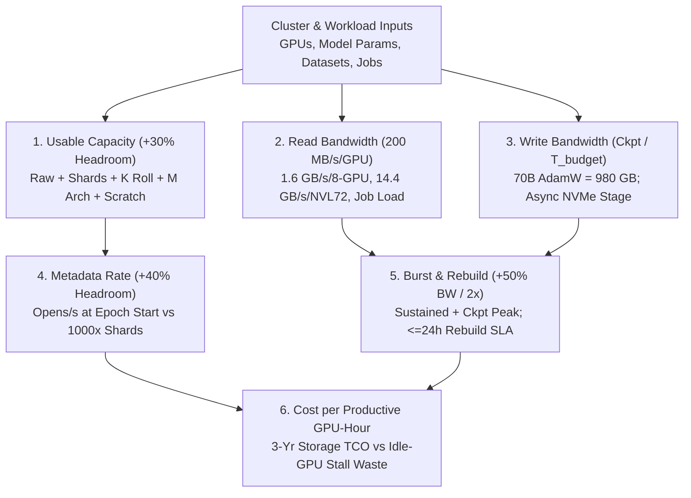
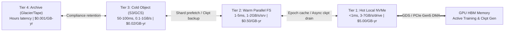

# 13.8 Capacity, performance and cost planning

| Field | Value |
|---|---|
| Level | Advanced |
| Priority tier | 2 |
| Lab venue | GCP / GKE + Local Python Verification Lab (`code/part13/storage_capacity_cost_planning_lab.py`) |
| Part | Part 13: AI storage |
| Primary sources | NVIDIA Zero-to-Hero Volume 15 (`chapter-10-capacity-performance-and-cost-planning.md`, `chapter-12-volume-15-summary.md`, `index.md`); Volume 21 (`chapter-04-storage-infrastructure-for-ai-pipelines.md`, `chapter-11-capacity-planning-and-forecasting.md`, `chapter-12-cost-optimization-and-resource-efficiency.md`); *NVIDIA DGX SuperPOD GB300 Reference Architecture* (`superpod-gb300-ra`); *NVIDIA DGX B200 SuperPOD Data Center Design* (`superpod-b200-dc`); *AI Systems Performance Engineering* (`ai-systems-performance-engineering`) |
| Coverage file | `planning/coverage/chapters/13-08.md` |
| Claim & number ledger | `planning/ledgers/13-08.md` |

## Why this matters for AI infrastructure

Traditional enterprise storage planning treats capacity (`TB` or `PB`) as the primary procurement metric and views storage hardware as a standalone cost center to minimize. In an AI factory, that mental model is backwards. A GPU that sits idle waiting on dataset reads, epoch-start metadata lookups, or synchronous checkpoint writes burns the exact same power and lease or depreciation dollars as a GPU executing matrix multiplications at peak Model FLOPs Utilization (`MFU`).

Consider a `128`-GPU `A100` training cluster drawing `4 kW` per GPU envelope at `$0.10/kWh` (`$51.20/hour` `~=` `$51/hour` in electricity) and `$3.00/hour` per GPU in lease or capital amortization (`$384/hour`), for a combined cluster burn rate of **`$435/hour`**. By contrast, `1 PB` of parallel filesystem storage typically costs `$50K`–`$100K` one-time (`+$10K/year` maintenance), or `$500K` one-time for `1.28 PB` of distributed local NVMe (`10 TB` NVMe `x` `128` nodes). If storage data stalls leave those `128` GPUs idle for just `10%` of the day (`2.4 hours/day`), the cluster wastes `2.4` `x` `$435` = **`$1,044/day`**, or **`$381,060/year` (`~$380K/year`)** in lost compute. Spending an extra `$100K` on parallel storage to eliminate that `10%` stall pays for itself in **`95.79` days** (`26.24%` of a single year's wasted compute, or `2.6%` across a `10x` larger cluster baseline). When evaluated per GPU-hour across `128` GPUs (`$435/hour` value per GPU-stream), cutting storage stall time from `5%` (`$2,784/hour` = **`$24.4M/year`** in wasted capacity) down to `< 1%` (`$556.80/hour` approximately `$558/hour` = **`$4.9M/year`**) by investing `$80K` (`+$10K/year`) in a `1 PB` Lustre tier plus `$500K` (`+$5K/year`) in NVMe caching lowers total annual cost from `$24.4M` to `$5.5M`—saving **`$18.9M/year`**.

At rack and cluster scale, storage sizing must simultaneously satisfy six coupled dimensions:
1. **Usable and Raw Capacity:** Raw datasets, pre-tokenized or repackaged shards, rolling $K$ and archive $M$ checkpoints (`14 bytes/parameter` = `980 GB` `~=` `1 TB` per checkpoint for a `70B` mixed-precision `AdamW` run, versus `16 bytes/parameter` = `1,120 GB` `~=` `1.1 TB` in-memory training state), scratch space, user home directories, **`30%` capacity headroom** (because parallel filesystems degrade sharply as fill approaches **`90%`**), and the raw-to-usable multiplier of replication (`2x` = `50.0%`, `3x` = `33.33%`) versus erasure coding (`WekaFS` `6+2` = `75.0%` or `16+2` = `88.89%`, `Lustre/ZFS` `8+2` = `80.0%`, `VAST DASE` `146+4` = `97.33%`).
2. **Sustained Read Bandwidth:** Sized both from per-GPU ingestion demand (**`200 MB/s` per GPU** = **`1.6 GB/s`** per `8`-GPU server and **`14.4 GB/s` [`14–20 GB/s` envelope]** per `72`-GPU `GB200`/`GB300` `NVL72` rack) and from concurrent job model/shard load budgets (`3` concurrent jobs `x` `100 GB / 30 s` = **`9.9–10.0 GB/s`**).
3. **Checkpoint Write Bandwidth:** Sized from `B_req = CheckpointBytes / T_budget`, separating synchronous network writes (`500 GB` at `1 GB/s` = **`500 s`** stall) from asynchronous two-tier local NVMe staging (`122.5 GB`/node for `70B` `ZeRO-3`/`FSDP` across `8` nodes flushed to local NVMe at `10–20 GB/s` in **`6.125–12.25 s`**).
4. **Metadata Operations per Second (`IOPS`):** Sized for peak epoch-start storms (`256` files/batch `x` `100` batches/sec = **`25,600` opens/sec**; `1.2M` files = **`4.8M` metadata ops/epoch**) with **`40%` metadata headroom** (`35,840` ops/sec) and `1,000x` reduction (`25.6` ops/sec) via `WebDataset` or `TFRecord` sharding.
5. **Burst Headroom and SuperPOD Scalable Unit (`SU`) Tiers:** Applying a **`50%` bandwidth headroom** (**`2.0x` sustained overbuild** rule) and matching NVIDIA DGX SuperPOD High-Performance Storage (`HPS`) specifications—**Standard Tier** (**`90 GB/s` read / `45 GB/s` write per SU**; **`360 GB/s` read / `180 GB/s` write for `4` SUs**) for cache-resident LLM workloads versus **Enhanced Tier** (**`280 GB/s` read / `140 GB/s` write per SU**; **`1,120 GB/s` read / `560 GB/s` write for `4` SUs**) for out-of-cache multimodal workloads.
6. **Multi-Tier FinOps and 3-Year TCO:** Balancing **Hot NVMe** (`$5.00/GB-year`), **Warm Parallel FS** (`$0.50/GB-year`), **Cold Object S3/GCS** (`$0.02/GB-year` or `$0.023/GB-month` = `$2,300/month` per `100 TB`), and **Archive Glacier/Tape** (`$0.001/GB-year`) within a 3-year AI Factory TCO (`$70.2M` for `1,200` GPUs at `$19.5K/GPU-year`, where `$2.0M` storage CapEx is only **`4.55%`** of hardware CapEx and **`2.85%`** of 3-year TCO).

## Prerequisites and outcomes

### Prerequisites
- Understanding of the seven-layer AI storage data path (storage media `->` storage server `->` fabric `->` client filesystem `->` OS page cache `->` CPU memory `->` PCIe/NVLink `->` GPU HBM) and local NVMe staging from Chapters 13.1–13.3.
- Familiarity with Lustre (`MGS`, `MDS`/`MDT`, `OSS`/`OST`, `DNE`), BeeGFS (`beegfs-meta`, `beegfs-storage`), WekaFS (`N+K` distributed stripes), VAST Data (`DASE` `146+4`), and object storage manifests from Chapters 13.4–13.5.
- Working knowledge of small-file metadata bottlenecks (`WebDataset` / `TFRecord` sharding) and sharded distributed checkpointing (`PyTorch Distributed Checkpoint`, `ZeRO-3` / `FSDP`) from Chapters 13.6–13.7.

### Outcomes
After completing this chapter, you will be able to:
1. Execute a **six-dimension AI storage sizing calculation** covering usable capacity (datasets, shards, rolling $K$ and archive $M$ checkpoints, scratch, homes, and `30%` headroom), read bandwidth, checkpoint write bandwidth (`B_req = CheckpointBytes / T_budget`), metadata rate (`+40%` headroom), burst handling (`2.0x` sustained overbuild / `+50%` headroom), and cost per productive GPU-hour.
2. Size storage networks and parallel filesystems for **NVIDIA DGX SuperPOD Scalable Units (`SUs`)** across `DGX GB300 NVL72` (`8` racks = `576` GPUs, `144` compute trays, `2,211.84 TB` local RAID0 NVMe scratch, `1.2 MW` TDP per SU, scaling to `16` SUs / `9,216` GPUs / `1024x400GbE`) and `DGX B200` (`32` systems = `256` GPUs, `458 kW` per SU; `127` systems at `4` SUs with `1` UFM appliance displacement) using the **Standard Tier (`90/45 GB/s` per SU)** and **Enhanced Tier (`280/140 GB/s` per SU)** guidelines.
3. Convert **usable capacity into raw physical flash capacity** across `2x` (`50.0%`) and `3x` (`33.33%`) replication, `WekaFS` `6+2` (`75.0%`) and `16+2` (`88.89%`), `Lustre/ZFS` `8+2` (`80.0%`), and `VAST DASE` `146+4` (`97.33%`), while budgeting background rebuild bandwidth to satisfy a **`24`-hour disk/node rebuild SLA** (`177.78 MB/s` per `15.36 TB` drive; `711.11 MB/s` per `61.44 TB` node).
4. Build a **4-tier storage placement and 3-year TCO / FinOps model** (`$/TB-month`, `$/GPU-year`, and idle-GPU stall ROI) that quantifies when to invest in NVMe caching, parallel filesystems, and spot-instance checkpoint resilience (`65.0%` compute discount at `$21/hr` vs `$60/hr` on `8xH100`).

---

## 1. The Six-Dimension AI Storage Sizing Framework

Sizing storage for a GPU cluster by adding up dataset terabytes is one of the most expensive mistakes in AI infrastructure engineering. A `5 TB` vision dataset easily fits on a single consumer hard drive, yet `256` GPUs training across `100` concurrent jobs on that `5 TB` dataset require `8.3–15 GB/s` of sustained read bandwidth, `5–10 GB/s` of burst checkpoint write bandwidth, and tens of thousands of metadata operations per second at every epoch boundary.



| Sizing Dimension | Governing Equation | Mandatory Headroom / Constraint | Typical Bottleneck Symptom | Primary Architectural Lever |
|---|---|---|---|---|
| **1. Usable Capacity** | `C_usable = (D_raw + D_shards + (K + M)* S_ckpt + S_scratch + S_home)x 1.30` | **`+30%` capacity headroom** (keep filesystem fill well below **`90%`**) | `ENOSPC` mid-checkpoint; severe fragmentation and write cliff above `85–90%` fill | Automated rolling-$K$ checkpoint pruning; S3 cold tiering; high-efficiency erasure coding |
| **2. Read Bandwidth** | `B_read = max\!(N_GPU* R_GPU,\; J_conc* \frac(S_load)(T_load))` | **`200 MB/s` per GPU** (`1.6 GB/s` per `8`-GPU node; **`14–20 GB/s` [`14.4 GB/s`]** per `NVL72` rack) | GPU SM utilization oscillates (`100%` `->` `0%`) while DataLoader prefetch queues drain | Parallel OST/target striping (`Lustre` `24` OSTs = `19.2 GB/s`); local NVMe shard caching; `GDS` |
| **3. Write Bandwidth** | `B_write = J_conc* \frac(S_ckpt)(T_ckpt_budget)` | `70B` AdamW = **`14 B/param` (`980 GB`)** ckpt (`16 B/param` = `1.12 TB` RAM); `< 60–300 s` budget | Multi-minute cluster-wide training freeze (`0%` GPU SM activity) on every checkpoint step | Sharded `PyTorch DCP` / `ZeRO-3` (`15.31 GB/GPU`, `122.5 GB/node`) + async local NVMe staging |
| **4. Metadata Rate** | `IOPS_meta = Batches/s x Files/batch x 1.40` | **`+40%` metadata headroom**; `< 50,000` ops/sec per `Lustre`/`BeeGFS` `MDS` (`< 5 ms` latency) | **`47`-minute** epoch-start stall; storage bandwidth near `0 MB/s` while `MDS` CPU is `100%` | Repackage small files into `WebDataset` / `TFRecord` `.tar` shards (**`1,000x` ops reduction**) |
| **5. Burst & Rebuild** | `B_peak = B_sustained_read + B_ckpt_burst <= B_fabric` | **`+50%` bandwidth headroom** (**`2.0x` sustained overbuild**); **`24`-hour** drive/node rebuild SLA | Training throughput drops `30–50%` whenever a neighboring job writes a checkpoint or rebuild runs | Overbuild fabric `2.0x` sustained (`3 GB/s` `->` `6 GB/s`, `10 GB/s` `->` `20 GB/s`); QoS throttling |
| **6. Cost per GPU-Hour** | `Total Annual Cost = Storage Amort + Storage OpEx + (N_GPU* f_stall* C_GPU-hr* 8760)` | Keep storage-induced GPU stall fraction `f_stall < 1%` | Saving `$80K` on storage causes `$18.9M/year` in idle GPU waste (`5%` vs `1%` stall on `128` GPUs) | Invest in parallel FS + local NVMe staging whenever payback period is `< 6–12` months |

### 1.1 Dimension 1: Usable Capacity and the `30%` (`< 90%` Fill) Rule

A production AI storage pool must hold five distinct data classes plus a mandatory free-space buffer:
1. **Raw source datasets (`D_raw`):** Immutable ingested corpora (text JSONL/Parquet, raw JPEGs, audio/video MP4s, genomic BAM files).
2. **Preprocessed / tokenized shards (`D_shards`):** Training-ready `WebDataset` `.tar` archives, `TFRecord` files, or memory-mapped `.bin`/`.idx` token arrays. Keeping both raw and processed copies during curation often doubles dataset footprint.
3. **Rolling active checkpoints (`K x S_ckpt`):** The most recent $K$ high-frequency recovery snapshots kept on fast warm/hot storage (`keep_last_k = 5` to `20`).
4. **Archive milestone checkpoints (`M x S_ckpt`):** Evaluation, compliance, and release-candidate checkpoints retained across epochs (`keep_archive_m = 10`).
5. **Scratch, model artifacts, user homes, and logs (`S_scratch + S_home`):** Exported inference weights (`.safetensors`, `TensorRT-LLM` engines), compilation caches, container layers, and TensorBoard/W&B logs.
6. **Capacity headroom (`+30%`):** Parallel and local filesystems (`Lustre` `ldiskfs`/`ZFS`, `BeeGFS` `XFS`, `WekaFS`) require contiguous free extents for high-bandwidth striped writes. As filesystem occupancy approaches **`90%`**, extent allocation fragments, metadata lock contention spikes, and write throughput drops sharply. Always add **`30%` capacity headroom** on top of your active usable subtotal.

**Worked Example A — `1.3B`-Parameter Model (`8` Nodes, `100` Epochs):**
- Training dataset (`D_raw + D_shards`): **`500 GB`**
- Checkpoint size per epoch (`S_ckpt`, weights + optimizer state): **`100 GB`**
- Rolling checkpoints ($K = 20$): `20 x 100 GB =` **`2,000 GB`**
- Archive checkpoints ($M = 10$): `10 x 100 GB =` **`1,000 GB`**
- Model artifacts / scratch (`S_scratch`): **`50 GB`**
- Logs and metadata (`S_home`): **`10 GB`**
- **Usable subtotal:** `500 + 2,000 + 1,000 + 50 + 10 =` **`3,560 GB`**
- **`30%` capacity headroom:** `3,560 x 0.30 =` **`1,068 GB`**
- **Total required usable capacity:** `3,560 + 1,068 =` **`4,628 GB` (`~4.63 TB` `~=` `5 TB` minimum)**

**Worked Example B — `256`-GPU Cluster Multi-Job Sizing:**
- Shared training datasets: **`5 TB` (`5,000 GB`)**
- Active checkpoint pool (`500 GB` checkpoints across rolling/active budget): **`1 TB` (`1,000 GB`)**
- Subtotal before headroom: `5 TB + 1 TB =` **`6.0 TB` (`6,000 GB`)**
- **`30%` capacity headroom:** `6.0 TB x 0.30 =` **`1.8 TB` (`1,800 GB`)**
- **Minimum usable capacity baseline:** `6.0 TB + 1.8 TB =` **`7.8 TB` (`7,800 GB`)** (expanding substantially if all `100` planned jobs simultaneously retain `20` unpruned `500 GB` rolling checkpoints—which would balloon checkpoint storage to `100 x 20 x 0.5 TB = 1,000 TB` unless lifecycle policies tier older snapshots to S3 or cap per-job active retention).

---

## 2. Read, Write, Metadata, and Burst Bandwidth Sizing

### 2.1 Dimension 2: Sustained Read Bandwidth (`200 MB/s` per GPU vs Modality Math)

Read bandwidth must be sized against whichever of two regimes is more demanding: **continuous training sample ingestion** or **burst model/dataset loading at job start**.

1. **Modality-Specific Continuous Ingestion:**
```text
Required Read Bandwidth = Samples/sec per GPU x Bytes/sample x N_GPU
```
   - **Pre-tokenized Text LLM Pretraining (`Llama-3-70B` on `64` `H100` GPUs):** With `tokens/s per GPU ~= (MFU x Peak FLOPs) / (6 x P) = \frac(0.40 x 989 x 10^12)(6 x 70 x 10^9) ~= 940 tokens/s per GPU`, a `64`-GPU cluster processes `~60,000 tokens/s`. At `2–4 bytes` per token ID (`int16`/`int32`), steady-state text ingestion is only **`120–240 KB/s`** across the entire cluster (`6 TB` of tokenized text read at `1 GB/s` takes `6,000 s` `~=` `1.7 hours`, far faster than an epoch). For text LLMs, steady-state read bandwidth is negligible; **checkpoint writes and startup weight/shard reads dominate**.
   - **Vision, Audio, Video, and Multimodal Training (`200 MB/s` per GPU Rule):** When training computer vision (`ResNet-50` / ViT processing thousands of `100–150 KB` JPEGs/sec per GPU) or multimodal video/audio foundation models, a standard engineering baseline is **`200 MB/s` per GPU**:
     - Single `8`-GPU server (`DGX H100` / `B200`): `8 x 200 MB/s =` **`1.6 GB/s`** sustained read.
     - Single `64`-GPU cluster (`8` nodes): `64 x 200 MB/s =` **`12.8 GB/s`** sustained read.
     - Single `72`-GPU **NVIDIA Grace Blackwell `GB200` / `GB300` `NVL72` rack**: `72 x 200 MB/s =` **`14.4 GB/s`** (**`14–20 GB/s`** operational rack envelope).
2. **Concurrent Job Startup / Epoch Load Budget:**
   Suppose a cluster runs `J_conc = 3` concurrent training jobs, and each job must load a **`100 GB`** model checkpoint or initial shard working set within a **`30`-second** startup budget:
```text
B_read, job = (100 GB) / (30 s) = 3.3333 GB/s ~= 3.3 GB/s per job
```
```text
B_read, total = 3 x 3.3333 GB/s = 10.0 GB/s \quad (9.9 GB/s at  3.3 GB/s)
```
   Comparing candidate storage backends against this `10.0 GB/s` requirement:
   - **Lustre (`24` OSTs `x` `800 MB/s`):** **`19.2 GB/s`** aggregate read (**Passes** with `92%` headroom).
   - **BeeGFS (`8` storage nodes `x` `1.5 GB/s`):** **`12.0 GB/s`** aggregate read (**Passes** with minimal `20%` headroom).
   - **Single-Server NFS (`2.0 GB/s`):** **`2.0 GB/s`** (**Fails**—`5.0x` too slow, causing `150`-second load stalls).

### 2.2 Dimension 3: Checkpoint Write Bandwidth and Two-Tier Async Staging

During distributed training with mixed-precision `AdamW`, every model parameter requires **`14 bytes`** of persistent checkpoint state (versus **`16 bytes/parameter`** of active GPU memory during the backward pass, since `2`-byte `BF16` gradients are recomputed rather than saved):
- `BF16` model weights: **`2 bytes/param`**
- `FP32` master weights: **`4 bytes/param`**
- `FP32` Adam first moment ($m$): **`4 bytes/param`**
- `FP32` Adam second moment ($v$): **`4 bytes/param`**
- **Total checkpoint state:** **`14 bytes/param`**

For **`Llama-3-70B` (`70 billion` parameters)**:
```text
S_ckpt, 70B = 70 x 10^9 x 14 bytes = 980 GB ~= 1 TB \quad (vs  70 x 10^9 x 16 B = 1,120 GB ~= 1.1 TB training memory)
```

When sharded with `ZeRO-3` or `PyTorch FSDP` (`torch.distributed.checkpoint`) across **`64` GPUs (`8` nodes `x` `8` GPUs)**:
- **Per-GPU shard:** `980 GB / 64 =` **`15.3125 GB`** (`~15 GB` per GPU rank).
- **Per-node shard (`8` GPUs):** `15.3125 GB x 8 =` **`122.5 GB`** (`~122 GB` per `8`-GPU node).

How much write bandwidth is required to prevent checkpoints from dominating wall-clock time?
```text
B_req = \frac(CheckpointBytes)(T_budget)
```
- **Smaller `100 GB` checkpoint with a `5`-minute (`300 s`) budget:** `100,000 MB / 300 s =` **`333.33 MB/s`** (`~333 MB/s`) per stream. If `8` ranks write `333.33 MB/s` simultaneously (`2.6667 GB/s` `~=` `2.7 GB/s` network demand), a `24`-OST Lustre tier (`24` `x` `400 MB/s` = **`9.6 GB/s`** write) or an `8`-node BeeGFS tier (`8` `x` `1.5 GB/s` = **`12.0 GB/s`** write) absorbs the burst without blocking.
- **Synchronous vs Asynchronous Staging on `500 GB`–`980 GB` Checkpoints:** Writing a **`500 GB`** checkpoint synchronously over a `1 GB/s` storage path stalls all GPUs for **`500 seconds`** (`8.33 minutes`). Writing a `980 GB` (`~1 TB`) `70B` checkpoint to a shared tier at `10 GB/s` takes **`98–100 seconds`**, and saving every `8` hours (`3/day` `x` `7` days) generates **`~21 TB/week`** (`~7 TB/week` at `24`-hour intervals). By staging each node's **`122.5 GB`** shard to **local NVMe** first (`PCIe Gen5 x16` = `64 GB/s`; local NVMe RAID array sustaining **`10–20 GB/s`** per node), the synchronous pause drops to **`6.125–12.25 seconds`** (`~10 seconds`, or `25 seconds` for `500 GB` at `20 GB/s`—a **`20.0x` stall reduction**), while background threads flush the shards to the warm parallel filesystem and cold S3 archive while training continues.

### 2.3 Dimension 4 & 5: Metadata Rate (`47`-Minute Problem) and Burst Overbuild

Bandwidth is irrelevant if the Metadata Server (`MDS`) is saturated. Consider a vision dataset of **`1.2 million` small images (`100 KB` each)**:
- **Per-epoch metadata volume:** `1.2M` `open()` + `1.2M` `close()` + `2.4M` `stat()` = **`4.8 million` metadata operations per epoch**.
- **Real-time metadata rate:** At `100` batches/sec with `256` images per batch (`256` file opens/batch):
```text
Raw Metadata Rate = 256 opens/batch x 100 batches/sec = 25,600 opens/sec
```
- **Applying the `+40%` metadata headroom rule:** `25,600 x 1.40 =` **`35,840` ops/sec** required capacity.
  - **Single NFS server (`5,000` ops/sec):** **Fails** (`5.12x` below raw demand; on larger multi-million-file epochs, unsharded metadata overhead wastes **`~47 minutes`** of idle GPU time per epoch).
  - **Lustre single `MDS` (`50,000` ops/sec), Lustre `2` `MDTs` (`100,000` ops/sec, or `500,000+` with `DNE`), and BeeGFS single `MDS` (`50,000–100,000` ops/sec):** **Pass** for a single job, but saturate as soon as `2–4` concurrent jobs launch.
  - **The `1,000x` Sharding Fix (`WebDataset` / `TFRecord` / `.tar`):** Repackaging `1,000` images into each sequential shard reduces metadata operations by **`1,000x`**, dropping `25,600` opens/sec down to **`25.6` opens/sec** (or `5 TB` in `1,000` shards = `100K` opens per entire epoch across `100` jobs).

Finally, because checkpoint bursts, epoch-start scans, and garbage collection overlap with steady-state training (`1 GB/s` sustained training read + `5 GB/s` checkpoint write burst = **`6 GB/s` peak**), always apply the **`2.0x` burst overbuild rule (`+50%` headroom on peak)**:
- If sustained demand is **`3 GB/s`**, provision **`6 GB/s`** of aggregate storage bandwidth.
- If sustained demand is **`10 GB/s`**, provision **`20 GB/s`** of aggregate storage bandwidth.

---

## 3. NVIDIA DGX SuperPOD High-Performance Storage (`HPS`) Architecture

When scaling from tens of GPUs to thousands of GPUs in an enterprise AI factory, NVIDIA's **DGX SuperPOD Reference Architecture** standardizes compute, fabric, and High-Performance Storage (`HPS`) into modular **Scalable Units (`SUs`)**.

### 3.1 DGX GB300 NVL72 vs DGX B200 SuperPOD Scalable Units

| Architectural Attribute | DGX GB300 NVL72 SuperPOD (`superpod-gb300-ra`) | DGX B200 SuperPOD (`superpod-b200-dc`) |
|---|---|---|
| **Compute building block** | **DGX GB300 NVL72 rack**: `72` `B300` GPUs + `36` `Grace` CPUs across `18` compute trays (`2` `GB300` Superchips/tray, `900 GB/s` `NVLink-C2C`) + `9` NVLink switch trays (`18` switch chips, `1.8 TB/s`/GPU `NVL5`) | **DGX B200 system**: `8` Blackwell `B200` GPUs per air-cooled server (`2` systems/rack standard, `4` systems/rack high-density in `48U`/`52U` racks) |
| **Size of `1` Scalable Unit (`SU`)** | **`8` DGX GB300 racks** = **`576` GPUs** (`144` compute trays) requiring **`1.2 MW` TDP** (`8` power shelves/rack `x` `6` `x` `5.5 kW` PSUs = `33 kW`/shelf) | Up to **`32` DGX B200 systems** = **`256` GPUs** requiring **`458 kW` per SU** (`127` DGX B200 systems = **`1,016` GPUs** at `4` SUs, as `1` server is displaced by the `UFM` appliance) |
| **Maximum scale-out documented** | Up to **`16` SUs** = **`128` racks** = **`9,216` GPUs** (`128` `Q3400-RD` `800G` IB leaves + `72` spines) | Multi-SU interconnected via common InfiniBand spine and shared High-Performance Storage |
| **Local NVMe scratch per node/tray** | **`4 x 3.84 TB` (`15.36 TB`) E1.S NVMe in `RAID 0`** for local staging + **`1 x 1.92 TB` M.2 NVMe** for OS (`276.48 TB` RAID0/rack; **`2,211.84 TB` RAID0/SU**) | Local NVMe cache/scratch array per DGX B200 system for dataset caching and async checkpoint staging |
| **Storage NIC & fabric segmentation** | **`1 x BlueField-3` (`BF3240`) dual-port `2x400G` DPU** per tray: `1 x 400 Gbps` dedicated to **`RoCEv2` Storage Network** + `1 x 200+ Gbps` (`400G` port) to **In-Band Mgmt / NFS** (`1:3` compute leaf blocking: `24x400G` uplinks; `72x400G` non-blocking storage leaves on `SN5600D`) | Dedicated high-speed storage fabric (`RoCEv2` / InfiniBand) separated from compute fabric and out-of-band management |

In the `DGX GB300` SuperPOD, separating the `400 Gbps` `RoCEv2` storage port from the In-Band management port on each `BlueField-3` DPU guarantees that bursty checkpoint writes and `GPUDirect Storage` (`GDS`) DMA streams never contend with Kubernetes, Slurm, `NGC` container pulls, or lower-speed `NFS` home-directory traffic. As the cluster scales from `2` SUs (`1,152` GPUs) to `16` SUs (`9,216` GPUs), the `SN5600D` (`800G`/`400G` Spectrum-4) Ethernet storage fabric scales its non-blocking storage links linearly:

| SuperPOD Scale (`GB300`) | `# GPUs` | `# SUs` | Compute Leaf Switches (`SN5600D`) | Storage Leaf Switches (`SN5600D`) | Spine Switches (`SN5600D`) | Max Supported Storage Fabric Links |
|---|---|---|---|---|---|---|
| **2-SU Cluster** | `1,152` | `2` | `8` (`4` per SU) | `2` | `4` | **`64 x 400GbE`** (`25.6 Tbps` = `3.2 TB/s` raw line rate) |
| **4-SU Cluster** | `2,304` | `4` | `16` (`4` per SU) | `2` | `8` | **`128 x 400GbE`** (`51.2 Tbps` = `6.4 TB/s` raw line rate) |
| **8-SU Cluster** | `4,608` | `8` | `32` (`4` per SU) | `4` | `12` | **`256 x 400GbE`** (`102.4 Tbps` = `12.8 TB/s` raw line rate) |
| **16-SU Cluster** | `9,216` | `16` | `64` (`4` per SU) | `8` | `24` | **`1024 x 400GbE`** (`409.6 Tbps` = `51.2 TB/s` raw line rate) |

### 3.2 SuperPOD Standard Tier (`90/45 GB/s`) vs Enhanced Tier (`280/140 GB/s`)

NVIDIA certifies partner parallel filesystems (`DDN EXAScaler`/Lustre, `WEKA`, `VAST Data`, `IBM Storage Scale`, `NetApp`, `Dell`) against two workload-driven High-Performance Storage (`HPS`) performance tiers defined per Scalable Unit (`SU`):

| SuperPOD HPS Tier | Workload & Dataset Characterization | `1 SU` Read (`GB/s`) | `1 SU` Write (`GB/s`) | `4 SU` Read (`GB/s`) | `4 SU` Write (`GB/s`) | `16 SU` Read (`GB/s`) | `16 SU` Write (`GB/s`) |
|---|---|---|---|---|---|---|---|
| **Standard Tier** | Concurrent LLM pretraining, fine-tuning, periodic checkpoints, and inference where compute dominates I/O; **most single-modality datasets fit within local compute memory/NVMe cache**, and models have millions to moderate billions of parameters | **`90 GB/s`** | **`45 GB/s`** | **`360 GB/s`** | **`180 GB/s`** | **`1,440 GB/s`** (`1.44 TB/s`) | **`720 GB/s`** |
| **Enhanced Tier** | Concurrent **multimodal** training, frequent large checkpoints, and inference where I/O directly bounds wall-clock timing; **multi-modality datasets exceed local memory/NVMe cache** and models have **billions or trillions of parameters** | **`280 GB/s`** | **`140 GB/s`** | **`1,120 GB/s`** (`1.12 TB/s`) | **`560 GB/s`** | **`4,480 GB/s`** (`4.48 TB/s`) | **`2,240 GB/s`** (`2.24 TB/s`) |

Notice three critical engineering ratios embedded in the SuperPOD HPS specification:
1. **Read-to-Write Asymmetry (`2 : 1`):** Both Standard (`90` vs `45 GB/s`) and Enhanced (`280` vs `140 GB/s`) tiers specify exactly a **`2.0x` read-to-write bandwidth ratio**, reflecting the fact that NVMe media and erasure-coded parallel filesystems sustain higher sequential read throughput than parity-calculated write throughput, while concurrent dataset reads and `mmap` model loads run continuously alongside staggered checkpoint flushes.
2. **Enhanced-to-Standard Multiplier (`3.1111x`):** Stepping up from Standard (`90/45 GB/s`) to Enhanced (`280/140 GB/s`) multiplies required per-SU storage bandwidth by **`3.1111x`** ($280 / 90 = 140 / 45 = 3.1111$).
3. **Why Local NVMe Staging Bridges the Gap:** On a single `DGX GB300` SU (`144` compute trays, each with `4 x 3.84 TB` = `15.36 TB` RAID0 E1.S NVMe), the `2,211.84 TB` (`~2.21 PB`) of aggregate local NVMe scratch absorbs immediate rank-local checkpoint shards and hot dataset epochs at multi-terabyte-per-second aggregate PCIe speeds, allowing a `90 GB/s` (Standard) or `280 GB/s` (Enhanced) shared `RoCEv2` parallel filesystem to drain and hydrate those local caches asynchronously without stalling the `576` GPUs.

---

## 4. Usable-to-Raw Efficiency, Erasure Coding, and Multi-Tier FinOps

### 4.1 Converting Usable TB to Raw Flash TB: Replication vs Erasure Coding

Once you have calculated your required **usable capacity** `C_usable` (including the `30%` free-space headroom), you must convert `C_usable` into **raw physical NVMe/QLC flash capacity** `C_raw` based on the storage system's data protection scheme (`N + K` erasure coding or $R$-way replication) and reserve enough bandwidth to rebuild a failed drive or storage node within **`24 hours`**:

```text
\eta_EC = (N) / (N + K), \quad C_raw = \frac(C_usable)(\eta_EC) = C_usable x (N + K) / (N), \quad B_rebuild, 24h = \frac(S_failed_unit)(24 x 3600 s)
```

| Protection Scheme | Example Storage Platform | Data ($N$) + Parity/Mirror ($K$) | Usable-to-Raw Efficiency (`\eta_EC`) | Raw Multiplier (`(N+K) / (N)`) | Raw Flash Needed for **`1,000 TB` (`1 PB`) Usable** | Parity / Replica Overhead (`TB`) |
|---|---|---|---|---|---|---|
| **`3x` Replication** | Ceph Default / HDFS / Early 3FS Metadata | `1 + 2` | **`33.33%`** | `3.0000x` | **`3,000.00 TB`** (`3.00 PB`) | `2,000.00 TB` |
| **`2x` Replication** | Lustre / BeeGFS Mirrored Targets | `1 + 1` | **`50.00%`** | `2.0000x` | **`2,000.00 TB`** (`2.00 PB`) | `1,000.00 TB` |
| **`6 + 2` Erasure Coding** | `WekaFS` (`8`-node small cluster) | `6 + 2` | **`75.00%`** | `1.3333x` | **`1,333.33 TB`** (`1.33 PB`) | `333.33 TB` |
| **`8 + 2` Erasure Coding** | `Lustre` ZFS `RAID-Z2` / `IBM Storage Scale` | `8 + 2` | **`80.00%`** | `1.2500x` | **`1,250.00 TB`** (`1.25 PB`) | `250.00 TB` |
| **`16 + 2` Erasure Coding** | `WekaFS` (`18+`-node production cluster) | `16 + 2` | **`88.89%`** | `1.1250x` | **`1,125.00 TB`** (`1.125 PB`) | `125.00 TB` |
| **`146 + 4` Wide Stripe** | `VAST Data DASE` (`QLC` + `SCM` buffer) | `146 + 4` | **`97.33%`** | `1.0274x` | **`1,027.40 TB`** (`1.027 PB`) | **`27.40 TB`** (`2.67%`) |

**The `24`-Hour Rebuild SLA Rule:**
When an NVMe drive or storage node fails in an erasure-coded pool, the cluster must reconstruct the lost data strips across the surviving nodes before a second or third failure exceeds $K$. To rebuild a failed **`15.36 TB`** NVMe drive within **`24 hours` (`86,400 seconds`)**, the storage fabric must sustain at least:
```text
B_rebuild, 15.36TB = (15,360,000 MB) / (86,400 s) = 177.78 MB/s
```
For a failed **`61.44 TB`** high-density QLC drive or `4`-drive storage sled, the minimum sustained background rebuild rate rises `4.0x` to **`711.11 MB/s`**—which must be accommodated inside your **`50%` bandwidth headroom** so active GPU training jobs do not stall during a drive rebuild.

### 4.2 Four-Tier Storage Architecture and 3-Year TCO / FinOps Economics

Because storage media unit costs span **`5,000x`** from local NVMe flash (`$5.00/GB-year`) to deep archive (`$0.001/GB-year`), placing all datasets and historical checkpoints on a single tier is financially reckless. Instead, production AI factories map each data lifecycle stage to one of four storage tiers:



| Storage Tier | Media & Representative Systems | Access Latency | Typical Throughput | Primary AI Workload Role | Annual Unit Cost (`$/GB-year`) | Worked `1.3B` Model Allocation & Cost |
|---|---|---|---|---|---|---|
| **Tier 1: Hot** | Local `PCIe Gen4/Gen5` NVMe (`RAID 0` / `Lustre LNet` / `Weka` cache) | **`< 1 ms`** | **`3–7 GB/s` per drive** (`15–50+ GB/s`/node) | Current epoch working-set cache and synchronous/async local checkpoint staging | **`$5.00 / GB-yr`** | `100 GB` $\times$ `$5.00` = **`$500 / yr`** |
| **Tier 2: Warm** | Parallel Filesystem (`Lustre`, `BeeGFS`, `WekaFS`, `VAST`, `GPFS`) | **`1–5 ms`** | **`1–2 GB/s` per server** (`10–1,120+ GB/s` cluster) | Active shared training datasets, preprocessed shards, and rolling-$K$ checkpoints | **`$0.50 / GB-yr`** | `2.5 TB` (`2,500 GB`) $\times$ `$0.50` = **`$1,250 / yr`** |
| **Tier 3: Cold** | Object Storage (`AWS S3`, `GCS`, `MinIO`, `Ceph RGW`) | **`50–100 ms`** | **`0.1–1 GB/s`** per stream (scales with prefix workers) | Durable source-of-truth datasets, manifest versions, and periodic (`8h`/`24h`) checkpoint backups | **`$0.02 / GB-yr`** (cloud S3 Standard `~$0.023/GB-mo` = **`$2,300/mo` per `100 TB`**) | `5.0 TB` (`5,000 GB`) $\times$ `$0.02` = **`$100 / yr`** |
| **Tier 4: Archive** | Deep Object Archive / Tape (`S3 Glacier Deep Archive`, `LTO`) | **Hours** | Batch restore only | Long-term regulatory audit trails and historical release checkpoints | **`$0.001 / GB-yr`** | `10.0 TB` (`10,000 GB`) $\times$ `$0.001` = **`$10 / yr`** |
| **Blended Total** | **4-Tier Lifecycle Pipeline** | **Sub-ms on hot path** | **Matches GPU ingest & ckpt burst** | **Full `17.6 TB` lifecycle footprint** | **`$8.81 / TB-month` blended** | **`17.6 TB` total = `$1,860 / year`** |

**Storage Share of 3-Year AI Factory TCO and Lead-Time / Spot FinOps (`V21` Ch. 11–12):**
How does storage fit into the macro-economics of a multi-year AI Factory deployment?
1. **3-Year Fleet Refresh and Amortization (`464` `->` `800` `->` `900` GPUs):** A fleet starting with `464` `H100` GPUs in Year 1 (`400` inference + `64` training at `$30K` = **`$13.9M`** CapEx), adding `60` `H200` GPUs in Year 2 at `$40K` (**`$2.4M`** vs `$1.8M` for `H100`), and adding `100` `H200` GPUs in Year 3 at `$35K` (**`$3.5M`** vs `$2.5M` for `H100` at `$25K`) spends **`$19.8M` in CapEx** plus **`$9.0M` in OpEx** (`$3.0M/year` power + personnel) for a **`$28.8M` 3-year TCO** across $464 \times 3 + 60 \times 2 + 100 \times 1 =$ **`1,612` GPU-years**, or **`$17,866` (`~$17.9K`) per GPU-year**. Because enterprise GPU and high-density storage procurement carries **`3–9 month` supply-chain lead times**, capacity planners target **`70–85%` maximum steady-state utilization** and trigger expansion orders when forecasted demand reaches `70%` of capacity minus supplier lead time.
2. **1,200-GPU AI Factory 3-Year TCO Breakdown (`$70.2M` Total):** Across a `1,200`-GPU `H100` factory (`1,186.8 PFLOPS` BF16 peak at `989 TFLOPS`/GPU, or `~9,100 QPS` inference capacity at `7.6 QPS`/GPU), 3-year CapEx totals **`$44.0M`** (`$36.0M` GPUs + `$1.5M` IB/Ethernet networking + **`$2.0M` NVMe/NAS/SAN storage** + `$1.5M` power/cooling + `$2.0M` chassis/rails + `$1.0M` install labor) and 3-year OpEx totals **`$26.2M`** (`$2.15M` electricity at `680 kW` average draw with `1.35 PUE` + `$13.5M` for `30` FTEs at `$150K/yr` + `$6.0M` maintenance/SLA + `$3.0M` WAN/CDN + `$1.5M` software licenses). Total 3-year TCO is **`$70.2M`** (**`$19.5K / GPU-year`**, `$19.7K / PFLOP-year`, or `$0.70 / million tokens` on `408` GPUs serving `2,000 QPS` / `25.9B tokens/day` at `$18.1K/day`). The **`$2.0M` storage CapEx represents just `4.55%` of hardware CapEx and `2.85%` of 3-year TCO**. Even when adding `$200K/year` in storage maintenance and `40 kW` of storage power (`1.35 PUE`, `$0.12/kWh` = `$56,764.80/year`), the 3-year TCO of a `1 PB` (`1,000 TB`) parallel storage system is **`$2,770,294.40`**, or **`$76.95 / TB-month`**.
3. **Spot Instance Resilience via Fast Checkpointing:** In cloud or hybrid bursts, renting `8xH100` (`p5.48xlarge`) on Spot at **`$21/hour` (`$2.63/GPU-hr`, `$18.9K/GPU-yr` over `300` days)** versus **`$60/hour` on-demand (`$7.50/GPU-hr`, `$54K/GPU-yr`)** saves **`65.0%` (`$35.1K/GPU-yr`)**. However, cloud providers issue only a **`2-minute` (`120-second`) spot termination warning** via `http://169.254.169.254/latest/meta-data/spot/instance-action`. To capture that `65.0%` compute discount without losing hours of training progress, your storage pipeline **must** complete an emergency checkpoint flush within `< 120 seconds`—which is only possible if checkpoint write bandwidth and local NVMe staging are sized for sub-minute flushes.

---

## 5. Production Readiness Checklist and End-to-End Cluster Sizing Walkthrough

Before declaring an AI storage architecture ready for production training and inference, platform teams must validate both the **quantitative sizing worksheet** and the **operational readiness checklist** across all seven layers of the data path (storage media `->` storage server `->` network fabric `->` client filesystem `->` OS page cache `->` CPU memory `->` PCIe/NVLink `->` GPU memory).

### 5.1 Worked Sizing Walkthrough: `256`-GPU Distributed Training Cluster

Suppose you are asked to architect the storage layer for a **`256`-GPU distributed training cluster** (`32` nodes `x` `8` GPUs) with **`5 TB` of shared training datasets**, **`500 GB` model/optimizer checkpoints**, and up to **`100` concurrent training/experiment jobs** planned across research teams:

1. **Step 1 — Usable and Raw Capacity:**
   - Baseline active working set: **`5.0 TB`** datasets + **`1.0 TB`** active checkpoint staging buffer (`2 x 500 GB`) = **`6.0 TB`** subtotal.
   - Add **`30%` capacity headroom**: `6.0 TB x 0.30 = 1.8 TB`, yielding a **`7.8 TB` minimum usable baseline** (`7,800 GB`).
   - Account for multi-job rolling retention: if all `100` jobs kept `20` unpruned `500 GB` checkpoints on hot/warm flash simultaneously (`100 x 20 x 0.5 TB = 1,000 TB`), capacity would explode. Enforce an automated lifecycle policy where active running jobs retain `2` rolling checkpoints on the parallel filesystem and tier older checkpoints asynchronously to cold S3 object storage (`$0.02/GB-year`).
   - Hardware provisioning: deploy a **`12`-node Lustre cluster** (**`8` OST storage nodes + `2` MDS metadata nodes + `1` backup MDS + `1` MGS management node**) with `12 TB` enterprise NVMe SSD per OST = **`96 TB` raw flash**, delivering **`80 TB` usable capacity** (`> 10x` the `7.8 TB` minimum baseline, leaving ample room for multi-team growth while keeping fill well below the `90%` cliff).
2. **Step 2 — Sustained Read and Checkpoint Write Bandwidth:**
   - **Read bandwidth:** Loading `5 TB` across `100` concurrent job shards within a `60`-second window requires **`8.3 GB/s` (`8.33 GB/s`)** of sustained read bandwidth; with the **`+50%` (`2.0x` burst)** headroom rule, target **`10–15 GB/s`** sustained read.
   - **Write bandwidth:** Absorbing concurrent **`5 GB/s`** checkpoint bursts alongside ongoing reads (`1 GB/s` + `5 GB/s` = `6 GB/s`) with headroom requires **`8–10 GB/s`** sustained write.
   - **Why NFS fails and Lustre/BeeGFS succeed:** A single `NFS` server (`2 GB/s` read/write, `5K` metadata ops/sec) is `5x` too slow. A `24`-OST Lustre layout (`24` `x` `800 MB/s` read = **`19.2 GB/s`** read; `24` `x` `400 MB/s` write = **`9.6 GB/s`** write) or an `8`–`12`-node BeeGFS/WekaFS cluster (`12–19 GB/s`) satisfies both read and write envelopes with headroom.
3. **Step 3 — Metadata Scaling and Sharding:**
   - Packaging the `5 TB` dataset into **`1,000` `WebDataset` `.tar` shards** (`5 GB` per shard) limits `100` jobs to **`100,000` file opens per entire epoch**, keeping instantaneous metadata rate well under the **`50,000` ops/sec per MDS** ceiling (`100,000` ops/sec across `2` Lustre `MDTs`).
4. **Step 4 — Financial Justification:**
   - Hardware and maintenance cost: **`~$100K` one-time CapEx + `$10K/year` maintenance**, which represents **`< 5%` (`2.6%`)** of the annual compute wasted if an undersized storage tier stalls the cluster by `5–10%`.

### 5.2 Production AI Storage Deployment Checklist

| Verification Domain | Production Gate / Requirement | Verification Tool / Metric (`untested here`) |
|---|---|---|
| **1. Seven-Layer Data Path & `GDS`** | Benchmark media, storage server, fabric, client FS, page cache, CPU RAM, PCIe, and GPU HBM independently; confirm `PHB` or better topology for `GDS` and verify zero CPU bounce copies | `nvidia-smi topo -m`, `perf record` (absence of `__memcpy_avx2`), `/proc/driver/nvidia-fs/stats`, `nvidia-smi dmon -s t` |
| **2. Capacity & Target Balance** | Reserve **`30%` capacity headroom** (alert at `75%`, hard gate before **`90%` fill**); keep all `OST` / `beegfs-storage` targets within **`±5%` fill** (`> 10%` spread triggers migration) | `lfs df -h`, `lfs df -i`, `beegfs-ctl --listtargets --nodetype=storage --spaceinfo` |
| **3. Metadata & Small-File Sharding** | Size `MDS`/`MDT` count against **peak epoch-start ops/sec + `40%` headroom**, not epoch average; repackage datasets with `> 100K` small files into `WebDataset`/`TFRecord` shards (`1,000x` ops reduction) | `strace -c -e openat`, `beegfs-ctl --serverstats --nodetype=meta`, `lctl get_param mdt.*.md_stats` |
| **4. Directory Striping at Creation** | Configure wide stripe patterns (`lfs setstripe -c -1 -S 4M` or `beegfs-ctl --setpattern --chunksize=2M --numtargets=12`) on `/checkpoints` and `/datasets` **before** files are written | `lfs getstripe /lustre/checkpoints`, `beegfs-ctl --getentryinfo /beegfs/checkpoints` |
| **5. Async Two-Tier Checkpointing** | Stage sharded checkpoints (`PyTorch DCP` / `ZeRO-3` `14 B/param`) to **local NVMe** first (`6–25 s`), write to temp names + atomic rename, verify `SHA-256` manifest checksums, and test multi-node restore RTO | Local NVMe eviction daemon, `sha256sum -c manifest.sha256`, end-to-end restore drill on altered node count |
| **6. Correlated GPU + Storage Telemetry** | Join GPU SM utilization (`DCGM_FI_DEV_GPU_UTIL`), DataLoader queue depth, OST/target throughput, and `MDS` latency (`< 5 ms`) on a single dashboard to price idle-GPU-hours during the worst `60 s` of each epoch | Prometheus + Grafana (`dcgm-exporter` + `node_exporter` + Lustre/BeeGFS/WEKA exporters) |

---

## Commands and configurations that matter

### 1. Auditing Usable Capacity, Inode Headroom, and Target Skew (`untested here`)

```bash
# (untested here) Verify Lustre OST and MDT capacity and inode fill (keep capacity < 85-90% and balanced within +/-5%)
lfs df -h /mnt/lustre
lfs df -i /mnt/lustre

# (untested here) Verify BeeGFS storage target fill balance and metadata server ops/sec + latency (< 5 ms)
beegfs-ctl --listtargets --nodetype=storage --spaceinfo
beegfs-ctl --serverstats --nodetype=meta --names

# (untested here) Pre-configure directory stripe patterns BEFORE writing checkpoints or dataset shards
lfs setstripe -S 4M -c 16 /mnt/lustre/checkpoints
beegfs-ctl --setpattern --chunksize=2M --numtargets=12 /mnt/beegfs/checkpoints
```

### 2. Measuring Sustained Read/Write Bandwidth and Metadata IOPS with `fio` and `gdsio` (`untested here`)

```bash
# (untested here) Benchmark multi-stream sequential read bandwidth (simulating 8 DataLoader workers reading 4 MiB chunks)
fio --name=seq_read_sizing \
    --directory=/mnt/lustre/benchmark \
    --rw=read --bs=4M --direct=1 --ioengine=libaio \
    --iodepth=16 --numjobs=8 --size=16G --group_reporting

# (untested here) Benchmark burst checkpoint write bandwidth (simulating 8 GPU ranks flushing 15.31 GB ZeRO-3 shards)
fio --name=ckpt_write_burst \
    --directory=/nvme/staging_cache \
    --rw=write --bs=4M --direct=1 --ioengine=libaio \
    --iodepth=8 --numjobs=8 --size=16G --end_fsync=1 --group_reporting

# (untested here) Compare GPUDirect Storage (-x 0, direct DMA) vs CPU bounce buffer (-x 2) read bandwidth
/usr/local/cuda/gds/tools/gdsio -f /mnt/vast/train/shard-000.bin -d 0 -w 4 -s 10G -i 1M -x 2 -I 0
/usr/local/cuda/gds/tools/gdsio -f /mnt/vast/train/shard-000.bin -d 0 -w 4 -s 10G -i 1M -x 0 -I 0

# (untested here) Profile file-open metadata rate of a live training process to catch unsharded small-file storms
strace -f -c -e trace=openat,stat,newfstatat -p $(pgrep -n -f train.py)
```

### 3. Executing the Deterministic Capacity, SuperPOD, and TCO Calculator (`tested locally`)

```bash
# Run the Chapter 13.8 pure-stdlib verification lab (26 self-checks)
python3 -B code/part13/storage_capacity_cost_planning_lab.py
```

---

## How it fails

| Failure Mode | Observable Symptom | Root Cause | Diagnosis Command (`untested here`) | Architectural Fix |
|---|---|---|---|---|
| **1. The `90%` Fill Fragmentation Cliff** | Checkpoint write time jumps `3x–5x` (`78 s` `->` `350 s`) or jobs crash with `ENOSPC` even though `df -h` shows `12%` free space on the cluster | Unbalanced `OST`/storage targets (one target hits `92–100%` while others sit at `65%`) or failure to reserve **`30%` capacity headroom** | `lfs df -h` or `beegfs-ctl --listtargets --spaceinfo` (check max spread `> 10%`) | Enforce `30%` free-space headroom (`< 75–80%` steady fill); automate rolling-$K$ checkpoint pruning; run `lfs_migrate` / `beegfs-ctl --migrate` on skewed targets |
| **2. Epoch-Start Metadata Storm (`47`-Minute Stall)** | GPU SM utilization drops to `0%` for `30–47 minutes` at the start of every epoch; storage network bandwidth is `< 100 MB/s` while `MDS` CPU is `100%` | Dataset stored as millions of raw `100 KB` JPEGs (`25,600–200,000+` opens/sec) exceeding the `50,000` ops/sec per-`MDS` ceiling | `strace -c -e openat -p <PID>` and `beegfs-ctl --serverstats --nodetype=meta` (latency `> 20 ms`) | Repackage small files into `WebDataset` `.tar` or `TFRecord` shards (`1,000x` metadata reduction to `25.6` ops/sec) and scale out `MDS`/`MDT` nodes with `+40%` headroom |
| **3. Concurrent Checkpoint + Read Collision** | Training step time doubles across all jobs whenever a large `70B` job saves its `980 GB` checkpoint | Storage bandwidth was sized for average read (`3 GB/s`) without the **`2.0x` burst overbuild (`+50%` headroom)** for `5 GB/s` checkpoint bursts | Correlate `DCGM_FI_DEV_GPU_UTIL` dips with storage fabric `RoCEv2`/IB port saturation (`ethtool -S`, `perfquery`) | Stage checkpoints to local NVMe (`122.5 GB`/node in `6.1–12.2 s` at `10–20 GB/s`), drain asynchronously at throttled rate, and overbuild shared bandwidth `2.0x` |
| **4. Spot Instance Eviction Checkpoint Loss** | Preemptible/Spot training job (`8xH100` at `$21/hr`) loses `4–8 hours` of compute on eviction because its emergency checkpoint write times out | AWS/GCP spot termination gives only **`120 seconds` (`2 minutes`)** warning, but synchronous `980 GB` write at `2 GB/s` takes `490 seconds` | Inspect spot termination handler logs (`169.254.169.254/latest/meta-data/spot/instance-action`) and checkpoint write duration | Poll spot metadata every `5 s`; on eviction signal, flush sharded `PyTorch DCP` state to **local NVMe** or high-speed parallel tier sized for `< 30–60 s` completion |
| **5. Local NVMe Cache Eviction Thrashing** | Training runs fast in Epoch 2 (`2.1 min` wait, `98.2%` hit rate) but slows down in Epoch 3+ (`3.5+ min` wait) with heavy S3/NAS re-downloads | Local NVMe cache occupancy crosses **`85%` fill** (`88%+`), causing LRU eviction of early-epoch shards before the next epoch reads them | Monitor local `/nvme/cache` capacity (`df -h /nvme`) and per-epoch cache hit counters | Partition dataset shards deterministically per rank (`my_files = all_files[rank::world_size]`) so each node's slice fits within `< 80%` of its local NVMe (`15.36 TB` on `GB300`) |
| **6. Degraded Erasure Rebuild Starving GPUs** | A single failed `15.36 TB` or `61.44 TB` NVMe drive causes a `25%` drop in training throughput for `24–48 hours` | Storage cluster prioritizes parity reconstruction (`177.78–711.11 MB/s` per failed unit) without reserved rebuild bandwidth headroom | Check storage array rebuild progress and client read latency (`gdsio` / `ioping`) during degraded mode | Reserve **`50%` bandwidth headroom** and spare capacity so `24`-hour rebuilds (`177.78 MB/s` per `15.36 TB`) run inside the headroom envelope without throttling GPU reads |

---

## Hands-on lab

### Lab Venue and Objectives
- **Venue:** Local Python 3 verification environment (or any GCP / GKE workstation) executing `code/part13/storage_capacity_cost_planning.py` and `code/part13/storage_capacity_cost_planning_lab.py` (pure Python standard library, zero external dependencies).
- **Objective:** Deterministically verify all `26` quantitative models in Chapter 13.8: six-dimension capacity/bandwidth/metadata/burst sizing, NVIDIA DGX SuperPOD `GB300` (`576` GPUs/SU) and `B200` (`256` GPUs/SU, `127` nodes at `4` SUs) Standard (`90/45 GB/s`) versus Enhanced (`280/140 GB/s`) HPS sizing, replication (`2x`, `3x`) versus erasure coding (`6+2`, `8+2`, `16+2`, `146+4`) raw capacity and `24`-hour rebuild math, 4-tier storage placement (`$1,860/year` for `17.6 TB`), and 3-year TCO / idle-GPU stall ROI (`$435/hr` cluster burn, `$18.9M/year` savings, `$70.2M` 1,200-GPU factory TCO).

### Step 1: Run the Verification Lab (`tested locally`)

```bash
python3 -B code/part13/storage_capacity_cost_planning_lab.py
```

### Expected Output (`26 passed, 0 failed`)

```text
=== Chapter 13.8 Lab: Capacity, Performance and Cost Planning ===
  [PASS] 1. Headroom rules reserve 30% capacity (<90% fill), 50% bandwidth (2.0x burst overbuild), 40% metadata, and <=24h rebuild SLA
  [PASS] 2. V15 Ch. 10 1.3B-model usable capacity: 500 GB dataset + 2,000 GB rolling + 1,000 GB archive + 50 GB artifacts + 10 GB logs = 3,560 GB + 30% (1,068 GB) = 4,628 GB
  [PASS] 3. V15 Ch. 10 256-GPU cluster interview baseline: 5,000 GB dataset + 1,000 GB checkpoints + 30% headroom (1,800 GB) = 7,800 GB (7.8 TB)
  [PASS] 4. Per-GPU 200 MB/s ingestion requires 1.6 GB/s per 8-GPU node and 14.4 GB/s (14-20 GB/s envelope) per 72-GPU GB200/GB300 NVL72 rack (AISPE Ch. 5)
  [PASS] 5. V15 Ch. 10 read bandwidth: 3 concurrent jobs loading 100 GB in 30 s require 3.3333 GB/s/job = 10.0 GB/s (Lustre 24 OSTs = 19.2 GB/s and BeeGFS 8 nodes = 12.0 GB/s pass; NFS 2.0 GB/s fails)
  [PASS] 6. V15 Ch. 10 checkpoint write budget: 100 GB checkpoint in 300 s (5 min) requires 333.33 MB/s (2.6667 GB/s across 8 parallel streams vs 9.6 GB/s Lustre write capacity)
  [PASS] 7. V21 Ch. 04 70B Llama mixed-precision AdamW checkpoint is 14 B/param = 980 GB (16 B/param = 1,120 GB training memory), sharded across 64 GPUs = 15.3125 GB/GPU and 122.5 GB/node
  [PASS] 8. V15 Ch. 12 synchronous 500 GB checkpoint at 1 GB/s stalls training for 500 s vs 25 s when staged asynchronously to local NVMe at 20 GB/s (20.0x stall reduction)
  [PASS] 9. V15 Ch. 10 burst handling: 1 GB/s sustained read + 5 GB/s checkpoint burst = 6 GB/s peak; 2.0x overbuild rule sizes 3 GB/s -> 6 GB/s and 10 GB/s -> 20 GB/s
  [PASS] 10. V15 Ch. 10 metadata sizing: 1.2M small images generate 4.8M ops/epoch and 25,600 opens/sec (35,840 ops/sec with 40% headroom; Lustre/BeeGFS 50K pass, NFS 5K fails; WebDataset cuts ops 1,000x to 25.6/s)
  [PASS] 11. SuperPOD Standard Tier delivers 90 GB/s read and 45 GB/s write per SU (360 GB/s read and 180 GB/s write for 4 SUs)
  [PASS] 12. SuperPOD Enhanced Tier delivers 280 GB/s read and 140 GB/s write per SU (1,120 GB/s read and 560 GB/s write for 4 SUs; 3.1111x Standard Tier)
  [PASS] 13. DGX GB300 SuperPOD SU has 8 NVL72 racks (576 GPUs, 144 compute trays, 15.36 TB RAID0 NVMe/tray = 2,211.84 TB/SU, 1.2 MW TDP) and scales to 16 SUs (128 racks, 9,216 GPUs, 1024x400GbE)
  [PASS] 14. DGX B200 SuperPOD SU has up to 32 DGX B200 systems (256 GPUs, 458 kW/SU) and 127 systems (1,016 GPUs) at 4 SUs with 1 system displaced by UFM (`superpod-b200-dc`)
  [PASS] 15. 2x replication (1+1) has 50.0% efficiency (2.0x raw multiplier) and 3x replication (1+2) has 33.33% efficiency (3.0x raw multiplier)
  [PASS] 16. WekaFS 6+2 (75.0%), Lustre/ZFS 8+2 (80.0%), WekaFS 16+2 (88.89%), and VAST 146+4 (97.33%) cut raw flash required for 1,000 TB usable from 2,000-3,000 TB down to 1,333.33-1,027.40 TB
  [PASS] 17. Rebuilding a failed 15.36 TB NVMe drive within the 24-hour SLA requires at least 177.78 MB/s of sustained background rebuild bandwidth (711.11 MB/s for a 61.44 TB drive/node)
  [PASS] 18. Four-tier storage unit costs span 5,000x: Hot NVMe ($5/GB-yr), Warm Parallel FS ($0.50/GB-yr), Cold Object S3 ($0.02/GB-yr or $0.023/GB-mo = $2,300/mo per 100 TB), and Archive ($0.001/GB-yr)
  [PASS] 19. V15 Ch. 10 1.3B-model 4-tier storage budget: 100 GB Hot ($500) + 2.5 TB Warm ($1,250) + 5 TB Cold ($100) + 10 TB Archive ($10) = $1,860/year across 17.6 TB ($8.81/TB-month blended)
  [PASS] 20. V15 Ch. 10 128-GPU A100 cluster costs $435/hr ($51/hr power + $384/hr lease); a 10% data stall (2.4 hr/day) wastes $1,044/day ($381,060/yr, ~$380K/yr), paying back a $100K storage upgrade in 95.79 days
  [PASS] 21. V15 Ch. 10 cost-per-GPU-hour comparison: Option A (5% stall = $2,784/hr = $24.4M/yr) vs Option B (1% stall = $558/hr = $4.9M/yr + $0.6M storage = $5.5M/yr) saves $18.9M/year
  [PASS] 22. V21 Ch. 12 1,200-GPU AI Factory 3-year TCO is $70.2M ($44.0M CapEx + $26.2M OpEx = $19.5K/GPU-yr), where $2.0M storage CapEx is only 4.55% of CapEx and 2.85% of 3-year TCO
  [PASS] 23. 1 PB (1,000 TB) parallel storage with $2.0M CapEx, $200K/yr maintenance, and 40 kW power (1.35 PUE, $0.12/kWh = $56,764.80/yr) has a $2,770,294.40 3-year TCO ($76.95/TB-month)
  [PASS] 24. V21 Ch. 11 3-year hardware refresh (464 GPUs Yr1 + 60 GPUs Yr2 + 100 GPUs Yr3 = 1,612 GPU-years; $19.8M CapEx + $9.0M OpEx = $28.8M TCO) amortizes to $17.87K (~$17.9K) per GPU-year
  [PASS] 25. V21 Ch. 12 spot instance resilience: $21/hr spot vs $60/hr on-demand (8xH100 p5.48xlarge) saves 65.0% ($2.625 vs $7.50/GPU-hr), bounded by the checkpoint interval on 2-minute eviction warning
  [PASS] 26. Input validation rejects non-positive SuperPOD SU counts, unsupported tiers, and negative capacity inputs

Summary: 26 passed, 0 failed
```

---

## Common first mistakes

1. **Sizing storage for average bandwidth instead of the worst `60` seconds of every epoch:** Engineers often divide dataset size by epoch duration (`6 TB / 6,000 s = 1 GB/s`) and buy a `2 GB/s` NAS. At epoch startup (`100 GB` model/shard load in `30 s` across `3` jobs = `10 GB/s`) or during a synchronous checkpoint burst (`5–10 GB/s`), the `2 GB/s` NAS saturates and leaves millions of dollars of GPUs idle.
2. **Confusing raw flash capacity with usable capacity under the `90%` fill limit:** Ordering `1.0 PB` of raw flash under `2x` replication (`50.0%` efficiency) gives `500 TB` of formatted space—and once you subtract the mandatory **`30%` free-space headroom** needed to avoid fragmentation near `90%` fill, safe usable capacity is only `~385 TB`.
3. **Treating local NVMe RAID0 scratch (`15.36 TB`/tray on `GB300`) as durable storage:** Local NVMe drives are ephemeral hot caches for active epoch shards and asynchronous checkpoint staging. If a compute tray or power shelf fails before the background daemon flushes the checkpoint to the warm parallel filesystem or cold S3 bucket, un-flushed state is lost. Always keep at least the last `2` verified checkpoints on durable shared storage before deleting local copies.
4. **Confusing `16 bytes/parameter` training memory with `14 bytes/parameter` checkpoint size:** Mixed-precision `AdamW` holds `2 B` (`BF16` weights) + `2 B` (`BF16` gradients) + `4 B` (`FP32` master weights) + `4 B` (`m`) + `4 B` (`v`) = **`16 bytes/parameter`** (`1,120 GB` for `70B`) in GPU HBM during backprop, but checkpoints omit gradients and store **`14 bytes/parameter` (`980 GB` for `70B`)**.
5. **Evaluating storage CapEx in isolation from idle-GPU opportunity cost:** Rejecting an `$80K`–`$100K` parallel filesystem upgrade to "save budget" while allowing a `5%`–`10%` data stall on a `128`-GPU cluster wastes `$380K` to `$18.9M` per year in idle GPU compute.

---

## Exercises

1. **Usable Capacity and Multi-Tier Lifecycle Budgeting (`1.3B` vs `70B` Model):**
   - **(a)** Using `calculate_usable_capacity_plan()`, compute the subtotal usable capacity (`GB`), `30%` headroom (`GB`), and total usable capacity (`GB` and `TB`) for a `1.3B`-parameter run with a `500 GB` dataset, `100 GB` per checkpoint, `20` rolling checkpoints, `10` archive checkpoints, `50 GB` model artifacts, and `10 GB` logs.
   - **(b)** Using `evaluate_four_tier_storage_budget()`, calculate the annual cost (`$/year`) and blended `$/TB-month` when placing `100 GB` on Hot NVMe (`$5.00/GB-yr`), `2,500 GB` (`2.5 TB`) on Warm Lustre (`$0.50/GB-yr`), `5,000 GB` (`5 TB`) on Cold S3 (`$0.02/GB-yr`), and `10,000 GB` (`10 TB`) on Archive Glacier (`$0.001/GB-yr`). What does `100 TB` of Cold S3 Standard cost per month at `$0.023/GB-month`?
2. **Read Bandwidth, Metadata Rate, and `WebDataset` Sharding:**
   - **(a)** At `200 MB/s` per GPU, calculate the sustained read bandwidth required for a single `8`-GPU node, a `64`-GPU cluster, and a `72`-GPU `DGX GB200`/`GB300` `NVL72` rack. Next, if `3` concurrent jobs each load a `100 GB` model/dataset working set within a `30`-second budget, compare the required aggregate read bandwidth against `24`-OST Lustre (`800 MB/s`/OST), `8`-node BeeGFS (`1.5 GB/s`/node), and single-server NFS (`2.0 GB/s`).
   - **(b)** A dataset of `1,200,000` small `100 KB` images is trained at `100` batches/sec with `256` files/batch. Calculate total metadata ops per epoch (`1.2M` opens + `1.2M` closes + `2.4M` stats), raw file opens/sec, required `MDS` ops/sec with `+40%` metadata headroom, and the new opens/sec rate after `1,000x` `WebDataset` sharding.
3. **`70B` `AdamW` Sharded Checkpointing and Async Local NVMe Staging:**
   - **(a)** For a `70B`-parameter model trained with mixed-precision `AdamW` across `64` GPUs (`8` nodes `x` `8` GPUs) using `ZeRO-3` / `PyTorch FSDP`, calculate the total checkpoint size at `14 bytes/param` (`GB`), total training memory state at `16 bytes/param` (`GB`), per-GPU checkpoint shard (`GB`), and per-node checkpoint shard (`GB`).
   - **(b)** Compare the synchronous training pause of writing a `500 GB` checkpoint over a `1 GB/s` network path against staging it to local NVMe at `20 GB/s`, and calculate how long each `8`-GPU node takes to stage its `122.5 GB` `70B` shard to local NVMe at `20 GB/s`. Using the `2.0x` burst overbuild rule, what storage bandwidth should you buy for `3 GB/s` and `10 GB/s` sustained workloads?
4. **NVIDIA DGX SuperPOD (`GB300` & `B200`) Standard vs Enhanced HPS Sizing:**
   - **(a)** Using `size_superpod_storage_by_su()`, calculate the total racks, total GPUs, total compute trays, local RAID0 NVMe scratch per tray (`4 x 3.84 TB`) and per SU (`TB`), total TDP (`MW`), and required High-Performance Storage read/write bandwidth (`GB/s`) for **`1` SU**, **`4` SUs**, and **`16` SUs** on `DGX GB300 NVL72` under both the **Standard Tier (`90/45 GB/s` per SU)** and **Enhanced Tier (`280/140 GB/s` per SU)**. How many `400GbE` storage links are provisioned at `2`, `4`, `8`, and `16` SUs?
   - **(b)** For a **`DGX B200` SuperPOD**, calculate the number of DGX B200 systems, total GPUs, and power envelope (`kW`) for `1` SU (`32` systems, `458 kW`) and `4` SUs (accounting for the `1` system displaced by the Unified Fabric Manager `UFM` appliance).
5. **Erasure Coding vs Replication Raw Flash Sizing and `24`-Hour Rebuild SLA:**
   - **(a)** You need **`1,000 TB` (`1.0 PB`) of usable capacity**. Using `calculate_raw_from_usable_capacity()`, compute the usable-to-raw efficiency (`%`), raw multiplier, required raw flash (`TB`), and parity/mirror overhead (`TB`) for `3x` replication (`1+2`), `2x` replication (`1+1`), `WekaFS` `6+2`, `Lustre/ZFS` `8+2`, `WekaFS` `16+2`, and `VAST DASE` `146+4`.
   - **(b)** Calculate the minimum sustained background rebuild bandwidth (`MB/s`) required to reconstruct a failed **`15.36 TB`** NVMe drive and a failed **`61.44 TB`** QLC drive/sled within the **`24`-hour rebuild SLA**.
6. **Idle-GPU Opportunity Cost, Spot Resilience, and 3-Year AI Factory TCO:**
   - **(a)** A `128`-GPU `A100` cluster draws `4 kW`/GPU at `$0.10/kWh` and costs `$3.00/GPU-hour` to lease. Calculate the hourly cluster cost (`$/hr`), daily and annual compute waste from a `10%` storage stall (`2.4 hr/day`), payback period (in days) for a `$100,000` storage upgrade, and the annual net savings (`$M/year`) between **Option A** (`5%` stall across `128` GPUs at `$435/hr` = `$2,784/hr` waste, `$5K/yr` maint) and **Option B** (`1%` stall = `$558/hr` waste, `$80K` Lustre + `$10K/yr` + `$500K` NVMe + `$5K/yr`).
   - **(b)** For the `1,200`-GPU AI Factory (`$44.0M` CapEx including `$2.0M` storage CapEx + `$26.2M` 3-year OpEx = `$70.2M` 3-year TCO), compute the amortized cost per GPU-year (`$K/GPU-yr`), storage share of CapEx (`%`) and 3-year TCO (`%`), and the 3-year TCO and effective `$/TB-month` of a `1,000 TB` (`1 PB`) storage tier with `$2.0M` CapEx, `$200K/yr` maintenance, and `40 kW` power (`1.35 PUE`, `$0.12/kWh`). Also verify the `1,612` GPU-year amortization of the `464` $\to$ `800` $\to$ `900` GPU refresh (`$28.8M` TCO) and the `%` savings of `$21/hr` Spot vs `$60/hr` on-demand (`8xH100`).

---

## Interview angles

1. **"You need to outfit a `256`-GPU cluster for distributed training (`5 TB` datasets, `500 GB` checkpoints, `100` concurrent jobs planned). What storage do you buy, and why?"**
   - *Strong answer:* Walk all six dimensions quantitatively. **First, capacity:** `5 TB` datasets + `1 TB` active checkpoint buffer + `30%` headroom (`1.8 TB`) = **`7.8 TB` minimum usable baseline**, paired with automated lifecycle pruning/S3 tiering so `100` jobs do not leave `20` unpruned `500 GB` checkpoints (`1,000 TB`) on hot flash. **Second, bandwidth:** `100` jobs loading `5 TB` shards over `60 s` require **`8.3 GB/s` sustained read**, plus **`5 GB/s` checkpoint write bursts**, so with `50%` headroom I need **`10–15 GB/s` sustained read and `8–10 GB/s` sustained write**. That immediately rules out single-server `NFS` (`2 GB/s`) and selects a parallel filesystem like **Lustre** (`24` OSTs `~=` `19.2 GB/s` read, `9.6 GB/s` write) or **BeeGFS/WekaFS** (`8–12` nodes `~=` `12+ GB/s`). **Third, metadata:** repackage the `5 TB` dataset into `1,000` `WebDataset` shards (`100K` opens/epoch across `100` jobs, well inside `50K` ops/sec per `MDS`). **Hardware choice:** a `12`-node Lustre cluster (`8` OST nodes + `2` MDS + `1` backup + `1` MGS) with `12 TB` NVMe SSD per OST = **`96 TB` raw / `80 TB` usable** at **`~$100K` CapEx + `$10K/year` maintenance**—less than `5%` (`2.6%`) of the annual compute wasted by an undersized storage path.
2. **"How do you decide between NVIDIA DGX SuperPOD Standard Tier (`90/45 GB/s` per SU) and Enhanced Tier (`280/140 GB/s` per SU) storage?"**
   - *Strong answer:* The decision hinges on **modality and working-set locality relative to node memory/NVMe cache**. If the cluster primarily runs **text LLM pretraining and fine-tuning** where tokenized datasets (`120–240 KB/s` for `64` GPUs) and single-modality working sets fit inside the compute trays' memory and local NVMe cache (`2,211.84 TB` RAID0 E1.S NVMe per `GB300` SU), the **Standard Tier (`90 GB/s` read / `45 GB/s` write per SU; `360/180 GB/s` for `4` SUs)** is sufficient. If the cluster runs **concurrent multimodal (video, high-res image, audio) training** on billion/trillion-parameter models where datasets exceed local cache and stream continuously at `200+ MB/s` per GPU alongside frequent multi-terabyte checkpoints, you must provision the **Enhanced Tier (`280 GB/s` read / `140 GB/s` write per SU; `1,120/560 GB/s` for `4` SUs—a `3.11x` bandwidth step-up)**.
3. **"Your CFO asks why you want `$580K` for a parallel filesystem and local NVMe cache when a minimal storage setup is already paid for. How do you make the business case?"**
   - *Strong answer:* Price the **idle-GPU-hours during the worst `60` seconds of every epoch and checkpoint**. On a `128`-GPU cluster valued at `$435/hour` per GPU-stream, a minimal storage setup that causes just a **`5%` data-loading/checkpoint stall** wastes `128` $\times$ `5%` $\times$ `$435/hr` = **`$2,784/hour` (`$24.4M/year`)**. Investing `$80K` (`+$10K/yr`) in a `1 PB` Lustre tier and `$500K` (`+$5K/yr`) in local NVMe staging reduces data stalls to **`< 1%`** (`$558/hour` = **`$4.9M/year`**, or **`$5.5M/year`** including all storage CapEx and OpEx), delivering a net savings of **`$18.9M/year`**. Even on a conservative cluster-wide basis where all `128` GPUs combined cost `$435/hr` (`$51/hr` power + `$384/hr` lease), a `10%` stall wastes `$1,044/day` (`$381K/year`), paying back a `$100K` storage upgrade in **`95.8` days**.
4. **"How does erasure coding change your raw flash purchase for a `1 PB` usable AI cluster compared to replication, and what operational risk does it introduce?"**
   - *Strong answer:* Under `3x` replication (`33.33%` efficiency) or `2x` replication (`50.0%` efficiency), `1,000 TB` (`1 PB`) of usable storage requires **`3,000 TB`** or **`2,000 TB`** of raw NVMe flash. Modern parallel filesystems use distributed erasure coding—such as `WekaFS` `6+2` (`75.0%` `->` **`1,333.33 TB` raw**), `Lustre/ZFS` `8+2` (`80.0%` `->` **`1,250.00 TB` raw**), `WekaFS` `16+2` (`88.89%` `->` **`1,125.00 TB` raw**), or `VAST DASE` `146+4` (`97.33%` `->` **`1,027.40 TB` raw**)—slashing raw flash CapEx by `33%` to `66%`. The operational trade-off is **degraded-mode parity reconstruction**: you must reserve enough spare capacity and **`50%` network bandwidth headroom** (`177.78 MB/s` per failed `15.36 TB` drive, or `711.11 MB/s` per `61.44 TB` node) to complete drive rebuilds within **`24 hours`** without starving active GPU jobs.

---

## Checkpoint questions (20)

<details>
<summary><strong>1. On a 128-GPU A100 cluster drawing 4 kW/GPU at $0.10/kWh and leased at $3/GPU-hour, what is the hourly cluster burn rate, and how much money is wasted per day and per year if storage stalls GPUs 10% of the time?</strong></summary>

Power costs `128 x 4 kW x $0.10/kWh = $51.20/hr ~= $51/hour`, and lease costs `128 x $3/hr = $384/hour`, totaling **`$435/hour`**. A `10%` storage stall (`2.4 hours/day` idle) wastes `2.4 x $435 =` **`$1,044/day`**, or **`$381,060/year` (`~$380K/year`)**—meaning a `$100K` storage upgrade pays for itself in **`95.79` days** (`26.24%` of one year's waste).
</details>

<details>
<summary><strong>2. What are the six dimensions of the AI storage capacity and performance planning framework?</strong></summary>

1. **Usable Capacity** (datasets, shards, rolling $K$ and archive $M$ checkpoints, artifacts/scratch, logs, plus `+30%` headroom).
2. **Read Bandwidth** (`200 MB/s` per GPU ingestion and concurrent job startup load budgets).
3. **Write Bandwidth** (`B_req = CheckpointBytes / T_budget` for synchronous and async-staged checkpoints).
4. **Metadata Rate** (`opens/sec` + `closes/sec` + `stats/sec` at epoch start with `+40%` headroom).
5. **Burst Handling & Rebuild Reserve** (`+50%` bandwidth headroom / `2.0x` sustained overbuild and `<= 24`-hour drive rebuild SLA).
6. **Cost per Productive GPU-Hour** (`3`-year storage TCO vs idle-GPU stall waste).
</details>

<details>
<summary><strong>3. Why must you reserve 30% capacity headroom on parallel filesystems instead of filling them to 95–100%?</strong></summary>

Parallel filesystems (`Lustre`, `BeeGFS`, `WekaFS`) suffer severe extent fragmentation, free-space allocator contention, and target skew as occupancy approaches **`90%`**. Reserving **`30%` capacity headroom** keeps steady-state utilization below `70–77%` (`1 / 1.30 = 76.9%`), preventing multi-minute checkpoint write cliffs and `ENOSPC` crashes when individual targets fill faster than average.
</details>

<details>
<summary><strong>4. In the worked 1.3B-parameter model example (500 GB dataset, 100 GB per checkpoint, 20 rolling checkpoints, 10 archive checkpoints, 50 GB model artifacts, 10 GB logs), what is the exact usable capacity required including 30% headroom?</strong></summary>

- Subtotal: `500 GB (dataset) + 2,000 GB (20 rolling) + 1,000 GB (10 archive) + 50 GB (artifacts) + 10 GB (logs) =` **`3,560 GB`**.
- `30%` Headroom: `3,560 x 0.30 =` **`1,068 GB`**.
- Total Usable Capacity: `3,560 + 1,068 =` **`4,628 GB` (`~4.63 TB` `~=` `5 TB` minimum)**.
</details>

<details>
<summary><strong>5. How much sustained storage read bandwidth is needed at 200 MB/s per GPU for an 8-GPU server, a 64-GPU cluster, and a 72-GPU Grace Blackwell GB200/GB300 NVL72 rack?</strong></summary>

- `8`-GPU server: `8 x 200 MB/s =` **`1.6 GB/s`**.
- `64`-GPU cluster: `64 x 200 MB/s =` **`12.8 GB/s`**.
- `72`-GPU `GB200`/`GB300` `NVL72` rack: `72 x 200 MB/s =` **`14.4 GB/s`** (**`14–20 GB/s`** operational rack envelope).
</details>

<details>
<summary><strong>6. Why does pre-tokenized text LLM pretraining (e.g., Llama-3-70B on 64 H100 GPUs) require almost no steady-state read bandwidth compared to vision or multimodal training?</strong></summary>

At `40%` MFU on `H100` (`989 TFLOPS`), `Llama-3-70B` processes `\frac(0.40 x 989 x 10^12)(6 x 70 x 10^9) ~= 940 tokens/s per GPU`, or `~60,000 tokens/s` across `64` GPUs. At `2–4 bytes` per token ID, cluster-wide read throughput is only **`120–240 KB/s`**. Thus, text LLM storage is dominated by **checkpoint write bursts (`~980 GB`)** and **metadata/random-access patterns**, whereas vision and video models require hundreds of `MB/s` per GPU (`14–20 GB/s` per rack).
</details>

<details>
<summary><strong>7. Three concurrent training jobs each need to load a 100 GB model within a 30-second startup budget. Which storage systems pass: single-server NFS (2 GB/s), 8-node BeeGFS (1.5 GB/s/node), or 24-OST Lustre (800 MB/s/OST)?</strong></summary>

Each job requires `100 GB / 30 s = 3.33 GB/s`, so `3` concurrent jobs require **`9.9–10.0 GB/s`** aggregate read bandwidth:
- **Single-server NFS (`2.0 GB/s`):** **Fails** (`5x` too slow).
- **`8`-node BeeGFS (`8 x 1.5 GB/s = 12.0 GB/s`):** **Passes** (minimal `20%` headroom).
- **`24`-OST Lustre (`24 x 800 MB/s = 19.2 GB/s`):** **Passes** (`92%` headroom).
</details>

<details>
<summary><strong>8. For a 70B-parameter model trained with mixed-precision AdamW across 64 GPUs (8 nodes), what is the exact checkpoint size (at 14 bytes/param), training memory state (at 16 bytes/param), per-GPU shard, and per-node shard?</strong></summary>

- **Checkpoint size (`14 B/param`):** `2 B` (`BF16` weights) + `4 B` (`FP32` master weights) + `4 B` (`Adam m`) + `4 B` (`Adam v`) `x 70x 10^9 =` **`980 GB` (`~1 TB`)**.
- **Training memory state (`16 B/param`, including `2 B` `BF16` gradients):** **`1,120 GB` (`~1.1 TB`)**.
- **Per-GPU shard (`ZeRO-3` / `FSDP` across `64` GPUs):** `980 GB / 64 =` **`15.3125 GB` (`~15 GB`)**.
- **Per-node shard (`8` GPUs/node):** `15.3125 GB x 8 =` **`122.5 GB` (`~122 GB`)**.
</details>

<details>
<summary><strong>9. How much training stall time is saved on a 500 GB checkpoint by switching from a 1 GB/s synchronous network write to a 20 GB/s local NVMe async staging write?</strong></summary>

A synchronous `500 GB` write at `1 GB/s` blocks training for **`500 seconds` (`8.33 minutes`)**. Staging to local NVMe at `20 GB/s` completes in **`25 seconds`** (a **`20.0x` reduction in critical-path stall time**, saving **`475 seconds`** per checkpoint) while background workers flush the staged shards to durable parallel/object storage asynchronously.
</details>

<details>
<summary><strong>10. A dataset has 1.2 million small images and trains at 100 batches/sec with 256 images/batch. What are the per-epoch metadata ops, peak opens/sec, required MDS capacity with 40% headroom, and the effect of WebDataset sharding?</strong></summary>

- **Per-epoch metadata ops:** `1.2M` opens + `1.2M` closes + `2.4M` stats = **`4.8 million` ops/epoch**.
- **Peak open rate:** `256 x 100 =` **`25,600` opens/sec**.
- **With `+40%` metadata headroom:** `25,600 x 1.40 =` **`35,840` ops/sec** (passes on Lustre/BeeGFS `50K` `MDS`, fails `5x` on NFS `5K`).
- **With `1,000x` `WebDataset`/tar sharding:** drops to **`25.6` opens/sec**.
</details>

<details>
<summary><strong>11. What is the 2.0x burst overbuild rule in AI storage network design?</strong></summary>

Because checkpoint write bursts (`e.g., 5 GB/s`) overlap with steady-state training reads (`e.g., 1 GB/s` `->` `6 GB/s` peak), you should **overbuild sustained bandwidth capacity by `2.0x` (`+50%` headroom on peak)**: provision **`6 GB/s`** for a `3 GB/s` sustained workload, and **`20 GB/s`** for a `10 GB/s` sustained workload.
</details>

<details>
<summary><strong>12. What are the per-SU and 4-SU read and write bandwidth specifications for NVIDIA DGX SuperPOD Standard Tier vs Enhanced Tier High-Performance Storage?</strong></summary>

- **Standard Tier (cache-resident single-modality LLM/fine-tuning):** **`90 GB/s` read and `45 GB/s` write per SU**; **`360 GB/s` read and `180 GB/s` write for `4` SUs**.
- **Enhanced Tier (out-of-cache multimodal training on billion+ param models):** **`280 GB/s` read and `140 GB/s` write per SU**; **`1,120 GB/s` read and `560 GB/s` write for `4` SUs** (`3.1111x` higher than Standard Tier).
</details>

<details>
<summary><strong>13. How many racks, GPUs, compute trays, and terabytes of local RAID0 NVMe scratch are in one DGX GB300 NVL72 SuperPOD Scalable Unit (SU), and what is its maximum documented scale?</strong></summary>

One `DGX GB300` SU contains **`8` `NVL72` racks** = **`576` `B300` GPUs** across **`144` compute trays** (`18` trays/rack, `1.2 MW` TDP/SU). Each tray has **`4 x 3.84 TB` (`15.36 TB`) E1.S NVMe in `RAID 0`** (plus `1 x 1.92 TB` M.2 OS NVMe), yielding **`276.48 TB` per rack** and **`2,211.84 TB` (`~2.21 PB`) of local RAID0 NVMe scratch per SU**. The architecture scales up to **`16` SUs (`128` racks, `9,216` GPUs, `1024 x 400GbE` storage links)**.
</details>

<details>
<summary><strong>14. How many DGX B200 systems and GPUs are in 1 SU and 4 SUs of a DGX B200 SuperPOD, and why does a 4-SU deployment have 127 systems instead of 128?</strong></summary>

One `DGX B200` SU consists of up to **`32` DGX B200 systems (`256` GPUs at `458 kW` per SU)**. In a full `4`-SU SuperPOD, **one DGX B200 server slot is displaced by an NVIDIA Unified Fabric Manager (`UFM`) appliance**, resulting in a maximum of **`127` DGX B200 systems (`1,016` GPUs)** sharing the common InfiniBand spine and storage fabric.
</details>

<details>
<summary><strong>15. How much raw flash capacity is required to deliver 1,000 TB (1 PB) of usable capacity under 3x replication, 2x replication, WekaFS 6+2, Lustre/ZFS 8+2, WekaFS 16+2, and VAST DASE 146+4?</strong></summary>

- **`3x` Replication (`33.33%`):** **`3,000.00 TB`** raw (`2,000 TB` mirror overhead).
- **`2x` Replication (`50.00%`):** **`2,000.00 TB`** raw (`1,000 TB` mirror overhead).
- **`WekaFS` `6+2` (`75.00%`):** **`1,333.33 TB`** raw (`333.33 TB` parity overhead).
- **`Lustre/ZFS` `8+2` (`80.00%`):** **`1,250.00 TB`** raw (`250.00 TB` parity overhead).
- **`WekaFS` `16+2` (`88.89%`):** **`1,125.00 TB`** raw (`125.00 TB` parity overhead).
- **`VAST DASE` `146+4` (`97.33%`):** **`1,027.40 TB`** raw (`27.40 TB` / `2.67%` parity overhead).
</details>

<details>
<summary><strong>16. What minimum sustained background rebuild bandwidth is required to reconstruct a failed 15.36 TB NVMe drive or a 61.44 TB storage sled within the 24-hour rebuild SLA?</strong></summary>

- For a **`15.36 TB`** drive: `(15,360,000 MB) / (86,400 s) =` **`177.78 MB/s`**.
- For a **`61.44 TB`** drive/sled: `(61,440,000 MB) / (86,400 s) =` **`711.11 MB/s`**.
</details>

<details>
<summary><strong>17. What are the latency, throughput, and unit cost ($/GB-year) of the four AI storage tiers (Hot, Warm, Cold, Archive), and what is the annual cost of the 17.6 TB 1.3B-model tiering plan?</strong></summary>

1. **Hot (`Local NVMe`):** `< 1 ms`, `3–7 GB/s`/drive, **`$5.00/GB-year`** (`100 GB` = **`$500/yr`**).
2. **Warm (`Parallel FS — Lustre/BeeGFS/WEKA/VAST`):** `1–5 ms`, `1–2 GB/s`/server, **`$0.50/GB-year`** (`2.5 TB` = **`$1,250/yr`**).
3. **Cold (`Object — S3/GCS`):** `50–100 ms`, `0.1–1 GB/s`, **`$0.02/GB-year`** (`5 TB` = **`$100/yr`**; or `$0.023/GB-mo` = **`$2,300/mo` per `100 TB`**).
4. **Archive (`Glacier/Tape`):** `hours`, batch restore, **`$0.001/GB-year`** (`10 TB` = **`$10/yr`**).
- **Total:** **`$1,860/year`** across `17.6 TB` (**`$8.81/TB-month`** blended).
</details>

<details>
<summary><strong>18. In the V15 Ch. 10 Cost-per-GPU-Hour comparison on 128 GPUs, how does investing in Balanced Storage (1 PB Lustre + NVMe cache) save $18.9M/year compared to Minimal Storage?</strong></summary>

- **Option A (Minimal Storage, `256 TB` NVMe, no Lustre):** Dataset loading stalls GPUs `5%` of the time `->` `128` `x` `5%` `x` `$435/hr` = **`$2,784/hr`** waste = **`$24.4M/year`** (`+$5K/yr` maintenance = **`$24.4M/year`**).
- **Option B (Balanced Storage, `1 PB` Lustre `$80K` + `$10K/yr` and NVMe `$500K` + `$5K/yr`):** Stalls drop to `< 1%` `->` `128` `x` `1%` `x` `$435/hr` approximately **`$558/hr`** (`$556.80/hr`) waste = **`$4.9M/year`** (`+$595K` Year-1 storage CapEx + OpEx = **`$5.5M/year`**).
- **Net Savings:** `$24.4M - $5.5M =` **`$18.9M/year`**.
</details>

<details>
<summary><strong>19. In a 1,200-GPU H100 AI Factory with a $70.2M 3-year TCO ($44.0M CapEx + $26.2M OpEx), what is the amortized cost per GPU-year, and what percentage of CapEx and 3-year TCO is the $2.0M storage hardware?</strong></summary>

- **Amortized cost per GPU-year:** `$70.2M / (1,200 x 3) =` **`$19.5K / GPU-year`** (`$10.0K/GPU-yr` GPU CapEx + `$7.3K/GPU-yr` OpEx + `$2.2K/GPU-yr` non-GPU hardware).
- **Storage share:** `$2.0M` storage CapEx is **`4.55%` of the `$44.0M` hardware CapEx** and only **`2.85%` of the `$70.2M` 3-year TCO**. Including `$200K/yr` maintenance and `40 kW` power (`1.35 PUE`, `$0.12/kWh` = `$56,764.80/yr`), `1,000 TB` (`1 PB`) of parallel storage has a 3-year TCO of **`$2,770,294.40` (`$76.95/TB-month`)**.
</details>

<details>
<summary><strong>20. Why does using cloud Spot GPU instances (e.g., $21/hr vs $60/hr on-demand for 8xH100, a 65% discount) place a strict minimum bandwidth requirement on your checkpoint storage tier?</strong></summary>

Cloud providers issue a **spot termination warning only `2 minutes` (`120 seconds`) before instance reclamation** (`http://169.254.169.254/latest/meta-data/spot/instance-action`). When the training loop detects `should_gracefully_shutdown()`, it must serialize and flush a complete sharded checkpoint before the `120-second` window expires; otherwise, all work since the last periodic checkpoint is lost, erasing the `65.0%` (`$35.1K/GPU-year`) spot savings.
</details>

---

## Sources and review notes

### Primary Sources (Read in Full and Migrated)
1. **Migrated from `nvidia-devops` — Volume 15 (AI Storage, Checkpointing, and Data Pipelines):**
   - `nvidia-zero-to-hero/volume-15/chapter-10-capacity-performance-and-cost-planning.md` (`128`-GPU `A100` idle-GPU vs storage cost model [`128 x 4 kW x $0.10/kWh = $51/hr` power + `128 x $3/hr = $384/hr` lease = `$435/hr`; `1 PB` parallel storage `$50K–$100K` + `$10K/yr` or `10 TB x 128 = 1.28 PB` NVMe `$500K`; `10%` idle = `2.4 hr/day` = `$1,044/day` = `$380K/yr`]; Six-Dimension Planning Framework: `1.3B`-model usable capacity [`500 GB` dataset + `2,000 GB` `20 x 100 GB` rolling + `1,000 GB` `10 x 100 GB` archive + `50 GB` artifacts + `10 GB` logs = `3,560 GB` + `30%` headroom `1,068 GB` = `4,628 GB` approximately `5 TB`], read bandwidth [`100 GB / 30 s = 3.3 GB/s` x `3` jobs = `9.9` approximately `10 GB/s`; Lustre `24` OSTs x `800 MB/s` = `19.2 GB/s`, BeeGFS `8` nodes x `1.5 GB/s` = `12 GB/s`, NFS `2 GB/s`], write bandwidth [`100 GB / 300 s = 333 MB/s`, `8` ranks = `2.7 GB/s` vs Lustre `24` x `400 MB/s` = `9.6 GB/s`], metadata rate [`1.2M` `100 KB` images = `4.8M` ops/epoch, `256` opens x `100` batches/s = `25.6K` opens/s vs Lustre `50K`/`100K` MDS, BeeGFS `50K`, NFS `5K`, and `1,000x` `WebDataset` reduction], burst handling [`1 GB/s` sustained + `5 GB/s` burst = `6 GB/s` peak, `2x` overbuild rule `3 -> 6 GB/s` and `10 -> 20 GB/s`], and cost per GPU-hour [Option A `5%` stall = `$2,784/hr` = `$24.4M/yr` vs Option B `1%` stall = `$558/hr` = `$4.9M/yr` + `$80K` Lustre + `$10K/yr` + `$500K` NVMe + `$5K/yr` = `$5.5M/yr`, saving `$18.9M/yr`]; 4-tier storage table [Hot NVMe `$5/GB` `<1 ms` `3 GB/s`, Warm Parallel FS `$0.50/GB` `1–5 ms` `1–2 GB/s`, Cold S3 `$0.02/GB` `50–100 ms` `0.1–1 GB/s`, Archive Glacier/Tape `$0.001/GB` `hours`; `1.3B` model `$500 + $1,250 + $100 + $10 = $1,860/yr`]; headroom rules [`30%` capacity `<90%` fill, `50%` bandwidth, `40%` metadata, `24h` rebuild]; and `256`-GPU interview sizing [`7.8 TB` min usable, `8.3 GB/s` read, `12`-node Lustre `8` OST + `2` MDS + `1` backup + `1` MGS = `96 TB` raw / `80 TB` usable at `$100K` + `$10K/yr`]).
   - `nvidia-zero-to-hero/volume-15/chapter-12-volume-15-summary.md` (Seven-layer AI storage data path; `GDS` topology verification via `nvidia-smi topo -m` [`PHB`], `perf record` [absence of `__memcpy_avx2`], and `/proc/driver/nvidia-fs/stats`; Lustre `DNE` `500K+` ops/sec vs BeeGFS `50–100K` ops/sec per MDS vs WEKA/VAST distributed metadata; synchronous `500 GB` checkpoint at `1 GB/s` = `500 s` stall vs async local NVMe staging; `~47`-minute epoch-start small-file metadata stall; and the Production Deployment Checklist).
   - `nvidia-zero-to-hero/volume-15/index.md` (Volume 15 end-to-end AI storage pipeline overview from Object Storage `->` Parallel Filesystem `->` Local NVMe Cache `->` CPU / `GDS` `->` GPU Memory `->` Checkpoint Writes & Metrics).
2. **Cross-Referenced `nvidia-devops` — Volume 21 (AI Factory Architecture, Capacity Planning & FinOps):**
   - `nvidia-zero-to-hero/volume-21/chapter-04-storage-infrastructure-for-ai-pipelines.md` (`Llama-3-70B` `40%` MFU on `H100` `989 TFLOPS` = `940 tokens/s/GPU`, `60,000 tokens/s` on `64` GPUs = `120–240 KB/s` text read vs `6 TB` at `1 GB/s` = `6,000 s`; `64`-GPU reference architecture with `8 x 7.68 TB = 61 TB` NVMe/node, `500 TB` `10 GB/s` cluster NAS over `2x400GbE`, and `100 TB` S3 at `$0.023/GB-mo = $2,300/mo`; and `Llama-70B` mixed-precision `AdamW` checkpoint sizing: `2 B` BF16 + `4 B` FP32 master + `4 B` $m$ + `4 B` $v$ = `14 bytes/param` = `980 GB` [`~1 TB`] vs `16 bytes/param` = `1.1 TB` training memory, sharded across `64` GPUs = `15 GB/GPU` and `122 GB/node`, `21 TB/week` at `8h` intervals vs `7 TB/week` at `24h`, staged to local NVMe in `~10 s`).
   - `nvidia-zero-to-hero/volume-21/chapter-11-capacity-planning-and-forecasting.md` (`3–9 month` hardware procurement lead times, `70–85%` target utilization buffer, and 3-year hardware refresh TCO: `464` H100s Yr1 `$13.9M` + `60` H200s Yr2 `$2.4M` + `100` H200s Yr3 `$3.5M` = `$19.8M` CapEx + `$9.0M` OpEx = `$28.8M` TCO across `1,612` GPU-years = `$17.9K/GPU-year`).
   - `nvidia-zero-to-hero/volume-21/chapter-12-cost-optimization-and-resource-efficiency.md` (`80%+` target measured SM utilization via backfill/bin-packing/MIG/preemption; `408` GPUs serving `2,000 QPS` / `25.9B tokens/day` at `$18.1K/day` = `$0.70 / million tokens`; `p5.48xlarge` `8xH100` Spot at `$21/hr` [`$2.63/GPU-hr`, `$18.9K/GPU-yr`] vs `$60/hr` on-demand [`$7.50/GPU-hr`, `$54K/GPU-yr`], saving `65%` with `2-minute` `169.254.169.254` eviction checkpointing; and `1,200`-GPU 3-year TCO breakdown: `$36M` GPU + `$1.5M` network + `$2.0M` storage + `$4.5M` power/chassis/labor = `$44M` CapEx + `$26.2M` OpEx = `$70.2M` 3-year TCO = `$19.5K/GPU-yr` and `$19.7K/PFLOP-yr`).
3. **Book & Reference Architecture Corpus Sources:**
   - *NVIDIA DGX SuperPOD: Next Generation Scalable Infrastructure for AI Factories Reference Architecture Featuring NVIDIA DGX GB300 Systems* (`superpod-gb300-ra`, `Pages 1-25` & `Pages 26-36`: `DGX GB300 NVL72` rack with `72` `B300` GPUs across `18` compute trays, `4 x 3.84 TB` E1.S NVMe RAID0 + `1 x 1.92 TB` M.2 OS NVMe and `1 x BlueField-3` `2x400G` DPU per tray; `8` racks = `576` GPUs and `1.2 MW` TDP per Scalable Unit [`SU`], scaling up to `16` SUs = `128` racks = `9,216` GPUs; `Table 4` `SN5600D` storage fabric scaling [`64x400GbE` at `2` SUs, `128x400GbE` at `4` SUs, `256x400GbE` at `8` SUs, `1024x400GbE` at `16` SUs]; and `Table 4` & `Table 5` High-Performance Storage [`HPS`] requirements: **Standard Tier** **`90 GB/s` read / `45 GB/s` write per SU** [`360/180 GB/s` for `4` SUs] vs **Enhanced Tier** **`280 GB/s` read / `140 GB/s` write per SU** [`1,120/560 GB/s` for `4` SUs]).
   - *NVIDIA DGX SuperPOD Data Center Design Featuring NVIDIA DGX B200 Systems* (`superpod-b200-dc`, `DGX SuperPOD Data Center Infrastructure`: up to `32` `DGX B200` systems per Scalable Unit [`SU`] at `458 kW` per SU, `2` or `4` systems per `48U`/`52U` rack, and maximum `127` `DGX B200` servers per `4`-SU SuperPOD due to `1` server displaced by the NVIDIA Unified Fabric Manager [`UFM`] appliance).
   - *AI Systems Performance Engineering* (`ai-systems-performance-engineering`, Chapter 5: *GPU-Based Storage I/O Optimizations* — `200 MB/s` per GPU training data rate = **`1.6 GB/s`** per `8`-GPU node and **`14–20 GB/s` (`14.4 GB/s`)** per `72`-GPU `GB200`/`GB300` `NVL72` rack; local NVMe sharding [`100 TB` across `10` nodes = `10 TB`/node]; and `GPUDirect Storage` [`GDS`] uplift of `+20%` on `A100` and `+30%+` on `H100`).

### Inferences and Unverified Claims Note
- Cluster CLI commands (`lfs`, `beegfs-ctl`, `fio`, `gdsio`, `strace`) are operational diagnostic patterns from the cited sources and are marked `(untested here)` because no multi-node Lustre/BeeGFS/SuperPOD hardware is attached to this build container.
- All capacity, bandwidth, metadata, SuperPOD SU, erasure-coding, 4-tier FinOps, and 3-year TCO calculations in `code/part13/storage_capacity_cost_planning.py` and `code/part13/storage_capacity_cost_planning_lab.py` are deterministically verified locally (`Summary: 26 passed, 0 failed`).

