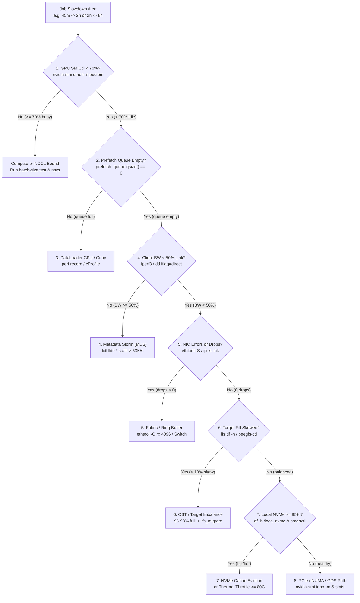
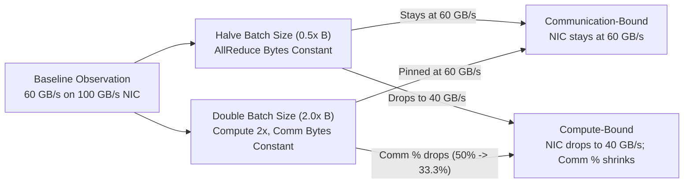

# 13.9 Storage troubleshooting

| Field | Value |
|---|---|
| Level | Advanced |
| Priority tier | 2 |
| Lab venue | GCP / GKE + Local Python Verification Lab (`code/part13/storage_troubleshooting_lab.py`) |
| Part | Part 13: AI storage |
| Primary sources | NVIDIA Zero-to-Hero Volume 15 (`chapter-11-production-troubleshooting.md`, `chapter-12-volume-15-summary.md`, `index.md`, `labs/lab-01..04`); *AI Systems Performance Engineering* |
| Coverage file | `planning/coverage/chapters/13-09.md` |
| Claim & number ledger | `planning/ledgers/13-09.md` |

## Why this matters for AI infrastructure

When a distributed training run slows down from `2` hours to `8` hours (`4.0x` slowdown) or a previously healthy `45`-minute job suddenly stretches to `2` hours, every minute spent guessing at the storage array burns expensive accelerator capacity. A GPU sitting at `15%` Streaming Multiprocessor (`SM`) utilization waiting on a stalled `open()` call or a dropped `RoCEv2` packet costs the exact same hourly rate as a GPU running at `92%` `SM` utilization. Yet production AI storage paths span eight distinct hardware and software layers—GPU device memory (`HBM`), `PCIe` / `NUMA` interconnects, `DataLoader` prefetch queues and host CPU threads, local `NVMe` staging caches, client kernel filesystems (`llite`, `beegfs-client`, `nvidia-fs`), network NICs and leaf/spine switches, parallel filesystem Metadata Servers (`MDS`/`MDT`), and Object Storage Targets (`OST`s / `DNodes` / `S3` prefixes).

Without an ordered, evidence-first diagnostic methodology, engineering teams routinely misdiagnose storage incidents: they scale out storage bandwidth when the true culprit is a `100,000+` ops/sec small-file metadata storm (losing `47` minutes per epoch to `open()` latency), they tune PyTorch `num_workers` when a `256`-entry NIC RX ring buffer is dropping `856` packets every `10` seconds under `5` concurrent `128`-GPU jobs (`640` GPUs), or they assume **GPUDirect Storage (`GDS`)** is bypassing the host CPU when `cuFile` has silently fallen back to `POSIX` compatibility mode (`__memcpy_avx2` consuming `> 20%` of CPU cycles). Conversely, teams sometimes blame the storage cluster when `8` GPUs achieve only a `5x` scaling speedup (`62.5%` scaling efficiency) due to `PCIe`-bound `NCCL` collectives (`60%` `SM` busy and `100 ms` iteration time vs `90%` `SM` busy and `70 ms` with `NVLink` compute-communication overlap) or compute starvation.

This final chapter of Part 13 synthesizes the entire AI storage stack into an operational runbook. You will learn how to capture a reproducible `5`-minute golden baseline before incidents happen, walk the **8-layer storage troubleshooting decision tree** from the GPU backward to the storage media in under `30` minutes, execute the **batch-size halving/doubling experiment** (`60 GB/s` vs `40 GB/s` on a `100 GB/s` NIC) to separate communication-bound from compute-bound regimes, prove whether `GDS` is genuinely active (`gdsio` `-x 2` at `8.0 GB/s` and `1.25 ms` vs `-x 0` at `9.6 GB/s` and `1.00 ms`), and resolve production failure modes across Lustre, BeeGFS, local `NVMe` `RAID-0` arrays, and `NFS`.

## Prerequisites and outcomes

### Prerequisites
- End-to-end understanding of the 7-stage AI storage data path, local `NVMe` staging, and `blk-mq` tuning from Chapters `13.1` and `13.2`.
- Working knowledge of **GPUDirect Storage (`GDS`)** (`cuFile`, `nvidia-fs.ko`, `/proc/driver/nvidia-fs/stats`, `4 KiB` / `8 KiB` `O_DIRECT` alignment, `gdsio`) from Chapter `13.3`.
- Familiarity with **Lustre** (`MDS`/`MDT`, `OSS`/`OST`, `lfs df`, `lfs setstripe`, `lctl get_param llite.*.stats`), **BeeGFS**, **WekaFS**, **VAST Data**, **DeepSeek `3FS`**, small-file repackaging (`WebDataset`), and asynchronous checkpoint recovery from Chapters `13.4` through `13.8`.

### Outcomes
After completing this chapter, you will be able to:
1. Walk the **8-layer AI storage troubleshooting decision tree** starting from `nvidia-smi dmon -s puctem` (`< 70%` `SM` utilization gate) and `prefetch_queue.qsize()` down through `cProfile`/`perf` CPU profiling, `lctl` / `beegfs-ctl` metadata counters, `ethtool -S` / `ethtool -g` NIC ring buffers, `lfs df -h` target fill skew, `df /local-nvme` cache eviction, and `PCIe`/`NUMA` topology.
2. Execute the **communication-bound vs compute-bound batch-size scaling experiment** on a `100 GB/s` NIC (`60 GB/s` baseline all-reduce throughput remaining at `60 GB/s` vs dropping to `40 GB/s` when batch size is halved) and correlate `Nsight Systems` (`nsys profile --trace=cuda,gds,nvtx,osrt`), `Nsight Compute` (`ncu`), `PyTorch Profiler` (`Kineto`), and `Holistic Trace Analysis` (`HTA`) timelines.
3. Establish a **reproducible node and storage baseline** across network links (`25 Gbps` / `100 Gbps` / `400 Gbps`, `MTU 9000`, `RX/TX` ring `4096`), `GPU-to-NIC` `PCIe` affinity (`nvidia-smi topo -m`), local `NVMe` (`3.5 GB/s` model load, `2.8 GB/s` `64 KB` batch stream, `1.2 GB/s` `4 MB` random read, `2.1 GB/s` checkpoint write), and shared parallel storage (`1.5–3.0 GB/s` single client, `3.0–5.0 GB/s` `8`-client aggregate).
4. Audit **GPUDirect Storage (`GDS`)** in production to catch silent `POSIX` compatibility-mode fallbacks (`allow_compat_mode: true`, `4 KiB` `NVMe-oF` vs `8 KiB` Lustre misalignment, `< 1 MiB` transfer sizes, `FUSE` mounts, zero increments in `/proc/driver/nvidia-fs/stats`, and `__memcpy_avx2 > 20%` in `perf record`), and apply the `> 20%` throughput uplift rule (`398 MB/s` CPU bounce vs `gdsio` `8.0 GB/s` -> `9.6 GB/s`).
5. Diagnose and remediate six high-impact production storage failures: `RX` ring-buffer drops plus switch oversubscription (`2h -> 8h` incident), epoch-start metadata storms (`47` minutes lost per epoch), synchronous `500 GB` checkpoint stalls (`500 s` at `1 GB/s` vs `50 s` staged at `10 GB/s`), Lustre `OST` `98%` fill imbalance and client eviction, local `NVMe` thermal throttling (`>= 80 C`) / `RAID-0` drive failure, and `NFS` `Stale file handle` (`ESTALE`, `errno 116`) or `soft`-mount silent checkpoint corruption.

---

## 1. The Eight-Layer AI Storage Troubleshooting Decision Tree

When a training job stalls or throughput regresses by `40%` to `75%`, the cardinal rule of production troubleshooting is: **never start at the storage array; start at the GPU and walk backward toward the media, one falsifiable signal at a time.** Guessing that "Lustre is slow" when the GPU is actually `94%` `SM` busy in a compute kernel—or adding `DataLoader` workers when the storage switch is dropping `856` packets per `10` seconds—wastes hours of incident response time.

### 1.1 The End-to-End Decision Tree



| Layer | Diagnostic Question | Primary Telemetry Command (`untested here`) | Healthy Baseline | Fault Signature | Immediate Remediation |
|---|---|---|---|---|---|
| **1. Accelerator (`GPU`)** | Is the GPU actually starving for input data, or busy computing / waiting on `NCCL`? | `nvidia-smi dmon -s puctem -c 5` | `SM >= 85–92%`, `Mem >= 40%` | `SM < 70%` (e.g., `15%` `SM`, `5%` `Mem`) or oscillating `0% <-> 95%` | If `SM >= 70%`, stop blaming storage; run `nsys` and the `0.5x`/`2.0x` batch-size test. If `< 70%`, check Layer 2. |
| **2. Batch Queue (`DataLoader`)** | Is the host prefetch queue empty when the GPU finishes a step? | `prefetch_queue.qsize()` and per-batch `wait_time` | `qsize >= 2`, `wait_time < 50 ms` | `qsize == 0` for `80%` of steps; `wait_time > 500 ms` (e.g., `620 ms`) | If queue is *full* (`qsize >= 2`) yet GPU waits, check CPU-to-GPU copy (`pin_memory`, `GDS`). If *empty*, check Layer 3 & 4. |
| **3. Host CPU (`Decode / Copy`)** | Are CPU cores pegged in image/token decode or `memcpy` bounce buffers? | `python -m cProfile -s cumtime` and `perf record -g` | Decode `< batch compute`; `__memcpy_avx2 < 5%` | `Image.open` + `augment` taking `57.3 s` / `120K` calls; `__memcpy_avx2 > 20%` | Offload decode to `NVIDIA DALI` / `nvJPEG`, preprocess offline (`NeMo Curator`), or enable `GDS` / `pin_memory=True`. |
| **4. Filesystem Metadata (`MDS`)** | Is the parallel filesystem choking on small-file `open()`/`stat()` calls? | `lctl get_param llite.*.stats \| grep -E 'open\|close\|getattr'` or `strace -c -e openat` | `< 50,000` ops/sec per `MDS`; `open` latency `2.0–5.0 ms` | `> 100,000` ops/sec saturated; `open` latency `20–50 ms` (`45 ms`); `47 min`/epoch lost | Repackage small files into `WebDataset` `.tar`, `TFRecord`, or `.bin`/`.idx` shards (`100x–1,000x` fewer opens). |
| **5. Network Fabric (`NIC / Switch`)** | Are storage packets dropping at the NIC ring buffer or leaf/spine switch? | `ethtool -S eth0`, `ethtool -g eth0`, `ip -s link`, `iperf3 -c storage -t 10` | `80–100%` link speed (`20–25 Gbps` on `25G`); `0` `rx_errors`/`rx_dropped`; ring `4096`; `MTU 9000` | `rx_errors = 1240`, `rx_dropped = 856` in `10 s`; `RX` ring `256`; `300`/sec TCP/RDMA retransmits | Raise ring buffer (`ethtool -G eth0 rx 4096 tx 4096`), verify `MTU 9000`, and throttle concurrent jobs on oversubscribed switches. |
| **6. Storage Targets (`OST / OSS`)** | Are specific storage targets full (`>= 95%`) or throttled by bad striping? | `lfs df -h`, `lfs getstripe <file>`, `beegfs-ctl --listtargets --spaceinfo` | All targets within `±5%` fill (e.g., `OST 0..7` at `50%`); `stripe_count = 1..4` (small) or `16` (ckpt) | `OST 5..7` at `98%` full while `OST 0..4` at `30%` (`68%` spread); `stripe_count = 32` on small files | Migrate hot files off full `OST`s (`lfs_migrate`), set `stripe_count = 1..4` for shards and `16+` for large checkpoints. |
| **7. Local `NVMe` Cache (`Scratch`)** | Is the node-local `NVMe` cache evicting hot shards, thermal throttling, or failing? | `df -h /local-nvme`, `iostat -xz 1`, `nvme smart-log /dev/nvme0n1`, `smartctl -a` | Fill `< 85%`; temp `< 70 C`; `0` media errors; `3.5 GB/s` sequential read | Fill `>= 85%` (`88%` LRU thrashing); temp `>= 80 C` (`0.65 GB/s`); `RAID-0` member failed | Expand scratch capacity, clean stale checkpoints, improve chassis airflow, or rebuild failed `RAID-0` member and re-stage. |
| **8. `PCIe` / `NUMA` / `GDS` Path** | Is traffic crossing inter-socket links (`SYS`/`NODE`) or silently bypassing `GDS`? | `nvidia-smi topo -m`, `/proc/driver/nvidia-fs/stats`, `numactl --hardware` | `PIX`/`PXB` affinity; `nvidia-fs` `Ops Read` climbing; loader pinned to GPU `NUMA` node | `SYS` cross-socket hop; `nvidia-fs` counters flat (`0` delta); `CPU` bounce active | Bind process with `numactl -N <node> -m <node>`, fix `4 KiB`/`8 KiB` alignment, and verify `/etc/cufile.json`. |

### 1.2 Why Layer Order Matters: Avoiding False Positives

Consider what happens in a real production incident when an engineer skips Layers 1 and 2 and runs `python -m cProfile -s cumtime train.py` first. Suppose `cProfile` prints:

```text
   ncalls  tottime  cumtime  filename:lineno(function)
   120000      0.5     45.2  Image.open
   120000      0.2     12.1  augmentation.apply
```

Across `120,000` image loads, `Image.open` (`45.2 s`) plus `augmentation.apply` (`12.1 s`) consumes `57.3` seconds (`~57` seconds total, or `0.48 ms` per image). An engineer looking only at `cProfile` will spend two days rewriting the image augmentation pipeline in C++ or `DALI`.

Yet checking Layer 1 (`nvidia-smi dmon`) and Layer 2 (`prefetch_queue.qsize()`) first immediately disproves that hypothesis:
- GPU `SM` utilization is `15%` (down from `92%`), and GPU memory utilization is `5%` (down from `40%`).
- `prefetch_queue.qsize()` is `0` (completely empty) `80%` of the time.
- If CPU decode (`0.48 ms`/image) were the primary bottleneck after data had already arrived in host memory, the `DataLoader` worker pipes would show raw bytes queued waiting on CPU decode threads and steady partial batch delivery. Instead, worker threads are blocked in kernel `D` state (`uninterruptible sleep`) waiting for `read()` and `open()` RPCs to return from the storage network. The bytes are not even reaching the CPU decoder.

---

## 2. Separating Compute, Collective Communication, and Storage I/O Bottlenecks

Before diving into storage-specific counters, you must prove that the slowdown is not caused by **GPU compute kernels** or **multi-GPU collective communication (`NCCL`)**. When scaling a data-parallel job from `1` GPU to `N` GPUs, ideal linear scaling yields `Nx` higher throughput (`samples/sec`). If scaling from `1` GPU to `8` GPUs delivers only a **`5x` throughput increase**, the system has a **`62.5%` scaling efficiency** (`5 / 8 = 62.5%`), losing `37.5%` of cluster capacity to synchronization, communication, or I/O stalls.

### 2.1 The Batch-Size Halving and Doubling Diagnostic (`60 GB/s` vs `40 GB/s`)

During the backward pass of distributed training, `NCCL` executes an `AllReduce` collective to average gradients across ranks. Suppose you monitor the network interface (`nvidia-smi dmon`, `ethtool -S`, `iftop`, or `nload`) and observe that gradient `AllReduce` is achieving **`60 GB/s`** across a **`100 GB/s` (`800 Gbps`) NIC**. Is the job achieving `60 GB/s` because the network fabric is congested and capping throughput at `60 GB/s` (**communication-bound**), or because the GPUs are computing backward passes too slowly to feed the NIC more than `60 GB/s` (**compute-bound**)?

You can isolate the answer deterministically without touching the network switch by exploiting a fundamental invariant of data-parallel training: **the byte volume of a gradient `AllReduce` scales strictly with the number of model parameters (`\Theta`), not with the micro-batch size ($B$).**

```text
Bytes_AllReduce = 2 x (N - 1) / (N) x |\Theta| x sizeof(grad) \quad (independent of batch size  B)
```

By holding the model (and therefore `Bytes_AllReduce`) constant while **halving (`0.5x B`)** and **doubling (`2.0x B`)** the micro-batch size, you change the ratio of GPU compute work to network communication work:

1. **Experiment A — Halve the batch size (`B -> 0.5 B`):**
   - **Case 1 (Communication-Bound):** Achieved NIC throughput **remains pinned at `60 GB/s`**. Even though the GPUs finish the backward compute pass in half the time and hand gradients to `NCCL` twice as fast, the network fabric or `NCCL` transport cannot push more than `60 GB/s`. The network is the true bottleneck.
   - **Case 2 (Compute-Bound):** Achieved NIC throughput **drops below `60 GB/s` down to `40 GB/s`**. Here, the network had plenty of headroom, and the GPUs were the pacing item; examine why SM compute or kernel launch overhead is starving the fabric.
2. **Experiment B — Double the batch size (`B -> 2.0 B`):**
   - **Case 1 (Communication-Bound):** Achieved NIC throughput **stays at `60 GB/s`** as compute workload grows, and `nsys` continues to show long `NCCL` wait gaps between steps.
   - **Case 2 (Compute-Bound):** Because `Bytes_AllReduce` stays constant while forward/backward compute time doubles (e.g., from `50 ms` compute + `50 ms` comm = `50.0%` communication share to `100 ms` compute + `50 ms` comm = **`33.33%` communication share**), the **percentage of total iteration time spent in `AllReduce` communication shrinks** relative to compute time.



| Diagnostic Experiment | Communication-Bound Signature (`Network / NCCL Limiter`) | Compute-Bound Signature (`GPU SM Limiter`) | Storage / Data-Loading Bound Signature (`I/O Limiter`) |
|---|---|---|---|
| **Baseline (`1.0x` batch size)** | NIC at `60 GB/s` (on `100 GB/s` link); long `ncclDevKernel` gaps at step end | NIC at `60 GB/s`; SMs `> 90%` busy during forward/backward pass | Gap appears **at iteration start** before forward pass; NIC idle; `prefetch_queue.qsize() == 0` |
| **Halve batch size (`0.5x` batch size)** | NIC throughput **remains at `60 GB/s`** (network caps transfer rate) | NIC throughput **drops from `60 GB/s` to `40 GB/s`** | Metadata `open()` rate doubles per second; iteration-start stall worsens |
| **Double batch size (`2.0x` batch size)** | NIC throughput **stays at `60 GB/s`** | Relative `%` of iteration time in `AllReduce` **shrinks** (`50.0% -> 33.33%`) | Sequential read bytes per batch double; `iostat` `rMB/s` or `OST` bandwidth saturates |
| **Topology-aware `NCCL` + overlap fix** | Moving `AllReduce` from `PCIe` to `NVLink` + stream overlap raises `SM` busy **`60% -> 90%`** and cuts step time **`100 ms -> 70 ms` (`-30%`)** | Use `FP8`/`BF16` Tensor Cores, kernel fusion (`torch.compile`), or `CUTLASS` | Repackage small files (`WebDataset`), enable `GDS`, stage to local `NVMe`, or widen `OST` striping |

### 2.2 Multi-Level Profiling Stack (`nsys`, `ncu`, `Kineto`, `HTA`, `perf`, `iostat`)

Once you know which regime dominates, select the profiling tool that instruments that exact layer of the stack:

| Tool | Scope | Key Command / API (`untested here`) | What It Proves During Storage & Pipeline Triage |
|---|---|---|---|
| **NVIDIA Nsight Systems (`nsys`)** | System-wide timeline (`CPU`, `GPU`, `OS`, `GDS`, `NVTX`) | `nsys profile --trace=cuda,gds,nvtx,osrt -o report python train.py` | Correlates `NVTX` ranges (`"train_step"`, `"forward"`, `"backward"`, `"optimizer_step"`) with OS `read()`/`open()` stalls (`osrt`), `cuFile` `GDS` transfers (`gds`), and `CUDA` stream gaps. |
| **PyTorch Profiler (`Kineto`)** | Operator-level `CPU` & `CUDA` timeline + memory | `torch.profiler.profile(activities=[CPU, CUDA], record_shapes=True, profile_memory=True, with_stack=True, with_flops=True)` | Identifies `DataLoader` `enumerate(loader)` wait gaps, host-to-device `cudaMemcpyAsync` stalls, and `torch.compile` graph breaks. Export JSON to **Perfetto** UI (TensorBoard's legacy trace plugin and `chrome://tracing` are deprecated). |
| **Holistic Trace Analysis (`HTA`)** | Multi-GPU / multi-node trace correlation | Ingests `Kineto` distributed JSON traces across all ranks | Separates true storage stragglers (one rank waiting on a `98%`-full `OST` or degraded `NVMe`) from collective `NCCL` wait times across ranks. |
| **NVIDIA Nsight Compute (`ncu`)** | Single-kernel hardware counters & roofline | `ncu --set full -o kernel_report python train.py` | Proves whether a slow `CUDA` or `NCCL` kernel is `HBM` memory-bandwidth bound, `SM` compute bound, or stalled on `PCIe` peer-to-peer memory barriers (`60%` vs `90%` `SM` busy). |
| **Linux `perf`** | Host `CPU` hardware PMU counters & off-CPU sleep | `perf record -g python train.py && perf report` and `perf sched` | Detects `__memcpy_avx2` (`> 20%` proves CPU bounce buffer / inactive `GDS`), Python `GIL` contention, image decode hotspots, and off-CPU `D`-state I/O sleep. |
| **Linux Block & Process I/O (`iostat`, `iotop`, `pidstat`)** | Block device queues, latencies, and per-PID I/O | `iostat -xz 1`, `iotop -b -n 5`, `pidstat -d 1`, `nvme-cli` | Measures local `NVMe` `%util`, `r_await`/`w_await` (`ms`), `aqu-sz` (queue depth), `rMB/s`, `wMB/s`, and isolates noisy-neighbor processes saturating disks. |

---

## 3. Evidence Gathering: The 5-Minute Golden Baseline

You cannot diagnose a "slow" storage path if you do not know what a "healthy" storage path looks like on the exact same node. Before launching production workloads—and at the start of every major training run—capture a reproducible **5-minute golden baseline** covering five domains: **network & `PCIe`/`NUMA` topology**, **storage mounts & target health**, **raw network vs storage bandwidth**, **local `NVMe` vs shared storage workload profiles**, and **page cache / `GPU` memory state**.

### 3.1 Layer-by-Layer Latency and Bandwidth Reference

```mermaid
flowchart LR
    Storage["Storage Array<br/>Lustre / BeeGFS / VAST"]
    Fabric["Network Fabric<br/>NIC & Switch (MTU 9000)"]
    ClientFS["Client Filesystem<br/>llite / beegfs / nvidia-fs"]
    CPU["CPU & NUMA Memory<br/>Page Cache / Pinned DRAM"]
    PCIe["PCIe Gen4/Gen5 Fabric<br/>or NVLink-C2C (900 GB/s)"]
    GPU["GPU HBM Memory<br/>A100 40GB / H100 / B200"]

    Storage -->|"Media: ~100 us"| Fabric
    Fabric -->|"Fabric: 10-100 us"| ClientFS
    ClientFS -->|"VFS/RPC: 50-500 us"| CPU
    CPU -->|"DRAM: 50-100 ns"| PCIe
    PCIe -->|"PCIe DMA: 1-10 us"| GPU
```



| Storage Path Stage | Baseline Latency Envelope | Healthy Single-Node Throughput / Capacity | Primary Baseline Command (`untested here`) | Red-Flag Threshold Requiring Action |
|---|---|---|---|---|
| **1. Storage Array (`OST` / `MDS`)** | `~100 us` media access; `2.0–5.0 ms` metadata `open` | `< 50,000` `open` ops/s per `MDS`; targets balanced within `±5%` | `lfs df -h` and `lctl get_param llite.*.stats` | Any `OST >= 90–98%` full; `> 10%` target fill spread; `open > 100,000` ops/s or `> 20 ms` latency |
| **2. Network Fabric (`NIC` / Switch)** | `10–100 us` (`~300 ns` IB, `~800 ns` RoCEv2 switch hop) | `20–25 Gbps` on `25GbE` (`80–100%` link); `MTU 9000`; `RX/TX` ring `4096` | `ip -s link`, `ethtool eth0`, `ethtool -g eth0`, `iperf3 -c storage -t 10` | `iperf3 < 50%` of link speed; `MTU 1500` on storage VLAN; `RX` ring `< 512` (`256`); `rx_errors` or `rx_dropped > 0` |
| **3. Client Filesystem (`Kernel`)** | `50–500 us` client VFS / RPC processing | `1.5–3.0 GB/s` single-client seq read; `3.0–5.0 GB/s` `8`-client aggregate | `findmnt -D`, `dd if=/lustre/test.file bs=1M count=1000 of=/dev/null iflag=direct` | Missing `flock,lazystatfs,noatime` (Lustre) or `rsize=1048576,wsize=1048576,hard` (NFS); `dd` `< 500 MB/s` |
| **4. Host CPU & `NUMA` Memory** | `50–100 ns` local `DRAM` access | Dual-socket `NUMA 0` (`cpus 0–31`) and `NUMA 1` (`cpus 32–63`); `ulimit -l unlimited` | `lscpu`, `numactl --hardware`, `free -h`, `cat /proc/meminfo` | `DataLoader` workers scheduled on `NUMA 1` while `GPU0`/`NIC0` sit on `NUMA 0`; swap active (`si`/`so > 0`) |
| **5. `PCIe` Fabric & `GDS` Topology** | `1–10 us` `PCIe` transaction (`~100 ns` Gen5 switch) | `PIX` or `PXB` between `GPU` and storage `NIC`/`NVMe` (`PHB` acceptable if verified) | `lspci -tv`, `nvidia-smi topo -m`, `/usr/local/cuda/gds/tools/gdscheck.py -p` | `SYS` or `NODE` traversal between `GPU` and storage `NIC`; `nvidia_fs` not loaded; driver `< 470` |
| **6. Local `NVMe` Scratch vs Shared FS** | `< 100 us` local `O_DIRECT` read | Local `NVMe`: `3.5 GB/s` seq read, `2.8 GB/s` batch stream, `1.2 GB/s` rand read, `2.1 GB/s` ckpt write | `nvme list`, `smartctl -a /dev/nvme0n1`, `fio --ioengine=libaio --direct=1` | Local `NVMe < 500 MB/s`; SMART `Temperature >= 70 C`; `Media and Data Integrity Errors > 0` |

### 3.2 Benchmarking Local NVMe vs Shared Storage Across Four AI Workload Profiles

A single `dd` test is never sufficient to certify an AI storage path because training and inference generate four fundamentally different I/O patterns. When baselining a cluster, run `fio` (`--ioengine=libaio --direct=1`) and metadata loops across both **local `NVMe` (`/local-nvme`)** and **shared storage (`/lustre` or `/beegfs`)** using these four reference profiles:

| AI Workload Profile | I/O Access Pattern | Total Test Size | Block Size (`bs`) | Concurrency (`numjobs` / `iodepth`) | Typical Local `NVMe` Baseline | Typical Shared Parallel FS Baseline | Operational Decision Rule |
|---|---|---|---|---|---|---|---|
| **1. Model Weight Load** | Sequential read (`rw=read`), once at startup/epoch | `10 GB`–`100 GB` (`count=10000` at `1M`) | `1 MB` (`bs=1M`) | `1` reader (`iodepth=32`, `numjobs=4` structured) | **`3.5 GB/s`** | **`1.5–3.0 GB/s`** (`2.33x` ratio at `1.5 GB/s`) | If `NVMe > 2x` faster than shared storage (`> 2.0 GB/s`), cache model weights on local `NVMe`. |
| **2. Batch Streaming** | Concurrent medium-block reads (`rw=read`) | `1 GB` per job (`1,000 x 1 MB` batches) | `64 KB` (`bs=64k`) | `8` parallel readers (`numjobs=8`, `iodepth=16`) | **`2.8 GB/s`** | **`3.0–5.0 GB/s`** aggregate across `8` clients | If aggregate shared bandwidth does not scale with client count, the storage network or `OST` count is saturated. |
| **3. Random Weight / KV-Cache Read** | Random large-block read (`rw=randread`) | `10 GB` | `4 MB` (`bs=4M`) | `1` reader (`iodepth=32`, `numjobs=1`) | **`1.2 GB/s`** | Scales with `stripe_count` and `read_ahead_kb` (`4 MiB`) | Ensure `blockdev --setra` (`4 MiB`) and `blk-mq` `none`/`mq-deadline` scheduler are active on `NVMe`. |
| **4. Checkpoint Burst Write** | Synchronized sequential write (`rw=write`) | `500 MB` per rank (`500 GB` cluster-wide) | `4 MB` (`bs=4M`) | `1` per rank (`8` ranks per node, `iodepth=16`) | **`2.1 GB/s`** per drive (`10+ GB/s` `RAID-0`) | `1.0–6.4 GB/s` (depends on `stripe_count = 16`) | A `500 GB` sync write at `1.0 GB/s` stalls GPUs for **`500 s`**; staging to `10x` faster `NVMe` (`10 GB/s` -> `50 s`) saves **`9/10` (`90%` = `450 s`)** of stall time. |
| **5. Metadata Storm (`Small Files`)** | `create` + `stat` + `open` + `close` on `10,000`–`1,000,000` files | `100 KB` per file | `4 KB` metadata inode | `16` metadata workers | `50,000+` local `XFS` ops/sec | **`1,000–5,000` ops/sec** per client (`< 50,000` per `MDS` ceiling) | If metadata rate is `< 10,000` ops/sec or dataset has `1,000,000` files, repackage into `1,000`–`10,000` `.tar` shards (`100x–1,000x` open reduction). |

---

## 4. Deep-Dive Walkthrough of a Real Production Incident (`2 Hours -> 8 Hours`)

To see how the 8-layer decision tree and the 5-minute baseline work together under pressure, let us walk through a real multi-symptom production incident on a Lustre-backed GPU cluster.

### 4.1 Incident Alert and Step 1 (`diff healthy.txt current.txt`)

**Symptom:** A distributed training job that normally finishes in **`2.0` hours** suddenly takes **`8.0` hours** (`4.0x` slowdown).

Instead of guessing, the on-call engineer runs `./capture_baseline.sh > current.txt` (`untested here`) on a training node and compares it against `healthy.txt` captured during the golden baseline:

```text
< GPU0    dmon -s puctem shows: sm=92%, mem=40%
> GPU0    dmon -s puctem shows: sm=15%, mem=5%          <- Signal 1: GPU idle!

< LFS df shows: OST 0-7 at 50% full
> LFS df shows: OST 5-7 at 98% full, OST 0-4 at 30%     <- Signal 2: OST imbalance (68% spread)!

< ethtool -S eth0: rx_errors=0, rx_dropped=0
> ethtool -S eth0: rx_errors=1240, rx_dropped=856       <- Signal 3: Network packet drops!
```

Notice that `diff` surfaces **three simultaneous anomalies** (`GPU` idle at `15%`, `OST 5..7` at `98%` full vs `OST 0..4` at `30%`, and `1,240` `rx_errors` / `856` `rx_dropped` on `eth0`). A junior engineer might immediately start migrating terabytes of data across `OST`s—an operation that takes hours and adds even more I/O load. A senior engineer follows the decision tree strictly in order.

### 4.2 Step 2 & Step 3: Queue Depth (`80%` Empty) and Ruling Out the `57.3 s` CPU Decoder

1. **Gate 1 (`GPU Utilization`):** `SM` utilization is `15%` (`< 70%`), confirming the workload is I/O-bound, not compute-bound.
2. **Gate 2 (`Prefetch Queue Depth`):** Instrumenting `prefetch_queue.qsize()` inside the training loop reveals that the batch queue is **empty (`qsize == 0`) `80%` of the time**, and average per-batch wait time exceeds `500 ms` (`620 ms`).
3. **Gate 3 (`DataLoader CPU Profile`):** Running `python -m cProfile -s cumtime train.py` (`untested here`) shows `120,000` calls to `Image.open` taking `45.2 s` cumulative time and `120,000` calls to `augmentation.apply` taking `12.1 s` cumulative time (**`57.3` seconds** / `~57 s` per `120,000` images, or `~57 s` per `1,000` batches). While `57.3 s` of CPU decode is non-trivial, **it cannot explain why `prefetch_queue.qsize()` is `0` for `80%` of the wall clock while the GPU sits at `15%`**. If CPU decoding were the primary bottleneck, raw file reads would complete quickly and back up inside worker memory queues. Because the queue is empty, batches are stalling *before* they ever reach `Image.open`.

### 4.3 Step 4, Step 5, and Step 6: Metadata Latency (`45 ms`), Ring Buffers (`256 -> 4096`), and Switch Oversubscription (`5 Jobs -> 3 Jobs`)

1. **Gate 4 (`Filesystem Metadata`):** Querying `lctl get_param llite.*.stats` (`untested here`) over a `60`-second window during epoch startup shows **`950,000` `open` calls in `1` minute**, which equals:
```text
Open Rate = (950,000 opens) / (60 s) = 15,833.33 opens/sec\ (~= 15.8K opens/sec)
```
   Wait: a single Lustre `MDS` safely handles **`50,000` opens/sec** (`> 100,000` ops/sec saturated) at `2.0 ms` average latency. Why is average `open()` latency spiking to **`45.0 ms`** (`22.5x` worse than the `2.0 ms` baseline) when the open rate is only `15.8K` opens/sec (`31.7%` of `MDS` capacity)?
2. **Gate 5 (`Network Errors and Ring Buffer Exhaustion`):** Watching `ethtool -S eth0` (`untested here`) over `10` seconds reveals **`1,240` `rx_errors`/retransmits and `856` `rx_dropped` packets**. Every dropped metadata RPC packet triggers a TCP/LNet **Retransmission Timeout (`RTO`)**, inflating a `2.0 ms` `MDS` lookup into a `45.0 ms` client stall. Checking `ethtool -g eth0` exposes the first root cause:
   - `RX` ring buffer size is set to **`256` descriptors** (whereas high-speed storage NICs require **`4096`**). Microbursts from `OST`s overflow the `256`-entry ring buffer and drop packets in the NIC driver before the kernel can drain them.
   - Executing `ethtool -G eth0 rx 4096 tx 4096` (`untested here`) immediately reduces `rx_dropped` from `856` per `10` seconds (`85.6/sec`) to **`< 5` drops/sec**.
3. **Gate 5b (`Switch Fabric Oversubscription`):** Even after enlarging the NIC ring buffer to `4096`, network retransmits persist at **`300` retransmits/sec**, and `iperf3 -c storage -R -t 10` (`untested here`, reverse direction from storage to client) shows degraded throughput. Inspecting the cluster scheduler reveals **`5` concurrent training jobs x `128` GPUs each = `640` GPUs** simultaneously hammering an oversubscribed storage leaf/spine switch fabric.
4. **Resolution Verification:** Temporarily capping concurrent training jobs from **`5` jobs (`640` GPUs) down to `3` jobs (`384` GPUs)** eliminates switch buffer congestion:
   - Network retransmits drop from `300/sec` to **`0/sec`**.
   - Metadata `open()` latency drops from **`45.0 ms` back to `2.0 ms`**.
   - GPU `SM` utilization rebounds from **`15%` to `88%`**, restoring the `2.0`-hour job runtime. Afterward, the team schedules `lfs_migrate` during a maintenance window to rebalance `OST 5..7` (`98%` full) back toward the `50%` cluster mean.

---

## 5. Validating GPUDirect Storage (`GDS`) and Catching Silent Fallbacks

A recurring production anti-pattern in GPU clusters is "Placebo GDS": an engineering team installs `nvidia-fs`, sets an environment flag, and assumes storage reads are DMAing directly into GPU `HBM`—when in reality, `cuFile` has **silently fallen back to POSIX compatibility mode (`allow_compat_mode: true`)**, routing every byte through the host CPU page cache and `DRAM` bounce buffers (`__memcpy_avx2`).

### 5.1 The Six Non-Negotiable GDS Prerequisites and Verification Signals

GPUDirect Storage bypasses the CPU bounce buffer only when **all six** architectural requirements hold simultaneously:

| Requirement # | Layer | Technical Requirement | Verification Command (`untested here`) | What Causes Silent Fallback to CPU Bounce |
|---|---|---|---|---|
| **1. Kernel Driver** | Host OS | `nvidia_fs` kernel module loaded and `/proc/driver/nvidia-fs/stats` active | `lsmod \| grep nvidia_fs` and `cat /proc/driver/nvidia-fs/stats` | `nvidia-fs` DKMS package missing or broken after a Linux kernel upgrade. |
| **2. GPU Driver** | CUDA Driver | NVIDIA display/compute driver **`>= 470`** (e.g., `535.29`+) and `/usr/local/cuda/include/cufile.h` present | `nvidia-smi \| grep "Driver Version"` | Older driver lacking `cuFile` `BAR1` peer-to-peer DMA hooks. |
| **3. `PCIe` Topology** | Hardware Fabric | GPU and `NVMe` / Storage `NIC` share a `PCIe` switch (`PIX` or `PXB`) or supported root complex (`PHB`), **never** crossing inter-socket links (`SYS` / `NODE`) | `nvidia-smi topo -m` and `lspci -tv \| grep -E "NVIDIA\|Tesla\|NIC"` | `GPU0` on `NUMA 0` reading via `NIC1` on `NUMA 1` (`SYS` / `NODE` hop across `QPI`/`UPI`/`Infinity Fabric`). |
| **4. Storage Backend** | Filesystem | Kernel-level `O_DIRECT` + `GDS`-enabled client (`NVMe`, `NVMe-oF`, `Lustre`, `BeeGFS`, `WekaFS`, `VAST`, `IBM Storage Scale`) | `/usr/local/cuda/gds/tools/gdscheck.py -p` | Mounting storage via **user-space `FUSE`** or standard `TCP` `NFS` without `RDMA`/`nvidia-fs` registration. |
| **5. Buffer & Offset Alignment** | I/O Geometry | File offset, GPU buffer address, and transfer size aligned to **`4 KiB` (`4,096 B`) for `NVMe`/`NVMe-oF`** or **`8 KiB` (`8,192 B`) for Lustre**, with request size **`>= 1 MiB` (`1,048,576 B`)** | Inspect `cuFileRead` / `kvikio.CuFile` arguments and `nsys --trace=gds` | Reading unaligned byte ranges (e.g., `4,096 B` offset on Lustre requiring `8,192 B`) or tiny `< 1 MiB` chunks. |
| **6. Application API & Proof** | Runtime | Uses `cuFile` (`kvikio.CuFile`, `DALI`, `NIXL` `GDS` plugin)—not Python `open()/read()`—and **proves** activity via counters | `perf record -g` (`0%` `__memcpy_avx2`) + rising `Ops Read` in `/proc/driver/nvidia-fs/stats` | Using standard `open(path, "rb")` or `torch.load()` without `kvikio`/`cuFile` integration. |

### 5.2 Benchmarking CPU Bounce (`398 MB/s` / `8.0 GB/s`) vs Direct GDS (`9.6 GB/s`) and the `> 20%` Rule

Before rolling out `GDS` across a fleet, benchmark both the application-level Python path (`100 MiB` = `104,857,600` B tensor load) and the raw storage-to-GPU ceiling using NVIDIA's `/usr/local/cuda/gds/tools/gdsio` utility:

1. **Application-Level `100 MiB` CPU Bounce vs `kvikio.CuFile` Benchmark:**
   - On the traditional CPU bounce path (`open("/lustre/model-test.bin", "rb")` -> `np.frombuffer` -> `torch.frombuffer` -> `.cuda()`), five consecutive `100 MiB` trials complete in **`0.265 s`, `0.250 s`, `0.248 s`, `0.247 s`, and `0.246 s`**, averaging **`0.251 s`** (`378`, `400`, `403`, `404`, `407 MB/s` -> **`398 MB/s` average throughput** at `100 MiB / 0.2512 s`), while host CPU utilization spikes in `__memcpy_avx2`.
   - Replacing `open()` with RAPIDS `kvikio.CuFile(INPUT_FILE, "rb")` (`f.read(gpu_buffer)`) transfers the `100 MiB` payload directly into `cuda:0` memory without a host CPU staging copy.
2. **Controlled `gdsio` Benchmark (`-x 2` CPU Bounce vs `-x 0` Direct `GDS`):**
   - **Baseline (`-x 2`, Storage -> Host CPU Pinned Memory -> GPU `HBM` with `4` workers, `10 GiB` file, `1 MiB` block size, read mode `-I 0`):**
```text
Throughput_-x\ 2 = 8.0 GB/s, \quad Average Latency_-x\ 2 = 1.25 ms, \quad Host CPU ~= 85%
```
   - **Direct `GDS` (`-x 0`, Storage -> GPU `HBM` via `cuFile` + `nvidia-fs`):**
```text
Throughput_-x\ 0 = 9.6 GB/s\ (+20.0% uplift), \quad Average Latency_-x\ 0 = 1.00 ms\ (-20.0% reduction), \quad Host CPU ~= 25%
```
3. **The `> 20%` Deployment Decision Rule:**
```text
Improvement % = \frac(Throughput_GDS - Throughput_CPU)(Throughput_CPU) x 100%
```
   - If `GDS` improves end-to-end throughput by **`>= 20%`** (or frees starved host CPU cores needed by `1,000` batches/sec x `1 MB` = `1,000 MB/s` streaming or `NIXL` KV-cache offloading), **deploy `GDS`**.
   - If `GDS` improves throughput by **`< 20%`**, **skip `GDS`** and fix the real bottleneck first (repackaging small files to stop metadata storms, widening `OST` stripe counts, or adding a local `NVMe` cache).

---

## 6. Commands and Configurations That Matter

Every command below is grouped by the exact diagnostic layer it instruments (`untested here` on live multi-node GPU cluster hardware).

### 6.1 The 5-Minute Node & Storage Baseline Capture Script

Run this script (`untested here`) on a GPU node before starting training to establish your `healthy.txt` reference, and run it again (`current.txt`) the moment a slowdown alert fires:

```bash
#!/bin/bash
# (untested here) Capture 5-minute golden baseline across GPU, NIC, Topology, FS, and NVMe
OUTPUT_FILE="baseline-$(hostname)-$(date +%Y%m%d-%H%M%S).txt"

echo "=== 1. GPU UTILIZATION & DETAILS ===" | tee "$OUTPUT_FILE"
nvidia-smi dmon -s puctem -c 5 >> "$OUTPUT_FILE"
nvidia-smi -i 0 -q | grep -E "Product Name|Memory|Driver" >> "$OUTPUT_FILE"

echo "=== 2. NETWORK INTERFACES, RING BUFFERS & TOPOLOGY ===" >> "$OUTPUT_FILE"
ip -s link >> "$OUTPUT_FILE"
ethtool eth0 >> "$OUTPUT_FILE"
ethtool -S eth0 | grep -E "rx_errors|rx_dropped|tx_errors" >> "$OUTPUT_FILE"
ethtool -g eth0 >> "$OUTPUT_FILE"
lscpu >> "$OUTPUT_FILE"
numactl --hardware >> "$OUTPUT_FILE"
lspci -tv | grep -E "NVIDIA|Tesla|NIC" >> "$OUTPUT_FILE"
nvidia-smi topo -m >> "$OUTPUT_FILE"

echo "=== 3. FILESYSTEM MOUNTS, TARGET HEALTH & METADATA ===" >> "$OUTPUT_FILE"
mount | grep -E "lustre|beegfs|nfs|/mnt" >> "$OUTPUT_FILE"
findmnt -D >> "$OUTPUT_FILE"
if command -v lfs &> /dev/null; then
    lfs df -h >> "$OUTPUT_FILE"
    lctl get_param llite.*.stats | grep -E "^[^ ]|^  open|^  close|^  getattr" | head -20 >> "$OUTPUT_FILE"
fi
if command -v beegfs-ctl &> /dev/null; then
    beegfs-ctl --listtargets --nodetype=storage --spaceinfo >> "$OUTPUT_FILE"
fi

echo "=== 4. LOCAL NVMe SMART HEALTH & PAGE CACHE ===" >> "$OUTPUT_FILE"
lsblk -o NAME,MODEL,SIZE,ROTA,TYPE >> "$OUTPUT_FILE"
if command -v nvme &> /dev/null; then
    nvme list >> "$OUTPUT_FILE"
    for dev in /dev/nvme*n1; do
        smartctl -a "$dev" 2>/dev/null | grep -E "Temperature|Errors|Percentage Used|Unsafe" >> "$OUTPUT_FILE" || true
    done
fi
free -h >> "$OUTPUT_FILE"
cat /proc/meminfo | grep -E "Cached|Buffers|MemAvailable|MemFree" >> "$OUTPUT_FILE"
```

### 6.2 Structured `fio`, `gdsio`, `nsys`, and `NUMA` Verification Commands

```bash
# (untested here) 1. Compare throughput with and without NUMA affinity binding
time dd if=/lustre/test.file bs=1M count=1000 of=/dev/null iflag=direct
time numactl -N 0 -m 0 dd if=/lustre/test.file bs=1M count=1000 of=/dev/null iflag=direct

# (untested here) 2. Local NVMe vs Shared Storage 4-Workload fio Benchmark
fio --name=seq-read --ioengine=libaio --rw=read --bs=1M --size=10G \
    --direct=1 --iodepth=32 --numjobs=4 --filename=/lustre/test.file --output-format=normal
fio --name=batch-stream --ioengine=libaio --rw=read --bs=64k --size=1G \
    --direct=1 --iodepth=16 --numjobs=8 --filename=/local-nvme/batch-test.bin --output-format=normal
fio --name=checkpoint-write --ioengine=libaio --rw=write --bs=4M --size=500M \
    --direct=1 --iodepth=16 --numjobs=1 --filename=/local-nvme/checkpoint-test.bin

# (untested here) 3. Verify GPUDirect Storage (-x 2 CPU bounce vs -x 0 Direct GDS)
/usr/local/cuda/gds/tools/gdscheck.py -p
/usr/local/cuda/gds/tools/gdsio -f /mnt/data/large_file -d 0 -w 4 -s 10G -i 1M -I 0 -x 2
/usr/local/cuda/gds/tools/gdsio -f /mnt/data/large_file -d 0 -w 4 -s 10G -i 1M -I 0 -x 0

# (untested here) 4. End-to-End System, GDS, and Block/Process I/O Profiling
nsys profile --trace=cuda,gds,nvtx,osrt -o storage_trace python train.py
perf record -g python train.py && perf report | grep __memcpy_avx2
strace -e openat -c python train.py
iostat -xz 1 10
iotop -b -n 5
pidstat -d 1 10

# (untested here) 5. Production NFS Client Mount & NIC Ring Buffer Remediation
ethtool -G eth0 rx 4096 tx 4096
mount -t nfs -o rw,hard,rsize=1048576,wsize=1048576,noatime,async,actimeo=60,lookupcache=pos \
    nfs-server:/export/datasets /mnt/datasets
```

---

## 7. How It Fails: Six Production Storage Failure Modes

| # | Failure Mode | Observable Symptom | Root-Cause Diagnosis (`Commands & Counters`) | Deterministic Fix |
|---|---|---|---|---|
| **1** | **NIC Ring Buffer Overflow + Switch Oversubscription** | Job runtime jumps `4.0x` (`2h -> 8h`); GPU `SM` drops `92% -> 15%`; `prefetch_queue` empty `80%` of steps; `open()` latency spikes `2 ms -> 45 ms` despite only `15.8K` opens/sec (`950K`/min). | `ethtool -S eth0` shows `rx_errors = 1240`, `rx_dropped = 856` in `10 s`; `ethtool -g eth0` reveals tiny `RX` ring (`256` vs `4096`). After ring fix (`< 5` drops/s), `300` retransmits/s persist because `5 x 128`-GPU jobs (`640` GPUs) oversubscribe switch uplinks. | Run `ethtool -G eth0 rx 4096 tx 4096`, verify `MTU 9000`, and cap concurrent heavy I/O jobs from `5` (`640` GPUs) to `3` (`384` GPUs) or add spine bandwidth (`0` retransmits, `2 ms` metadata, `88%` `SM`). |
| **2** | **Epoch-Start Small-File Metadata Storm (`The 47-Minute Problem`)** | Epoch 1 start takes `2` minutes while Epoch 2 takes `30` seconds; or `47` minutes per epoch are lost with GPUs idle while storage bandwidth sits `< 10%` utilized. | `lctl get_param llite.*.stats \| grep open` or `strace -c -e openat` shows `> 100,000` opens/sec (`> 50,000` per `MDS` safe ceiling); `top -H` on `MDS` shows all service threads at `100%` CPU; or small files have `stripe_count = 32`. | Repackage `1,000,000` small files (`100–260 KB`) into `1,000–10,000` `WebDataset` `.tar`, `TFRecord`, or `.bin`/`.idx` shards (`100x–1,000x` fewer opens; batch wait drops `620 ms -> 31 ms`, `-95%`), and set `stripe_count = 1..4` for small files. |
| **3** | **Silent `GPUDirect Storage` (`GDS`) Compatibility-Mode Fallback** | `GDS` (`kvikio` / `cuFile`) is enabled, yet throughput remains stuck at CPU-bounce speed (`398 MB/s` or `8.0 GB/s` instead of `9.6 GB/s`), and host CPU sits at `85%–100%`. | `/proc/driver/nvidia-fs/stats` `Ops Read` counter stays at `0` during reads; `perf record` shows `> 20%` (`24.5%–31.0%`) of CPU samples in `__memcpy_avx2`. Caused by `"allow_compat_mode": true` masking `4 KiB` (`NVMe`) / `8 KiB` (Lustre) misalignment, `< 1 MiB` I/O size, `FUSE` mount, or `SYS` cross-socket topology. | Align offsets/buffers to `4,096 B` (`NVMe-oF`) or `8,192 B` (Lustre) with `>= 1 MiB` transfers, bind process to the `PIX`/`PXB`-affine `NUMA` node (`numactl -N 0 -m 0`), use kernel `GDS` clients (not `FUSE`), and verify `nvidia-fs` counters increment. |
| **4** | **Lustre `OST` Fill Skew (`98%` Full), Client Eviction, & Sync Checkpoint Stalls** | Checkpoint saves stall training for `500+` seconds (`500 GB` at `1 GB/s`) or fail mid-write with `ENOSPC` / `EIO` even though `df -h /lustre` shows `45%` free cluster space. | `lfs df -h` shows `OST 5..7` at `98%` full while `OST 0..4` sit at `30%` (`68%` spread); files landing on `OST 5..7` hit allocator fragmentation, `LDLM` lock timeouts, and client eviction (`ptlrpc` expired). | Migrate files off full targets (`lfs_migrate`), set `lfs setstripe -c 16 -S 4M` on checkpoint directories *before* writing, and async-stage checkpoints to local `NVMe` (`10x` faster -> saves `9/10` = `450 s` of the `500 s` stall) before background flushing. |
| **5** | **Local `NVMe` Thermal Throttling (`>= 80 C`), SMART Wear, or `RAID-0` Failure** | Single node becomes a straggler (`500 MB/s` vs `3.5 GB/s` peers), or job crashes with `Input/output error` on `/local-nvme` scratch. | `iostat -xz 1` shows `100%` `%util` with `r_await > 25 ms` on one `nvme` device; `smartctl -a /dev/nvme1n1` shows `Temperature = 82 C` (`>= 70 C` warn, `>= 80 C` critical throttle to `0.65 GB/s`), `Percentage Used >= 95%`, or `Media Errors > 0` breaking an `mdadm` `RAID-0` stripe. | Replace worn/faulted `NVMe` SSD, remediate server fan/heatsink airflow to keep composite temperature `< 70 C`, enforce `< 85%` local cache fill watermark, and treat `RAID-0` local `NVMe` strictly as ephemeral cache (never sole durable checkpoint store). |
| **6** | **`NFS` `Stale file handle` (`ESTALE`) & `soft`-Mount Silent Corruption** | Workers crash with `OSError: [Errno 116] Stale file handle` during dataset reads, or `torch.save()` produces truncated/corrupted `.pt` checkpoints during network blips. | Dataset curation scripts deleted and recreated a directory on the `NFS` server while compute nodes held cached dentries (`ESTALE`, `errno 116`); or `/etc/fstab` used `soft,timeo=...`, causing `write()` syscalls to return `EIO` on transient timeouts instead of retrying. | Remount with **`hard,rsize=1048576,wsize=1048576,noatime,actimeo=60,lookupcache=pos`** (never `soft` for read-write checkpoints), use atomic rename or immutable versioned directories (`dataset-v2/`) to avoid `ESTALE`, and move clusters `> 8` nodes off single-server `NFS`. |

---

## 8. Hands-On Lab: End-to-End Storage Incident & Bottleneck Triage

**Venue:** GCP / GKE or any Linux workstation (`python3` standard library only; no GPU or root access required).

The companion verification suite (`code/part13/storage_troubleshooting.py` and `code/part13/storage_troubleshooting_lab.py`) encodes the 8-layer decision tree, the `2h -> 8h` production incident walkthrough, the `60 GB/s` vs `40 GB/s` batch-size halving/doubling test, the `GDS` silent compatibility-mode auditor and `gdsio` benchmark evaluator, the local `NVMe` vs shared storage checkpoint staging model, `10,000`- and `1,000,000`-file `WebDataset` repackaging math, local `NVMe` SMART/thermal/RAID-0 triage, and `NFS` `ESTALE`/`soft`-mount auditing into **28 deterministic self-checks**.

### Run the Verification Lab

```bash
python3 -B code/part13/storage_troubleshooting_lab.py
```

### Expected Output (Verified Locally)

```text
=== Chapter 13.9: Storage Troubleshooting Verification Lab ===

  [PASS] 01. Production incident slowdown is 4.0x (2.0 hours baseline -> 8.0 hours current) with GPU SM utilization dropping from 92% (mem 40%) to 15% (mem 5%)
  [PASS] 02. Decision tree Gate 1 & Gate 2 classify GPU utilization < 70% (15%) with 80% empty prefetch queue as I/O-bound starvation
  [PASS] 03. cProfile CPU decode (45.2 s) + augmentation (12.1 s) totals 57.3 s (~57 s) across 120,000 calls, ruled out as primary root cause because prefetch queue is 80% empty
  [PASS] 04. Lustre metadata open rate of 950,000 opens in 60 s equals 15,833.33 (~15.8K) opens/sec (< 50,000 ops/sec MDS ceiling, > 100,000 saturated) with 45.0 ms open latency vs 2.0 ms baseline
  [PASS] 05. Network triage isolates rx_errors=1240 and rx_dropped=856 in 10 s on RX ring size 256 (fixed via ethtool -G eth0 rx 4096 tx 4096 to < 5 drops/sec)
  [PASS] 06. Switch oversubscription triage shows 5 concurrent 128-GPU jobs (640 GPUs) cause 300 retransmits/sec; reducing to 3 jobs (384 GPUs) restores 0 retransmits, 2 ms open latency, and 88% GPU util
  [PASS] 07. Lustre target fill check detects OST 5..7 at 98.0% full vs OST 0..4 at 30.0% full (68.0% spread vs 50.0% healthy baseline)
  [PASS] 08. Decision tree classifies GPU SM utilization >= 70% (94%) as Compute / Collective Communication (Not Storage)
  [PASS] 09. Decision tree classifies low GPU utilization (28%) with full queue (5% empty) and low memcpy (6%) as DataLoader CPU Preprocessing bottleneck
  [PASS] 10. Decision tree classifies > 20% CPU __memcpy_avx2 samples (28.0%) with low GPU util (30%) as PCIe / CPU-to-GPU Bounce Copy Overhead
  [PASS] 11. Decision tree classifies 110,000 opens/sec (> 50K healthy, > 100K saturated) with healthy network link (22.0 / 25.0 Gbps = 88%) as Filesystem Metadata Server (MDS) bottleneck
  [PASS] 12. Batch-size scaling test diagnoses COMMUNICATION_BOUND when NIC stays pinned at 60.0 GB/s (on a 100.0 GB/s NIC) across 0.5x, 1.0x, and 2.0x batch sizes
  [PASS] 13. Batch-size scaling test diagnoses COMPUTE_BOUND when halving batch size drops NIC utilization from 60.0 GB/s to 40.0 GB/s and doubling batch size shrinks all-reduce time share from 50.0% to 33.33%
  [PASS] 14. GDS audit confirms GDS_DIRECT_DMA when nvidia_fs is loaded, driver is 535.29 (>= 470), topology is PIX, NVMe-oF offset is 4096 B aligned, request >= 1 MiB, nvidia-fs stats increment, and __memcpy_avx2 is 0%
  [PASS] 15. GDS audit catches silent POSIX_COMPAT_CPU_BOUNCE fallback on Lustre when offset is 4096 B (not 8192 B / 8 KB aligned), request < 1 MiB, nvidia-fs stats delta is 0, and __memcpy_avx2 is 24.5%
  [PASS] 16. GDS audit flags user-space FUSE mount and cross-socket SYS topology as incompatible with kernel nvidia-fs O_DIRECT DMA
  [PASS] 17. Lab 03 100 MiB (104,857,600 B) CPU-bounce benchmark trials [0.265, 0.250, 0.248, 0.247, 0.246] s average 0.251 s (396..426 MB/s decimal, ~398 MiB/s)
  [PASS] 18. gdsio (-d 0 -w 4 -s 10G -i 1M -I 0) shows -x 0 GDS (9.6 GB/s, 1.00 ms) achieves +20.0% throughput uplift and -20.0% latency reduction over -x 2 CPU path (8.0 GB/s, 1.25 ms), meeting the >= 20% DEPLOY_GDS threshold
  [PASS] 19. Lab 02 local NVMe baseline verifies 3.5 GB/s model load, 2.8 GB/s batch stream (64 KB x 8), 1.2 GB/s random read (4 MB), and 2.1 GB/s checkpoint write (2.33x faster than 1.5 GB/s shared storage)
  [PASS] 20. Synchronous 500 GB checkpoint at 1.0 GB/s stalls training for 500.0 s; staging to 10x faster NVMe (10.0 GB/s) cuts critical-path stall to 50.0 s, saving 450.0 s (9/10 = 90.0%)
  [PASS] 21. Lab 04 repackaging of 10,000 small 100 KB files into 100 tar shards (100 files/shard) cuts open calls 100.0x and reduces batch wait from 620.0 ms (> 500 ms stall threshold) to 31.0 ms (95.0% improvement)
  [PASS] 22. Repackaging 1,000,000 small files into 1,000 WebDataset/tar shards cuts metadata open calls by 1,000.0x and collapses the 47.0-minute per-epoch metadata stall to < 0.05 minutes
  [PASS] 23. Local NVMe health check passes HEALTHY drive at 52 C (< 70 C), 18% wear (< 95%), 0 media errors, and 3.5 GB/s read throughput
  [PASS] 24. Local NVMe health check detects CRITICAL_THERMAL_THROTTLE at 82 C (>= 80 C critical) when throughput drops to 0.65 GB/s alongside 96% endurance wear
  [PASS] 25. Local NVMe health check flags CRITICAL_RAID0_FAILURE and media_errors=3 when a RAID-0 scratch member fails
  [PASS] 26. NFS audit validates tuned mount (hard,rsize=1048576,wsize=1048576,noatime,async,actimeo=60,lookupcache=pos) on 4 GPU nodes with 0 risks
  [PASS] 27. NFS audit catches soft-mount checkpoint corruption risk, missing 1 MiB rsize/wsize, missing noatime, ESTALE (errno 116, Stale file handle), and 32-node scale overload
  [PASS] 28. Topology-aware NCCL and compute-communication overlap raises SM utilization from 60.0% to 90.0% and cuts iteration time by 30.0% (100.0 ms -> 70.0 ms)

Summary: 28 passed, 0 failed
```

---

## Common first mistakes

1. **Starting storage troubleshooting at the storage array instead of `nvidia-smi dmon` and `prefetch_queue.qsize()`:** If GPU `SM` utilization is `>= 70%` (`90%+`), the job is compute- or `NCCL`-bound, not storage-bound. And if `SM` is `< 30%` while `prefetch_queue.qsize()` is full, the bottleneck is CPU preprocessing or host-to-GPU memory copies—not the parallel filesystem.
2. **Changing three knobs at once without re-measuring against a captured baseline:** Simultaneously increasing `DataLoader(num_workers=16)`, changing `lfs setstripe -c 16`, and modifying `ethtool -G eth0 rx 4096` makes it impossible to tell which change fixed the regression—or which change introduced a new CPU/MDS contention cliff. Follow the iterative loop: **Baseline -> Hypothesis -> Single Change -> Remeasure**.
3. **Assuming `GPUDirect Storage` (`GDS`) is active without checking `/proc/driver/nvidia-fs/stats` and `perf record`:** Because `/etc/cufile.json` defaults to `"allow_compat_mode": true`, any alignment mismatch (`4 KiB` vs `8 KiB` on Lustre), `< 1 MiB` read size, or unsupported `PCIe` bridge (`SYS`) silently routes I/O through host `DRAM` via `__memcpy_avx2` without raising an exception.
4. **Benchmarking storage with cached `dd` (omitting `iflag=direct` / `oflag=direct` or `fio --direct=1`):** Running `dd if=/lustre/test.file of=/dev/null` without `iflag=direct` measures Linux `DRAM` page-cache bandwidth (`20–50 GB/s`) on any file smaller than free host memory (`free -h`), completely masking a `500 MB/s` degraded network or `OST` path.
5. **Using `stripe_count = 32` for small dataset files or `stripe_count = 1` for `500 GB` checkpoints:** Striping a `100 KB` file across `32` `OST`s requires `32` object RPCs and lock operations per file, turning a small read into a metadata and lock storm. Use `stripe_count = 1..4` for normal/small files and `stripe_count = 16+` only for multi-gigabyte shards and checkpoints.

---

## Exercises

1. **8-Layer Incident Triage (`2 Hours -> 8 Hours` Slowdown):**
   - **(a)** During an incident where training slows from `2.0` hours to `8.0` hours, `nvidia-smi dmon` shows `SM = 15%` (baseline `92%`) and `Mem = 5%` (baseline `40%`), `prefetch_queue.qsize()` is `0` for `80%` of steps, `cProfile` shows `120,000` calls to `Image.open` (`45.2 s`) and `augmentation.apply` (`12.1 s`), and `lctl get_param llite.*.stats` records `950,000` `open` calls in `60` seconds at `45.0 ms` average latency (baseline `2.0 ms`). Calculate the job slowdown factor, total CPU decode + augmentation time, and exact `open` rate per second. Why are neither CPU decode nor `MDS` capacity (`50,000` ops/sec safe ceiling) the primary root cause?
   - **(b)** `ethtool -S eth0` reports `rx_errors = 1240` and `rx_dropped = 856` in `10` seconds with `RX` ring buffer `256`. After setting `ethtool -G eth0 rx 4096 tx 4096`, drops fall to `< 5/sec`, but `300` retransmits/sec remain while `5` concurrent `128`-GPU jobs run. Calculate the active GPU count before and after reducing concurrency to `3` jobs, and state the resulting retransmit rate, `open()` latency, and GPU `SM` utilization.
2. **Communication-Bound vs Compute-Bound Batch-Size Scaling Test (`60 GB/s` vs `40 GB/s`):**
   - **(a)** A multi-node job achieves `60.0 GB/s` during backward-pass gradient `AllReduce` on a `100.0 GB/s` (`800 Gbps`) NIC, with `50.0 ms` compute time and `50.0 ms` `AllReduce` time per step. Explain mathematically why changing the batch size does not change the gradient `AllReduce` payload bytes.
   - **(b)** When you halve the batch size (`0.5x`), Run A stays at `60.0 GB/s` while Run B drops to `40.0 GB/s`. When you double the batch size (`2.0x`), calculate Run B's new `AllReduce` percentage of total iteration time (`100.0 ms` compute + `50.0 ms` communication). Classify Run A and Run B as `COMMUNICATION_BOUND` or `COMPUTE_BOUND`.
3. **GPUDirect Storage (`GDS`) Silent Fallback Audit & `gdsio` Decision Math:**
   - **(a)** In Lab 03, five `100 MiB` (`104,857,600` B) CPU-bounce read trials take `[0.265, 0.250, 0.248, 0.247, 0.246]` seconds. Calculate the mean elapsed time (`s`) and average throughput (`MiB/s`). Next, given `gdsio` (`-d 0 -w 4 -s 10G -i 1M -I 0`) results of `8.0 GB/s` at `1.25 ms` for `-x 2` (CPU path) and `9.6 GB/s` at `1.00 ms` for `-x 0` (`GDS` path), compute the percentage throughput uplift, percentage latency reduction, and whether `GDS` passes the `>= 20.0%` deployment threshold.
   - **(b)** A developer runs `kvikio.CuFile` on Lustre with `io_offset = 4,096` bytes and `io_request = 512 KiB`, observing `0` change in `/proc/driver/nvidia-fs/stats` and `24.5%` `__memcpy_avx2` in `perf record`. Identify the two geometry violations causing silent fallback to `POSIX` compatibility mode.
4. **Local `NVMe` vs Shared Storage Benchmarking & `500 GB` Checkpoint Staging:**
   - **(a)** Lab 02 measures local `NVMe` at `3.5 GB/s` (model load), `2.8 GB/s` (`64 KB` x `8` batch stream), `1.2 GB/s` (`4 MB` random read), and `2.1 GB/s` (checkpoint write), while shared storage achieves `1.5 GB/s` on model load. Compute the `NVMe`-to-shared model-load speedup ratio and determine whether it exceeds the `> 2.0x` local caching threshold.
   - **(b)** A synchronous `500 GB` checkpoint written directly to shared storage at `1.0 GB/s` stalls training for `500.0` seconds. If local `NVMe` `RAID-0` staging sustains `10.0 GB/s` (`10x` faster), calculate the new critical-path stall duration, the exact seconds saved per checkpoint, and the fraction of checkpoint stall time eliminated.
5. **Small-File Metadata Storm Repackaging (`10,000` and `1,000,000` Files):**
   - **(a)** In Lab 04, a training loop over `10,000` individual `100 KB` files experiences an average batch wait time of `620.0 ms` (`> 500 ms` GPU starvation threshold). After repackaging into `100` `.tar` shards (`100` files/shard), average batch wait drops to `31.0 ms`. Compute the file-open reduction factor and percentage reduction in batch wait time.
   - **(b)** On a production dataset of `1,000,000` small files that loses `47.0` minutes per epoch to metadata overhead, calculate the open-call reduction factor and remaining metadata stall time (`minutes`) after repackaging into `1,000` `WebDataset` shards (`1,000` files/shard).
6. **Local `NVMe` SMART/Thermal Triage and `NFS` `ESTALE` / `soft`-Mount Auditing:**
   - **(a)** Compare three local `NVMe` scratch drives: `nvme0n1` (`52 C`, `18%` used, `0` media errors, `3.5 GB/s`, `RAID-0 clean`), `nvme1n1` (`82 C`, `96%` used, `0` media errors, `0.65 GB/s`, `RAID-0 clean`), and `nvme2n1` (`58 C`, `40%` used, `3` media errors, `0.0 GB/s`, `RAID-0 failed`). Classify each drive's health state against the `70 C` warning, `80 C` critical thermal, and `95%` endurance thresholds.
   - **(b)** Audit an `NFS` client mounted with `-o rw,soft,rsize=32768,wsize=32768` across `32` GPU nodes where workers fail with `errno 116` (`ESTALE`). List all five operational risks/faults and write the corrected production `mount` option string.

---

## Interview angles

1. **"Your training job suddenly slows from `2` hours to `8` hours. You have `5` minutes on the node to isolate the root cause. What exact sequence of checks do you run?"**
   - *Strong answer:* "I walk the 8-layer decision tree from the GPU backward so I never guess. **First (`Minute 1`):** `nvidia-smi dmon -s puctem`. GPU `SM` is `15%` (`< 70%`), proving we are I/O-bound, not compute-bound. **Second (`Minute 2`):** Check `prefetch_queue.qsize()`. It is `0` (`80%` of the time), meaning the `DataLoader` cannot deliver batches. Even if `cProfile` shows `57 s` of CPU decode across `120K` images, an empty prefetch queue with a `15%`-busy GPU means data isn't even arriving from storage yet. **Third (`Minute 3`):** Check metadata (`lctl get_param llite.*.stats`) and network (`ethtool -S eth0`). Open rate is `15.8K/sec` (`950K/min`, well below the `50K/sec` `MDS` ceiling), yet `open` latency is `45 ms` (vs `2 ms` baseline) because `eth0` has `1,240` `rx_errors` and `856` `rx_dropped` packets in `10` seconds. **Fourth (`Minute 4–5`):** `ethtool -g eth0` shows `RX` ring is `256`; raising it to `4096` (`ethtool -G eth0 rx 4096 tx 4096`) cuts drops to `< 5/s`, and reducing concurrent `128`-GPU jobs from `5` (`640` GPUs) to `3` (`384` GPUs) clears switch oversubscription, dropping retransmits from `300/s` to `0`, `open` latency to `2 ms`, and restoring `88%` GPU utilization."
2. **"During distributed training, your `100 GB/s` NIC shows `60 GB/s` during backward-pass `AllReduce`. How do you prove whether you are network-bound or compute-bound without changing hardware?"**
   - *Strong answer:* "Because gradient `AllReduce` byte volume scales strictly with model parameter count and is independent of micro-batch size, I run the **batch-size halving and doubling experiment**. When I halve the batch size (`0.5x`), backward compute finishes twice as fast while `AllReduce` bytes stay constant: if the NIC stays pinned at **`60 GB/s`**, the network is the bottleneck (**communication-bound**); if NIC throughput drops to **`40 GB/s`**, the GPUs were starving the NIC (**compute-bound**). Doubling the batch size (`2.0x`) cross-checks the result: in a compute-bound job, the fraction of iteration time spent in `AllReduce` shrinks (e.g., `50% -> 33.3%`)."
3. **"Training throughput dropped `40%` after a dataset update, or metadata latency jumped from `2 ms` to `45 ms`. How do you isolate why?"**
   - *Strong answer:* "First, verify GPU utilization is oscillating/low (`< 70%`). Second, measure the file-open rate on the training process with `strace -c -e openat` and on the filesystem client with `lctl get_param llite.*.stats | grep open` or `beegfs-ctl --serverstats --nodetype=meta`. If the open rate stayed flat (`~15K/s`) while latency jumped `2 ms -> 45 ms`, either another job is saturating the `MDS` (`top -H` on `MDS` showing `100%` threads) or network packet drops (`ethtool -S`) are causing RPC retransmit timeouts. If the open rate spiked (`> 50K–100K` ops/sec), the dataset update introduced millions of small files—and the permanent fix is repackaging into `WebDataset` `.tar` or `.bin`/`.idx` shards to cut opens by `100x–1,000x`."
4. **"How do you prove GPUDirect Storage (`GDS`) is actually working in production rather than silently falling back to CPU bounce buffers?"**
   - *Strong answer:* "Never trust configuration flags alone because `/etc/cufile.json` defaults to `allow_compat_mode: true`. I verify four things: (1) `nvidia-smi topo -m` shows `PIX` or `PXB` (or verified `PHB`, never `SYS`/`NODE`) between the GPU and the `NVMe`/storage `NIC`; (2) `gdscheck.py -p` confirms driver `>= 470` (`535.29`), `nvidia_fs` loaded, and filesystem compatibility; (3) `/proc/driver/nvidia-fs/stats` `Ops Read` counters actively increment during the workload; and (4) `perf record -g` shows **`0%` `__memcpy_avx2`** in the CPU stack (whereas silent fallback shows `> 20%` `__memcpy_avx2`), paired with `gdsio` `-x 0` vs `-x 2` showing the expected `+20%` throughput uplift (`8.0 -> 9.6 GB/s`) and `-20%` latency drop (`1.25 -> 1.00 ms`)."

---

## Checkpoint questions (20)

<details>
<summary><strong>1. In the 8-layer AI storage troubleshooting decision tree, what is Gate 1, and what threshold separates compute/communication bottlenecks from storage I/O bottlenecks?</strong></summary>

Gate 1 is **GPU Streaming Multiprocessor (`SM`) utilization** (`nvidia-smi dmon -s puctem`). If GPU `SM` utilization is **`>= 70%`** (e.g., `90%+`), the job is compute- or `NCCL`-bound, not storage-bound. If GPU `SM` utilization is **`< 70%`** (or oscillating between busy and idle), proceed to Gate 2 (`prefetch_queue.qsize()`).
</details>

<details>
<summary><strong>2. If GPU utilization is low (`< 30%`) but `prefetch_queue.qsize()` is full most of the time, which layers of the data path are suspect?</strong></summary>

If the batch queue in host memory is full (`qsize >= 2`) yet the GPU is starving, storage media and network fetch are keeping up; the bottleneck is **downstream of storage fetch**—either slow **DataLoader CPU post-processing/collation** or **CPU-to-GPU `PCIe` copy overhead** (`__memcpy_avx2 > 20%`, missing `pin_memory=True`, cross-socket `NUMA` placement, or inactive `GPUDirect Storage`).
</details>

<details>
<summary><strong>3. In the Volume 15 Chapter 11 production incident (`2 hours -> 8 hours`), why did `cProfile` showing `57.3` seconds (`45.2 s` `Image.open` + `12.1 s` `augmentation.apply` per `120,000` calls) turn out not to be the root cause?</strong></summary>

Because `prefetch_queue.qsize()` was **`0` (empty) `80%` of the time** and GPU `SM` utilization was collapsed at **`15%`**. If CPU decoding had been the pacing limiter after fast storage reads, raw read buffers would have queued up waiting on CPU threads. Instead, worker threads were stalled waiting on network/filesystem RPCs before `Image.open` could even execute.
</details>

<details>
<summary><strong>4. In that same incident, `lctl get_param llite.*.stats` showed `950,000` `open` calls in `1` minute (`15.8K` opens/sec) with `45 ms` average latency. Why was `open()` latency `22.5x` above the `2 ms` baseline when the `MDS` ceiling is `50,000` ops/sec?</strong></summary>

Because `eth0` had a **`256`-entry RX ring buffer** (`ethtool -g eth0`) and an oversubscribed switch fabric (`5` concurrent `128`-GPU jobs = `640` GPUs), causing **`1,240` `rx_errors` and `856` `rx_dropped` packets in `10` seconds**. Dropped metadata RPC packets triggered TCP/LNet **Retransmission Timeouts (`RTO`s)**, inflating a `2 ms` `MDS` operation into a `45 ms` client wait.
</details>

<details>
<summary><strong>5. What two remediations resolved the `2 hours -> 8 hours` incident, and what metrics confirmed the fix?</strong></summary>

1. Increasing the NIC ring buffers via **`ethtool -G eth0 rx 4096 tx 4096`** reduced packet drops from `856` per `10 s` to **`< 5` drops/sec**.
2. Reducing concurrent `128`-GPU training jobs from **`5` (`640` GPUs) to `3` (`384` GPUs)** eliminated switch oversubscription, dropping network retransmits from `300/sec` to **`0/sec`**, restoring metadata `open()` latency from `45 ms` to **`2 ms`**, and raising GPU `SM` utilization from `15%` to **`88%`**.
</details>

<details>
<summary><strong>6. How does the batch-size halving (`0.5x`) and doubling (`2.0x`) experiment distinguish a communication-bound workload from a compute-bound workload when a `100 GB/s` NIC shows `60 GB/s`?</strong></summary>

Gradient `AllReduce` byte volume depends only on model parameter count, not batch size. When batch size is halved (`0.5x`), backward compute takes half as long:
- If NIC bandwidth **stays at `60 GB/s`**, the network caps throughput (**communication-bound**).
- If NIC bandwidth **drops to `40 GB/s`** (and doubling batch size shrinks the `AllReduce` percentage of iteration time, e.g., `50% -> 33.33%`), GPU SMs are the limiter (**compute-bound**).
</details>

<details>
<summary><strong>7. What is the quantitative impact of switching `NCCL` from a topology-unaware `PCIe` path without overlap to a topology-aware `NVLink` path with compute-communication overlap?</strong></summary>

Per *AI Systems Performance Engineering* Table 4-2, GPU `SM` busy utilization increases from **`60%` to `90%`**, memory-stall warps drop from high to much lower, and total iteration time decreases by **`30%` (`100 ms` down to `70 ms`)**.
</details>

<details>
<summary><strong>8. Which Nsight Systems (`nsys`) CLI flags capture CUDA kernels, GPUDirect Storage transfers, NVTX ranges, and OS runtime syscalls in a single timeline?</strong></summary>

`nsys profile --trace=cuda,gds,nvtx,osrt -o report python train.py` (`untested here`). This aligns `NVTX` markers (`"train_step"`, `"forward"`, `"backward"`, `"optimizer_step"`) with `osrt` (`open`/`read`/`pread` blocks), `gds` (`cuFileRead`/`cuFileWrite`), and `cuda` streams.
</details>

<details>
<summary><strong>9. Why should you use Perfetto and Meta's Holistic Trace Analysis (`HTA`) instead of TensorBoard's PyTorch trace plugin or `chrome://tracing`?</strong></summary>

Both TensorBoard's legacy PyTorch trace visualization plugin and Chrome's built-in `chrome://tracing` viewer are **deprecated**. **Perfetto** provides a web UI and SQL query engine for sub-millisecond `Kineto` JSON trace inspection, while **Holistic Trace Analysis (`HTA`)** aggregates multi-rank/multi-node traces to isolate stragglers and compute/communication/I/O overlap.
</details>

<details>
<summary><strong>10. What are the expected baseline numbers for network throughput (`25GbE`), single-client Lustre read, metadata `open` rate, and per-operation metadata latency in Lab 01?</strong></summary>

- **Network bandwidth (`iperf3`):** **`20–25 Gbps`** on a `25 Gbps` link (`80–100%` utilization) with **`MTU 9000`** jumbo frames and `RX/TX` ring **`4096`**.
- **Storage sequential read (`dd iflag=direct` / `fio`):** **`~1.0 GB/s` to `~3.0 GB/s`** per client (`3.0–5.0 GB/s` across `8` concurrent clients).
- **Metadata `open` rate:** **`< 50,000` ops/sec** is healthy; **`> 100,000` ops/sec** is saturated.
- **Metadata latency:** **`2–5 ms`** per operation is healthy; **`> 20 ms`** indicates contention or network RTOs.
</details>

<details>
<summary><strong>11. In Lab 02, what are the four reference workload throughputs on a healthy local `NVMe` drive, and when should you cache models on local `NVMe`?</strong></summary>

1. **Model Load (`10 GB` seq read, `1 MB` blocks):** **`3.5 GB/s`** (vs `1.5–3.0 GB/s` on shared storage).
2. **Batch Streaming (`64 KB` blocks, `8` parallel jobs):** **`2.8 GB/s`**.
3. **Random Read (`4 MB` blocks, `iodepth=32`):** **`1.2 GB/s`**.
4. **Checkpoint Burst Write (`500 MB` seq write, `4 MB` blocks):** **`2.1 GB/s`**.
Cache models and stage checkpoints on local `NVMe` whenever `NVMe` throughput is **`> 2x` faster** than shared storage (`> 2.0 GB/s`).
</details>

<details>
<summary><strong>12. How much critical-path training stall time does asynchronous local `NVMe` staging save on a `500 GB` checkpoint if shared storage writes at `1.0 GB/s` and `NVMe` staging writes `10x` faster (`10.0 GB/s`)?</strong></summary>

Writing `500 GB` synchronously at `1.0 GB/s` stalls all GPUs for **`500` seconds**. Staging to `10x` faster local `NVMe` (`10.0 GB/s`) completes in **`50` seconds**, saving **`9/10` (`90.0%` = `450` seconds)** of critical-path GPU idle time while a background thread flushes to durable storage.
</details>

<details>
<summary><strong>13. What are the six prerequisites required for GPUDirect Storage (`GDS`) to bypass the host CPU bounce buffer?</strong></summary>

1. `nvidia_fs` kernel module loaded (`/proc/driver/nvidia-fs/stats` present).
2. NVIDIA GPU driver **`>= 470`** (e.g., `535.29`).
3. `GPU` and storage `NIC`/`NVMe` in the same `PCIe` domain (`PIX`/`PXB` or verified `PHB` in `nvidia-smi topo -m`, not `SYS`/`NODE`).
4. `GDS`-capable kernel storage client (`NVMe`, `NVMe-oF`, `Lustre`, `BeeGFS`, `WekaFS`, `VAST`; never user-space `FUSE`).
5. Buffer and file offset aligned to **`4 KiB` (`4,096 B`) for `NVMe-oF`** or **`8 KiB` (`8,192 B`) for Lustre**, with transfer size **`>= 1 MiB`**.
6. Application uses the **`cuFile` API** (`kvikio.CuFile`, `DALI`, `NIXL`), not standard `open()/read()`.
</details>

<details>
<summary><strong>14. In Lab 03 and `gdsio`, what throughput and latency numbers distinguish CPU bounce (`-x 2`) from direct `GDS` (`-x 0`), and what is the deployment threshold?</strong></summary>

- **Lab 03 Python `100 MiB` CPU bounce:** `5` trials (`0.265 s`, `0.250 s`, `0.248 s`, `0.247 s`, `0.246 s`) average **`0.251 s`** (**`398 MB/s`**).
- **`gdsio` `-x 2` (CPU bounce path):** **`8.0 GB/s`** throughput at **`1.25 ms`** average latency (`~85%` CPU).
- **`gdsio` `-x 0` (Direct `GDS` path):** **`9.6 GB/s`** throughput (**`+20.0%` uplift**) at **`1.00 ms`** average latency (**`-20.0%` reduction**, `~25%` CPU).
Deploy `GDS` when measured throughput improvement is **`>= 20%`** (or when freeing host CPU cores unblocks data loading).
</details>

<details>
<summary><strong>15. Which two runtime signals prove beyond doubt whether `GDS` is using direct `DMA` or silently falling back to `POSIX` compatibility mode?</strong></summary>

1. **`/proc/driver/nvidia-fs/stats`:** `Ops Read` and byte counters **increase** during the read workload.
2. **`perf record -g`:** **`__memcpy_avx2` is absent (`0%`)** from the CPU profile (whereas silent CPU-bounce fallback shows **`> 20%` `__memcpy_avx2`** samples).
</details>

<details>
<summary><strong>16. What is "the 47-minute problem" in AI storage, and how does repackaging into `WebDataset` `.tar` shards solve it?</strong></summary>

Opening millions of individual small files (`100–260 KB`) at the start of every epoch saturates the parallel filesystem `MDS` (`> 50,000–100,000` opens/sec), wasting **`~47` minutes of idle GPU time per epoch** on metadata lookups while data bandwidth sits idle. Repackaging into `WebDataset` `.tar`, `TFRecord`, or `.bin`/`.idx` shards (`100` to `1,000` files per shard) cuts `open()` calls by **`100x` to `1,000x`**, converting a metadata-bound stall (`620 ms` batch wait) into a fast sequential stream (`31 ms` batch wait, **`95%` improvement**).
</details>

<details>
<summary><strong>17. Why does setting `lfs setstripe -c 32` on a directory of small files degrade Lustre performance, and when should high stripe counts be used?</strong></summary>

Setting `stripe_count = 32` on small files splits each tiny file across `32` `OST`s, multiplying `MDS` layout overhead and requiring `32` separate `OST` RPCs and `LDLM` locks per read. Small and medium files should use the default **`stripe_count = 1..4`**, reserving **`stripe_count = 16+`** strictly for multi-gigabyte dataset shards and checkpoint files.
</details>

<details>
<summary><strong>18. How does Lustre `OST` fill imbalance (`OST 5..7` at `98%` full vs `OST 0..4` at `30%` full) cause training stalls and job failures even when the cluster is only `55%` full overall?</strong></summary>

When specific `OST`s reach **`95%–98%` full**, their `ldiskfs`/`ZFS` block allocators suffer severe fragmentation and high write latency, throttling every striped file or checkpoint that touches those `OST`s to the speed of the slowest target—and eventually returning **`ENOSPC` (`No space left on device`)** or triggering client lock evictions even though other `OST`s are `70%` empty. Fix with `lfs_migrate` to rebalance targets within **`±5%`**.
</details>

<details>
<summary><strong>19. What `smartctl` / `nvme smart-log` and `iostat -xz` metrics indicate that a local `NVMe` scratch drive is thermal-throttling or failing in a `RAID-0` array?</strong></summary>

- **Thermal throttling:** Composite temperature **`>= 70 C` (warning)** or **`>= 80 C` (critical)** (`82 C`), accompanied by `iostat -xz 1` showing `100%` `%util`, high `r_await`, and sequential read bandwidth collapsing from **`3.5 GB/s` to `< 0.8 GB/s` (`0.65 GB/s`)**.
- **Wear / Media failure:** `Percentage Used >= 95%` (`96%`) or `Media and Data Integrity Errors > 0` (`3` errors). In an `mdadm` **`RAID-0`** scratch array, a single failed drive destroys the entire staging volume.
</details>

<details>
<summary><strong>20. Why must production `NFS` mounts on GPU clusters never use the `soft` mount option for checkpoints, and what causes `OSError: [Errno 116] Stale file handle` (`ESTALE`)?</strong></summary>

- **Why `soft` is dangerous:** Under transient network or `NFS` server congestion, a `soft` mount aborts in-flight RPCs after `timeo` and returns **`EIO` (`Input/output error`)** to `write()`, silently truncating or corrupting `torch.save()` checkpoints. Always use **`hard`** with `rsize=1048576,wsize=1048576,noatime,actimeo=60,lookupcache=pos`.
- **What causes `ESTALE` (`errno 116`):** An underlying file or directory inode on the `NFS` server was deleted and recreated (or unexported) while compute nodes held open file descriptors or cached dentries.
</details>

---

## Sources and review notes

### Primary Sources (Read in Full and Migrated)
1. **Migrated from `nvidia-devops` — Volume 15 (AI Storage, Checkpointing, and Data Pipelines):**
   - `nvidia-zero-to-hero/volume-15/chapter-11-production-troubleshooting.md` (8-layer production troubleshooting decision tree: GPU utilization `< 70%` gate, `prefetch.queue.qsize()` batch queue check, `cProfile` / `perf record` CPU decode and `__memcpy_avx2 > 20%` check, `lctl get_param llite.*.stats` metadata rate `< 50K` healthy vs `> 100K` saturated, `ethtool -S` / `ethtool -g` network errors and ring buffers, `lfs df -h` and `smartctl` storage target health, `df /local-nvme` local cache eviction, and `PCIe`/memory bandwidth; `5`-minute baseline script; real incident walkthrough where a `2`-hour job took `8` hours with `SM` dropping `92% -> 15%`, `mem` `40% -> 5%`, `OST 5..7` at `98%` vs `OST 0..4` at `30%` [baseline `50%`], `120,000` calls to `Image.open` [`45.2 s`] + `augmentation.apply` [`12.1 s`] = `57.3 s` / `57 s`, `950,000` opens in `1` min = `15.8K` opens/sec at `45 ms` latency vs `2 ms` baseline, `rx_errors = 1240` and `rx_dropped = 856` in `10 s` on `RX` ring `256` fixed via `ethtool -G eth0 rx 4096 tx 4096` to `< 5` drops/sec, and `300`/sec retransmits from `5 x 128` GPUs resolved by reducing to `3` jobs -> `0` retransmits, `2 ms` latency, `88%` GPU utilization; Troubleshooting Tables 1–4; and interview Q&A).
   - `nvidia-zero-to-hero/volume-15/chapter-12-volume-15-summary.md` (Volume 15 synthesis: 7-stage data path measurement tools `iostat`, `iotop`, `ethtool`/`iperf`, `vmstat`, `perf`, `nvidia-smi`; proving `GDS` active via `nvidia-smi topo -m` [`PHB` or better], absence of `__memcpy_avx2` in `perf record`, and rising `/proc/driver/nvidia-fs/stats` counters; Lustre `DNE` `500K+` ops/sec vs BeeGFS `50–100K` ops/sec per `MDS` vs `GPFS`/`WEKA`/`VAST`; synchronous `500 GB` checkpoint at `1 GB/s` stalling training for `500` seconds vs async local `NVMe` staging; the **`47`-minute problem** of small-file metadata overhead per epoch cured by `WebDataset`/`TFRecord`/`.tar` repackaging; Production Deployment Checklist; and `40%` throughput drop interview diagnosis using `strace -c -e openat` and `beegfs-ctl --getstats`).
   - `nvidia-zero-to-hero/volume-15/index.md` (Volume 15 overview of the end-to-end AI storage pipeline across Object Storage, Parallel Filesystem, Local `NVMe` Cache, CPU/System Memory, `GPUDirect Storage`, GPU Memory, Checkpoint Writes, and correlated Storage/GPU Metrics).
   - `nvidia-zero-to-hero/volume-15/labs/lab-01-baseline-an-ai-storage-path.md` (Lab 01 6-stage path latency reference: Storage `100 us`, Fabric `10–100 us`, Client FS `50–500 us`, CPU/NUMA `50–100 ns`, `PCIe` `1–10 us`; baseline inventory scripts for `25,000 Mb/s` [`25 Gbps`] link, `MTU 9000`, `RX/TX` ring `4096`, `NUMA` node `0` [`0–31`] and node `1` [`32–63`], `A100 PCIe` `40960 MiB` [`40 GB`] on driver `535.29`; expected healthy values of `20–25 Gbps` [`80–100%`], `1–3 GB/s` storage read, `< 50K` opens/sec [`> 100K` saturated], and `2–5 ms` metadata latency [`> 20 ms` slow]; and `numactl -N 0 -m 0` affinity verification).
   - `nvidia-zero-to-hero/volume-15/labs/lab-02-benchmark-local-nvme-and-shared-storage.md` (Lab 02 4 AI workload profiles: Model Load `100 GB` / `10 GB` `1 MB` seq read, Batch Stream `1 MB` / `64 KB` x `8` readers, Metadata Storm `100 KB` files / `4 KB` x `16`, Checkpoint Write `500 MB`/rank `4 MB` x `8`; local `NVMe` baseline results of `3.5 GB/s` model load, `2.8 GB/s` batch stream, `1.2 GB/s` `4 MB` random read, and `2.1 GB/s` checkpoint write; shared storage baseline of `1.5–3.0 GB/s` model load, `3–5 GB/s` `8`-client concurrent read, and `1K–5K` ops/sec metadata create/stat; `> 2x` `NVMe`/shared caching rule and `10x` `NVMe` staging rule saving `9/10` = `90%` of checkpoint time).
   - `nvidia-zero-to-hero/volume-15/labs/lab-03-validate-a-gpudirect-storage-design.md` (Lab 03 6-point `GDS` prerequisite verification: `nvidia_fs` module, `/proc/driver/nvidia-fs/stats`, `nvidia-smi topo -m` same `PCIe` domain, storage support via `nvme list` / `gdscheck.py -p`, driver `470+`, `cuFile` / RAPIDS `kvikio.CuFile` API with `4 KB` `NVMe-oF` and `8 KB` Lustre alignment and `> 1 MB` request size; `100 MiB` CPU-bounce benchmark trials `[0.265, 0.250, 0.248, 0.247, 0.246] s` averaging `0.251 s` and `398 MB/s`; and the `> 20%` improvement decision rule to deploy vs skip `GDS`).
   - `nvidia-zero-to-hero/volume-15/labs/lab-04-troubleshoot-checkpoint-and-data-loading-bottlenecks.md` (Lab 04 synthetic `10,000` x `100 KB` small-file dataset and `batch_size = 256`, `num_workers = 4` training loop instrumentation; `wait_time > 0.5 s` [`500 ms`] GPU data-starvation alert and `ckpt_time > 10 s` checkpoint bottleneck threshold; `strace -e openat -c` profiling; repackaging `10,000` files into `100` `.tar` shards [`images-0.tar` .. `images-99.tar`, `100` files/tar]; and the resolution checklist across Data Loading, Checkpoint, Network, and Metadata).
2. **Book Corpus Sources:**
   - *AI Systems Performance Engineering* (`ai-systems-performance-engineering`, Chapter 4: *Tuning Distributed Networking Communication*, Chapter 5: *GPU-Based Storage I/O Optimizations*, and Chapter 13: *Profiling, Tuning, and Scaling PyTorch* — `1,000` batches/sec of `1 MB` = `1,000 MB/s` CPU vs `GDS`; `cuda-checkpoint` and `CRIU` `cuCheckpointProcessLock`/`Checkpoint`/`Restore`/`Unlock`; `gdsio` benchmark `-d 0 -w 4 -s 10G -i 1M -I 0` comparing `-x 2` CPU path [`8.0 GB/s`, `1.25 ms`] vs `-x 0` `GDS` path [`9.6 GB/s` `+20%`, `1.00 ms` `-20%`]; `NFS` tuning `rsize=1048576,wsize=1048576,noatime,async,actimeo=60,lookupcache=pos`; `s5cmd` and `NeMo Curator` `.bin`/`.idx` offline preprocessing; Blackwell Hardware Decompression Engine [`LZ4`, `Snappy`, `Deflate`] and `nvJPEG`; monitoring storage I/O with `iostat`, `iotop`, `pidstat -d`, `nvme-cli`, `perf`, `eBPF`, and `nsys profile --trace=gds`; scaling efficiency example [`8` GPUs giving `5x` throughput = `62.5%` efficiency]; Table 4-2 topology-aware `NCCL` + overlap raising `SM` busy `60% -> 90%` and cutting iteration time `100 ms -> 70 ms` [`-30%`]; **Diagnosing Communication- Versus Compute-Bound Workloads** using the **`60 GB/s` vs `40 GB/s`** batch-size halving/doubling test on a `100 GB/s` NIC; and Table 13-1 profiling stack comparing `PyTorch Profiler` [`Kineto`], `Nsight Systems` [`nsys`], `Nsight Compute` [`ncu`], `Linux perf`, `Holistic Trace Analysis` [`HTA`], and `Perfetto`).

### Inferences and Unverified Claims Note
- All node and cluster CLI commands (`nvidia-smi`, `ethtool`, `ip`, `iperf3`, `lfs`, `lctl`, `beegfs-ctl`, `fio`, `dd`, `numactl`, `nvme`, `smartctl`, `gdsio`, `gdscheck.py`, `nsys`, `ncu`, `perf`, `strace`, `iostat`, `iotop`, `pidstat`, `mount`) are operational diagnostic patterns from the cited sources and have **not been executed on live multi-node GPU cluster hardware in this build environment** (`untested here`).
- The Python diagnostic models and incident triage verifications in `code/part13/storage_troubleshooting.py` and `code/part13/storage_troubleshooting_lab.py` are deterministic standard-library reference implementations verified locally (`28 passed, 0 failed`).

