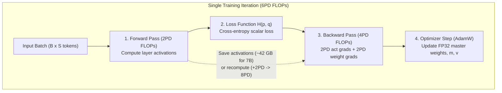
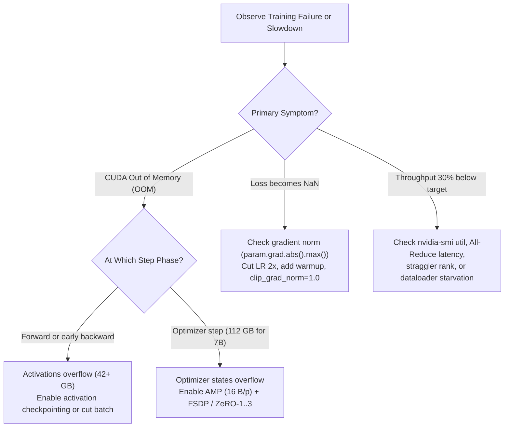

# 14.1 ML and deep learning fundamentals for infrastructure engineers

| Field | Value |
|---|---|
| Level | Basics |
| Priority tier | 2 |
| Lab venue | Nebius GPU + Local Python Verification Lab (`code/part14/ml_dl_fundamentals_lab.py`) |
| Part | Part 14: Distributed training and fine-tuning |
| Primary sources | *Designing Machine Learning Systems* (`designing-machine-learning-systems`, Ch. 1, Ch. 2, Ch. 6); *Engineering AI Systems: Architecture and DevOps Essentials* (`engineering-ai-systems-architecture-and-devops-essentials`, Ch. 3); NVIDIA Zero-to-Hero Volume 13 (`chapter-01-why-distributed-training-exists.md`, `chapter-02-training-memory-and-compute-anatomy.md`) and Volume 21 (`chapter-07-multi-node-distributed-training.md`) |
| Coverage file | `planning/coverage/chapters/14-01.md` |
| Claim & number ledger | `planning/ledgers/14-01.md` |

## Why this matters for AI infrastructure

When data scientists say "machine learning system," they often picture the neural network architecture or the optimization algorithm. In production, the ML algorithm is a small fraction of a holistic system that spans business objectives, data engineering pipelines, feature stores, distributed training clusters, checkpoint storage, deployment serving engines, and continuous observability (*Designing Machine Learning Systems*, Ch. 1). Yet an AI infrastructure or platform engineer who treats the training loop as an opaque black box cannot size a cluster, diagnose an Out-Of-Memory (`OOM`) crash at step `1`, explain why doubling GPU count from `512` to `1,024` stopped speeding up convergence, or tell whether a `20M tokens/sec` throughput reading on `64` GPUs represents healthy utilization or a `30%` fabric regression.

Every mathematical choice inside a machine learning or deep learning training loop maps directly onto a physical hardware constraint:
1. **The Memory Wall (`16 bytes/parameter` + Activations):** GPU `HBM` capacity has grown linearly (`80 GB` `HBM3` on an `NVIDIA A100` or `H100`), whereas foundation model parameter counts have grown exponentially. Loading `GPT-3` (`175B` parameters) in `FP32` (`4 bytes/parameter`) requires `175,000,000,000 x 4 bytes = 700 GB` of model weights alone—exceeding a single `80 GB` `H100` by **`8.75x`** before allocating a single byte for gradients, optimizer states, or activations (`V13 Ch. 01`). Even a `7B`-parameter model trained with `Adam` requires `28 GB` of weights, `28 GB` of gradients, and `56 GB` of optimizer states (`112 GB` static state), plus `42–80 GB` of intermediate activations and `5–10 GB` of buffers (`180–190 GB` total), crashing a single `80 GB` GPU with `RuntimeError: CUDA out of memory. Tried to allocate 2.45 GiB` (`79,456 MiB` used, `103 MiB` free out of `79,559 MiB`).
2. **The Compute Wall (`2PD` Forward + `4PD` Backward = `6PD` Training FLOPs):** A single `GPT-3` (`175B`) forward pass at batch size `2,048` and sequence length `2,048` (`4,194,304` tokens) requires `2 x 175 x 10^9 x 2048 x 2048 ~= 1.46 x 10^18 FLOPs` (`1.4680 x 10^18` exact; `4.4040 x 10^18` FLOPs for the full `6PD` forward + backward step). On one `A100` GPU delivering `312 TFLOPS` (`FP32` tensor operations), `1.46 x 10^18` FLOPs takes **`4,679.49` seconds (`~4,679 s` or `78` minutes)** for a single step; across `128` `A100` GPUs, that step drops `128x` to **`36.56` seconds (`~37` seconds)** (`V13 Ch. 01`). Across a full `500B`-token pretraining corpus (`DMLS Ch. 2`), `GPT-3` (`175B`) requires `6 x 175 x 10^9 x 500 x 10^9 = 5.25 x 10^23 FLOPs` (`525.0 ZFLOPs`).
3. **Hyperparameters as Cluster Control Knobs:** Learning rate (`LR`), linear warmup + cosine decay schedules, micro-batch size, gradient accumulation, and global batch size (`3.2M` tokens for `GPT-3` `175B`, `DMLS Ch. 6`) are not merely statistical tuning dials. Pushing global batch size beyond the **critical batch size** (`B_crit`) governed by the gradient noise scale wastes GPU-hours in a curvature-dominated diminishing-returns regime (`DMLS Ch. 6`), while scaling batch size across `64` GPUs (`128` sequences/GPU = `8,192` global sequences) without applying square-root or linear learning-rate scaling (`1e-4 x sqrt(8192 / 32) = 1.6e-3`) and warmup causes either sluggish progress or `NaN` gradient divergence (`V21 Ch. 07`).

## Prerequisites and outcomes

### Prerequisites
- Familiarity with GPU compute architecture (`SMs`, Tensor Cores, `HBM`, `NVLink`, `PCIe`) from Part 4 and `CUDA` / `PyTorch` runtime basics from Part 6.
- Understanding of cluster networking (`RoCEv2`, `InfiniBand`, `NCCL` collectives) from Part 9 and checkpoint storage paths from Part 13.

### Outcomes
After completing this chapter, you will be able to:
1. Contrast **symbolic AI**, **classical data-driven ML** (`classification`, `regression`, `clustering`, and `ensembles`), and **foundation models** (`FMs`) across the `4` phases of ML adoption (`DMLS Ch. 1, Ch. 2, Ch. 6`; `EAS Ch. 3`), and translate business goals into decoupled ML objective functions and tail-latency SLAs (`p50`, `p90`, `p99`).
2. Derive the exact **`6PD` training FLOPs law** (`2PD` forward pass + `4PD` backward pass = `6PD` total, or `8PD` with full activation checkpointing) and calculate single-step and full-run wall-clock times, achieved `TFLOPS/GPU`, and **Model FLOPs Utilization (`MFU`)**.
3. Break down the `5` GPU memory consumers of a training step (`weights`, `gradients`, `optimizer states`, `activations`, and `workspace buffers`), prove why mixed-precision `AdamW` consumes **`16 bytes/parameter`** (`2 B` `BF16` weights + `2 B` `BF16` grads + `4 B` `FP32` master weights + `4 B` `FP32` momentum `m` + `4 B` `FP32` variance `v`) versus `8 B` or `12 B/parameter` for `SGD`, and select between `AMP`, activation checkpointing, and distributed sharding.
4. Compute **linear warmup + cosine annealing learning-rate schedules**, batch-size learning-rate scaling rules (`sqrt` and `linear`), **critical batch size (`B_crit`)** parallel scaling efficiency, and pipeline parallelism bubble fractions `(p - 1) / (m + p - 1)`.
5. Calculate **cross-entropy loss** `H(p, q)` and **perplexity** `PPL = exp(loss)`, evaluate models against the `5` production baselines (`random`, `simple heuristic`, `zero-rule`, `human`, `existing solutions`), and apply perturbation, invariance, directional, calibration, and slice-based tests (`Simpson's paradox`).

---

## 1. AI Taxonomy, ML Systems Design, and Model Selection (`EAS Ch. 3`, `DMLS Ch. 1–2, Ch. 6`)

Before provisioning GPU racks, an infrastructure architect must verify whether a workload requires symbolic rules, a classical tabular ML model on CPUs, or a multi-billion-parameter foundation model (`FM`) on an `NVLink`/`InfiniBand` cluster. As George Box observed (quoted in both *Engineering AI Systems* Ch. 3 and *Designing Machine Learning Systems* Ch. 6), *"All models are wrong, but some are useful"*—because every model is an abstraction that omits real-world detail.

### 1.1 Symbolic AI vs Data-Driven ML vs Foundation Models (`EAS Ch. 3`)

*Engineering AI Systems* (Ch. 3, Sections `3.1–3.3`) divides AI techniques into **symbolic AI** (rule-based) and **non-symbolic (sub-symbolic) AI** (data-driven machine learning and foundation models):

| Category | Learning Paradigm & Data | When to Choose (`EAS Ch. 3`, `DMLS Ch. 1`) | Execution & Infrastructure Profile |
|---|---|---|---|
| **1. Symbolic & Rule-Based AI** | Explicit human-authored rules (`if/else` knowledge base); no training dataset | Well-understood domain; well-defined scope (`a few hundred rules`, failing when rules grow into the `thousands`); strict regulatory compliance and `100%` audit traceability | CPU-bound rules engine; latency governed by **rule ordering**, **rule grouping** (cache locality), **conflict resolution** (`specificity`, `salience`, `chronological order`), **condition indexing/filtering**, pre-compilation, and thread parallelism (`EAS 3.3.1`) |
| **2. Classical Data-Driven ML** | **Supervised** (labeled input-target pairs), **Unsupervised** (unlabeled pattern discovery / clustering) | Large structured/tabular datasets where complex patterns exist (`DMLS Ch. 1`: `9` criteria—capacity to learn, complex patterns, existing data, predictive framing, unseen data shares distribution, repetitive, cheap wrong predictions, at scale, changing patterns) | Often fits on CPU or single GPU (`scikit-learn`, `XGBoost`, `LightGBM`); fast training and sub-millisecond inference (`1 GB` to `16 GB` RAM) |
| **3. Foundation Models (`FMs`) & Deep Learning** | **Self-supervised pretraining** (models generate their own labels from massive unlabeled corpora, e.g., masked token or next-token prediction) followed by **supervised fine-tuning (`SFT`)** on labeled instruction datasets (`EAS Ch. 3`) | Unstructured modalities (**Language**, **Vision**, **Audio**, **Video**, **Multimodal**, and **Domain-specific** models such as `BloombergGPT` `50B` for finance, `NVIDIA Nemotron`, `BLOOM` [`1,000+` researchers], `OpenAI GPT-x`, `Google Gemini`, `Meta LLaMA`, `BERT-Large` `340M` params / `1.35 GB`) | Multi-GPU / multi-node accelerated clusters (`PyTorch`, `TensorFlow`, `Megatron-LM`, `DeepSpeed`) across cloud platforms (`AWS SageMaker`, `Azure ML`, `Google Vertex AI`, `IBM Watson Studio`, `MosaicML`) or on-prem GPU fabrics |

### 1.2 Research vs Production Systems and Latency vs Throughput (`DMLS Ch. 1–2`)

Academic ML research and production ML engineering optimize fundamentally different system properties (*Designing Machine Learning Systems*, Ch. 1, Table 1-1):
- **Stakeholders and Objectives:** Research optimizes a single metric—state-of-the-art (`SOTA`) accuracy on a static benchmark. Production must reconcile conflicting stakeholders: ML engineers (accuracy via complex models), sales (recommending expensive restaurants for a `10%` order fee), product (strict `< 100 ms` latency SLA because `> 100 ms` causes `10%` of users to close the app; Akamai (`2017`) found a `100 ms` delay hurts conversion rates by `7%`, Booking.com (`2019`) found a `30%` latency increase costs `0.5%` in conversion, and Google (`2016`) found `> 50%` of mobile users abandon pages taking `> 3 seconds`), ML platform SREs (stability over frequent model updates), and executives (maximizing margin; acquiring a mobile app user who makes an in-app purchase costs `$86.61`, acquiring a Lyft rider costs `$158`, and customer acquisition is `5 to 25x` more expensive than retention).
- **Decoupling Conflicting Objectives (`DMLS Ch. 2`):** When a newsfeed must minimize both `quality_loss` and `engagement_loss`, combining them into a single training loss `loss = alpha * quality_loss + beta * engagement_loss` forces a full model retrain every time business priorities shift `alpha` and `beta`. Decoupling into two separate models (`quality_model` and `engagement_model`) and ranking by `alpha * quality_score + beta * engagement_score` at serving time allows instant weight tuning and independent retraining schedules.
- **Computational Priority (Throughput vs Tail Latency):** Research prioritizes **fast training and high throughput** via aggressive batching, whereas production prioritizes **fast inference and low tail latency**. If a system processes `1` query at a time, `10 ms` latency yields `100 queries/sec` and `100 ms` yields `10 queries/sec`. With **batching**, processing `10` queries in `10 ms` achieves **`1,000 queries/sec`** at `10 ms` latency, and batching `50` queries in `20 ms` achieves **`2,500 queries/sec`** at `20 ms` latency—both latency and throughput increase (`DMLS Ch. 1`, Fig. 1-4).
- **Latency Percentiles (`p50`, `p90`, `p99`):** Arithmetic mean latency hides tail outliers. For `10` requests with latencies `[100, 102, 100, 100, 99, 104, 110, 90, 3000, 95] ms`, the average is **`390.0 ms`**, yet the median (**`p50`**) is **`100.0 ms`** and the **`p90`** outlier is **`3,000.0 ms`** (`3.0 s`). Production SLAs are always specified at `p90`, `p95`, or `p99`/`p99.9`.
- **Four Systems Requirements & Maturity (`DMLS Ch. 2`):** Every production ML system requires **Reliability** (detecting silent model failures where `model.predict()` returns HTTP `200` with garbage predictions), **Scalability** (scaling from a `1 GB` RAM logistic regression to a `100M`-parameter model needing `16 GB` RAM, scaling from `10,000` to `10M` daily requests, or managing `8,000` per-customer enterprise models; Amazon's Prime Day autoscaling crash cost `$72M–$99M` per hour), **Maintainability** (versioning code, data, and artifacts across ML, DevOps, and SMEs), and **Adaptability** (continual learning under shifting distributions). Algorithmia (`2020`) found that `75%` of organizations with `> 5` years of ML maturity deploy a model in `< 30` days, whereas `60%` of beginners take `> 30` days.

### 1.3 Taxonomy of ML Tasks, Algorithms, Ensembles, and the Four Adoption Phases (`EAS 3.2.2`, `DMLS Ch. 2, Ch. 6`)

Both *Engineering AI Systems* (`3.2.2`) and *Designing Machine Learning Systems* (`Ch. 2` & `Ch. 6`) emphasize problem framing and starting simple:
1. **Classification vs Regression vs Clustering (`EAS 3.2.2`, `DMLS Ch. 2`):**
   - **Classification** assigns inputs to discrete categories: **binary** (`2` classes, e.g., spam vs non-spam, hotdog vs not-hotdog—note `EAS 3.2.2` distinguishes *class assignment* on static inputs from true temporal *prediction/forecasting*), **multiclass** (`>= 3` mutually exclusive classes; high-cardinality tasks with `1,000` classes require `>= 100` examples/class = `>= 100,000` labeled examples and benefit from **hierarchical classification**), and **multilabel** (each example belongs to a variable subset of classes, e.g., `[0, 1, 1, 0]` for entertainment + finance, solved via multi-output sigmoid or independent binary classifiers). Core algorithms (`EAS 3.2.2`): **K-Nearest Neighbors (`KNN`)** (majority vote of `k` nearest neighbors by Euclidean distance), **Logistic Regression** (linear weights + sigmoid `1 / (1 + exp(-z))` with `0.5` threshold), **Decision Trees** (recursive feature threshold splits), **Random Forests** (bagged ensemble of trees voting on random data/feature subsets), **Naive Bayes** (Bayes' theorem assuming conditional feature independence given the class), **Support Vector Machines (`SVM`)** (maximum-margin hyperplane between support vectors), and **Neural Networks** (input, hidden, and softmax output layers).
   - **Regression** predicts continuous numerical values (`EAS 3.2.2`): **Linear Regression**, **Polynomial Regression** (`n`-th degree nonlinear trends), **Support Vector Regression (`SVR`)** (`epsilon`-insensitive buffer zone around hyperplane), **Decision Tree Regression**, **Random Forest Regression** (averaging tree outputs), **Gradient Boosting Regression** (sequential trees correcting prior residuals scaled by learning rate), and **Neural Network Regression**.
   - **Framing Trick (`DMLS Ch. 2`, Figs. 2-5 & 2-6):** Framing next-app recommendation as `N`-class classification (`1` prediction outputting an `N`-element softmax vector) forces a model retrain whenever a new app is added. Framing it as **regression/scoring** (inputting `[user_features, env_features, app_features]` to output a scalar probability in `[0, 1]` across `N` independent queries) allows adding new apps zero-shot without retraining.
   - **Clustering (`EAS 3.2.2`):** Unsupervised grouping using distance metrics (Euclidean or **Levenshtein edit distance** for strings) via **hard clustering** (single cluster assignment) or **soft clustering** (cluster probabilities). Core algorithms: **K-Means** (iteratively assigning points to `k` centroids and recomputing means, used in Netflix movie/show clustering), **DBSCAN** (`MinPts` and radius `epsilon` categorizing **core**, **border**, and **noise** points across arbitrary cluster shapes), and **Hierarchical Clustering** (**agglomerative** bottom-up merging vs **divisive** top-down splitting).
2. **Ensembles: Bagging, Boosting, and Stacking (`DMLS Ch. 6`):**
   - `20` of `22` Kaggle winning solutions (`2021`, including a `33`-model winner) and all `top 20` `SQuAD 2.0` leaderboard entries use ensembles. Why? Suppose `3` **uncorrelated** spam classifiers each have **`70%` (`0.70`)** accuracy (`DMLS Ch. 6`, Table 6-1). Under majority vote:
     * All `3` correct: `0.7 x 0.7 x 0.7 = 0.343` (`34.3%`)
     * Exactly `2` correct: `3 x (0.7 x 0.7 x 0.3) = 0.441` (`44.1%`)
     * Exactly `1` correct: `3 x (0.3 x 0.3 x 0.7) = 0.189` (`18.9%`)
     * None correct: `0.3 x 0.3 x 0.3 = 0.027` (`2.7%`)
     The ensemble is correct whenever `>= 2` base learners are correct: `0.343 + 0.441 = 0.784` (**`78.4%` accuracy**, an **`+8.4%`** gain from uncorrelated diversity).
   - **Bagging** (*bootstrap aggregating*, e.g., Random Forests) samples with replacement in parallel to **reduce variance** and stabilize high-variance learners. **Boosting** (`GBM`, `XGBoost`, distributed `LightGBM`) trains weak learners sequentially on reweighted errors to **reduce bias**. **Stacking** trains a **meta-learner** (e.g., logistic/linear regression) on base learner predictions.
3. **Six Model Selection Tips & Four Phases of ML Adoption (`DMLS Ch. 6`):**
   - **Six Selection Tips:** (1) Avoid the `SOTA` trap, (2) start with the simplest model, (3) avoid human bias in model comparisons (equal hyperparameter tuning budgets across candidates), (4) evaluate performance *now* vs *later* using **learning curves** (and noteAndrew Ng's rule: high-variance models improve with more data, whereas high-bias models do not), (5) evaluate trade-offs (`FP` vs `FN`, compute/latency vs accuracy, interpretability vs performance—in `2019` Stanford HAI found only `13%` of large enterprises mitigated fairness risks and `19%` worked on explainability, while `50%` of tech executives rejected a `90%`-cure black-box AI surgeon in favor of an `80%`-cure human surgeon), and (6) verify model assumptions (**Prediction**, **IID**, **Smoothness**, **Tractability** `P(Z|X)`, **Linear Boundaries**, **Conditional Independence**, and **Normal Distribution**).
   - **Four Adoption Phases:** **Phase 1: Before ML** (non-ML heuristics—e.g., predicting top-`3` English letters `"e"`, `"t"`, `"a"` for `30%` accuracy, chronological Facebook newsfeed from `2006–2011`, or Martin Zinkevich's rule that if ML gives a `100%` boost, a heuristic gets you `50%` of the way there) `->` **Phase 2: Simplest ML models** (logistic regression, `GBDT`, `KNN` to validate pipeline end-to-end) `->` **Phase 3: Optimizing simple models** (feature engineering, objective tuning, hyperparameter search, ensembles) `->` **Phase 4: Complex models** (deep neural networks and foundation models).

---

## 2. Deep Learning Mechanics and the `6PD` Training FLOPs Law (`EAS Ch. 3`, `V13 Ch. 01–02`, `DMLS Ch. 2, Ch. 6`)

When Phase 4 demands a deep neural network or Transformer foundation model, training proceeds as an iterative loop over **batches**, **iterations (steps)**, and **epochs** (`EAS 3.3.2`):
- **Batch size (`B`):** Number of training examples (or tokens `B x S`, where `S` is sequence length) processed before a single weight update.
- **Iteration (Step):** A single forward + backward + optimizer update on one batch.
- **Epoch:** One full pass over the entire training dataset. For example, a dataset of **`1,000` examples** with a **batch size of `100`** requires **`10` iterations** to complete **`1` epoch** (`EAS 3.3.2`).



### 2.1 Why Forward Is `2PD` and Backward Is `4PD` (`Total = 6PD` FLOPs)

Consider a dense linear layer `Y = X * W` in a Transformer with parameter matrix `W` of shape `[d_in, d_out]` (`P = d_in x d_out` parameters) processing a batch of `D` tokens (`X` of shape `[D, d_in]`):
1. **Forward Pass (`2PD` FLOPs):** Computing `Y = X * W` (`[D, d_in] x [d_in, d_out] -> [D, d_out]`) performs `D x d_in x d_out = P x D` multiply-accumulate (`MAC`) operations. Because each `MAC` consists of **`1` floating-point multiplication + `1` floating-point addition = `2` FLOPs**, the forward pass across a model with `P` non-embedding parameters and `D` tokens costs:
   ```text
   F_forward = 2 x P x D   FLOPs
   ```
2. **Backward Pass (`4PD` FLOPs = `2x` Forward):** By the chain rule of calculus (`backpropagation`), every linear layer must compute two separate matrix multiplications during the backward pass given upstream gradient `dL/dY` (`[D, d_out]`):
   - **Gradient with respect to inputs/activations** (`dL/dX = dL/dY * W^T`, needed to propagate errors to earlier layers): `[D, d_out] x [d_out, d_in] -> [D, d_in]`, costing **`2 x P x D` FLOPs**.
   - **Gradient with respect to weights** (`dL/dW = X^T * dL/dY`, needed by the optimizer to update `W`): `[d_in, D] x [D, d_out] -> [d_in, d_out]`, costing another **`2 x P x D` FLOPs**.
   Summing both backward GEMMs yields:
   ```text
   F_backward = 2PD (activation grads) + 2PD (weight grads) = 4 x P x D   FLOPs
   ```
3. **Total Standard Training FLOPs (`6PD`) vs Activation Checkpointing (`8PD`):**
   ```text
   F_train_standard      = F_forward (2PD) + F_backward (4PD) = 6 x P x D   FLOPs
   F_train_checkpointed  = 6PD + 2PD (recomputed forward pass) = 8 x P x D   FLOPs  (+33.33% compute)
   ```
   When **activation (gradient) checkpointing** is enabled (`V13 Ch. 02`, `DMLS Ch. 6`), intermediate activations inside each Transformer block are discarded during the forward pass and recomputed on-the-fly via an extra forward pass (`+2PD`) during backpropagation—increasing total FLOPs from `6PD` to `8PD` (`+33.33%` total compute, or `30–50%` slower backward pass in `V13 Ch. 02`, enabling `10x` larger feed-forward models at `~20%` wall-clock overhead in Salimans & Bulatov [`2017`], `DMLS Ch. 6`).

### 2.2 Concrete Compute Scaling: `7B`, `70B`, and `175B` (`GPT-3`) Across Dataset Scales

*Designing Machine Learning Systems* (Ch. 2, Fig. 2-8) traces the exponential growth of language model datasets from **`0.8 billion` tokens** (`2013` One Billion Word Benchmark) to **`10 billion` tokens** (`2019` OpenAI `GPT-2`) and **`500 billion` tokens** (`2020` OpenAI `GPT-3`), while modern open-weights runs (`7B` to `70B`) train on **`1 trillion` (`1T`) to `2 trillion` (`2T`) tokens**:

| Model & Workload Scenario | Parameters (`P`) | Tokens (`D`) | Forward (`2PD`) | Backward (`4PD`) | Total Standard (`6PD`) | With Checkpointing (`8PD`) | Hardware Timing Benchmark (`code/part14/ml_dl_fundamentals.py`) |
|---|---|---|---|---|---|---|---|
| **`GPT-3` `175B` Single Step** (`V13 Ch. 01`, batch `2048`, seq `2048`) | `175 x 10^9` | `4,194,304` (`4.19M`) | `1.468 x 10^18` (`~1.46e18`) | `2.936 x 10^18` | `4.404 x 10^18` | `5.872 x 10^18` | At `1.46e18` FLOPs on `1` `A100` (`312 TFLOPS`): **`4,679.49 s` (`~78 min`)**; on `128` `A100` GPUs: **`36.56 s` (`~37 s`)** |
| **`7B` Model Pretraining** (`1T` tokens) | `7 x 10^9` | `1.0 x 10^12` | `1.40 x 10^22` | `2.80 x 10^22` | **`4.20 x 10^22` (`42.0 ZFLOPs`)** | `5.60 x 10^22` (`56.0 ZFLOPs`) | On `64` `H100` GPUs (`989 TFLOPS` peak) at `50%` `MFU` (`494.50 TFLOPS/GPU`, `31.648 PFLOPS`): **`368.64 hours` (`15.36 days`)** |
| **`GPT-3` `175B` Full Run** (`DMLS Ch. 2`, `500B` tokens) | `175 x 10^9` | `5.0 x 10^11` | `1.75 x 10^23` | `3.50 x 10^23` | **`5.25 x 10^23` (`525.0 ZFLOPs`)** | `7.00 x 10^23` (`700.0 ZFLOPs`) | Requires multi-node distributed training across hundreds or thousands of GPUs |
| **`70B` Model Pretraining** (`2T` tokens) | `70 x 10^9` | `2.0 x 10^12` | `2.80 x 10^23` | `5.60 x 10^23` | **`8.40 x 10^23` (`840.0 ZFLOPs`)** | `1.12 x 10^24` (`1.12 YFLOPs`) | On `512` `H100` GPUs (`989 TFLOPS` peak) at `45%` `MFU` (`445.05 TFLOPS/GPU`, `227.8656 PFLOPS`): **`1,024.0 hours` (`42.67 days`)** |

---

## 3. Training Step Memory Anatomy and `SGD` vs `AdamW` (`16 Bytes/Param`) (`V13 Ch. 01–02`, `EAS Ch. 3`)

Why does a `7B`-parameter model—whose `BF16` weights occupy only `14 GB` on disk—crash an `80 GB` `H100` GPU during training? Because a training step dynamically allocates five distinct memory consumers in GPU `HBM` (`V13 Ch. 01` & `Ch. 02`).

### 3.1 Optimizer State Memory: Vanilla `SGD` (`8 B`) vs Momentum `SGD` (`12 B`) vs Mixed-Precision `AdamW` (`16 B/param`)

During backpropagation, the optimizer updates model parameters `W` using computed gradients `g_t`. Different optimizers maintain vastly different historical state buffers per parameter (`V13 Ch. 01–02`, `EAS 3.3.2`):
1. **Vanilla `SGD` in `FP32` (`0` optimizer states = `8 bytes/parameter`):**
   `W_{t+1} = W_t - lr * g_t`. Requires only `4 bytes` (`FP32` weight) + `4 bytes` (`FP32` gradient) + `0 bytes` (state) = **`8 bytes/parameter`** (`56.0 GB` for a `7B` model).
2. **`SGD` with Momentum in `FP32` (`1` state buffer = `12 bytes/parameter`):**
   Maintains `1` exponential moving average velocity buffer `v_t` in `FP32` (`4 bytes/param`), totaling `4 B + 4 B + 4 B` = **`12 bytes/parameter`** (`84.0 GB` for a `7B` model).
3. **Pure `FP32` `Adam` / `AdamW` (`2` state buffers = `16 bytes/parameter`, `V13 Ch. 01–02`):**
   Maintains `2` `FP32` buffers per parameter—the first moment (**momentum** `m_t`, exponential moving average of gradients, controlled by `beta_1`) and the second moment (**variance** `v_t`, exponential moving average of squared gradients, controlled by `beta_2`):
   ```text
   FP32 Weights (4 B) + FP32 Gradients (4 B) + FP32 Momentum m (4 B) + FP32 Variance v (4 B) = 16 bytes/parameter
   ```
4. **Mixed-Precision (`AMP` `BF16`/`FP16` + `FP32` Master Weights) `AdamW` (`16 bytes/parameter`):**
   Why can we not simply train entirely in `FP16`? As explained in `V13 Ch. 02`, `FP16` has a narrow dynamic range (`~10^-5` to `10^4`, whereas `FP32` spans `10^-38` to `10^38`). Small gradient updates `lr * g_t` underflow to `0.0` when added directly to `FP16`/`BF16` weights. Mixed-precision `AdamW` therefore computes forward and backward GEMMs in `BF16`/`FP16` (`2 bytes/param` working weights + `2 bytes/param` gradients), but maintains an **`FP32` master copy of weights (`4 bytes/param`)** plus **`FP32` momentum `m` (`4 bytes/param`)** and **`FP32` variance `v` (`4 bytes/param`)** for the optimizer update:
   ```text
   Mixed-Precision AdamW Static Memory per Parameter:
     - BF16 / FP16 Working Weights:     2 bytes
     - BF16 / FP16 Gradients:           2 bytes
     - FP32 Master Weights:             4 bytes
     - FP32 Adam First Moment (m_t):    4 bytes
     - FP32 Adam Second Moment (v_t):   4 bytes
     ------------------------------------------
     TOTAL STATIC TRAINING STATE:      16 bytes / parameter
   ```

| Optimizer Configuration | Weights | Gradients | Master Weights | Optimizer States (`m`, `v`) | Total Bytes / Param | `7B` Static State | `70B` Static State | `175B` Static State |
|---|---|---|---|---|---|---|---|---|
| **Vanilla `SGD` (`FP32`)** | `4 B` (`FP32`) | `4 B` (`FP32`) | `0 B` | `0 B` (`0` states) | **`8 B / param`** | **`56.0 GB`** | `560.0 GB` | `1,400.0 GB` |
| **`SGD` + Momentum (`FP32`)** | `4 B` (`FP32`) | `4 B` (`FP32`) | `0 B` | `4 B` (`1` state: `v_t`) | **`12 B / param`** | **`84.0 GB`** | `840.0 GB` | `2,100.0 GB` |
| **Pure `FP32` `Adam` / `AdamW`** (`V13 Ch. 01–02`) | `4 B` (`FP32`) | `4 B` (`FP32`) | `0 B` | `8 B` (`4 B` `m_t` + `4 B` `v_t`) | **`16 B / param`** | **`112.0 GB`** | `1,120.0 GB` | `2,800.0 GB` |
| **Mixed-Precision `AdamW` (`BF16`/`FP16` + `FP32` Master)** | `2 B` (`BF16`) | `2 B` (`BF16`) | `4 B` (`FP32`) | `8 B` (`4 B` `m_t` + `4 B` `v_t`) | **`16 B / param`** | **`112.0 GB`** (`14+14+28+28+28`) | **`1,120.0 GB`** (`~1.2 TB` with buffers) | **`2,800.0 GB`** (`2.8 TB`) |

### 3.2 Timeline of the Five Memory Consumers Across a `7B` Training Step (`V13 Ch. 02`)

In addition to the `112.0 GB` static state (`16 B/param`), the GPU must store **activations** (intermediate layer outputs saved during forward propagation so backpropagation can compute `dL/dW = X^T * dL/dY`) and **temporary workspace buffers** (`5–15 GB` for `PyTorch` dispatch, `cuBLAS` workspaces, `NCCL` communication staging, and allocator fragmentation).

Following the concrete `7B` Transformer walkthrough in `V13 Ch. 02` (`32` layers, `hidden_dim = 4096`, `batch_size = 4`, `seq_len = 2048`):
- **Stage 1 — Forward Pass (`70.0 GB`, `87.5%` of an `80 GB` `H100`):**
  Model weights (`28.0 GB` in `FP32`) + saved activations across `32` layers (`32 x 4 x 4096 x 4 x 2048 ~= 42.0 GB`, or `60–80 GB` on `120`-layer deeper variants in `V13 Ch. 01`) = **`70.0 GB`**. An `80 GB` `H100` is already at **`87.5%`** capacity before backward even starts.
- **Stage 2 — Backward Pass Without Activation Checkpointing (`98.0 GB` -> `OOM`):**
  Holding `28.0 GB` weights + `42.0 GB` saved forward activations while allocating `28.0 GB` of gradients requires **`98.0 GB`**, immediately crashing an `80 GB` GPU.
- **Stage 3 — Backward Pass With Activation Checkpointing (`66.0 GB` -> Fits):**
  Saving only layer boundary checkpoints and recomputing intermediate activations on demand drops peak activation memory from `42.0 GB` to **`10.0 GB`** (`5–10 GB` peak): `28.0 GB` weights + `10.0 GB` recomputed activations + `28.0 GB` gradients = **`66.0 GB`** (at the cost of `30–50%` slower backward compute).
- **Stage 4 — Optimizer Step (`112.0 GB` -> `OOM` Without Sharding):**
  Updating parameters with `Adam` requires `28.0 GB` weights + `28.0 GB` gradients + `28.0 GB` momentum (`m`) + `28.0 GB` variance (`v`) = **`112.0 GB`** simultaneously in `VRAM`, proving why optimizer-state sharding (`ZeRO-1` / `FSDP`) or CPU offloading is mandatory.
- **Effect of Automatic Mixed Precision (`AMP`, `V13 Ch. 02`):**
  Casting forward/backward layers to `FP16`/`BF16` cuts the `98.0 GB` forward+backward footprint to **`51.0 GB`** (`14.0 GB` `FP16` weights + `21.0 GB` `FP16` activations + `14.0 GB` `FP16` gradients + `2.0 GB` `FP32` loss/normalizations). In the `V13 Ch. 02` benchmark (`python train.py --use_amp True`), `AMP` drops measured GPU memory from **`78.5 GB` to `48.2 GB`** while increasing training speed from **`1,000 tokens/sec` to `1,280 tokens/sec` (`1.28x` speedup)** due to Tensor Core acceleration and reduced memory-bandwidth pressure.

---

## 4. Optimization Dynamics: Learning Rate Schedules, Critical Batch Size, and Loss/Perplexity (`EAS Ch. 3`, `DMLS Ch. 2, Ch. 6`, `V21 Ch. 07`)

### 4.1 Linear Warmup + Cosine Decay and Batch-Size LR Scaling (`V21 Ch. 07`, `EAS 3.3.2`)

In neural network training, the **learning rate (`lr`)** is the single most sensitive hyperparameter (`EAS 3.3.2`, `DMLS Ch. 6`). At step `0`, model weights are randomly initialized and `AdamW` second-moment variance estimates `v_t` are uncalibrated; applying a large learning rate immediately causes massive weight jumps and gradient divergence (`loss = NaN`). Conversely, holding a large learning rate constant at the end of training causes the optimizer to bounce around the minimum of the loss basin.

Modern LLM training therefore pairs **linear warmup** (`0 <= step <= W`) with **cosine annealing decay** (`W < step <= T`) down to a minimum learning rate `lr_min` (typically `0.1 x lr_peak`):

```text
1. Linear Warmup (0 <= t <= W):
   lr(t) = lr_peak x (t / W)

2. Cosine Decay (W < t <= T):
   progress = (t - W) / (T - W)
   lr(t)    = lr_min + 0.5 x (lr_peak - lr_min) x (1 + cos(pi x progress))
```

For a concrete `100,000`-step run (`T = 100,000`) with `W = 2,000` warmup steps, `lr_peak = 3.0e-4` (`0.0003`), and `lr_min = 3.0e-5` (`0.00003`):
- At `t = 0`: `lr(0) = 0.0`.
- At `t = 1,000` (`50%` warmup): `lr(1000) = 3.0e-4 x (1000 / 2000) = 1.5e-4`.
- At `t = 2,000` (`warmup peak`): `lr(2000) = 3.0e-4`.
- At `t = 51,000` (`50%` cosine progress, `(51000 - 2000) / 98000 = 0.5`): `cos(0.5 * pi) = 0`, so `lr(51000) = 3.0e-5 + 0.5 x (2.7e-4) = 1.65e-4`.
- At `t = 100,000` (`end of decay`): `cos(pi) = -1`, so `lr(100000) = 3.0e-5`.

**Scaling Learning Rate with Global Batch Size (`V21 Ch. 07`, `DMLS Ch. 6`):**
When you scale data parallelism across `N` GPUs, `global_batch_size = batch_size_per_gpu x num_gpus`. For example (`DMLS Ch. 6`), if `1` machine processes a batch of `1,000` samples and takes `1,000,000` (`1M`) steps per epoch, `1,000` machines process a global batch of **`1,000,000` (`1M`)** samples and take only **`1,000` steps** per epoch (`GPT-3` `175B` uses a `3.2M`-token global batch size). To compensate for fewer steps with lower-variance gradients, `V21 Ch. 07` demonstrates the **square-root scaling rule** (`lr_scaled = lr_base x sqrt(B_global / B_base)`): scaling from `B_base = 32` (`lr_base = 1e-4`) to `64` GPUs at `128` sequences/GPU (`B_global = 8,192`) multiplies the learning rate by `sqrt(8192 / 32) = sqrt(256) = 16x` to **`1.6e-3`** (whereas linear scaling `lr_base x (B_global / B_base)` yields `2.56e-2`, which often destabilizes `AdamW` without long warmup).

### 4.2 Critical Batch Size (`B_crit`), Gradient Noise Scale, and Parallel Regimes (`DMLS Ch. 6`, `V21 Ch. 07`)

Why can you not shorten a `30`-day training run to `30` minutes simply by multiplying `num_gpus` and `global_batch_size` by `1,440x`? As McCandlish et al. (`2018`, cited in `DMLS Ch. 6` footnote 20) proved, increasing global batch size `B` reduces stochastic gradient noise only up to the **critical batch size (`B_crit`)**, which is proportional to the **gradient noise scale** `B_noise = tr(Sigma) / |G|^2` (the ratio of per-sample gradient variance `tr(Sigma)` to the squared norm of the true gradient `|G|^2`):

```text
Relative Optimization Steps Required:   S / S_min = 1 + (B_crit / B)
Relative Total Data / Compute Cost:     E / E_min = 1 + (B / B_crit)
Parallel Step Scaling Efficiency:       eta(B)    = 1 / (1 + B / B_crit)
```

| Global Batch Size (`B`) vs `B_crit` (Example `B_crit = 2,048,000` tokens) | Step Ratio (`S / S_min`) | Data & FLOP Cost (`E / E_min`) | Step Scaling Efficiency (`eta`) | Physical Training Regime (`code/part14/ml_dl_fundamentals.py`) |
|---|---|---|---|---|
| **`B = 0.25 x B_crit` (`512,000` tokens)** | `5.00x` | `1.25x` | **`80.0%`** | **Noise-Dominated (Linear Scaling):** Doubling `B` cuts required steps nearly in half (`~2x` speedup) with minimal wasted FLOPs |
| **`B = 1.00 x B_crit` (`2,048,000` tokens)** | **`2.00x`** | **`2.00x`** | **`50.0%`** | **Critical Batch Knee (`B = B_crit`):** Requires `2x` minimum steps and `2x` minimum compute; optimal cost/time knee for cluster sizing |
| **`B = 8.00 x B_crit` (`16,384,000` tokens)** | `1.125x` | **`9.00x`** | **`11.11%`** | **Curvature-Dominated (Diminishing Returns):** Batch gradient is already exact; `8x` more GPUs reduce steps by only `11.1%` while burning **`9.0x` total GPU FLOPs** |

When `B` approaches `B_crit`, adding more GPUs via **Data Parallelism (`DDP`)** alone wastes compute; you must instead keep `B <= B_crit` and scale via **Model Parallelism** (`DMLS Ch. 6`, `V21 Ch. 07`):
- **Synchronous vs Asynchronous SGD (`DMLS Ch. 6`, Fig. 6-6):** In data parallelism, **synchronous SGD** waits at an `All-Reduce` barrier for every worker to finish its mini-batch (vulnerable to the **straggler problem** across `N` workers), whereas **asynchronous SGD** (`Hogwild!`) updates weights immediately from each worker, risking **gradient staleness** unless weight updates are sparse.
- **Tensor Parallelism (`TP`, `V21 Ch. 07`):** Splits weight matrices *inside* each layer (`column-parallel` first MLP matrix + `row-parallel` second MLP matrix in `Megatron-Core`, e.g., `Llama-70B` with `80` layers, `hidden_size = 8192`, `64` attention heads, `tensor_model_parallel_size = 8`). Because `TP` executes an `All-Reduce` on *every layer* in both forward and backward passes, it **must stay inside a single node's `900 GB/s` `NVLink` domain** (`V21 Ch. 07`), never across `50 GB/s` inter-node InfiniBand.
- **Pipeline Parallelism (`PP`, `DMLS Ch. 6` Fig. 6-8, `V21 Ch. 07`):** Places consecutive layer groups (`p` stages) on different machines (`pipeline_model_parallel_size = 2` or `4`) and splits each mini-batch into `m` micro-batches (`GPipe`, `1F1B`) so stage `2` computes micro-batch `1` while stage `1` computes micro-batch `2`. The idle startup/drain slots form the **pipeline bubble fraction**:
  ```text
  Bubble Fraction = (p - 1) / (m + p - 1)
  ```
  For `p = 4` stages and `m = 4` micro-batches, the bubble fraction is `(4 - 1) / (4 + 4 - 1) = 3 / 7 = 42.86%` (`0.4286`); increasing to `m = 16` micro-batches shrinks the bubble to `3 / 19 = 15.79%` (`0.1579`).

### 4.3 Cross-Entropy Loss, Perplexity `exp(loss)`, and Production Offline Evaluation (`DMLS Ch. 2, Ch. 6`)

For classification and autoregressive language modeling, the standard objective function is **cross-entropy loss** `H(p, q)` between the ground-truth distribution `p` and the model's predicted softmax distribution `q`, and language modeling reports **perplexity (`PPL`)** as the exponential of cross-entropy loss in natural-log units (`nats`):

```text
Cross-Entropy Loss (nats):   H(p, q) = - sum_i  p_i x ln(q_i)
Perplexity (PPL):            PPL     = exp( H(p, q) )
```

- **Worked Example 1 (`DMLS Ch. 2` `4`-Class Topic Classification):** An article about `[tech, entertainment, finance, politics]` has ground truth `p = [0, 0, 0, 1]` (politics) and model prediction `q = [0.45, 0.2, 0.02, 0.33]`. The cross-entropy loss is:
  ```text
  H(p, q) = -(0 + 0 + 0 + 1 x ln(0.33)) = -ln(0.33) = 1.108663 nats   (1.599462 bits)
  PPL     = exp(1.108663) = 3.030303   (= 1 / 0.33, effective branching factor of ~3.03 choices)
  ```
- **Worked Example 2 (LLM Vocabulary Guessing vs Converged Pretraining):** At step `0` over a `V = 50,000`-token vocabulary, uniform guessing assigns `q_i = 1 / 50,000` to the true token, yielding `loss = ln(50,000) = 10.819778 nats` and **`PPL = exp(10.819778) = 50,000.0`**. As training converges to `loss = 2.50 nats`, perplexity drops to **`exp(2.50) = 12.182494` (`12.18`)**; at `loss = 2.00 nats`, perplexity reaches **`exp(2.00) = 7.389056` (`7.39`)**.

**Offline Evaluation Beyond Raw Loss (`DMLS Ch. 6`):**
Before deploying a trained checkpoint, *Designing Machine Learning Systems* (Ch. 6) requires evaluating against **five baselines** and **five behavioral/slice tests**:
1. **Five Baselines:** (i) **Random baseline**—on an imbalanced dataset with `90%` `NEGATIVE` and `10%` `POSITIVE` (`DMLS Ch. 6`, Table 6-2), uniform random (`50%/50%`) gets `F1 = 0.167` and `Accuracy = 0.50`, whereas predicting `NEGATIVE` `90%` of the time (`task label distribution`) gets `F1 = 0.10` and `Accuracy = 0.82` (and if `POSITIVE` is `90%` of labels, random guessing at `90%` achieves `F1 = 0.90` and `Accuracy = 0.80`); (ii) **Simple heuristic** (e.g., reverse-chronological feed); (iii) **Zero-rule baseline** (always predicting the most common class—e.g., recommending a user's single most-used phone app for `70%` accuracy, or always predicting the `90%` majority class for `90%` accuracy); (iv) **Human baseline**; and (v) **Existing business-logic solutions**.
2. **Perturbation, Invariance, Directional, Calibration, and Slice-Based Tests:**
   - **Perturbation tests:** Inject realistic production noise (e.g., microphone background chatter/clipping on `2`-second hospital cough recordings) to verify robustness.
   - **Invariance tests:** Verify outputs do *not* change when sensitive attributes change (e.g., race or applicant names—referencing the Berkeley study where `1.3 million` creditworthy Black and Latino mortgage applicants were rejected between `2008` and `2015`, and deleting race identifiers reversed the rejections).
   - **Directional expectation tests:** Verify monotonic relationships (e.g., increasing house lot size never decreases predicted price).
   - **Model calibration & confidence measurement:** A model predicting a `70%` win rate that wins only `60%` of `1,000` games (or `10%` ad CTR that gets `5%` clicks, or an uncalibrated movie recommender showing `100%` romance instead of a user's `80%` romance / `20%` comedy habit) is miscalibrated; measure with `sklearn.calibration.calibration_curve` and fix via **Platt scaling** (`CalibratedClassifierCV`).
   - **Slice-based evaluation & Simpson's Paradox (`DMLS Ch. 6`, Tables 6-3, 6-4, 6-5):** On a dataset with `90%` majority and `10%` minority samples (`Table 6-3`), **Model A** (`98%` majority, `80%` minority) achieves **`96.2%` overall accuracy**, whereas **Model B** (`95%` majority, `95%` minority) achieves **`95.0%` overall accuracy**—aggregate accuracy hides Model A's `80%` minority failure. Even worse, **Simpson's paradox** (`Table 6-4`, Charig et al. `1986` kidney stone study; `Table 6-5`, Berkeley `1973` admissions across `12,763` applicants where men had a `44%` [`8,442`] aggregate admission rate vs `35%` [`4,321`] for women despite women having higher admission rates in `4` of `6` departments `A..F`) shows **Model A** beating **Model B** in both **Group A** (`81/87 = 93%` vs `234/270 = 87%`) and **Group B** (`192/263 = 73%` vs `55/80 = 69%`), yet losing when aggregated (**`273/350 = 78%` vs `289/350 = 83%`**). Discover critical slices via **heuristics**, **error analysis** (e.g., finding a half-hidden button on mobile screens), and automated **Slice Finder** algorithms.

---

## 5. Training Time, Model FLOPs Utilization (`MFU`), Experiment Tracking, and AutoML (`DMLS Ch. 6`, `V13 Ch. 01–02`, `V21 Ch. 07`)

### 5.1 Capacity Planning: Achieved TFLOPS, `MFU`, and Training Duration

When sizing a GPU cluster for a foundation model pretraining or fine-tuning campaign, platform engineers use **Model FLOPs Utilization (`MFU`)**—the ratio of useful `6PD` model FLOPs executed per second per GPU to the GPU's theoretical dense Tensor Core datasheet peak (`peak_tflops_per_gpu`, e.g., `989 TFLOPS` `BF16` on `NVIDIA H100 SXM5` or `312 TFLOPS` on `NVIDIA A100`):

```text
Achieved TFLOPS / GPU   = (6 x P x tokens_per_sec_cluster) / (num_gpus x 10^12)
MFU                     = Achieved TFLOPS / GPU  ÷  Hardware Peak TFLOPS / GPU
Training Time (seconds) = (6 x P x D) / (num_gpus x Hardware_Peak_FLOPS x MFU)
```

Notice that `MFU` deliberately measures useful `6PD` mathematical progress against hardware peak, *excluding* activation recomputation overhead (`+2PD`), `NCCL` communication stalls, pipeline bubbles, and dataloader waits. In production multi-node LLM runs, `MFU` typically lands between **`35%` and `55%`**.

**Worked Cluster Sizing Examples (`code/part14/ml_dl_fundamentals.py`):**
1. **`70B` Model on `2 Trillion` (`2 x 10^12`) Tokens Across `512` `H100` GPUs (`989 TFLOPS` `BF16` peak) at `45%` `MFU`:**
   - Total training compute (`6PD`): `6 x (70 x 10^9) x (2 x 10^12) = 8.40 x 10^23 FLOPs` (`840.0 ZFLOPs`).
   - Achieved compute per GPU: `989.0 x 0.45 = 445.05 TFLOPS/GPU`.
   - Aggregate cluster compute: `512 x 445.05 TFLOPS = 227,865.6 TFLOPS = 227.8656 PFLOPS`.
   - Cluster token throughput: `227.8656 x 10^15 / (6 x 70 x 10^9) = 542,537.14 tokens/sec` (**`1,059.64 tokens/sec/GPU`**).
   - Wall-clock training duration: `8.40 x 10^23 / (227.8656 x 10^15) = 3,686,383.30 seconds = 1,024.0 hours = 42.67 days`.
2. **`7B` Model on `1 Trillion` (`1 x 10^12`) Tokens Across `64` `H100` GPUs (`989 TFLOPS` peak) at `50%` `MFU`:**
   - Total training compute (`6PD`): `6 x (7 x 10^9) x (1 x 10^12) = 4.20 x 10^22 FLOPs` (`42.0 ZFLOPs`).
   - Achieved compute per GPU: `989.0 x 0.50 = 494.50 TFLOPS/GPU` (`31.648 PFLOPS` across `64` GPUs).
   - Wall-clock training duration: `4.20 x 10^22 / (31.648 x 10^15) = 1,327,098.08 seconds = 368.64 hours = 15.36 days`.



### 5.2 Experiment Tracking, Data Versioning, Debugging, and AutoML (`DMLS Ch. 6`, `EAS 3.3.2`)

1. **Experiment Tracking & Data Versioning (`DMLS Ch. 6`):**
   Small hyperparameter diffs—such as `lr = 0.003` vs `lr = 0.002`—produce drastically different models. Production teams log `6` telemetry streams in tools like `MLflow`, `Weights & Biases`, and `DVC`: (i) train and validation loss curves, (ii) task metrics (`F1`, `accuracy`, `perplexity`), (iii) sample prediction/label logs, (iv) training speed (`steps/sec` or `tokens/sec`), (v) system telemetry (`GPU memory`, `GPU/CPU utilization`), and (vi) dynamic parameter/hyperparameter norms (`learning rate schedule`, global and per-layer **gradient norms** under gradient clipping, and **weight norms** under weight decay `L1` Lasso, `L2` Ridge, `ElasticNet`, or `dropout`, `EAS 3.3.2`). Unlike Git line-by-line code diffs, **data versioning** (`DVC`) tracks directory checksums and file additions/removals because datasets cannot be duplicated locally, `1,000,000`-character binary lines cannot be line-diffed, merging dataset `X` (model `A`) with dataset `Y` (model `B`) into `Z` has no merged model, and `GDPR` right-to-erasure mandates deleting user records across historical versions (`DMLS Ch. 6`). Even with full versioning, hardware nondeterminism (`CUDA` atomic operation ordering) requires explicit random seed locking (`DMLS Ch. 6`).
2. **Preventive Debugging Discipline (`DMLS Ch. 6`):**
   Because ML models fail silently, take hours to retrain, and span cross-functional teams (data engineers, SMEs, ML scientists, platform SREs), `DMLS Ch. 6` prescribes three non-negotiable debugging steps before launching a multi-node run:
   - **Start simple and add components incrementally** (e.g., `1` `RNN` layer before stacking, or `BERT` `MLM` loss alone before adding `NSP` loss).
   - **Overfit a single batch** (e.g., `10` images to `100%` accuracy or `100` translation sentence pairs to a `BLEU` score near `100`; if the model cannot drive loss to `~0` on `1` batch, there is a bug in the model code, loss sign, or forgotten `model.train()` / `zero_grad()`).
   - **Set all random seeds** (`Python`, `NumPy`, `PyTorch` CPU/CUDA) to isolate code changes from stochastic initialization, dropout, and shuffling variance.
3. **Soft AutoML (Hyperparameter Tuning) vs Hard AutoML (`NAS` & Learned Optimizers, `DMLS Ch. 6`, `EAS 3.3.2`):**
   - **Soft AutoML:** Automates tuning of user-supplied hyperparameters (`lr`, `batch_size`, hidden layers/units, `dropout`, `Adam` `beta_1`/`beta_2`, and quantization bitwidth `32`/`16`/`8`-bit) on the **validation split** (never the **test split**, which causes test-split overfitting, `DMLS Ch. 6` Warning; `Melis et al. 2018` proved weaker models with well-tuned hyperparameters beat stronger untuned architectures). Replaces manual *"Graduate Student Descent (`GSD`)"* with **coarse-to-fine random search** (e.g., NVIDIA's `Milano`), **grid search**, and **Bayesian optimization** (`Ray Tune`, `Keras Tuner`, `auto-sklearn`).
   - **Hard AutoML:** At `TensorFlow Dev Summit 2018`, Jeff Dean framed AutoML as replacing `100` ML researchers with `100x` compute. **Neural Architecture Search (`NAS`)** combines a discrete **search space** (convolutions, linear layers, activations `ReLU`/`Sigmoid`/`Tanh`, pooling, skip connections; continuous relaxation via `DARTS`), a **performance estimation strategy** (avoiding training `1,000` candidates to convergence), and a **search strategy** (reinforcement learning `Zoph & Le 2016` or regularized evolution `Real et al. 2019`), producing families like `EfficientNet` (`up to 10x` better efficiency). **Learned optimizers** (`Metz et al. 2020`) replace hand-designed update rules (`SGD`, `Momentum`, `Adam`, `RMSprop`) with a meta-trained neural network trained across thousands of tasks.

---

## Commands and configurations that matter

### 1. Live GPU Memory & Utilization Telemetry (`V13 Ch. 01–02`)

```bash
# Poll GPU memory (used, free, total) and compute utilization every 2 seconds (untested here)
nvidia-smi --query-gpu=index,memory.used,memory.free,memory.total,utilization.gpu --format=csv -l 2

# Inspect per-process GPU memory allocation to catch single-GPU launch bugs on multi-GPU nodes (untested here)
nvidia-smi --query-compute-apps=index,pid,process_name,used_memory --format=csv
nvidia-smi pmon -c 5
```

Healthy production training signals (`V13 Ch. 01`):
- **Memory used / total:** `70–90%` steady working set after step `1` (`> 95%` leaves no headroom for temporary `NCCL`/`cuBLAS` buffers; `< 30%` indicates micro-batch under-sizing; linear growth after step `5` indicates a tensor history leak such as accumulating `loss` instead of `loss.item()`).
- **GPU utilization (`%`):** `80–95%` sustained (`< 50%` indicates CPU dataloader starvation or network bottleneck; `100%` static with zero step progress indicates a deadlocked `NCCL` collective).

### 2. PyTorch Memory Phase Profiler & `AMP` + Gradient Clipping Loop (`V13 Ch. 02`, `V21 Ch. 07`)

```python
# Instrument exact VRAM high-water marks across the 4 training step phases (untested here)
import torch
from torch.amp import GradScaler, autocast
from torch.profiler import ProfilerActivity, profile

def log_memory(phase_name: str) -> None:
    allocated = torch.cuda.memory_allocated() / 1e9
    reserved = torch.cuda.memory_reserved() / 1e9
    print(f"{phase_name:22s}: allocated={allocated:6.2f} GB, reserved={reserved:6.2f} GB")

def run_profiled_training_step(model, dataloader, optimizer, compute_loss):
    scaler = GradScaler()
    with profile(
        activities=[ProfilerActivity.CPU, ProfilerActivity.CUDA],
        record_shapes=True,
        profile_memory=True,
    ) as prof:
        for inputs, labels in dataloader:
            log_memory("start")
            optimizer.zero_grad(set_to_none=True)

            # 1. Forward pass + 2. Loss computation in mixed precision (2PD FLOPs)
            with autocast(device_type="cuda", dtype=torch.bfloat16):
                outputs = model(inputs)
                log_memory("after_forward")
                loss = compute_loss(outputs, labels)
                log_memory("after_loss")

            # 3. Backward pass (4PD FLOPs) + gradient norm clipping (V21 Ch. 07 NaN guard)
            scaler.scale(loss).backward()
            log_memory("after_backward")
            scaler.unscale_(optimizer)
            grad_norm = torch.nn.utils.clip_grad_norm_(model.parameters(), max_norm=1.0)

            # 4. Optimizer step (reads FP32 master weights, m_t, v_t -> 16 B/param)
            scaler.step(optimizer)
            scaler.update()
            log_memory("after_optimizer_step")
            break

    print(prof.key_averages().table(sort_by="cuda_memory_usage", row_limit=10))
```

### 3. Megatron-Core `3D` Parallelism & Elastic Multi-Node Launch (`V21 Ch. 07`)

```python
# Megatron-Core Llama-70B configuration keeping Tensor Parallelism inside 1 NVLink node (untested here)
from megatron.core.transformer.transformer_config import TransformerConfig

config = TransformerConfig(
    num_layers=80,
    hidden_size=8192,
    num_attention_heads=64,
    tensor_model_parallel_size=8,      # Shard intra-layer matrices across 8 GPUs on 1 node (900 GB/s NVLink)
    pipeline_model_parallel_size=2,    # Split 80 layers into 2 pipeline stages across nodes (50 GB/s InfiniBand)
)
```

```bash
# Launch elastic multi-node training with bounded restarts and NCCL flight-recorder diagnostics (untested here)
export TORCH_NCCL_ASYNC_ERROR_HANDLING=1
export NCCL_DEBUG=INFO
torchrun --nnodes=8 --nproc_per_node=8 --max-restarts=3 \
    --rdzv_id=job_1401 --rdzv_backend=c10d --rdzv_endpoint=master-0:29500 \
    train.py --batch-size 128 --lr 1.6e-3 --warmup-steps 2000 --clip-grad-norm 1.0
```

---

## How it fails

| Failure Mode & Symptom | Diagnostic Commands & Evidence (`untested here`) | Root Cause | Production Resolution |
|---|---|---|---|
| **1. `CUDA out of memory` Immediately After Forward or Early Backward (`V13 Ch. 01–02`):** `RuntimeError: CUDA out of memory. Tried to allocate 2.45 GiB` (`79,456 MiB` used / `103 MiB` free) | `log_memory("after_forward")` shows `~70 GB` (`28 GB` weights + `42 GB` activations for `7B`); `prof.key_averages().table(sort_by="cuda_memory_usage")` shows `aten::_backward` at `42.1 GB` | Intermediate forward activations (`32 x 4 x 4096 x B x S`) plus `28 GB` backward gradients require `98 GB > 80 GB` `HBM3` | Enable **activation (gradient) checkpointing** (`~66 GB` peak, saving `~40%` activation memory at `~30–33.3%` extra compute) and **Automatic Mixed Precision (`AMP`)** (`51 GB` theoretical / `48.2 GB` measured), or reduce micro-batch size with gradient accumulation |
| **2. `CUDA out of memory` Specifically During `optimizer.step()` (`V13 Ch. 02`):** Forward and backward succeed (with checkpointing), but step crashes inside `aten::addmm` / Adam update | `log_memory("after_backward")` fits (`~66 GB`), then crashes on `optimizer.step()` allocating `28 GB` `m_t` + `28 GB` `v_t` | `AdamW` requires `16 bytes/param` (`112 GB` static state for `7B` or `1,120 GB` for `70B`) simultaneously in `VRAM` during the parameter update | Shard optimizer states across data-parallel ranks using **`ZeRO-1` / `FSDP`** (`112 / N GB` per GPU), enable `AMP`, or use `8-bit Adam` / CPU optimizer offload |
| **3. Unbalanced Multi-GPU Memory & Idle Ranks (`V13 Ch. 01`):** `nvidia-smi` shows GPU `0` at `89%` memory (`68+ GB` or `OOM`), while GPUs `1` and `2` sit at `45%` and `52%` memory with low utilization | `nvidia-smi pmon` and `nvidia-smi --query-compute-apps=index,name,used_memory --format=csv`; rerun with `NCCL_DEBUG=TRACE` | Script was launched with `torchrun` or `DataParallel` (`DP`), or model/dataloader was not wrapped in `DistributedDataParallel` (`DDP`) + `DistributedSampler`, concentrating master tensors or unsharded batches on `rank 0` | Wrap model in `DDP(model, device_ids=[local_rank])` after `torch.cuda.set_device(local_rank)`, shard dataset via `DistributedSampler`, and never gather full-batch outputs onto `cuda:0` |
| **4. Model Divergence (`loss = NaN` After `1,000` Steps, `V21 Ch. 07`):** Training loss decreases initially, then suddenly spikes and prints `NaN` at step `~1,000` | Print per-layer gradient magnitudes `max(p.grad.abs().max() for p in model.parameters())` and current learning rate `scheduler.get_last_lr()` | (a) Global batch size was scaled up across `64+` GPUs using aggressive linear LR scaling without sufficient **linear warmup** (`W = 2,000` steps); (b) `FP16` gradient overflow without `GradScaler` or `BF16`; or (c) corrupted data sample | Cut peak learning rate by `2x`, use `BF16` or `GradScaler`, enforce **gradient norm clipping** (`clip_grad_norm_(model.parameters(), 1.0)`), add linear LR warmup, and inspect the offending batch |
| **5. Throughput `30%` Below Target (`8 hours` Instead of `6 hours` / Epoch, `20M` vs `32M tokens/sec`, `V21 Ch. 07`):** Job runs without crashing, but `MFU` drops from `45%` to `< 30%` | Compare per-rank iteration times (`dist.all_gather`), run `nccl-tests` (`all_reduce_perf`), check `nvidia-smi dmon` for thermal throttling, and inspect `ibstat` / `perfquery` | (a) **Tensor Parallelism (`TP`)** accidentally configured across nodes over `50 GB/s` InfiniBand instead of inside `1` node's `900 GB/s` `NVLink`; (b) a single **straggler GPU** thermal-throttling or stalling `All-Reduce`; or (c) excessive synchronous checkpointing / small micro-batch size | Restrict `tensor_model_parallel_size <= 8` (`intra-node NVLink`), increase micro-batch count `m` to shrink the `(p-1)/(m+p-1)` pipeline bubble, drain straggler nodes, and use asynchronous checkpointing |

---

## Hands-on lab

### Venue and Scope
- **Venue:** Nebius GPU VM or local Python 3 standard-library verification lab (`code/part14/ml_dl_fundamentals_lab.py` importing `code/part14/ml_dl_fundamentals.py`), runnable on any workstation without external dependencies.
- **What it validates:** All `26` first-principles quantitative checks for Chapter 14.1:
  1. Forward (`2PD`), backward (`4PD` = `2PD` activation gradients + `2PD` weight gradients), standard (`6PD`), and activation-checkpointed (`8PD`, `+33.33%`) training FLOPs across `7B` (`1T` tokens = `4.20e22` FLOPs), `70B` (`2T` tokens = `8.40e23` FLOPs), and `175B` `GPT-3` (`500B` tokens = `5.25e23` FLOPs, plus `V13 Ch. 01` `1.46e18` single-step timing: `4,679.49 s` / `78 min` on `1` `A100` vs `36.56 s` / `37 s` on `128` `A100` GPUs).
  2. Static memory per parameter for vanilla `FP32` `SGD` (`8 B/param`), momentum `FP32` `SGD` (`12 B/param`), pure `FP32` `AdamW` (`16 B/param`), and mixed-precision `AdamW` (`16 B/param`: `2 B` `BF16` weights + `2 B` `BF16` grads + `4 B` `FP32` master weights + `4 B` `FP32` momentum `m` + `4 B` `FP32` variance `v` = `112.0 GB` for `7B`, `1,120.0 GB` for `70B`, `2,800.0 GB` for `175B`), plus `V13 Ch. 02` `7B` step phase high-water marks (`70.0 GB` forward, `98.0 GB` uncheckpointed backward, `66.0 GB` checkpointed backward, `51.0 GB` `AMP`, `1.28x` throughput speedup).
  3. Linear warmup + cosine decay schedule (`0 -> 2,000 -> 100,000` steps) and `V21 Ch. 07` square-root vs linear batch-size LR scaling (`32 -> 8,192` sequences).
  4. McCandlish et al. (`DMLS Ch. 6`) critical batch size (`B_crit`) step/compute scaling across noise-dominated (`80.0%` efficiency), critical-knee (`50.0%` efficiency), and curvature-dominated (`11.11%` efficiency, `9.0x` compute cost) regimes, plus `GPipe`/`1F1B` pipeline bubble fractions (`42.86%` at `m=4` vs `15.79%` at `m=16`).
  5. Cross-entropy loss `H(p, q)` and perplexity `exp(loss)` (`DMLS Ch. 2` politics example `loss = 1.108663`, `PPL = 3.030303`; `50,000`-vocab random guessing `loss = 10.819778`, `PPL = 50,000.0`; `loss = 2.50 -> PPL = 12.182494`; `loss = 2.00 -> PPL = 7.389056`), plus `DMLS Ch. 6` `3`-classifier ensemble majority vote (`78.4%`), imbalanced random baselines (`F1 = 0.167` vs `0.10`), slice accuracy (`96.2%` vs `95.0%`), and Simpson's paradox (`78.0%` vs `82.57%`).
  6. Cluster training time and `MFU` calculator (`70B` on `2T` tokens across `512` `H100` GPUs at `45%` `MFU` = `445.05 TFLOPS/GPU`, `542,537.14 tokens/sec`, `42.67 days`; `7B` on `1T` tokens across `64` `H100` GPUs at `50%` `MFU` = `15.36 days`) and `DMLS Ch. 1` batching throughput (`100` `->` `1,000` `->` `2,500 qps`) and tail latency (`mean = 390.0 ms`, `p50 = 100.0 ms`, `p90 = 3,000.0 ms`).

### Run the Verification Lab (`tested locally`)

```bash
python3 -B code/part14/ml_dl_fundamentals_lab.py
```

```text
  [PASS] 1. Forward pass requires 2PD FLOPs, backward pass requires 4PD FLOPs (2PD activation grad + 2PD weight grad = 2x forward), and total training is 6PD FLOPs
  [PASS] 2. Full activation checkpointing adds one extra forward pass during backward, raising total FLOPs from 6PD to 8PD (+33.33% compute overhead)
  [PASS] 3. V13 Ch. 01 GPT-3 175B single step (batch 2048, seq 2048 = 4,194,304 tokens) at 1.46e18 FLOPs takes 4,679.49 s (~78 min) on 1 A100 (312 TFLOPS) vs 36.56 s (~37 s) on 128 A100s
  [PASS] 4. DMLS Ch. 2 dataset scaling: 0.8B tokens (2013 One Billion Word) -> 10B (GPT-2) -> 500B (GPT-3 175B), requiring 6PD = 5.25e23 FLOPs (525.0 ZFLOPs)
  [PASS] 5. Static memory per parameter is 8 B for vanilla FP32 SGD, 12 B for FP32 SGD with momentum, and 16 B for both FP32 AdamW and mixed-precision AdamW
  [PASS] 6. Mixed-precision AdamW 16 B/param for a 7B model equals 14 GB BF16 weights + 14 GB BF16 grads + 28 GB FP32 master weights + 28 GB FP32 momentum m + 28 GB FP32 variance v = 112.0 GB (vs 56.0 GB vanilla SGD)
  [PASS] 7. Mixed-precision AdamW 16 B/param scales to 1,120.0 GB (~1.2 TB) for 70B parameters and 2,800.0 GB for 175B parameters
  [PASS] 8. V13 Ch. 02 7B step anatomy: 70.0 GB forward (87.5% of 80 GB H100), 98.0 GB backward without checkpointing (OOM), 66.0 GB with checkpointing, and 51.0 GB with AMP (48.2 GB measured, 1,280 vs 1,000 tokens/s = 1.28x speedup)
  [PASS] 9. Linear warmup from step 0 to warmup_steps = 2,000 scales LR linearly from 0.0 to 1.5e-4 at midpoint (step 1,000) and 3.0e-4 at peak (step 2,000)
  [PASS] 10. Cosine decay from step 2,000 to 100,000 hits exact midpoint 1.65e-4 at step 51,000 (progress = 0.5) and min_lr = 3.0e-5 at step 100,000
  [PASS] 11. Cosine decay at quarter progress (step 26,500) and three-quarter progress (step 75,500) matches exact trigonometric schedule
  [PASS] 12. V21 Ch. 07 square-root LR scaling from batch 32 (base_lr = 1e-4) to global batch 8,192 (128/GPU x 64 GPUs) multiplies LR by 16x to 1.6e-3
  [PASS] 13. At B = B_crit (e.g., 2,048,000 tokens), training requires 2.0x minimum steps and 2.0x minimum tokens (50.0% parallel scaling efficiency)
  [PASS] 14. In noise-dominated small-batch regime (B = 0.25 * B_crit = 512,000 tokens), parallel scaling efficiency is 80.0% (1.25x data cost, 5.0x step ratio)
  [PASS] 15. In curvature-dominated large-batch regime (B = 8 * B_crit = 16,384,000 tokens), steps drop to 1.125x S_min but compute/data cost balloons 9.0x (11.11% efficiency)
  [PASS] 16. V21 Ch. 07 & DMLS Ch. 6 pipeline bubble fraction (p - 1)/(m + p - 1) for p = 4 stages drops from 3/7 = 42.86% at m = 4 micro-batches to 3/19 = 15.79% at m = 16 micro-batches
  [PASS] 17. DMLS Ch. 2 politics classification cross-entropy for p = [0, 0, 0, 1] and q = [0.45, 0.2, 0.02, 0.33] equals -ln(0.33) = 1.108663 nats and perplexity exp(loss) = 3.030303 (1 / 0.33)
  [PASS] 18. Uniform random guessing over a 50,000-token vocabulary yields cross-entropy loss ln(50,000) = 10.819778 nats and perplexity exp(loss) = 50,000.0
  [PASS] 19. Cross-entropy loss 2.50 nats corresponds to perplexity exp(2.50) = 12.182494, and loss 2.00 nats corresponds to perplexity exp(2.00) = 7.389056
  [PASS] 20. DMLS Ch. 6 Table 6-1 majority-vote ensemble of 3 uncorrelated classifiers (70% accuracy each) achieves 0.343 + 0.441 = 0.784 (78.4%) accuracy
  [PASS] 21. DMLS Ch. 6 Table 6-2 random baselines on 90%-NEGATIVE / 10%-POSITIVE data yield F1 = 0.167 / Acc = 0.50 (uniform) vs F1 = 0.10 / Acc = 0.82 (label-distribution) vs Acc = 0.90 (zero-rule)
  [PASS] 22. DMLS Ch. 6 Table 6-3 & 6-4: Model A (96.2% overall) hides an 80% minority slice vs Model B (95.0% uniform), and Simpson's paradox reverses subgroup winners (93%/73% vs 87%/69%) into overall 78% vs 83%
  [PASS] 23. Training 70B parameters on 2T tokens (6PD = 8.40e23 FLOPs) across 512 H100 GPUs (989 TFLOPS peak) at 45% MFU (445.05 TFLOPS/GPU, 227.8656 PFLOPS cluster) takes 42.67 days (1,024.0 hours)
  [PASS] 24. Achieving 542,537.14 tokens/s across 512 GPUs (1,059.64 tokens/s/GPU) on a 70B model corresponds to exactly 445.05 TFLOPS/GPU and 45.0% MFU on H100 (989 TFLOPS peak)
  [PASS] 25. Training 7B parameters on 1T tokens (6PD = 4.20e22 FLOPs) across 64 H100 GPUs at 50% MFU (494.50 TFLOPS/GPU, 31.648 PFLOPS cluster) completes in 15.36 days (368.64 hours)
  [PASS] 26. DMLS Ch. 1 latency vs batching & percentiles: batching 50 queries at 20 ms yields 2,500 qps (vs 100 qps unbatched at 10 ms), and [100..3000 ms] has mean 390.0 ms, p50 = 100.0 ms, p90 = 3,000.0 ms

Summary: 26 passed, 0 failed
```

---

## Common first mistakes

1. **Sizing GPU memory from the checkpoint file size (`2 bytes/param` `BF16` weights) instead of the `16 bytes/param` `AdamW` training high-water mark + activations:** A `7B` model weighs `14 GB` in `BF16` (`28 GB` in `FP32`), luring engineers into thinking it fits easily on one `80 GB` `H100`. In reality, `AdamW` requires `16 bytes/param` (`112.0 GB` static state for `7B`) plus `42–80 GB` of activations (`180–190 GB` total without `AMP`/checkpointing/sharding).
2. **Using `2PD` (forward-only) instead of `6PD` (or `8PD` with activation checkpointing) when estimating training cluster GPU-hours:** Backpropagation costs **`4PD` FLOPs** (`2x` the forward pass: `2PD` for activation gradients + `2PD` for weight gradients). Using `2PD` underestimates cluster rental cost and training duration by **`3.0x`** (or **`4.0x`** when full activation checkpointing is enabled).
3. **Scaling global batch size across `64–1,024` GPUs without checking the Critical Batch Size (`B_crit`) or adjusting the learning rate + warmup:** Linearly multiplying `global_batch_size` past `B_crit` (`E / E_min = 1 + B / B_crit`) burns `9x` more GPU FLOPs for a `11%` step reduction, while scaling `lr` without `2,000+` warmup steps and `clip_grad_norm_(1.0)` triggers `loss = NaN` divergence.
4. **Tuning hyperparameters on the test split or trusting aggregate accuracy without baselines and data slicing (`DMLS Ch. 6`):** Tuning hyperparameters on the test split leaks test information into model selection. Likewise, celebrating an `F1 = 0.90` on a `90%`-positive dataset (`equal to random guessing`) or a `96.2%` overall accuracy that hides an `80%` minority-slice failure (`or Simpson's paradox`) ships broken models into production.
5. **Forgetting `optimizer.zero_grad(set_to_none=True)` during training or `torch.no_grad()` + `model.eval()` during validation (`DMLS Ch. 6`):** Leaving gradient tracking enabled during validation both corrupts weights (if `step()` is called) and allocates `42+ GB` of forward activation graphs that immediately `OOM` the validation loop.

---

## Exercises

1. **Forward (`2PD`), Backward (`4PD`), Standard (`6PD`), and Checkpointed (`8PD`) FLOPs Accounting:**
   - **(a)** Derive the exact forward (`2PD`), backward activation-gradient (`2PD`), backward weight-gradient (`2PD`), total backward (`4PD`), standard training (`6PD`), and full-activation-checkpointed (`8PD`) FLOP counts (`in ZFLOPs = 10^21 FLOPs`) for: (i) a `7B` model trained on `1T` (`10^12`) tokens, (ii) `GPT-3` `175B` trained on `500B` (`5 x 10^11`) tokens (`DMLS Ch. 2`), and (iii) a `70B` model trained on `2T` (`2 x 10^12`) tokens. What is the exact percentage compute increase from `6PD` to `8PD`?
   - **(b)** Using `V13 Ch. 01`'s `1.46 x 10^18` FLOPs figure for a single `GPT-3` (`175B`) step at `batch_size = 2048` and `seq_len = 2048` (`4,194,304` tokens), calculate the step duration in seconds and minutes on `1` `A100` (`312 TFLOPS`) versus `128` `A100` GPUs.
2. **Optimizer State Memory (`SGD` vs `AdamW` `16 B/param`) and `V13 Ch. 02` Step Timeline:**
   - **(a)** Calculate the exact static memory per parameter (`bytes/param`) and total static memory (`GB`) for a `7B`, `70B`, and `175B` model under: (i) vanilla `FP32` `SGD` (`0` states), (ii) `FP32` `SGD` with momentum (`1` state), and (iii) mixed-precision `AdamW` (`BF16` working weights + `BF16` gradients + `FP32` master weights + `FP32` momentum `m` + `FP32` variance `v`). List the `5` component sizes (`GB`) for the `7B` mixed-precision `AdamW` case.
   - **(b)** For the `V13 Ch. 02` `7B` Transformer (`28.0 GB` `FP32` weights, `42.0 GB` `FP32` forward activations, `28.0 GB` gradients, `56.0 GB` `Adam` states), compute the peak memory (`GB`) at: (i) forward pass (and `%` of an `80 GB` `H100`), (ii) backward pass without activation checkpointing, (iii) backward pass with activation checkpointing (`10.0 GB` recomputed activations), (iv) optimizer step, and (v) with `AMP` (`14.0 GB` `FP16` weights + `21.0 GB` `FP16` activations + `14.0 GB` `FP16` gradients + `2.0 GB` `FP32` loss/norm), plus the measured throughput speedup ratio from `1,000` to `1,280 tokens/sec`.
3. **Linear Warmup + Cosine Decay Schedule and Batch-Size LR Scaling:**
   - **(a)** A training run executes `T = 100,000` total steps with `W = 2,000` linear warmup steps, `lr_peak = 3.0e-4`, and `lr_min = 3.0e-5`. Calculate `lr(t)` at steps `t = 0`, `t = 1,000`, `t = 2,000`, `t = 51,000`, and `t = 100,000`.
   - **(b)** Following `V21 Ch. 07`, a job scales from a single-GPU baseline batch size of `32` (`lr_base = 1.0e-4`) to `64` GPUs with `batch_size_per_gpu = 128` (`global_batch_size = 8,192`). Calculate the scaled learning rate under both the **square-root scaling rule** and the **linear scaling rule**.
4. **Critical Batch Size (`B_crit`), Gradient Noise Scale, and Pipeline Bubble Overhead:**
   - **(a)** Suppose a model's critical batch size is `B_crit = 2,048,000` tokens. Using McCandlish et al.'s equations `S / S_min = 1 + B_crit / B`, `E / E_min = 1 + B / B_crit`, and `eta = 1 / (1 + B / B_crit)`, calculate the step overhead ratio, total data/compute cost ratio, and parallel scaling efficiency (`%`) at: (i) `B = 512,000` tokens (`0.25 x B_crit`), (ii) `B = 2,048,000` tokens (`1.0 x B_crit`), and (iii) `B = 16,384,000` tokens (`8.0 x B_crit`).
   - **(b)** Calculate the `GPipe` pipeline bubble fraction `(p - 1) / (m + p - 1)` for `p = 4` pipeline stages when each mini-batch is split into `m = 4` micro-batches versus `m = 16` micro-batches (`V21 Ch. 07`, `DMLS Ch. 6`).
5. **Cross-Entropy Loss, Perplexity `exp(loss)`, Ensembles, and Offline Evaluation (`DMLS Ch. 2, Ch. 6`):**
   - **(a)** Compute the cross-entropy loss `H(p, q)` (in `nats` and `bits`) and perplexity `PPL = exp(H)` for `DMLS Ch. 2`'s `4`-class politics classification example (`p = [0, 0, 0, 1]`, `q = [0.45, 0.2, 0.02, 0.33]`), and compute `PPL` for an LLM at step `0` (`V = 50,000` uniform random guessing, `loss = ln(50,000)`), at `loss = 2.50 nats`, and at `loss = 2.00 nats`.
   - **(b)** Reproduce `DMLS Ch. 6` Table 6-1 (`3` uncorrelated classifiers with `70%` accuracy each: probabilities of `3/3`, `2/3`, `1/3`, `0/3` correct and majority-vote accuracy), Table 6-2 (`90%` `NEGATIVE` / `10%` `POSITIVE` random baseline `F1` and `Accuracy` under uniform vs label-distribution guessing), Table 6-3 (`90%` majority / `10%` minority overall accuracy for Model A `98%/80%` vs Model B `95%/95%`), and Table 6-4 (`Simpson's paradox` group and overall percentages for `81/87` & `192/263` vs `234/270` & `55/80`).
6. **Cluster Training Time, `MFU` Calculator, and Batching vs Tail Latency (`DMLS Ch. 1`):**
   - **(a)** Calculate the achieved `TFLOPS/GPU`, cluster achieved `PFLOPS`, cluster token throughput (`tokens/sec` and `tokens/sec/GPU`), and wall-clock training duration (`hours` and `days`) for: (i) a `70B` model on `2T` tokens across `512` `H100` GPUs (`989 TFLOPS` peak) at `45%` `MFU`, and (ii) a `7B` model on `1T` tokens across `64` `H100` GPUs at `50%` `MFU`.
   - **(b)** For `DMLS Ch. 1`'s `10` request latencies `[100, 102, 100, 100, 99, 104, 110, 90, 3000, 95] ms`, compute the arithmetic mean, `p50` (median), and `p90` latency, and compare unbatched throughput (`1` query in `10 ms` vs `100 ms`) against batched throughput (`10` queries in `10 ms` vs `50` queries in `20 ms`).

---

## Interview angles

1. **"Walk me through the exact math of why a `7B` or `70B` model trained with mixed-precision `AdamW` requires `16 bytes per parameter` of static GPU memory, and why `7B` still OOMs a single `80 GB` `H100`."**
   - *Strong answer:* In mixed-precision `AdamW`, forward and backward matrix multiplications use `2-byte` (`BF16`/`FP16`) working weights and produce `2-byte` (`BF16`/`FP16`) gradients (`4 B/param` subtotal). However, because `BF16`/`FP16` lacks the mantissa precision to accumulate small gradient updates `lr * g_t` without underflow, the optimizer maintains an `FP32` master copy of the weights (`4 B/param`), an `FP32` first-moment momentum buffer `m_t` (`4 B/param`), and an `FP32` second-moment variance buffer `v_t` (`4 B/param`)—totaling `2 + 2 + 4 + 4 + 4 = 16 bytes/parameter` (or `4 B` weights + `4 B` grads + `8 B` moments in pure `FP32`). For `7B` parameters, that static state alone is **`112.0 GB`** (`14 + 14 + 28 + 28 + 28 GB`), and for `70B` it is **`1,120.0 GB` (`~1.2 TB` with buffers)**. Once you add `42–80 GB` of forward activations and `5–10 GB` of workspace buffers (`180–190 GB` total for `7B`), a single `80 GB` `H100` is exceeded by `> 2.2x`. We solve the activation peak with **activation checkpointing** + **`AMP`**, and we solve the `112 GB` optimizer peak by sharding across GPUs with **`FSDP` / `ZeRO`**.
2. **"Why does training a Transformer cost `6PD` FLOPs instead of `2PD`, and how do you convert observed `tokens/sec/GPU` into Model FLOPs Utilization (`MFU`)?"**
   - *Strong answer:* Every dense linear layer `Y = XW` performs `P x D` multiply-accumulates (`2PD` FLOPs) during the forward pass. During backpropagation, the chain rule requires two GEMMs of identical size: `dL/dX = dL/dY * W^T` (`2PD` FLOPs to propagate activation gradients backward) and `dL/dW = X^T * dL/dY` (`2PD` FLOPs to compute weight gradients for the optimizer), totaling **`4PD` backward FLOPs** (`2x` forward) and **`6PD` total training FLOPs** (or **`8PD`** if full activation checkpointing recomputes the forward pass during backward). Given observed throughput `tps_gpu` (`tokens/sec/GPU`), achieved compute is `(6 x P x tps_gpu) / 10^12 TFLOPS/GPU`. On an `H100` (`989 TFLOPS` `BF16` peak) training a `70B` model at `1,059.64 tokens/sec/GPU`, achieved compute is `6 x 70e9 x 1059.64 = 445.05 TFLOPS/GPU`, yielding **`MFU = 445.05 / 989.0 = 45.0%`**.
3. **"A team wants to cut `70B` training wall-clock time by `8x` by scaling from `512` GPUs (`global batch = 2M tokens`) to `4,096` GPUs (`global batch = 16M tokens`). Using the critical batch size (`B_crit`), explain what actually happens."**
   - *Strong answer:* Per McCandlish et al. (`DMLS Ch. 6`), stochastic gradients contain per-sample variance up to the **critical batch size** `B_crit` (`proportional to the gradient noise scale tr(Sigma)/|G|^2`). When `B << B_crit`, averaging more samples reduces gradient variance linearly, so `2x` batch size cuts required steps by `~2x`. At the knee `B = B_crit` (`say 2M tokens`), step overhead `1 + B_crit/B = 2.0x` and compute overhead `1 + B/B_crit = 2.0x` (`50%` scaling efficiency). Pushing `8x` past `B_crit` (`B = 8 x B_crit = 16M tokens`) enters the **curvature-dominated regime**: the gradient estimate is already accurate, so step count drops from `2.0 x S_min` to `1.125 x S_min` (only a `1.78x` wall-clock speedup instead of `8x`) while total GPU-hours explode by `(1 + 8) / (1 + 1) = 4.5x` (`9.0 x E_min`, `11.11%` parallel efficiency). To scale past `B_crit` without wasting GPUs, keep global batch size at `<= B_crit` and scale **Tensor Parallelism** (inside `900 GB/s` `NVLink` nodes) and **Pipeline Parallelism** (across `50 GB/s` InfiniBand nodes).
4. **"An engineer proudly reports that their new fraud/churn classifier achieved `96.2%` overall accuracy (beating the previous `95.0%` model) and an `F1` of `0.90`. What questions do you ask before approving deployment?"**
   - *Strong answer:* From *Designing Machine Learning Systems* (Ch. 6), raw metrics without **baselines** and **slice-based evaluation** are meaningless. First, what is the class distribution and **random / zero-rule baseline**? If `90%` of labels are positive, predicting positive `90%` of the time at random already yields `F1 = 0.90` (`and zero-rule majority prediction on a 90%-negative dataset gets 90% accuracy`). Second, was hyperparameter tuning performed strictly on the **validation split** (`never the test split`)? Third, what is the **slice-based accuracy** across critical subgroups? In `DMLS Ch. 6` Table 6-3, Model A (`96.2%` overall) achieves `98%` on the `90%` majority slice but drops to **`80%`** on the `10%` minority slice, whereas Model B (`95.0%` overall) delivers `95%` on both—and **Simpson's paradox** (`Table 6-4`) can even make a model that is worse on *every single subgroup* (`87%` vs `93%` and `69%` vs `73%`) appear better in aggregate (`83%` vs `78%`). Finally, did the model pass **perturbation**, **invariance**, **directional**, and **calibration** (`Platt scaling`) checks, and does its `p99` inference latency meet the `< 100 ms` production SLA?

---

## Checkpoint questions (20)

<details>
<summary><strong>1. How does *Engineering AI Systems* (Ch. 3) distinguish Symbolic AI, Classical Data-Driven ML, and Foundation Models (`FMs`), and when is Symbolic AI still preferred?</strong></summary>

- **Symbolic AI:** Uses explicit predefined rules (`if/else` knowledge bases). Preferred when the domain is well understood, the scope fits within **a few hundred rules** (failing when rule counts grow into the thousands), and **explainability / regulatory auditability** is mandatory.
- **Classical Data-Driven ML:** Uses statistical algorithms (`KNN`, logistic regression, decision trees, random forests, `SVM`, `GBDT`, clustering) trained via supervised or unsupervised learning on structured features for forecasting, classification, anomaly detection, and clustering.
- **Foundation Models (`FMs`):** Massive neural networks (typically Transformers) pretrained via **self-supervised learning** (e.g., predicting masked or next tokens on unlabeled corpora) and adapted via **supervised fine-tuning (`SFT`)** across language, vision, audio, video, multimodal, and domain-specific (`BloombergGPT` `50B`, `NVIDIA Nemotron`, `BLOOM`) tasks.
</details>

<details>
<summary><strong>2. What are the five key differences between ML in research and ML in production (`DMLS Ch. 1`, Table 1-1)?</strong></summary>

1. **Requirements:** Research optimizes single-objective state-of-the-art (`SOTA`) benchmark accuracy; production balances multiple conflicting stakeholder requirements (accuracy, revenue, `< 100 ms` latency, platform stability, margin).
2. **Computational priority:** Research prioritizes **fast training and high throughput**; production prioritizes **fast inference and low tail latency (`p90`/`p99`)**.
3. **Data:** Research datasets are clean, formatted, historical, and **static**; production data is noisy, unstructured, biased, privacy-sensitive, and **constantly shifting**.
4. **Fairness:** Often an afterthought in research (`only 13%` of large companies mitigated fairness risks in `2019`), but mandatory in production to prevent discrimination at scale.
5. **Interpretability:** Rarely rewarded on leaderboards (`only 19%` of large companies worked on explainability in `2019`), but critical in production for user trust, debugging, and regulatory compliance.
</details>

<details>
<summary><strong>3. Why can batching online queries increase both latency and throughput simultaneously, and why must SLAs use percentiles (`p50`, `p90`, `p99`) instead of average latency (`DMLS Ch. 1`)?</strong></summary>

- **Batching trade-off:** Processing `1` query in `10 ms` yields `100 queries/sec`. Batching `10` queries in `10 ms` yields `1,000 queries/sec`, and batching `50` queries in `20 ms` increases latency (`10 ms -> 20 ms`, plus queue wait time) while increasing throughput **`25x` (`2,500 queries/sec`)**.
- **Percentiles vs Mean:** For `10` requests `[100, 102, 100, 100, 99, 104, 110, 90, 3000, 95] ms`, a single `3,000 ms` outlier skews the arithmetic mean to **`390.0 ms`**, whereas **`p50` (median) = `100.0 ms`** and **`p90` = `3,000.0 ms`** cleanly separate typical performance from tail outliers.
</details>

<details>
<summary><strong>4. Why should a multi-objective system decouple objectives into separate models (`alpha * quality_score + beta * engagement_score`) rather than training one model on `alpha * quality_loss + beta * engagement_loss` (`DMLS Ch. 2`)?</strong></summary>

1. **Zero-retrain weight tuning:** Combining losses at training time requires **retraining the entire model** every time product managers adjust `alpha` and `beta`; combining scores from separate `quality_model` and `engagement_model` instances lets engineers tune `alpha` and `beta` instantly at serving time.
2. **Independent maintenance schedules:** Different objectives decay at different rates (e.g., spam patterns shift daily while content quality shifts slowly), so decoupled models can be retrained on independent schedules.
</details>

<details>
<summary><strong>5. Why is framing next-app recommendation as regression/scoring (`N` scalar `[0, 1]` queries) superior to framing it as `N`-class classification (`DMLS Ch. 2`)?</strong></summary>

In `N`-class classification (`input = [user, context] -> output = N-dim softmax`), the output layer's parameter count is hardwired to `N`; adding a single new app requires modifying the output layer and retraining the model. In **regression/scoring framing** (`input = [user, context, app_features] -> output = scalar probability in [0, 1]`), the model architecture is independent of `N`, allowing newly installed apps to be scored immediately without retraining.
</details>

<details>
<summary><strong>6. Prove why a dense Transformer training step requires `2PD` FLOPs for the forward pass, `4PD` FLOPs for the backward pass, `6PD` total standard FLOPs, and `8PD` FLOPs with full activation checkpointing.</strong></summary>

- **Forward (`2PD`):** Each parameter in `Y = XW` performs `1` multiply + `1` add (`2` FLOPs) per token across `P` parameters and `D` tokens = **`2PD` FLOPs**.
- **Backward (`4PD`):** Backpropagation computes two GEMMs per layer: activation gradients `dL/dX = dL/dY * W^T` (**`2PD` FLOPs**) and weight gradients `dL/dW = X^T * dL/dY` (**`2PD` FLOPs**) = **`4PD` FLOPs** (`2x` forward).
- **Standard Total (`6PD`):** `2PD + 4PD = 6PD` FLOPs.
- **With Full Activation Checkpointing (`8PD`):** Discarding forward activations and recomputing them via an extra forward pass (`+2PD`) during backward raises total compute to `6PD + 2PD = 8PD` FLOPs (**`+33.33%`** compute overhead).
</details>

<details>
<summary><strong>7. How long does a single `GPT-3` (`175B`) training step (`batch = 2048`, `seq = 2048` -> `1.46 x 10^18` FLOPs) take on `1` NVIDIA `A100` (`312 TFLOPS`) vs `128` `A100` GPUs (`V13 Ch. 01`)?</strong></summary>

- **Single `A100` (`312 TFLOPS`):** `1.46 x 10^18 / (312 x 10^12) = 4,679.49 seconds` (**`~4,679 s` or `78` minutes**) for just **one step**.
- **`128` `A100` GPUs:** `4,679.49 s / 128 = 36.56 seconds` (**`~37` seconds** per step).
</details>

<details>
<summary><strong>8. Compare the static memory per parameter (`bytes/param`) and `7B`-model static footprint (`GB`) for vanilla `FP32` `SGD`, momentum `FP32` `SGD`, and mixed-precision `AdamW`.</strong></summary>

- **Vanilla `FP32` `SGD` (`0` optimizer states):** `4 B` weights + `4 B` gradients = **`8 bytes/param`** (**`56.0 GB`** for `7B`).
- **`FP32` `SGD` with Momentum (`1` velocity state):** `4 B` weights + `4 B` gradients + `4 B` velocity = **`12 bytes/param`** (**`84.0 GB`** for `7B`).
- **Mixed-Precision `AdamW` (`2` moments + `FP32` master copy):** `2 B` (`BF16` weights) + `2 B` (`BF16` gradients) + `4 B` (`FP32` master weights) + `4 B` (`FP32` momentum `m_t`) + `4 B` (`FP32` variance `v_t`) = **`16 bytes/param`** (**`112.0 GB`** for `7B`, `1,120.0 GB` for `70B`, `2,800.0 GB` for `175B`).
</details>

<details>
<summary><strong>9. In the `V13 Ch. 02` `7B` Transformer step timeline (`32` layers, `batch = 4`, `seq = 2048`), what are the exact memory totals (`GB`) during forward, uncheckpointed backward, checkpointed backward, optimizer step, and `AMP`?</strong></summary>

- **Forward pass (`FP32`):** `28.0 GB` weights + `42.0 GB` saved activations = **`70.0 GB`** (`87.5%` of an `80 GB` `H100`).
- **Backward without activation checkpointing:** `28.0 GB` weights + `42.0 GB` activations + `28.0 GB` gradients = **`98.0 GB`** (`OOM` on `80 GB`).
- **Backward with activation checkpointing:** `28.0 GB` weights + `10.0 GB` recomputed activations + `28.0 GB` gradients = **`66.0 GB`** (fits).
- **Optimizer step (`FP32` Adam):** `28.0 GB` weights + `28.0 GB` gradients + `28.0 GB` `m_t` + `28.0 GB` `v_t` = **`112.0 GB`** (`OOM` without `ZeRO-1`/`FSDP`).
- **With `AMP` (`FP16`/`FP32`):** `14.0 GB` `FP16` weights + `21.0 GB` `FP16` activations + `14.0 GB` `FP16` gradients + `2.0 GB` `FP32` loss/norm = **`51.0 GB`** (`48.2 GB` vs `78.5 GB` in benchmark, boosting speed **`1.28x`** from `1,000` to `1,280 tokens/sec`).
</details>

<details>
<summary><strong>10. Write the formulas for linear warmup (`0 <= t <= W`) and cosine annealing decay (`W < t <= T`), and evaluate `lr(t)` at `t = 1,000` and `t = 51,000` for `W = 2,000`, `T = 100,000`, `lr_peak = 3.0e-4`, `lr_min = 3.0e-5`.</strong></summary>

- **Linear warmup:** `lr(t) = lr_peak x (t / W)`. At `t = 1,000`: `3.0e-4 x (1000 / 2000) = 1.5e-4`.
- **Cosine decay:** `lr(t) = lr_min + 0.5 x (lr_peak - lr_min) x (1 + cos(pi x (t - W) / (T - W)))`. At `t = 51,000` (`progress = 49,000 / 98,000 = 0.5`), `cos(0.5 * pi) = 0`, yielding `3.0e-5 + 0.5 x 2.7e-4 = 1.65e-4`.
</details>

<details>
<summary><strong>11. How do you scale a base learning rate `lr_base = 1e-4` (`batch = 32`) when scaling data parallelism across `64` GPUs at `128` sequences/GPU (`global_batch = 8,192`) (`V21 Ch. 07`)?</strong></summary>

Using the **square-root scaling heuristic** (`V21 Ch. 07`):
```text
lr_scaled = lr_base x sqrt(global_batch_size / base_batch_size) = 1e-4 x sqrt(8192 / 32) = 1e-4 x 16 = 1.6e-3
```
(paired with linear warmup to prevent early gradient divergence).
</details>

<details>
<summary><strong>12. What is the Critical Batch Size (`B_crit`), and what happens to step count `S/S_min` and total compute cost `E/E_min` when global batch size `B = B_crit` vs `B = 8 x B_crit` (`DMLS Ch. 6`)?</strong></summary>

- **`B_crit`** (governed by the gradient noise scale `tr(Sigma) / |G|^2`) is the batch size where stochastic gradient noise equals true gradient signal.
- **At `B = B_crit`:** `S / S_min = 1 + 1 = 2.0x` minimum steps and `E / E_min = 1 + 1 = 2.0x` minimum data/compute (**`50.0%` parallel scaling efficiency**).
- **At `B = 8 x B_crit`:** `S / S_min = 1 + 1/8 = 1.125x` (`only 11.1%` fewer steps than infinite batch), while `E / E_min = 1 + 8 = 9.0x` minimum compute (**`11.11%` parallel efficiency**—severe diminishing returns).
</details>

<details>
<summary><strong>13. Contrast Synchronous SGD and Asynchronous SGD in data-parallel training (`DMLS Ch. 6`), and explain why Tensor Parallelism must stay inside a single node (`V21 Ch. 07`).</strong></summary>

- **Synchronous vs Asynchronous SGD:** Synchronous SGD waits at an `All-Reduce` barrier for all workers every step (mathematically exact mini-batch SGD, but slowed by the slowest **straggler** machine). Asynchronous SGD (`Hogwild!`) updates weights without waiting, avoiding stragglers but suffering from **gradient staleness** unless parameter updates are sparse.
- **Tensor Parallelism (`TP`) placement:** `TP` shards weight matrices *inside* every Transformer layer, requiring `2` `All-Reduce` collectives per layer per step. It must run over intra-node **`900 GB/s` `NVLink`**, whereas **Pipeline Parallelism (`PP`)** and **Data Parallelism (`DP`)** can span across nodes over **`50 GB/s` InfiniBand**.
</details>

<details>
<summary><strong>14. What is the pipeline parallelism bubble formula (`V21 Ch. 07`, `DMLS Ch. 6`), and what is the bubble fraction for `p = 4` stages with `m = 4` vs `m = 16` micro-batches?</strong></summary>

```text
Bubble Fraction = (p - 1) / (m + p - 1)
```
- For `p = 4, m = 4`: `(4 - 1) / (4 + 4 - 1) = 3 / 7 = 42.86%` (`0.4286`).
- For `p = 4, m = 16`: `(4 - 1) / (16 + 4 - 1) = 3 / 19 = 15.79%` (`0.1579`).
</details>

<details>
<summary><strong>15. Define cross-entropy loss `H(p, q)` and perplexity `PPL = exp(loss)`, and compute both for `p = [0, 0, 0, 1]` and `q = [0.45, 0.2, 0.02, 0.33]` (`DMLS Ch. 2`).</strong></summary>

- **Formulas:** `H(p, q) = -sum_i p_i x ln(q_i)` and `PPL = exp(H(p, q))`.
- **Calculation:** Since only `p_3 = 1.0` is non-zero (`q_3 = 0.33`), `H(p, q) = -ln(0.33) = 1.108663 nats` (`1.599462 bits`), and **`PPL = exp(1.108663) = 3.030303`** (`= 1 / 0.33`).
</details>

<details>
<summary><strong>16. Why does a majority-vote ensemble of `3` uncorrelated classifiers with `70%` accuracy each achieve `78.4%` accuracy (`DMLS Ch. 6`, Table 6-1), and how do Bagging, Boosting, and Stacking differ?</strong></summary>

- **Ensemble math:** All `3` correct = `0.7^3 = 0.343`; exactly `2` correct = `3 x 0.7^2 x 0.3 = 0.441`; majority vote (`>= 2` correct) = `0.343 + 0.441 = 0.784` (**`78.4%`**). (If the classifiers are `100%` correlated, accuracy remains `70.0%`.)
- **Bagging** (`Random Forest`): Parallel bootstrap sampling with replacement to **reduce variance**.
- **Boosting** (`GBM`, `XGBoost`, `LightGBM`): Sequential weak learners reweighting misclassified examples to **reduce bias**.
- **Stacking**: A **meta-learner** trained to combine base learner outputs.
</details>

<details>
<summary><strong>17. On a binary classification task with `90%` `NEGATIVE` and `10%` `POSITIVE` labels (`DMLS Ch. 6`, Table 6-2), what are the `F1` and `Accuracy` of uniform random guessing vs label-distribution random guessing vs the zero-rule baseline?</strong></summary>

- **Uniform random (`50%` POS / `50%` NEG):** `F1 = 0.167`, `Accuracy = 0.50` (`50%`).
- **Task label-distribution random (`10%` POS / `90%` NEG):** `F1 = 0.10`, `Accuracy = 0.82` (`82%`).
- **Zero-rule baseline (always predict `NEGATIVE`):** `Accuracy = 0.90` (`90%`).
</details>

<details>
<summary><strong>18. Explain how Simpson's paradox (`DMLS Ch. 6`, Table 6-4) and slice-based evaluation (`Table 6-3`) can cause an inferior or biased model to win on aggregate metrics.</strong></summary>

- **Masking minority failures (`Table 6-3`):** With `90%` majority and `10%` minority data, Model A (`98%` majority, `80%` minority) scores **`96.2%` overall**, beating Model B (`95%` majority, `95%` minority = **`95.0%` overall**) while failing on the minority subgroup.
- **Simpson's paradox (`Table 6-4`):** Model A beats Model B in **Group A** (`81/87 = 93%` vs `234/270 = 87%`) *and* in **Group B** (`192/263 = 73%` vs `55/80 = 69%`), yet when combined across all `350` samples, Model B (`289/350 = 83%`) appears to beat Model A (`273/350 = 78%`) because Model A was tested predominantly on the harder Group B (`263` of `350` samples).
</details>

<details>
<summary><strong>19. What are the three core debugging practices recommended in `DMLS Ch. 6`, and why is data versioning (`DVC`) fundamentally harder than code versioning (`Git`)?</strong></summary>

- **Three debugging practices:** (1) Start simple and add model components incrementally, (2) **overfit a single batch** (`10` images to `100%` accuracy or `100` sentence pairs to `~100` `BLEU`) to verify code/gradient correctness, and (3) **lock all random seeds**.
- **Why data versioning is harder:** Datasets are too large to duplicate locally, binary/million-character records cannot be line-diffed (`DVC` tracks directory checksums and file adds/removals), merging two dataset versions `X` and `Y` has no corresponding merged trained model, and `GDPR` erasure mandates deleting user records from historical snapshots.
</details>

<details>
<summary><strong>20. Calculate the total `6PD` FLOPs, achieved `TFLOPS/GPU`, cluster token throughput (`tokens/sec`), and wall-clock training days for a `70B` model trained on `2T` tokens across `512` `H100` GPUs (`989 TFLOPS` peak) at `45%` `MFU`.</strong></summary>

- **Total `6PD` FLOPs:** `6 x 70 x 10^9 x 2 x 10^12 = 8.40 x 10^23 FLOPs` (`840.0 ZFLOPs`).
- **Achieved `TFLOPS/GPU`:** `989.0 x 0.45 = 445.05 TFLOPS/GPU` (`227.8656 PFLOPS` across `512` GPUs).
- **Cluster throughput:** `227.8656 x 10^15 / (6 x 70 x 10^9) = 542,537.14 tokens/sec` (`1,059.64 tokens/sec/GPU`).
- **Training time:** `8.40 x 10^23 / (227.8656 x 10^15) = 3,686,383.30 seconds = 1,024.0 hours = 42.67 days`.
</details>

---

## Sources and review notes

### Primary Sources (Read in Full and Mapped)
1. **Book Corpus — *Designing Machine Learning Systems* (`designing-machine-learning-systems`, Chip Huyen):**
   - **Chapter 1 (`Overview of Machine Learning Systems`):** Holistic ML systems vs algorithms (`MLOps` + systems design); `9` criteria for when to use ML (`learn`, `complex patterns` vs zip-code lookup table / Software 2.0, `existing data` / zero-shot / continual learning, `predictive framing`, `unseen data` shares distribution, `repetitive`, `cheap wrong predictions`, `at scale`, `changing patterns`); enterprise vs consumer ML requirements (`0.1%` resource efficiency saving millions vs `0.2%` CTR gain; customer acquisition cost `$86.61` mobile app / `$158` Lyft rider, `5 to 25x` retention cost; `2020` Algorithmia survey); Table 1-1 (`5` differences between ML in research and production: stakeholders/requirements, computational priority, data, fairness [`13%` McKinsey/Stanford HAI `2019`], interpretability [`19%` HAI `2019`; Geoffrey Hinton's `90%` AI surgeon vs `80%` human surgeon where `50%` of `30` tech executives chose human]); latency vs throughput under batching (`1` query at `10 ms = 100 qps`, `100 ms = 10 qps`; batch `10` at `10 ms = 1,000 qps`; batch `50` at `20 ms = 2,500 qps`; Akamai `100 ms` delay `->` `7%` conversion drop, Booking.com `30%` latency increase `->` `0.5%` conversion cost, Google `> 3 s` `->` `> 50%` mobile abandonment); tail latency distribution `[100, 102, 100, 100, 99, 104, 110, 90, 3000, 95] ms` (`mean = 390 ms`, `p50 = 100 ms`, `p90 = 3,000 ms`); and ML vs traditional SWE (`BERT-Large` `340M` parameters / `1.35 GB`).
   - **Chapter 2 (`Introduction to Machine Learning Systems Design`):** Business vs ML metrics (`Netflix` `take-rate`, Algorithmia `2020` maturity survey where `75%` of `> 5`-year teams deploy in `< 30` days vs `60%` of beginners taking `> 30` days); `4` system requirements (**Reliability**, **Scalability** [`1 GB` logistic regression `->` `100M`-param `16 GB` model, `10,000 -> 10M` daily requests, `8,000` enterprise models, Amazon Prime Day `$72M–$99M`/hour autoscaling outage], **Maintainability**, **Adaptability**); `6`-step iterative lifecycle; problem framing (**binary**, **multiclass**, **high-cardinality** [`>= 100` examples/class `->` `100,000` for `1,000` classes, hierarchical classification], **multilabel**, and next-app classification vs regression reframing); cross-entropy loss `H(p, q)` (`p = [0, 0, 0, 1]`, `q = [0.45, 0.2, 0.02, 0.33]` `->` `-ln(0.33) = 1.108663`); decoupling conflicting objectives (`alpha * quality_score + beta * engagement_score` vs Pareto retraining); and Mind vs Data (`Judea Pearl`, `Chris Manning`, `Rich Sutton`'s *The Bitter Lesson*, `Peter Norvig`, `Monica Rogati`, and dataset scaling from `0.8B` tokens [`2013` One Billion Word Benchmark] `->` `10B` [`GPT-2`] `->` `500B` [`GPT-3`]).
   - **Chapter 6 (`Model Development and Offline Evaluation`):** `6` model selection tips (avoid `SOTA` trap, start simple, avoid human bias with equal experiment budgets, learning curves for now vs later, trade-offs, and `7` model assumptions [`Prediction`, `IID`, `Smoothness`, `Tractability P(Z|X)`, `Boundaries`, `Conditional independence`, `Normally distributed`]); Ensembles (`20/22` Kaggle `2021` winners including `33`-model solution, top `20` `SQuAD 2.0`, Table 6-1 `3` uncorrelated `70%` classifiers `->` `0.343 + 0.441 = 0.784` [`78.4%`], **Bagging**, **Boosting** [`GBM`, `XGBoost`, `LightGBM`], **Stacking**); Experiment tracking & versioning (`MLflow`, `Weights & Biases`, `DVC`, `GDPR` erasure, `CUDA` atomic nondeterminism); Debugging (`3` failure difficulties, `5` causes, and `3` recipes: start simple, **overfit a single batch**, **set random seeds**); Distributed training (**gradient checkpointing** fitting `10x` larger models at `20%` compute cost, **synchronous vs asynchronous SGD** stragglers vs staleness, **critical batch size / diminishing returns** [`McCandlish et al. 2018`, `1,000` machines x `1,000` batch = `1M` global batch, `GPT-3` `175B` `3.2M` batch], **data/model/pipeline parallelism** `GPipe` micro-batches); **AutoML** (Soft AutoML hyperparameter tuning vs `GSD`, never tune on test split; Hard AutoML `NAS` [`100x` compute at `TF Dev Summit 2018`, `EfficientNet` `10x` efficiency] and **learned optimizers** [`Metz et al. 2020`]); `4` phases of ML adoption (`Martin Zinkevich` `50%` heuristic rule); and Offline Evaluation (`5` baselines including Table 6-2 random `F1 = 0.167 / 0.10` and `Acc = 0.50 / 0.82`, perturbation tests, invariance tests [`1.3M` rejected mortgage applicants `2008–2015`], directional tests, model calibration [`Platt scaling`], confidence measurement, and slice-based evaluation [Table 6-3 `96.2%` vs `95.0%`, Table 6-4 **Simpson's paradox** `93%/73%` vs `87%/69%` reversing to `78%` vs `83%`, and Table 6-5 Berkeley `1973` `12,763` applicants `44%` men vs `35%` women across `6` departments]).
2. **Book Corpus — *Engineering AI Systems: Architecture and DevOps Essentials* (`engineering-ai-systems-architecture-and-devops-essentials`, Bass, Lu, Weber, Zhu):**
   - **Chapter 3 (`3. AI Background`):** George Box & Ingo Weber quotes; `3.1 Terminology` (**supervised**, **unsupervised**, and **self-supervised learning**; **training**, **validation**, and **test** sets; **overfitting** vs **underfitting**; **loss function**; **F1 score**); `3.2.1 Selecting a Category` (**Symbolic AI** [`few hundred rules` vs `thousands`], **ML models** [forecasting, classification, anomaly detection, clustering across `SageMaker`, `Azure ML`, `Vertex AI`, `Watson Studio`, `SAS`, `RapidMiner`, `KNIME`, `TensorFlow`, `PyTorch`, `scikit-learn`], and **Foundation Models** [language, vision, audio, video, multimodal, domain-specific, `GNNs`, `BloombergGPT` `50B`, `NVIDIA Nemotron`, `BLOOM` `1,000+` researchers, `MosaicML`, `GPT-x`, `Gemini`, `LLaMA`]); `3.2.2 Choosing a Model Type` (**Classification** vs temporal **Prediction** box, binary vs multi-class, `KNN`, `Logistic Regression` [`0.5` threshold], `Decision Tree`, `Random Forest`, `Naive Bayes`, `SVM`, `Neural Network` [forward propagation, activation functions, loss, back-propagation, `SGD`, softmax]; **Regression**: `Linear`, `Polynomial`, `SVR`, `Decision Tree`, `Random Forest`, `Gradient Boosting`, `Neural Network`; **Clustering**: Euclidean vs **Levenshtein edit distance**, hard vs soft clustering, `K-Means` [Netflix], `DBSCAN` [`MinPts`, `epsilon`, core/border/noise], `Hierarchical` [agglomerative vs divisive]); `3.3.1 Symbolic AI Execution` (`8` rule specification practices + `4` engine configurations); and `3.3.2 ML Hyperparameters` (parameters vs hyperparameters: **learning rate**, **batch size**, **iteration**, **epochs** [`1,000` examples / `100` batch = `10` iterations/epoch], **regularization** [`L1` Lasso, `L2` Ridge, `ElasticNet`, `dropout`], **activation functions** [`ReLU`, `Sigmoid`, `Tanh`], and **optimizers** [`SGD`, `Adam`, `RMSprop`]).
3. **NVIDIA DevOps / Zero-to-Hero Reference Material:**
   - `nvidia-zero-to-hero/volume-13/chapter-01-why-distributed-training-exists.md` (`80 GB` `H100` `HBM3` vs `70B` Llama-3 `140 GB` weights / `1.2 TB` training state and `175B` `GPT-3` `700 GB` `FP32` weights = `8.75x` GPU capacity; `7B` memory breakdown: `28 GB` weights + `28 GB` gradients + `56 GB` Adam states + `60–80 GB` activations + `5–10 GB` buffers = `180–190 GB`, failing with `79,456 MiB` used / `103 MiB` free and `Tried to allocate 2.45 GiB`; `1.46 x 10^18` FLOPs step taking `4,679 s` [`78 min`] on `1` `A100` at `312 TFLOPS` vs `37 s` on `128` `A100` GPUs; `nvidia-smi` production monitoring signals `70–90%` memory and `80–95%` utilization; and GPU `0` `89%` vs GPUs `1–2` `45%/52%` unbalanced launch diagnosis).
   - `nvidia-zero-to-hero/volume-13/chapter-02-training-memory-and-compute-anatomy.md` (`5` memory consumers across a `7B` Transformer step [`32` layers, `hidden_dim = 4096`, `batch = 4`, `seq = 2048`]: `28 GB` weights + `42 GB` forward activations = `70 GB` [`87.5%` of `80 GB` `H100`]; `98 GB` backward without checkpointing [`OOM`]; `66 GB` backward with activation checkpointing [`10 GB` recomputed activations, `30–50%` slower backward]; `112 GB` optimizer step [`OOM` without `ZeRO-1`]; `AMP` reducing `98 GB` to `51 GB` [`14 GB` `FP16` weights + `21 GB` `FP16` activations + `14 GB` `FP16` gradients + `2 GB` `FP32` loss/norm] and cutting measured memory from `78.5 GB` [`1,000 tokens/sec`] to `48.2 GB` [`1,280 tokens/sec`]; `FP16` `10^-5..10^4` vs `FP32` `10^-38..10^38` exponent range; and `torch.profiler` + `log_memory` instrumentation).
   - `nvidia-zero-to-hero/volume-21/chapter-07-multi-node-distributed-training.md` (Multi-node physical boundaries: `900 GB/s` intra-node `NVLink` for Tensor Parallelism vs `50 GB/s` inter-node InfiniBand for Data/Pipeline Parallelism; `batch_size_per_gpu = 128` x `64` GPUs = `8,192` global batch with square-root LR scaling `1e-4 x sqrt(8192 / 32) = 1.6e-3`; pipeline bubble fraction `(p - 1) / (m + p - 1)` across `4` stages and `4` micro-batches; `Megatron-Core` `TransformerConfig` for `Llama-70B` [`80` layers, `hidden_size = 8192`, `64` heads, `TP = 8`, `PP = 2`]; `torchrun --max-restarts=3` fault recovery at step `5243 -> 5000`; and troubleshooting `30%` throughput drop [`20M` vs `32M tokens/sec`], stragglers, `All-Reduce` deadlocks, and `loss = NaN` divergence after `1,000` steps via `2x` LR cut and `clip_grad_norm = 1.0`).

### Inferences and Unverified Claims Note
- All multi-GPU and multi-node CLI commands (`nvidia-smi`, `torchrun`, `Megatron-Core`, `PyTorch` CUDA memory profiler) are production patterns from the cited sources and are marked `(untested here)` where not executed on live GPU hardware in this build environment.
- All `26` mathematical models (`2PD`/`4PD`/`6PD`/`8PD` FLOPs, `8 B`/`12 B`/`16 B` optimizer memory, `V13 Ch. 02` step high-water marks, warmup + cosine schedules, square-root LR scaling, critical batch size regimes, pipeline bubble fraction, cross-entropy/perplexity, ensemble/baseline/slice/Simpson's paradox statistics, and `MFU` capacity planning) are verified locally by `code/part14/ml_dl_fundamentals_lab.py` (`26 passed, 0 failed`).

