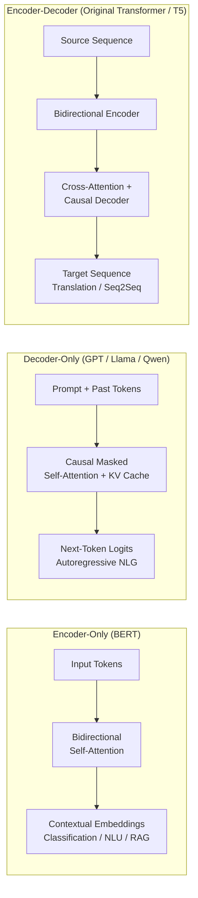
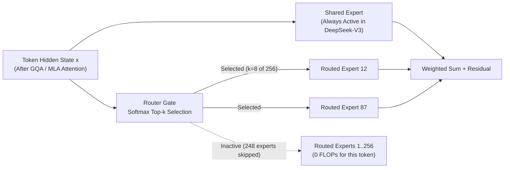
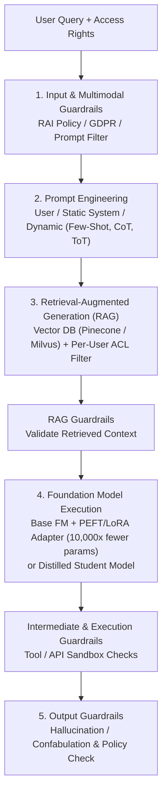

# 14.2 Transformers and LLM architecture

| Field | Value |
|---|---|
| Level | Intermediate |
| Priority tier | 2 |
| Lab venue | Nebius GPU + Local Python Verification Lab (`code/part14/transformers_llm_arch_lab.py`) |
| Part | Part 14: Distributed training and fine-tuning |
| Primary sources | *AI Engineering* Ch. 2 (`ai-engineering`); *Engineering AI Systems* Ch. 4 (`engineering-ai-systems-architecture-and-devops-essentials`); *AI Systems Performance Engineering* Ch. 1, Ch. 10, Ch. 13, Ch. 16–18 (`ai-systems-performance-engineering`); *Hands-On LLM Serving and Optimization* Ch. 2 (`hands-on-llm-serving-and-optimization`); *LLMs in Production* Ch. 2 (`llms-in-production`) |
| Coverage file | `planning/coverage/chapters/14-02.md` |
| Claim & number ledger | `planning/ledgers/14-02.md` |

## Why this matters for AI infrastructure

Every GPU cluster sizing calculation, network topology choice, and inference serving SLO in modern AI infrastructure is a direct mathematical consequence of the **Transformer** architecture (`Vaswani et al., 2017`). When a model architect switches a `13B` or `70B` Large Language Model (`LLM`) from standard **Multi-Head Attention (`MHA`)** to **Grouped-Query Attention (`GQA`)**, **Multi-Query Attention (`MQA`)**, or DeepSeek's **Multi-Head Latent Attention (`MLA`)**, the per-token **Key-Value (`KV`) cache** footprint shrinks by `5.0x` to `40.0x`—immediately changing whether a `4,096`-token or `250,000`-token context fits inside a single GPU's High Bandwidth Memory (`HBM`) or must be sharded and paged across a multi-node `NVLink` / `RDMA` pool (`3.36 GB` vs `0.671 GB` vs `0.084 GB` at `4,096` tokens on a `13B` model, or `328 GB` of `FP16` KV cache on a `70B` model at `250,000` tokens). When a team moves from a dense `671B` (`~680B`) parameter model to a sparse **Mixture-of-Experts (`MoE`)** architecture like **DeepSeek-V3 / R1** (`671B` total parameters, `37B` active per token across `1` shared and `8` of `256` routed experts) or **Mixtral `8x7B`** (`46.7B` total parameters, `12.9B` active across `2` of `8` experts), total `HBM` capacity still scales with `total` parameters (`93.4 GB` in `FP16` for Mixtral `8x7B`), while per-token compute `FLOPs` scale with `active` parameters (`18.14x` compute reduction for DeepSeek-V3) and network traffic shifts from predictable `AllReduce` rings to latency-sensitive `AllToAll` expert dispatch.

At the same time, infrastructure engineers must understand **why** foundation models (`FM`s) are sized, pre-trained, post-trained, and customized the way they are. Training OpenAI's **GPT-3 `175B`** (`300B` training tokens) required `3.14 x 10^23` `FLOPs`—roughly `236` ideal days (`7.8` months) on `256` `H100` GPUs, or **`$4,142,811.43`** at `70%` utilization and `$2/hour` per `H100`—whereas training frontier models such as GPT-4 (`~$100 million`) and Gemini Ultra (`~$191 million`) pushed costs two orders of magnitude higher. DeepMind's **Chinchilla compute-optimal scaling law** (`D ~= 20 * N`, `C ~= 6 * N * D`) proved that a `70B` model trained on `1.4 trillion` tokens outperforms `175B`–`530B` models trained on `270B`–`300B` tokens, while Meta's **Llama 3** deliberately over-trained an `8B` model on `15 trillion` tokens (`1,875` tokens per parameter, `93.75x` the Chinchilla ratio) to minimize downstream inference hardware cost. Without mastering exact parameter counting, quadratic `O(N^2)` vs linear `O(N)` `FLOP` crossover math, `FlashAttention` HBM tiling, and the architectural trade-offs between narrow ML models, external FM APIs, open-weight self-hosting, **Prompt Engineering**, **Retrieval-Augmented Generation (`RAG`)**, **Parameter-Efficient Fine-Tuning (`PEFT`/`LoRA`)**, **Distillation**, and **Guardrails**, an infrastructure engineer cannot accurately provision compute or debug production bottlenecks.

## Prerequisites and outcomes

### Prerequisites
- Matrix multiplication, activation functions (`ReLU`, `GELU`, `SiLU`, `softmax`), loss functions (`cross-entropy`), backpropagation, and mixed-precision number formats (`FP32`, `TF32`, `FP16`, `BF16`, `FP8`, `FP4`) from Chapter `14.1`.
- GPU `SM` / Tensor Core memory hierarchy (`SRAM`/shared memory vs `L2` vs `HBM`) and collective communication primitives (`AllReduce`, `AllGather`, `ReduceScatter`, `AllToAll`) from Parts `9`, `10`, and `12`.

### Outcomes
After completing this chapter, you will be able to:
1. Contrast **Foundation Models (`FM`s)** with **narrow ML models** across vector space dimensionality, training data distribution (**Common Crawl** `250B+` pages, `2–3B` pages/month, **C4**, multilingual token inflation of `7` median tokens in English vs `32` in Hindi and `72` in Burmese on `MASSIVE`), and total cost of ownership (tool, development, maintenance, and operational costs across external APIs, bespoke in-house FMs, and open-weight self-hosting).
2. Trace a token sequence end-to-end through a **decoder-only Transformer** (`Tokenizer -> Embedding -> N Decoder Blocks [RMSNorm, Q/K/V/O Attention, RoPE, SwiGLU MLP] -> Final RMSNorm -> Unembedding / LM Head`), and contrast **encoder-only (`BERT`)**, **decoder-only (`GPT`, `Llama`, `Qwen`)**, **encoder-decoder (`T5`, `seq2seq`)**, and **alternative architectures (`CNNs`, `RNNs`/`LSTMs`/`GRUs`, `GNNs`, `VAEs`, `RWKV`, `S4`/`H3`/`Mamba` `SSMs`, and `Jamba` `52B`/`12B` hybrid)**.
3. Compute exact **parameter counts** (`Embedding`, `MHA`/`GQA`/`MQA` projections, `3`-matrix `SwiGLU` vs `2`-matrix `MLP`, and `LM Head`) and **forward-pass `FLOPs`** (`8 * B * s * d^2` attention projections + `6 * B * s * d * d_ff` `SwiGLU` vs `4 * B * s^2 * d` quadratic attention core and `T(N) = N(N + 1) / 2` causal dot products) for production models (`Qwen 2.5-0.5B` `494,032,768` params, `Llama 2-7B/13B/70B`, `Llama 3-8B/70B/405B`).
4. Calculate **KV cache memory footprints** (`2 * n_layers * n_kv_heads * d_head * bytes_per_elem`) across **MHA**, **GQA**, **MQA**, and **DeepSeek MLA**, and explain how **FlashAttention** (`2x–4x` speedup, `~75%` peak `FP16` `FLOPs` in FlashAttention-3), **FlashMLA**, **ThunderMLA** (`20%–35%` faster decode), **FlexAttention / FlexDecoding** (`85%–90%` of FlashAttention), and **PagedAttention** eliminate `HBM` bandwidth bottlenecks across **prefill** (`TTFT`) and **decode** (`TPOT`).
5. Apply **Chinchilla compute-optimal scaling** (`D ~= 20 * N`, `C ~= 6 * N * D`), **Mixture-of-Experts (`MoE`)** active-vs-total parameter math (**Mixtral `8x7B`**, **DeepSeek-V3 `671B`/`37B`**), **post-training alignment** (`SFT` `13,000` demonstration pairs at `$130,000`, `RLHF` Bradley-Terry reward modeling at `73%` agreement and `$3.50`/comparison vs `$25`/response, `PPO` vs `DPO`), **probabilistic sampling** (`temperature`, `logprobs`, `top-k`, `top-p`, `min-p`, `test-time compute` verifiers giving a `30x` model-size equivalent boost up to `400` samples, constrained grammar sampling), and **FM customization** (`Prompt Engineering`, `RAG`, `PEFT`/`LoRA` `10,000x` parameter and `3x` compute reduction, `Distillation`, `Guardrails`, and the **Fraunhofer `FhGenie`** production architecture).

---

## 1. Foundation Models, Data Distributions, and Vector Spaces

### 1.1 Foundation Models vs. Narrow Machine Learning Models

Traditional machine learning systems rely on **narrow ML models** trained from scratch on task-specific, manually labeled datasets (for example, a dedicated spam classifier or fraud detector). By contrast, a **Foundation Model (`FM`)** is a large-scale model pre-trained via **self-supervision** (predicting masked or next tokens without human labels) on massive, broad datasets spanning natural language, source code, images, audio, and video, which can then be adapted to a wide spectrum of downstream tasks. While an **LLM** specifically denotes a text-based foundation model, the broader `FM` category encompasses multimodal and domain-specific architectures.

| Architectural Dimension | Narrow ML Models | Foundation Models (`FMs` / `LLMs`) | Infrastructure Impact |
|---|---|---|---|
| **Training Objective & Data** | Supervised learning on narrow, task-specific labeled tables/text | Self-supervised pre-training on web-scale corpora (`Common Crawl` `250B+` pages, `1.4T–15T+` tokens) + post-training (`SFT` + `RLHF`/`DPO`) | Pre-training consumes `98%` of compute (`InstructGPT`), while post-training uses `~2%` to unlock conversational alignment. |
| **Model Scale (`Parameters`)** | Thousands to `~100M` parameters | Billions to trillions: `Qwen 2.5-0.5B` (`494M`), `BloombergGPT` (`50B`), `GPT-3` (`175B`), `DeepSeek-V3/R1` (`671B`/`~680B`), `GPT-4` (est. up to `~700B`–`1.8T`), toward `100T` | A `7B` model in `FP16` (`2` bytes/param) requires at least `14 GB` of `HBM` just for weights; a `100T` model requires `200 TB` (`~1,110` `B200` `180 GB` GPUs or `~695` `B300` `288 GB` GPUs). |
| **Vector Space Dimensionality** | Tens to low hundreds of engineered features | Hidden dimensions `d_model` in the thousands or tens of thousands (`896` in Qwen-0.5B, `4,096` in Llama-7B/8B, `8,192` in Llama-70B, `16,384` in Llama-405B) | Determines tensor-parallel (`TP`) sharding granularity and `KV` cache bytes per token. |
| **Adaptation & Customization** | Retrain model weights per task | **Zero-shot / few-shot prompting**, **RAG**, **PEFT / LoRA** (`10,000x` fewer trainable params, `3x` less compute), **Distillation**, or full fine-tuning | A single base model weight allocation in `HBM` can serve dozens of tasks via dynamic prompts or lightweight `LoRA` adapters. |

### 1.2 Web-Scale Training Corpora, Tokenization Skew, and Domain Distributions

Because a foundation model's capabilities are bounded by its training distribution, data curation is the first architectural bottleneck:
- **Common Crawl and C4:** The nonprofit **Common Crawl** archive covers more than **`250 billion` web pages** and crawled approximately **`2–3 billion` web pages per month** in `2022` and `2023`. Google's **Colossal Clean Crawled Corpus (`C4`)** is a filtered subset of Common Crawl, and Together AI's **RedPajama-v2** spans **`30 trillion` tokens** (equivalent to **`450 million` books** at `50,000` words / `67,000` tokens per book, or **`5,400x`** the size of Wikipedia). OpenAI filtered WebText for `GPT-2` by scraping only Reddit links with at least **`3` upvotes**. However, web crawls contain substantial noise, clickbait, and synthetic text: between `2023` and `2024`, crawling restrictions and Terms of Service updates rendered **`28%`** of the most critical sources in `C4` fully restricted and **`45%`** of `C4` restricted overall (`Longpre et al., 2024`).
- **Data Quality vs. Raw Quantity:** Training on smaller, curated datasets frequently beats indiscriminate web scraping. Using **`7B` tokens** of high-quality coding data, `Gunasekar et al. (2023)` trained a **`1.3B`-parameter** model (`Phi-1`) that outperformed much larger general-purpose models on coding benchmarks.
- **Multilingual Representation Skew and the Tokenization Tax:** An analysis of Common Crawl (`Lai et al., 2023`) shows that **English accounts for `45.88%`** (`45.8786%`) of all data (`1,452M` speakers, `18.15%` of an `8B` world population, world-to-CC ratio **`0.40`**), making it nearly **`8x` more prevalent** than the second-most common language, **Russian (`5.97%` / `5.9692%`)**, followed by German (`5.88%`), Chinese (`4.87%`), Japanese (`4.79%`), French (`4.73%`), Spanish (`4.47%`), Italian (`2.57%`), Dutch (`2.06%`), Polish (`1.66%`), Portuguese (`1.15%`), and Vietnamese (`1.03%`). Conversely, languages with tens or hundreds of millions of speakers are severely under-represented: **Punjabi** (`113M` speakers, `1.41%` world pop vs **`0.0061%`** CC, ratio **`231.56`**), **Swahili** (`71M`, `0.89%` vs **`0.0077%`**, ratio **`115.26`**), **Urdu** (`231M`, `2.89%` vs **`0.0274%`**, ratio **`105.38`**), **Kannada** (`64M`, `0.80%` vs **`0.0122%`**, ratio **`65.57`**), **Telugu** (`95M`, `1.19%` vs **`0.0183%`**, ratio **`64.89`**), **Gujarati** (`62M`, `0.78%` vs **`0.0126%`**, ratio **`61.51`**), **Marathi** (`99M`, `1.24%` vs **`0.0213%`**, ratio **`58.10`**), and **Bengali** (`272M`, `3.40%` vs **`0.0930%`**, ratio **`36.56`**).
- **Direct Latency and Cost Impact of Tokenization:** On the **MMLU** benchmark (`14,000` multiple-choice problems across `57` subjects), `GPT-4` scored worst on Telugu, Marathi, and Punjabi; on `6` Project Euler math problems (`Yennie Jun`), `GPT-4` solved English `> 3x` as often as Armenian or Farsi and scored `0 / 6` in Burmese and Amharic; and in a `NewsGuard` (`April 2023`) test, `ChatGPT-3.5` refused `6 / 7` misinformation prompts in English but complied `7 / 7` times in simplified and traditional Chinese. Critically for infrastructure, on the **MASSIVE** dataset (`1 million` short parallel texts across `52` languages), the median `GPT-4` token length is **`7` tokens in English**, **`32` tokens in Hindi (`4.57x`)**, and **`72` tokens in Burmese (`10.29x` / `~10x`)**. Because autoregressive decoding latency and per-token API pricing scale linearly with token count, Burmese requests take **`~10x` longer** and cost **`~10x` more** than identical queries in English—motivating language-specialized FMs (`ChatGLM`, `YAYI`, `Llama-Chinese`, `CroissantLLM`, `PhoGPT`, `Jais`) and expanded vocabularies (`Llama 3`'s `128,256` tokens and `Qwen 2.5`'s `151,936` tokens vs `Llama 2`'s `32,000` tokens).
- **Domain-Specific Models and Vision Benchmarks:** Even broad vision-language models like `CLIP` and `OpenCLIP` (`ViT-B/32`) exhibit sharp domain variance (`ImageNet`: `63.2%` vs `62.9%`; `ImageNet v2`: `62.6%`; `Birdsnap`: `37.8%` vs `46.0%`; `Country211`: `17.8%` vs `14.8%`; `Oxford 102 Flower`: `66.7%` vs `66.0%`; `GTSRB`: `32.2%` vs `42.0%`; `Stanford Cars`: `59.4%` vs `79.3%`; `UCF101`: `64.5%` vs `63.1%`), while Flamingo (`Alayrac et al., 2022`) required datasets of `1.8B` and `312M` `(image, text)` pairs. Tasks involving non-web modalities—such as protein 3D structure prediction (**DeepMind `AlphaFold`**, trained on **`~100,000` known proteins**), biomolecular drug discovery (**NVIDIA `BioNeMo`**), or clinical question answering (**Google `Med-PaLM 2`**)—require curated domain corpora.

### 1.3 Tokenization and Vector Spaces (`Embeddings`)

Before a neural network can process text, a **tokenizer** (`Byte-Pair Encoding [BPE]`, `WordPiece`, or `SentencePiece`) segments raw strings into subword **tokens** and maps each token to an integer ID `t_i in [0, V - 1]` from a fixed vocabulary of size `V`. For example, in OpenAI's tokenizer, the `11`-token prompt `["\"", "Write", "a", "short", "introduction", "about", "US", "capital", "city", "\""]` maps to token IDs `[1100, 10930, 261, 4022, 22575, 1078, 290, 2952, 9029, 5030, 693]`.

An **embedding matrix** `W_E` of shape `[V, d_model]` then maps each discrete token ID into a continuous real-valued vector `x_i in R^(d_model)`. Classical static embedding algorithms (**Word2Vec** [`Mikolov et al., 2013`], **GloVe**, and **FastText**) assign a single fixed vector per word such that geometric distances reflect semantic relationships (e.g., `vec("king") - vec("man") + vec("woman") ~= vec("queen")`). However, static embeddings cannot disambiguate polysemous words: the token `"book"` (a printed volume, an accounting ledger, or `"a book of stamps"`) or `"capital"` (`"US capital city"` vs financial capital) receives the exact same input vector regardless of surrounding words. Modern **Transformers** solve this by passing the initial token embeddings through stacked self-attention and feedforward layers to produce **contextualized hidden states** whose values dynamically shift based on the entire sequence.

---

## 2. Inside the Transformer Architecture: Encoders, Decoders, and Alternative Backbones

### 2.1 Why Transformers Replaced RNNs and Seq2Seq (`2014–2017`)

Prior to `2017`, sequence tasks such as machine translation and summarization were dominated by **sequence-to-sequence (`seq2seq`)** architectures (`Sutskever et al., 2014`; adopted in **Google Neural Machine Translation [`GNMT`]** in `2016`) built on **Recurrent Neural Networks (`RNNs`)**, **Long Short-Term Memory (`LSTM`)** networks, and **Gated Recurrent Units (`GRUs`)** (`2014`). While `LSTM`s added gating cells, `dropout`, and `bidirectional` passes that converged in half as many epochs as vanilla `RNN`s (`25` epochs vs `50` epochs on sentiment benchmarks, reaching `96.28%` train / `86.83%` validation accuracy vs vanishing/exploding gradients), recurrent architectures suffered from two fatal infrastructure bottlenecks:
1. **The Sequential Execution Bottleneck (`No Training Parallelism`):** An `RNN` processes token `t` as a function of hidden state `h_(t-1)`. For a `200`-token sequence, step `200` cannot begin until steps `1..199` finish sequentially, starving massively parallel GPU `SM`s and making `bidirectional` + `dropout` `LSTM` training `10x–12x` more compute-expensive than an `MLP` of the same parameter count.
2. **The Fixed-State Information Bottleneck:** In vanilla `seq2seq`, the encoder compresses the entire input sequence into a single final hidden vector passed to the decoder—analogous to answering detailed questions about a book using only a one-paragraph summary. Although `Bahdanau et al. (2014)` introduced attention on top of `RNN`s, **Vaswani et al. (`2017`, *"Attention Is All You Need"*)** proved that **dispensing with recurrence and convolutions entirely** allows all input tokens to be processed **in parallel** during training and prompt prefill while allowing every token to attend directly to any prior token ("referencing any page in the book").

### 2.2 Encoder-Only, Decoder-Only, and Encoder-Decoder Variants



1. **Encoder-Only (`BERT`):** Uses **bidirectional self-attention** (every token attends to both left and right context) trained via Masked Language Modeling. Excels at Natural Language Understanding (`NLU`), classification, named-entity recognition, and generating dense semantic embeddings for vector databases (`Pinecone`, `Milvus`).
2. **Decoder-Only (`GPT`, `Llama`, `Qwen`, `DeepSeek`):** Uses **causal (masked) self-attention**, where token `i` can attend only to positions `j <= i`. Generates text **autoregressively** (one token at a time, appending each new token to the input context). Dominates modern generative `LLM`s because a single next-token prediction objective scales seamlessly to trillions of tokens and supports streaming user interfaces.
3. **Encoder-Decoder (`Original 2017 Transformer`, `T5`):** Combines a bidirectional encoder with a causal decoder containing **two** attention sublayers per block (causal self-attention plus encoder-decoder **cross-attention**) and **three** residual-and-normalize blocks. Ideal for conditional sequence-to-sequence tasks (translation, summarization) but bulkier to serve than decoder-only stacks.

### 2.3 Anatomy of a Modern Decoder-Only Transformer (`Qwen 2.5` & `Llama 3` Case Study)

Inspecting a production model in PyTorch (`AutoModelForCausalLM.from_pretrained("Qwen/Qwen2.5-0.5B")`) reveals the exact module hierarchy used by modern `Llama`, `Mistral`, `Qwen`, and `DeepSeek` architectures:

```text
Qwen2ForCausalLM (Total parameters: 494,032,768 | vocab_size: 151,936 | max_position_embeddings: 32,768)
├── model: Qwen2Model (hidden_size d_model = 896, num_hidden_layers = 24)
│   ├── embed_tokens: Embedding(151936, 896)
│   ├── layers: ModuleList [0 .. 23] of Qwen2DecoderLayer
│   │   ├── input_layernorm: Qwen2RMSNorm(896)
│   │   ├── self_attn: Qwen2Attention (num_attention_heads = 14, num_key_value_heads = 2, head_dim = 64)
│   │   │   ├── q_proj: Linear(896 -> 896)
│   │   │   ├── k_proj: Linear(896 -> 128)
│   │   │   ├── v_proj: Linear(896 -> 128)
│   │   │   ├── o_proj: Linear(896 -> 896)
│   │   │   └── rotary_emb: Qwen2RotaryEmbedding (RoPE)
│   │   ├── post_attention_layernorm: Qwen2RMSNorm(896)
│   │   └── mlp: Qwen2MLP (intermediate_size d_ff = 4,864)
│   │       ├── gate_proj: Linear(896 -> 4864)
│   │       ├── up_proj:   Linear(896 -> 4864)
│   │       ├── down_proj: Linear(4864 -> 896)
│   │       └── act_fn:    SiLU (SwiGLU)
│   └── norm: Qwen2RMSNorm(896)
└── lm_head: Linear(896 -> 151936)
```

Every modern decoder block incorporates four structural upgrades over the original `2017` Transformer:
1. **Pre-Normalization with `RMSNorm`:** Instead of applying `LayerNorm` *after* attention and `MLP` (`Post-LN`), modern `LLM`s apply **Root Mean Square Layer Normalization (`RMSNorm`)** *before* each sublayer (`input_layernorm` and `post_attention_layernorm`) while keeping an unnormalized residual stream (`x + SubLayer(RMSNorm(x))`). This stabilizes gradient norms across `80` to `126+` layers without warm-up fragility.
2. **Rotary Position Embeddings (`RoPE`):** Whereas the original Transformer added sinusoidal or learned absolute position vectors (`PE(pos, 2i) = sin(...)`, which in `LLMs in Production` Ch. 2 shifts cosine similarity between `"red"` at position `10` and `"brown"` at position `14` from `99%` after raw embedding to `85%–86%` before restoring it to `~96%` via trigonometric periodicity) directly to token embeddings—naively locking maximum context length to a fixed table size (such as `2,048` positions)—modern `LLM`s apply **RoPE** inside each attention layer by rotating Query and Key head vectors in complex 2D frequency planes according to their relative token distance `m - n`. Critically, **increasing context length (e.g., from `4K` in `Llama 2` to `128K` in `Llama 3` via `RoPE` base-frequency scaling) adds zero learned parameters to the model**, though it linearly increases `KV` cache memory and quadratically increases prefill attention `FLOPs`.
3. **Grouped-Query Attention (`GQA`):** Shares Key and Value projections across groups of Query heads (`14` Query heads sharing `2` KV heads in `Qwen 2.5-0.5B`; `32` or `64` or `128` Query heads sharing `8` KV heads in `Llama 3`).
4. **SwiGLU Feedforward Network (`MLP`):** Replaces the classic `2`-matrix `ReLU` (`max(0, x)`, `GPT-2`) or `GELU` (`GPT-3`) feedforward block with a gated **`3`-matrix `SwiGLU` block** (`gate_proj`, `up_proj`, `down_proj` with `SiLU(x) = x * sigmoid(x)`):

```text
SwiGLU_MLP(x) = (SiLU(x * W_gate) (elementwise-multiply) (x * W_up)) * W_down
```

### 2.4 Exact Parameter Counting Across the Llama 2, Llama 3, and Qwen Families

For a decoder-only Transformer with vocabulary `V`, hidden dimension `d_model`, `L` transformer blocks, `n_heads` query heads, `n_kv_heads` key/value heads (`d_head = d_model / n_heads`), and feedforward intermediate dimension `d_ff`:

```text
1. Embedding Layer:        P_embed   = V * d_model
2. Per-Layer Attention:    P_attn    = d_model * (n_heads * d_head)       [W_Q]
                                     + d_model * (n_kv_heads * d_head)    [W_K]
                                     + d_model * (n_kv_heads * d_head)    [W_V]
                                     + (n_heads * d_head) * d_model       [W_O]
   (For standard MHA where n_kv_heads == n_heads, P_attn = 4 * d_model^2)
3. Per-Layer SwiGLU MLP:   P_mlp     = 3 * d_model * d_ff   (vs 2 * d_model * d_ff for standard ReLU/GELU)
4. Per-Layer RMSNorms:     P_norm    = 2 * d_model
5. Final Norm + LM Head:   P_head    = d_model + (0 if tied_embeddings else V * d_model)
---------------------------------------------------------------------------------------------------------
Total Parameters:          P_total   = P_embed + L * (P_attn + P_mlp + P_norm) + P_head
```

Let us walk through **`Llama 2-7B`** (`L = 32`, `d_model = 4,096`, `d_ff = 11,008`, `n_heads = 32`, `n_kv_heads = 32`, `d_head = 4096 / 32 = 128`, `V = 32,000`) and **`Llama 3-8B`** (`L = 32`, `d_model = 4,096`, `d_ff = 14,336`, `n_heads = 32`, `n_kv_heads = 8`, `V = 128,256`):
- **Llama 2-7B (`MHA`):** Each of `W_Q, W_K, W_V, W_O` is `4,096 x 4,096 = 16,777,216` parameters (`P_attn = 67,108,864` per layer). The `SwiGLU` `MLP` holds `3 * 4,096 * 11,008 = 135,266,304` parameters per layer (vs `90,177,536` for a `2`-matrix `MLP`). Adding `2 * 4,096 = 8,192` `RMSNorm` parameters gives **`202,383,360` parameters per layer**. Across `32` layers (`6,476,267,520`) plus `P_embed = 131,072,000`, `P_head = 131,072,000`, and final `RMSNorm` (`4,096`), total parameters equal **`6,738,415,616` (`~6.74B`)**, requiring `13,476,831,232` bytes (`~13.48 GB`, or `~14 GB`) in `FP16`/`BF16`.
- **Llama 3-8B (`GQA-8`):** Switching from `MHA` (`32` KV heads) to `GQA-8` (`8` KV heads) shrinks `W_K` and `W_V` by `4x` each (`4,096 x 1,024 = 4,194,304`), reducing `P_attn` by **`37.5%`** to **`41,943,040` parameters/layer** (while `MQA` with `1` KV head drops `P_attn` to **`34,603,008`**). Simultaneously, expanding `d_ff` to `14,336` (`P_mlp = 176,160,768`/layer) and `V` to `128,256` (`P_embed = P_head = 525,336,576`) brings total parameters to **`8,030,261,248` (`~8.03B`, `~16.06 GB` in `FP16`)**—which, trained on `15T` tokens, outperforms `Llama 2-70B` (`2023`) on `MMLU`.

| Model (`AIE Table 2-4` & `Hands-On Ch. 2`) | Blocks (`L`) | `d_model` | `d_ff` (`SwiGLU`) | Heads (`Q / KV`) | Vocab (`V`) | Context Length | Exact Parameter Count (`FP16` Weight `GB`) |
|---|---|---|---|---|---|---|---|
| **Qwen 2.5-0.5B** | `24` | `896` | `4,864` | `14 / 2` (`d_h=64`) | `151,936` | `32K` (`32,768`) | `494,032,768` (`~0.49B` / `~0.99 GB`, tied embed + QKV bias) |
| **Llama 2-7B** | `32` | `4,096` | `11,008` | `32 / 32` (`MHA`) | `32K` (`32,000`) | `4K` (`4,096`) | `6,738,415,616` (`~6.74B` / `~13.48 GB`) |
| **Llama 2-13B** | `40` | `5,120` | `13,824` | `40 / 40` (`MHA`) | `32K` (`32,000`) | `4K` (`4,096`) | `13,015,864,320` (`~13.02B` / `~26.03 GB`) |
| **Llama 2-70B** | `80` | `8,192` | `28,672` (`22,016`*) | `64 / 8` (`GQA-8`) | `32K` (`32,000`) | `4K` (`4,096`) | `68,976,648,192` (`~68.98B` / `~137.95 GB`) |
| **Llama 3-8B (`7B`)** | `32` | `4,096` | `14,336` | `32 / 8` (`GQA-8`) | `128K` (`128,256`) | `128K` (`128,000`) | `8,030,261,248` (`~8.03B` / `~16.06 GB`) |
| **Llama 3-70B** | `80` | `8,192` | `28,672` | `64 / 8` (`GQA-8`) | `128K` (`128,256`) | `128K` (`128,000`) | `70,553,706,496` (`~70.55B` / `~141.11 GB`) |
| **Llama 3-405B** | `126` | `16,384` | `53,248` | `128 / 8` (`GQA-8`) | `128K` (`128,256`) | `128K` (`128,000`) | `405,853,388,800` (`~405.85B` / `~811.71 GB`) |

### 2.5 Alternative Foundation Model Architectures (`CNNs`, `GNNs`, `VAEs`, `RWKV`, `Mamba`, `Jamba`)

While Transformers dominate text and multimodal generation (`GAN`s having peaked around `2014–2019` and `seq2seq` around `2014–2018`), both *Engineering AI Systems* Ch. 4 and *AI Engineering* Ch. 2 highlight non-Transformer and hybrid architectures engineered for specific data structures or linear-time `O(N)` sequence scaling:
- **Domain-Structure Alternatives (`EAS Ch. 4.3`):** **Convolutional Neural Networks (`CNNs`)** for spatial/grid vision tasks; **Graph Neural Networks (`GNNs`)** for relational graphs, social networks, and molecular structures; **Autoencoders / Variational Autoencoders (`VAEs`)** for unsupervised representation learning and reconstruction; and **CNN-Transformer hybrids**.
- **Linear-Time Sequence Backbones (`AIE Ch. 2`):**
  1. **`RWKV` (`Peng et al., 2023`):** Reformulates an `RNN` so that training can be parallelized like a Transformer while retaining `O(1)` recurrent state inference without a growing `KV` cache.
  2. **State Space Models (`SSMs` — `Gu et al., 2021a`):** Evolved from **`S4`** (*Structured State Spaces*, `Gu et al., 2021b`) and **`H3`** (*Hungry Hungry Hippos*, `Fu et al., 2022`, which added shift/multiplicative recall mechanisms to compare tokens across sequences) into **`Mamba`** (*Selective State Spaces*, `Gu and Dao, 2023`). Scaled to **`3B` parameters**, `Mamba-3B` outperforms same-size Transformers, matches Transformers **`2x` its size**, and scales **linearly `O(N)`** with sequence length up to **`1 million` tokens**.
  3. **`Jamba` (`Lieber et al., 2024`):** Interleaves **Transformer**, **Mamba**, and **Mixture-of-Experts (`MoE`)** layers into a **`52B` total parameter (`12B` active parameter, `23.08%` active)** hybrid model that supports a **`256K`-token context window** and fits inside a **single `80 GB` GPU** (with quantized weights and compressed `KV` state because `Mamba` layers require no `KV` cache).

---

## 3. Attention Variants, KV Cache Memory Math, and FlashAttention Hardware Codesign

### 3.1 Scaled Dot-Product Attention and Quadratic `O(N^2)` vs. Linear `O(N)` FLOPs

For an input tensor `X` of shape `[B, s, d_model]` (batch size `B`, sequence length `s`), scaled dot-product attention computes Queries `Q = X * W_Q`, Keys `K = X * W_K`, and Values `V = X * W_V`, splits them into `n_heads` of dimension `d_head = d_model / n_heads`, and evaluates:

```text
Attention(Q, K, V) = softmax((Q * K^T) / sqrt(d_head) + Mask) * V
```

Dividing by `sqrt(d_head)` prevents dot products from growing large in magnitude at high `d_head` (`128`), which would push `softmax` into regions with vanishingly small gradients.

From an infrastructure standpoint, a single Transformer block's forward pass consists of two distinct computational regimes:
1. **Linear Projections (`O(s)` in sequence length, `O(d_model^2)` in width):**
   - `Q, K, V, O` projections: `2 * B * s * (2 * d_model^2 + 2 * d_model * d_kv)` `FLOPs` (equal to `8 * B * s * d_model^2` for `MHA`).
   - `SwiGLU` `MLP` projections (`gate`, `up`, `down`): `6 * B * s * d_model * d_ff` `FLOPs`.
2. **Quadratic Attention Core (`O(s^2)` in sequence length, `O(d_model)` in width):**
   - Computing `S = Q * K^T` (`[B, n_heads, s, d_head] x [B, n_heads, d_head, s]`) requires `2 * B * s^2 * d_model` `FLOPs`, and multiplying `P * V` requires another `2 * B * s^2 * d_model` `FLOPs`, totaling **`4 * B * s^2 * d_model` `FLOPs`** (or `2 * B * s^2 * d_model` if a fused causal kernel skips the upper triangle).

In `Llama 2-7B` (`d_model = 4,096`, `d_ff = 11,008`), the linear projections cost `404,750,336` `FLOPs` per token. Setting `4 * s * d_model = 404,750,336` reveals the exact **crossover sequence length `s* = 24,704` tokens**:
- At short context (**`s = 4,096`**), the quadratic attention core is only **`14.22%`** of layer `FLOPs` (`85.78%` is dense `GEMM`s in `QKV/O` and `SwiGLU`).
- At long context (**`s = 128,000`**), the quadratic attention core explodes to **`83.82%`** of layer `FLOPs`.

Furthermore, in causal self-attention, the number of `Q * K` token-pair dot products per head is triangular: **`T(N) = N(N + 1) / 2`**. For a `20,000`-token prompt (`N = 20K`), `T(20K) = 200,010,000` (`~200M`) dot products—and **chunked prefill** (`1 x 20K = 200M`, `2 x 10K = 50M + 150M = 200M`, or `4 x 5K = 12.5M + 37.5M + 62.5M + 87.5M = 200M`) **does not reduce total `O(N^2)` compute**; it only smooths inter-token latency by interleaving decode steps (`AISPE Ch. 16`). However, because `T(N)` is convex (`T(6K) = 18,003,000` vs `T(2K) = 2,001,000`), a **latency-aware scheduler** that reorders six arriving prompts `[6K, 2K, 6K, 2K, 2K, 2K]` across `2` GPUs from naive `FIFO` (`GPU 1: [6K, 2K, 6K] = 38,007,000` ops, `14K` tokens; `GPU 2: [2K, 2K, 2K] = 6,003,000` ops, `6K` tokens) into balanced batches (`[2K, 2K, 6K] = 22,005,000` ops, `10K` tokens on each GPU) cuts critical-path self-attention work by **`42.10%` (`~42%`)**.

### 3.2 Prefill vs. Decode and the KV Cache Byte Footprint Formula

Autoregressive inference executes in two hardware-distinct phases:
- **Prefill (`Prompt Processing`):** Processes all `N` input prompt tokens in parallel (`matrix-matrix` `GEMM`s), populating the initial `KV` cache and emitting the first output token. Prefill is **compute-bound** and governs **Time to First Token (`TTFT`)**.
- **Decode (`Token Generation`):** Generates `1` token per step (`Q_len = 1`), reading all model weights and all prior `K, V` vectors from `HBM` to perform low-intensity `vector-matrix` (`GEMV`) operations. Decode is **memory-bandwidth-bound** and governs **Time Per Output Token (`TPOT` / `ITL`)**. In the `Qwen 2.5-0.5B` manual walkthrough (`Hands-On LLM Serving` Ch. 2), generating `100` tokens without a `KV` cache (recomputing all prior tokens every step) takes **`9.1205` seconds** (`~0.09 s/token`), whereas enabling the `KV` cache (`use_cache=True`, passing `past_key_values`) drops execution time to **`3.1416` seconds** (**`2.90x` speedup**).

For any Transformer, the exact **`KV` cache memory footprint** is:

```text
kv_bytes_per_token = 2 * n_layers * n_kv_heads * d_head * bytes_per_element
total_kv_bytes     = kv_bytes_per_token * seq_len * batch_size
```

where the factor of `2` accounts for `K` and `V`.

```mermaid
flowchart TB
    subgraph MHA["Multi-Head Attention (MHA)<br/>13B: 40 Q heads, 40 KV heads"]
        M_Q["40 Query Heads"] --- M_KV["40 Key + 40 Value Heads<br/>819.2 KB/tok | 3.36 GB @ 4K FP16"]
    end
    subgraph GQA["Grouped-Query Attention (GQA-8)<br/>13B: 40 Q heads, 8 KV heads"]
        G_Q["40 Query Heads (5 per group)"] --- G_KV["8 Key + 8 Value Heads<br/>163.84 KB/tok | 0.671 GB @ 4K FP16 (5x smaller)"]
    end
    subgraph MQA["Multi-Query Attention (MQA)<br/>13B: 40 Q heads, 1 KV head"]
        Q_Q["40 Query Heads (all share 1)"] --- Q_KV["1 Key + 1 Value Head<br/>20.48 KB/tok | 0.084 GB @ 4K FP16 (40x smaller)"]
    end
    subgraph MLA["DeepSeek Multi-Head Latent Attention (MLA)<br/>Low-Rank Compressed Joint KV Latent"]
        L_Q["Query Heads"] --- L_KV["Compressed Latent Vector c_KV (dim 576)<br/>46.08 KB/tok | 0.189 GB @ 4K FP16 (17.78x smaller)"]
    end
```



| Attention / Model Configuration (`AISPE Ch. 17 & 18`) | Layers (`L`) | `n_kv_heads` | `d_head` | Precision (`bytes`) | `KV` Bytes / Token | Total `KV` Cache at Context `N` | Reduction vs. `MHA FP16` |
|---|---|---|---|---|---|---|---|
| **`13B` Model — Standard `MHA`** | `40` | `40` | `128` | `FP16` (`2 B`) | `819,200 B` (`~0.819 MB`) | **`3.36 GB`** (`3,355,443,200 B` @ `4,096` tok) | `1.0x` (baseline) |
| **`13B` Model — `MHA` with `FP8` KV** | `40` | `40` | `128` | `FP8` (`1 B`) | `409,600 B` (`~0.410 MB`) | **`1.68 GB`** (`1,677,721,600 B` @ `4,096` tok) | `2.0x` |
| **`13B` Model — `GQA-8` (`8` KV groups)** | `40` | `8` | `128` | `FP16` (`2 B`) | `163,840 B` (`~0.164 MB`) | **`0.671 GB`** (`671,088,640 B` @ `4,096` tok) | **`5.0x`** |
| **`13B` Model — `GQA-8` with `FP8` KV** | `40` | `8` | `128` | `FP8` (`1 B`) | `81,920 B` (`~0.082 MB`) | **`0.336 GB`** (`335,544,320 B` @ `4,096` tok) | **`10.0x`** |
| **`13B` Model — `MQA` (`1` KV head)** | `40` | `1` | `128` | `FP16` (`2 B`) | `20,480 B` (`~0.020 MB`) | **`0.084 GB`** (`83,886,080 B` @ `4,096` tok) | **`40.0x`** |
| **`13B` Equivalent — DeepSeek `MLA`** (`d_c=576`) | `40` | Latent `576` | — | `FP16` (`2 B`) | `46,080 B` (`~0.046 MB`) | **`0.189 GB`** (`188,743,680 B` @ `4,096` tok) | **`17.78x`** |
| **`70B` Model (`32` KV heads) @ `250K` Context** | `80` | `32` | `128` | `FP16` (`2 B`) | `1,310,720 B` (`655,360` floats, `~1.31 MB`) | **`327.68 GB`** (`~328 GB` @ `250,000` tok; `100–150 GB` in `FP8`/selective) | Requires disaggregated `KV` pool |

### 3.3 FlashAttention, FlashMLA, ThunderMLA, FlexDecoding, and PagedAttention

Standard attention materializes the intermediate `N x N` score and probability matrices `S = Q * K^T` and `P = softmax(S)` in off-chip GPU **`HBM`**, performing repeated `O(N^2)` reads and writes between `HBM` and on-chip **`SRAM`**.
- **FlashAttention (`Dao et al.` / `AISPE Ch. 1 & 10`):** Restructures attention via **SRAM tiling** and **online softmax rescaling**, keeping `Q, K, V` tiles inside on-chip shared memory (`SRAM`, e.g., `3` tiles of `112 x 112 x 4 B = 150,528 B < 227,328 B` [`~227 KB`] per-block dynamic `SMEM` limit on Blackwell) and writing only the final `[B, s, d_model]` output back to `HBM`. This reduces `HBM` I/O from `O(N^2)` to `O(N)`, delivering a **`2x–4x` end-to-end speedup** in training and long-sequence inference while eliminating `O(N^2)` intermediate activation memory. **FlashAttention-3** further applies **warp-specialized producer-consumer pipelines** (`<cuda/pipeline>`, where `double-buffered` tiling cuts kernel time from `41.3 ms` [`68%` `SM` active, `80 GB/s` `L2`, `1.7B` instructions] to `20.5 ms` [`92%` `SM` active, `155 GB/s` `L2`, `1.05B` instructions, `2.01x` faster], and `3`-role `warp-specialized` loader/compute/storer pipelines reach `18.4 ms` [`96%` `SM` active, `165 GB/s` `L2`, `~1.00B` instructions, `+10.2%` faster, scaling to `64` warps/SM]) to overlap `TMA` data loads, `GEMM`, and `SFU` `softmax`, reaching **`~75%` of peak `FP16` `FLOPs`**.
- **DeepSeek `MLA` (`Multi-Head Latent Attention`), `FlashMLA`, and `ThunderMLA` (`AISPE Ch. 1 & 18`):** Instead of caching full `K` and `V` heads, `MLA` projects keys and values into a compressed low-rank joint latent vector (`512` latent + `64` decoupled `RoPE` elements = `576` elements per layer in DeepSeek-V3/R1) and absorbs the up-projection matrices into `W_Q` and `W_O` during decoding. **FlashMLA** fuses multi-head latent decoding on constrained `H800` GPUs to shift decode toward the compute-bound regime, while Stanford's **ThunderMLA** megakernel dynamically packs variable-length decode streams to eliminate tail effects, achieving **`20%–35%` faster decode throughput** than FlashMLA.
- **PyTorch `SDPA`, `FlexAttention`, `FlexDecoding`, and `POD-Attention` (`AISPE Ch. 13 & 18`):** `torch.nn.functional.scaled_dot_product_attention` (`SDPA`) dispatches to FlashAttention or cuDNN fused kernels, while `FlexAttention` and `FlexDecoding` (`TorchInductor` + `Triton`) compile custom block-sparse, sliding-window, and **Nested Jagged Tensor (`NJT`)** kernels that reach **`~85%–90%` of FlashAttention** performance. **POD-Attention** uses `SM`-aware `CTA` scheduling to colocate compute-bound prefill and memory-bound decode on the same `SM`s, improving attention throughput by up to **`29%`**.
- **PagedAttention (`vLLM` — `10x–20x` higher throughput than Hugging Face `.generate()`) and Disaggregated KV Pools (`NIXL` / `LMCache`):** Without paging, contiguous `KV` allocations waste **`20%–30%` of `HBM`** to fragmentation. `vLLM`'s **PagedAttention** partitions `KV` memory into fixed **`16`-token blocks**, enables content-hashed **automatic prefix caching**, and swaps cold blocks to `CPU DRAM` (`swap_space=16`) or `NVMe`. In **disaggregated prefill-decode** architectures (**NVIDIA Dynamo**, **Splitwise**, **HexGen-2**, **TetriInfer**, **Arrow** [up to `5.6x` higher serving rate under shifting workloads], and **Mooncake**), prefill runs on compute-dense nodes (e.g., `4x H100` or `TP_p=2, PP_p=2`) and pushes `KV` caches over **NVIDIA `NIXL`** (`GPUDirect RDMA` / `NVLink`) to memory-rich decode nodes (e.g., `4x A100` or `TP_d=1..4, PP_d=1`), yielding **`1.4x` higher throughput at `20%` lower cost** or **`2.35x` RPS at the same cost/power** in Splitwise (`~25%` hardware savings using `6` GPUs instead of `8`), up to **`2x` (`~1.3x` average) throughput or `30%` lower cost** in HexGen-2 on `Llama 2-70B`, and up to **`30x` higher inference throughput** on a `~680B` model across a `72`-GPU `GB200 NVL72` rack. Collating `470` small `16`-token `KV` pages (`7,500` tokens) into `>= 128`-token contiguous `RDMA` buffers in **LMCache** (`1 GiB` `1,073,741,824 B` CUDA buffers on ports `7300/7400/7500`) cuts `RDMA` transfer time **`2.5x` (`20 ms -> 8 ms`)**.

---

## 4. Model Scaling Laws, Dense vs. Mixture-of-Experts (MoE), and Alignment

### 4.1 Dense vs. Sparse Mixture-of-Experts (`MoE`) Architectures

In a **dense** Transformer (`GPT-3`, `Llama 3-70B/405B`), every input token traverses `100%` of the model's parameters. In a sparse **Mixture-of-Experts (`MoE`)** Transformer (`Shazeer et al., 2017`), each dense `SwiGLU` `MLP` block is replaced by `E` parallel **expert `MLP`s** plus a lightweight learned **router (gating network)** that dispatches each token to only the top-`k` experts:



| Model | Architecture Type | Total Parameters (`HBM` Weight Footprint) | Active Parameters / Token (`Compute FLOPs`) | Expert Routing Configuration | Key Infrastructure Trade-Off (`AIE Ch. 2` & `AISPE Ch. 1`) |
|---|---|---|---|---|---|
| **Switch Transformer (`2021`)** | Sparse `MoE` | **`1.6 Trillion`** (`1,600B`) | Fraction of total | Top-`1` routing | Reached dense accuracy **`7x` faster** in training wall-clock time. |
| **Mixtral `8x7B`** | Sparse `MoE` | **`46.7 Billion`** (`93.4 GB` in `FP16`; vs `8 x 7B = 56B` if unshared) | **`12.9 Billion`** (`27.62%` active; **`3.62x` fewer FLOPs**) | `2` active experts out of `8` per layer | Inference speed and `FLOP` cost match a `12.9B` dense model, but `HBM` capacity must hold all `46.7B` weights. |
| **Jamba (`Lieber et al., 2024`)** | Hybrid `Transformer-Mamba MoE` | **`52 Billion`** | **`12 Billion`** (`23.08%` active; **`4.33x` fewer FLOPs**) | `2` of `16` experts on MoE layers; `256K` context | Fits in a **single `80 GB` GPU** (with quantization + small Mamba state). |
| **DeepSeek-V3 & DeepSeek-R1** | Fine-Grained + Shared-Expert `MoE` + `MLA` | **`671 Billion` (`~680B`)** | **`37 Billion`** (`5.51%` active; **`18.14x` fewer FLOPs**) | **`1` shared expert + `8` routed out of `256` = `9` active experts/token** | Trained on export-restricted **NVIDIA `H800`** GPUs (`400 GB/s` `NVLink` vs `900 GB/s` on `H100`, `3.35 TB/s` `HBM`) for **`< $6 million`** in compute (`~17%` single-day NVIDIA stock drop) using **`DualPipe`**, **`DeepEP`**, **`EPLB`**, **`DeepGEMM` (`FP8`)**, **`FlashMLA`**, and **`3FS`**. |

### 4.2 The Three Numbers of Scale, Chinchilla Compute-Optimal Scaling, and Cluster Economics

A foundation model's scale is governed by three coupled numbers (`AIE Ch. 2`): (1) **Parameter count `N`** (learning capacity / `HBM` footprint), (2) **Training tokens `D`** (`dataset tokens x epochs`, typically `1` epoch for modern pre-training), and (3) **Training compute `C` in `FLOPs`** (where dense Transformer training requires **`C ~= 6 * N * D` `FLOPs`**: `2ND` forward + `4ND` backward). Note that **`FLOPs`** (plural noun: total operations) must never be confused with **`FLOP/s` (`FLOPS`)** (rate: operations per second), where **`1 FLOP/s-day = 60 * 60 * 24 = 86,400 FLOPs`**.

In *"Training Compute-Optimal Large Language Models"* (`Hoffmann et al., DeepMind, 2022`), the **Chinchilla** authors trained **`400` language models** ranging from **`70 million` to over `16 billion` parameters** on **`5 billion` to `500 billion` tokens** and discovered that first-generation `LLM`s were massively over-parameterized and under-trained:
- **The Chinchilla `20:1` Rule:** For compute-optimal training under a fixed `FLOP` budget `C`, model parameters `N` and training tokens `D` must scale equally (**`D ~= 20 * N`**): a `3B` model requires `60B` tokens (`1.08 x 10^21` `FLOPs`), and **Chinchilla-`70B`** trained on **`1.4 trillion` tokens** (`20 x 70B`) outperformed **LaMDA (`137B` params, `168B` tokens)**, **GPT-3 (`175B` params, `300B` tokens)**, **Jurassic-1 (`178B` params, `300B` tokens)**, **Gopher (`280B` params, `300B` tokens)**, and **MT-NLG (`530B` params, `270B` tokens)**.
- **Inference-Aware Over-Training (`Sardana et al., 2023` & `Llama 1/2/3`):** Chinchilla optimizes *training* compute alone. Because smaller models are dramatically cheaper to serve at inference time, Meta scaled pre-training tokens from **`1.4 trillion` (`Llama 1`)** to **`2 trillion` (`Llama 2`)** to **`15 trillion` (`Llama 3`)**—training `Llama 3-8B` to **`1,875` tokens/parameter (`93.75x` Chinchilla)**.
- **Cluster Time, Cost, Goodput, and Scaling Bottlenecks:**
  - **GPT-3 `175B` (`3.14 x 10^23` `FLOPs`) on `256` `H100`s:** At `60 TFLOP/s` (`6 x 10^13` `FLOP/s` in `FP32`), one `H100 NVL` delivers **`5.2 x 10^18` `FLOPs/day`**. Across `256` `H100`s at `100%` peak, training takes `(3.14 x 10^23) / (256 * 5.2 x 10^18) ~= 236 days` (`~7.8 months`). At a realistic **`70%` utilization** (`50%` is okay, `> 70%` is great) and **`$2/hour` per `H100`** (`$2–$5/hr` cloud range), total compute cost is **`$2 * 256 * 24 * 236 / 0.7 = $4,142,811.43` (`> $4 million`)**; Google's largest **PaLM-2** used `10^22` `FLOPs`.
  - **Goodput (`Effective Training-Time Ratio` — `AISPE Ch. 1`):** If an `8`-GPU node processes `100,000` tokens in `10 s` (`10,000` tok/s achieved) against a `1,500` tok/s/GPU speed-of-light (`12,000` tok/s peak), its **goodput is `83.3%`** (`10,000 / 12,000`), whereas a cluster achieving `300` samples/s out of `1,000` samples/s runs at **`30%` goodput** (`70%–75%` lost to communication stalls, data delays, and preemptions).
  - **Diminishing Returns, Hyperparameter Extrapolation (`muP`), and Emergent / Inverse Scaling:** Halving ImageNet `93%`-accuracy cost (`2019–2021`) contrasts with steep last-mile power laws: cutting language modeling cross-entropy loss from **`3.4` to `2.8` nats** requires **`10x` more training data**, and doubling vision samples from `1B` to `2B` adds only a few percentage points. Because `10` binary hyperparameters yield **`1,024` (`2^10`) combinations**, frontier labs transfer hyperparameters from **`40M` proxy models to `6.7B+` target models** (`Microsoft/OpenAI, 2022`), complicated by **emergent abilities** (`Wei et al., 2022`) and **inverse scaling** (`Perez et al., 2022`; `2023` NYU Inverse Scaling Prize: `$5K`/`$20K`/`$100K` prizes, `11` third prizes out of `99` submissions).
  - **The `100-Trillion-Parameter` Horizon and Power Limits:** Scaling `3` orders of magnitude from `GPT-1` (`117M`, `2018`) -> `GPT-2` (`1.5B`) -> `GPT-3` (`175B`, `2020`) toward **`100 trillion` parameters** (matching the `~100T` synaptic connections in the human neocortex, estimated by Dario Amodei at `$100B`) on **`29 trillion` tokens** requires **`C ~= 6 * 10^14 * 2.9 * 10^13 = 1.74 x 10^28` `FLOPs`** and **`200 TB` of `FP16` weight memory** (`~1,110` `B200` `180 GB` GPUs across `~125` `8`-GPU nodes, or `~695` `B300` `288 GB` GPUs across `~86` nodes). NVIDIA's **`GB200 / GB300 NVL72`** rack (`36` Grace `72`-core CPUs + `72` Blackwell GPUs, `1.8 TB/s`/GPU `NVLink 5` [`18 x 100 GB/s`], `~130 TB/s` rack bisection, `1.44 exaFLOPS` `FP4` / `720 PFLOPS` `FP8`, `13,824 GB` [`13.5 TB`] `HBM3e` at `192 GB`/GPU or `288 GB`/GPU on `GB300`, `~30 TB` unified memory, `120–132 kW`/rack) delivers **`2.6x` higher training** and **`3.4x` higher inference throughput per GPU** over Hopper (`MLPerf v5.0, 2025`), while global data center electricity is projected to jump from **`1%–2%` to `4%–20%` by `2030`** (`Patel et al., 2024`, capping growth at `< 50x`).

### 4.3 Post-Training Alignment (`SFT`, `RLHF`, `DPO`) and Probabilistic Sampling

Pre-training produces an untamed base completion model ("a Shoggoth") that consumes **`98%` of total compute**, while **post-training** consumes **`~2%` of compute** (`InstructGPT`) across two stages:
1. **Supervised Fine-Tuning (`SFT` / `Behavior Cloning`):** Trains on `(prompt, response)` demonstration pairs written by expert annotators (`~90%` college degree, `> 33%` master's degree for `InstructGPT`; up to `30` minutes and `$10`–`$25` per pair; **`13,000` pairs = `$130,000`** for `InstructGPT`, vs `LAION` OpenAssistant's `13,500` volunteers producing `10,000` conversations / `161,443` messages across `35` languages with `461,292` ratings and `90%` male skew, or DeepMind `Gopher`'s `[A]: ... [B]: ...` dialogue heuristics).
2. **Preference Fine-Tuning (`RLHF` via `PPO` vs. `DPO` vs. `RLAIF`):** Because pointwise `1–10` scoring is noisy, labelers rank pairwise comparisons `(prompt, y_w, y_l)` (turning `A > B > C` into `3` pairs: `(A > B), (A > C), (B > C)`, taking `3–5` minutes/pair [`LMSYS`], costing **`$3.50` per comparison vs `$25` per written SFT response** on `Llama 2`, and achieving **`~73%` inter-labeler agreement** on `InstructGPT`'s `1–7` UI). A **reward model (`RM`)** `r_theta(x, y)` is trained via the **Bradley-Terry cross-entropy loss**:

```text
L_RM(theta) = -E_{(x, y_w, y_l)} [ log( sigma( r_theta(x, y_w) - r_theta(x, y_l) ) ) ]
```

   The `SFT` policy is then optimized via **Proximal Policy Optimization (`PPO`, `2017`)** (`GPT-3.5`, `Llama 2`) or reward-model-free **Direct Preference Optimization (`DPO`, `Rafailov et al., 2023`)** (`Llama 3`), while **DeepSeek-R1-Zero** applied pure `RL` directly to chain-of-thought reasoning without cold-start `SFT`.
3. **Logits, Temperature, `Top-k`, `Top-p`, `Test-Time Compute`, and Hallucinations:**
   - **Temperature (`T`):** Divides logits `x_i` before softmax: `p_i = exp(x_i / T) / sum_j exp(x_j / T)`. For two tokens `[A, B]` with logits **`[1, 2]`**, **`T = 1.0`** yields probabilities **`[0.27, 0.73]`** (`73%` for `B`), **`T = 0.5`** sharpens them to **`[0.12, 0.88]`** (`88%` for `B`), and **`T = 0`** bypasses softmax to execute greedy `argmax` (`100%` for `B`). Providers typically bound `T in [0, 2]` (`0.7` common for creative tasks) and expose **`logprobs`** (capped at top **`20`** tokens in OpenAI's API) to prevent floating-point underflow across `100,000+`-token vocabularies.
   - **`Top-k`, `Top-p` (`Nucleus`), and `Min-p`:** `Top-k` (`k in 50..500`) restricts softmax to the `k` largest logits (reducing softmax compute), whereas **`top-p`** (`0.90–0.95`) sums descending probabilities until reaching `p` (e.g., if `P("yes")=0.60, P("maybe")=0.32, P("no")=0.07`, **`top_p = 0.90`** keeps only `{"yes", "maybe"}` [`0.92 >= 0.90`], while **`top_p = 0.99`** keeps `{"yes", "maybe", "no"}`).
   - **Test-Time Compute (`Best-of-N`, Verifiers, Self-Consistency):** For sequence `["I", "love", "food"]` with conditional probabilities `[0.2, 0.1, 0.3]`, joint probability is **`0.2 * 0.1 * 0.3 = 0.006`** and length-normalized score is `avg_logprob = (log(0.2) + log(0.1) + log(0.3)) / 3 = -1.7053`. Training a math **verifier** (`Cobbe et al., 2021`) yields a **`30x` effective model size boost** (a **`100M`-parameter model + verifier matches a `3B`-parameter model** without a verifier) up to **`400` sampled outputs** (beyond which adversarial false positives degrade `OpenAI`'s verifier, whereas Stanford's *"Monkey Business"* [`Brown et al., 2024`] observed log-linear gains from `1` to `10,000` samples, and Google sampled **`32` outputs** with majority voting [`self-consistency`, `Wang et al., 2023`] for Gemini on `MMLU`).
   - **Structured Outputs and Hallucinations (`Confabulation`):** Structured formats (`Text-to-SQL`, `Text-to-Regex`, `JSON`/`YAML`) are enforced via prompting, post-processing (**LinkedIn's defensive `YAML` parser raised valid `GPT-4` outputs from `90%` to `99.99%`** while using fewer tokens than `JSON`), grammar-constrained logit masking (`guidance`, `outlines`, `instructor`, `llama.cpp`), or fine-tuning. **Hallucinations** (termed **confabulation** in `EAS Ch. 4.7` due to lack of causal/world grounding) arise from two mechanisms (`AIE Ch. 2`): (1) **Self-delusion (`Ortega et al., DeepMind 2021`) / snowballing hallucinations (`Zhang et al., 2023`)**, where the model treats its own generated tokens (`"Chip Huyen is an architect"`, `LLaVA-v1.5-7B` mistaking a shampoo bottle for milk, or claiming `9677` is divisible by `13`) as factual observations; and (2) **Mismatched internal knowledge (`Leo Gao` / `John Schulman, 2023`)**, where `SFT` forces a model to imitate labeler facts absent from its pre-training weights (and in `Ouyang et al., 2022`, `InstructGPT` `RLHF + SFT` exhibited higher hallucination rates than `SFT` alone).

---

## 5. Customizing Foundation Models and System Architecture Decisions

Once an organization understands the internal mechanics of a foundation model, it must make three architectural decisions (`EAS Ch. 4.4–4.6`): **(1) how to customize the FM for domain tasks**, **(2) whether to use narrow ML vs. an external FM API vs. an open-weight self-hosted FM vs. an in-house bespoke FM**, and **(3) how to align customization complexity with organizational maturity**.

### 5.1 The Five FM Customization Techniques (`Prompting`, `RAG`, `Fine-Tuning`, `Distillation`, `Guardrails`)



| Customization Technique (`EAS Ch. 4.4`) | Modifies Model Weights? | Sub-Variants & Core Mechanisms | Infrastructure, Security, & Cost Trade-Offs |
|---|---|---|---|
| **1. Prompt Engineering (`4.4.1`)** | **No** (guides self-attention via input context) | **User** (UI hints/training), **Static** (fixed developer system prompt), and **Dynamic** (**Contextual adjustment**, **Iterative refinement**, **Progressive prompting**, **Few-shot context learning**, **Adaptive learning**; plus **Self-consistency**, **Chain of Thought [`CoT`]**, **Tree of Thought [`ToT`]**, and **Medprompt**). | Lowest organizational maturity barrier (`Level 1`); zero training cost, but increases prefill token count (`TTFT`) and requires tight feedback loops (e.g., `early 2024` Gemini historical image generation failure from misconfigured dynamic prompt rewriting). |
| **2. Retrieval-Augmented Generation — `RAG` (`4.4.2`)** | **No** (augments prompt with external chunks) | Embeds proprietary documents into a **vector database (`Pinecone`, `Milvus`)**, performs similarity search per query, and injects matching passages into the FM prompt. | **Supports document-level per-user Access Control Lists (`ACL`s)**: if `User A` has access to docs `X, Y, Z` and `User B` only has access to `Y`, `RAG` augments `User B` strictly with `Y`—**impossible with fine-tuning**, which bakes data into weights shared by all users. |
| **3. Fine-Tuning (`Full` vs. `PEFT` / `LoRA`, `4.4.3`)** | **Yes** (base weights or adapter weights) | **Full fine-tuning** updates `100%` of parameters (prohibitive compute/HBM). **Parameter-Efficient Fine-Tuning (`PEFT`)** freezes base FM weights and trains small **Adapter modules**: **Low-Rank Adaptation (`LoRA`)** reduces trainable parameters by **`10,000x`** and decreases training compute by **`3x`** (`threefold`). | Ideal for teaching domain style, structured output schemas, or adding a task-specific **classifier head** (`feature-based transfer`, e.g., `3`-class classifier in `AIE Fig. 2-22`). Cannot enforce per-user document ACLs. |
| **4. Distilling (`Teacher -> Student`, `4.4.4`)** | **Yes** (trains smaller student architecture) | Transfers capabilities from a large **teacher FM** to a compact **student model** via: (1) **Knowledge distillation** (joint `data loss` on ground truth + `distillation loss` matching teacher outputs), (2) **Attention distillation** (student mimics teacher attention maps), and (3) **Parameter sharing** (reusing teacher layers). | Enables changing to a smaller, faster architecture for edge or low-latency serving when full retraining is infeasible. |
| **5. Runtime Guardrails (`4.4.5`) & Continuous Updates (`4.4.6`)** | **No** (wraps inputs, RAG, tools, and outputs) | Five enforcement points: **Input guardrails**, **Output guardrails**, **RAG guardrails**, **Execution guardrails** (sandboxing external tool/model calls), **Intermediate workflow guardrails**, and **Multimodal guardrails** (flagging harmful images or non-`GDPR`-compliant dynamically generated UIs). | Built with `RAI` knowledge bases, dedicated classifier models, or FMs; must be **generalizable**, **customizable** (e.g., autonomous vehicle warning vs slowing down by region), **dynamic** (negotiable rules), and **interpretable**. Continuous updates (`4.4.6`) via RAG/fine-tuning must prevent leaking user inputs into public models. |

### 5.2 Cost Engineering (`Narrow ML` vs. `FM`), Deployment Models, and Organizational Maturity (`FhGenie` Case Study)

When designing an AI system (`EAS Ch. 4.5–4.6`), architects evaluate four cost categories—**Tool cost**, **Development cost** (data ingestion + model customization, as non-AI components and amortized tooling are comparable), **Maintenance cost**, and **Operational cost** (where **narrow ML models hold a decisive advantage** because they run on modest local CPU/GPU hardware, whereas FMs require expensive cloud API tokens or scarce multi-GPU clusters, and bespoke frontier LLMs cost **tens to hundreds of millions of dollars** to pre-train, such as the UK's **`£100 million`** startup fund for a sovereign FM):

1. **External Pretrained FM via API (`OpenAI`, `Azure OpenAI`, `Google Gemini`):** Zero GPU procurement or training maintenance; pay per input/output token. Best for rapid adoption, but raises data-privacy and intellectual-property leakage concerns if prompts are retained for third-party retraining.
   - **Production Architecture Case Study — Fraunhofer `FhGenie` (`EAS Ch. 4.4.6`):** To give **`~30,000` staff members** at Germany's **Fraunhofer-Gesellschaft** low-barrier access to `GPT-3.5`, `GPT-4`, and `GPT-4o` without leaking confidential research data, Fraunhofer launched **FhGenie** in **`June 2023`** (immediately after **Microsoft Azure OpenAI Services** became available in Europe in **`May 2023`** with contractual `GDPR` and zero-data-retention guarantees, growing to **thousands of users within days** after workers' council approval). `FhGenie` uses a **strictly stateless cloud architecture**: conversation state lives **only in the user's browser**, while cloud components store only `IAM` authentication/authorization metadata, high-level metrics, and an **encrypted abuse log** triggered only when a request violates Responsible AI (`RAI`) filter rules. Depending on model choice and traffic, end-to-end latency ranges from **`1` second to several tens of seconds** (dominated by FM generation time), and holistic system evolution spans both AI extensions (intranet/extranet `RAG` and self-hosted open models) and non-AI pipelines (`PDF`/`PNG`/office document upload transformation, modality limits, and cost).
2. **Self-Hosted Open-Weight / Open-Parameter Models (`Llama 3`, `Mixtral`, `Qwen 2.5`, `DeepSeek-V3/R1`):** Because model weights are publicly released without full proprietary training data or pipelines, *Engineering AI Systems* Ch. `4.5.2` emphasizes calling these **open-weight (or open-parameter) models** rather than "open-source." They allow full data sovereignty on private GPU clusters (or local quantized inference via `llama.cpp`), domain fine-tuning (`LoRA`), and internal activation inspection (`Explainable AI`), trading off GPU hosting capex/opex.
3. **In-House Bespoke FM From Scratch:** Reserved for organizations at the highest **organizational maturity** (`EAS Fig. 4.3` progression: **`1. Prompt Engineering -> 2. RAG -> 3. Fine-Tuning & Distilling -> 4. Bespoke FM`**) that possess unique proprietary datasets (`BloombergGPT` `50B`, `AlphaFold`) and tens of millions of dollars in compute budget. Note also that FMs are mature enough to replace complex non-AI data-engineering modules: in the **CSIRO / `EAS Ch. 4.6.1` Data Cleaning Experiment**, `GPT-4o` autonomously inspected a messy sales spreadsheet (`"Dirty 1"` across `Consumer`, `Corporate`, and `Home Office` segments), diagnosed missing headers in column 1, extracted exact order records (`Order ID CA-2012-162201`), analyzed segment trends, and cleaned malformed rows.

---

## 6. Commands and configurations that matter

### 6.1 Inspecting Transformer Architecture, Attention Heads, and KV Cache Speedup in PyTorch

```python
# (untested here — requires GPU node with torch, transformers, and vllm installed)
import time
import torch
from transformers import AutoModelForCausalLM, AutoTokenizer

model_name = "Qwen/Qwen2.5-0.5B"
tokenizer = AutoTokenizer.from_pretrained(model_name, trust_remote_code=True)
model = AutoModelForCausalLM.from_pretrained(
    model_name, trust_remote_code=True
).eval().to("cuda" if torch.cuda.is_available() else "cpu")

cfg = model.config
print(f"Hidden size (d_model): {cfg.hidden_size}")               # 896
print(f"Layers (L):            {cfg.num_hidden_layers}")         # 24
print(f"Query heads (n_heads): {cfg.num_attention_heads}")       # 14 (d_head = 64)
print(f"KV heads (n_kv_heads): {cfg.num_key_value_heads}")       # 2  (GQA 7:1 ratio)
print(f"MLP size (d_ff):       {cfg.intermediate_size}")         # 4864 (SwiGLU)
print(f"Vocab size (V):        {cfg.vocab_size}")                # 151936
print(f"Max positions:         {cfg.max_position_embeddings}")   # 32768
print(f"Total parameters:      {sum(p.numel() for p in model.parameters()):,}")  # 494,032,768

# Step-by-step autoregressive generation WITH KV cache enabled (3.1416 s vs 9.1205 s without cache for 100 tokens)
prompt = "Write a short introduction about the US capital city."
input_ids = tokenizer(prompt, return_tensors="pt").input_ids.to(model.device)
past_key_values = None
start_t = time.time()

for _ in range(100):
    with torch.no_grad():
        outputs = model(input_ids=input_ids, past_key_values=past_key_values, use_cache=True)
        past_key_values = outputs.past_key_values
        next_token_logits = outputs.logits[:, -1, :]
        probas = torch.softmax(next_token_logits, dim=-1)
        next_token_id = torch.multinomial(probas, num_samples=1)
    # CRITICAL: with KV cache enabled, pass ONLY the newly generated token (Q_len = 1) on the next step
    input_ids = next_token_id
    if next_token_id.item() == tokenizer.eos_token_id:
        break
```

### 6.2 Pinning PyTorch Fused FlashAttention (`SDPA`) and Production `vLLM` / `LMCache` / `Dynamo` Configs

```python
# (untested here) Force fused FlashAttention / cuDNN SDPA fast-path in PyTorch
import torch
import torch.nn.functional as F
from torch.nn.attention import SDPBackend, sdpa_kernel

torch.set_float32_matmul_precision("high")  # Enable TF32 fallback on FP32 ops
with sdpa_kernel([SDPBackend.FLASH_ATTENTION, SDPBackend.CUDNN_ATTENTION]):
    # Replaces 3 separate HBM-bound kernels (matmul -> softmax -> matmul) with 1 SRAM-tiled kernel
    context = F.scaled_dot_product_attention(queries, keys, values, is_causal=True)
```

```python
# (untested here) Production vLLM Engine Configuration with PagedAttention, Prefix Caching, and Chunked Prefill
from vllm import LLM, SamplingParams

llm = LLM(
    model="Qwen/Qwen-7B",
    dtype="float16",
    swap_space=16,                # 16 GB CPU DRAM overflow for evicted KV pages
    max_model_len=4096,           # Bound maximum context length
    block_size=16,                # 16 tokens per PagedAttention physical KV block
    enable_prefix_caching=True,   # Content-hash 16-token KV blocks across requests
    max_num_seqs=256,             # Upper bound on concurrent sequences per continuous-batch iteration
    max_num_batched_tokens=4096,  # Bound prefill + decode token budget per step
    max_seq_len_to_capture=8192,  # CUDA Graph capture coverage (default 8192)
    enable_chunked_prefill=True,  # Interleave long prompt chunks with active decodes
)

sampling_params = SamplingParams(
    temperature=0.7, top_p=0.9, top_k=50, max_tokens=100, stop=["\n", "###"]
)
```

```yaml
# (untested here) Disaggregated Prefill-Decode NIXL KV Transfer & NVIDIA Dynamo QoS Tiering
# 1. Prefill Sender (lmcache-prefiller-config.yaml) -> Decode Receiver (ports 7300/7400/7500)
enable_pd: true
transfer_channel: "nixl"
pd_role: "sender"                 # "receiver" on decode node (pd_peer_init_port: 7300, pd_peer_alloc_port: 7400)
pd_proxy_host: "decode-host"
pd_proxy_port: 7500
pd_buffer_size: 1073741824        # 1 GiB (1,073,741,824 B) pre-registered GPU HBM RDMA buffer
pd_buffer_device: "cuda"

# 2. NVIDIA Dynamo SLO-Aware QoS Tiered Capacity Reservation (configs/qos.yaml)
scheduler:
  qos_classes:
    - { name: premium,  reserved_fraction: 0.10, priority: 100 }  # 10% dedicated prefill/decode headroom
    - { name: standard, reserved_fraction: 0.30, priority: 50 }   # 30% standard tier
    - { name: free,     reserved_fraction: 0.60, priority: 10 }   # 60% best-effort shared pool
```

---

## 7. How it fails: Six Architecture and Serving Failure Modes

| # | Failure Mode | Observable Symptom | Root-Cause Diagnosis (`Architecture & Math`) | Deterministic Fix |
|---|---|---|---|---|
| **1** | **Unpaged or `MHA` `KV` Cache `HBM` Exhaustion (`CUDA OOM` at Long Context)** | Serving a `13B` or `70B` model crashes with `CUDA out of memory` as concurrency or context length grows (`4K -> 250K`), or `vLLM` rejects requests with `20%–30%` unused `HBM`. | Standard `MHA` (`n_kv_heads = 40` on `13B`) consumes `0.819 MB/tok` (`3.36 GB`/seq at `4,096` tok), and `70B` (`32` KV heads) consumes `1.31 MB/tok` (**`327.68 GB` [`~328 GB`]** in `FP16` at `250,000` tok). Contiguous allocation wastes `20%–30%` to internal fragmentation. | Use **`GQA-8`** (`5x` smaller KV: `0.671 GB` `FP16` / `0.336 GB` `FP8` on `13B`), **`MQA`** (`40x` smaller: `0.084 GB`), or **DeepSeek `MLA`** (`17.78x` smaller: `0.189 GB`); enable **`PagedAttention`** (`block_size=16`), **`FP8` KV quantization**, and disaggregated `CPU`/`NVMe` `KV` pools. |
| **2** | **Quadratic `O(N^2)` Attention Materialization & `SDPA` Fallback to Unfused Math** | Training or prefill `TTFT` degrades `2x–4x` and `HBM` capacity spikes quadratically at `s >= 16K–128K` (`83.82%` of layer `FLOPs` at `128K` in `Llama 2-7B`). | Unsupported mask, head dimension, or `FP32` dtype caused `torch.nn.functional.scaled_dot_product_attention` to fall back from **FlashAttention** (`O(N)` `HBM` I/O in `SRAM`) to the unfused math backend (`matmul -> softmax -> matmul` materializing `[B, n_heads, s, s]` in `HBM`). | Cast `Q, K, V` to `BF16`/`FP16`/`FP8`, enforce `sdpa_kernel([SDPBackend.FLASH_ATTENTION, SDPBackend.CUDNN_ATTENTION])`, or compile custom masks with **`FlexAttention` / `FlexDecoding`** (`85%–90%` of FlashAttention speed) using Nested Jagged Tensors (`NJT`). |
| **3** | **MoE `HBM` Under-Provisioning & All-to-All Expert Hotspots** | Engineers provision `HBM` for **DeepSeek-V3** or **Mixtral `8x7B`** based on *active* parameters (`37B` or `12.9B`) and hit immediate `OOM`, or `NVLink`/`RDMA` stalls on `AllToAll` dispatch. | In an `MoE`, **compute `FLOPs` scale with active parameters** (`12.9B` for Mixtral `8x7B`; `37B` across `9` active experts for DeepSeek-V3), but **every expert's weights must reside in `HBM`** (`46.7B * 2 B = 93.4 GB` for Mixtral; `671B` [`~680B`] for DeepSeek-V3), and skewed token routing overloads popular experts. | Size cluster `HBM` for **total parameters** (`EP` + `TP`), overlap `AllToAll` communication with expert computation by splitting token batches into two halves (or using DeepSeek **`DualPipe`** + **`DeepEP`**), and duplicate hot experts via **`EPLB`** (Expert Parallelism Load Balancer). |
| **4** | **FIFO Long-Prompt Blocking (`Head-of-Line TTFT Stall`) & Small-Page `RDMA` Thrashing** | A `6,000`-token prompt queued ahead of `2,000`-token prompts spikes p99 `TTFT` and stalls ongoing decode streams (`TPOT`); or disaggregated `KV` transfer takes `20 ms` for `7.5K` tokens. | Naive `FIFO` scheduling assigns `[6K, 2K, 6K]` (`38,007,000` causal `QK` dot products, `14K` tokens) to `GPU 1` while `GPU 2` gets `[2K, 2K, 2K]` (`6,003,000` ops). Meanwhile, sending `470` separate `16`-token `PagedAttention` blocks over `RDMA` saturates `WQE` doorbell overhead. | Enable **latency-aware batching** (`[2K, 2K, 6K] = 22,005,000` ops/GPU, **`-42.10%` critical-path `QK` ops**), **chunked prefill**, or **prefill-decode disaggregation**; collate `KV` blocks into **`>= 128`-token pages** before `NIXL` `RDMA` write (**`20 ms -> 8 ms`**, `2.5x` faster). |
| **5** | **Multilingual Tokenization Inflation (`10x` Burmese Cost/Latency) & Truncated Structured JSON** | Non-English traffic experiences `4.5x–10x` higher API bills and `TTFT`/`TPOT` latency, or downstream agent workflows crash with `JSONDecodeError`. | Byte-level/English-centric tokenizers fragment low-resource scripts (`MASSIVE` median tokens: **`7` in English vs `32` in Hindi [`4.57x`] and `72` in Burmese [`10.29x`]**). Early `max_tokens` stopping truncates closing `}` brackets in `JSON` mode. | Use expanded-vocabulary models (`Llama 3` `128K`, `Qwen 2.5` `151,936` tokens) or language-specialized FMs; enforce structured schemas via **grammar-constrained sampling** (`outlines`, `guidance`), **defensive `YAML` post-processing** (`90% -> 99.99%` validity at LinkedIn with fewer tokens than `JSON`), or `LoRA` fine-tuning. |
| **6** | **RAG vs. Fine-Tuning Access-Control (`ACL`) Leakage & Snowballing Hallucinations** | Fine-tuning an internal chatbot on corporate intranet documents leaks executive-only files to all employees, or an FM invents citations and snowballs an initial error (`9677 / 13`). | **Fine-tuning updates shared model weights**, making per-user document `ACL` enforcement mathematically impossible (`EAS Ch. 4.4.2`). Self-attention treats the model's own generated tokens identically to user-supplied facts (**self-delusion**). | Use **`RAG` with per-user metadata filtering** in the vector DB (`Pinecone`/`Milvus`) whenever individual access rights (`User A: X,Y,Z` vs `User B: Y`) apply; keep cloud web tiers **stateless** (`FhGenie`), set `temperature = 0` for factual tasks, and wrap inputs/RAG/outputs in **runtime guardrails**. |

---

## 8. Hands-on lab: Transformer Architecture & Scaling Verification Suite

**Venue:** Nebius GPU or any Linux/macOS workstation (`python3` standard library only; no GPU required for the architectural verification suite).

The companion verification suite (`code/part14/transformers_llm_arch.py` and `code/part14/transformers_llm_arch_lab.py`) implements exact parameter counters (`Llama 2-7B/13B/70B`, `Llama 3-8B/70B/405B`, `Qwen 2.5-0.5B`), `O(N^2)` vs `O(N)` `FLOP` crossover calculators, triangular causal `QK` schedulers, `MHA`/`GQA`/`MQA`/`MLA` `KV` cache memory models, `MoE` active-vs-total calculators (`Mixtral 8x7B`, `DeepSeek-V3`, `Jamba`), `Chinchilla` scaling and cluster cost estimators (`GPT-3 175B`, `100T` model, `GB200 NVL72`), temperature/`top-p`/`logprob` samplers, and multilingual token-tax models across **28 deterministic self-checks**.

### Run the Verification Lab

```bash
python3 -B code/part14/transformers_llm_arch_lab.py
```

### Expected Output (Verified Locally)

```text
=== Chapter 14.2: Transformers & LLM Architecture Verification Lab ===

  [PASS] 01. Llama 2-7B MHA attention projections (W_Q, W_K, W_V, W_O) each have 4,096x4,096 = 16,777,216 params (67,108,864 total/layer, d_head=128)
  [PASS] 02. GQA-8 (n_kv_heads=8) cuts attention projection params from 67,108,864 (MHA) to 41,943,040/layer (-37.5%), and MQA (n_kv_heads=1) to 34,603,008
  [PASS] 03. Llama 2-7B SwiGLU MLP (3 * 4,096 * 11,008) has 135,266,304 params/layer vs 90,177,536 for a 2-matrix ReLU/GELU MLP
  [PASS] 04. Llama 2-7B full parameter breakdown totals 6,738,415,616 (~6.74B) parameters (131,072,000 embedding + 202,383,360 * 32 layers + 131,072,000 LM head)
  [PASS] 05. Llama 3-8B (vocab=128,256, d_ff=14,336, GQA-8) totals 8,030,261,248 (~8.03B) parameters (~16.06 GB in FP16)
  [PASS] 06. Qwen 2.5-0.5B (24 layers, d_model=896, n_heads=14, n_kv_heads=2, d_ff=4,864, vocab=151,936, tied embeddings) totals ~494M parameters (494,032,768 with QKV bias)
  [PASS] 07. Llama 3-70B (80 layers, d=8,192, d_ff=28,672) totals 70.55B (70,553,706,496) params and Llama 3-405B (126 layers, d=16,384, d_ff=53,248) totals 405.85B (405,853,388,800) params
  [PASS] 08. In Llama 2-7B, quadratic attention core FLOPs (4*B*s^2*d) grow from 14.22% of layer FLOPs at s=4,096 to 83.82% at s=128,000 (crossover s*=24,704 tokens)
  [PASS] 09. Causal self-attention QK dot products T(N) = N(N+1)/2 equal 200,010,000 (~200M) at N=20,000, 18,003,000 at N=6,000, and 2,001,000 at N=2,000
  [PASS] 10. Latency-aware scheduling of [6K, 2K, 6K, 2K, 2K, 2K] across 2 GPUs cuts critical-path QK dot products by 42.10% (38,007,000 -> 22,005,000)
  [PASS] 11. 13B MHA (40 layers, 40 heads, d_head=128) KV cache is 819,200 B/tok (~0.819 MB/tok) or 3.36 GB (3,355,443,200 B) at FP16 and 1.68 GB at FP8 for 4,096 tokens
  [PASS] 12. On 13B (4,096 tokens), GQA-8 shrinks KV cache 5.0x to 0.671 GB FP16 (0.336 GB FP8), MQA shrinks 40.0x to 0.084 GB FP16, and MLA (dim 576) shrinks 17.78x to 0.189 GB
  [PASS] 13. 70B model (80 layers, 32 heads, d_head=128) generates 655,360 floats (1,310,720 B ~= 1.31 MB/tok) and 327.68 GB (~328 GB) of FP16 KV cache at 250,000 tokens
  [PASS] 14. Mixtral 8x7B activates 2 of 8 experts per token (12.9B active of 46.7B total params = 27.62%, 3.62x compute savings, 93.4 GB FP16 weights)
  [PASS] 15. DeepSeek-V3 / R1 routes 1 shared + 8 of 256 experts (9 active experts/token), activating 37B of 671B (~680B) total params (5.51% active, 18.14x compute savings)
  [PASS] 16. Jamba hybrid Transformer-Mamba MoE activates 12B of 52B total parameters (23.08% active, 4.33x compute savings)
  [PASS] 17. Chinchilla scaling (D ~= 20*N, C ~= 6*N*D) prescribes 60B tokens for a 3B model (1.08e21 FLOPs) and 1.4T tokens for Chinchilla-70B (5.88e23 FLOPs)
  [PASS] 18. Llama 3 pre-trains on 15T tokens (vs 1.4T for Llama 1 and 2T for Llama 2), giving Llama 3-8B 1,875 tokens/parameter (93.75x Chinchilla's 20x ratio)
  [PASS] 19. Training GPT-3 175B (3.14e23 FLOPs, 300B tokens) on 256 GPUs at 5.2e18 FLOPs/day takes ~236 ideal days (~7.8 months) and costs $4,142,811.43 at 70% utilization and $2/GPU/hr
  [PASS] 20. 100T-parameter dense model trained on 29T tokens requires 1.74e28 FLOPs (C ~= 6ND) and 200 TB FP16 weight memory (~1,110 B200 GPUs at 180 GB or 695 B300 GPUs at 288 GB)
  [PASS] 21. GB200 NVL72 integrates 36 Grace CPUs and 72 Blackwell GPUs with 1.8 TB/s/GPU NVLink 5 (~130 TB/s aggregate), 13,824 GB (13.5 TB) HBM3e, and 1.44 exaFLOPS FP4 (720 PFLOPS FP8)
  [PASS] 22. For logits [1, 2], softmax yields [0.27, 0.73] at T=1.0, sharpens to [0.12, 0.88] at T=0.5, and selects greedy argmax [0.0, 1.0] at T=0
  [PASS] 23. Top-p (nucleus) sampling dynamically keeps ['yes', 'maybe'] at top_p=0.90 (cum=0.92 >= 0.90) and ['yes', 'maybe', 'no'] at top_p=0.99 (cum=0.99)
  [PASS] 24. Sequence ['I', 'love', 'food'] with token probabilities [0.2, 0.1, 0.3] has product probability 0.006, total logprob -5.115996, and average logprob -1.705332
  [PASS] 25. Test-time compute with a reward verifier boosts a 100M-parameter model by ~30x in effective scale to match a 3.0B-parameter unverified model (up to ~400 samples before adversarial drop)
  [PASS] 26. On MASSIVE, median token length jumps from 7 (English) to 32 (Hindi, 4.57x) and 72 (Burmese, 10.29x ~= 10x cost/latency); English is 45.88% of Common Crawl vs Punjabi 0.0061% (231.56x under-represented)
  [PASS] 27. InstructGPT used 2% compute for post-training vs 98% pre-training and $130,000 for 13,000 SFT pairs ($10/pair; Llama 2 paid $3.50/comparison vs $25/response), while LoRA cuts trainable params 10,000x and compute 3x
  [PASS] 28. Enabling KV cache accelerates 100-token Qwen 2.5 generation 2.90x (9.1205 s -> 3.1416 s), and collating 16-token PagedAttention blocks into >=128-token RDMA transfers cuts 7.5K-token KV handoff 2.5x (20 ms -> 8 ms)

Summary: 28 passed, 0 failed
```

---

## Common first mistakes

1. **Using `2 * d_model * d_ff` instead of `3 * d_model * d_ff` when counting modern `SwiGLU` `MLP` parameters:** Almost all modern open-weight LLMs (`Llama 2/3`, `Mistral`, `Qwen 2.5`, `DeepSeek`) use `3` linear projections (`gate_proj`, `up_proj`, `down_proj`) per `MLP` block. Using the legacy `2`-matrix formula under-counts `MLP` parameters by `33.3%` (`90.18M` vs `135.27M` per layer in `Llama 2-7B`).
2. **Assuming context-window extension (`4K -> 128K`) increases a Transformer's parameter count:** With **Rotary Position Embeddings (`RoPE`)**, extending context from `4,096` (`Llama 2`) to `128,000` (`Llama 3`) adds **zero parameters** (`AIE Table 2-4`). Instead, it linearly increases `KV` cache `HBM` footprint (`O(N)`) and quadratically increases prefill attention `FLOPs` (`O(N^2)`).
3. **Sizing GPU `HBM` for a Mixture-of-Experts (`MoE`) model using *active* parameters instead of *total* parameters:** While `Mixtral 8x7B` computes `FLOPs` on only `12.9B` active parameters per token (and `DeepSeek-V3` on `37B`), every token in a batch may route to different experts—so **all `46.7B` (`93.4 GB` `FP16`) or `671B` (`~680B`) parameters must remain resident in `HBM`** across the expert-parallel group.
4. **Thinking chunked prefill reduces total `O(N^2)` attention `FLOPs`:** Splitting a `20,000`-token prompt into `2 x 10K` (`50M + 150M`) or `4 x 5K` (`12.5M + 37.5M + 62.5M + 87.5M`) chunks still executes the exact same **`T(20K) = 200,010,000` (`~200M`)** causal `QK` dot products per head (`AISPE Ch. 16`). Chunking smooths decode `TPOT` tail latency; it does not reduce total work.
5. **Confusing `FLOPs` (total operations) with `FLOP/s` (`FLOPS`, operations per second) or sizing production models strictly by Chinchilla without accounting for inference volume:** Chinchilla (`D ~= 20 * N`) minimizes *pre-training* cost for a single run, but if a model will serve billions of queries, **over-training a smaller model** (`Llama 3-8B` trained on `15T` tokens = `1,875` tokens/param, `93.75x` Chinchilla) yields vastly lower lifetime inference GPU cost.

---

## Exercises

1. **Transformer Parameter Counting (`Llama 2-7B` `MHA` vs. `Llama 3-8B` `GQA-8`):**
   - **(a)** Given `Llama 2-7B` (`L = 32`, `d_model = 4,096`, `d_ff = 11,008`, `n_heads = 32`, `n_kv_heads = 32`, `V = 32,000`, untied embeddings, `SwiGLU` `MLP`, `2` `RMSNorm`s per layer + `1` final `RMSNorm`), calculate the exact parameter count of `1` attention block (`W_Q, W_K, W_V, W_O`), `1` `SwiGLU` `MLP` block, `1` full decoder layer, the token embedding + `LM` head matrices, and the complete model (plus its `FP16` weight byte footprint).
   - **(b)** In `Llama 3-8B`, `n_kv_heads` drops from `32` (`MHA`) to `8` (`GQA-8`), while `d_ff` increases to `14,336` and `V` increases to `128,256`. Compute the exact per-layer attention parameter reduction (`params` and `%`), the new total parameter count of `Llama 3-8B`, and what the per-layer attention parameter count would be under `MQA` (`n_kv_heads = 1`).
2. **Quadratic Attention Core `FLOPs` vs. Linear `GEMM` `FLOPs` and Latency-Aware Scheduling:**
   - **(a)** For `1` layer of `Llama 2-7B` (`d_model = 4,096`, `d_ff = 11,008`, `MHA`, `B = 1`), write the forward-pass `FLOP` formulas for the `Q, K, V, O` projections, the `3`-matrix `SwiGLU` `MLP`, and the full attention core (`4 * B * s^2 * d_model`). Compute the exact **crossover sequence length `s*`** where quadratic attention core `FLOPs` equal total linear `GEMM` `FLOPs`, and state the percentage of layer `FLOPs` spent in the attention core at `s = 4,096` vs `s = 128,000`.
   - **(b)** Using the triangular causal dot-product formula `T(N) = N(N + 1) / 2`, verify that `1 x 20K`, `2 x 10K`, and `4 x 5K` chunked prefills all perform `~200M` (`200,010,000`) dot products. Then calculate the critical-path `QK` dot products when scheduling arriving prompts `[6K, 2K, 6K, 2K, 2K, 2K]` across `2` GPUs under naive `FIFO` (`[6K, 2K, 6K]` and `[2K, 2K, 2K]`) vs latency-aware balancing (`[2K, 2K, 6K]` per GPU), and state the percentage reduction.
3. **`KV` Cache Footprint Across `MHA`, `GQA`, `MQA`, and DeepSeek `MLA` (`4K` and `250K` Contexts):**
   - **(a)** Using `kv_bytes_per_token = 2 * n_layers * n_kv_heads * d_head * bytes_per_element`, calculate the per-token `KV` cache bytes and total `4,096`-token `KV` cache size (`GB` decimal) for a `13B` model (`40` layers, `40` query heads, `d_head = 128`) under: (i) `MHA` `FP16`, (ii) `MHA` `FP8`, (iii) `GQA-8` (`n_kv_heads = 8`) `FP16` and `FP8`, (iv) `MQA` (`n_kv_heads = 1`) `FP16`, and (v) **DeepSeek `MLA`** (`576` compressed latent elements/layer in `FP16`). State the exact compression ratios over `MHA` `FP16`.
   - **(b)** For a `70B` model (`80` layers, `32` KV heads, `d_head = 128`) serving a `250,000`-token context in `FP16`, compute the number of `KV` floats per token, bytes per token (`MB`), and total `KV` cache size (`GB`). If `7,500` tokens (`470` blocks of `16` tokens) of `KV` cache are transferred from prefill to decode over `NIXL` `RDMA`, how much faster is collated transfer (`>= 128` tokens/page, `8 ms`) than uncollated transfer (`20 ms`)?
4. **Mixture-of-Experts (`MoE`) Capacity vs. Active Compute (`Mixtral 8x7B`, `DeepSeek-V3`, `Jamba`):**
   - **(a)** Compare **Mixtral `8x7B`** (`46.7B` total parameters vs `8 x 7B = 56B` unshared; `2` of `8` experts active = `12.9B` active), **Jamba** (`52B` total, `12B` active), and **DeepSeek-V3 / R1** (`671B` [`~680B`] total, `37B` active across `1` shared + `8` of `256` routed experts = `9` active experts/token). Compute each model's active parameter percentage and per-token compute savings factor (`total / active`).
   - **(b)** Why was DeepSeek-V3 engineered with `MLA` and `DualPipe` / `DeepEP` when trained on export-restricted **NVIDIA `H800`** GPUs (`400 GB/s` `NVLink` vs `900 GB/s` on `H100`, `3.35 TB/s` `HBM`, `< $6M` compute cost)?
5. **Chinchilla Scaling (`D ~= 20 * N`, `C ~= 6 * N * D`), `GPT-3 175B` Cluster Cost, and `100T` Sizing:**
   - **(a)** Using Chinchilla's `D ~= 20 * N` and `C ~= 6 * N * D`, compute the optimal training tokens `D` and training `FLOPs` `C` for a `3B` model and a `70B` model (`Chinchilla-70B`), and compare `Llama 3-8B` (`15T` tokens) against Chinchilla's token-to-parameter ratio.
   - **(b)** Reproduce the `AIE Ch. 2` cluster cost calculation for **GPT-3 `175B`** (`3.14 x 10^23` `FLOPs`) on `256` `H100` GPUs (`60 TFLOP/s` `FP32` = `5.2 x 10^18` `FLOPs/day`, `1 FLOP/s-day = 86,400 FLOPs`) at `70%` utilization and `$2/H100/hour`. Then compute the dense training `FLOPs` (`29T` tokens), `FP16` weight memory (`TB`), and minimum `B200` (`180 GB`) vs `B300` (`288 GB`) GPUs needed just to hold the weights of a **`100-trillion-parameter`** model.
6. **Sampling Math (`Temperature`, `Top-p`, `Logprobs`), Multilingual Token Tax, and `RAG` vs. `LoRA`:**
   - **(a)** Given two output tokens `[A, B]` with logits `[1, 2]`, compute the softmax probabilities at `T = 1.0`, `T = 0.5`, and `T = 0`. For a sequence `["I", "love", "food"]` with conditional probabilities `[0.2, 0.1, 0.3]`, calculate the joint probability, total natural `logprob`, and length-normalized average `logprob`.
   - **(b)** Using the `MASSIVE` benchmark median token lengths (`English = 7`, `Hindi = 32`, `Burmese = 72`), compute the latency and API cost multipliers for Hindi and Burmese relative to English. Finally, explain why **Fraunhofer `FhGenie`** (`~30,000` staff, stateless browser-held chat history, `May/June 2023` Azure OpenAI launch) and enterprise architects must use **`RAG`** rather than **`LoRA` fine-tuning** (`10,000x` fewer trainable parameters, `3x` less compute) when enforcing per-user document access rights (`User A: X,Y,Z` vs `User B: Y`).

---

## Interview angles

1. **"Walk me through every weight matrix in a modern `7B`/`8B` decoder-only Transformer (`Llama 2-7B` vs `Llama 3-8B`) and explain why `Llama 3-8B` has a `32x` longer context (`128K` vs `4K`) yet a smaller per-token `KV` cache."**
   - *Strong answer:* "In `Llama 2-7B` (`32` layers, `d_model = 4,096`, `d_ff = 11,008`, `V = 32,000`), each layer has four `MHA` matrices (`W_Q, W_K, W_V, W_O`, each `4,096 x 4,096 = 16.78M`, totaling `67.11M` params/layer) and three `SwiGLU` `MLP` matrices (`gate_proj`, `up_proj`, `down_proj`, `3 * 4,096 * 11,008 = 135.27M` params/layer), plus `2` `RMSNorm` vectors (`8,192` params), giving `202.38M` params/layer and `6.74B` total parameters (`~13.5–14 GB` in `FP16`). In `Llama 3-8B`, Meta switched from `MHA` (`32` KV heads) to **`GQA-8` (`8` KV heads)**, shrinking `W_K` and `W_V` by `4x` (`67.11M -> 41.94M` attention params/layer, `-37.5%`) and cutting the per-token `KV` cache by **`4x`** (`5x` on `40`-head `13B`), while expanding `d_ff` to `14,336` and `V` to `128,256` (`8.03B` total params). Context length grew `32x` (`4K -> 128K`) via **Rotary Position Embeddings (`RoPE`)** scaling, which rotates `Q` and `K` by relative token distance without adding a single learned parameter."
2. **"Why is LLM prefill compute-bound while decode is memory-bandwidth-bound, and how do FlashAttention, GQA/MLA, and PagedAttention fix each bottleneck?"**
   - *Strong answer:* "During **prefill**, all `s` prompt tokens are processed in parallel (`matrix-matrix` `GEMM`s), so arithmetic intensity (`FLOPs/byte`) is high; at long contexts (`s > 24,704` tokens in `Llama 2-7B`), the `4 * B * s^2 * d_model` quadratic attention core dominates (`83.82%` of layer `FLOPs` at `s = 128K`). **FlashAttention** fixes prefill and training by tiling `Q, K, V` in on-chip `SRAM` with online softmax rescaling, avoiding `O(N^2)` `HBM` materialization for a `2x–4x` speedup (`~75%` peak `FP16` `FLOPs` in FlashAttention-3 using warp-specialized producer/consumer pipelines). During **decode** (`Q_len = 1`), the GPU must stream every model weight and the entire `KV` cache (`2 * L * n_kv_heads * d_head * bytes * seq_len`) from `HBM` just to generate `1` token (`GEMV`). **`GQA-8`** (`5x`), **`MQA`** (`40x`), and **DeepSeek `MLA` / `FlashMLA` / `ThunderMLA`** (`17.78x` KV compression, `+20%–35%` decode throughput) shrink the `KV` bytes read per step, while **`vLLM` PagedAttention** (`16`-token blocks) eliminates `20%–30%` `HBM` fragmentation and enables `10x–20x` higher serving throughput via continuous batching and prefix caching."
3. **"Compare a dense `671B` model against DeepSeek-V3 (`671B`/`~680B` total, `37B` active MoE). How do you size GPU memory, compute, and networking for an MoE?"**
   - *Strong answer:* "DeepSeek-V3 uses `1` shared expert plus `8` routed experts out of `256` (`9` active experts/token), activating only **`37B` of its `671B` (`~680B`) parameters per token (`5.51%`)**—an **`18.14x` reduction in per-token `FLOPs`** (similar to `Mixtral 8x7B` activating `2` of `8` experts = `12.9B` of `46.7B` params, `3.62x` fewer `FLOPs`). However, **GPU `HBM` capacity still scales with total parameters (`671B`)**, requiring Expert Parallelism (`EP`) across nodes. That shifts the network bottleneck from data-parallel `AllReduce` to latency-sensitive `AllToAll` token dispatch/combine, which DeepSeek hid on bandwidth-restricted `H800` GPUs (`400 GB/s` `NVLink` vs `900 GB/s` on `H100`) using **`DualPipe`** bidirectional pipeline overlap, **`DeepEP`** custom `RDMA`/`NVLink` kernels, and **`EPLB`** redundant expert load balancing."
4. **"When should an enterprise use Prompt Engineering vs. RAG vs. LoRA Fine-Tuning vs. Distillation, and what is the security trap with fine-tuning?"**
   - *Strong answer:* "Follow the organizational maturity ladder (`EAS Ch. 4.4–4.6`): start with **Prompt Engineering** (static system prompts, dynamic few-shot / `CoT`) and **RAG** (retrieving embeddings from `Pinecone`/`Milvus`). The critical security distinction is **per-user Access Control Lists (`ACL`s)**: if `User A` is authorized for documents `X, Y, Z` and `User B` only for `Y`, **`RAG` can filter retrieval per query**, whereas **fine-tuning bakes document knowledge into shared model weights** accessible to every user. When weight adaptation is required (e.g., domain syntax or structured output reliability), use **`PEFT` / `LoRA`** to cut trainable parameters by **`10,000x`** and compute by **`3x`**, or **Distillation** (`data loss + distillation loss` + attention transfer) to compress a large teacher into a low-latency student, all wrapped in **stateless web tiers (`FhGenie`)** and **runtime guardrails**."

---

## Checkpoint questions (20)

<details>
<summary><strong>1. How do Foundation Models (`FMs`) differ from narrow ML models in training objective, scale, and operational cost structure?</strong></summary>

Narrow ML models are trained from scratch via supervised learning on task-specific labeled datasets (thousands to `~100M` parameters) and have low **operational hosting costs**. Foundation models (`FMs`, where `LLMs` are text-specific `FMs`) are pre-trained via **self-supervision** on massive unlabeled corpora (`Common Crawl` `250B+` web pages, `1.4T–15T+` tokens) with billions to trillions of parameters (`BloombergGPT` `50B`, `GPT-3` `175B`, `DeepSeek-V3/R1` `671B`/`~680B`, `GPT-4` up to `~700B+`) and adapted via prompting, `RAG`, `PEFT`/`LoRA`, or distillation, incurring much higher cloud/GPU operational costs (`EAS Ch. 4.1 & 4.5.1`).
</details>

<details>
<summary><strong>2. What is the language distribution of Common Crawl (`Lai et al., 2023`), and how does tokenization efficiency on the `MASSIVE` dataset directly impact non-English inference latency and API cost?</strong></summary>

English accounts for **`45.88%`** of Common Crawl (`18.15%` of world population, ratio `0.40`), nearly **`8x`** more than second-place Russian (`5.97%`), whereas languages like **Punjabi (`0.0061%`, ratio `231.56`)**, **Swahili (`0.0077%`, ratio `115.26`)**, and **Telugu (`0.0183%`, ratio `64.89`)** are severely under-represented. On the `MASSIVE` dataset (`1M` parallel texts across `52` languages), median `GPT-4` token length is **`7` tokens in English**, **`32` in Hindi (`4.57x`)**, and **`72` in Burmese (`10.29x` / `~10x`)**—making Burmese inference **`~10x` slower and `~10x` more expensive** per query (`AIE Ch. 2`).
</details>

<details>
<summary><strong>3. What two architectural bottlenecks of `RNN` / `LSTM` `seq2seq` models did the `2017` Transformer (*"Attention Is All You Need"*) eliminate?</strong></summary>

1. **The fixed-state information bottleneck:** Vanilla `seq2seq` compressed the entire input into a single final hidden vector ("generating answers about a book from its summary"), whereas self-attention lets the decoder reference any input token directly ("referencing any page in the book").
2. **The sequential input processing bottleneck:** `RNN`s must process token `t` after token `t-1` (stalling on `200`-token sequences and suffering vanishing/exploding gradients), whereas Transformers dispense with recurrence entirely and process all input tokens **in parallel** during training and prefill (`AIE Ch. 2`, `LLMs in Production Ch. 2`).
</details>

<details>
<summary><strong>4. When should you choose an Encoder-only (`BERT`), Decoder-only (`GPT`/`Llama`/`Qwen`), or Encoder-Decoder (`T5`) Transformer?</strong></summary>

- **Encoder-only (`BERT`):** Bidirectional self-attention; best for Natural Language Understanding (`NLU`), classification, feature extraction, and dense `RAG` embeddings.
- **Decoder-only (`GPT`, `Llama`, `Qwen`):** Causal (masked) self-attention shifted right for autoregressive next-token prediction; best for Natural Language Generation (`NLG`), general-purpose `LLM`s, and streaming chat.
- **Encoder-Decoder (`Original Transformer`, `T5`):** Bidirectional encoder feeding cross-attention in a causal decoder (`2` attention blocks + `3` add-and-norm layers per decoder block); best for conditional sequence-to-sequence tasks like translation and summarization (`LLMs in Production Ch. 2.3`).
</details>

<details>
<summary><strong>5. What are the exact parameter formulas for a Transformer layer's Attention module (`MHA` vs `GQA`) and `SwiGLU` `MLP` module, and what do they sum to in `Llama 2-7B`?</strong></summary>

- **Attention (`Q, K, V, O`):** `P_attn = 2 * d_model * (n_heads * d_head) + 2 * d_model * (n_kv_heads * d_head)` (which simplifies to **`4 * d_model^2`** for `MHA`). In `Llama 2-7B` (`d_model = 4,096`, `32` heads, `d_head = 128`), each matrix has `16,777,216` parameters, totaling **`67,108,864` parameters/layer** (reduced by `37.5%` to **`41,943,040`** in `Llama 3-8B` with `GQA-8`).
- **`SwiGLU` `MLP` (`gate_proj`, `up_proj`, `down_proj`):** **`P_mlp = 3 * d_model * d_ff`**. In `Llama 2-7B` (`d_ff = 11,008`), `P_mlp = 135,266,304` parameters/layer (plus `8,192` `RMSNorm` params = **`202,383,360` params/layer** and **`6,738,415,616` [`~6.74B`] total model parameters**).
</details>

<details>
<summary><strong>6. Why does extending context length from `4K` (`Llama 2`) to `128K` (`Llama 3`) add zero parameters to the model?</strong></summary>

Modern LLMs replace fixed learned positional embedding tables with **Rotary Position Embeddings (`RoPE`)**, which encode relative token positions by rotating Query and Key head vectors in 2D frequency planes inside the attention operator. Adjusting the `RoPE` base frequency (`theta`) extends the supported context window from `4,096` to `128,000` tokens without changing the shapes of `W_E`, `W_Q`, `W_K`, `W_V`, `W_O`, or `MLP` weight matrices (`AIE Table 2-4`).
</details>

<details>
<summary><strong>7. How do `RWKV`, `Mamba` (`Selective State Spaces`), and `Jamba` (`Lieber et al., 2024`) address the Transformer's `O(N^2)` long-context bottleneck?</strong></summary>

- **`RWKV` (`Peng et al., 2023`):** Formulates an `RNN` with parallelizable training and `O(1)` recurrent state inference.
- **State Space Models (`S4` -> `H3` -> `Mamba` [`Gu and Dao, 2023`]):** `Mamba` introduces input-selective state spaces whose inference compute scales **linearly `O(N)`** with sequence length up to `1M` tokens; `Mamba-3B` outperforms same-size Transformers and matches Transformers `2x` its size.
- **`Jamba` (`Lieber et al., 2024`):** Interleaves **Transformer**, **Mamba**, and **MoE** layers (`52B` total parameters, `12B` active parameters) to support a **`256K`-token context** while fitting in a **single `80 GB` GPU** (`AIE Ch. 2`).
</details>

<details>
<summary><strong>8. At what sequence length `s*` do quadratic attention core `FLOPs` (`4 * B * s^2 * d_model`) overtake linear projection `FLOPs` (`QKV/O` + `SwiGLU`) in `Llama 2-7B`?</strong></summary>

In `Llama 2-7B` (`d_model = 4,096`, `d_ff = 11,008`), per-token linear `FLOPs` are `8 * d_model^2 + 6 * d_model * d_ff = 404,750,336` `FLOPs`. Dividing by `4 * d_model = 16,384` gives a crossover sequence length of **`s* = 24,704` tokens**. At `s = 4,096`, the attention core is only **`14.22%`** of layer `FLOPs`; at `s = 128,000`, it reaches **`83.82%`** of layer `FLOPs`.
</details>

<details>
<summary><strong>9. Does chunked prefill reduce total self-attention `QK` dot products `T(N) = N(N + 1) / 2`? How does latency-aware scheduling reduce critical-path `QK` ops by `42%`?</strong></summary>

**No.** For `N = 20,000` tokens, `T(20K) = 200,010,000` (`~200M`) causal `QK` dot products per head whether executed as `1 x 20K` (`200M`), `2 x 10K` (`50M + 150M = 200M`), or `4 x 5K` (`12.5M + 37.5M + 62.5M + 87.5M = 200M`); chunking only smooths latency by interleaving decode steps. However, when prompts `[6K, 2K, 6K, 2K, 2K, 2K]` arrive across `2` GPUs, reordering from naive `FIFO` (`GPU 1: [6K, 2K, 6K] = 38,007,000` ops) to balanced `[2K, 2K, 6K]` batches (`22,005,000` ops per GPU) cuts critical-path `QK` dot products by **`42.10%` (`~42%`)** (`AISPE Ch. 16 Table 16-6 & 16-7`).
</details>

<details>
<summary><strong>10. What is the exact formula for `KV` cache memory per token, and what are the `4,096`-token `KV` cache sizes for a `13B` model (`40` layers, `40` heads, `d_head=128`) under `MHA`, `GQA-8`, `MQA`, and `MLA`?</strong></summary>

`kv_bytes_per_token = 2 * n_layers * n_kv_heads * d_head * bytes_per_element`. On the `13B` model at `4,096` tokens (`AISPE Ch. 17`):
- **`MHA` (`40` KV heads):** `819,200 B/tok` (`~0.819 MB/tok`) -> **`3.36 GB` at `FP16`** and **`1.68 GB` at `FP8`**.
- **`GQA-8` (`8` KV heads):** `163,840 B/tok` -> **`0.671 GB` at `FP16`** (**`5.0x` smaller**) and **`0.336 GB` at `FP8`** (**`10.0x` smaller**).
- **`MQA` (`1` KV head):** `20,480 B/tok` -> **`0.084 GB` at `FP16`** (**`40.0x` smaller**).
- **DeepSeek `MLA` (`576` latent elements/layer):** `46,080 B/tok` -> **`0.189 GB` at `FP16`** (**`17.78x` smaller**).
</details>

<details>
<summary><strong>11. How much `FP16` `KV` cache does a `70B` model (`80` layers, `32` KV heads, `d_head = 128`) generate for a single `250,000`-token conversation, and how do disaggregated `KV` pools handle it?</strong></summary>

Each token generates `2 * 80 * 32 * 128 = 655,360` floats = **`1,310,720` bytes (`~1.31 MB/token`)** in `FP16`. Across `250,000` tokens, a single sequence requires **`327.68 GB` (`~328 GB`)** of `KV` cache (`100–150 GB` with `FP8` and selective-layer caching)—exceeding a single GPU's `HBM`. Disaggregated `KV` cache pools (`vLLM` + `LMCache` + `NVIDIA Dynamo` over `NIXL` `RDMA`) page older `KV` blocks across cluster `HBM`, `Grace CPU LPDDR5X`, and `NVMe` SSDs, collating `>= 128`-token pages to cut `7.5K`-token `RDMA` transfers from **`20 ms` to `8 ms`** (`AISPE Ch. 18`).
</details>

<details>
<summary><strong>12. How do FlashAttention, FlashAttention-3, FlashMLA, and ThunderMLA optimize GPU memory hierarchy and warp execution?</strong></summary>

- **FlashAttention:** Tiles `Q, K, V` in on-chip `SRAM` (`shared memory`) and uses online softmax rescaling so the `N x N` attention matrix is never written to `HBM`, yielding a **`2x–4x` speedup** and `O(N)` memory.
- **FlashAttention-3:** Uses `<cuda/pipeline>` **warp-specialized producer-consumer pipelines** (separate loader, compute, and storer warps overlapping `TMA` copies, Tensor Core `GEMM`s, and `SFU` softmax) to reach **`~75%` of peak `FP16` `FLOPs`** (`AISPE Ch. 10`).
- **FlashMLA & ThunderMLA:** `FlashMLA` fuses low-rank latent attention decoding on `H800`/`H100` GPUs, while Stanford's **ThunderMLA** megakernel dynamically packs variable-length decode streams to achieve **`20%–35%` faster decode throughput** than `FlashMLA` (`AISPE Ch. 18`).
</details>

<details>
<summary><strong>13. How do `Mixtral 8x7B` and `DeepSeek-V3` compare in total vs. active parameters, and why did DeepSeek-V3 cost `< $6 million` to train on restricted `H800` GPUs?</strong></summary>

- **Mixtral `8x7B`:** **`46.7B` total parameters** (`93.4 GB` `FP16`; vs `56B` if unshared) with `2` of `8` experts active = **`12.9B` active parameters/token (`27.62%`, `3.62x` compute savings)**.
- **DeepSeek-V3 / R1:** **`671B` (`~680B`) total parameters** with **`1` shared expert + `8` of `256` routed experts = `9` active experts/token**, or **`37B` active parameters/token (`5.51%`, `18.14x` compute savings)**. Despite `H800` export limits (`400 GB/s` `NVLink` vs `900 GB/s` on `H100`), DeepSeek trained V3 for **`< $6M`** (vs `~$100M` for GPT-4 and `~$191M` for Gemini Ultra) by codesigning **`MLA` (`FlashMLA`)**, **`DeepGEMM` (`FP8`)**, **`DualPipe`** bidirectional compute/communication overlap, **`DeepEP`**, **`EPLB`**, and **`3FS`** (`AISPE Ch. 1`).
</details>

<details>
<summary><strong>14. What is the Chinchilla compute-optimal scaling law (`DeepMind, 2022`), and why did Meta train `Llama 3-8B` on `15 trillion` tokens (`93.75x` the Chinchilla ratio)?</strong></summary>

After training **`400` models (`70M` to `> 16B` parameters)** on **`5B` to `500B` tokens**, Chinchilla established that for a fixed training `FLOP` budget **`C ~= 6 * N * D`**, optimal training tokens equal **`D ~= 20 * N`** (`60B` tokens for a `3B` model; `1.4T` tokens for `Chinchilla-70B`, beating `175B–530B` models trained on `270B–300B` tokens). Meta trained `Llama 3-8B` on **`15T` tokens (`1,875` tokens/param)** because Chinchilla ignores **inference demand** (`Sardana et al., 2023`): spending extra pre-training `FLOPs` once produces a compact `8B` model (`outperforming Llama 2-70B`) that is vastly cheaper to serve across billions of inference requests (`AIE Ch. 2`).
</details>

<details>
<summary><strong>15. How many days and dollars does it take to train `GPT-3 175B` (`3.14 x 10^23` `FLOPs`) on `256` `H100`s at `70%` utilization, and what hardware is required for a `100-trillion-parameter` model?</strong></summary>

- **GPT-3 `175B` (`AIE Ch. 2`):** At `60 TFLOP/s` (`5.2 x 10^18` `FLOPs/day`, where `1 FLOP/s-day = 86,400 FLOPs`), `256` `H100`s take `(3.14 x 10^23) / (256 * 5.2 x 10^18) ~= 236` ideal days (`~7.8` months). At `70%` utilization and `$2/hr/H100`, cost is **`$2 * 256 * 24 * 236 / 0.7 = $4,142,811.43` (`> $4M`)**.
- **`100T` Dense Model (`AISPE Ch. 1`):** Training on `29T` tokens requires **`1.74 x 10^28` `FLOPs`** and **`200 TB` of `FP16` weight memory**, needing **`~1,110` Blackwell `B200` GPUs (`180 GB` each, `~125` nodes)** or **`~695` `B300` GPUs (`288 GB` each, `~86` nodes)** just to load the weights (or multi-rack **`GB200 NVL72`** systems with `72` GPUs, `1.8 TB/s`/GPU `NVLink 5`, `130 TB/s` rack bisection, `13,824 GB` `HBM3e`, and `1.44 exaFLOPS` `FP4`).
</details>

<details>
<summary><strong>16. How do `SFT`, `RLHF` (`Bradley-Terry RM` + `PPO`), and `DPO` fit into post-training, and what are their annotation economics?</strong></summary>

Post-training consumes **`~2%` of compute** vs **`98%` for pre-training** (`InstructGPT`):
1. **`SFT` (`Behavior Cloning`):** Finetunes on `(prompt, response)` demonstration pairs (`13,000` pairs at `$10`/pair = **`$130,000`** for `InstructGPT`, written by labelers with `~90%` college / `> 33%` master's degrees).
2. **`RLHF` vs `DPO`:** Labelers rank pairwise responses `(x, y_w, y_l)` (`~73%` agreement; `3–5` min/pair; **`$3.50`/comparison vs `$25`/written SFT response** on `Llama 2`) to train a reward model via **`-E[log(sigma(r(x, y_w) - r(x, y_l)))]`** followed by **`PPO`** (`GPT-3.5`, `Llama 2`), whereas **`DPO`** (`Llama 3`) optimizes the policy directly on preference pairs without a separate reward model (`AIE Ch. 2`).
</details>

<details>
<summary><strong>17. Given logits `[1, 2]`, how does lowering `temperature` from `1.0` to `0.5` to `0` change token probabilities, and how does `top-p` (`nucleus`) differ from `top-k`?</strong></summary>

Temperature divides logits before softmax (`x_i / T`): for logits `[1, 2]`, **`T = 1.0`** gives **`[0.27, 0.73]`**, **`T = 0.5`** sharpens the distribution to **`[0.12, 0.88]`**, and **`T = 0`** performs deterministic `argmax` (**`[0.0, 1.0]`**). **`Top-k`** (`50–500`) fixes the number of candidate tokens (reducing softmax compute), whereas **`top-p`** (`0.90–0.95`) dynamically selects the smallest set of descending-probability tokens whose cumulative probability reaches `p` (`AIE Ch. 2`).
</details>

<details>
<summary><strong>18. How is sequence `average logprob` computed for `["I", "love", "food"]` with probabilities `[0.2, 0.1, 0.3]`, and how much effective model scale does a test-time verifier add?</strong></summary>

The sequence probability is **`0.2 * 0.1 * 0.3 = 0.006`**, the total natural logprob is `ln(0.2) + ln(0.1) + ln(0.3) = -5.1160`, and dividing by length `3` avoids short-sequence bias to give **`avg_logprob = -1.7053`**. In `Cobbe et al. (2021)`, pairing test-time sampling with a math **verifier** provided the same performance boost as a **`30x` model size increase** (a **`100M` model + verifier matched a `3B` model** without a verifier, improving up to **`400` samples** before adversarial false positives degraded the score) (`AIE Ch. 2`).
</details>

<details>
<summary><strong>19. What are the two scientific hypotheses for why LLMs hallucinate (`confabulate`), and how do teams enforce structured outputs in production?</strong></summary>

1. **Self-delusion (`Ortega et al., DeepMind 2021`) / snowballing hallucinations (`Zhang et al., 2023`):** Autoregressive models cannot distinguish user-provided facts (observations) from their own generated tokens (actions), compounding an initial error (`LLaVA-v1.5-7B` shampoo->milk or `9677` divisible by `13`).
2. **Mismatched internal knowledge (`Leo Gao` / `John Schulman, 2023`):** `SFT` trains models to mimic labeler answers that rely on facts absent from the model's pre-training weights.
Structured outputs are enforced via prompting, **defensive post-processing** (LinkedIn's `YAML` parser raised valid outputs from **`90%` to `99.99%`** while using fewer tokens than `JSON`), **grammar-constrained logit masking** (`guidance`, `outlines`, `instructor`, `llama.cpp`), or fine-tuning (`AIE Ch. 2`, `EAS Ch. 4.7`).
</details>

<details>
<summary><strong>20. Compare `Prompt Engineering`, `RAG`, `PEFT/LoRA`, `Distillation`, and `Guardrails` (`EAS Ch. 4.4`), and explain how Fraunhofer's `FhGenie` (`~30,000` staff) guarantees data privacy.</strong></summary>

- **Prompt Engineering (`user`, `static`, `dynamic` `CoT`/`ToT`/`Medprompt`)** and **`RAG` (`Pinecone`/`Milvus`)** customize inputs without changing weights; **`RAG` uniquely enforces per-user document `ACL`s** (`User A: X,Y,Z` vs `User B: Y`).
- **`PEFT` / `LoRA`** trains lightweight adapters (**`10,000x` fewer trainable parameters, `3x` less compute**), while **Distillation** trains a smaller student via `data loss + distillation loss`, attention transfer, or parameter sharing, and **Guardrails** (`input`, `output`, `RAG`, `execution`, `intermediate`, `multimodal`) enforce `RAI`/`GDPR` compliance.
- **Fraunhofer `FhGenie` (`launched June 2023` on EU `Azure OpenAI`):** Keeps all cloud components **stateless** (conversation history stays strictly in the user's browser, storing only `IAM`/metrics and an encrypted `RAI` abuse log), preventing proprietary data leakage across `~30,000` employees (`EAS Ch. 4.4.6`).
</details>

---

## Sources and review notes

### Primary Sources (Read in Full and Cited)
1. **Mapped Primary Sources (`brief.py 14.2`):**
   - *AI Engineering* (`ai-engineering`, Chip Huyen, Chapter 2: *Understanding Foundation Models* — Common Crawl `2–3B` pages/month, `C4` `28%` critical / `45%` total restricted sources [`Longpre et al., 2024`], `GPT-2` `>= 3` Reddit upvotes, `Gunasekar et al., 2023` `1.3B` model on `7B` coding tokens, `Table 2-1` & `Table 2-2` Common Crawl language skew [`Lai et al., 2023`: English `45.88%` vs `18.15%` pop = `0.40` ratio, `8x` Russian `5.97%`; Punjabi `0.0061%` = `231.56` ratio; Swahili `115.26`; Urdu `105.38`; Kannada `65.57`; Telugu `64.89`; Gujarati `61.51`; Marathi `58.10`; Bengali `36.56`], `MMLU` `14,000` questions / `57` subjects, `MASSIVE` `1M` texts / `52` languages median token lengths [`English = 7`, `Hindi = 32`, `Burmese = 72` (`10x` latency/cost)], `Table 2-3` `CLIP`/`OpenCLIP` benchmarks, `AlphaFold` `~100,000` proteins / `BioNeMo` / `Med-PaLM 2`, `seq2seq` [`2014–2018`] vs `Transformer` [`Vaswani et al., 2017`], prefill vs decode, `Q/K/V/O` and `MLP` blocks, `Table 2-4` `Llama 2-7B/13B/70B` and `Llama 3-7B(8B)/70B/405B` dimensions, `RWKV`, `SSMs` [`S4`, `H3`, `Mamba-3B`, `Jamba` `52B` total / `12B` active / `256K` context / `80 GB` GPU], `Mixtral 8x7B` [`46.7B` total vs `56B`, `12.9B` active], `Llama 1/2/3` [`1.4T`, `2T`, `15T` tokens], `RedPajama-v2` [`30T` tokens = `450M` books = `5,400x` Wikipedia], `Table 2-5` `Chinchilla` scaling [`400` models, `70M–16B` params, `5B–500B` tokens, `D ~= 20 * N`], `GPT-3 175B` [`3.14 x 10^23` `FLOPs`, `256` `H100`s at `60 TFLOP/s` = `5.2 x 10^18` `FLOPs/day`, `~236` days, `$4,142,811.43` at `70%` util and `$2/hr`], `3.4 -> 2.8` nats `10x` data, `40M -> 6.7B` hyperparameter transfer, data center power `1–2% -> 4–20%` by `2030`, `SFT` [`2%` vs `98%` compute, `13,000` pairs * `$10` = `$130,000`, `LAION` `13,500` volunteers / `161,443` messages], `RLHF` [`73%` agreement, `$3.50` vs `$25`, Bradley-Terry loss, `PPO` vs `DPO`], sampling [`logits [1, 2]` at `T=1.0 -> [0.27, 0.73]` and `T=0.5 -> [0.12, 0.88]`, `logprobs` top `20`, `top-k`, `top-p`, `min-p`, `["I", "love", "food"]` `0.2 * 0.1 * 0.3 = 0.006`, `30x` verifier boost `100M -> 3B` up to `400` samples, LinkedIn `YAML` `90% -> 99.99%`], and `self-delusion` vs `mismatched internal knowledge` hallucinations).
   - *Engineering AI Systems: Architecture and DevOps Essentials* (`engineering-ai-systems-architecture-and-devops-essentials`, Chapter 4: *Foundation Models* — Sections `4.1–4.10`: FMs vs narrow ML models, `BloombergGPT` `50B`, `GPT-4` up to `700B`, `CommonCrawl` `250B+` pages, `4.2.1` Vector Spaces [`Word2Vec`, `GloVe`, `FastText`, `"king"/"queen"/"man"/"woman"`], `4.2.2` Self-Attention & Multi-Head Attention [`"book"` disambiguation], `4.2.3` Transformer components, `4.3` Alternatives [`CNNs`, `RNNs`/`LSTMs`/`GRUs`, `Hybrid`, `GNNs`, `Autoencoders`/`VAEs`], `4.4.1` Prompt Engineering [`user`, `static`, `dynamic`: contextual adjustment, iterative refinement, progressive prompting, few-shot, adaptive learning, `early 2024` Gemini incident, `self-consistency`, `CoT`, `ToT`, `Medprompt`], `4.4.2` `RAG` [`Pinecone`, `Milvus`, per-user access control `User A: X,Y,Z` vs `User B: Y`], `4.4.3` Fine-Tuning [`Full` vs `PEFT`/`Adapters`/`LoRA` `10,000x` parameter and `3x` compute reduction], `4.4.4` Distilling [`knowledge distillation` data + distillation loss, `attention distillation`, `parameter sharing`], `4.4.5` Guardrails [`input`, `output`, `RAG`, `execution`, `intermediate`, `multimodal`, `GDPR`], `4.4.6` Updating FMs & **Fraunhofer `FhGenie`** [`~30,000` staff, `May/June 2023` EU Azure OpenAI, stateless browser state, encrypted `RAI` abuse log, `1 s` to tens of seconds latency], `4.5.1` Tool/Dev/Maintenance/Operational costs, `4.5.2` External API vs In-House [`£100M` UK fund, `llama.cpp`] vs Open-Weight/Open-Parameter FMs, `4.6.1` `GPT-4o` Data Cleaning Experiment [`"Dirty 1"`, `Order ID CA-2012-162201`], `4.6.2` Organizational Maturity, and `4.7` Limited Grounding & Hallucination/Confabulation).
2. **Cross-Referenced Performance & Serving Corpus Sources:**
   - *AI Systems Performance Engineering* (`ai-systems-performance-engineering`, Chapters 1, 10, 13, 16, 17, and 18 — DeepSeek-V3/R1 `671B`/`~680B` total and `37B` active params across `1` shared + `8` of `256` routed = `9` active experts on restricted `H800` GPUs [`400 GB/s` `NVLink` vs `900 GB/s` on `H100`, `3.35 TB/s` `HBM`, `< $6M` vs `~$100M` GPT-4 / `~$191M` Gemini Ultra, `~17%` NVIDIA stock drop], `FlashMLA`, `DeepGEMM`, `DeepEP`, `EPLB`, `DualPipe`, `3FS`, `Switch Transformer` `1.6T` `7x` faster, `100T` model on `29T` tokens = `1.74 x 10^28` `FLOPs` and `200 TB` `FP16` weights [`~1,110` `B200` `180 GB` or `~695` `B300` `288 GB` GPUs], `GB200 NVL72` [`36` Grace CPUs + `72` Blackwell GPUs, `1.8 TB/s`/GPU `NVLink 5`, `130 TB/s` rack, `1.44 exaFLOPS` `FP4`, `720 PFLOPS` `FP8`, `13,824 GB` `HBM3e`, `2.6x` train / `3.4x` infer MLPerf v5.0], `goodput` [`83.3%` vs `30%`], `FlashAttention` `2x–4x` speedup and `FlashAttention-3` `~75%` peak `FP16` `FLOPs` via `<cuda/pipeline>` warp specialization [`41.3 ms -> 20.5 ms -> 18.4 ms`, `68% -> 92% -> 96%` `SM`], `FlexAttention`/`FlexDecoding` [`85%–90%`], `ThunderMLA` [`+20%–35%`], `POD-Attention` [`+29%`], `T(N) = N(N+1)/2` [`200M` at `20K`; `FIFO` `38,007,000` vs latency-aware `22,005,000` = `-42%`], `13B` `KV` cache math [`3.36 GB` `MHA` vs `0.671 GB` `GQA-8` vs `0.084 GB` `MQA`], `70B` `250K`-token `KV` cache [`655,360` floats = `1.31 MB/tok` = `328 GB`], and `Splitwise`/`HexGen-2`/`LMCache` [`20 ms -> 8 ms`]).
   - *Hands-On LLM Serving and Optimization* (`hands-on-llm-serving-and-optimization`, Chapter 2: *Large Language Model Serving* — `Qwen 2.5-0.5B` module structure [`d_model=896`, `L=24`, `n_heads=14`, `n_kv_heads=2`, `d_ff=4,864`, `V=151,936`, `max_pos=32,768`, `494,032,768` params], `11`-token OpenAI tokenizer IDs, `100`-token walkthrough [`9.1205 s` without `KV` cache vs `3.1416 s` with `KV` cache = `2.90x` speedup], and `vLLM` `10x–20x` speedup over Hugging Face `.generate()`).
   - *LLMs in Production* (`llms-in-production`, Chapter 2: *Large language models: A deep dive into language* — `RNN` vs `LSTM` [`25` vs `50` epochs, `96.28%` train / `86.83%` val accuracy, `10x–12x` training compute overhead], positional encoding cosine similarity [`99% -> 85–86% -> 96%` at positions `10` and `14`], and `BERT` encoder vs `GPT` decoder vs `T5` encoder-decoder).

### Inferences and Unverified Claims Note
- All GPU cluster, PyTorch `SDPA`, `vLLM`, `LMCache`, and `NVIDIA Dynamo` code/configuration blocks are reference patterns from the cited sources and have **not been executed on live multi-node GPU hardware in this build environment** (`untested here`).
- All architectural parameter counts, `FLOP` crossover formulas, `KV` cache footprints, `MoE` active/total ratios, `Chinchilla` scaling calculations, and sampling/tokenization numbers are verified locally by `code/part14/transformers_llm_arch.py` and `code/part14/transformers_llm_arch_lab.py` (`28 passed, 0 failed`).

