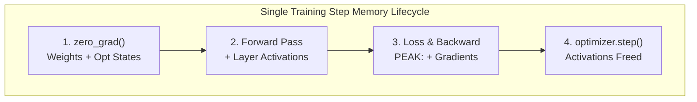
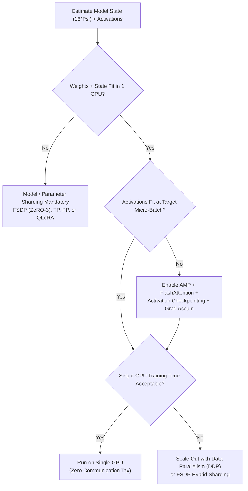
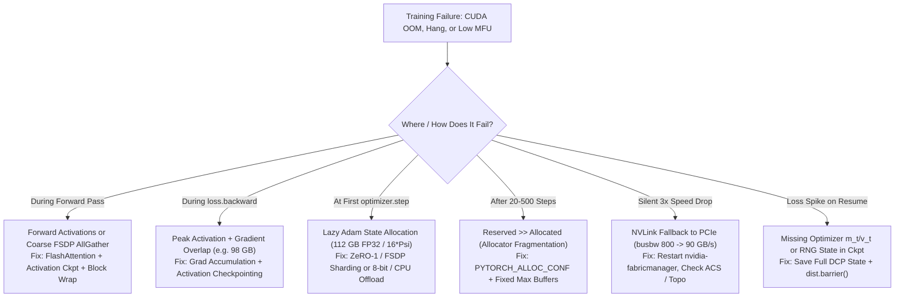

# 14.3 Training memory and compute anatomy

| Field | Value |
|---|---|
| Level | Intermediate |
| Priority tier | 2 |
| Lab venue | Nebius GPU + Local Python Verification Lab (`code/part14/training_memory_compute_lab.py`) |
| Part | Part 14: Distributed training and fine-tuning |
| Primary sources | NVIDIA Zero-to-Hero Volume 13 (`chapter-01-why-distributed-training-exists.md`, `chapter-02-training-memory-and-compute-anatomy.md`, `chapter-08-nccl-collectives-and-communication-paths.md`, `chapter-12-volume-13-summary.md`, `index.md`, `labs/lab-01..04`); Legacy Volume 05 (`01-ai-workloads-training-masterclass.md`); *Distributed AI Systems* (`distributed-ai-systems`, Ch. 1); *AI Systems Performance Engineering* (`ai-systems-performance-engineering`, Ch. 13) |
| Coverage file | `planning/coverage/chapters/14-03.md` |
| Claim & number ledger | `planning/ledgers/14-03.md` |

## Why this matters for AI infrastructure

Distributed training exists because **model parameter counts have grown exponentially while single-GPU high-bandwidth memory (`HBM`) and compute have grown linearly**. A single `80 GB` `NVIDIA H100` (or `141 GB` `H200`, `192 GB` `B200`) cannot even hold the full-precision (`FP32`, `4 bytes/parameter`) weights of a `70B`-parameter model (`70B x 4 bytes = 280 GB`) or `175B`-parameter `GPT-3` (`175B x 4 bytes = 700 GB`, which exceeds an `80 GB` `H100` by **`8.75x`** before loading a single token of data). Even when weights are stored in `16`-bit `BF16` (`2 bytes/parameter`), loading `Llama-3-70B` takes `140 GB` for weights alone, while mixed-precision training with `AdamW` inflates the static model state to **`16 bytes/parameter`** (`1,120 GB` `~=` `1.12 TB`, and over **`1.2 TB`** once activations and workspace buffers are included).

Compute hits an equally hard physical wall. A single `NVIDIA A100` delivers `312 TFLOPS` of tensor compute. A single pass of `GPT-3` (`175B` parameters) at batch size `2048` and sequence length `2048` requires approximately `2 x 175 x 10^9 x 2048 x 2048` `~=` **`1.46 x 10^18` FLOPs** (`1.468 x 10^18` exact). On one `A100`, that single pass takes `1.46 x 10^18 / (312 x 10^12)` `~=` **`4,679 seconds` (`~78 minutes`)**; across `128` `A100` GPUs, the same step drops to `78 minutes / 128` `~=` **`37 seconds`** (`36.56 s`). Training a `7B`-parameter model on `1 trillion` tokens still takes roughly **`2 weeks` of continuous training on `8` `A100` (`80 GB`) GPUs**.

For an AI infrastructure engineer, sizing a cluster or diagnosing a `RuntimeError: CUDA out of memory` requires accounting for **every byte and every FLOP across the training step**:
1. **Static Model State (`16Psi` vs `8Psi` Bytes):** Why mixed-precision `AdamW` requires `2Psi` (`BF16` weights) + `2Psi` (`BF16` gradients) + `4Psi` (`FP32` master weights) + `4Psi` (`FP32` momentum `m_t`) + `4Psi` (`FP32` variance `v_t`) = **`16Psi` bytes** (`112 GB` for `7B`, `208 GB` for `13B`, `1,120 GB` for `70B`, `2,800 GB` [`2.8 TB`] for `175B`), whereas checkpoints on disk omit gradients and store **`14Psi` bytes** (`980 GB` for `70B`).
2. **Dynamic Transformer Activations and Checkpointing:** How per-layer activation memory scales as `s * b * h * (34 + 5 * a * s / h)` bytes (`122.41 GB` standard vs `36.51 GB` with `FlashAttention` and `3.29 GB` with full activation checkpointing on a `7B` model at `b = 4, s = 2048`), and why peak VRAM occurs **during `loss.backward()`** when stored forward activations and newly computed gradients coexist.
3. **Gradient Accumulation and CUDA Allocator Fragmentation:** How accumulating across `K` micro-batches preserves the global batch size (`B_global = b_micro * K * DP_world_size`) while shrinking activation memory by `K`, and how `PYTORCH_ALLOC_CONF` (`max_split_size_mb:256`, `roundup_power2_divisions`, `backend:cudaMallocAsync`) prevents variable-length sequence or `MoE` routing allocations from fragmenting `HBM`.
4. **Compute Anatomy (`MFU` vs `HFU`) and Collective Overhead:** How `6Psi` model FLOPs per token (`2Psi` forward + `4Psi` backward) and `8Psi` hardware FLOPs per token (with activation checkpointing) map to Model FLOPs Utilization (`MFU`, typically `35–55%` at scale) and Hardware FLOPs Utilization (`HFU = 4/3 * MFU`), and how `PyTorch` `DDP`, `FSDP`, and `NCCL` collectives (`AllReduce`, `AllGather`, `ReduceScatter`, `AlltoAll`) trade memory against interconnect bandwidth.

## Prerequisites and outcomes

### Prerequisites
- Familiarity with neural network forward/backward propagation, matrix multiplications (`GEMMs`), and transformer self-attention from Chapters 14.1 and 14.2.
- Understanding of GPU `HBM` capacity, Tensor Core number formats (`FP32`, `TF32`, `BF16`, `FP16`, `FP8`), and `NVLink` vs `PCIe` vs `InfiniBand`/`RoCEv2` topology from Parts 10 and 12.
- Basic familiarity with `nvidia-smi` and `PyTorch` tensors.

### Outcomes
After completing this chapter, you will be able to:
1. Calculate the exact **static and dynamic GPU memory footprint** of any dense or `MoE` transformer across pure `FP32`, mixed-precision (`BF16` + `FP32` master weights), and pure `BF16` `Adam`/`AdamW`/`SGD`/`Lion`/`Adafactor` configurations.
2. Predict **which phase of the training loop** (`forward`, `backward`, `optimizer.step()`, or multi-step allocator fragmentation) will trigger a `CUDA out of memory` crash first, and select the exact mitigation (`AMP`, `FlashAttention`, selective/full activation checkpointing, gradient accumulation, `PYTORCH_ALLOC_CONF`, or `ZeRO`/`FSDP`).
3. Compute **per-step FLOPs (`6Psi` vs `8Psi`), `MFU`, and `HFU`** from observed `tokens/sec/GPU`, and decompose iteration wall-clock time across forward compute, backward compute, and `NCCL` collective synchronization.
4. Choose between single-GPU optimization, `DistributedDataParallel` (`DDP`), `FullyShardedDataParallel` (`FSDP` / `ZeRO-1/2/3`), Tensor Parallelism (`TP`), Pipeline Parallelism (`PP`), and Expert Parallelism (`EP`) using quantitative memory and communication thresholds.

---

## 1. The Five GPU Memory Consumers and Precision Formats

During a single training iteration, GPU `HBM` is shared by **five distinct memory consumers**:
1. **Model Weights (`w_t`):** The learnable parameters of the neural network.
2. **Gradients (`g_t`):** The partial derivatives of the loss with respect to every learnable parameter (`g_t = grad_w L(w_t)`), matching the shape of the trainable weights.
3. **Optimizer States (`m_t, v_t`, and Master Weights):** Per-parameter history buffers maintained across steps by adaptive optimizers such as `Adam` and `AdamW`.
4. **Forward Activations (`h, z`):** Intermediate layer outputs produced during the forward pass that must be retained in memory until the backward pass consumes them via the chain rule.
5. **Workspace and Temporary Buffers:** `cuBLAS`/`cuDNN` algorithm scratchpads (`1–2 GB` `PyTorch` runtime overhead), `NCCL` collective communication staging buckets (`2–5 GB` per GPU), and unallocated free blocks held inside the `PyTorch` CUDA caching allocator (`5–15 GB` total operational overhead on an `80 GB` GPU).

### 1.1 Numerical Precision Formats (`FP32`, `BF16`, `FP16`, `FP8`, `INT8`, `INT4`)

The byte cost of weights, gradients, and activations depends directly on the numerical format selected for storage and Tensor Core execution:

| Format | Bytes / Value | Bit Layout (`Sign / Exp / Mantissa`) | Dynamic Range & Numeric Behavior | Primary Infrastructure Usage |
|---|---|---|---|---|
| **`FP32`** | `4.0` | `1 / 8 / 23` (`32`-bit) | `~10^-38` to `10^38`; full single precision | Master weights, `AdamW` moment states (`m_t, v_t`), loss/LayerNorm reductions |
| **`TF32`** | `4.0` (storage) | `1 / 8 / 10` (`19`-bit compute in `32`-bit storage) | Same `8`-bit exponent range as `FP32`; Tensor Core math | Default fast `FP32` matmul mode (`torch.set_float32_matmul_precision('high')`) |
| **`BF16`** | `2.0` | `1 / 8 / 7` (`16`-bit bfloat) | Same `8`-bit exponent range as `FP32` (`~10^-38` to `10^38`); no `GradScaler` needed | **Preferred LLM training format** on `A100`/`H100`/`B200`/`GB300` for weights, grads, and activations |
| **`FP16`** | `2.0` | `1 / 5 / 10` (`16`-bit float) | Narrow `5`-bit exponent (`~10^-5` to `65,504` / `~10^4`); underflows on small gradients | Mixed-precision training with `torch.amp.GradScaler`; `FP16` inference |
| **`FP8 E4M3`** | `1.0` | `1 / 4 / 3` (`8`-bit float) | Higher mantissa precision, narrower range (`[-448, 448]`) | Forward pass weights and activations on Hopper (`H100`/`H200`) and Blackwell |
| **`FP8 E5M2`** | `1.0` | `1 / 5 / 2` (`8`-bit float) | Wider `5`-bit exponent range (matches `FP16` range) | Backward pass gradient storage and communication in `FP8` training |
| **`MXFP8`** | `~1.0` | `E4M3` + `32`-value shared block scale | Microscaling block format for sub-tensor dynamic range | Native Blackwell (`B200`/`GB200`/`GB300`) `FP8` training and inference |
| **`INT8`** | `1.0` | `8`-bit integer (`[-128, 127]`) | Fixed-point; requires per-channel or per-token scale factors | Quantized inference (`SmoothQuant`, `W8A8`) and `8`-bit optimizer states (`bitsandbytes`) |
| **`INT4` / `NVFP4`** | `0.5` (`~0.5`) | `4`-bit integer or `E2M1` + `16`-value block scale | Extreme compression; `NVFP4` adds microscaling on Blackwell | `QLoRA` `NF4`/`INT4` frozen base weights (`3.5 GB` for `7B`); Blackwell `NVFP4` inference |

For a `7B`-parameter model, raw weights alone consume **`28 GB` in `FP32`**, **`14 GB` in `BF16`/`FP16`**, **`7 GB` in `FP8`/`INT8`**, and **`3.5 GB` in `INT4`/`NVFP4`**. Why is `BF16` strongly preferred over `FP16` for LLM training? Because `FP16` allocates only `5` exponent bits (`~10^-5` to `10^4`), so small gradient updates frequently underflow to zero unless you wrap the backward pass in `torch.amp.GradScaler`. `BF16` keeps all `8` exponent bits of `FP32` (`~10^-38` to `10^38`), trading `3` bits of mantissa precision (`7` vs `10`) for drop-in numerical stability without dynamic loss scaling.

### 1.2 Optimizer State Math (`SGD` vs `Adam` / `AdamW` / `LAMB` / `Lion` / `Adafactor`)

Why do optimizer states dominate static training memory? Compare the parameter update rules for Stochastic Gradient Descent (`SGD`) and Adaptive Moment Estimation (`Adam` / `AdamW`):

```text
SGD update rule:
  w_{t+1} = w_t - eta * g_t

Adam / AdamW update rule:
  m_t     = beta_1 * m_{t-1} + (1 - beta_1) * g_t
  v_t     = beta_2 * v_{t-1} + (1 - beta_2) * (g_t)^2
  m_hat_t = m_t / (1 - beta_1^t)
  v_hat_t = v_t / (1 - beta_2^t)
  w_{t+1} = w_t - eta * ( m_hat_t / (sqrt(v_hat_t) + epsilon) + lambda * w_t )
```

In plain `SGD`, the learning rate `eta` is a single scalar (`~0x` parameter memory). Once `g_t` is computed, `w_t` is updated in place without extra per-parameter state tensors. In `Adam` and `AdamW` (where hyperparameters `beta_1 = 0.9`, `beta_2 = 0.999`, `eta`, `epsilon`, and weight decay `lambda` are scalars), the optimizer must persist **two full-sized state tensors across every step**: the first moment `m_t` (exponential moving average of gradients, `1x` parameter count) and the second moment `v_t` (exponential moving average of squared gradients, `1x` parameter count), totaling **`2x` parameter count** in optimizer states alone:

| Optimizer | Stored Per-Parameter Tensors | State Multiplier (Tensors / Param) | FP32 State Bytes / Param | Mixed-Precision Static Total (`Weights + Grads + Opt`) |
|---|---|---|---|---|
| **`SGD` (no momentum)** | Scalar learning rate `eta` only | `~0x` | `0 B` (`+4 B` if `FP32` master weights) | `4 B` (pure `BF16`) or `8 B` (with `FP32` master copy) |
| **`Adafactor`** | Factorized row and column second-moment statistics | `~0.5x` | `~2 B` | `~6–10 B` |
| **`SGD+Momentum` / `Nesterov`** | Velocity / momentum buffer `v_{t-1}` | `1x` | `4 B` | `12 B` (`2B W + 2B G + 4B Master + 4B v`) |
| **`Adagrad` / `RMSProp`** | Accumulated squared gradients / second moment `v_{t-1}` | `1x` | `4 B` | `12 B` |
| **`Lion`** | First moment `m_{t-1}` only (`sign`-based update) | `1x` | `4 B` | `12 B` |
| **`Adam` / `AdamW` / `LAMB` / `Nadam` / `SparseAdam` / `AdaBelief`** | First moment `m_{t-1}` (`1x`) + second moment `v_{t-1}` (`1x`) | **`2x`** | **`8 B` (`+4 B` `FP32` master = `12 B`)** | **`16 B` (`2B W + 2B G + 4B Master + 4B m + 4B v`)** |
| **`AMSGrad`** | `m_{t-1}` (`1x`) + `v_{t-1}` (`1x`) + historical max `v_max` (`1x`) | `3x` | `12 B` (`+4 B` `FP32` master = `16 B`) | `20 B` |
| **`Shampoo`** | Left and right preconditioner matrices per layer | `> 2x` (varies) | `> 8 B` | `> 16 B` |

### 1.3 The `16Psi` Static Memory Rule vs `14Psi` Checkpoint Rule vs `8Psi` Pure-`BF16` Baseline

For a model with `Psi` parameters trained with `Adam` or `AdamW`, three memory accounting conventions appear in production engineering and technical interviews. You must distinguish them clearly:

```text
Convention 1 — Production Mixed-Precision AdamW (BF16 forward/backward + FP32 master weights & states):
  BF16 Model Weights (w_t):        2 * Psi bytes
  BF16 Gradients (g_t):            2 * Psi bytes
  FP32 Master Weights (w_master):  4 * Psi bytes   \
  FP32 Adam First Moment (m_t):    4 * Psi bytes    |-- 12 * Psi bytes FP32 Optimizer State
  FP32 Adam Second Moment (v_t):   4 * Psi bytes   /
  -------------------------------------------------------------------------
  Total In-Memory Static State:   16 * Psi bytes  (e.g., 7B = 112 GB; 70B = 1,120 GB [~1.12 TB])
  On-Disk Checkpoint State:       14 * Psi bytes  (omits 2*Psi gradients; 7B = 98 GB; 70B = 980 GB [~1 TB])

Convention 2 — Pure FP32 Adam (no master copy needed because weights are already FP32):
  FP32 Model Weights:              4 * Psi bytes  (28 GB for 7B)
  FP32 Gradients:                  4 * Psi bytes  (28 GB for 7B)
  FP32 Adam m_t + v_t:             8 * Psi bytes  (28 GB + 28 GB = 56 GB for 7B)
  -------------------------------------------------------------------------
  Total In-Memory Static State:   16 * Psi bytes  (112 GB for 7B; + 60-80 GB act + 5-10 GB buf = 180-190 GB)

Convention 3 — Pure BF16 Adam Teaching Baseline (no FP32 master weights, m_t and v_t stored in BF16):
  BF16 Model Weights:              2 * Psi bytes  (14 GB for 7B)
  BF16 Gradients:                  2 * Psi bytes  (14 GB for 7B)
  BF16 Adam m_t + v_t:             4 * Psi bytes  (28 GB for 7B)
  -------------------------------------------------------------------------
  Total In-Memory Static State:    8 * Psi bytes  (56 GB fixed for 7B; + 8-16 GB act = 64-72 GB peak)
```

Notice the critical architectural insight: **both pure `FP32` `Adam` and production mixed-precision (`BF16`/`FP32`) `AdamW` consume exactly `16Psi` bytes (`112 GB` for a `7B` model) of static state**. Why? Because mixed precision saves `2Psi` bytes on the forward/backward weights (`14 GB` vs `28 GB`) and `2Psi` bytes on the gradients (`14 GB` vs `28 GB`), which equals `4Psi` bytes (`28 GB`) saved—the exact size of the `FP32` master weight copy (`4Psi = 28 GB`) required to prevent small `AdamW` updates (`eta * m_hat_t / sqrt(v_hat_t)`) from rounding to zero when added to `BF16` weights. The memory win of mixed precision (`AMP`) is that **forward/backward activations are halved** (`2 bytes` instead of `4 bytes` per element) and Tensor Core throughput doubles.

| Model Size (`Psi`) | `FP32` Weights (`4Psi`) | `BF16` Weights (`2Psi`) | Pure `BF16` Adam + Act (`DAI` Baseline) | Mixed-Precision `AdamW` Static (`16Psi`) | Mixed-Precision `AdamW` Checkpoint (`14Psi`) | `BF16` Inference (`Weights + KV Cache`) |
|---|---|---|---|---|---|---|
| **`1B`** | `4 GB` | `2 GB` | `~8 GB` | `16 GB` | `14 GB` | `2–4 GB` |
| **`7B`** | `28 GB` | `14 GB` | `~60–70 GB` (`64–72 GB`) | `112 GB` | `98 GB` | `14–20 GB` |
| **`13B`** | `52 GB` | `26 GB` | `~110–130 GB` (`72 GB` base + `18%` buffer = `85 GB`) | `208 GB` | `182 GB` | `26–35 GB` |
| **`70B`** | `280 GB` | `140 GB` | `~600–700 GB` | `1,120 GB` (`~1.12 TB`; `> 1.2 TB` w/ act) | `980 GB` (`~1.0 TB`) | `140–180 GB` (`20–40 GB` KV cache at `b=32, s=2048`) |
| **`175B` (`GPT-3`)** | `700 GB` (`8.75x` `80 GB`) | `350 GB` | `~1.5–1.8 TB` | `2,800 GB` (`2.8 TB`) | `2,450 GB` (`2.45 TB`) | `350–450 GB` |

:::info Operational Safety Margin (`10–20%` to `20–30%` Overhead)
Never size GPU count by dividing static model bytes by `80 GB`. In production, `PyTorch` consumes `1–2 GB` of CUDA context/kernel state, `NCCL` communication buckets allocate `2–5 GB` per GPU, the host OS reserves `5–10 GB` of system RAM, and checkpointing or allocator splits add transient spikes. Always add a **`10–20%` minimum (`20–30%` conservative) safety margin**. For example, a `13B` `BF16` configuration with a `72 GB` base footprint reaches **`85 GB`** once an `~18%` (`10–20%`) safety buffer is applied—exceeding a single `80 GB` `A100` and requiring `2` GPUs with `FSDP` or model parallelism.
:::

---

## 2. Dynamic Memory Anatomy: Activations, FlashAttention, and the Step Timeline

Unlike weights, gradients, and optimizer states—which depend only on parameter count `Psi`—**activation memory is independent of `Psi` at a single layer and scales with batch size `b`, sequence length `s`, hidden dimension `h`, and layer count `L`**.

### 2.1 Why Backpropagation Requires Stored Forward Activations (`h` vs Pre-Activation `z`)

Consider a two-layer network `z = W_1 * x`, `h = sigma(z)`, `y_hat = W_2 * h` with loss `L(y_hat, y)`. By the chain rule:

```text
grad_{W_2} L = (dL / dy_hat) * (dy_hat / dW_2) = (dL / dy_hat) * h^T
grad_{W_1} L = (dL / dy_hat) * (dy_hat / dh) * (dh / dz) * (dz / dW_1)
             = (dL / dy_hat) * W_2^T * sigma'(z) * x^T
```

To compute `grad_{W_2} L` during `loss.backward()`, autograd must read the activation output `h` computed during the forward pass. To compute `grad_{W_1} L`, autograd needs the input `x` and the activation derivative `sigma'(z)`. Whether `PyTorch` must save the post-activation output `h` or the pre-activation input `z` depends on the mathematical form of `sigma'(z)`:
- **Derivatives expressible purely in terms of output `h` (`Sigmoid`, `Tanh`, `Softplus`):** For `Sigmoid`, `sigma'(z) = sigma(z) * (1 - sigma(z)) = h * (1 - h)`. For `Tanh`, `tanh'(z) = 1 - h^2`. Because `sigma'(z)` can be reconstructed directly from `h`, `PyTorch` only stores `h` and discards `z`.
- **Derivatives requiring the pre-activation input `z` (`ReLU`, `Leaky ReLU`, `ELU`, `GELU`, `Swish`/`SiLU`, `Mish`, and `GLU` variants `SwiGLU`/`GeGLU`/`ReGLU`):** For `ReLU`, autograd needs the sign mask (`z > 0`). For `GELU(z) = z * Phi(z)` (or its tanh approximation with `c ~= 0.044715`) and `Swish(z) = z * sigma(z)` (`Swish'(z) = sigma(z) + z * sigma(z) * (1 - sigma(z))`), the derivative formula contains `z` explicitly and is non-invertible from `h` alone. Thus, modern LLMs using `SwiGLU` or `GELU` must retain the pre-activation tensors `z` across all `L` transformer blocks during the forward pass.

### 2.2 Exact Transformer Activation Memory Formula (`s * b * h * (34 + 5 * a * s / h)`)

For a standard `L`-layer transformer block trained in `16`-bit mixed precision (`BF16`/`FP16`, `2 bytes` per element) with sequence length `s`, micro-batch size `b`, hidden dimension `h`, and `a` attention heads (derivation by Korthikanti et al. / Megatron-LM), each layer stores:
1. **Non-attention activations (`34 * s * b * h` bytes/layer):** Input to self-attention LayerNorm (`2sbh`), `Q, K, V` projections (`6sbh`), attention output projection input (`2sbh`) and dropout mask (`sbh`), post-attention LayerNorm input (`2sbh`), `MLP` up/gate/activation inputs (`16sbh` to `18sbh`), `MLP` dropout mask (`sbh`), and residual stream inputs (`2sbh`), totaling **`34 * s * b * h` bytes per layer**.
2. **Materialized attention score tensors (`5 * a * b * s^2` bytes/layer):** The `Q * K^T` attention score matrix (`2 * a * b * s^2` bytes in `BF16`), the softmax probability output (`2 * a * b * s^2` bytes in `BF16`), and the `1`-byte attention dropout mask (`1 * a * b * s^2` bytes), totaling **`5 * a * b * s^2 = s * b * h * (5 * a * s / h)` bytes per layer**.

Summing across `L` transformer layers yields the fundamental transformer activation sizing equation:

```text
A_layer (standard)        = s * b * h * (34 + 5 * a * s / h)   bytes
A_total (standard, L)     = L * s * b * h * (34 + 5 * a * s / h)   bytes
A_total (FlashAttention)  = L * (34 * s * b * h)   bytes   (eliminates 5 * a * b * s^2 term)
A_total (Full Checkpt)    = L * (2 * s * b * h) + 34 * s * b * h   bytes
```

Let us evaluate this formula on our `7B`-parameter transformer (`L = 32`, `h = 4096`, `a = 32`) at two operating points (verified by `calculate_transformer_activation_memory()` in `code/part14/training_memory_compute.py`):

| Configuration (`7B`, `L=32, h=4096, a=32`) | Non-Attention (`34sbh` / layer) | Attention Matrix (`5abs^2` / layer) | Standard Total (`L` layers) | With `FlashAttention` / `SDPA` | With Full Activation Checkpointing |
|---|---|---|---|---|---|
| **Short context (`b = 4, s = 2048`)** | `1,140,850,688 B` (`1.141 GB`/layer) | `2,684,354,560 B` (`2.684 GB`/layer) | **`122.4066 GB`** (`3.825 GB`/layer) | **`36.5072 GB`** (**`70.18%` savings**) | **`3.2883 GB`** (**`97.31%` savings**) |
| **Long context (`b = 2, s = 8192`)** | `2,281,701,376 B` (`2.282 GB`/layer) | `21,474,836,480 B` (`21.475 GB`/layer) | **`760.2092 GB`** (`23.757 GB`/layer) | **`73.0144 GB`** (**`90.40%` savings**) | **`6.5767 GB`** (**`99.13%` savings**) |

Look closely at the long-context row (`b = 2, s = 8192`): because the materialized attention matrix scales **quadratically with sequence length (`s^2`)**, it explodes to **`687.1948 GB`** across `32` layers (`760.2092 GB` total). Using `PyTorch` Scaled Dot-Product Attention (`torch.nn.functional.scaled_dot_product_attention`, which dispatches to **`FlashAttention`**) fuses `Q * K^T`, softmax, and `* V` inside on-chip `SRAM` tiles without ever writing the `s x s` attention matrix to `HBM`, slashing activation memory by **`70.18%`** at `s = 2048` (`122.41 GB -> 36.51 GB`) and **`90.40%`** at `s = 8192` (`760.21 GB -> 73.01 GB`) while *accelerating* wall-clock speed. When combined with **full activation checkpointing** (`torch.utils.checkpoint`), which saves only the `2 * s * b * h` layer-boundary tensor per block (`32 x 2 x 2048 x 4 x 4096 x 2 B = 2.1475 GB`) plus one layer's active recomputation buffer (`1.1409 GB`), total activation memory drops to **`3.2883 GB`** (`97.31%` reduction) at the cost of one extra forward pass (`~30–33%`, up to `30–50%` backward compute overhead).

### 2.3 The Training Step Memory Timeline and High-Water Mark

Memory consumption expands and contracts dynamically across the five lines of a standard `PyTorch` training step:

```python
for x_batch, y_batch in dataloader:
    optimizer.zero_grad(set_to_none=True)  # 1. Release gradient tensors (set_to_none=True avoids zero-fill)
    y_hat = model(x_batch)                 # 2. Forward pass: compute and store layer activations
    loss = criterion(y_hat, y_batch)       # 3. Loss computation: logits -> scalar loss
    loss.backward()                        # 4. Backward pass: PEAK MEMORY (activations + gradients coexist)
    optimizer.step()                       # 5. Optimizer step: activations freed; update weights & m_t, v_t
```



Let us trace two concrete `7B` step timelines from our primary sources:
1. **Steady-State `BF16` `Adam` Timeline (`DAI` Ch. 1 Figure 1.4, after Step 1 warmup so `28 GB` optimizer states already reside in `HBM`):**
   - **Fixed static state:** `14 GB` (`BF16` weights) + `28 GB` (`BF16` `m_t, v_t`) = `42 GB` at step start (`56 GB` once `14 GB` gradients are allocated).
   - **Forward pass (`model(x_batch)`):** `14 GB` weights + `28 GB` optimizer states + `12 GB` activations = **`54 GB`** (gradients do not exist yet).
   - **Backward pass (`loss.backward()` — Peak High-Water Mark):** As backpropagation walks backward from layer `L` to layer `1`, gradients are materialized while earlier layers' forward activations are still in memory: `14 GB` weights + `28 GB` optimizer states + `12 GB` activations + `14 GB` gradients = **`68 GB` peak** (`64–72 GB` across `8–16 GB` activation budgets).
   - **Optimizer step (`optimizer.step()`):** Forward activations (`12 GB`) have been freed layer-by-layer during backprop, leaving `14 GB` weights + `28 GB` optimizer states + `14 GB` gradients = **`56 GB`**.
2. **Cold-Start / Unsharded `FP32` vs `AMP` Timeline (`V13` Ch. 2 `7B` Model at `b = 4, s = 2048`):**
   - **Forward pass (`FP32`):** `28 GB` weights + `42 GB` saved activations = **`70 GB`** (`87.5%` of an `80 GB` `H100` consumed before backward even starts).
   - **Backward pass without activation checkpointing (`FP32`):** `28 GB` weights + `42 GB` activations + `28 GB` gradients = **`98 GB`** (**`OOM`** on an `80 GB` `H100`).
   - **Backward pass with activation checkpointing (`FP32`):** Activations are recomputed on the fly (`~5–10 GB` peak working set) + `28 GB` weights + `28 GB` gradients = **`~60–66 GB`** (fits during backward, at `~30–50%` slower backward pass).
   - **First `optimizer.step()` (`FP32` `Adam`):** Lazy initialization of `FP32` `m_t` (`28 GB`) and `v_t` (`28 GB`) alongside `28 GB` weights and `28 GB` gradients hits **`112 GB`** (**`OOM`** on a single `80 GB` GPU unless optimizer states are sharded via `ZeRO-1`/`FSDP` or `AMP` is enabled).
   - **With Automatic Mixed Precision (`AMP`, `FP16`/`BF16`):** `14 GB` weights + `21 GB` activations + `14 GB` gradients + `2 GB` `FP32` loss/normalizations = **`51 GB`**, dropping measured GPU memory on a single-GPU benchmark from **`78.5 GB` to `48.2 GB`** while *increasing* training speed from **`1,000 tokens/sec` to `1,280 tokens/sec` (`+28.0%`)** due to Tensor Core execution and reduced `HBM` bandwidth traffic.

---

## 3. Gradient Accumulation, CUDA Allocator Internals, and Compute (`MFU` vs `HFU`)

### 3.1 Gradient Accumulation (`b_micro` vs `B_global`) and `PyTorch` Caching Allocator Tuning

When activation memory causes a `CUDA out of memory` error during `loss.backward()`, reducing the per-GPU micro-batch size `b_micro` linearly reduces activation memory (`A_total` is proportional to `b_micro`). However, shrinking the global batch size alters optimization dynamics and reduces convergence stability. **Gradient accumulation** decouples hardware memory capacity from algorithmic batch size by running `K` (`grad_accum_steps`) sequential forward+backward micro-steps—accumulating `g_t` in place before calling `optimizer.step()` and `optimizer.zero_grad(set_to_none=True)` once every `K` micro-steps:

```text
Per-GPU Effective Batch (samples) = b_micro * K
Global Batch Size (samples)       = b_micro * K * DP_world_size
Global Batch Size (tokens)        = s * b_micro * K * DP_world_size
Peak Activation Memory            = A_total(b_micro) = (1 / K) * A_total(b_micro * K)
```

For example (verified by `size_gradient_accumulation_and_batch()` in `code/part14/training_memory_compute.py`), training a `7B` model at `s = 4096` across `DP_world_size = 8` GPUs with `b_micro = 2` and `K = 8` gradient accumulation steps achieves an effective per-GPU batch of `16` sequences and a **global batch of `128` sequences (`524,288` tokens/step)** while slashing per-GPU peak activation memory by **`8.0x`** (`89.1288 GB` down to **`11.1411 GB`**).

Even when peak tensor allocations fit comfortably inside `80 GB`, long-running jobs with variable sequence lengths or Mixture-of-Experts (`MoE`) dynamic token routing frequently crash after десятки or hundreds of steps due to **CUDA caching allocator fragmentation**. By default, `PyTorch` never calls slow blocking `cudaMalloc`/`cudaFree` during training; instead, it maintains a pool of **reserved memory (`torch.cuda.memory_reserved()`)** split into blocks, from which active tensors draw **allocated memory (`torch.cuda.memory_allocated()`)**. When variable-sized tensors (such as `MoE` expert outputs) are freed and reallocated, large contiguous blocks get splintered into non-contiguous fragments. Two production fixes eliminate this failure mode (`AISPE` Ch. 13):
1. **Pre-allocate fixed maximum-size buffers** (e.g., sizing `MoE` expert output buffers to the worst-case token capacity upfront and writing into slices each step).
2. **Tune `PYTORCH_ALLOC_CONF` (`PYTORCH_CUDA_ALLOC_CONF` in older releases):**

```bash
export PYTORCH_ALLOC_CONF=max_split_size_mb:256,roundup_power2_divisions:[256:1,512:2,1024:4,>:8],backend:cudaMallocAsync
```

How does each `PYTORCH_ALLOC_CONF` parameter work?
- **`max_split_size_mb:256`:** Prevents the caching allocator from splitting free memory blocks larger than `256 MB` into smaller pieces, preserving large contiguous extents for big transformer layers.
- **`roundup_power2_divisions:[256:1,512:2,1024:4,>:8]`:** Quantizes allocation requests between powers of two into fixed sub-buckets so slightly different tensor sizes reuse the exact same cached block. Specifically, for a request falling in `[512 MB, 1024 MB]` where `:2` divisions are configured, the `512 MB` span is split into `2` equal steps of `256 MB` (`[512 MB, 768 MB, 1024 MB]`). Thus, a **`600 MB` tensor request rounds up to `768 MB`** (`168 MB` or `21.88%` internal bucket padding in exchange for zero external fragmentation). In `[1024 MB, 2048 MB]` with `:4` divisions (`256 MB` step), a **`1,100 MB` request rounds up to `1,280 MB`** (`180 MB` or `14.06%` padding).
- **`backend:cudaMallocAsync`:** Switches to the CUDA driver's stream-ordered asynchronous memory allocator, avoiding cross-stream host synchronizations on memory frees and enabling shared memory pools across `CUDA Graphs`.

### 3.2 Compute Anatomy: Forward (`2Psi`) vs Backward (`4Psi`) FLOPs, `MFU`, and `HFU`

Why is a training step compute-bound on matrix multiplications (`GEMMs`) while element-wise operations (`LayerNorm`, `SwiGLU`, residual adds, dropout) are memory-bandwidth-bound? Because a linear layer multiplying an activation matrix `X` of shape `(B_tokens, K)` by a weight matrix `W` of shape `(K, N)` performs `2 * B_tokens * K * N` floating-point operations (`1` multiply + `1` accumulate per parameter per token). Summing across all dense parameters `Psi` yields the canonical per-token FLOP rules:

```text
Forward Pass FLOPs per token:               F_fwd   = 2 * Psi
Backward Pass Input-Grad FLOPs (dL/dX):     F_bwd_x = 2 * Psi
Backward Pass Weight-Grad FLOPs (dL/dW):    F_bwd_w = 2 * Psi
--------------------------------------------------------------------------------
Total Backward Pass FLOPs per token:        F_bwd   = 4 * Psi   (2x forward pass)
Standard Model Training FLOPs per token:    F_model = 6 * Psi   (forward + backward)
Hardware FLOPs with Full Checkpointing:     F_hw    = 8 * Psi   (2*Psi fwd + 2*Psi recompute + 4*Psi bwd)
```

From `F_model = 6Psi` and `F_hw = 8Psi`, we define **Model FLOPs Utilization (`MFU`)** and **Hardware FLOPs Utilization (`HFU`)** for a GPU with rated peak Tensor Core throughput `P_peak` (e.g., `989 TFLOPS` `BF16` on `H100 SXM`, `312 TFLOPS` on `A100`):

```text
Achieved Model FLOPs/sec/GPU = 6 * Psi * (tokens / sec / GPU)
MFU (%)                      = (6 * Psi * tokens_per_sec_per_gpu) / P_peak * 100%
HFU (%)                      = (8 * Psi * tokens_per_sec_per_gpu) / P_peak * 100%  = (4 / 3) * MFU (with full ckpt)
```

For example (verified by `calculate_training_step_flops_and_mfu()`):
- **`Llama-3-70B` (`Psi = 70B`) on `H100` (`989 TFLOPS`) at `940 tokens/sec/GPU`:** Each token requires `140 GFLOPs` forward + `280 GFLOPs` backward = **`420 GFLOPs` model work** (`560 GFLOPs` hardware work with full activation checkpointing). At `940 tokens/sec/GPU`, the GPU sustains **`394.80` model TFLOPS (`MFU = 39.92% ~= 40%`)** and **`526.40` hardware TFLOPS (`HFU = 53.23%`)**.
- **`7B` Model (`Psi = 7B`) on `H100` (`989 TFLOPS`) at `10,500 tokens/sec/GPU`:** Sustains **`441.0` model TFLOPS (`MFU = 44.59%`)** and **`588.0` hardware TFLOPS (`HFU = 59.45%`)**. Published large-scale LLM runs typically achieve **`35–55%` `MFU`**.

In a structured `MLPerf` iteration log (`:::MLL` JSON prefix, `AISPE` Ch. 13 Table 13-6), a healthy **`24.0 ms`** distributed training step decomposes into **`10.5 ms` forward pass (`43.8%`)**, **`9.0 ms` backward pass (`37.5%`)**—for **`19.5 ms` (`81.3%`) total compute**—plus **`4.0 ms` (`16.7%`, roughly one-sixth of the step) in non-overlapped `AllReduce` gradient synchronization** and **`0.5 ms` (`2.1%`) in data-loading/other overhead**.

---

## 4. From Single-GPU Limits to Distributed Parallelism and Collectives

### 4.1 Decision Framework: Training vs Inference vs Serving and When to Distribute

Before adding multi-node complexity, always compare your workload across the three operational phases (`DAI` Ch. 1) and walk the memory/compute decision tree:

| Dimension | Training (Learning Phase) | Inference (Prediction / Generation) | Serving (Production System) |
|---|---|---|---|
| **Primary Goal** | Learn parameters `w_t` iteratively over epochs | Generate predictions / autoregressive tokens | Provide HA, multi-tenant, SLA-bound API access |
| **Memory Profile** | **Highest (`16Psi` static + `O(L*s*b*h)` activations)** | Medium (`2Psi` weights + dynamic `KV` cache) | Variable (multi-model pools, dynamic batch queues) |
| **Compute Pattern** | Iterative `Forward + Backward + Opt` (`6Psi–8Psi`/tok) | Single forward pass (`Prefill` compute-bound + `Decode` memory-bound) | Request-driven continuous batching (`vLLM`, `SGLang`) |
| **Communication** | Frequent collective sync (`AllReduce`, `AllGather`, `ReduceScatter`) | Minimal (`TP` `AllReduce` / `EP` `AlltoAll` if model > 1 GPU) | API-level routing, load balancing, disaggregated `KV` transfer |
| **Latency & Metric** | Hours to weeks; measured in **`samples/sec` or `tokens/sec/GPU` (`MFU`)** | Milliseconds to seconds; **`tokens/sec`** | Milliseconds (`TTFT`, `TPOT`); **`requests/sec` (`QPS`)** |

Even at inference time, ultra-long context windows force distribution: for instance, `meta-llama/Llama-4-Scout-17B-16E-Instruct` (`17B` active parameters across `16` experts) supports a **`10 million` token context window**, where the **`KV` cache alone exceeds `1 TB` of memory** for a single full-context sequence (`DAI` Ch. 1).



### 4.2 The Distributed AI Stack, Process Groups (`RANK` vs `LOCAL_RANK`), and `NCCL` Collectives

When a job scales beyond one GPU, requests flow down the **six-layer Distributed AI Stack** (`DAI` Ch. 1):
1. **Framework Layer:** `PyTorch` `torch.distributed`, `DDP`, `FSDP`, `Megatron-LM`, `DeepSpeed`.
2. **Gradient Bucketing Layer:** `DDP` groups small parameter gradients into **`25 MB` default buckets** (`bucket_cap_mb`) so `NCCL` launches fewer large collectives overlapped with backward computation.
3. **Collective Operations Layer:** `AllReduce`, `AllGather`, `Broadcast`, `Reduce`, `Gather`, `Scatter`, `ReduceScatter`, `AlltoAll`.
4. **Data Transfer Backend Layer:** **`NCCL`** (NVIDIA Collective Communications Library, standard for GPUs; required for `AlltoAll`), **`Gloo`** (CPU backend), or **`MPI`** / **`UCX`**.
5. **Network Topology Layer:** Logical **Ring** (`O(N)` latency hops, bandwidth-optimal for large messages) vs **Double Binary Tree** (`O(log N)` hops for large cluster scales; e.g., cutting `512` ring hops to **`9` tree hops** on `512` GPUs) over Fat-Tree, Rail-Optimized, or Dragonfly fabrics.
6. **Physical Link & Hardware Layer:** Intra-node **`NVLink 4`** (`450 GB/s` per direction, **`900 GB/s`** bidirectional on `H100`) and **`NVLink 5`** (**`1.8 TB/s`** bidirectional on `B200`/`GB200`/`GB300`) vs `PCIe Gen4 x16` (`~32 GB/s` per direction), and inter-node **`InfiniBand` / `RoCEv2` with `GPUDirect RDMA` and `SHARP`**.

Within a `torchrun` job, `PyTorch` organizes worker processes into a **Process Group** sized by `WORLD_SIZE`:
- **`RANK` (Global Rank):** Unique integer `0 .. WORLD_SIZE - 1` across the entire cluster.
- **`LOCAL_RANK` (Node-Local Rank):** Unique integer `0 .. nproc_per_node - 1` on a single server (e.g., on `2` nodes with `4` GPUs each, `WORLD_SIZE = 8`; Node 1 runs `RANK = 4..7` with `LOCAL_RANK = 0..3`, binding each process via `torch.cuda.set_device(local_rank)`).

Every distributed training strategy maps directly to a specific subset of the **eight `torch.distributed` / `NCCL` collective primitives**:

| Collective | Communication Pattern | Per-Rank Data Volume / Cost | Primary Distributed Training & Inference Use Case |
|---|---|---|---|
| **`Broadcast`** | `1 -> All` (root copies identical tensor to all ranks) | `O(size)` independent of `WORLD_SIZE` | Distributing initial weights, hyperparameters, or RNG seeds from `rank 0` |
| **`Reduce`** | `All -> 1` (aggregates via `SUM`/`MAX`/`MIN` to root only) | `1` step (avoids `Broadcast` half of `AllReduce`) | Aggregating loss, accuracy, or gradient norms to `rank 0` for logging |
| **`Gather`** | `All -> 1` (concatenates `N` values/rank onto root) | Root receives `WORLD_SIZE * N` (bottlenecks `rank 0`) | Centralizing validation predictions or small state dicts on `rank 0` |
| **`Scatter`** | `1 -> All` (root slices list of tensors across ranks) | Root sends `WORLD_SIZE * N` (`DistributedSampler` preferred) | Partitioning rank-specific inputs or shards from `rank 0` |
| **`AllReduce`** | `All -> All` (`Reduce` + `Broadcast`; mathematically `ReduceScatter` + `AllGather`) | Ring moves **`2 * (N-1)/N * size`** per GPU in `N-1` steps (vs `2*(N-1)` for naive Reduce+Broadcast) | **`DDP` gradient synchronization** (`49.0 GB` moved in **`~54 ms`** on `8xH100` `NVLink` for `28 GB` `7B` `FP32` grads; **`55.9 GB` in `~2.2 s`** on `512` GPUs at `25 GB/s` IB) |
| **`AllGather`** | `All -> All` (every rank receives concatenated `WORLD_SIZE * N` array) | Total cluster movement scales as `WORLD_SIZE^2 * N` | **`FSDP` / `ZeRO-3` weight reconstruction** before each layer's forward and backward pass; `TP` activation gathering |
| **`ReduceScatter`** | `All -> All` (reduces across ranks and scatters `1/N` chunk to each rank) | Each rank sends `WORLD_SIZE * N` and keeps its `N` shard | **`FSDP` / `ZeRO-2/3` gradient reduction + sharding** during the backward pass |
| **`AlltoAll`** | `All -> All` (every rank sends a distinct chunk `chunk[i]` to each rank `i`) | `WORLD_SIZE^2 * chunk_size` (requires `NCCL` GPU backend; unsupported on `Gloo`) | **Mixture-of-Experts (`MoE`) Expert Parallelism token routing** and Sequence/Context Parallelism transpositions |

As computation per step increases, the relative tax of collective communication shrinks (`DAI` Ch. 1 benchmarks): scaling `ResNet18` on `FashionMNIST` (`3` epochs) from `1` to `8` GPUs drops training time from **`8.78 s` to `2.44 s` (`3.60x` speedup)** (`5.91 s` / `1.48x` at `2` GPUs, `3.69 s` / `2.38x` at `4` GPUs, `2.92 s` / `3.01x` at `6` GPUs), whereas a heavier `20`-epoch `CIFAR-10` run drops from **`73.00 s` to `18.20 s` (`4.01x` speedup)** (`46.47 s` / `1.57x` at `2` GPUs, `27.72 s` / `2.63x` at `4` GPUs, `21.24 s` / `3.44x` at `6` GPUs). For distributed inference (`1,000` requests on `2` GPUs vs `1.85 s` / `541.00 req/s` single-GPU baseline), static `DistributedSampler` data-splitting reaches **`0.98 s` (`1,025.45 req/s`, `1.89x` speedup)** while dynamic round-robin queue splitting reaches **`1.22 s` (`819.09 req/s`, `1.51x` speedup)**.

---

## 5. Commands and configurations that matter

### 5.1 Live GPU Memory, Topology, and Collective Bandwidth Diagnostics (`untested` on live hardware)

Use these commands on Nebius GPU nodes or Slurm/Kubernetes training pods to inspect `HBM` high-water marks, `NVLink` vs `PCIe` topology, and `NCCL` collective bus bandwidth:

```bash
# 1. Poll GPU memory used, free, total, and SM utilization every 2 seconds (V13 Ch. 01 & Ch. 02)
# Healthy working set: 70-90% memory used, 80-95% GPU utilization, flat memory after Step 2 warmup
nvidia-smi --query-gpu=index,memory.used,memory.free,memory.total,utilization.gpu --format=csv -l 2

# 2. Record 10-second memory timeline to CSV to detect fragmentation climbs (e.g., 28000 -> 35200 -> 42000 MiB)
nvidia-smi --query-gpu=index,memory.used,memory.reserved --format=csv -l 10 > memory_timeline.csv

# 3. Verify GPU-to-GPU interconnect matrix (expect NV# for NVLink; PIX/PXB/SYS indicates PCIe fallback)
nvidia-smi topo -m
systemctl status nvidia-fabricmanager
nvidia-smi -q -d ECC

# 4. Tune PyTorch CUDA caching allocator to prevent variable-shape / MoE fragmentation (AISPE Ch. 13)
export PYTORCH_ALLOC_CONF=max_split_size_mb:256,roundup_power2_divisions:[256:1,512:2,1024:4,>:8],backend:cudaMallocAsync

# 5. Production NCCL environment variables for multi-node InfiniBand / RoCEv2 debugging (V05 Ch. 01 & V13 Ch. 08)
export OMP_NUM_THREADS=4
export NCCL_DEBUG=INFO
export NCCL_DEBUG_SUBSYS=INIT,ENV
export NCCL_IB_HCA=mlx5_0,mlx5_1
export NCCL_IB_DISABLE=0
export NCCL_SOCKET_IFNAME=eth0
export NCCL_NET_GDR_LEVEL=5
export NCCL_MIN_NCHANNELS=8

# 6. Benchmark single-node (8 GPUs, 8 B to 128 MB) and multi-node (16 GPUs, 8 B to 8 GB) All-Reduce busbw (Lab 02 & V05)
./build/all_reduce_perf -b 8 -e 128M -f 2 -g 8
mpirun -np 16 -hostfile my_hosts -x NCCL_DEBUG=INFO -x LD_LIBRARY_PATH \
  /path/to/nccl-tests/build/all_reduce_perf -b 8 -e 8G -f 2 -g 1

# 7. Launch DDP, FSDP (FULL_SHARD), and deterministic checkpoint resume jobs (Labs 01, 03, 04)
torchrun --nproc_per_node=2 train.py --epochs 5 --batch-size 32
torchrun --nproc_per_node=4 train_fsdp.py --sharding-strategy FULL_SHARD
torchrun --nproc_per_node=4 train.py --resume-from ./checkpoints/epoch_3.pt

# 8. Profile timeline with Nsight Systems to verify compute/NCCL overlap and spot dataloader gaps (V05 Ch. 01)
nsys profile -t cuda,nvtx,osrt -s cpu -o my_profile_report --force-overwrite true python train.py --config config.yaml
```

### 5.2 Per-Phase Memory Instrumentation, `AMP`, `FSDP` Block Wrapping, and `DCP` (`PyTorch`)

To pinpoint the exact phase where `allocated` or `reserved` VRAM spikes, instrument each stage of the step and combine `torch.set_float32_matmul_precision('high')`, `torch.amp.autocast`, block-level `FSDP` wrapping (`use_orig_params=True`), activation checkpointing, and `torch.distributed.checkpoint` (`DCP`):

```python
import functools
import torch
import torch.nn as nn
import torch.distributed as dist
import torch.distributed.checkpoint as dcp
from torch.profiler import profile, ProfilerActivity
from torch.distributed.fsdp import (
    FullyShardedDataParallel as FSDP,
    CPUOffload,
    ShardingStrategy,
    BackwardPrefetch,
    MixedPrecision,
)
from torch.distributed.fsdp.wrap import transformer_auto_wrap_policy
from torch.distributed.algorithms._checkpoint.checkpoint_wrapper import (
    apply_activation_checkpointing,
    checkpoint_wrapper,
)

def log_memory(phase_name: str) -> None:
    allocated_gb = torch.cuda.memory_allocated() / 1e9
    reserved_gb = torch.cuda.memory_reserved() / 1e9
    peak_gb = torch.cuda.max_memory_allocated() / 1e9
    print(f"{phase_name:22s}: allocated={allocated_gb:.2f}GB, reserved={reserved_gb:.2f}GB, peak={peak_gb:.2f}GB")

# Enable TF32 Tensor Core math for eligible FP32 GEMMs on Ampere/Hopper/Blackwell (AISPE Ch. 13)
torch.set_float32_matmul_precision("high")

# Wrap at transformer-block granularity (min_num_params=1e8) so FSDP materializes only 1 block at a time
auto_wrap_policy = functools.partial(
    transformer_auto_wrap_policy,
    transformer_layer_cls={nn.TransformerEncoderLayer, nn.TransformerDecoderLayer},
    min_num_params=int(1e8),
)

def configure_fsdp_with_activation_checkpointing(model: nn.Module) -> FSDP:
    compiled_model = torch.compile(model, mode="reduce-overhead")
    apply_activation_checkpointing(
        compiled_model,
        checkpoint_wrapper_fn=checkpoint_wrapper,
        check_fn=lambda m: isinstance(m, (nn.TransformerEncoderLayer, nn.TransformerDecoderLayer)),
    )
    return FSDP(
        compiled_model,
        auto_wrap_policy=auto_wrap_policy,
        sharding_strategy=ShardingStrategy.HYBRID_SHARD,  # or ShardingStrategy.FULL_SHARD (ZeRO-3)
        cpu_offload=CPUOffload(offload_params=False),
        use_orig_params=True,
        mixed_precision=MixedPrecision(
            param_dtype=torch.bfloat16,
            reduce_dtype=torch.bfloat16,
            buffer_dtype=torch.bfloat16,
        ),
        backward_prefetch=BackwardPrefetch.BACKWARD_PRE,
    )
```

When profiling operator-level memory with `torch.profiler.profile(activities=[ProfilerActivity.CPU, ProfilerActivity.CUDA], record_shapes=True, profile_memory=True)` on an unsharded `7B` `FP32` step (`V13` Ch. 2), `prof.key_averages().table(sort_by="cuda_memory_usage", row_limit=10)` surfaces the exact culprits: `aten::linear` (`28.4 GB` weight loading), `aten::t` (`5.6 GB` transposition), `aten::mm` (`10.2 GB` activation matmuls), `aten::div` (`128 MB` loss normalization), `aten::_backward` (`42.1 GB` backward activations/gradients), and `aten::addmm` (`28.0 GB` `Adam` state interaction).

For `DeepSpeed` `ZeRO-3` (`V05` Ch. 1), the equivalent JSON configuration shards parameters, gradients, and optimizer states across ranks (`"stage": 3`) with `"reduce_bucket_size": 5e8`, `"stage3_prefetch_bucket_size": 5e7`, `"stage3_param_persistence_threshold": 1e5`, `"train_batch_size": 1024`, and `"train_micro_batch_size_per_gpu": 8`. Using `SimpleFSDP` with `DTensor` and selective activation checkpointing in `TorchTitan` (`AISPE` Ch. 13) further reduces memory usage by up to **`28%`** and improves training throughput by up to **`69%`** over the eager `FSDP2` path.

---

## 6. How it fails



| Failure Mode | Symptom / Error Signature | Root Cause | Exact Diagnostic Command / Check | Production Resolution |
|---|---|---|---|---|
| **1. Peak Backward `OOM` (`Activations + Grads`)** | `RuntimeError: CUDA out of memory. Tried to allocate 2.45 GiB on CUDA device 0 (79.45 GiB allocated, 103 MiB free)` during `loss.backward()` on Step 1 | Forward activations (`42 GB` `FP32` or `5abs^2` attention matrices) coexist in `HBM` with newly materialized gradients (`28 GB`) and weights (`28 GB` = `98 GB > 80 GB`) | Call `log_memory("after_forward")` vs `log_memory("after_backward")` and check `prof.key_averages()` (`aten::_backward` at `42.1 GB`) | Enable `BF16` `AMP` (`98 -> 51 GB`), `FlashAttention`/`SDPA` (`70–90%` activation cut), activation checkpointing (`60–66 GB`), and gradient accumulation |
| **2. First `optimizer.step()` Lazy `AdamW` `OOM`** | Forward and backward complete on Step 1, then `optimizer.step()` crashes with `CUDA out of memory` | `PyTorch` `Adam`/`AdamW` lazily allocates `FP32` `m_t` (`4Psi`) and `v_t` (`4Psi`) on the **first** call to `optimizer.step()`, jumping `7B` static state to `112 GB` | Inspect stack trace pointing to `torch/optim/adamw.py` (`torch.zeros_like(p, memory_format=torch.preserve_format)`) | Shard optimizer states across GPUs with `ZeRO-1` / `FSDP` (`SHARD_GRAD_OP` or `FULL_SHARD`, cutting `112 GB` to `112 / N GB`), or offload optimizer to CPU |
| **3. Multi-Step Caching Allocator Fragmentation** | Job runs `30–500` steps, `memory.reserved` climbs (`28 GB -> 40 GB -> 50 GB`) while `memory.allocated` stays flat, then crashes with random `CUDA OOM` | Variable sequence lengths or `MoE` dynamic token counts leave non-contiguous free holes inside the `PyTorch` caching allocator pool | Compare `torch.cuda.memory_allocated()` vs `torch.cuda.memory_reserved()` and dump `torch.cuda.memory._dump_snapshot('memory_snapshot.pkl')` | Set `PYTORCH_ALLOC_CONF=max_split_size_mb:256,roundup_power2_divisions:[256:1,512:2,1024:4,>:8],backend:cudaMallocAsync` and pre-allocate max-size `MoE` buffers |
| **4. Unbalanced GPU 0 `OOM` or Coarse `FSDP` Wrap** | `GPU 0` hits `89–100%` VRAM and `OOM`s while `GPUs 1..7` sit at `45–52%` VRAM; or `FSDP` uses as much peak memory as `DDP` | Rank `0` gathered a `FULL_STATE_DICT` checkpoint onto `cuda:0`, or `FSDP` wrapped the entire model as one unit instead of per-transformer-block | Run `nvidia-smi pmon` and inspect `FSDP` module print structure (`auto_wrap_policy`) | Wrap `FSDP` with `transformer_auto_wrap_policy` (so only `1` block is `AllGather`ed at a time) and save checkpoints via `torch.distributed.checkpoint` (`SHARDED_STATE_DICT`) |
| **5. Silent `NVLink` Fallback to `PCIe` (`3x` Slowdown)** | Throughput drops from **`950 tokens/sec` to `310 tokens/sec`** after a reboot; `all_reduce_perf` `busbw` drops from **`~800 GB/s` to `90 GB/s`** (`20–90 GB/s`) with `NCCL INFO Using PCIe interface` | `nvidia-fabricmanager` stopped after reboot, BIOS `ACS` (Access Control Services) is enabled, or `NCCL_P2P_DISABLE=1` forced traffic through PCIe/CPU root complex | Run `nvidia-smi topo -m` (look for `PIX`/`PXB` instead of `NV#`), `systemctl status nvidia-fabricmanager`, and `dmesg -T` for PCIe `AER` or `Xid 48/63/79` errors | Run `sudo systemctl restart nvidia-fabricmanager`, disable PCIe `ACS` in BIOS, `unset NCCL_P2P_DISABLE`, and re-verify `busbw` with `all_reduce_perf` |
| **6. Post-Resume Loss Spike or `NCCL` Watchdog Hang** | Resumed job from `./checkpoints/epoch_3.pt` exhibits an immediate loss spike or silent divergence; or surviving ranks hang for `30 min` with `NCCL WARN Watchdog caught network down` | Checkpoint saved only `model.state_dict()` (omitting `Adam` `m_t, v_t`, LR scheduler, or RNG state), or one rank OOM-died / had unused `DDP` parameters | Diff epoch `4–5` resumed loss against an uninterrupted `5`-epoch control run (Lab 04); check remote `dmesg -T \| grep -i oom` and `NCCL_DEBUG=TRACE` | Always save/load `(model, optimizer, scheduler, rng_state)` behind `dist.barrier()`, and pass `find_unused_parameters=True` (or fix dead branches) in `DDP` |

---

## 7. Hands-on lab

### Lab Venue and Objectives
- **Venue:** Local Python 3 verification environment (or any Nebius GPU workstation) executing `code/part14/training_memory_compute.py` and `code/part14/training_memory_compute_lab.py` (pure Python standard library, zero external dependencies; GPU cluster commands in Section 5.1 are marked `untested` on live hardware).
- **Objective:** Deterministically verify all `26` quantitative models in Chapter 14.3: precision byte sizes (`FP32` to `NVFP4`), optimizer state multipliers (`SGD` `0x` to `AMSGrad` `3x`), the `16Psi` static training memory rule versus `14Psi` checkpoint rule (`7B`, `13B`, `70B`, `175B`), `DAI` Ch. 1 and `V13` Ch. 2 `7B` step timelines (`54 -> 68 -> 56 GB` and `70 -> 98 -> 112 GB` vs `51 GB` `AMP`), exact transformer activation memory `s * b * h * (34 + 5 * a * s / h)` plus `FlashAttention` and full activation checkpointing savings, gradient accumulation batch/memory scaling, `PYTORCH_ALLOC_CONF` power-of-two sub-bucket rounding (`600 MB -> 768 MB`), `GPT-3` `175B` step scaling (`4,679 s` / `78 min` `->` `37 s`), `MFU` vs `HFU` (`Llama-3-70B` at `940 tok/s/GPU` = `39.92%` `MFU`, `53.23%` `HFU`), `MLPerf` `24.0 ms` step breakdown, and `NCCL` Ring vs Tree `AllReduce` cost (`49.0 GB` in `54 ms` on `8` GPUs vs `55.9 GB` in `2.2 s` / `9` tree hops on `512` GPUs).

### Step 1: Run the Verification Lab (`tested locally`)

```bash
python3 -B code/part14/training_memory_compute_lab.py
```

### Expected Output (`26 passed, 0 failed`)

```text
=== Chapter 14.3 Lab: Training Memory and Compute Anatomy ===
  [PASS] 1. Precision format byte sizes: FP32=4B, BF16=2B, FP16=2B, FP8 (E4M3/E5M2/MXFP8)=1B, INT8=1B, INT4/NVFP4=0.5B (DAI Ch. 01)
  [PASS] 2. Optimizer state multipliers: SGD=0x, SGD+Momentum/RMSProp/Lion=1x, Adafactor=0.5x, Adam/AdamW/LAMB=2x, AMSGrad=3x (DAI Ch. 01)
  [PASS] 3. V13 Ch. 01 & Ch. 02 7B pure FP32 Adam static state: 28 GB weights + 28 GB grads + 28 GB m + 28 GB v = 112 GB (56 GB optimizer state)
  [PASS] 4. Mixed-precision (BF16 + FP32 master weights) AdamW 16*Psi rule on 7B: 14 GB weights + 14 GB grads + 28 GB master + 28 GB m + 28 GB v = 112 GB
  [PASS] 5. Mixed-precision AdamW on 70B (Llama-3-70B, V05 Ch. 01 & V13 Ch. 01): 140 GB BF16 weights + 140 GB grads + 840 GB FP32 optimizer = 1,120 GB (~1.12 TB) training, 980 GB checkpoint
  [PASS] 6. Mixed-precision AdamW on 13B (DAI Ch. 01) and 175B GPT-3 (V05 Ch. 01): 13B = 26 GB weights / 208 GB total; 175B = 350 GB weights / 2,800 GB (2.8 TB) total
  [PASS] 7. DAI Ch. 01 Fig 1.4 7B pure-BF16 Adam timeline: 56 GB fixed (14W + 14G + 28Opt), 54 GB forward, 68 GB backward peak (12 GB act), 56 GB optimizer step (64-72 GB range)
  [PASS] 8. V13 Ch. 02 7B scenarios: 70 GB forward (87.5% of 80 GB H100), 98 GB backward no-ckpt (OOM), 60-66 GB with ckpt, 51 GB AMP (78.5 -> 48.2 GB, 1,000 -> 1,280 tok/s = +28%)
  [PASS] 9. Transformer activation formula s*b*h*(34 + 5*a*s/h) for 7B (L=32, b=4, s=2048, h=4096, a=32): 3,825,205,248 B/layer = 122.4066 GB total (V13 Ch. 02, Korthikanti et al.)
  [PASS] 10. FlashAttention / SDPA removes the 5*a*b*s^2 attention matrix on 7B (b=4, s=2048), cutting activations from 122.4066 GB to 36.5072 GB (70.18% savings)
  [PASS] 11. Full activation checkpointing on 7B (b=4, s=2048) stores only layer boundaries + 1 active layer = 3.2883 GB (97.31% savings vs 122.4066 GB standard)
  [PASS] 12. Long-context 7B (L=32, b=2, s=8192, h=4096, a=32): attention matrix explodes to 687.1948 GB (760.2092 GB total); FlashAttention cuts to 73.0144 GB (90.40% savings), full ckpt to 6.5767 GB (99.13% savings)
  [PASS] 13. Gradient accumulation (b_micro=2, accum=8, DP=8, s=4096): global batch = 128 samples (524,288 tokens) while cutting peak activation memory 8.0x (89.1288 -> 11.1411 GB)
  [PASS] 14. AISPE Ch. 13 PYTORCH_ALLOC_CONF roundup_power2_divisions:[256:1,512:2,1024:4,>:8]: a 600 MB request in [512, 1024] with 2 divisions rounds up to 768 MB (168 MB / 21.88% internal fragmentation)
  [PASS] 15. PYTORCH_ALLOC_CONF in [1024, 2048] MB with 4 divisions (256 MB step): a 1,100 MB request rounds up to 1,280 MB (180 MB / 14.06% internal fragmentation)
  [PASS] 16. V13 Ch. 01 GPT-3 175B single-GPU vs 128-GPU scaling: 700 GB FP32 weights (8.75x 80 GB H100), 1.46e18 FLOPs / 312 TFLOPS = 4,679 s (~78 min) on 1 A100 vs 37 s on 128 A100s
  [PASS] 17. Dense 70B transformer FLOPs per token: 140 GFLOPs forward (2*Psi) + 280 GFLOPs backward (4*Psi) = 420 GFLOPs model (6*Psi) and 560 GFLOPs hardware with activation checkpointing (8*Psi)
  [PASS] 18. Llama-3-70B on H100 (989 TFLOPS) at 940 tokens/sec/GPU achieves 394.80 model TFLOPS (39.92% ~ 40% MFU) and 526.40 hardware TFLOPS (53.23% HFU with full activation checkpointing)
  [PASS] 19. 7B model on H100 (989 TFLOPS) at 10,500 tokens/sec/GPU achieves 441.0 model TFLOPS (44.59% MFU) and 588.0 hardware TFLOPS (59.45% HFU)
  [PASS] 20. AISPE Ch. 13 Table 13-6 MLPerf 24.0 ms iteration breakdown: 10.5 ms forward (43.8%) + 9.0 ms backward (37.5%) = 19.5 ms compute (81.3%), 4.0 ms all-reduce (16.7%), 0.5 ms other (2.1%)
  [PASS] 21. V13 Ch. 08 Ring vs Tree All-Reduce for 28 GB FP32 gradients (7B model): 8 GPUs over NVLink (900 GB/s) moves 49.0 GB in ~54 ms; 512 GPUs over IB (25 GB/s) moves 55.9 GB in ~2.2 s (Tree cuts 512 hops to 9 hops)
  [PASS] 22. DAI Ch. 01 FashionMNIST & CIFAR-10 DDP scaling: FashionMNIST 1->8 GPUs drops 8.78 s to 2.44 s (3.60x speedup); CIFAR-10 20 epochs drops 73.00 s to 18.20 s (4.01x speedup)
  [PASS] 23. V13 Ch. 08 & Lab 02 interconnect gap: NVLink 4 delivers 450 GB/s per direction (900 GB/s bidirectional) vs PCIe Gen4 x16 at 32 GB/s per direction (node reboot fallback drops 950 -> 310 tok/s and 800 -> 90 GB/s)
  [PASS] 24. AISPE Ch. 13 SimpleFSDP + TorchTitan compiler optimizations reduce memory usage by up to 28% and improve training throughput by up to 69% over eager FSDP2
  [PASS] 25. DAI Ch. 01 13B BF16 model safety margin: 72 GB base footprint + 18% safety margin (10-20% buffer for 2-5 GB comm buffers + 1-2 GB PyTorch) reaches 85 GB, exceeding a single 80 GB A100
  [PASS] 26. Input validation rejects non-positive parameter counts, invalid memory modes, and non-positive transformer/allocator dimensions

Summary: 26 passed, 0 failed
```

---

## Common first mistakes

1. **Sizing training VRAM from weight file size (`2Psi`) instead of full `16Psi` static state + activations:** Seeing a `14 GB` `.safetensors` file for a `7B` `BF16` model and assuming it easily trains on a `24 GB` or `40 GB` GPU ignores the `14 GB` gradients and `84 GB` `FP32` `AdamW` state (`28 GB` master weights + `28 GB` `m_t` + `28 GB` `v_t` = `112 GB` static state before activations).
2. **Expecting Data Parallelism (`DDP`) to reduce per-GPU model memory:** `DDP` replicates the entire `16Psi` model state on every GPU and only splits the batch. If a model `OOM`s at `b_micro = 1` with activation checkpointing enabled, adding more GPUs with `DDP` will still `OOM`—you must shard state using `FSDP` (`ZeRO-1/2/3`), `TP`, or `PP`.
3. **Wrapping an entire model in a single top-level `FSDP(model)` call:** Without a block-level `auto_wrap_policy` (`transformer_auto_wrap_policy`), `FSDP`'s forward `AllGather` materializes all `L` layers' full weights simultaneously on every GPU, giving you `FSDP`'s `AllGather`/`ReduceScatter` communication overhead with zero peak memory savings.
4. **Assuming `torch.autocast` converts stored model weights to `BF16`:** `torch.amp.autocast` only casts eligible forward operations on the fly while leaving `FP32` parameters and `FP32` optimizer states in memory, and calling `time.time()` or `tensor.item()` inside the step loop forces a full CPU-GPU stream synchronization (`AISPE` Ch. 13).
5. **Comparing `NCCL` `algbw` instead of `busbw` against hardware link specs, or confusing `100%` `nvidia-smi` utilization with high `MFU`:** `algbw` divides tensor size by time without the `2 * (N-1)/N` ring multiplier (`busbw = algbw * 2 * (N-1)/N`), and `nvidia-smi` reports `100%` GPU utilization whenever at least one streaming multiprocessor (`SM`) is active—even if the GPU is stalled waiting on an `NCCL` collective or memory-bound small kernels at `15%` `MFU`.

---

## Exercises

1. **Static Training Memory vs Checkpoint Footprint (`7B`, `13B`, `70B`, `175B`):**
   - **(a)** Using `calculate_static_training_memory()`, compute the `BF16` weights (`GB`), `BF16` gradients (`GB`), `FP32` master weights (`GB`), `FP32` `AdamW` `m_t` and `v_t` (`GB`), total static training memory (`16Psi` `GB`), and on-disk checkpoint size (`14Psi` `GB`) for **`7B`**, **`13B`**, **`70B`**, and **`175B`** models under `"mixed_bf16_fp32_adamw"`.
   - **(b)** Using `evaluate_dai_7b_memory_timeline()`, compute the forward pass (`GB`), backward peak (`GB`), and optimizer step (`GB`) memory usage for a `7B` model under the pure-`BF16` `Adam` baseline (`8Psi = 56 GB` fixed) with `12 GB` of activations, and state the peak range across `8–16 GB` of activations.
2. **Transformer Activation Scaling, `FlashAttention`, and Activation Checkpointing (`s = 2048` vs `s = 8192`):**
   - **(a)** Using `calculate_transformer_activation_memory()`, compute the per-layer non-attention bytes (`34sbh`), per-layer attention matrix bytes (`5abs^2`), standard total activation memory (`GB`), `FlashAttention` total (`GB` and `%` saved), and full activation checkpointing total (`GB` and `%` saved) for a `7B` transformer (`L = 32, h = 4096, a = 32`) at **`b = 4, s = 2048`**.
   - **(b)** Repeat the calculation for a long-context workload at **`b = 2, s = 8192`**. Why does the attention score matrix grow by `8.0x` per layer (`2.684 GB -> 21.475 GB`) even though `b` was halved from `4` to `2`?
3. **Gradient Accumulation and `PYTORCH_ALLOC_CONF` Sub-Bucket Rounding:**
   - **(a)** Using `size_gradient_accumulation_and_batch()`, calculate the per-GPU effective batch size (samples), global batch size (samples and tokens), and peak activation memory reduction (`GB` without accumulation vs with accumulation) for `s = 4096`, `b_micro = 2`, `grad_accum_steps = 8`, `dp_world_size = 8`, and `11.1411 GB` per micro-batch.
   - **(b)** Using `simulate_cuda_allocator_rounding()` with `roundup_power2_divisions:[256:1,512:2,1024:4,>:8]`, compute the bucket boundaries, step size (`MB`), rounded allocation size (`MB`), and internal padding (`MB` and `%`) for a **`600 MB`** allocation request and an **`1,100 MB`** allocation request.
4. **Step Compute FLOPs (`6Psi` vs `8Psi`), `GPT-3` `175B` Scaling, `MFU`, and `HFU`:**
   - **(a)** Using `evaluate_gpt3_175b_step_scaling()`, calculate the `FP32` weight memory (`GB` and overflow factor against an `80 GB` `H100`), pass FLOPs at `b = 2048, s = 2048`, single-GPU `A100` (`312 TFLOPS`) step duration (`seconds` and `minutes`), and `128`-GPU `A100` step duration (`seconds`).
   - **(b)** Using `calculate_training_step_flops_and_mfu()`, compute the forward, backward, model (`6Psi`), and hardware (`8Psi` with full activation checkpointing) GFLOPs per token, achieved model and hardware `TFLOPS`, **`MFU` (`%`)**, and **`HFU` (`%`)** on an `H100` (`989 TFLOPS`) for **`Llama-3-70B` at `940 tokens/sec/GPU`** and a **`7B` model at `10,500 tokens/sec/GPU`**.
5. **`MLPerf` Step Breakdown and `NCCL` Ring vs Tree `AllReduce` Cost:**
   - **(a)** Using `evaluate_mlperf_step_timing_breakdown()`, compute the total step time (`ms`), total compute time (`ms` and `%`), and percentage share of forward (`10.5 ms`), backward (`9.0 ms`), `AllReduce` (`4.0 ms`), and other overhead (`0.5 ms`).
   - **(b)** Using `evaluate_ring_allreduce_vs_tree_cost()`, compute the per-GPU data moved (`GB`) and transfer time for a `28 GB` `FP32` gradient tensor (`7B` model) across **`8` GPUs over `NVLink` (`900 GB/s`)** and **`512` GPUs over `InfiniBand` (`25 GB/s`)**, and compare the hop count of a Ring vs a Binary Tree at `512` GPUs.
6. **End-to-End OOM Triage (`V13` Ch. 2 `7B` Scenarios):**
   - Using `evaluate_v13_ch02_7b_scenarios()`, compare the `FP32` forward memory (`GB` and `%` of `80 GB` `H100`), `FP32` backward memory without checkpointing (`GB`), `FP32` backward memory with checkpointing (`GB` range), `FP32` `Adam` optimizer peak (`GB`), and `AMP` total (`GB`), along with the measured memory (`GB`) and throughput (`tokens/sec` and `%` speedup) before and after enabling `AMP`.

---

## Interview angles

1. **"Walk me through why a `70B` or `175B` model cannot be trained on a single `80 GB` `H100` GPU, and explain where every byte goes during a mixed-precision `AdamW` step."**
   - *Strong answer:* Start with the **`16Psi` static memory proof**. In mixed-precision `AdamW`, each parameter requires `2 B` (`BF16` weights) + `2 B` (`BF16` gradients) + `4 B` (`FP32` master weights) + `4 B` (`FP32` `m_t` momentum) + `4 B` (`FP32` `v_t` variance) = **`16 bytes/parameter`**. For `Llama-3-70B`, static state alone is `70B x 16 B =` **`1,120 GB` (`~1.12 TB`, and `> 1.2 TB` with activations)**—`14x` larger than an `80 GB` `H100`. For `GPT-3` (`175B`), `FP32` weights alone are **`700 GB` (`8.75x` an `80 GB` `H100`)**, and `16Psi` mixed-precision state is **`2.8 TB`**. Even on a `7B` model, `16Psi` is **`112 GB`** (`14 GB` weights + `14 GB` grads + `84 GB` `FP32` optimizer state), which is why single-GPU full fine-tuning of a `7B` model with `FP32` master weights and `FP32` `AdamW` states overflows an `80 GB` GPU at `optimizer.step()` unless you shard optimizer states (`ZeRO-1`/`FSDP`), use `8`-bit/pure-`BF16` states (`56 GB` static + `12 GB` activations = `68 GB` peak), or use `LoRA`/`QLoRA`.
2. **"Why does peak GPU memory usually occur during `loss.backward()` rather than during the forward pass or `optimizer.step()`, and when does `optimizer.step()` become the failure point instead?"**
   - *Strong answer:* Once `AdamW` states (`m_t, v_t`) are initialized after Step 1, they sit in `HBM` permanently. During `model(x_batch)`, the GPU holds weights + optimizer states + all `L` layers' saved forward activations (`e.g., 54 GB` on the `7B` `BF16` baseline). During `loss.backward()`, autograd must keep those forward activations in memory while materializing `g_t` gradients (`+14 GB` `->` **`68 GB` peak**). As each layer finishes backprop, its forward activations are freed, so by the time `optimizer.step()` runs, activations are gone (`56 GB`). **Exception:** On **Step 1** (`PyTorch` lazy initialization), `m_t` and `v_t` do not exist during forward/backward; they are allocated inside the first `optimizer.step()`, which is why an unsharded `7B` `FP32` job with activation checkpointing survives forward (`70 GB`) and backward (`60–66 GB`) on Step 1 only to crash at `optimizer.step()` (`112 GB`).
3. **"You want to fit a training job that currently needs `98 GB` into an `80 GB` `H100`. Compare Automatic Mixed Precision (`AMP`), `FlashAttention`, Activation Checkpointing, Gradient Accumulation, and `FSDP`."**
   - *Strong answer:* Apply optimizations in order of **lowest compute/communication tax first**:
     1. **`BF16` Mixed Precision (`AMP`) + `FlashAttention` (`SDPA`):** Free wins that *accelerate* training (`+28%` speed, `1,000 -> 1,280 tok/s`) while cutting weights, gradients, and activations in half (`98 GB -> 51 GB` in `V13` Ch. 2) and eliminating the `O(s^2)` `5 * a * b * s^2` attention score matrix (`70–90%` activation reduction).
     2. **Gradient Accumulation (`b_micro` reduction):** Divides activation memory by `K` while keeping `B_global = b_micro * K * DP` constant, with zero recomputation FLOP penalty (only slightly lower arithmetic intensity if `b_micro` becomes too small).
     3. **Selective or Full Activation Checkpointing:** Trades `~30–33%` (`30–50%`) extra backward FLOPs (`8Psi` vs `6Psi`/token) to drop activation memory from `O(L)` (`36.51 GB`) to `O(1)` active layer (`3.29 GB`, `97.31%` savings vs standard).
     4. **`FSDP` / `ZeRO` Sharding:** Necessary once the `16Psi` static state itself exceeds `HBM`; shards optimizer states (`ZeRO-1`), gradients (`ZeRO-2`), and weights (`ZeRO-3` / `FULL_SHARD`) across `N` GPUs at the cost of per-block `AllGather` and `ReduceScatter` collectives.
4. **"What is the difference between `MFU` and `HFU`, and why can `nvidia-smi` report `100%` GPU utilization while `MFU` is only `18%`?"**
   - *Strong answer:* **`MFU` (Model FLOPs Utilization)** compares achieved useful algorithmic work (`6Psi` FLOPs/token `x` `tokens/sec/GPU`) against the GPU's peak Tensor Core spec (`989 TFLOPS` on `H100`). **`HFU` (Hardware FLOPs Utilization)** includes activation checkpointing recomputation (`8Psi` FLOPs/token, so `HFU = 4/3 * MFU`—for `Llama-3-70B` at `940 tok/s/GPU`, `MFU = 39.92%` and `HFU = 53.23%`). `nvidia-smi`'s `utilization.gpu` only measures the fraction of time *at least one kernel* is resident on the GPU (`SM` active `>= 1`). If a job runs hundreds of tiny unfused element-wise kernels, or if `NCCL` `AllReduce` spins waiting on a congested `RoCEv2` link (missing `PFC`/`ECN`) or a `PCIe` fallback, `nvidia-smi` shows `100%` while Tensor Cores sit idle (`18%` `MFU`). You diagnose this with `nsys profile` (timeline gaps / long `NCCL` kernels) and `ncu --metrics sm__throughput.avg.pct_of_peak_sustained_elapsed`.

---

## Checkpoint questions (20)

<details>
<summary><strong>1. Why cannot a single 80 GB H100 GPU hold GPT-3 (175B) or Llama-3 (70B) for training, even before loading a single batch of data?</strong></summary>

Stored in `FP32` (`4 bytes/param`), `GPT-3`'s `175B` weights alone require `175B x 4 B =` **`700 GB`**, exceeding an `80 GB` `H100` by **`8.75x`** (`280 GB` for `70B` `FP32`, which also exceeds `141 GB` `H200` and `192 GB` `B200`). Even in mixed-precision `BF16`/`FP32` `AdamW` (`16 bytes/param`), `Llama-3-70B` requires `140 GB` (`BF16` weights) + `140 GB` (`BF16` gradients) + `840 GB` (`FP32` master weights + `m_t` + `v_t`) = **`1,120 GB` (`~1.12 TB`, and `> 1.2 TB` with activations)**.
</details>

<details>
<summary><strong>2. How long would a single forward pass of GPT-3 (175B) at batch size 2048 and sequence length 2048 take on 1 A100 GPU (312 TFLOPS) versus 128 A100 GPUs?</strong></summary>

The pass requires `2 x 175 x 10^9 x 2048 x 2048 ~= 1.46 x 10^18` FLOPs (`1.468 x 10^18` exact). At `312 TFLOPS` (`312 x 10^12` FLOPs/s), `1` `A100` takes `1.46 x 10^18 / 312 x 10^12 =` **`4,679 seconds` (`~78 minutes`)** per pass. Across `128` `A100` GPUs, the same work drops to `78 minutes / 128 ~= ` **`37 seconds`** (`36.56 s`).
</details>

<details>
<summary><strong>3. What are the five distinct consumers of GPU VRAM during a training step?</strong></summary>

1. **Model weights (`w_t`)** (`2Psi` bytes in `BF16`/`FP16` or `4Psi` bytes in `FP32`).
2. **Gradients (`g_t`)** (`2Psi` bytes in `BF16`/`FP16` or `4Psi` bytes in `FP32`).
3. **Optimizer states** (`FP32` master weights `4Psi` + `Adam` momentum `m_t` `4Psi` + `Adam` variance `v_t` `4Psi` = `12Psi` bytes in mixed-precision `AdamW`, or `8Psi` in pure `FP32`).
4. **Forward activations (`h, z`)** (intermediate layer outputs retained for backpropagation, scaling as `O(L * s * b * h)`).
5. **Temporary and workspace buffers** (`1–2 GB` `PyTorch` framework state, `2–5 GB` `NCCL` communication buckets, `cuBLAS` workspaces, and caching allocator fragmentation, totaling `5–15 GB` on an `80 GB` GPU).
</details>

<details>
<summary><strong>4. Why is BF16 preferred over FP16 for training large language models, and what roles do FP8 E4M3, FP8 E5M2, MXFP8, and NVFP4 play?</strong></summary>

`BF16` (`1` sign, `8` exponent, `7` mantissa bits) preserves the exact **`8`-bit exponent dynamic range of `FP32` (`~10^-38` to `10^38`)**, avoiding the gradient underflow that plagues `FP16` (`1` sign, `5` exponent, `10` mantissa bits, range `~10^-5` to `10^4`) and eliminating the need for `GradScaler`. In `8`-bit training (`1 byte`), **`FP8 E4M3`** (`4` exp, `3` mantissa) provides higher precision for forward weights and activations, **`FP8 E5M2`** (`5` exp, `2` mantissa) provides wider dynamic range for backward gradients, and Blackwell adds **`MXFP8`** (`E4M3` + `32`-value block scale) and **`NVFP4`** (`~0.5 bytes`, `E2M1` + `16`-value block scale).
</details>

<details>
<summary><strong>5. How do the optimizer state memory multipliers compare across SGD, Adafactor, SGD+Momentum/RMSProp/Lion, Adam/AdamW/LAMB, and AMSGrad?</strong></summary>

Relative to parameter count `Psi`:
- **`SGD` (no momentum):** **`~0x`** (stores only scalar learning rate `eta`).
- **`Adafactor`:** **`~0.5x`** (factorized row/column second moments).
- **`SGD+Momentum`, `Nesterov`, `Adagrad`, `RMSProp`, `Lion`:** **`1x`** (one state tensor per parameter).
- **`Adam`, `AdamW`, `LAMB`, `Nadam`, `SparseAdam`, `AdaBelief`:** **`2x`** (two state tensors `m_t` and `v_t` per parameter).
- **`AMSGrad`:** **`3x`** (`m_t`, `v_t`, and `v_max`).
</details>

<details>
<summary><strong>6. Why do both pure FP32 Adam and mixed-precision (BF16 + FP32 master weights) AdamW require exactly 16*Psi bytes of static training memory, while a mixed-precision checkpoint on disk requires 14*Psi bytes?</strong></summary>

In pure `FP32` `Adam`, weights (`4Psi`) + gradients (`4Psi`) + `m_t` (`4Psi`) + `v_t` (`4Psi`) = **`16Psi` bytes** (`112 GB` for `7B`). In mixed-precision `AdamW`, weights (`2Psi` `BF16`) and gradients (`2Psi` `BF16`) save `4Psi` bytes, which is offset by the `4Psi` `FP32` master weight copy needed for numerical precision during small weight updates: `2Psi + 2Psi + 4Psi + 4Psi + 4Psi =` **`16Psi` bytes** (`112 GB` for `7B`, `1,120 GB` for `70B`). When writing a checkpoint to disk, ephemeral gradients (`2Psi`) are omitted, leaving **`14Psi` bytes** (`98 GB` for `7B`, `980 GB` for `70B`).
</details>

<details>
<summary><strong>7. Which activation functions allow PyTorch autograd to store only the post-activation output h, and which require storing the pre-activation input z?</strong></summary>

- **Post-activation output `h` only:** **`Sigmoid`** (`sigma'(z) = h(1 - h)`), **`Tanh`** (`tanh'(z) = 1 - h^2`), and **`Softplus`** (`Softplus'(z) = sigma(z)`).
- **Pre-activation input `z` required:** **`ReLU`**, **`Leaky ReLU`**, **`ELU`**, **`GELU`** (both exact `z * Phi(z)` and `tanh` approximation with `c ~= 0.044715`), **`Swish` / `SiLU`** (`z * sigma(z)`), **`Mish`**, and gated linear units (**`SwiGLU`, `GeGLU`, `ReGLU`**), because their derivatives contain `z` (or `sign(z)`) explicitly and cannot be inverted from `h`.
</details>

<details>
<summary><strong>8. What is the exact formula for per-layer transformer activation memory in 16-bit mixed precision, and how much memory do FlashAttention and full activation checkpointing save on a 7B model (L=32, b=4, s=2048, h=4096, a=32)?</strong></summary>

Per layer, standard activation memory is **`A_layer = s * b * h * (34 + 5 * a * s / h)` bytes**, where `34 * s * b * h` (`1.1409 GB`/layer) is the linear/MLP/norm activations and `5 * a * b * s^2` (`2.6844 GB`/layer) is the materialized attention score and dropout tensors:
- **Standard total (`32` layers):** **`122.4066 GB`**.
- **With `FlashAttention` / `SDPA` (removes `5 * a * b * s^2`):** **`36.5072 GB`** (**`70.18%` savings**).
- **With Full Activation Checkpointing (`32 x 2sbh + 34sbh`):** **`3.2883 GB`** (**`97.31%` savings**).
</details>

<details>
<summary><strong>9. Walk through the exact memory numbers at each stage of the training loop for the DAI Ch. 1 7B pure-BF16 Adam baseline (14 GB weights, 14 GB grads, 28 GB optimizer states, 12 GB activations).</strong></summary>

1. **Before forward (`zero_grad`):** `14 GB` weights + `28 GB` persisting optimizer states = `42 GB` (`56 GB` fixed static budget once `14 GB` gradients are counted).
2. **After `model(x_batch)` (Forward Pass):** `14 GB` weights + `28 GB` optimizer states + `12 GB` activations = **`54 GB`**.
3. **During `loss.backward()` (Peak High-Water Mark):** `14 GB` weights + `28 GB` optimizer states + `12 GB` activations + `14 GB` gradients = **`68 GB` peak** (`64–72 GB` across `8–16 GB` activations).
4. **During `optimizer.step()`:** Activations (`12 GB`) are freed, leaving `14 GB` weights + `28 GB` optimizer states + `14 GB` gradients = **`56 GB`**.
</details>

<details>
<summary><strong>10. In the V13 Ch. 2 7B model benchmark, how do FP32 without checkpointing, FP32 with activation checkpointing, and AMP compare in memory usage and training speed?</strong></summary>

- **`FP32` Forward Pass:** `28 GB` weights + `42 GB` activations = **`70 GB`** (`87.5%` of an `80 GB` `H100`).
- **`FP32` Backward without Checkpointing:** `70 GB + 28 GB` gradients = **`98 GB` (`OOM`)**.
- **`FP32` Backward with Activation Checkpointing:** `28 GB` weights + `28 GB` grads + `4–10 GB` recomputed activations = **`60–66 GB`** (fits backward, `30–50%` slower backward pass, but still hits **`112 GB` `OOM`** at the `FP32` `Adam` step).
- **With `AMP` (`FP16`/`BF16`):** `14 GB` weights + `21 GB` activations + `14 GB` grads + `2 GB` `FP32` loss/norm = **`51 GB`**, dropping measured GPU memory from **`78.5 GB` to `48.2 GB`** and accelerating throughput from **`1,000` to `1,280 tokens/sec` (`+28.0%`)**.
</details>

<details>
<summary><strong>11. How does gradient accumulation affect global batch size, peak activation memory, and static model memory?</strong></summary>

With micro-batch size `b_micro`, `K` accumulation steps, and `DP` data-parallel ranks, the **global batch size is `B_global = b_micro * K * DP` samples** (`s * b_micro * K * DP` tokens). Peak activation memory scales only with **`b_micro`**—shrinking by a factor of **`K`** compared to running `b_micro * K` in a single pass (e.g., `89.13 GB -> 11.14 GB` for `K = 8`)—while static model memory (`16Psi` weights + gradients + optimizer states) remains completely unchanged.
</details>

<details>
<summary><strong>12. How does PYTORCH_ALLOC_CONF=max_split_size_mb:256,roundup_power2_divisions:[256:1,512:2,1024:4,>:8],backend:cudaMallocAsync prevent memory fragmentation, and what size does it allocate for a 600 MB request?</strong></summary>

`max_split_size_mb:256` keeps free blocks up to `256 MB` intact, `backend:cudaMallocAsync` uses stream-ordered async allocation without host syncs, and `roundup_power2_divisions` rounds variable-sized requests into fixed sub-buckets so buffers are reused without splitting blocks. In `[512 MB, 1024 MB]` with `:2` divisions, the `512 MB` span is divided into `2` steps of `256 MB` (`512, 768, 1024 MB`), so a **`600 MB` request rounds up to `768 MB`** (`168 MB` / `21.88%` internal padding).
</details>

<details>
<summary><strong>13. Why does the backward pass require 4*Psi FLOPs per token compared to 2*Psi FLOPs per token for the forward pass, and how do MFU and HFU relate when full activation checkpointing is enabled?</strong></summary>

In the forward pass, each linear layer computes `Y = X * W` (`2Psi` FLOPs/token). During backpropagation, each layer must compute **two** matrix multiplications: gradients with respect to the inputs (`dL/dX = dL/dY * W^T`, `2Psi` FLOPs/token) and gradients with respect to the weights (`dL/dW = X^T * dL/dY`, `2Psi` FLOPs/token), totaling **`4Psi` FLOPs/token** (`2x` forward) and **`6Psi` total model FLOPs/token**. Full activation checkpointing adds one extra forward pass (`+2Psi` = **`8Psi` hardware FLOPs/token**), so **`HFU = (8 / 6) * MFU = 1.3333 * MFU`**.
</details>

<details>
<summary><strong>14. For Llama-3-70B trained on H100 GPUs (989 TFLOPS peak BF16) at 940 tokens/sec/GPU with full activation checkpointing, what are the achieved model TFLOPS, MFU, hardware TFLOPS, and HFU?</strong></summary>

- **Model FLOPs/token (`6Psi`):** `6 x 70B = 420 GFLOPs/token` `->` `420 GFLOPs x 940 tok/s =` **`394.80 TFLOPS`** `->` `394.80 / 989 =` **`39.92%` (`~40%`) `MFU`**.
- **Hardware FLOPs/token (`8Psi`):** `8 x 70B = 560 GFLOPs/token` `->` `560 GFLOPs x 940 tok/s =` **`526.40 TFLOPS`** `->` `526.40 / 989 =` **`53.23%` `HFU`**.
</details>

<details>
<summary><strong>15. In the AISPE Ch. 13 MLPerf 24.0 ms training step breakdown, what percentage of the iteration is spent in forward compute, backward compute, AllReduce communication, and other overhead?</strong></summary>

- **Forward pass:** `10.5 ms` (**`43.8%`**).
- **Backward pass:** `9.0 ms` (**`37.5%`**) `->` **Total compute = `19.5 ms` (`81.3%`)**.
- **`AllReduce` gradient sync:** `4.0 ms` (**`16.7%`**, roughly one-sixth of the step).
- **Other overhead (e.g., data loading):** `0.5 ms` (**`2.1%`**).
</details>

<details>
<summary><strong>16. How do the eight PyTorch/NCCL collective operations map to DDP, FSDP (ZeRO-3), and Mixture-of-Experts (MoE) Expert Parallelism?</strong></summary>

- **`DDP`:** Uses **`Broadcast`** at initialization (syncing weights from `rank 0`) and bucketed **`AllReduce`** (`25 MB` default buckets) during `loss.backward()` to average gradients.
- **`FSDP` (`ZeRO-3`):** Decomposes `AllReduce` into **`AllGather`** (reconstructing unsharded parameters before each block's forward and backward pass) and **`ReduceScatter`** (reducing and sharding gradients during backward).
- **`MoE` Expert Parallelism (`EP`):** Uses **`AlltoAll`** (`NCCL`-only, `O(WORLD_SIZE^2 * chunk)` volume) to route tokens dynamically to their assigned expert GPUs and back.
- **`Reduce`, `Gather`, `Scatter`:** Used for centralized `rank 0` metric logging, prediction collection, and shard distribution.
</details>

<details>
<summary><strong>17. Compare the Ring AllReduce and Tree AllReduce cost for a 28 GB FP32 gradient tensor (7B model) at 8 GPUs (single-node NVLink, 900 GB/s) versus 512 GPUs (64 nodes over InfiniBand, 25 GB/s).</strong></summary>

- **Case A (`8` GPUs, `NVLink` `900 GB/s`):** Ring moves `2 x (7/8) x 28 GB =` **`49.0 GB`** per GPU in `49 / 900 ~= ` **`54 ms`** (`54.44 ms`), with negligible `8`-hop latency (`< 0.1 ms`).
- **Case B (`512` GPUs, `InfiniBand` `25 GB/s`):** Ring moves `2 x (511/512) x 28 GB ~= ` **`55.9 GB`** per GPU in **`~2.2 seconds`**, but incurs **`512` sequential ring hops** of kernel/queue latency; switching to a **Double Binary Tree** cuts the hop count logarithmically from `512` to **`O(log_2 512) = 9` hops**.
</details>

<details>
<summary><strong>18. How does DDP overlap gradient communication with backward computation, and how does FSDP with torch.compile achieve the same overlap?</strong></summary>

`DDP` groups parameters in reverse layer order into **`25 MB` buckets** (`bucket_cap_mb`); as soon as a bucket's gradients are ready during `loss.backward()`, `NCCL` launches an asynchronous `AllReduce` on that bucket while the GPU continues computing backward gradients for earlier buckets (`TorchDynamo` inserts intentional graph breaks at bucket boundaries to preserve this overlap). In `FSDP`, wrapping at **transformer-block granularity** (`transformer_auto_wrap_policy`, `use_orig_params=True`, `BackwardPrefetch.BACKWARD_PRE`) compiles each block into a fused graph and overlaps the next block's `AllGather` / `ReduceScatter` with the current block's compute.
</details>

<details>
<summary><strong>19. What is the difference between algbw and busbw in nccl-tests (all_reduce_perf), and what causes an 8-GPU H100 node to drop from ~800 GB/s to ~90 GB/s after a reboot?</strong></summary>

`algbw` is `message_bytes / time_sec`, whereas **`busbw = algbw * 2 * (N - 1) / N`** normalizes for the ring `AllReduce` data-movement multiplier so `busbw` can be compared directly against the hardware link spec (`450 GB/s` per direction / `900 GB/s` bidirectional on `NVLink 4` vs `~32 GB/s` per direction on `PCIe Gen4 x16`). A sudden drop from `~800 GB/s` to `~90 GB/s` (and `950 -> 310 tok/s`) after a reboot indicates **`NCCL` silently fell back from `NVLink` to `PCIe`** because `nvidia-fabricmanager` did not start, PCIe `ACS` is enabled in BIOS, or `NCCL_P2P_DISABLE=1` is set.
</details>

<details>
<summary><strong>20. Besides model weights (model.state_dict()), what three state components must a distributed training checkpoint save and restore to guarantee a reproducible, spike-free resume?</strong></summary>

1. **Optimizer state (`optimizer.state_dict()`):** `Adam`/`AdamW` momentum (`m_t`) and variance (`v_t`) buffers (plus `FP32` master weights); omitting them restarts `Adam` cold (`m_0 = 0, v_0 = 0`) and causes a severe loss spike on resume.
2. **Learning-rate scheduler state (`scheduler.state_dict()`):** Preserves the exact warmup/cosine decay step counter.
3. **Random Number Generator (`RNG`) states (`Python`, `NumPy`, `torch`, `torch.cuda`) and `DistributedSampler` epoch (`sampler.set_epoch(epoch)`):** Prevents silent data-order and dropout divergence across ranks after resume.
</details>

---

## Sources and review notes

### Primary Sources (Read in Full and Migrated)
1. **Migrated from `nvidia-devops` — Volume 13 (Distributed Training Foundations) & Legacy Volume 05:**
   - `nvidia-zero-to-hero/volume-13/chapter-02-training-memory-and-compute-anatomy.md` (Five memory consumers [weights, activations, gradients, optimizer states, workspace]; `7B` `FP32` step timeline [`28 GB` weights + `42 GB` activations = `70 GB` forward (`87.5%` of `80 GB` `H100`), `98 GB` backward without checkpointing (`OOM`), `60–66 GB` with activation checkpointing (`5–10 GB` recomputed peak, `30–50%` slower backward), `112 GB` `FP32` `Adam` optimizer step (`28 GB` x `4`), `5–15 GB` temporary buffer overhead]; `PyTorch` `torch.profiler` operator table [`aten::linear` `28.4 GB`, `aten::t` `5.6 GB`, `aten::mm` `10.2 GB`, `aten::div` `128 MB`, `aten::_backward` `42.1 GB`, `aten::addmm` `28.0 GB`]; `AMP` breakdown [`14 GB` weights + `21 GB` activations + `14 GB` grads + `2 GB` `FP32` loss/norm = `51 GB`, reducing measured VRAM from `78.5 GB` to `48.2 GB` and speeding up training from `1,000` to `1,280 tokens/sec`]; `log_memory()` phase logger; and `nvidia-smi` `10 s` fragmentation timeline [`28000 -> 35200 -> 42000 MiB`]).
   - `nvidia-zero-to-hero/volume-13/chapter-01-why-distributed-training-exists.md` (`Llama-3` `70B` `140 GB` raw parameters inflating to `> 1.2 TB` training state vs `80 GB` `H100`; `GPT-3` `175B` `x 4 bytes = 700 GB` `FP32` weights = `8.75x` `80 GB` `H100`; `7B` `FP32` breakdown [`28 GB` weights + `28 GB` grads + `56 GB` `Adam` states + `60–80 GB` activations + `5–10 GB` temporary buffers = `180–190 GB`]; `CUDA out of memory` `2.45 GiB` / `79.45 GiB` / `103 MiB` diagnostic; `GPT-3` `175B` compute scaling [`2 x 175B x 2048 x 2048 ~= 1.46 x 10^18` FLOPs `/ 312 TFLOPS = 4,679 s ~= 78 minutes` on `1` `A100` vs `78 min / 128 ~= 37 seconds` on `128` `A100`s]; and `nvidia-smi` production monitoring signals [`70–90%` memory, `80–95%` GPU util, straggler detection at `45%` vs `87–91%`, and unbalanced `GPU 0` `89%` vs `GPUs 1–2` `45–52%`]).
   - `nvidia-zero-to-hero/volume-13/chapter-08-nccl-collectives-and-communication-paths.md` (`NCCL` Ring vs Double Binary Tree topologies; worked Ring vs Tree cost comparison on `28 GB` `7B` `FP32` gradients [Case A `8` GPUs over `900 GB/s` `NVLink` moves `2 x (7/8) x 28 GB = 49 GB` in `~54 ms` with `~8` hops `< 0.1 ms`; Case B `512` GPUs over `25–50 GB/s` `InfiniBand` moves `2 x (511/512) x 28 GB ~= 55.9 GB` in `~2.2 s` at `25 GB/s`, where Tree cuts `512` hops to `O(log N) ~= 9` hops]; `PCIe Gen4 x16` `~32 GB/s` per direction vs `NVLink 4` `450 GB/s` per direction / `900 GB/s` aggregate; `MoE` `All-to-All` router skew dropping throughput to `25%` at `40–50%` uniform GPU util; and reboot fallback troubleshooting [`950 -> 310 tokens/sec`, `800 -> 90 GB/s` `busbw`]).
   - `nvidia-zero-to-hero/volume-13/chapter-12-volume-13-summary.md` (Volume 13 synthesis across `DDP`, `FSDP`/`ZeRO`, `TP`/`PP`/`EP`, `NCCL` Ring/Tree, `MFU` vs `HFU`, `ncu --metrics sm__throughput.avg.pct_of_peak_sustained_elapsed`, `Xid 48` / `Xid 63` `ECC` double-bit error draining, and `NVLink` bridge `20 GB/s` vs `400 GB/s` `nvidia-smi topo -m` recovery).
   - `nvidia-zero-to-hero/volume-13/index.md` (Distributed training strategy comparison matrix across Single GPU, `DDP`, `FSDP`, `TP`, and `PP`).
   - `nvidia-zero-to-hero/volume-13/labs/lab-01-run-multi-gpu-ddp-training.md` (`torchrun --nproc_per_node=2 train.py --epochs 5 --batch-size 32`, `RANK`/`LOCAL_RANK`/`WORLD_SIZE`, `DistributedSampler`, `80–95%` `DDP` scaling efficiency, `find_unused_parameters`, and `Xid 79`/`Xid 13` checks).
   - `nvidia-zero-to-hero/volume-13/labs/lab-02-benchmark-nccl-collectives.md` (`./build/all_reduce_perf -b 8 -e 128M -f 2 -g 8`, `algbw` vs `busbw = algbw * 2 * (N-1)/N`, `BIOS` `ACS` and `NCCL_P2P_DISABLE=1` failure injection).
   - `nvidia-zero-to-hero/volume-13/labs/lab-03-test-sharded-training-with-fsdp.md` (`torchrun --nproc_per_node=4 train_fsdp.py --sharding-strategy FULL_SHARD`, `1/N` memory scaling, per-layer `AllGather`, `auto_wrap_policy` coarse-wrapping pitfall, and `FULL_STATE_DICT` vs `SHARDED_STATE_DICT` `DCP` resharding).
   - `nvidia-zero-to-hero/volume-13/labs/lab-04-recover-a-distributed-training-job.md` (`torchrun --nproc_per_node=4 train.py --resume-from ./checkpoints/epoch_3.pt`, `5`-epoch control vs interrupted epoch `3` resume loss diffing, saving `(model, optimizer, scheduler, rng_state)` behind `dist.barrier()`).
   - `volume-05/01-ai-workloads-training-masterclass.md` (Arithmetic intensity, `RoCEv2` `PFC`/`ECN` drop from `45%` to `< 15%` `MFU` on `128`-node `DGX H100`, mixed-precision `Adam` `16 bytes/param` breakdown [`2 B` `BF16` weights + `2 B` `BF16` grads + `4 B` `FP32` master + `4 B` `m` + `4 B` `v` = `~1.1 TB` for `70B`, `2.8 TB` for `175B`], `DeepSpeed` `ZeRO-3` JSON config, `3D/4D` parallelism [`TP=8, PP=16, DP=N`], `NCCL` environment tuning [`NCCL_NET_GDR_LEVEL=5`, `NCCL_MIN_NCHANNELS=8`], `PyTorch DCP`, `mpirun -np 16` `all_reduce_perf` up to `400 GB/s` `3.2 Tbps` `NDR IB`, `35–55%` published `MFU`, and `nsys` `18%` `MFU` JSONL dataloader diagnosis).
2. **Book Corpus Sources Read in Full and Cited:**
   - *Distributed AI Systems* (`distributed-ai-systems`, Chapter 1: *Introduction to Modern Distributed AI* — `Table 1.1` frontier model growth up to `1.6T–10T`; `70B` `FP32` `280 GB` vs `141 GB` `H200` and `192 GB` `B200`; precision table [`FP32` `4 B`, `BF16`/`FP16` `2 B`, `FP8 E4M3`/`E5M2`/`MXFP8` `1 B`, `INT8` `1 B`, `INT4`/`NVFP4` `0.5 B`; `7B` = `28 / 14 / 7 / 3.5 GB`]; optimizer state table across `15` optimizers [`SGD` `~0x`, `Adafactor` `~0.5x`, `SGD+Momentum`/`RMSProp`/`Lion` `1x`, `Adam`/`AdamW`/`LAMB` `2x`, `AMSGrad` `3x`]; activation chain-rule derivation for `SimpleDNN` [`Sigmoid`/`Tanh`/`Softplus` output `h` vs `ReLU`/`GELU` (`c ~= 0.044715`)/`Swish`/`SwiGLU` input `z`]; `Figure 1.4` `7B` `BF16` `Adam` timeline [`54 GB` forward, `68 GB` backward peak, `56 GB` optimizer step, `64–72 GB` range]; `Llama-4-Scout-17B-16E-Instruct` `10M` context `> 1 TB` `KV` cache; `13B` `72 GB` base `-> 85 GB` with `10–20%` buffer; `1–2 GB` `PyTorch` + `2–5 GB` comm + `5–10 GB` OS + `20–30%` buffer; `7B` on `1T` tokens = `8x A100` for `2 weeks`; `FashionMNIST` [`8.78 s -> 2.44 s`, `3.60x`] and `CIFAR-10` [`73.00 s -> 18.20 s`, `4.01x`] `DDP` scaling; distributed inference [`1.85 s / 541 req/s` `->` `0.98 s / 1,025.45 req/s` (`1.89x`) data-split and `1.22 s / 819.09 req/s` (`1.51x`) request-split]; `6`-layer Distributed AI Stack; and `8` `torch.distributed` collectives).
   - *AI Systems Performance Engineering* (`ai-systems-performance-engineering`, Chapter 13: *Profiling, Tuning, and Scaling PyTorch* — `Table 13-1` profiling tools [`Kineto`, `nsys`, `ncu`, `perf`, `HTA`, `Perfetto`, `TorchEval`, `ExecuTorch`]; `torch.compile` modes [`default`, `reduce-overhead`, `max-autotune`, `max-autotune-no-cudagraphs`] and regional compilation; `SDPA` / `FlashAttention`, `FlexAttention`, `FlexDecoding`, `Context Parallel`, `torchao`; `CUDA Streams` & `CUDA Graphs` / `CUDA Graph Trees`; `PYTORCH_ALLOC_CONF` (`max_split_size_mb:256`, `roundup_power2_divisions:[256:1,512:2,1024:4,>:8]` rounding `600 MB -> 768 MB`, `backend:cudaMallocAsync`); selective/block activation checkpointing; `ZeRO-Infinity`, `SuperOffload` [`STV`, `GraceAdam` `ARM SVE`], and `FSDP` `HYBRID_SHARD` / `FULL_SHARD` / `SHARD_GRAD_OP` with `transformer_auto_wrap_policy` (`min_num_params=1e8`, `use_orig_params=True`); `NCCL` `MemPool` (`ncclMemAlloc`, `1.8 TB/s` `NVLink 5` on Blackwell) and `UCX` (`NCCL_NET=UCX`); `DataLoader` `pin_memory=True`, `num_workers=4`, `prefetch_factor`, `persistent_workers=True`, `DALI`; `DDP` `25 MB` buckets; `SimpleFSDP` + `TorchTitan` [`28%` memory reduction, `69%` throughput speedup]; `TorchBench` CI & `PyTorch HUD` [`5%` regression threshold]; and `Table 13-6` `MLPerf` `24.0 ms` iteration breakdown [`10.5 ms` (`43.8%`) forward, `9.0 ms` (`37.5%`) backward, `4.0 ms` (`16.7%`) `AllReduce`, `0.5 ms` (`2.1%`) other]).

### Inferences and Unverified Claims Note
- Multi-GPU and multi-node CLI invocations (`nvidia-smi`, `torchrun`, `all_reduce_perf`, `mpirun`, `nsys`, `ncu`, `systemctl restart nvidia-fabricmanager`) are reference operational commands from the cited sources and are marked `untested` on live hardware because no physical multi-GPU `NVLink`/`InfiniBand` cluster is attached to this build environment.
- All static model state (`16Psi` vs `14Psi` vs `8Psi`), transformer activation (`s * b * h * (34 + 5 * a * s / h)`), `FlashAttention`, activation checkpointing, gradient accumulation, `PYTORCH_ALLOC_CONF` bucketing, step FLOPs (`6Psi` vs `8Psi`), `MFU`/`HFU`, `MLPerf` step timing, and `NCCL` Ring/Tree calculations in `code/part14/training_memory_compute.py` and `code/part14/training_memory_compute_lab.py` are deterministically verified locally (`Summary: 26 passed, 0 failed`).

