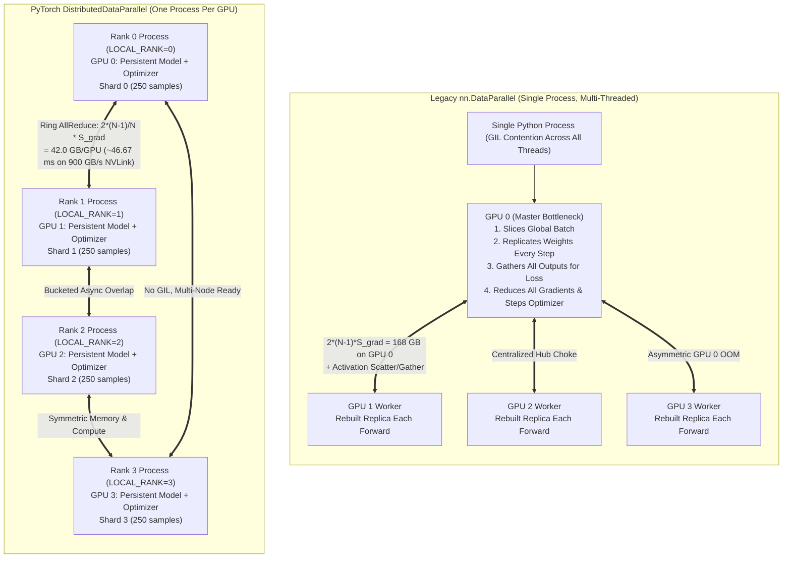
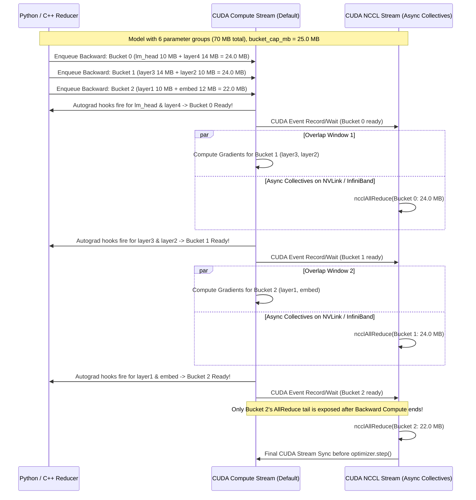
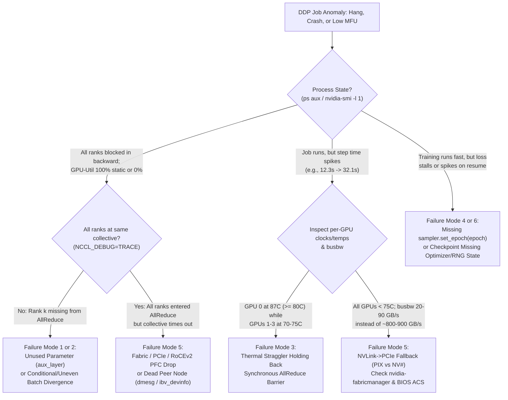

# 14.4 Data parallelism and DDP

| | |
|---|---|
| Level | Intermediate |
| Priority tier | 2 |
| Lab venue | Nebius GPU |
| Part | Part 14: Distributed training and fine-tuning |
| Sources to use | DAI 3; V13 ch3, ch1, ch8, ch12, labs 1–4; VL5 ch1; AISPE ch13 |
| Coverage file | `planning/coverage/chapters/14-04.md` |

## Why this matters for AI infrastructure

When a neural network fits inside the High Bandwidth Memory (`HBM`) of a single GPU—or inside a Tensor/Pipeline parallel group—the fastest, least invasive way to multiply training throughput is **data parallelism**: replicate the model on every worker, partition the incoming mini-batch across workers, and synchronize parameter gradients before every optimizer step. Even inside 3D-parallel (`TP x PP x DP`) foundation-model jobs across thousands of GPUs, the outermost scaling dimension is almost always data parallelism.

For an AI infrastructure engineer, PyTorch `DistributedDataParallel` (`DDP`) is the boundary where deep learning code meets the physical cluster fabric. Unlike legacy `torch.nn.DataParallel` (`DP`), which runs inside a single Python process throttled by the Global Interpreter Lock (`GIL`) and funnels all activations and gradients through `GPU 0` over `PCIe`, `DDP` spawns one operating-system process per GPU and overlaps backward-pass matrix multiplications on the default CUDA compute stream with asynchronous `NCCL` `AllReduce` collectives on a dedicated communication stream. Whether a `4`-GPU `H100` node achieves `95.7%` scaling efficiency (`3.83x`–`3.84x` speedup) or stalls at `15%` Model FLOPs Utilization (`MFU`) depends directly on `DDP`'s internal C++ `Reducer`: reverse-order `25 MB` gradient bucketing (`bucket_cap_mb`), `gradient_as_bucket_view=True` buffer aliasing, `model.no_sync()` gradient accumulation, `DistributedSampler` epoch seeding (`set_epoch`), and `TORCH_NCCL` watchdog behavior when a conditional forward branch or thermal-throttled straggler breaks collective lockstep.

## Prerequisites and outcomes

**Prerequisites:**
- Chapter 14.1 (`ML and deep learning fundamentals for infrastructure engineers`), Chapter 14.2 (`Why distributed training exists`), and Chapter 14.3 (`Training memory and compute anatomy`).
- Familiarity with `NVIDIA` `NVLink`/`PCIe` topologies (`nvidia-smi topo -m`), `NCCL` collectives (`AllReduce`, `Broadcast`), and Linux process/environment management.

**Outcomes:** After completing this chapter, you will be able to:
1. Quantify why `nn.DataParallel` (`DP`) creates a `GPU 0` memory and `PCIe`/`NVLink` communication choke point (`168.0 GB` on `GPU 0` vs `42.0 GB` per GPU in `DDP` for a `7B` `FP32` model on `N = 4` GPUs) and why `DDP` uses one OS process per rank.
2. Trace `DDP`'s forward/backward lifecycle—including `_sync_module_states` parameter/buffer broadcast, reverse-order autograd hook registration (`list(model.parameters())[::-1]`), `Reducer` bucket packing (`bucket_cap_mb = 25.0 MB`), and `gradient_as_bucket_view=True` zero-copy memory savings (`28.0 GB` saved in `FP32` or `14.0 GB` in `BF16` for `7B` parameters).
3. Calculate backward-pass compute/communication overlap efficiency, interpret `TorchDynamo` (`torch.compile`) bucket-boundary graph breaks, and classify `torch.profiler` / `MLPerf` iteration breakdowns (`< 20%` healthy, `20–40%` acceptable, `> 40%` communication bottleneck).
4. Configure `DistributedSampler` (`set_epoch`, `drop_last`), `DataLoader` worker queues (`num_workers`, `pin_memory`, `prefetch_factor`, `persistent_workers`), `model.no_sync()` gradient accumulation (`K`-fold `AllReduce` reduction), `model.join()` for uneven inputs, and `torchrun` single-node, multi-node (`Slurm`), and elastic (`c10d` rendezvous) launches.
5. Diagnose and remediate production `DDP` failures: unused-parameter autograd deadlocks (`aux_layer`), conditional rank divergence, thermal stragglers (`87 C` on `GPU 0` inflating step time from `12.3 s` to `32.1 s`), `RoCEv2` `PFC`/transceiver hangs, and non-atomic or incomplete checkpoint resumes.

---

## 1. The data-parallel contract and why DDP replaced DataParallel

### 1.1 When data parallelism applies: the memory vs. compute boundary

Distributed training solves two distinct physical walls: the **memory wall** (when model states exceed a single GPU's `80 GB` `HBM`) and the **compute wall** (when a single GPU would take months or centuries to finish training). As established in the Volume 13 foundation math, `GPT-3` (`175B` parameters) requires `175,000,000,000 x 4 bytes = 700.0 GB` (`700 GB`) just for `FP32` weights—`8.75x` larger than an `80 GB` `H100` before allocating gradients, optimizer states, or activations (`> 1.2 TB` total, or `~1.1 TB` at `16 bytes/param` mixed precision for `70B`–`175B` class models). Even for a `7B` parameter model trained in `FP32` with `Adam`, the steady-state footprint is:

```text
Model weights (FP32):         7B * 4 bytes = 28.0 GB
Gradients (FP32):             7B * 4 bytes = 28.0 GB
Adam optimizer states (FP32): 7B * 8 bytes = 56.0 GB (momentum m + variance v)
Steady-state model state:                  = 112.0 GB (before activations)
Activations (batch size 4):                ~ 60.0-80.0 GB
Temporary staging buffers:                 ~  5.0-10.0 GB
Total single-GPU footprint:                ~ 180.0-190.0 GB -> OOM on 80 GB H100 (79,456 MiB used, 103 MiB free)
```

On the compute side, a single `GPT-3` (`175B`) training step at global batch size `2048` and sequence length `2048` requires `2 * 175B * 2048 * 2048 ~ 1.46 * 10^18 FLOPs` (`1.468e18 FLOPs`); at `312 TFLOPS` on one `A100`, a single step takes `4,679`–`4,705 seconds` (`~78 minutes`), whereas `128` GPUs reduce that step to `~37 seconds`.

**Data parallelism (`DDP`)** addresses the **compute wall** when the model state and micro-batch activations fit inside each GPU's memory (either natively for smaller models, or via mixed precision + activation checkpointing, or as the outer loop around `TP`/`PP` shards). Its contract has four steps per iteration:
1. **Forward pass (`_sync_module_states` + local compute):** Every GPU holds an identical replica of the model parameters `_parameters` and persistent `_buffers` (such as `BatchNorm` `running_mean` and `running_var`). Each rank `r in 0..N-1` reads a disjoint mini-batch shard of size `B_local` from `DistributedSampler`, making the effective global batch size `B_global = B_local * N`.
2. **Backward pass (local gradient computation):** Each rank independently backpropagates its local loss `L_r` to compute local gradients `g_r`.
3. **Gradient synchronization (`AllReduce`):** Across all `N` (`world_size`) processes, `DDP` invokes `NCCL` `AllReduce` (`ReduceOp.SUM` or `AVG`) so every GPU receives the exact global mean gradient:
   ```text
   g_sync = (1 / N) * sum_{r=0..N-1} g_r
   ```
   Because differentiation is linear, averaging gradients computed on `N` shards of size `B_local` is mathematically identical to computing gradients on one GPU with batch size `B_global = N * B_local` (except for batch-level statistics like non-synchronized `BatchNorm`).
4. **Optimizer step (lockstep parameter update):** Because every rank started the step with identical initial weights `W_t` (broadcast from `rank 0` at `DDP` initialization and verified by identical random seed `set_seed(42)`) and identical optimizer states, applying `optimizer.step()` to identical `g_sync` yields bit-identical updated weights `W_{t+1}` on every GPU without ever broadcasting weights after step 0.

### 1.2 Why `nn.DataParallel` (`DP`) is an infrastructure anti-pattern

Before `DDP`, PyTorch provided `torch.nn.DataParallel` (`DP`), a single-process, multi-threaded wrapper. Even on a single `4`-GPU or `8`-GPU server, `DP` fails at scale for four architectural reasons:



1. **Python `GIL` serialization:** `DP` spawns `N` threads inside one Python interpreter. Because Python's Global Interpreter Lock (`GIL`) allows only one thread to execute Python bytecode at a time, C++ operator dispatch and autograd bookkeeping contend on the `GIL`, starving CUDA streams as GPU count grows from `2` to `8`.
2. **Per-step model replication and `GPU 0` centralized hub traffic:** In `DP`, only `GPU 0` runs the optimizer step. On every single training iteration, `GPU 0` must broadcast updated parameters to `N - 1` peer GPUs during forward and gather full gradients from `N - 1` peer GPUs during backward:
   ```text
   DP GPU 0 parameter + gradient traffic = 2 * (N - 1) * S_grad
   DDP per-GPU Ring AllReduce traffic    = 2 * ((N - 1) / N) * S_grad
   Ratio (DP GPU 0 / DDP per GPU)        = N
   ```
   For a `7B` `FP32` model (`S_grad = 28.0 GB`) on `N = 4` GPUs, `DDP` moves `2 * (3/4) * 28.0 = 42.0 GB` per GPU, whereas `DP` forces `GPU 0` to push and pull `2 * 3 * 28.0 = 168.0 GB` (`4.0x` higher traffic on `GPU 0`), plus scattering inputs and gathering forward outputs!
3. **Asymmetric `GPU 0` memory `OOM`:** Because `DP` gathers forward-pass output logits from all `N` GPUs onto `GPU 0` to compute the loss and stages incoming gradients on `GPU 0`, `GPU 0` consumes significantly more VRAM than `GPUs 1..N-1` (for example, `1.5 GB` per peer = `4.5 GB` extra on `GPU 0` across `4` GPUs, often causing `GPU 0` to `OOM` at `89%`–`100%` while `GPUs 1..3` sit at `45%`–`52%`).
4. **No overlap and single-node ceiling:** `DP` cannot overlap weight broadcast or gradient gather with backward compute and cannot span multiple physical servers.

| Architectural Dimension | `torch.nn.DataParallel` (`DP`) | `DistributedDataParallel` (`DDP`) |
|---|---|---|
| Process & threading model | `1` OS process, `N` Python threads (`GIL` bottleneck) | `N` OS processes (`1` per GPU via `torchrun`, zero `GIL` contention) |
| Multi-node capability | Single node only | Single-node (`NVLink`/`PCIe`) and multi-node (`InfiniBand`/`RoCEv2`) |
| Forward pass weight sync | Broadcasts weights from `GPU 0` to `GPUs 1..N-1` **every step** | Broadcasts weights once at `init`; only `_buffers` (`BatchNorm`) sync if `broadcast_buffers=True` |
| Gradient synchronization | Centralized gather/reduce onto `GPU 0` (`2*(N-1)*S_grad` on `GPU 0`) | Decentralized `NCCL` Ring/Tree `AllReduce` (`2*(N-1)/N * S_grad` per GPU) |
| Compute–communication overlap | None (strictly sequential) | Asynchronous per-bucket `AllReduce` overlapped with backward compute |
| VRAM balance across GPUs | Asymmetric (`GPU 0` holds gathered outputs, loss, and master step) | Symmetric across all `N` ranks |

---

## 2. DDP internals: autograd hooks, reverse bucketing, and overlap

### 2.1 Forward pass state synchronization (`_sync_module_states` and `_buffers`)

Every `torch.nn.Module` stores its state in two internal ordered dictionaries:
- `_parameters`: trainable tensors (`requires_grad=True` by default) updated by the optimizer.
- `_buffers`: persistent non-trainable tensors registered via `register_buffer()` (most notably `BatchNorm` `running_mean`, `running_var`, and `num_batches_tracked`).

When you wrap a module via `model = DDP(model, device_ids=[local_rank])`, `DDP` executes `_sync_module_states()` during construction to `Broadcast` both `_parameters` and `_buffers` from `rank 0` to `ranks 1..N-1`. This guarantees identical starting weights even if you forgot to seed `torch.manual_seed` identically.

At the beginning of **every forward pass**, if `broadcast_buffers=True` (the default), `DDP` broadcasts `_buffers` from `rank 0` to all other ranks so buffer statistics do not drift across processes.
- If your architecture uses `LayerNorm` or `RMSNorm` (like almost all modern Transformers: `Llama`, `Mistral`, `GPT`), those layers maintain no running statistics in `_buffers`; setting `broadcast_buffers=False` eliminates unnecessary pre-forward broadcast checks.
- If your vision or hybrid model uses `BatchNorm` and has a small per-GPU batch size `B_local`, broadcasting `rank 0`'s buffers alone only copies `rank 0`'s local running statistics. To compute true global batch mean and variance across all `N` GPUs during forward, convert layers before wrapping in `DDP` via `nn.SyncBatchNorm.convert_sync_batchnorm(model)` (keeping in mind that `SyncBatchNorm` adds an extra cross-rank synchronization collective per normalization layer inside the forward pass).

### 2.2 C++ `Reducer`, reverse-order parameter bucketing (`bucket_cap_mb = 25`), and `gradient_as_bucket_view`

If `DDP` launched a separate `ncclAllReduce` kernel for every individual parameter tensor in a Transformer (hundreds of weight matrices and bias vectors), per-collective launch latency (`~5–15 us` per kernel launch plus network setup) would destroy interconnect utilization. Conversely, if `DDP` waited until `loss.backward()` finished computing the gradients for Layer 0 before launching a single monolithic `AllReduce`, the network fabric would sit `100%` idle during the entire backward pass and the GPU Tensor Cores would sit `100%` idle during the entire `AllReduce`.

`DDP` solves both problems simultaneously inside its C++ `Reducer` using **reverse-order parameter bucketing**:
1. **Reverse parameter ordering (`list(model.parameters())[::-1]`):** Backpropagation traverses the computation graph from the loss at the final layer (`lm_head`, Layer `L-1`) backward toward the input embedding (`Layer 0`). Therefore, `DDP` iterates over `model.parameters()` in **reverse order** and packs consecutive trainable parameters into contiguous communication buckets up to `bucket_cap_mb` (default **`25 MB`** / `25.0 MB`).
2. **Autograd `AccumulatorGrad` hooks:** At initialization, the `Reducer` attaches a C++ autograd post-hook to every trainable parameter's `AccumulateGrad` node. As soon as a parameter's backward gradient finishes accumulating on the default CUDA compute stream, its hook fires and marks that parameter slot ready inside its assigned bucket.
3. **Bucket readiness and asynchronous `ncclAllReduce` launch:** Only when **every** parameter assigned to Bucket `b` has fired its autograd hook does the `Reducer` launch an asynchronous `ncclAllReduce` for Bucket `b` on a separate internal `NCCL` CUDA stream (`cudaStreamWaitEvent` ensures the `NCCL` stream waits for the compute stream's gradient kernels for Bucket `b` without blocking the CPU or the compute stream's work on Bucket `b+1`).



Consider the concrete `6`-layer parameter layout verified in `code/part14/data_parallelism_ddp.py` (`embed.weight = 12.0 MB`, `layer1.weight = 10.0 MB`, `layer2.weight = 10.0 MB`, `layer3.weight = 14.0 MB`, `layer4.weight = 14.0 MB`, `lm_head.weight = 10.0 MB`, total `70.0 MB`):
- With default `bucket_cap_mb = 25.0 MB`, reverse packing produces **3 buckets**:
  - **Bucket 0:** `("lm_head.weight", "layer4.weight")` (`10.0 + 14.0 = 24.0 MB <= 25.0 MB`, layers `5, 4`) — fires earliest in backward!
  - **Bucket 1:** `("layer3.weight", "layer2.weight")` (`14.0 + 10.0 = 24.0 MB <= 25.0 MB`, layers `3, 2`).
  - **Bucket 2:** `("layer1.weight", "embed.weight")` (`10.0 + 12.0 = 22.0 MB <= 25.0 MB`, layers `1, 0`).
- If you increase `bucket_cap_mb = 50.0 MB`, `DDP` merges the model into **2 buckets** (`Bucket 0 = 48.0 MB` containing `lm_head..layer2`, `Bucket 1 = 22.0 MB` containing `layer1, embed`). That cuts the number of `AllReduce` kernel launches from `3` to `2`, but delays the start of the very first `AllReduce` until `48.0 MB` of backward compute has finished instead of `24.0 MB`.

**Memory optimization with `gradient_as_bucket_view=True`:**
By default (`gradient_as_bucket_view=False`), each parameter allocates its own `param.grad` tensor (`S_grad` bytes total) **and** the `DDP` `Reducer` allocates a separate set of contiguous `25 MB` bucket buffers (`S_grad` bytes total). As each autograd hook fires, `DDP` copies `param.grad` into the bucket buffer (`D2D memcpy`), runs `ncclAllReduce` in-place on the bucket buffer, and copies the averaged slice back into `param.grad`.
- For our `7B` `FP32` model (`28.0 GB` weights + `56.0 GB` `Adam` states + `28.0 GB` `param.grad` + `28.0 GB` `Reducer` buckets = `140.0 GB` steady state), setting **`gradient_as_bucket_view=True`** makes each `param.grad` a zero-copy tensor view (`storage_offset` pointer) directly into the `Reducer`'s flat bucket buffer. That eliminates duplicate gradient storage and saves **`28.0 GB`** of VRAM (`140.0 GB -> 112.0 GB`) in `FP32`, or **`14.0 GB`** of VRAM (`126.0 GB -> 112.0 GB`) in `BF16`/`FP16` mixed precision (`14.0 GB` `BF16` weights + `14.0 GB` `BF16` grads + `84.0 GB` `FP32` master weights/momentum/variance), while also eliminating two device-to-device memory copies per parameter per step. (One caveat: with `gradient_as_bucket_view=True`, you cannot call `param.grad.detach_()`, and you should use `optimizer.zero_grad(set_to_none=True)` or standard `zero_grad()`.)

### 2.3 Quantifying compute–communication overlap and `torch.compile` subgraphs

We can model the exact two-stream timeline for `B` buckets with per-bucket backward compute times `c_0, c_1, ..., c_{B-1}` and per-bucket `AllReduce` durations `a_0, a_1, ..., a_{B-1}`:

```text
Compute stream completion for bucket b:
  T_comp(b) = sum_{k=0..b} c_k

NCCL communication stream window for bucket b:
  T_comm_start(b) = max(T_comp(b), T_comm_end(b - 1))   (with T_comm_end(-1) = 0)
  T_comm_end(b)   = T_comm_start(b) + a_b

Sequential (non-overlapped) time = T_comp(B - 1) + sum_{b=0..B-1} a_b
Overlapped backward + sync time  = T_comm_end(B - 1)
Exposed communication overhead   = T_comm_end(B - 1) - T_comp(B - 1)
Hidden communication time        = (sum_{b=0..B-1} a_b) - Exposed communication overhead
Overlap efficiency (%)           = (Hidden communication time / sum_{b=0..B-1} a_b) * 100%
```

For example, consider a backward pass partitioned into `B = 4` buckets where each bucket takes `c_b = 3.0 ms` of backward compute (`12.0 ms` total) and `a_b = 2.5 ms` of `AllReduce` (`10.0 ms` total):
- **Bucketed `DDP` (`B = 4` buckets, `bucket_cap_mb = 25`):**
  - Bucket 0 finishes compute at `3.0 ms`; `AllReduce 0` runs `3.0 -> 5.5 ms` while Bucket 1 computes (`3.0 -> 6.0 ms`).
  - Bucket 1 finishes compute at `6.0 ms`; `AllReduce 1` runs `6.0 -> 8.5 ms` while Bucket 2 computes (`6.0 -> 9.0 ms`).
  - Bucket 2 finishes compute at `9.0 ms`; `AllReduce 2` runs `9.0 -> 11.5 ms` while Bucket 3 computes (`9.0 -> 12.0 ms`).
  - Bucket 3 finishes compute at `12.0 ms`; `AllReduce 3` runs `12.0 -> 14.5 ms`.
  - Total overlapped backward + sync time is **`14.5 ms`** versus **`22.0 ms`** sequential (`1.517x` speedup). Out of `10.0 ms` of total `AllReduce`, **`7.5 ms` (`75.0%`) is completely hidden** behind compute, leaving only the final bucket's **`2.5 ms`** tail exposed!
- **Interaction with `torch.compile` (`TorchDynamo`):**
  When you compile a `DDP`-wrapped model (`model = DDP(torch.compile(raw_model))` or compiling the `DDP` module), `TorchDynamo` intentionally inserts **graph breaks at `DDP` bucket boundaries** (visible in `torch._dynamo.explain(model, ...)`). It compiles each bucket's backward pass as a separate fused `TorchInductor` subgraph (`4` subgraphs for `4` buckets) so the C++ `Reducer` can launch `ncclAllReduce` between subgraphs. If an engineer overrides `bucket_cap_mb` to one giant bucket (`1000 MB`) hoping to fuse the entire backward pass into `1` monolithic `TorchInductor` graph with `0` graph breaks, `AllReduce` cannot start until `12.0 ms` of backward compute finishes: all `10.0 ms` of `AllReduce` is exposed (`22.0 ms` total, `0.0%` overlap). Always keep `bucket_cap_mb` near `25 MB`–`50 MB` when using `torch.compile` with `DDP`.

### 2.4 Ring vs. Tree `AllReduce` cost model across NVLink and InfiniBand

In Chapter 14.3 and Volume 13 Chapters 3 & 8, we derived the bandwidth term for `NCCL` Ring `AllReduce` across `N` GPUs with gradient tensor size `S_grad`:
- **Phase 1 (`Reduce-Scatter`):** `N - 1` ring steps, moving `((N - 1) / N) * S_grad` bytes per GPU.
- **Phase 2 (`All-Gather`):** `N - 1` ring steps, moving another `((N - 1) / N) * S_grad` bytes per GPU.
- **Total data moved per GPU:** `2 * ((N - 1) / N) * S_grad`.

Let us compare three canonical production regimes for our `7B` `FP32` model (`S_grad = 28.0 GB`):
1. **`4` `H100` GPUs on single-node `NVLink` (`900.0 GB/s` per GPU):**
   - Data moved per GPU: `2 * (3/4) * 28.0 GB = 42.0 GB`.
   - Wire time: `42.0 GB / 900.0 GB/s = 0.04667 s = 46.67 ms` (`~47 ms`).
   - Against a `12.3 s` single-GPU baseline step (`8.13 tokens/sec`), pure wire overhead is `46.67 ms / 12,300 ms = 0.38%`, yielding a theoretical ceiling of `99.6%` efficiency (`3.98x` speedup). In production, kernel launch, stream synchronization, and minor barrier jitter bring the measured `4`-GPU step time to `12.9 s` (`31.2 tokens/sec`), achieving **`3.83x`–`3.84x` speedup (`95.7%`–`95.9%` scaling efficiency)**.
2. **`8` `H100` GPUs on single-node `NVLink` (`900.0 GB/s` per GPU):**
   - Data moved per GPU: `2 * (7/8) * 28.0 GB = 49.0 GB`.
   - Wire time: `49.0 GB / 900.0 GB/s = 54.4 ms` (`~54 ms`). The `8`-hop ring latency (`8 * ~1–5 us < 0.05 ms`) is negligible compared to `54.4 ms`; `NCCL` selects `Ring`.
3. **`512` GPUs (`64` nodes) over cross-node `InfiniBand` (`~25.0 GB/s`–`50.0 GB/s` effective per-GPU link):**
   - Data moved per GPU: `2 * (511/512) * 28.0 GB = 55.89 GB` (`~55.9 GB`).
   - Wire time at `25.0 GB/s`: `55.89 GB / 25.0 GB/s = 2.2356 s` (`~2.2 s`).
   - Here a pure `512`-GPU ring requires `2 * 511 = 1,022` sequential pipelined hops (`512` ranks), accumulating `0.5–2.5 ms` of fabric propagation delay plus substantial per-hop queueing and software overhead. `NCCL` (`NCCL_ALGO`) therefore switches to a **Double Binary Tree** or hierarchical algorithm (Ring/NVLS within each `8`-GPU `NVLink` node, Tree or `SHARP` `CollNet` across nodes), cutting the hop depth from `512` to `log2(512) = 9` hops.

---

## 3. Data sharding, DataLoader pipelines, and uneven inputs

### 3.1 `DistributedSampler` internals: `set_epoch()`, `drop_last`, and seed hygiene

If you launch `4` `DDP` processes with a standard `DataLoader(dataset, batch_size=32, shuffle=True)`, every rank independently shuffles the full `1,000`-sample dataset, trains on `1,000` samples per epoch instead of `250`, and potentially sees overlapping batches—wasting compute or leaking duplicate samples into the same global step.

`torch.utils.data.distributed.DistributedSampler` partitions a dataset of length `D` across `world_size = N` processes deterministically:
1. **Sample count calculation (`drop_last`):**
   - When `drop_last=True` and `D % N != 0`, the sampler drops the tail `D % N` samples so every rank gets `num_samples = D // N` (`total_size = num_samples * N`). For `D = 1003, N = 4`, `drop_last=True` gives `250` samples/rank (`1,000` total, dropping `3` tail samples).
   - When `drop_last=False` (the default), the sampler rounds up: `num_samples = ceil(D / N)` and `total_size = num_samples * N`, padding the index list by repeating the first `total_size - D` indices from the front (`indices[:padding_size]`). For `D = 1003, N = 4`, `drop_last=False` gives `251` samples/rank (`1,004` total, duplicating `1` sample so all `4` ranks execute the exact same number of batches).
2. **Deterministic epoch permutation (`sampler.set_epoch(epoch)`):**
   When `shuffle=True` on `DistributedSampler`, every rank constructs a pseudo-random generator seeded with `seed + epoch` (where `self.epoch` defaults to `0`) and generates the **exact same global permutation** of `[0, 1, ..., D - 1]`. Rank `r` then takes the strided slice:
   ```text
   shard_r = indices[r : total_size : world_size]
   ```
   For `D = 1000, N = 4`, each rank gets `250` strictly disjoint indices (`union_size = 1000`).
   - **Critical bug if `sampler.set_epoch(epoch)` is omitted:** `self.epoch` remains `0` forever, so Epoch 0, Epoch 1, ..., Epoch 9 feed the exact same batch ordering to every GPU! Always call `sampler.set_epoch(epoch)` at the top of the epoch loop, and **never** pass `shuffle=True` to `DataLoader` when passing `sampler=sampler` (PyTorch raises a `ValueError` because `sampler` and `shuffle` are mutually exclusive).

### 3.2 Multi-process `DataLoader` queues and worker sizing

When `num_workers > 0`, `DataLoader` uses `_MultiProcessDataLoaderIter` rather than `_SingleProcessDataLoaderIter`:
- The main training process enqueues batch index lists from `DistributedSampler` into an `index_queue` (`prefetch_factor * num_workers` batches ahead, default `prefetch_factor=2`).
- Each rank spawns its own `num_workers` OS worker processes (`num_workers * nproc_per_node` total workers per node). Workers dequeue indices, read and transform samples from storage, and push collated tensors into `worker_result_queue`.
- When `pin_memory=True`, a dedicated `pin_memory_thread` copies tensors from pageable host RAM into page-locked (pinned) host memory so `data.to(device, non_blocking=True)` can DMA directly over `PCIe` without blocking the CPU or GPU compute stream.
- Setting `persistent_workers=True` keeps the worker pool alive across epoch boundaries instead of tearing down and respawning `num_workers * 8` processes every epoch.
- **Worker sizing rule:** Because `torchrun --nproc_per_node=G` spawns `G` training processes per node, total DataLoader workers on the host equal `G * num_workers`. Size per-rank workers as:
  ```text
  num_workers_per_rank = min(8, cpu_cores_per_node // gpus_per_node // 2)
  ```

### 3.3 Handling uneven inputs across ranks with `model.join()`

When `drop_last=False` on a custom sharded iterable dataset or dynamic sequence-packing pipeline, different ranks may produce different numbers of micro-batches in an epoch (for example, in `DAI` Ch 3's `ddp_join_demo.py`, `Rank 0` has `2` batches while `Rank 1` has `3` batches).
- **Without `model.join()`:** `Rank 0` finishes step `2` and exits the training loop, while `Rank 1` enters step `3`, calls `loss.backward()`, and blocks forever inside `ncclAllReduce` waiting for `Rank 0` (until the `30`-minute `init_process_group` watchdog kills the job).
- **With `with model.join():`:** Wrapping the batch loop in `with model.join():` hooks into the `DDP` `Reducer` so that when `Rank 0` exhausts its `2` batches early, it remains inside the context manager and participates in **`1` shadow/dummy `AllReduce` collective** (contributing zero gradients) during `Rank 1`'s 3rd step before both ranks exit cleanly.

---

## 4. Optimization levers: AMP, `no_sync()`, static graphs, and hooks

### 4.1 Mixed precision (`BF16` vs. `FP16` + `GradScaler`) with `DDP`

Training with `torch.autocast` halves activation and gradient communication volume (`2 bytes/param` instead of `4 bytes/param`) and activates Tensor Cores (`torch.set_float32_matmul_precision("high")` for `TF32` on `FP32` paths, or native `BF16`/`FP16`):
- **`BF16` (`torch.bfloat16`, preferred on `Ampere`/`Hopper`/`Blackwell`):** Shares `FP32`'s `8`-bit exponent range (`7`-bit mantissa), so gradients rarely underflow and `GradScaler` is not required.
- **`FP16` (`torch.float16`):** Uses a narrow `5`-bit exponent (`10`-bit mantissa) prone to gradient underflow. When using `FP16` with `DDP`, instantiate `scaler = torch.cuda.amp.GradScaler()` **before** or alongside `DDP` on every rank:
  1. `scaler.scale(loss).backward()` multiplies `loss` by `scale` before backpropagation, so `DDP`'s `Reducer` `AllReduce`s the **scaled** gradients across all ranks.
  2. `scaler.step(optimizer)` unscales the synchronized gradients on every rank in lockstep, checks for `Inf`/`NaN` overflow (which is identical across ranks because the gradients were just `AllReduce`d), and either steps or skips `optimizer.step()` identically on all ranks.
  3. `scaler.update()` adjusts the scale factor on every rank.

### 4.2 Gradient accumulation with `model.no_sync()`

When a target global batch size exceeds single-GPU memory, engineers accumulate gradients across `K` micro-batches (`accumulation_steps = K`) before calling `optimizer.step()`.
- **The naive trap:** Calling `loss.backward()` on all `K` micro-batches triggers `DDP`'s `Reducer` autograd hooks on every single micro-batch, executing **`K` full `AllReduce` collectives** per optimizer step when `K - 1` of them are completely wasted (the weights do not change until step `K`)!
- **The `with model.no_sync():` solution:** Wrapping micro-batches `0 .. K-2` inside `with model.no_sync():` temporarily disables `DDP`'s `Reducer` `AllReduce` hooks so `loss.backward()` accumulates gradients purely in local GPU memory (`param.grad += g_{r,k} / K`). On the final micro-batch `k = K - 1`, exiting `no_sync()` re-enables the `Reducer` so `loss.backward()` performs **1 single `AllReduce`** over the locally accumulated sum:

```text
Naive accumulation (no no_sync):
  AllReduce calls per optimizer step = K
  Ring bytes per GPU per step        = K * 2 * ((N - 1) / N) * S_grad

Optimized accumulation (with model.no_sync() on steps 0..K-2):
  AllReduce calls per optimizer step = 1
  Ring bytes per GPU per step        = 1 * 2 * ((N - 1) / N) * S_grad
  Communication reduction factor     = K  (saves (K - 1) / K of AllReduce volume & latency)

Mathematical equivalence (linearity of averaging):
  (1 / N) * sum_{r=0..N-1} [ sum_{k=0..K-1} (g_{r,k} / K) ]
  == sum_{k=0..K-1} [ (1 / N) * sum_{r=0..N-1} (g_{r,k} / K) ]
```

As verified in `code/part14/data_parallelism_ddp_lab.py` for our `7B` model (`S_grad = 28.0 GB`) on `N = 4` GPUs:
- With `K = 4` accumulation steps, `model.no_sync()` cuts `AllReduce` collectives per optimizer step from `4` to `1` (**`4.0x` reduction, `75.0%` communication saved**), slashing per-GPU Ring traffic from `168.0 GB` to `42.0 GB` while producing identical gradients to within `< 1e-12`.
- With `K = 8` accumulation steps, `model.no_sync()` cuts `AllReduce` calls from `8` to `1` (**`87.5%` communication saved**, `336.0 GB -> 42.0 GB`).
- **Tail-window edge case:** If the total number of batches in an epoch is not divisible by `K`, remember to run a final un-wrapped `backward()` / `optimizer.step()` / `optimizer.zero_grad()` on the remaining micro-batches at the end of the epoch so all ranks synchronize before exiting.

### 4.3 `find_unused_parameters=True` vs. `static_graph=True`

When a model contains conditional control flow (e.g., an auxiliary classifier head `aux_layer` that executes only when `use_aux=True`, or Mixture-of-Experts routing without dropped-token padding), some parameters may not participate in producing `loss` on a given step.
- **Default behavior (`find_unused_parameters=False, static_graph=False`):** `DDP`'s `Reducer` expects **every** trainable parameter hook to fire during `loss.backward()`. If `aux_layer.weight` is skipped, its bucket never reaches `100%` ready, its `ncclAllReduce` never launches, and the run either hangs or crashes on the next iteration with:
  `RuntimeError: Expected to have finished reduction in the prior iteration before starting a new one.`
- **`find_unused_parameters=True`:** Forces `DDP` to traverse the autograd DAG starting from the root `loss` tensor on **every single forward/backward pass** to discover which parameters are reachable and pre-mark unreachable parameters as ready. This prevents the hang but adds noticeable CPU autograd-traversal overhead and delays bucket reductions every step.
- **`static_graph=True` (preferred when graph topology is fixed):** If the set of used/unused parameters (or activation checkpointing re-entrant hooks) is invariant across iterations, passing `static_graph=True` tells `DDP` to record the active parameter graph during the warmup iterations (`model._get_ddp_logging_data().get("can_set_static_graph")`) and reuse that exact reduction schedule forever without per-step graph traversal overhead. Even better, in standard models, wire every parameter into the loss (for instance `loss = main_loss + 0.0 * aux_out.sum()`) so `find_unused_parameters` can stay `False`.

### 4.4 Gradient hooks and custom `DDP` communication hooks

`DDP` exposes two hook levels for custom gradient processing:
1. **Per-parameter autograd gradient hooks (`model.module.fc.weight.register_hook(fn)`):** Inspect or transform an individual parameter's gradient tensor (`grad -> modified_grad`, e.g., per-layer norm logging or clamping) during `backward()`. Note the `.module` unwrap to access the underlying `nn.Module`.
2. **Per-bucket `DDP` communication hooks (`model.register_comm_hook(state, hook_fn)`):** Override `DDP`'s default C++ `AllReduce` entirely at the bucket level! The hook receives `(state, bucket: dist.GradBucket)`, extracts the flat contiguous tensor via `bucket.buffer()`, performs custom asynchronous communication (such as `FP16`/`BF16` gradient compression, PowerSGD low-rank gradient compression, or custom intra-node/inter-node hierarchical reductions), and returns a `torch.futures.Future` that resolves to the reduced tensor.

---

## 5. Launching, profiling, and checkpointing DDP at scale

### 5.1 Process groups, environment variables, and `torchrun` (`single-node`, `Slurm`, `elastic`)

`torchrun` spawns one worker process per local GPU (`--nproc_per_node=G`), manages rendezvous over a `TCPStore` (`c10d`), and injects the standard PyTorch distributed environment variables into every worker:
- **`LOCAL_RANK` (`0 .. nproc_per_node - 1`):** Index of the GPU **on the local server**. Always bind the CUDA device using `torch.cuda.set_device(int(os.environ["LOCAL_RANK"]))`—**never** use `RANK` for `set_device()`, because on Node 1 of an `8`-GPU-per-node job, `RANK` is `8..15` while local GPU indices are `0..7`!
- **`RANK` (`0 .. WORLD_SIZE - 1`):** Global process rank across the entire job (`RANK = NODE_RANK * nproc_per_node + LOCAL_RANK`). Used to gate console logging and `rank 0` checkpoint writes.
- **`WORLD_SIZE` (`NNODES * nproc_per_node`):** Total number of participating processes across all nodes.
- **`MASTER_ADDR` and `MASTER_PORT`:** IP address (use a routable cluster IP, not a hostname that resolves to `127.0.0.1`) and free TCP port (e.g., `29500` or `29400` for elastic `c10d`) on Node 0 where ranks rendezvous during `dist.init_process_group(backend="nccl")`.

**Elastic and fault-tolerant `DDP` (`Torch Distributed Elastic`):**
In standard `DDP`, if `1` process crashes (or `1` spot node is preempted), the entire `world_size` collective aborts. Passing `--max_restarts=3`, `--rdzv_id=<job_id>`, `--rdzv_backend=c10d` (or `etcd-v2`), and `--rdzv_endpoint=$MASTER_ADDR:29400`—plus an optional dynamic node range `--nnodes=2:4`—activates `torchrun`'s elastic agent:
- **Fault-tolerant mode (fixed `--nnodes=2`, `--max_restarts=3`):** If a worker crashes, the elastic agent terminates surviving local workers, re-runs rendezvous across the `2` nodes, respawns workers, and resumes from the latest atomic checkpoint.
- **Elastic mode (`--nnodes=2:4`):** Allows nodes to join or leave mid-run; because `WORLD_SIZE` changes dynamically after rendezvous, `B_global = B_local * WORLD_SIZE` shifts at resize boundaries, so scripts must never hardcode `WORLD_SIZE` and should adjust learning-rate or gradient-accumulation schedules accordingly.

### 5.2 Profiling `DDP` overlap (`torch.profiler`, `Perfetto`, `HTA`, and `MLPerf` logging)

To verify that `ncclAllReduce` is actually overlapping with backward compute rather than running sequentially:
1. **`torch.profiler.profile` (`Kineto` / Chrome Trace / `Perfetto`):** Capture `ProfilerActivity.CPU` and `ProfilerActivity.CUDA` across a few active steps and export `prof.export_chrome_trace("ddp_trace.json")` (or inspect at `https://ui.perfetto.dev/`). In the timeline, `DDP` executes backward compute kernels (`LinearBackward`, `ConvolutionBackward0`) on the **default CUDA compute stream** (`stream 7`) while launching `ncclKernel_AllReduce_*` on a **separate `NCCL` CUDA communication stream**. Horizontal bars that overlap in wall-clock time on **two different stream rows** prove true hardware overlap.
2. **Meta Holistic Trace Analysis (`HTA`):** Because the legacy TensorBoard PyTorch profiler plugin is deprecated, use `HTA` to ingest per-rank JSON traces (`ddp_multinode_rank{rank}.json`) and align NVTX markers across `8`–`512+` GPUs on a single timeline—instantly exposing whether `Rank 1` entered `backward` late because it was blocked waiting for `Rank 0` in the prior step's `AllReduce`.
3. **Quantitative step-time health bands (`DAI` Ch 3 & `AISPE` Table 13-6 `MLPerf` breakdown):**
   Instrument your training loop to emit structured JSON step breakdowns (`:::MLL` style):
   ```text
   Example 24.0 ms MLPerf Training Iteration Breakdown (AISPE Table 13-6):
     Forward pass:            10.5 ms  (43.8%)
     Backward pass:            9.0 ms  (37.5%)  -> Total Compute = 19.5 ms (81.3%)
     AllReduce (exposed):      4.0 ms  (16.7%)  -> < 20% = Healthy Overlap Band
     Other (data/host overhead):0.5 ms  (2.1%)
     Total step time:         24.0 ms (100.0%)
   ```
   Use the `DAI` Ch 3 `AllReduce` share thresholds to classify communication overhead:
   - **`< 20%` of step time:** **`GOOD_OVERLAP`** (healthy `NVLink` or well-overlapped fabric; e.g., `16.7%` above, or `0.38%`–`4.3%` on `4x H100` `7B` `DDP`).
   - **`20%–40%` of step time:** **`ACCEPTABLE_COMM`** (typical for cross-node Ethernet or moderate-scale clusters; tune `bucket_cap_mb` across `[10, 25, 50, 100] MB`).
   - **`> 40%` of step time:** **`COMM_BOTTLENECK`** (interconnect saturation, `PCIe` fallback due to `ACS` or stopped `nvidia-fabricmanager`, `RoCEv2` `PFC` packet drops, or tiny micro-batch / tiny model with insufficient backward compute to hide `AllReduce`).

### 5.3 Checkpointing `DDP` safely: `.module`, RNG states, atomic renames, and `dist.barrier()`

Because every `DDP` rank holds an identical copy of the model weights and optimizer state after `loss.backward()` and `optimizer.step()`, **only `rank 0` should write a replicated `DDP` checkpoint** (writing the same file path from all `N` ranks simultaneously causes file corruption and metadata storms):
1. **Unwrap `model.module.state_dict()`:** Calling `model.state_dict()` on a `DDP`-wrapped model prefixes every parameter key with `"module."`. Saving `model.module.state_dict()` stores clean keys that load cleanly into both non-distributed and `DDP` models.
2. **Save all 4 reproducibility states (Volume 13 Lab 04):** A bit-reproducible resume requires saving:
   - `model_state_dict` (`model.module.state_dict()`)
   - `optimizer_state_dict` (`optimizer.state_dict()` — omitting `Adam`'s `m` and `v` buffers causes `Adam` to restart "cold" and triggers an immediate post-resume loss spike!)
   - `scheduler_state_dict` + `scaler_state_dict` (if using `FP16` `GradScaler`) + `epoch`/`step`
   - `rng_state` (`torch.get_rng_state()`, `torch.cuda.get_rng_state_all()`, `numpy.random.get_state()`, `random.getstate()` — omitting RNG state causes silent divergence in data shuffling and dropout masks after resume).
3. **Atomic write (`temp_file -> os.rename`) + `dist.barrier()`:** If `rank 0` is killed (`kill -9` or `OOM`) mid-write during `torch.save(ckpt, filepath)`, the checkpoint file is truncated and unreadable. Always write to `filepath + ".tmp"`, call `os.rename(temp_file, filepath)` (atomic on POSIX filesystems), and place a `dist.barrier()` immediately after the `if rank == 0:` block so worker ranks cannot advance or read a half-written checkpoint. (When transitioning from `DDP` to `FSDP`/`ZeRO-3` in Chapter 14.5, replace `rank 0` `torch.save` with parallel sharded `torch.distributed.checkpoint` `dcp.save` so gathering full state onto `rank 0` never causes a host/GPU `OOM`.)

---

## Commands and configurations that matter

### 1. Production single-node and multi-node `DDP` training template (`train_ddp_prod.py`)

```python
import os
import random
from datetime import timedelta
import numpy as np
import torch
import torch.distributed as dist
import torch.nn as nn
from torch.nn.parallel import DistributedDataParallel as DDP
from torch.utils.data import DataLoader, DistributedSampler

def set_seed(seed: int = 42) -> None:
    torch.manual_seed(seed)
    torch.cuda.manual_seed_all(seed)
    np.random.seed(seed)
    random.seed(seed)

def setup_ddp() -> tuple[int, int, int, torch.device]:
    rank = int(os.environ["RANK"])
    local_rank = int(os.environ["LOCAL_RANK"])
    world_size = int(os.environ["WORLD_SIZE"])
    # CRITICAL: Always bind device with LOCAL_RANK, never global RANK
    torch.cuda.set_device(local_rank)
    device = torch.device(f"cuda:{local_rank}")
    dist.init_process_group(
        backend="nccl",
        timeout=timedelta(minutes=30),  # Enforced when TORCH_NCCL_BLOCKING_WAIT=1
    )
    return rank, local_rank, world_size, device

def save_checkpoint_atomic(model: DDP, optimizer: torch.optim.Optimizer, epoch: int, loss: float, path: str) -> None:
    if dist.get_rank() == 0:
        tmp_path = f"{path}.tmp"
        ckpt = {
            "epoch": epoch,
            "loss": loss,
            "model_state_dict": model.module.state_dict(),  # Unwrap .module!
            "optimizer_state_dict": optimizer.state_dict(),
            "rng_state": torch.get_rng_state(),
            "cuda_rng_state": torch.cuda.get_rng_state_all(),
            "numpy_rng_state": np.random.get_state(),
            "python_rng_state": random.getstate(),
        }
        torch.save(ckpt, tmp_path)
        os.rename(tmp_path, path)  # Atomic POSIX rename prevents torn checkpoints
    dist.barrier()  # Ensure all ranks wait until rank 0 completes atomic rename

def train_step_loop(model: nn.Module, dataset, epochs: int = 10, batch_size: int = 32, accum_steps: int = 4) -> None:
    rank, local_rank, world_size, device = setup_ddp()
    set_seed(42)
    torch.set_float32_matmul_precision("high")  # Enable TF32 on Ampere/Hopper/Blackwell

    model = model.to(device)
    ddp_model = DDP(
        model,
        device_ids=[local_rank],
        bucket_cap_mb=25,               # Default 25 MB reverse-order Reducer buckets
        gradient_as_bucket_view=True,   # Zero-copy grad views: saves 1x S_grad VRAM
        broadcast_buffers=False,        # False for Transformer LayerNorm/RMSNorm
        find_unused_parameters=False,   # Keep False unless conditional branches skip params
        static_graph=True,              # Optimize fixed computation graph schedule
    )

    sampler = DistributedSampler(dataset, num_replicas=world_size, rank=rank, shuffle=True, drop_last=True)
    loader = DataLoader(
        dataset,
        batch_size=batch_size,          # Per-GPU micro-batch size (Global = batch_size * world_size * accum_steps)
        sampler=sampler,                # Never pass shuffle=True here when sampler is used!
        num_workers=4,
        pin_memory=True,
        prefetch_factor=2,
        persistent_workers=True,
    )
    optimizer = torch.optim.AdamW(ddp_model.parameters(), lr=1e-4, fused=True)
    criterion = nn.CrossEntropyLoss()

    for epoch in range(epochs):
        sampler.set_epoch(epoch)        # CRITICAL: Seed epoch shuffle so epochs don't repeat order
        optimizer.zero_grad(set_to_none=True)
        for step, (inputs, labels) in enumerate(loader):
            inputs = inputs.to(device, non_blocking=True)
            labels = labels.to(device, non_blocking=True)
            is_sync_step = ((step + 1) % accum_steps == 0) or ((step + 1) == len(loader))
            # Skip K-1 unnecessary AllReduces during gradient accumulation
            sync_ctx = ddp_model.no_sync if not is_sync_step else torch.enable_grad
            with sync_ctx():
                with torch.autocast(device_type="cuda", dtype=torch.bfloat16):
                    outputs = ddp_model(inputs)
                    loss = criterion(outputs, labels) / accum_steps
                loss.backward()
            if is_sync_step:
                optimizer.step()
                optimizer.zero_grad(set_to_none=True)

        save_checkpoint_atomic(ddp_model, optimizer, epoch, float(loss.item()), f"./ckpt_epoch_{epoch}.pt")

    dist.destroy_process_group()
```

### 2. Single-node, multi-node, `Slurm`, and elastic `torchrun` launch commands

```bash
# 1. Single-node 4-GPU launch with watchdog error handling and NCCL diagnostics
export TORCH_NCCL_ASYNC_ERROR_HANDLING=1
export TORCH_NCCL_BLOCKING_WAIT=1
export NCCL_DEBUG=INFO
export NCCL_DEBUG_SUBSYS=INIT,COLL,ENV
CUDA_VISIBLE_DEVICES=0,1,2,3 torchrun --nproc_per_node=4 train_ddp_prod.py

# 2. Multi-node static launch (2 nodes x 8 GPUs = WORLD_SIZE 16)
# Run on Node 0 (Master IP 10.24.0.10):
export NCCL_IB_DISABLE=0
export NCCL_SOCKET_IFNAME=ib0
export NCCL_NET_GDR_LEVEL=5
torchrun --nnodes=2 --nproc_per_node=8 --node_rank=0 \
  --master_addr=10.24.0.10 --master_port=29500 train_ddp_prod.py

# Run on Node 1:
torchrun --nnodes=2 --nproc_per_node=8 --node_rank=1 \
  --master_addr=10.24.0.10 --master_port=29500 train_ddp_prod.py

# 3. Slurm multi-node batch script (4 nodes x 8 GPUs = 32 GPUs)
#!/bin/bash
#SBATCH --job-name=ddp_llm
#SBATCH --nodes=4
#SBATCH --ntasks-per-node=1
#SBATCH --gpus-per-node=8
#SBATCH --time=24:00:00
export MASTER_ADDR=$(scontrol show hostnames "$SLURM_JOB_NODELIST" | head -n 1)
export MASTER_PORT=29500
export TORCH_NCCL_ASYNC_ERROR_HANDLING=1
export TORCH_NCCL_BLOCKING_WAIT=1
srun torchrun --nnodes=$SLURM_NNODES --nproc_per_node=8 \
  --node_rank=$SLURM_NODEID --master_addr=$MASTER_ADDR --master_port=$MASTER_PORT \
  train_ddp_prod.py

# 4. Fault-tolerant / Elastic launch (2 to 4 nodes, up to 3 automatic restarts on rank failure)
torchrun --nnodes=2:4 --nproc_per_node=8 --max_restarts=3 \
  --rdzv_id=job_1404 --rdzv_backend=c10d --rdzv_endpoint=10.24.0.10:29400 \
  train_ddp_prod.py
```

### 3. Pre-flight interconnect validation with `nccl-tests` (`busbw` vs. `algbw`)

```bash
# Validate 8-GPU single-node NVLink AllReduce scaling from 8 B to 128 MB (Lab 02)
./build/all_reduce_perf -b 8 -e 128M -f 2 -g 8

# Normalization formula: busbw = algbw * 2 * (N - 1) / N
# On 8x H100 (NVLink 4 rated ~900 GB/s bidirectional per GPU):
#   algbw = 514.29 GB/s  ->  busbw = 514.29 * 2 * (7/8) = 900.0 GB/s
# Safe failure injection test (force host staging without touching BIOS ACS):
NCCL_P2P_DISABLE=1 ./build/all_reduce_perf -b 8 -e 128M -f 2 -g 8
unset NCCL_P2P_DISABLE
```

---

## How it fails

Use this diagnostic flow and the six production failure modes below whenever a `DDP` job hangs, diverges, or loses throughput:



| # | Failure Mode | Production Symptom | Root Cause & Diagnostic Evidence | Fix |
|---|---|---|---|---|
| **1** | **Unused parameter autograd hang (`aux_layer` bug)** | Job hangs on step 1 backward or raises `RuntimeError: Expected to have finished reduction in the prior iteration before starting a new one`. | A conditional forward branch (`if use_aux:`) skipped `self.aux_layer`. Its autograd hook never fired, so its `Reducer` bucket never launched `ncclAllReduce`. `NCCL_DEBUG=TRACE` shows ranks waiting for a bucket that never completes. | Ensure all parameters participate in `forward()` (e.g., `+ 0.0 * aux.sum()`), or pass `find_unused_parameters=True` (or `static_graph=True` if the unused subset is fixed). |
| **2** | **Uneven batch counts or rank-conditional collective** | Job runs for an epoch, then hangs on the final batch (`step 3` when `Rank 0` had `2` batches and `Rank 1` had `3`), or hangs immediately when `if rank == 0: dist.all_reduce(...)` is called. | Collective operations require every rank in the process group to enter in identical order. Early-exiting ranks leave surviving ranks blocked until `init_process_group(timeout=...)` expires (`30 min` default). | Set `drop_last=True` on `DistributedSampler`, or wrap the training loop in `with model.join():` so early-finishing ranks issue shadow `AllReduce`s. Never place collectives inside `if rank == 0:`. |
| **3** | **Thermal straggler stalling the `AllReduce` barrier** | Annotated `4x H100` `DDP` log shows `Epoch 1, Step 1–20` running at `12.3–12.4 s` (`8.06–8.13 images/s`, loss `4.519–4.523`, `0.004` spread), then `Step 21–30` jumps to **`32.1 s` (`3.12 images/s`)** on `Rank 0` (`+163.1%` skew `> 10%` red flag). | Synchronous `AllReduce` runs at the speed of the slowest GPU. `nvidia-smi -l 1` reveals `GPU 0` at **`87 C` (`350 W`, `95%` util)** thermal throttling (`>= 80 C` threshold) while `GPUs 1–3` sit at `70–75 C` (`310–325 W`). | Inspect server fan/liquid cooling loops, reseat heatsink/airflow baffles, or cap power state; monitor per-rank step-time skew (`±5%` healthy, `> 10%` straggler alert). |
| **4** | **Stale epoch ordering (`set_epoch` omitted) or `DataLoader` `shuffle=True` conflict** | Training completes without crashing, but validation perplexity/accuracy plateaus prematurely or loss curves across ranks diverge (`> 0.1%` spread). | Omitting `sampler.set_epoch(epoch)` leaves `epoch=0`, feeding the exact same batch permutation every epoch. Or `DistributedSampler` was omitted entirely so all ranks train on identical data. | Call `sampler.set_epoch(epoch)` at the start of every epoch; pass `sampler=sampler` to `DataLoader` with `shuffle=False` (default). |
| **5** | **Silent `NVLink -> PCIe` fallback or `RoCEv2` `PFC` / transceiver drop** | Throughput drops from `950` to `310 tokens/sec` after a node reboot (`all_reduce_perf` `busbw` drops from `~800–900 GB/s` to `20–90 GB/s`), or `128`-node `RoCEv2` cluster drops from `45%` to `< 15%` `MFU` with `NCCL WARN Call to connect returned Connection timed out`. | `NCCL INFO Using PCIe interface` and `nvidia-smi topo -m` showing `PIX`/`PXB` instead of `NV#` prove `nvidia-fabricmanager` is stopped or BIOS `ACS` is enabled. On multi-node `RoCEv2`/`IB`, missing `PFC`/`ECN` (`DCQCN`) watermarks or a failing leaf-switch optical transceiver drops burst `AllReduce` packets. | Run `systemctl restart nvidia-fabricmanager`, disable BIOS `ACS`, verify `NCCL_NET_GDR_LEVEL=5` and `NCCL_SOCKET_IFNAME=ib0`, check `ibv_devinfo` and `dmesg -T` for `PCIe AER` / `Xid 48/63/79`, and validate `PFC`/`ECN` queues. |
| **6** | **`LOCAL_RANK` vs. `RANK` device bug or incomplete checkpoint resume** | Multi-node launch fails with `RuntimeError: CUDA error: invalid device ordinal` on Node 1, or a resumed job spikes in loss at Epoch 4 compared to an uninterrupted control run (Lab 04). | Using `torch.cuda.set_device(rank)` on Node 1 passes `rank=8` when only `cuda:0..7` exist locally. On resume, saving only `model.state_dict()` omits `Adam` momentum/variance (`optimizer_state_dict`) and `rng_state`, or saving without `os.rename` + `dist.barrier()` corrupts the file. | Always use `LOCAL_RANK` for `torch.cuda.set_device(local_rank)`. Save `model.module.state_dict()`, `optimizer_state_dict`, `scheduler_state_dict`, and all RNG states via atomic `.tmp -> rename` behind `dist.barrier()`. |

---

## Hands-on lab

**Venue:** Nebius GPU (`4x` or `8x` `NVIDIA H100` / `A100` node for live `torchrun` and `nccl-tests`; deterministic verification lab runs anywhere in `< 1 second` with standard library Python 3).

### Part A: Run the deterministic Chapter 14.4 simulator and 28-check verification suite

Run `code/part14/data_parallelism_ddp_lab.py` to verify all six quantitative subsystems (`DP` vs. `DDP` traffic & scaling efficiency, reverse-order `25.0 MB` bucket packing, two-stream backward/`AllReduce` overlap & `TorchDynamo` subgraphs, `model.no_sync()` accumulation across `K = 4` and `K = 8` micro-batches, `DistributedSampler` `set_epoch` & `model.join()`, and `gradient_as_bucket_view=True` memory savings + runtime failure triage):

```bash
python3 -B code/part14/data_parallelism_ddp_lab.py
```

**Expected output (`tested`):**

```text
=== Chapter 14.4: Data Parallelism and DDP Verification Lab ===

  [PASS] 01. 7B FP32 model has 28.0 GB weights and 28.0 GB gradients; on N=4 GPUs DDP Ring AllReduce moves 2*(3/4)*28 = 42.0 GB per GPU
  [PASS] 02. On 900.0 GB/s NVLink, 42.0 GB Ring AllReduce takes 46.67 ms (~47 ms), giving 99.6% theoretical efficiency (3.98x speedup) on a 12.3 s step
  [PASS] 03. Measured 4-GPU H100 DDP run (12.9 s step, 31.2 vs 8.13 tokens/sec) achieves 3.84x (~3.83x) speedup and 95.9% (~95.7%) scaling efficiency
  [PASS] 04. nn.DataParallel (DP) forces GPU 0 to move 2*(N-1)*28 = 168.0 GB of weights/gradients on N=4 (4.0x higher GPU-0 traffic than DDP's 42.0 GB) plus GIL contention and 4.5 GB activation gather imbalance
  [PASS] 05. At N=8 GPUs on 900 GB/s NVLink, Ring AllReduce moves 2*(7/8)*28 = 49.0 GB per GPU in 54.4 ms (~54 ms) across 8 hops (Ring optimal)
  [PASS] 06. At N=512 GPUs (64 nodes) on 25 GB/s InfiniBand, Ring AllReduce moves 2*(511/512)*28 = 55.89 GB (~55.9 GB) in 2235.6 ms (~2.2 s); Tree cuts hop count from 512 to 9 (log2(512))
  [PASS] 07. DDP Reducer packs parameters in reverse model.parameters() order (layer 5 -> 0) into 3 buckets under default bucket_cap_mb=25.0 MB
  [PASS] 08. Bucket 0 contains the final layers (lm_head, layer4: 24.0 MB <= 25.0 MB) so the earliest gradients computed during backward() trigger the first async AllReduce
  [PASS] 09. Increasing bucket_cap_mb from 25.0 MB to 50.0 MB merges the 70.0 MB model into 2 buckets (48.0 MB and 22.0 MB), trading fewer collective launches for later first AllReduce
  [PASS] 10. With 4 buckets (3.0 ms compute, 2.5 ms AllReduce each), sequential backward+sync is 22.0 ms but overlapped two-stream execution finishes in 14.5 ms
  [PASS] 11. Bucketed overlap hides 7.5 ms of the 10.0 ms total AllReduce behind backward compute (75.0% overlap efficiency, only 2.5 ms tail exposed, 1.517x speedup)
  [PASS] 12. Overriding DDP to 1 giant bucket under torch.compile creates 1 subgraph (0 graph breaks) but exposes all 10.0 ms of AllReduce (22.0 ms total, 0.0% overlap)
  [PASS] 13. MLPerf step breakdown (AISPE Table 13-6): 24.0 ms total = 10.5 ms forward (43.8%) + 9.0 ms backward (37.5%) [19.5 ms / 81.3% compute] + 4.0 ms AllReduce (16.7%, GOOD_OVERLAP < 20%) + 0.5 ms other (2.1%)
  [PASS] 14. DAI Ch 3 profiler bands classify AllReduce > 40% of step time (9.0 / 20.0 ms = 45.0%) as COMM_BOTTLENECK
  [PASS] 15. model.no_sync() across K=4 micro-batches reduces AllReduce collectives from 4 to 1 (4.0x reduction, saving 75.0% of communication)
  [PASS] 16. On a 7B model across 4 GPUs, model.no_sync() (K=4) cuts per-step Ring AllReduce traffic from 168.0 GB to 42.0 GB while producing mathematically identical gradients (max_diff < 1e-12)
  [PASS] 17. With K=8 micro-batches, model.no_sync() reduces AllReduce calls from 8 to 1, saving 87.5% of interconnect traffic (336.0 GB -> 42.0 GB per optimizer step)
  [PASS] 18. DistributedSampler(dataset_size=1000, world_size=4) partitions data into 4 disjoint shards of 250 samples each covering all 1000 indices
  [PASS] 19. Omitting sampler.set_epoch(epoch) repeats the exact same shard permutation every epoch, whereas set_epoch(1) generates a fresh disjoint 250-sample permutation per rank
  [PASS] 20. For non-divisible dataset_size=1003 across 4 ranks, drop_last=True drops 3 tail samples (250/rank, 1000 total) while drop_last=False pads 1 sample (251/rank, 1004 total)
  [PASS] 21. Uneven inputs (rank 0 has 2 batches, rank 1 has 3 batches) deadlock at step 3 without model.join(); wrapping with model.join() runs 1 dummy collective on rank 0 so both exit cleanly
  [PASS] 22. For 7B FP32 model + Adam (28 GB weights + 56 GB optimizer + 28 GB grad + 28 GB Reducer buckets = 140.0 GB), gradient_as_bucket_view=True aliases param.grad to buckets, saving 28.0 GB (140.0 -> 112.0 GB)
  [PASS] 23. In mixed-precision BF16/FP32 Adam for 7B params (14 GB weights + 14 GB BF16 grads + 84 GB FP32 master/m/v = 112.0 GB), gradient_as_bucket_view=True saves 14.0 GB of duplicate BF16 bucket buffers (126.0 -> 112.0 GB)
  [PASS] 24. When aux_layer.weight is skipped in forward(use_aux=False), its Reducer bucket never fires all hooks and DDP deadlocks with DEADLOCK_UNUSED_PARAMETERS unless find_unused_parameters=True or static_graph=True
  [PASS] 25. V13 Ch 3 straggler diagnosis: Rank 0 step time spiking to 32.1s vs 12.2s peers (+163.1% skew > 10% threshold) at 87C (>= 80C) isolates GPU 0 thermal throttling
  [PASS] 26. V13 Ch 3 healthy baseline: 4 ranks at 12.4s (0.0% skew <= 5%) and losses 4.519..4.523 (0.004 spread) classify as HEALTHY
  [PASS] 27. V13 Ch 1 scaling proof: 175B FP32 weights require 700.0 GB (8.75x an 80 GB H100), and 1.468e18 FLOPs/step takes ~4705 s (~78 min) on 1 A100 vs ~37 s across 128 GPUs
  [PASS] 28. V13 Lab 02 nccl-tests normalization: busbw = algbw * 2*(N-1)/N maps 514.29 GB/s algbw on N=8 GPUs to 900.0 GB/s busbw

Summary: 28 passed, 0 failed
```

### Part B: Multi-GPU Nebius GPU validation workflow (Labs 01–04 integration)

When running on a live Nebius `H100` node (`untested` on local CPU host; designed for `2+` GPUs):
1. **Verify topology & baseline `AllReduce` bus bandwidth (Lab 02):** Run `nvidia-smi topo -m` to confirm `NV#` links across all GPUs, then run `./build/all_reduce_perf -b 8 -e 128M -f 2 -g 8` and verify `busbw = algbw * 2 * (N - 1) / N` plateaus near `NVLink` line rate (`~800–900 GB/s`). Test `NCCL_P2P_DISABLE=1` to observe host-memory staging degradation, then `unset NCCL_P2P_DISABLE`.
2. **Launch multi-GPU `DDP` and prove gradient lockstep (Lab 01):** Launch `torchrun --nproc_per_node=2 train.py --epochs 5 --batch-size 32`. Verify both ranks report identical per-epoch losses (within `< 0.004` floating-point rounding) and `80–95%+` scaling efficiency (`nvidia-smi dmon` showing simultaneous SM activity on GPU 0 and GPU 1).
3. **Compare `DDP` vs. `FSDP` memory footprint (Lab 03 preview):** Record `torch.cuda.max_memory_allocated()` under `DDP` (flat across GPU counts) versus `FSDP` `FULL_SHARD` (`~1/N` reduction for model states, trading memory for per-layer `All-Gather` + `Reduce-Scatter` traffic).
4. **Validate interruption and deterministic checkpoint recovery (Lab 04):** Run a `5`-epoch uninterrupted control job, then run a job killed after Epoch 3 (`kill -9 <worker_pid>`) and resumed via `torchrun --nproc_per_node=4 train.py --resume-from ./checkpoints/epoch_3.pt`. Confirm Epoch 4 and Epoch 5 losses match the control run bit-for-bit.

---

## Common first mistakes

1. **Passing `--batch-size 128` as a global batch size to each `DDP` worker:** Each `DDP` process instantiates its own `DataLoader`. Passing `batch_size=128` on `4` GPUs allocates `128` samples **per GPU** (`512` global), causing immediate `CUDA out of memory`. Always set `per_gpu_batch_size = global_batch_size // (world_size * accum_steps)`.
2. **Calling `torch.cuda.synchronize()`, `loss.item()`, or `torch.cuda.empty_cache()` inside the backward/step hot path:** Calling `.item()` or `synchronize()` before `optimizer.step()` blocks the host CPU thread until all GPU streams drain, stalling kernel launch pipelining. Calling `torch.cuda.empty_cache()` every iteration forces global allocator synchronization without reducing peak active memory.
3. **Omitting `with model.no_sync():` during gradient accumulation:** Running `K = 8` micro-batches without `no_sync()` executes `8` full `AllReduce` collectives per optimizer step instead of `1`, wasting `87.5%` (`7/8`) of your `NVLink`/`InfiniBand` bandwidth.
4. **Saving `model.state_dict()` from all ranks without `model.module` or `dist.barrier()`:** Having all `8` local ranks write to the same file path corrupts the zip archive; forgetting `.module` pollutes state-dict keys with `"module."`; and omitting `optimizer.state_dict()` + `rng_state` causes a post-resume loss spike.
5. **Expecting an `NCCL_TIMEOUT` environment variable to configure PyTorch's process-group watchdog:** PyTorch does not read `NCCL_TIMEOUT`; pass `timeout=timedelta(minutes=60)` to `dist.init_process_group()` and set `TORCH_NCCL_ASYNC_ERROR_HANDLING=1` and `TORCH_NCCL_BLOCKING_WAIT=1`.
6. **Setting a single `1000 MB` `bucket_cap_mb` under `torch.compile`:** While a single giant bucket removes `TorchDynamo` graph breaks between buckets, it forces the entire `AllReduce` to wait until the end of `loss.backward()`, reducing communication overlap to `0%`.

---

## Exercises

1. **`DP` vs. `DDP` traffic and `NVLink` scaling efficiency:** A `7B`-parameter model is trained in `FP32` (`4 bytes/param` for weights and gradients) across `N = 4` `H100` GPUs connected via `900.0 GB/s` `NVLink`. Single-GPU step time is `12.3 s` (`8.13 tokens/sec`), and the measured `4`-GPU `DDP` step time is `12.9 s` (`31.2 tokens/sec`). (a) Calculate the per-GPU Ring `AllReduce` data volume in `DDP` versus `GPU 0`'s parameter-broadcast + gradient-gather volume in `nn.DataParallel` (`DP`), and give their ratio. (b) Compute the pure wire time (`ms`), theoretical scaling efficiency (`%`) and speedup (`x`), and measured scaling efficiency (`%`) and speedup (`x`).
2. **Ring vs. Tree collectives from single-node `NVLink` to `512`-GPU `InfiniBand`:** Using the same `28.0 GB` gradient payload, (a) calculate the per-GPU Ring `AllReduce` data moved (`GB`), wire time (`ms`), and hop count for `N = 8` GPUs on `900.0 GB/s` `NVLink`; (b) calculate the per-GPU Ring data moved (`GB`), wire time (`s`), Ring hop count, and Double Binary Tree hop count (`ceil(log2(N))`) for `N = 512` GPUs (`64` nodes) at `25.0 GB/s` effective cross-node `InfiniBand` bandwidth, and state why `NCCL` switches algorithms at `512` GPUs.
3. **Reverse-order `Reducer` bucket packing (`bucket_cap_mb`):** A `6`-layer network registers trainable parameters in forward order: `embed.weight` (`12.0 MB`), `layer1.weight` (`10.0 MB`), `layer2.weight` (`10.0 MB`), `layer3.weight` (`14.0 MB`), `layer4.weight` (`14.0 MB`), and `lm_head.weight` (`10.0 MB`). (a) List the exact parameter tuples and byte sizes (`MB`) of each bucket formed by `DDP` under the default `bucket_cap_mb = 25.0 MB`, and explain why `lm_head.weight` is placed in Bucket 0 rather than the last bucket. (b) How many buckets and what bucket sizes (`MB`) are formed if `bucket_cap_mb` is increased to `50.0 MB`?
4. **Two-stream backward/`AllReduce` overlap and `torch.compile` subgraphs:** Suppose a `DDP` model's backward pass is split into `4` buckets, where each bucket requires `3.0 ms` of backward compute on the default CUDA stream (`12.0 ms` total) and `2.5 ms` of `ncclAllReduce` on the `NCCL` stream (`10.0 ms` total). (a) Calculate the sequential time (`ms`), overlapped two-stream completion time (`ms`), hidden vs. exposed communication (`ms`), overlap efficiency (`%`), and speedup factor (`x`). (b) If an engineer overrides `bucket_cap_mb` to pack all gradients into `1` giant bucket under `torch.compile`, how many `TorchDynamo` subgraphs are compiled, and what happens to the completion time (`ms`) and overlap efficiency (`%`)?
5. **`model.no_sync()` gradient accumulation and `gradient_as_bucket_view=True` memory math:** You train the `7B` model (`S_grad = 28.0 GB` in `FP32`) across `N = 4` GPUs with `Adam`. (a) Compare the number of `AllReduce` collectives and total per-GPU Ring `AllReduce` gigabytes per optimizer step with and without `with model.no_sync():` for `K = 4` and `K = 8` micro-batches, along with the percentage of communication saved. (b) Calculate steady-state per-GPU memory (`weights + Adam states + param.grad + Reducer buckets`) with `gradient_as_bucket_view=False` versus `gradient_as_bucket_view=True` in both full `FP32` (`4B` weights, `4B` grads, `8B` `Adam`) and mixed-precision `BF16`/`FP32` (`2B` weights, `2B` grads, `12B` `FP32` master weights + `m` + `v`).
6. **`DistributedSampler`, `model.join()`, and production straggler/deadlock triage:** (a) For `dataset_size = 1003` across `world_size = 4`, state the per-rank sample count and `total_size` under `drop_last=True` versus `drop_last=False`, and state what happens at collective step `3` if `Rank 0` has `2` batches and `Rank 1` has `3` batches with and without `with model.join():`. (b) Given `MLPerf` iteration timings (`forward = 10.5 ms`, `backward = 9.0 ms`, `allreduce = 4.0 ms`, `other = 0.5 ms`) and `4`-GPU telemetry where `Rank 0` jumps from `12.4 s` to `32.1 s` vs `12.2 s` peers at `87 C` (`GPUs 1–3` at `70–75 C`), compute the `MLPerf` component percentages, classify the `AllReduce` health band, and calculate `Rank 0`'s step-time skew (`%`) and root cause.

---

## Interview angles

1. **"Why should you use `DistributedDataParallel` (`DDP`) instead of `DataParallel` (`DP`) even on a single 4-GPU or 8-GPU machine?"**
   - *What they are testing:* Multi-process vs. multi-threaded `GIL` limits, `GPU 0` memory/traffic asymmetry, and `AllReduce` overlap.
   - *Senior answer:* `DP` runs in a single Python process where `N` worker threads fight over the Python `GIL`, replicates the model from `GPU 0` on every forward pass, gathers all outputs onto `GPU 0` for loss calculation (causing `GPU 0` to `OOM` early), and forces `GPU 0` to move `2*(N-1)*S_grad` bytes (`168 GB` for a `7B` `FP32` model on `4` GPUs) sequentially without overlap. `DDP` spawns one process per GPU (`LOCAL_RANK`), keeps weights persistent on each GPU, overlaps backward compute with `25 MB` reverse-bucketed `NCCL` Ring `AllReduce` (`2*(N-1)/N * S_grad = 42 GB`/GPU on `4` GPUs), and scales seamlessly to multi-node fabrics.
2. **"Walk through what happens inside PyTorch `DDP` during `loss.backward()`. How does `DDP` overlap communication with computation, and why can conditional layers deadlock it?"**
   - *What they are testing:* Knowledge of the C++ `Reducer`, reverse parameter bucketing (`bucket_cap_mb=25`), autograd hooks, CUDA streams, and the `aux_layer` unused-parameter deadlock.
   - *Senior answer:* At `DDP` init, the `Reducer` groups `model.parameters()` in **reverse order** into `25 MB` buckets and attaches autograd post-hooks to every parameter's `AccumulateGrad` node. As backpropagation runs from the last layer toward the first on the default CUDA compute stream, each parameter's hook marks its slot ready. As soon as all parameters in Bucket `b` are ready, the `Reducer` records a CUDA event and launches `ncclAllReduce` for Bucket `b` on a dedicated `NCCL` CUDA stream while the compute stream continues backpropagating Bucket `b+1`. If a conditional branch skips `aux_layer`, its hook never fires, its bucket never becomes ready, and `AllReduce` blocks or raises `Expected to have finished reduction in the prior iteration`.
3. **"Your 4-GPU or 64-node `DDP` job ran fine for 100 steps and then hung indefinitely (or dropped from 950 to 310 tokens/sec after a reboot). Walk through your exact triage sequence."**
   - *What they are testing:* Structured operational debugging distinguishing compute divergence, thermal stragglers, `NVLink` fallback, and network faults.
   - *Senior answer:* First, check `nvidia-smi -l 1` and `ps aux` to see if all ranks are alive and whether one GPU is thermally throttled (`>= 80 C`, e.g., `87 C` inflating step time from `12.2 s` to `32.1 s`). Second, if throughput dropped post-reboot with no code change (`busbw` `90 GB/s` vs `~800–900 GB/s`), check `nvidia-smi topo -m` (`PIX` vs `NV#`) and `systemctl status nvidia-fabricmanager` for silent `NVLink -> PCIe` fallback. Third, for a hard hang, inspect `NCCL_DEBUG=INFO` / `TRACE` (`NCCL_DEBUG_SUBSYS=INIT,COLL`): if all ranks entered `ncclAllReduceRing` and timed out, check `dmesg -T` (OOM/Xid/PCIe AER), `ibv_devinfo`, and `RoCEv2` `PFC`/switch optics; if one rank never entered `AllReduce`, look for rank-divergent control flow, uneven batches (`model.join()`), or unused parameters.

---

## Checkpoint questions (20)

<details>
<summary><strong>1. Why does data parallelism scale training throughput (`tokens/sec`) without reducing the steady-state model memory footprint per GPU?</strong></summary>

In `DDP`, every GPU holds a full copy of the model weights, gradients, and optimizer states (`112 GB` steady state for a `7B` `FP32` `Adam` model, or `140 GB` without `gradient_as_bucket_view=True`), while the input batch is partitioned across `N` GPUs. Therefore, training time drops by `~1/N`, but per-GPU model-state memory stays constant with `N`.
</details>

<details>
<summary><strong>2. For a `7B`-parameter model with `FP32` gradients (`28.0 GB`), how much parameter/gradient data does `GPU 0` move in `nn.DataParallel` (`DP`) versus per-GPU in `DDP` across `N = 4` GPUs?</strong></summary>

In `DP`, `GPU 0` broadcasts weights to `3` peers and gathers gradients from `3` peers every step: `2 * (4 - 1) * 28.0 GB = 168.0 GB`. In `DDP`, Ring `AllReduce` moves `2 * (3/4) * 28.0 GB = 42.0 GB` per GPU—a `4.0x` reduction in peak link load on `GPU 0`.
</details>

<details>
<summary><strong>3. Why must `torch.cuda.set_device()` use `LOCAL_RANK` rather than `RANK`?</strong></summary>

`LOCAL_RANK` is the `0 .. nproc_per_node - 1` device index on the current physical host, whereas `RANK` is the global `0 .. WORLD_SIZE - 1` index across all nodes. On Node 1 of an `8`-GPU-per-node job, `RANK` is `8..15`, which causes an `invalid device ordinal` crash if passed to `torch.cuda.set_device()`.
</details>

<details>
<summary><strong>4. In what order does `DDP`'s `Reducer` pack parameters into gradient buckets, and why?</strong></summary>

`DDP` packs parameters in **reverse** `model.parameters()` order (`list(model.parameters())[::-1]`) because `loss.backward()` computes gradients starting from the final layer back toward the input layer. Reverse ordering ensures that Bucket 0 fills and launches its asynchronous `ncclAllReduce` as early as possible during backward execution.
</details>

<details>
<summary><strong>5. What is the default value of `bucket_cap_mb` in PyTorch `DDP`, and what is the tradeoff of making it much smaller or much larger?</strong></summary>

The default is `25 MB` (`bucket_cap_mb=25`). Smaller buckets start the first `AllReduce` earlier (helpful on slow links or small models) but incur higher per-collective launch and latency overhead; larger buckets reduce collective launch count and improve bandwidth efficiency on fast `NVLink` fabrics, but delay when the first `AllReduce` can begin.
</details>

<details>
<summary><strong>6. How does `gradient_as_bucket_view=True` save GPU memory and bandwidth in `DDP`?</strong></summary>

Instead of allocating separate `param.grad` tensors (`S_grad` bytes) and copying them into and out of the `Reducer`'s contiguous bucket buffers (`S_grad` bytes), `gradient_as_bucket_view=True` makes each `param.grad` a zero-copy tensor view (`storage_offset` slice) directly inside the bucket buffer—saving `1.0x S_grad` (`28.0 GB` in `FP32` or `14.0 GB` in `BF16` for a `7B` model) and removing two `D2D memcpy` passes per step.
</details>

<details>
<summary><strong>7. How does `TorchDynamo` (`torch.compile`) preserve compute–communication overlap when compiling a `DDP` model?</strong></summary>

`TorchDynamo` intentionally inserts graph breaks at `DDP` bucket boundaries (visible in `torch._dynamo.explain`), compiling each bucket's backward computation into its own subgraph so `DDP`'s `Reducer` can launch `ncclAllReduce` between subgraphs and overlap communication with the next compiled subgraph.
</details>

<details>
<summary><strong>8. What happens during `DDP` initialization and before each forward pass when `broadcast_buffers=True`?</strong></summary>

During `DDP.__init__`, `_sync_module_states()` broadcasts both `_parameters` and `_buffers` from `rank 0` to all other ranks. Before each `forward()` pass, if `broadcast_buffers=True` (default), `DDP` broadcasts module `_buffers` (such as `BatchNorm` running mean/variance) from `rank 0` to all ranks to keep non-trainable buffers consistent.
</details>

<details>
<summary><strong>9. Why does omitting `sampler.set_epoch(epoch)` degrade training quality without throwing an error?</strong></summary>

`DistributedSampler` seeds its per-epoch shuffle RNG using `self.seed + self.epoch`, where `self.epoch` defaults to `0`. If `sampler.set_epoch(epoch)` is never called, every epoch shuffles indices with `seed + 0`, feeding the exact same batch ordering to each GPU on every epoch.
</details>

<details>
<summary><strong>10. Why must you never pass `shuffle=True` to `DataLoader` when using `DistributedSampler`?</strong></summary>

`DistributedSampler(dataset, shuffle=True)` already manages deterministic global shuffling before slicing per-rank shards. Passing `shuffle=True` to `DataLoader` along with `sampler=sampler` is mutually exclusive and raises a `ValueError` in PyTorch.
</details>

<details>
<summary><strong>11. How does `DistributedSampler` handle a dataset of size `1003` across `4` GPUs when `drop_last=True` versus `drop_last=False`?</strong></summary>

With `drop_last=True`, it drops the last `3` samples so each of the `4` ranks receives `250` disjoint samples (`total_size = 1000`). With `drop_last=False`, it rounds up to `ceil(1003 / 4) = 251` samples per rank (`total_size = 1004`) by padding with the first `1` index from the front of the permutation so all ranks still execute an identical number of steps.
</details>

<details>
<summary><strong>12. What does `with model.no_sync():` do during `K`-step gradient accumulation, and why are the final weights mathematically identical?</strong></summary>

`with model.no_sync():` suppresses `DDP`'s `Reducer` autograd hooks on micro-batches `0 .. K-2` so gradients accumulate locally in `param.grad`, then runs a single `AllReduce` on micro-batch `K - 1`. Because summation and averaging are linear (`(1/N) * sum_r sum_k g_{r,k}/K == sum_k (1/N) * sum_r g_{r,k}/K`), the synchronized gradient is identical while cutting `AllReduce` traffic by a factor of `K`.
</details>

<details>
<summary><strong>13. When `Rank 0` has `2` batches and `Rank 1` has `3` batches in an epoch, how does `with model.join():` prevent a deadlock?</strong></summary>

When `Rank 0` finishes its `2` batches and reaches the end of the `with model.join():` block, the `Join` hook keeps `Rank 0` participating in shadow/dummy `AllReduce` collectives (contributing zero gradients) while `Rank 1` completes its 3rd batch.
</details>

<details>
<summary><strong>14. Why does an unused parameter in a conditional forward pass hang `DDP`, and why is `static_graph=True` preferred over `find_unused_parameters=True` when the graph is fixed?</strong></summary>

An unused parameter's autograd hook never fires during `backward()`, so its `Reducer` bucket never reaches `100%` ready to launch `ncclAllReduce`. `find_unused_parameters=True` traverses the autograd graph on every single step to mark unreachable parameters ready (adding CPU overhead), whereas `static_graph=True` records the active parameter schedule once during warmup and reuses it with zero per-step traversal tax.
</details>

<details>
<summary><strong>15. How does `FP16` mixed precision (`GradScaler`) interact with `DDP`'s `AllReduce` during `scaler.scale(loss).backward()` and `scaler.step(optimizer)`?</strong></summary>

`scaler.scale(loss).backward()` scales the loss on each rank before backprop, so `DDP` `AllReduce`s the **scaled** gradients. Because every rank receives the exact same averaged scaled gradients after `AllReduce`, `scaler.step(optimizer)` unscales and detects `Inf`/`NaN` identically across all ranks, keeping parameter updates and `scaler.update()` scale adjustments in lockstep.
</details>

<details>
<summary><strong>16. In `nccl-tests` (`all_reduce_perf`), what is the formula relating `algbw` and `busbw`, and which metric should be compared against the hardware link specification?</strong></summary>

`busbw = algbw * 2 * (N - 1) / N`. Always compare `busbw` (bus bandwidth) against the hardware spec sheet (e.g., `900 GB/s` on `H100` `NVLink` for `algbw = 514.29 GB/s` on `N = 8` GPUs), because `busbw` accounts for the `2*(N-1)/N` Ring `AllReduce` data-movement multiplier.
</details>

<details>
<summary><strong>17. What are the three `DAI` Chapter 3 health bands for `AllReduce` communication time as a percentage of total step time?</strong></summary>

Under `20%` (`< 20%`) indicates good overlap and healthy communication (e.g., `16.7%` in the `24.0 ms` `MLPerf` breakdown); `20%–40%` is acceptable; and over `40%` (`> 40%`) indicates a communication bottleneck requiring overlap, bucket-size, or fabric remediation.
</details>

<details>
<summary><strong>18. How do you configure collective watchdog timeouts in modern PyTorch (`2.2+`), and why does `export NCCL_TIMEOUT=...` fail?</strong></summary>

PyTorch ignores `NCCL_TIMEOUT`. Configure the timeout via `dist.init_process_group(backend="nccl", timeout=timedelta(minutes=60))` (default `30` minutes) and export `TORCH_NCCL_ASYNC_ERROR_HANDLING=1` and `TORCH_NCCL_BLOCKING_WAIT=1` before initialization.
</details>

<details>
<summary><strong>19. What four state components and two filesystem/synchronization practices are required for a reproducible, corruption-proof `DDP` checkpoint?</strong></summary>

Save (1) `model.module.state_dict()`, (2) `optimizer.state_dict()`, (3) LR scheduler / `GradScaler` / epoch state, and (4) RNG states (`torch`, `torch.cuda.get_rng_state_all()`, `numpy`, `random`). Write only from `rank 0` using an atomic temporary file rename (`os.rename(path + ".tmp", path)`) followed immediately by `dist.barrier()`.
</details>

<details>
<summary><strong>20. What is the difference between fault-tolerant `torchrun` (`--nnodes=2 --max_restarts=3`) and elastic `torchrun` (`--nnodes=2:4 --max_restarts=3`)?</strong></summary>

Fault-tolerant mode keeps `WORLD_SIZE` fixed (`2` nodes) and automatically terminates, re-rendezvouses (`c10d`), and restarts all workers from the last checkpoint when a rank fails. Elastic mode (`--nnodes=2:4`) allows the cluster to scale node count up or down between `2` and `4` nodes across restarts, dynamically changing `WORLD_SIZE` and the effective global batch size.
</details>

---

## Sources and review notes

### Primary sources cited in this chapter

1. **Migrated from `nvidia-devops` (all 10 mapped files read in full and merged):**
   - `nvidia-zero-to-hero/volume-13/chapter-03-data-parallelism-and-ddp.md` (`Chapter 3: Data Parallelism and DDP`: factory-floor mental model, `DDP` training loop, `4`-GPU `H100` `7B` annotated training output [`Epoch 1, Step 1–20` at `12.3–12.4 s`, `8.06–8.13 images/s`, loss `4.519–4.523`, `0.004` spread; `Step 21–30` `Rank 0` straggler jumping to `32.1 s` / `3.12 images/s` caused by `GPU 0` at `87 C` vs `70–75 C` peers], Ring `AllReduce` `2*(N-1)/N * size` cost model [`42 GB` on `4` GPUs at `900 GB/s` = `~47 ms`, `0.38%` overhead, `99.6%` / `3.98x` theoretical vs `12.9 s`, `31.2 tokens/sec`, `3.83x` / `95.7%` measured], hang decision flowchart, `aux_layer` unused-parameters deadlock and `NCCL_DEBUG=TRACE` log, production monitoring signals [`±5%` vs `> 10%` step skew, `< 0.1%` loss spread, `1–5%` vs `> 10%` `AllReduce` latency], and interview Q&A).
   - `nvidia-zero-to-hero/volume-13/chapter-01-why-distributed-training-exists.md` (`Chapter 1: Why Distributed Training Exists`: `GPT-3` `175B` `FP32` weights = `700 GB` [`8.75x` `80 GB` `H100`], `70B` `Llama-3` `> 1.2 TB`, `7B` `FP32` `Adam` memory breakdown [`28 GB` weights + `28 GB` grads + `56 GB` `Adam` + `60–80 GB` activations + `5–10 GB` buffers = `180–190 GB`, `OOM` at `79,456 MiB` used / `103 MiB` free], `1.46 * 10^18 FLOPs` per step taking `4,679 s` [`~78 min`] on `1` `A100` [`312 TFLOPS`] vs `~37 s` on `128` GPUs, and `GPU 0` at `89%` vs `GPUs 1–2` at `45%`/`52%` unbalanced launch triage).
   - `nvidia-zero-to-hero/volume-13/chapter-08-nccl-collectives-and-communication-paths.md` (`Chapter 08 — NCCL Collectives and Communication Paths`: Ring vs. Tree topologies, worked `7B` `28 GB` `AllReduce` comparison at `N = 8` GPUs [`2*(7/8)*28 = 49 GB`, `~54 ms` on `900 GB/s` `NVLink`, `8` hops] vs `N = 512` GPUs [`64` nodes, `2*(511/512)*28 = 55.9 GB`, `~2.2 s` at `25 GB/s` `InfiniBand`, `512` ring hops vs `O(log N) = 9` tree hops], `PCIe Gen4 x16` `~32 GB/s` vs `NVLink 4` `450 GB/s` uni / `900 GB/s` bidir, `950 -> 310 tokens/sec` [`800 -> 90 GB/s`] post-reboot `nvidia-fabricmanager` fallback, and `NCCL` watchdog timeout triage).
   - `nvidia-zero-to-hero/volume-13/chapter-12-volume-13-summary.md` (`Chapter 12: Volume 13 Summary`: parallelism strategy comparison, symptom-to-first-command table, `Xid 48`/`Xid 63` double-bit `ECC` errors (`nvidia-smi -q -d ECC`), and `20 GB/s` vs `400 GB/s` broken `NVLink` bridge `PIX` vs `NV#` triage).
   - `nvidia-zero-to-hero/volume-13/index.md` (`Volume 13: Distributed Training Foundations`: `Single GPU` vs `DDP` vs `FSDP` vs `TP` vs `PP` decision matrix and production orchestration overview).
   - `nvidia-zero-to-hero/volume-13/labs/lab-01-run-multi-gpu-ddp-training.md` (`Lab 01 — Run Multi-GPU DDP Training`: `torchrun --nproc_per_node=2 train.py --epochs 5 --batch-size 32`, `80–95%` scaling efficiency validation, `kill -9` safe failure injection, and `Xid 79`/`Xid 13` checks).
   - `nvidia-zero-to-hero/volume-13/labs/lab-02-benchmark-nccl-collectives.md` (`Lab 02 — Benchmark NCCL Collectives`: `./build/all_reduce_perf -b 8 -e 128M -f 2 -g 8`, `busbw = algbw * 2*(N-1)/N` normalization, BIOS `ACS` / `NCCL_P2P_DISABLE=1` safe failure injection, and `PCIe AER` `dmesg -T` diagnostics).
   - `nvidia-zero-to-hero/volume-13/labs/lab-03-test-sharded-training-with-fsdp.md` (`Lab 03 — Test Sharded Training with FSDP`: `DDP` flat memory vs `FSDP` `1/N` sharded memory and `FULL_STATE_DICT` vs `SHARDED_STATE_DICT` / `DCP` comparison).
   - `nvidia-zero-to-hero/volume-13/labs/lab-04-recover-a-distributed-training-job.md` (`Lab 04 — Recover a Distributed Training Job`: `5`-epoch control vs Epoch 3 interrupted resume validation across weights, `Adam` optimizer state, LR scheduler, and RNG states behind `dist.barrier()`).
   - `volume-05/01-ai-workloads-training-masterclass.md` (`AI Workloads & Training Architecture Masterclass`: `16 bytes/param` mixed-precision `Adam` memory anatomy [`2B` weights + `2B` grads + `12B` `FP32` master/momentum/variance = `~1.1 TB` for `70B`], `128`-node `DGX H100` `RoCEv2` `PFC`/`QoS` incident [`45% -> < 15%` `MFU`], `64`-node optical transceiver `3`-hour hang, `NCCL` production env vars [`NCCL_IB_HCA`, `NCCL_SOCKET_IFNAME`, `NCCL_NET_GDR_LEVEL=5`, `NCCL_MIN_NCHANNELS=8`, `NCCL_CROSS_NIC=1`], `SHARP` `CollNet`, and `PyTorch Distributed Checkpointing` `dcp.save`).
2. **Book sources from the local TOON-RAG corpus:**
   - **DAI 3:** *Distributed AI Systems* (`distributed-ai-systems`, Chapter 3: *Distributed Training with PyTorch DDP* — basic flow, `DP` vs. `DDP`, reverse-order `25 MB` `bucket_cap_mb` gradient bucketing, computation–communication overlap via autograd hooks and `Reducer`, `AMP` `GradScaler` + `BF16`, `_sync_module_states` and `broadcast_buffers`, `torchrun` single-node/multi-node/`Slurm`/elastic `c10d` launches, `DistributedSampler` `set_epoch` and `drop_last`, `_MultiProcessDataLoaderIter` queues, `TORCH_NCCL_ASYNC_ERROR_HANDLING=1` and `TORCH_NCCL_BLOCKING_WAIT=1` with `30`-minute default `init_process_group` timeout, `torch.profiler` + `Perfetto` overlap analysis [`< 20%` good, `20–40%` acceptable, `> 40%` bottleneck], `model.no_sync()` gradient accumulation, `find_unused_parameters` vs `static_graph=True`, atomic rank-0 checkpointing with RNG state, parameter/communication hooks, and `model.join()`).
   - **AISPE 13:** *AI Systems Performance Engineering* (`ai-systems-performance-engineering`, Chapter 13: *Profiling, Tuning, and Scaling PyTorch* — `DDP` with `torch.compile` and `TorchDynamo` intentional graph breaks at `25 MB` bucket boundaries vs single-bucket anti-pattern, `FSDP` block-level wrapping, Meta Holistic Trace Analysis `HTA` and `Perfetto` replacing deprecated TensorBoard trace viewer, PyTorch `HUD` `5%` regression CI, and `Table 13-6` `MLPerf` `24.0 ms` step breakdown [`10.5 ms` / `43.8%` forward, `9.0 ms` / `37.5%` backward, `4.0 ms` / `16.7%` `AllReduce`, `0.5 ms` / `2.1%` other]).

