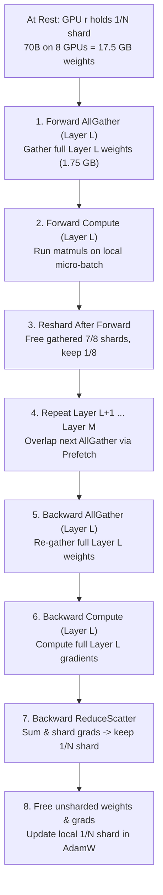
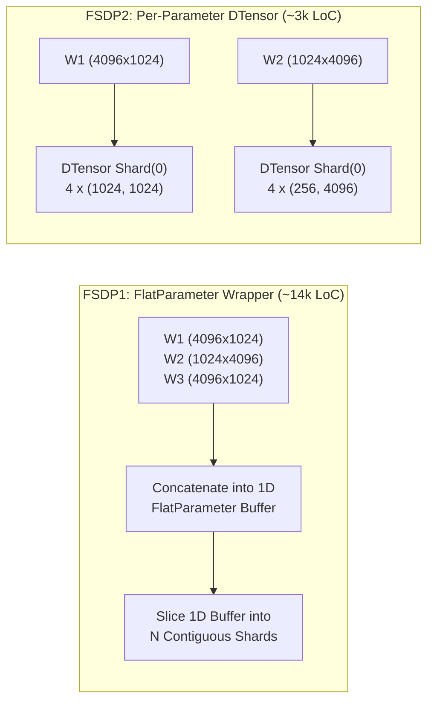
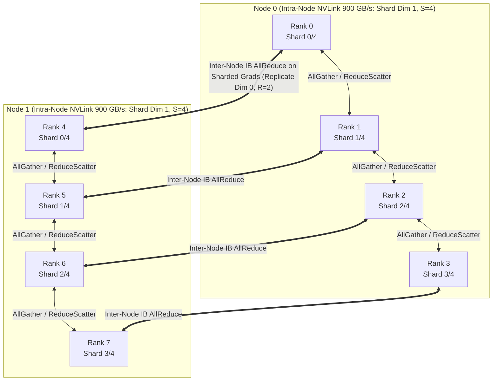

# 14.5 FSDP and parameter sharding

| Field | Value |
|---|---|
| Level | Advanced |
| Priority tier | 2 |
| Lab venue | Nebius GPU + Local Python Verification Lab (`code/part14/fsdp_parameter_sharding_lab.py`) |
| Part | Part 14: Distributed training and fine-tuning |
| Primary sources | *Distributed AI Systems* (`distributed-ai-systems`, Ch. 4); NVIDIA Zero-to-Hero Volume 13 (`chapter-04-fsdp-and-parameter-sharding.md`, `chapter-01-why-distributed-training-exists.md`, `chapter-08-nccl-collectives-and-communication-paths.md`, `chapter-12-volume-13-summary.md`, `index.md`, `labs/lab-01..04`); *AI Systems Performance Engineering* (`ai-systems-performance-engineering`, Ch. 13) |
| Coverage file | `planning/coverage/chapters/14-05.md` |
| Claim & number ledger | `planning/ledgers/14-05.md` |

## Why this matters for AI infrastructure

In Chapter `14.4`, **DistributedDataParallel (`DDP`)** scaled training throughput by giving every GPU an identical copy of the model and synchronizing gradients via a single `AllReduce` per step. That replication-first design hits a hard physical wall as soon as model state outgrows a single accelerator's `HBM` capacity. Even a `7B`-parameter model trained with `AdamW` in mixed precision requires `14 GB` of `BF16` parameters, `14 GB` of `BF16` gradients, and `56 GB` of `FP32` momentum and variance states (`84 GB` total before counting `FP32` master weights or activations)—already exceeding an `80 GB` `A100` or `H100` GPU (`112 GB` when including the `28 GB` `FP32` master weight copy under the `16 * Psi` mixed-precision rule). At `70B` parameters, weights (`140 GB`), gradients (`140 GB`), and `FP32` momentum/variance (`560 GB`) consume **`840 GB` per GPU** (`1,120 GB` with `FP32` master weights, and over `1.2 TB` with activations); a single `80 GB` GPU holds only **`9.5%`** (`80 / 840`) of the required state. At `175B` parameters (`GPT-3`), `FP32` weights alone require `700 GB` (`8.75x` a single `80 GB` GPU).

**Fully Sharded Data Parallel (`FSDP`)** breaks this single-GPU memory ceiling by applying the **Zero Redundancy Optimizer (`ZeRO`)** principle natively inside PyTorch: instead of replicating parameters, gradients, and optimizer states on every rank, `FSDP` shards (partitions) them across `N` GPUs so each rank stores only `1 / N` of the model state at rest. On `8` GPUs, the `7B` model's `84 GB` state drops to **`10.5 GB` per GPU** (`14.0 GB` under `16 * Psi`), and on `16` GPUs the `70B` model's `840 GB` state drops to **`52.5 GB` per GPU**, leaving `27.5 GB` of headroom on `80 GB` `H100` GPUs for activations and temporary buffers.

For AI infrastructure engineers, `FSDP` fundamentally shifts the cluster bottleneck from **single-device `HBM` capacity** to **interconnect bandwidth, collective scheduling, and memory allocator discipline**:
- Every forward pass and backward pass dynamically reassembles unsharded layer weights via **`AllGather`** and shards gradients via **`ReduceScatter`**, increasing per-step collective communication volume from `DDP`'s **`2 * Psi`** bytes to **`3 * Psi`** bytes (`1.5x` higher network traffic).
- Wrapping a `70B` model too coarsely (as a single monolithic root unit instead of per-`TransformerBlock`) materializes all `140 GB` of weights during `AllGather` and immediately triggers `CUDA out of memory` (`OOM`).
- Failing to enable `limit_all_gathers=True` allows the CPU thread to enqueue dozens of asynchronous `AllGather` allocations ahead of GPU execution, exhausting `HBM`.
- Saving a checkpoint with default `FULL_STATE_DICT` gathers `280 GB` of `FP32` weights onto rank `0` and crashes the job at step `100`, whereas **Distributed Checkpoint (`DCP`)** (`torch.distributed.checkpoint`) and `SHARDED_STATE_DICT` write `8.75 GB` (`FP16`) or `4.375 GB` (`70 GB / 16`) per rank in parallel.
- Scaling `FULL_SHARD` across multi-node InfiniBand fabrics can bottleneck on cross-node `AllGather` latency unless you deploy **Hybrid Sharded Data Parallel (`HSDP` / `HYBRID_SHARD`)** over a `2D` `DeviceMesh` to keep `AllGather`/`ReduceScatter` inside the `900 GB/s` `NVLink` domain and run `AllReduce` across nodes.

## Prerequisites and outcomes

### Prerequisites
- Memory and compute anatomy of a training step (`weights`, `gradients`, `optimizer states`, `activations`, `16 * Psi` mixed-precision rule) from Chapters `14.1`–`14.3`.
- Multi-GPU `DDP` execution, `torchrun` (`RANK`, `LOCAL_RANK`, `WORLD_SIZE`), `DistributedSampler`, and ring vs tree `NCCL` collectives (`AllReduce`, `AllGather`, `ReduceScatter`, `algbw` vs `busbw`) from Chapters `12.15`–`12.17` and `14.4`.
- GPU `HBM` vs `PCIe Gen4` (`32 GB/s`) vs `NVLink 4` (`900 GB/s`) vs `NVLink 5` (`1.8 TB/s`) vs `NVLink-C2C` architectures from Part 10.

### Outcomes
After completing this chapter, you will be able to:
1. Quantify steady-state and peak GPU memory across **`NO_SHARD` (`DDP`)**, **Stage 1 (`ZeRO-1`)**, **`SHARD_GRAD_OP` (`ZeRO-2`)**, **`FULL_SHARD` (`ZeRO-3`)**, and **`HYBRID_SHARD` (`HSDP`)** for `7B` and `70B` models, including the transient unsharded layer buffer (`2 * Psi_layer`) and `limit_all_gathers=True` rate limiting.
2. Derive why `FSDP` `FULL_SHARD` (`reshard_after_forward=True`) moves **`3 * Psi`** bytes per step (`1` forward `AllGather` + `1` backward `AllGather` + `1` backward `ReduceScatter`) versus **`2 * Psi`** for `DDP` and `SHARD_GRAD_OP` (`reshard_after_forward=False`).
3. Contrast **FSDP1 (`FullyShardedDataParallel` `FlatParameter`, `~14k` lines of code)** with **FSDP2 (`fully_shard()` per-parameter `DTensor` `Shard(0)`, `~3k` lines of code, PyTorch RFC `#114299`)** and **TorchTitan `SimpleFSDP`** (`-28%` memory and `+69%` throughput with `torch.compile`).
4. Configure **hierarchical sharding**, **`DeviceMesh`** (`1D` FSDP and `2D` `HSDP`), **`MixedPrecisionPolicy`**, **forward/backward prefetching** (`BackwardPrefetch.BACKWARD_PRE`), **meta-device initialization** (`torch.device("meta")` + `to_empty()`), **activation checkpointing** (`50–80%` activation memory savings), and **`CPUOffload` vs Grace-Blackwell `SuperOffload` (`GraceAdam`)**.
5. Implement fault-tolerant sharded checkpointing with **PyTorch Distributed Checkpoint (`DCP`)** (`dcp.save` / `dcp.load`), profile multi-GPU `FSDP` timelines with `torch.profiler` (`Kineto`), `Nsight Systems` (`nsys`), and `Holistic Trace Analysis` (`HTA`), and resolve `OOM`, hang, straggler, and convergence failures.

---

## 1. How FSDP Works: From DDP Replication to ZeRO State Sharding

### 1.1 Why Replication Fails: The `7B` and `70B` Memory Math

In data-parallel training, every rank processes a distinct micro-batch of data but executes the exact same model layers sequentially (`Layer 0 -> Layer 1 -> ... -> Layer L-1`). As established by Rajbhandari et al. in the **ZeRO (Zero Redundancy Optimizer)** paper, keeping a full copy of all model parameters, gradients, and optimizer states on every GPU is pure storage redundancy when the GPUs are connected by a high-speed collective fabric.

Let `Psi` denote the number of model parameters. Under standard mixed-precision training with `AdamW`, we encounter two common accounting conventions in production literature:
1. **The `12 * Psi` (`FP16`/`BF16` weights + `FP32` momentum/variance) breakdown** (used in *Distributed AI Systems* Ch. 4 and Volume 13 Ch. 4 when parameters are stored directly in `FP16`/`BF16` without a separate `FP32` master weight buffer):
   - Model parameters (`BF16`/`FP16`): `2 * Psi` bytes (`14 GB` for `7B`; `140 GB` for `70B`)
   - Gradients (`BF16`/`FP16`): `2 * Psi` bytes (`14 GB` for `7B`; `140 GB` for `70B`)
   - `AdamW` `FP32` momentum (`4 * Psi`) + `FP32` variance (`4 * Psi`): `8 * Psi` bytes (`56 GB` for `7B`; `560 GB` for `70B`)
   - **Total model state:** **`12 * Psi` bytes** (**`84 GB`** for `7B`; **`840 GB`** for `70B`)
2. **The `16 * Psi` full mixed-precision `AdamW` breakdown** (when the optimizer also maintains an `FP32` master copy of the weights, `4 * Psi` bytes = `28 GB` for `7B` or `280 GB` for `70B`):
   - Model parameters (`2 * Psi`) + Gradients (`2 * Psi`) + `FP32` master weights, momentum, and variance (`12 * Psi` = `4 + 4 + 4` bytes)
   - **Total model state:** **`16 * Psi` bytes** (**`112 GB`** for `7B`; **`1,120 GB`** for `70B`)

```text
70B Model State Breakdown (12*Psi vs 16*Psi conventions):
  Weights (FP16/BF16):            70B x 2 bytes =  140 GB
  Gradients (FP16/BF16):          70B x 2 bytes =  140 GB
  Adam FP32 Momentum:             70B x 4 bytes =  280 GB
  Adam FP32 Variance:             70B x 4 bytes =  280 GB
  -------------------------------------------------------
  Subtotal (12*Psi convention):                 =  840 GB per GPU in DDP
  + FP32 Master Weights (optional 4 bytes):     = +280 GB
  -------------------------------------------------------
  Total (16*Psi convention):                    = 1120 GB per GPU in DDP
```

Even under the conservative `840 GB` (`12 * Psi`) figure for a `70B` model, a single `80 GB` `A100` or `H100` holds only `80 / 840 = 9.5%` of the model state, and an entire `8 x 80 GB` node (`640 GB` aggregate `HBM`) cannot hold even one unsharded copy with activation headroom.

### 1.2 The Hierarchy of FSDP Sharding Strategies

`FSDP` maps directly to the ZeRO sharding stages via `ShardingStrategy` in `FSDP1` and `reshard_after_forward` / `DeviceMesh` in `FSDP2`:

| Strategy / Stage | What is Replicated on Each GPU | What is Sharded Across `N` GPUs | Steady-State Memory Formula (`16 * Psi` rule) | `70B` Model on `N = 8` GPUs (`840 GB` / `12 * Psi` base) | `70B` Model on `N = 16` GPUs (`840 GB` base) | Per-Step Collectives & Volume |
|---|---|---|---|---|---|---|
| **`NO_SHARD` (`DDP`)** | Weights, Gradients, Optimizer States | Nothing (`N = 1` shard) | `16 * Psi` | **`840.0 GB`** (`1,120.0 GB` w/ master) | **`840.0 GB`** | `1x` Bwd `AllReduce` (`2 * Psi`) |
| **Stage 1 (`ZeRO-1`)** | Weights (`140 GB`), Gradients (`140 GB`) | Optimizer States (`560 / N GB`) | `4 * Psi + (12 * Psi) / N` | **`350.0 GB`** (`140 + 140 + 70`) | **`315.0 GB`** (`140 + 140 + 35`) | `1x` Bwd `ReduceScatter` + `1x` `AllGather` (`2 * Psi`) |
| **`SHARD_GRAD_OP` (`ZeRO-2` / `reshard_after_forward=False`)** | Weights (`140 GB` kept after Fwd) | Gradients (`140 / N GB`), Optimizer States (`560 / N GB`) | `2 * Psi + (14 * Psi) / N` | **`227.5 GB`** (`~228 GB`: `140 + 17.5 + 70`, saves `122.5 GB` vs Stage 1) | **`183.75 GB`** (`140 + 8.75 + 35`) | `1x` Fwd `AllGather` + `1x` Bwd `ReduceScatter` (`2 * Psi`) |
| **`FULL_SHARD` (`ZeRO-3` / `reshard_after_forward=True`)** | Nothing at rest (only `1` active layer materialized during compute) | Weights, Gradients, Optimizer States (`840 / N GB`) | `(16 * Psi) / N` (steady) + `2 * Psi_layer` (peak buffer) | **`105.0 GB`** (`17.5 + 17.5 + 70`) | **`52.5 GB`** (`27.5 GB` free on `80 GB` `H100`) | `1x` Fwd `AllGather` + `1x` Bwd `AllGather` + `1x` Bwd `ReduceScatter` (`3 * Psi`) |
| **`HYBRID_SHARD` (`HSDP`, `R` nodes x `S` GPUs/node)** | Shards replicated across `R` nodes | Weights, Gradients, Optimizer States sharded `S`-way inside each node | `(16 * Psi) / S` | **`105.0 GB`** (`S = 8` GPUs/node) | **`105.0 GB`** (`R = 2` nodes x `S = 8` GPUs) | Intra-node `NVLink`: `3 * Psi`; Inter-node `IB`: `2 * Psi / S` |

:::tip Activations Are Never Sharded by FSDP
`FSDP` shards **parameters, gradients, and optimizer states**, but it **does not shard activations**. Because `FSDP` is still data parallelism at its core, every GPU computes the forward and backward pass on its own local micro-batch of tokens and must store the full intermediate activations for that micro-batch (unless paired with **activation checkpointing** or **Tensor/Sequence Parallelism**).
:::

### 1.3 Forward Pass (`AllGather`) and Backward Pass (`ReduceScatter`) Lifecycle

How does `FSDP` (`FULL_SHARD`) execute a layer when each GPU holds only `1 / N` of the weights? It exploits the sequential execution of neural network layers:



Let us trace the exact memory and communication sequence for a `70B` model (`140 GB` weights across `L = 80` Transformer blocks, so each block's unsharded weights `2 * Psi_layer` = `140 GB / 80` = **`1.75 GB`**; or if wrapped coarsely into `8` macro-stages, `17.5 GB` per stage) across `N = 8` GPUs (`105 GB` steady-state, or `52.5 GB` across `N = 16` GPUs):
1. **Before Forward Pass:** Each GPU holds its local `1 / N` parameter shard (`17.5 GB` on `8` GPUs, `8.75 GB` on `16` GPUs).
2. **Forward `AllGather` (Layer `l`):** Just before Layer `l` executes, all `N` GPUs execute an `AllGather` collective over `NCCL` to materialize the full unsharded weights of Layer `l` (`2 * Psi_layer` bytes).
3. **Forward Compute & Immediate Discard (`reshard_after_forward=True`):** Every GPU computes `y_l = f_l(x_l; W_l)` on its local micro-batch, then **immediately frees the non-local `(N - 1) / N` slices of `W_l`**, returning parameter memory to the sharded baseline before Layer `l + 1` finishes.
4. **Backward `AllGather` + Gradient Compute (Reverse Order `L-1 -> 0`):** Because Layer `l`'s full weights were freed after forward, the backward pass must run a **second `AllGather`** on Layer `l`'s weights to compute input gradients `dL/dx_l` and full unsharded weight gradients `dL/dW_l`.
5. **Backward `ReduceScatter`:** Immediately after `dL/dW_l` is computed for Layer `l`, `FSDP` executes a **`ReduceScatter`** collective across the `N` GPUs. `ReduceScatter` sums the gradients from all `N` micro-batches and scatters `1 / N` of the reduced gradient tensor to each rank. The full unsharded weight and gradient buffers for Layer `l` are freed immediately.
6. **Sharded Optimizer Step:** Once backward finishes for all layers, each GPU holds `1 / N` of the weights and `1 / N` of the reduced gradients, and updates its local `1 / N` slice of the `FP32` `AdamW` momentum and variance states in-place with zero cross-GPU communication.

### 1.4 Collective Communication Volume: `3 * Psi` (`FSDP`) vs `2 * Psi` (`DDP`)

Why does `FSDP` (`FULL_SHARD`) require `1.5x` (`50%`) more interconnect bandwidth than `DDP`? Recall from Chapter `12.15` and Volume 13 Chapter 8 that for a parameter/gradient tensor of size `M = 2 * Psi` bytes across `N` ranks:
- A ring **`AllGather`** moves `((N - 1) / N) * M` bytes per GPU (`~M = 2 * Psi` bytes for large `N`).
- A ring **`ReduceScatter`** moves `((N - 1) / N) * M` bytes per GPU (`~M = 2 * Psi` bytes).
- A ring **`AllReduce`** is mathematically equivalent to `ReduceScatter + AllGather` and moves `2 * ((N - 1) / N) * M` bytes per GPU (`~2 * M`).

Comparing per-step communication volume (measured in parameter elements `Psi` or weight bytes `M = 2 * Psi`):

```text
DDP (NO_SHARD):
  Backward AllReduce                  = 2 x ((N - 1) / N) x M   -->  2 * M  (280.0 GB asymptotic, 245.0 GB exact on N=8 for 70B FP16)

FSDP SHARD_GRAD_OP (ZeRO-2) or FULL_SHARD (reshard_after_forward=False):
  Forward AllGather                   = 1 x ((N - 1) / N) x M
  Backward ReduceScatter              = 1 x ((N - 1) / N) x M
  Total                               = 2 x ((N - 1) / N) x M   -->  2 * M  (280.0 GB asymptotic, 245.0 GB exact on N=8)

FSDP FULL_SHARD (ZeRO-3, reshard_after_forward=True):
  Forward AllGather                   = 1 x ((N - 1) / N) x M
  Backward AllGather                  = 1 x ((N - 1) / N) x M
  Backward ReduceScatter              = 1 x ((N - 1) / N) x M
  Total                               = 3 x ((N - 1) / N) x M   -->  3 * M  (420.0 GB asymptotic, 367.5 GB exact on N=8; 1.5x DDP)
```

Notice the critical operational insight from Volume 13 Chapter 8's worked collective comparison (`28 GB` `FP32` gradient tensor for a `7B` model):
- **Case A — Single-node `8` GPUs over `NVLink 4` (`900 GB/s` aggregate bidirectional):** Moving `2 * (7/8) * 28 GB = 49.0 GB` takes `49.0 GB / 900 GB/s` = **`~54 ms`**, while ring hop latency (`8` hops x `1–5 us/hop`) is `< 0.1 ms` (bandwidth-bound).
- **Case B — Multi-node `512` GPUs (`64` nodes) over InfiniBand (`~25–50 GB/s` effective per-GPU link):** Moving `2 * (511/512) * 28 GB = 55.9 GB` at `25 GB/s` takes **`~2.2 s`**, and `512` sequential ring hops incur per-hop software scheduling overhead that forces `NCCL` to switch from Ring to **Double Binary Tree (`O(log2 N) = 9` hops)** for `AllReduce`—an optimization that applies to `AllReduce`, whereas `FSDP`'s `AllGather` and `ReduceScatter` across `512` ranks hammer the cross-node fabric on every single layer.

---

## 2. FSDP1 (`FlatParameter`) vs FSDP2 (`fully_shard` and `DTensor`)

PyTorch provides two generations of GPU `FSDP` APIs (plus `SpmdFullyShardedDataParallel` for `TPU`/`XLA` devices using `GSPMD`):



### 2.1 Original FSDP (`FSDP1`: `FullyShardedDataParallel` and `FlatParameter`)

Introduced in `2021` (derived from FairScale), **`FSDP1`** (`torch.distributed.fsdp.FullyShardedDataParallel`) is a module wrapper class that flattens and concatenates all parameters inside a wrapped submodule (`FSDP` unit) into a single contiguous `1D` **`FlatParameter`** tensor before slicing that buffer across ranks:
- **Strengths & Production Persistence:** `FSDP1` remains widely deployed in established production repositories. For example, *Distributed AI Systems* Chapter 4 highlights **Wan2.2** (`27B` total / `14B` active parameters Mixture-of-Experts video generative model), which uses `FSDP1` for three concrete engineering reasons:
  1. **DeepSpeed Ulysses sequence-parallel compatibility:** Ulysses `AllToAll` attention-head collectives were hardened against `FSDP1`'s `distributed_c10d` process-group hooks.
  2. **Dynamic MoE expert swapping:** `FSDP1`'s `ModuleWrapPolicy` gives explicit wrapper control when non-uniform MoE experts are dynamically offloaded or swapped across diffusion timesteps.
  3. **Frozen `UMT5-XXL` encoder integration:** Existing Hugging Face `T5` wrappers rely on `FSDP1`'s `ShardedGradScaler` and `transformer_auto_wrap_policy`.
- **Limitations of `FlatParameter`:** Because `FSDP1` concatenates multiple parameters into one `FlatParameter` (`~14,000` lines of complex state-machine code), all parameters in a wrapped group must share the **exact same `dtype`** and **`requires_grad` status** (mixing frozen and trainable parameters or mixing `FP8` and `BF16` weights requires splitting groups), state-dict checkpointing requires complex un-flattening metadata, and `torch.compile` struggles to trace across dynamic `FlatParameter` storage views (requiring `use_orig_params=True`).

### 2.2 Modern FSDP (`FSDP2`: `fully_shard()` and Per-Parameter `DTensor`)

Introduced in `2024` via **PyTorch RFC `#114299`**, **`FSDP2`** (`torch.distributed.fsdp.fully_shard`) eliminates `FlatParameter` entirely and implements **per-parameter sharding** built on PyTorch's native **`DTensor`** (`Shard(0)`) primitive in **`~3,000` lines of code**:
- **How `DTensor(Shard(0))` works:** Instead of concatenating `W_1, W_2, W_3`, `FSDP2` shards each parameter tensor independently along dimension `0`. A linear layer weight of shape `(4096, 1024)` sharded across `4` GPUs becomes four local shards of shape **`(1024, 1024)`**. When dimension `0` is not evenly divisible by `world_size`, `FSDP2` automatically pads the tensor; tiny parameters can remain replicated.
- **In-place composable API:** `fully_shard(module, mesh=..., mp_policy=..., reshard_after_forward=..., offload_policy=...)` mutates `module` in place (via tensor-subclass hooks) rather than wrapping it in a new `nn.Module` container.
- **Why `FSDP2` is the default for new projects:**
  1. **Mixed `dtype` and frozen parameters in the same unit:** You can freely mix `FP8` linear weights and `BF16` normalization weights—or frozen and trainable parameters—within the same `fully_shard` block.
  2. **Deterministic sharded checkpoints (`DCP`):** Because `model.state_dict()` returns `DTensor`s whose logical global shapes match the unsharded model while storing only the local `Shard(0)` slice, each rank saves and loads its shard directly via `torch.distributed.checkpoint` without rank-`0` gathering.
  3. **First-class `torch.compile` and `SimpleFSDP` integration:** Because `TorchDynamo` sees individual parameters instead of an opaque `FlatParameter` view, the compiler can trace, bucket, and reorder `AllGather` and `ReduceScatter` nodes alongside compute kernels. In **TorchTitan** benchmarks (*AI Systems Performance Engineering* Ch. 13), **`SimpleFSDP`** (a `DTensor`-based compilable `FSDP` implementation) paired with selective activation checkpointing and `torch.compile` reduced memory usage by up to **`28%`** and improved training throughput by up to **`69%`** compared to eager `FSDP2`.

### 2.3 Quantitative Benchmark: Single-GPU vs `FSDP1` vs `FSDP2` on `H200` (`140 GB`)

*Distributed AI Systems* Chapter 4 benchmarks `FLAN-T5-XL` (`3B` parameters) and `FLAN-T5-XXL` (`11B` parameters) on `NVIDIA H200` (`140 GB` `HBM3e`) GPUs (`code/FSDP/T5_training_Single.py`, `T5_training_FSDP1.py`, `T5_training_FSDP2.py`):

| Model | Mode | GPUs | Steady Mem / GPU | Peak Mem / GPU | Per-GPU Throughput (`it/s`) | Wall-Clock Time / Epoch | Key Infrastructure Takeaway |
|---|---|---|---|---|---|---|---|
| **`FLAN-T5-XL` (`3B`)** | Single-GPU | `1` | `~43 GB` | `~58 GB` | `~4.36 it/s` | `~91 s` | Fits on `1` `H200`; zero collective overhead gives highest per-GPU `it/s`. |
| **`FLAN-T5-XL` (`3B`)** | `FSDP1` (`FULL_SHARD`) | `2` | `~22 GB` | `~33 GB` | `~4.09 it/s` | `~49 s` | Cuts steady memory in half (`43 -> 22 GB`) and finishes epoch `1.86x` faster (`91 -> 49 s`). |
| **`FLAN-T5-XXL` (`11B`)** | Single-GPU | `1` | `OOM` (`> 140 GB`) | `OOM` | — | — | Exceeds `140 GB` `H200` capacity on a single GPU. |
| **`FLAN-T5-XXL` (`11B`)** | `FSDP1` (`FULL_SHARD`) | `2` | `~84 GB` | `~105 GB` | `~1.96 it/s` | `~101 s` | Sharding across `2` `H200` GPUs fits comfortably at `84 GB` steady / `105 GB` peak. |
| **`FLAN-T5-XXL` (`11B`)** | `FSDP2` (`fully_shard`) | `2` | `~84 GB` | `~105 GB` | `~1.86 it/s` | `~106 s` | Matches `FSDP1` memory (`84 GB` / `105 GB`) while enabling `DTensor` `DCP` checkpoints and `torch.compile`. |

---

## 3. Hierarchical Wrapping, `DeviceMesh`, and Hybrid Sharding (`HSDP`)

### 3.1 Why Wrapping Granularity Determines Peak Memory (`2 * Psi_layer`)

The single most common configuration error in `FSDP` is wrapping only the top-level root model (`FSDP(model)` or calling `fully_shard(model)` without first sharding child blocks).

If you wrap a `70B` model (`140 GB` of `FP16` weights across `80` `TransformerBlock` layers) as **one monolithic `FSDP` unit** on `16` GPUs (`52.5 GB` steady-state memory per GPU):
- At the start of `model.forward()`, `FSDP` executes a single `AllGather` across the entire model, materializing all **`140.0 GB`** of weights on every GPU simultaneously.
- Peak memory spikes to `52.5 GB + 140.0 GB = 192.5 GB` (plus activations), immediately crashing an `80 GB` `H100` or `140 GB` `H200` with `CUDA out of memory`.

When you instead apply **hierarchical sharding**—wrapping each of the `80` `TransformerBlock` modules as its own `FSDP` unit (`fully_shard(block)` in a bottom-up loop before `fully_shard(model)`, or using `transformer_auto_wrap_policy` with `transformer_layer_cls={TransformerBlock}` in `FSDP1`):
- Each `TransformerBlock` contains only `140.0 GB / 80` = **`1.75 GB`** of weights (`2 * Psi_layer`).
- During forward and backward execution, only the currently executing block (`1.75 GB`) and the prefetched next block (`1.75 GB`, totaling **`3.5 GB`**) are unsharded in `HBM` at any instant, keeping peak state memory at `52.5 GB + 3.5 GB = 56.0 GB` and leaving `24.0 GB` of `HBM` on an `80 GB` `H100` for activations.
- Small boundary layers such as token embeddings can either be left in the root group or kept unsharded if communication overhead outweighs memory savings. **Shared parameters (such as tied input/output embeddings) must reside inside the same `FSDP` unit** so parameter unsharding preserves weight tying.

### 3.2 `DeviceMesh` and Hybrid Sharded Data Parallel (`HSDP` / `HYBRID_SHARD`)

When scaling `FSDP` (`FULL_SHARD`) from a single `8`-GPU server (`NVLink 4` at `900 GB/s` or `NVLink 5` at `1.8 TB/s`) to a multi-node cluster (`4`, `16`, or `64` nodes connected over `200–400 Gb/s` InfiniBand at `25–50 GB/s` per NIC), `AllGather` and `ReduceScatter` collectives must traverse the inter-node network on **every layer** of every forward and backward pass.

**Hybrid Sharded Data Parallel (`HSDP`)** (`ShardingStrategy.HYBRID_SHARD` in `FSDP1`, or passing a **`2D` `DeviceMesh`** to `fully_shard(model, mesh=mesh)` in `FSDP2`) aligns collective communication with physical hardware topology:



- **How `2D` `DeviceMesh` (`(R, S)`) works:** Calling `mesh = init_device_mesh("cuda", (4, 8))` on `32` GPUs (`R = 4` nodes x `S = 8` GPUs per node) creates a `2D` grid where:
  - **Dimension `1` (`S = 8` GPUs within each node):** `FSDP` shards parameters, gradients, and optimizer states `8`-way across the fast intra-node `NVLink` domain (`105.0 GB` steady-state per GPU for `70B`). All per-layer `AllGather` and `ReduceScatter` traffic (`3 * (7/8) * 140 GB = 367.5 GB` per step) stays strictly inside the node's `NVLink` switch fabric.
  - **Dimension `0` (`R = 4` nodes across the cluster):** The `8`-GPU shard group is replicated across each of the `4` nodes. During the backward pass, each GPU synchronizes only its **`1 / 8` gradient shard** (`140 GB / 8 = 17.5 GB`) with the corresponding rank on the other `3` nodes (`Rank 0 <-> Rank 8 <-> Rank 16 <-> Rank 24`) via an inter-node `AllReduce`.
- **Quantitative Cross-Node Bandwidth Savings:** On `4` nodes x `8` GPUs (`32` GPUs total) training a `70B` `FP16` model (`140 GB` weights):
  - Standard `32`-GPU `FULL_SHARD` pushes `3 * (31 / 32) * 140 GB` = **`406.875 GB`** of collectives across the multi-node fabric every step.
  - `HSDP` (`(4, 8)`) keeps `367.5 GB` on intra-node `NVLink` and pushes only `2 * (3 / 4) * (140 GB / 8)` = **`26.25 GB`** across inter-node InfiniBand—a **`15.5x` reduction in cross-node network traffic** in exchange for holding `1 / 8` (`105 GB`) instead of `1 / 32` (`26.25 GB`) of the model state per GPU.
- **Intermediate Resharding (`hpZ` style):** In `FSDP2`, `reshard_after_forward` also accepts an integer `k` (e.g., `reshard_after_forward=2`), which reshards parameters across a subgroup of `2` GPUs after the forward pass instead of all `N` GPUs (mirroring `ZeRO++` hierarchical parameter sharding `hpZ`) so backward `AllGather` stays within a tiny local GPU pair.

---

## 4. Communication Overlap, Activation Checkpointing, Offloading, and `torch.compile`

### 4.1 Hiding Collective Latency: Forward/Backward Prefetching and `limit_all_gathers=True`

Because modern GPUs have dedicated copy/communication engines (`NVLink` / `PCIe` DMA streams) separate from Tensor Core compute streams, `FSDP` can overlap the `AllGather` of the next layer with the matrix multiplications of the current layer:
1. **Forward Prefetching:** While Layer `L_i` is computing on the default compute stream, `FSDP` launches the `AllGather` for Layer `L_{i+1}` (or up to `num_to_forward_prefetch=2` layers ahead via `layer.set_modules_to_forward_prefetch(...)` in `FSDP2`).
2. **Backward Prefetching (`BackwardPrefetch.BACKWARD_PRE` vs `BACKWARD_POST`):** During backpropagation (`L_i -> L_{i-1}`), `BACKWARD_PRE` (the recommended setting in `FSDP1` and configurable via `layer.set_modules_to_backward_prefetch(...)` in `FSDP2`) prefetches Layer `L_{i-1}`'s parameters **before** Layer `L_i`'s backward compute finishes, allowing `L_{i-1}`'s `AllGather` and `L_i`'s `ReduceScatter` to overlap with compute. As shown in the Volume 13 Chapter 4 `8 x H100` `70B` run (`batch_size=16` per GPU, `128` global), Step `1` takes **`18.4 s`** (`62.3 GB` peak memory) due to communicator and allocator initialization, whereas Step `2+` drops to a steady **`14.1–14.3 s`** (`59.5–60.2 GB` memory, `~23%` faster than Step `1` and `~3.2x` speedup over baseline) once prefetch overlap reaches steady state.
3. **Why `limit_all_gathers=True` is mandatory for memory stability:** Because Python host dispatch runs asynchronously ahead of GPU kernel execution, a fast CPU thread can enqueue `AllGather` CUDA kernels for `10–15` upcoming layers before the GPU finishes computing Layer `1`. Without rate limiting (`limit_all_gathers=False`), `15` queued `AllGather` buffers on a `70B` model (`1.75 GB` per layer) lock **`28.0 GB`** of extra `HBM` (`52.5 + 28.0 = 80.5 GB > 80 GB`), causing sudden allocator fragmentation and `CUDA OOM`. Setting **`limit_all_gathers=True`** blocks the CPU thread when `2` unsharded units (current + `1` prefetched) are in flight, capping transient `AllGather` memory at **`3.5 GB`**.

### 4.2 Activation Memory Math and Selective Activation Checkpointing

Because `FSDP` does not shard activations, activation memory rapidly becomes the dominant consumer of `HBM` at long sequence lengths or large micro-batch sizes. *Distributed AI Systems* Chapter 4 provides the standard back-of-the-envelope estimate for a Transformer's activation footprint:

```text
Activation_Memory_Bytes  ~  L x B x S x H x bytes_per_element x k
```

where `L` is the number of layers, `B` is the per-GPU micro-batch size, `S` is sequence length, `H` is hidden dimension, and `k` is an architecture multiplier (typically **`10` to `20`** accounting for attention projections, softmax intermediates, and `MLP` expansion). For a **`7B` Transformer (`L = 32`, `H = 4096`)** with micro-batch **`B = 8`**, sequence length **`S = 2048`**, in `FP16`/`BF16` (`2` bytes) with **`k = 12`**:

```text
32 x 8 x 2048 x 4096 x 2 x 12 = 51,539,607,552 bytes  ~  51.54 GB (~52 GB per GPU)
```

Even though `FSDP` (`FULL_SHARD`) shrinks the `7B` model state to `10.5 GB` on `8` GPUs, adding `52 GB` of activations plus temporary `AllGather` buffers pushes peak `HBM` above `65 GB`. Enabling **Activation Checkpointing** (`apply_activation_checkpointing` or wrapping each `TransformerBlock` with `torch.utils.checkpoint.checkpoint`, or checkpointing every other layer `i % 2 == 0` for selective checkpointing) discards intermediate layer activations during forward and recomputes them during backward, **cutting activation memory by `50%` to `80%`** (e.g., a `75%` reduction drops `51.54 GB` to **`12.88 GB`**) in exchange for **`~30%` extra forward compute FLOPs**. When you also need a large effective batch size for convergence without extra activation memory, pair activation checkpointing with **gradient accumulation** (`loss = criterion(model(data), target) / accumulation_steps`, calling `optimizer.step()` every `accumulation_steps = 4` micro-steps).

### 4.3 The PCIe `CPUOffload` Trap vs Grace-Blackwell `SuperOffload` (`GraceAdam`)

When a model still exceeds `HBM` after `FULL_SHARD` and activation checkpointing, `FSDP` can offload sharded parameters, gradients, and optimizer states to host CPU `DRAM` via `CPUOffload(offload_params=True)` (`FSDP1`) or `offload_policy=CPUOffloadPolicy(pin_memory=True)` (`FSDP2`).

However, on conventional `x86` servers connected via **`PCIe Gen4 x16` (`32 GB/s`)**, CPU offloading creates a severe throughput cliff compared to **`3 TB/s` (`3,000 GB/s`) GPU `HBM3`** (`~100x` bandwidth gap):

| Configuration (`70B` Model) | Interconnect Bandwidth | Step Time (`s`) | Throughput (`tokens/sec`) | GPU SM Utilization | Operational Verdict |
|---|---|---|---|---|---|
| **`16` GPUs, `FULL_SHARD`, No Offload** | `NVLink 4` (`900 GB/s`) + `3 TB/s` `HBM` | **`12.3 s`** | **`10.4 tok/s`** | **`~88%`** | Production baseline: scale horizontally across GPUs first. |
| **`4` GPUs, `FULL_SHARD` + `CPUOffload`** | `PCIe Gen4` (`32 GB/s`, `100x` slower than `HBM`) | **`48.7 s`** (`3.96x` / `~4x` slower) | **`2.6 tok/s`** (`4x` slower) | **`18%`** (`82%` idle waiting on `PCIe`) | **The CPU Offload Trap:** GPUs sit idle `> 80%` of the time waiting on `H2D`/`D2H` copies (`20–50%+` typical slowdown). |
| **Grace-Blackwell (`GB200`/`GB300`) `SuperOffload` + `GraceAdam`** | **`NVLink-C2C` (`900 GB/s` coherent CPU-GPU)** | **`~13.5 s`** | **`~9.5 tok/s`** | **`~82%`** | **Superchip Offload:** Coherent `NVLink-C2C` + Speculation-Then-Validation (`STV`) + ARM `SVE` `GraceAdam` (`32` vector / `16` predicate registers). |

As *AI Systems Performance Engineering* Chapter 13 explains, **SuperOffload** overcomes the traditional `PCIe` offload bottleneck on **Grace Hopper / Grace Blackwell (`GB200`/`GB300`)** superchips by combining four hardware-aware mechanisms:
1. **High-bandwidth `NVLink-C2C`** coherent memory between the Grace ARM CPU and Blackwell GPU (`900 GB/s` vs `32 GB/s` `PCIe Gen4`).
2. **Speculation-Then-Validation (`STV`):** Instead of stalling the GPU while waiting for global gradient reduction and `Inf`/`NaN` checks, the Grace CPU executes **speculative optimizer updates** concurrently with backpropagation on the GPU and validates afterward.
3. **Heterogeneous optimizer partitioning:** Compute-heavy tensor casts and updates run on the GPU while lighter momentum/variance state updates run on the Grace CPU.
4. **`GraceAdam`:** A custom `Adam` implementation vectorized for ARM's **Scalable Vector Extension (`SVE`)** using **`32` vector registers** and **`16` predicate registers**.

### 4.4 Compiler Integration (`torch.compile`), `MemPool`, and `UCX`

To maximize `FSDP` efficiency with **`torch.compile`**:
- **In `FSDP1`:** Pass **`use_orig_params=True`** and wrap at the **`TransformerBlock` level** (`min_num_params=int(1e8)`). `TorchDynamo` intentionally inserts a **graph break at each `FSDP` block boundary** (`torch._dynamo.explain()` will report breaks on collectives—this is expected and required so `AllGather` and `ReduceScatter` overlap between compiled block subgraphs).
- **In `FSDP2`:** Apply `fully_shard(block)` to every block first, then `fully_shard(model)`, and finally call **`model = torch.compile(model)`**.
- **Pluggable `NCCL` Memory Pools (`torch.cuda.MemPool`) and `UCX`:** On `NVSwitch` and `SHARP`-capable fabrics (`GB200 NVL72`, `NVLink 5` at `1.8 TB/s` bidirectional / `900 GB/s` per direction), binding `NCCL`'s native allocator (`backend.mem_allocator` / `ncclMemAlloc`) into `torch.cuda.memory.MemPool` and registering it via `backend.register_mem_pool(nccl_pool)` aligns collective buffers for zero-copy `GPUDirect RDMA` and `NVSwitch` reductions without SM contention. Across multi-rack `InfiniBand` fabrics, setting `NCCL_NET=UCX`, `NCCL_PLUGIN_P2P=ucx`, and `UCX_TLS=rc,self,gdr_copy,cuda_copy` enables hardware-offloaded pipelined cross-rack transfers.

---

## 5. Checkpointing, Multi-Node Scaling, and Production Profiling

### 5.1 Distributed Checkpoint (`DCP`) vs `SHARDED_STATE_DICT` vs `FULL_STATE_DICT`

Long multi-GPU training runs inevitably encounter hardware faults (such as `Xid 48` double-bit `ECC` errors, `Xid 63` row-remapping events, `Xid 79` GPU fallen off the bus, or `Xid 13` graphics engine exceptions in `dmesg -T`). However, checkpointing an `FSDP` model incorrectly is one of the fastest ways to crash a healthy job:
- **The `FULL_STATE_DICT` Rank-0 OOM Trap:** Calling `model.state_dict()` under default `FULL_STATE_DICT` gathers all shards of a `70B` model onto rank `0` (`70B x 4 bytes = 280.0 GB` in `FP32`, or up to `700 GB` with optimizer state), immediately crashing an `80 GB` GPU on rank `0` with `CUDA out of memory` at checkpoint time even though steady-state training used only `52.5 GB`. Reserve `full_state_dict=True` (with `cpu_offload=True`) strictly for final evaluation/export when host `CPU` `DRAM` is large enough.
- **Recommended: PyTorch Distributed Checkpoint (`DCP`, `torch.distributed.checkpoint`):** In `FSDP2`, each rank's parameters and optimizer states are already `DTensor`s. Using `get_model_state_dict` and `get_optimizer_state_dict` with `StateDictOptions(full_state_dict=False, cpu_offload=True)` and calling `dcp.save(...)` writes each rank's local shard in parallel (`140 GB / 16 = 8.75 GB` of `FP16` weights per rank on `16` GPUs, or `70 GB / 16 = 4.375 GB` per `70 GB` shard unit) to shared storage (`Lustre`, `NFS`, or `S3` via `s3fs`). Even better, **`dcp.load` supports automatic elastic resharding across different world sizes** (e.g., saving on `4` GPUs and resuming on `8` GPUs) as long as you pass a pre-initialized sharded state-dict template (`get_model_state_dict` + `get_optimizer_state_dict` -> `dcp.load` -> `set_model_state_dict` + `set_optimizer_state_dict`).
- **Complete Reproducible Resume State:** As verified in Volume 13 Lab 04, a bit-for-bit reproducible checkpoint restore (`loss` trajectory matching an uninterrupted control run across epochs `4–5`) must save and restore **four components** behind a `dist.barrier()`: (1) model weights, (2) optimizer states (`AdamW` momentum and variance—omitting these causes an immediate loss spike upon resume), (3) `LR` scheduler step state, and (4) `RNG` states (`Python`, `NumPy`, `torch`, `torch.cuda`).

### 5.2 Meta-Device Initialization, Gradient Clipping, and TPU/XLA `SPMD`

- **Zero-Memory Initialization via `torch.device("meta")`:** To avoid materializing a `70B` (`140 GB`) model on CPU or GPU `0` before sharding, instantiate the model inside `with torch.device("meta"):` (which records shapes without allocating storage), apply `fully_shard(model, mesh=mesh)`, materialize only the local `1 / N` shards via **`model.to_empty(device=device)`**, and call **`model.reset_parameters()`** after setting identical random seeds (`torch.manual_seed(42)`, `torch.cuda.manual_seed_all(42)`) across all ranks.
- **Data Loading & Gradient Clipping:** Always pair `FSDP` with `DistributedSampler` and call **`sampler.set_epoch(epoch)`** at the start of every epoch so ranks do not replay identical shuffle orders. Standard `torch.nn.utils.clip_grad_norm_(model.parameters(), max_norm=1.0)` works transparently with `FSDP2` `DTensor`s (`FSDP1` uses `model.clip_grad_norm_(1.0)`).
- **`FSDP` via `SPMD` for `TPU`/`XLA` (`SpmdFullyShardedDataParallel`):** On Google Cloud `TPU` VMs (`code/fsdp_spmd_tpu.py`), PyTorch/XLA provides `SpmdFullyShardedDataParallel` (`FSDPv2`) backed by the `XLA` **`GSPMD`** compiler (`xr.use_spmd()`, `xs.Mesh(np.array(range(num_devices)), (num_devices, 1), ('fsdp', 'model'))`, `xs.mark_sharding(x, mesh, ('fsdp', None))`), where the `XLA` compiler automatically inserts and overlaps collectives rather than using eager `NCCL` hooks.
- **Progressive Optimization Order:** Follow a strict engineering order when bringing up `FSDP`:
  1. Start with `FSDP2` (`fully_shard`) + `BF16` mixed precision (`param_dtype=torch.bfloat16`, `reduce_dtype=torch.float32` for numerical stability) without prefetching or offloading.
  2. If `OOM` occurs, enable **activation checkpointing** on `TransformerBlock` layers.
  3. If `OOM` persists, reduce micro-batch size or sequence length and use **gradient accumulation** (`accumulation_steps = 4`).
  4. Profile with `torch.profiler` (`Kineto`) / `Perfetto` / `HTA`; if `AllGather` blocks compute, enable prefetching (`num_to_forward_prefetch=2`, `num_to_backward_prefetch=2`) or `HSDP` (`2D` `DeviceMesh`) across nodes.
  5. Enable **`CPUOffloadPolicy(pin_memory=True)`** only as a last resort on `PCIe` systems (or use `SuperOffload` on Grace-Blackwell `NVLink-C2C`).

---

## Commands and configurations that matter

### 1. FSDP2 Hierarchical Sharding, `2D` `HSDP` `DeviceMesh`, Meta Init, and `torch.compile` (`untested here`)

```python
import os
import torch
import torch.nn as nn
import torch.distributed as dist
from torch.distributed.device_mesh import init_device_mesh
from torch.distributed.fsdp import (
    fully_shard,
    MixedPrecisionPolicy,
    CPUOffloadPolicy,
)
from torch.utils.checkpoint import checkpoint

def setup_fsdp2_model(model_cls, model_args, use_hsdp: bool = False, use_compile: bool = True):
    dist.init_process_group(backend="nccl")
    local_rank = int(os.environ["LOCAL_RANK"])
    world_size = dist.get_world_size()
    device = torch.device(f"cuda:{local_rank}")
    torch.cuda.set_device(device)

    # Identical RNG seed across all ranks for deterministic reset_parameters()
    torch.manual_seed(42)
    torch.cuda.manual_seed_all(42)

    # 1D mesh for standard FSDP, or 2D mesh (nodes, gpus_per_node) for HSDP
    if use_hsdp and world_size >= 16:
        gpus_per_node = 8
        num_nodes = world_size // gpus_per_node
        mesh = init_device_mesh("cuda", (num_nodes, gpus_per_node))
    else:
        mesh = init_device_mesh("cuda", (world_size,))

    # BF16 weights for memory/TensorCores + FP32 gradient reduction for stability
    mp_policy = MixedPrecisionPolicy(
        param_dtype=torch.bfloat16,
        reduce_dtype=torch.float32,
    )

    # Zero-memory construction on meta device before sharding
    with torch.device("meta"):
        model = model_cls(model_args)

    # Hierarchical sharding: shard each child TransformerBlock BEFORE the root model
    for layer in model.layers:
        fully_shard(
            layer,
            mesh=mesh,
            mp_policy=mp_policy,
            reshard_after_forward=True,
        )
    fully_shard(model, mesh=mesh, mp_policy=mp_policy, reshard_after_forward=True)

    # Materialize only local 1/N DTensor shards on GPU and initialize weights
    model.to_empty(device=device)
    model.reset_parameters()

    # Optional: configure explicit forward and backward prefetching (2 layers ahead)
    num_prefetch = 2
    for i, layer in enumerate(model.layers):
        if i < len(model.layers) - num_prefetch:
            layer.set_modules_to_forward_prefetch(
                [model.layers[i + j] for j in range(1, num_prefetch + 1)]
            )
        if i >= num_prefetch:
            layer.set_modules_to_backward_prefetch(
                [model.layers[i - j] for j in range(1, num_prefetch + 1)]
            )

    if use_compile:
        model = torch.compile(model)
    return model
```

### 2. FSDP2 Distributed Checkpoint (`DCP`) Save, Elastic Load, and `DTensor` Shard Verification (`untested here`)

```python
import os
import torch
import torch.distributed as dist
import torch.distributed.checkpoint as dcp
from torch.distributed.checkpoint.state_dict import (
    get_model_state_dict,
    get_optimizer_state_dict,
    set_model_state_dict,
    set_optimizer_state_dict,
    StateDictOptions,
)

def verify_dtensor_shards(model, rank: int):
    """Sanity-check that FSDP2 parameters are sharded DTensors on each rank."""
    if rank == 0:
        for name, param in model.named_parameters():
            local = param.to_local() if hasattr(param, "to_local") else param
            print(f"{name}: global={tuple(param.shape)}, local_shard={tuple(local.shape)}, device={param.device}")

def save_checkpoint_dcp(model, optimizer, epoch: int, checkpoint_dir: str):
    opts = StateDictOptions(full_state_dict=False, cpu_offload=True)
    state = {
        "model": get_model_state_dict(model, options=opts),
        "optimizer": get_optimizer_state_dict(model, optimizers=optimizer, options=opts),
        "epoch": epoch,
        "rng_state": torch.get_rng_state(),
        "cuda_rng_state": torch.cuda.get_rng_state(),
    }
    ckpt_path = os.path.join(checkpoint_dir, f"epoch_{epoch}")
    dcp.save(state, checkpoint_id=ckpt_path)
    dist.barrier()

def load_checkpoint_dcp(model, optimizer, checkpoint_dir: str, epoch: int) -> int:
    opts = StateDictOptions(full_state_dict=False)
    # Build template from already-initialized, sharded model and optimizer
    state_dict = {
        "model": get_model_state_dict(model, options=opts),
        "optimizer": get_optimizer_state_dict(model, optimizers=optimizer, options=opts),
        "epoch": 0,
    }
    ckpt_path = os.path.join(checkpoint_dir, f"epoch_{epoch}")
    dcp.load(state_dict, checkpoint_id=ckpt_path)
    set_model_state_dict(model, state_dict["model"], options=opts)
    set_optimizer_state_dict(
        model, optimizers=optimizer, optim_state_dict=state_dict["optimizer"], options=opts
    )
    return int(state_dict["epoch"])
```

### 3. FSDP1 Wrapper with `HYBRID_SHARD`, `limit_all_gathers=True`, `BACKWARD_PRE`, and `torch.compile` (`untested here`)

```python
import functools
import torch
import torch.nn as nn
from torch.distributed.fsdp import (
    FullyShardedDataParallel as FSDP,
    ShardingStrategy,
    BackwardPrefetch,
    MixedPrecision,
    StateDictType,
)
from torch.distributed.fsdp.wrap import transformer_auto_wrap_policy
from torch.distributed.algorithms._checkpoint.checkpoint_wrapper import (
    apply_activation_checkpointing,
    checkpoint_wrapper,
)

torch.set_float32_matmul_precision("high")  # Enable TF32 for eligible FP32 matmuls

auto_wrap_policy = functools.partial(
    transformer_auto_wrap_policy,
    transformer_layer_cls={nn.TransformerEncoderLayer, nn.TransformerDecoderLayer},
    min_num_params=int(1e8),
)

apply_activation_checkpointing(
    model,
    checkpoint_wrapper_fn=checkpoint_wrapper,
    check_fn=lambda m: isinstance(m, (nn.TransformerEncoderLayer, nn.TransformerDecoderLayer)),
)

fsdp_model = FSDP(
    model,
    auto_wrap_policy=auto_wrap_policy,
    sharding_strategy=ShardingStrategy.HYBRID_SHARD,  # or ShardingStrategy.FULL_SHARD
    backward_prefetch=BackwardPrefetch.BACKWARD_PRE,
    mixed_precision=MixedPrecision(
        param_dtype=torch.bfloat16,
        reduce_dtype=torch.bfloat16,
        buffer_dtype=torch.bfloat16,
    ),
    device_id=torch.cuda.current_device(),
    limit_all_gathers=True,
    use_orig_params=True,  # Mandatory when combining FSDP1 with torch.compile
)
```

### 4. Multi-Node SLURM Launch, NCCL Fabric Verification, andCUDA Allocator Tuning (`untested here`)

```bash
#!/bin/bash
#SBATCH --job-name=fsdp2_70b
#SBATCH --nodes=4
#SBATCH --ntasks-per-node=8
#SBATCH --gres=gpu:8
#SBATCH --time=24:00:00
#SBATCH --partition=gpu

export MASTER_ADDR=$(scontrol show hostnames "$SLURM_JOB_NODELIST" | head -n 1)
export MASTER_PORT=29500

# Verify InfiniBand and peer-to-peer NVLink are active
export NCCL_IB_DISABLE=0
export NCCL_DEBUG=INFO

# Reduce long-run CUDA caching allocator fragmentation under dynamic shapes
export PYTORCH_ALLOC_CONF="max_split_size_mb:256,roundup_power2_divisions:[256:1,512:2,1024:4,>:8],backend:cudaMallocAsync"

# 1. Pre-flight collective busbw check (expect near-900 GB/s busbw on NVLink4 at >=32M)
# ./build/all_reduce_perf -b 8 -e 128M -f 2 -g 8

# 2. Launch multi-node FSDP2 training
srun torchrun \
  --nnodes="$SLURM_NNODES" \
  --nproc_per_node=8 \
  --node_rank="$SLURM_NODEID" \
  --master_addr="$MASTER_ADDR" \
  --master_port="$MASTER_PORT" \
  train_fsdp2.py
```

### 5. Production FSDP Health Signals & Thresholds

| Telemetry Signal | Command / Source (`untested here`) | Healthy Baseline | Red Flag Threshold | Primary Root Cause |
|---|---|---|---|---|
| **Step 1 -> Step 2+ Warmup Delta** | Per-step training log (`18.4 s -> 14.1–14.3 s`) | Step 1 is **`~20–30%` slower** than Step 2+ | Step 2+ fails to speed up or regresses **`> 50%`** | Prefetching disabled, `torch.compile` recompilation churn, or `limit_all_gathers=False` allocator thrashing |
| **`AllGather` Share of Step Time** | `torch.profiler` (`Kineto`) / `HTA` / `nsys` | **`20–40%`** of total step time (overlapped) | **`> 60%`** of step time | Cross-node `FULL_SHARD` over slow fabric, `NVLink` fallback to `PCIe` (`PIX`/`SYS` in `nvidia-smi topo -m`), or `ACS` enabled in BIOS |
| **Peak GPU `HBM` Footprint** | `torch.cuda.max_memory_allocated()` / `nvidia-smi` | Steady (`~59.5–60.2 GB` on `70B` / `16` GPUs w/ activations) | Sudden spike to `> 80 GB` or steady upward creep | Coarse root-only wrapping (`140 GB` `AllGather`), `FULL_STATE_DICT` checkpoint gather (`280 GB`), or undisposed tensor leak |
| **Per-Rank Step Time Spread** | `grep "step_time:" train_rank*.log` / `HTA` | All ranks within **`<= 10%`** | **`> 15%`** spread across ranks | Thermal throttling (`nvidia-smi -l 1`), degraded NIC/transceiver, or unbalanced sequence lengths across ranks |

---

## How it fails

| Failure Mode | Observable Symptom | Root Cause & Diagnostic Proof | Production Fix |
|---|---|---|---|
| **1. Coarse Wrapping `AllGather` OOM** | Immediate `CUDA out of memory` on the very first forward pass despite `(16 * Psi) / N` fitting easily inside GPU `HBM`. | Model was wrapped only at the root (`FSDP(model)` or `fully_shard(model)` without sharding child blocks), causing `AllGather` to materialize all `140 GB` of `70B` weights at once (`192.5 GB` peak). Proof: `param.to_local().shape` or profiler memory timeline shows a single massive `AllGather`. | Wrap every `TransformerBlock` individually (`fully_shard(block)` in a bottom-up loop before `fully_shard(model)`, or use `transformer_auto_wrap_policy`). |
| **2. Checkpoint Save Rank-0 OOM at Step 100** | Training runs smoothly at `52.5–60.2 GB` for `100` steps, then crashes on rank `0` with `CUDA out of memory: Attempted to allocate 280 GB` (or `700 GB`). | Calling `model.state_dict()` under default `FULL_STATE_DICT` gathers the entire unsharded `FP32` model (`280 GB`) onto rank `0`. | Use `torch.distributed.checkpoint` (`DCP`) with `StateDictOptions(full_state_dict=False, cpu_offload=True)` or `StateDictType.SHARDED_STATE_DICT` so each rank writes only its `1 / N` shard (`8.75 GB` `FP16`). |
| **3. Unthrottled `AllGather` Queue OOM (`limit_all_gathers=False`)** | Intermittent `CUDA OOM` or severe allocator fragmentation mid-epoch even with block-level wrapping. | Host CPU dispatches `AllGather` kernels for `10–15` future layers ahead of GPU compute (`15 x 1.75 GB = 26.25 GB` of unfreed buffers). Proof: `torch.cuda.memory_summary()` shows high reserved-vs-allocated split and many active `AllGather` streams. | Set `limit_all_gathers=True` in `FSDP1` (default rate-limiting in `FSDP2`) and tune `PYTORCH_ALLOC_CONF=max_split_size_mb:256,backend:cudaMallocAsync`. |
| **4. The `PCIe` `CPUOffload` Throughput Cliff (`4x` Slowdown)** | Step time balloons from `12.3 s` (`10.4 tok/s`) to `48.7 s` (`2.6 tok/s`), and `nvidia-smi` shows GPU `SM` utilization stuck at **`18%`**. | `CPUOffload(offload_params=True)` streams sharded weights and gradients across `PCIe Gen4` (`32 GB/s`), which is `~100x` slower than `3 TB/s` `HBM3`. Proof: `nsys` shows `80%+` of step time stalled on `Memcpy HtoD` / `DtoH`. | Disable `CPUOffload`; instead scale horizontally to `16` GPUs, enable activation checkpointing (`50–80%` activation savings), or run `SuperOffload` (`GraceAdam`) on `NVLink-C2C` (`900 GB/s`) hardware. |
| **5. Rank Divergence Hang / `NCCL` Collective Deadlock** | Training freezes silently mid-step until `Watchdog caught collective operation timeout` (`NCCL` timeout). | Conditional rank logic (`if rank == 0: model.some_op()`), uneven batch counts across ranks, or a hardware fault (`Xid 48`/`63`/`79` in `dmesg -T`) caused one rank to miss or enter a different `AllGather`/`ReduceScatter`. | Ensure every rank executes identical forward/backward control flow, use `DistributedSampler(drop_last=True)`, inspect `NCCL_DEBUG=INFO` / `torch.distributed.set_debug_level(DebugLevel.DETAIL)`, and check `dmesg -T` + `nvidia-smi -q -d ECC`. |
| **6. Loss Spike After Checkpoint Resume or Non-Convergence** | Job resumes from checkpoint without crashing, but training loss spikes sharply or diverges from a continuous control run. | Either (a) only `model.state_dict()` was restored without `optimizer.state_dict()` (`AdamW` momentum/variance reset to zero), (b) `sampler.set_epoch(epoch)` was omitted, or (c) `dcp.load()` was called before constructing the sharded model template. | Save and restore model, optimizer, `LR` scheduler, and `RNG` state via `DCP` template loading behind `dist.barrier()`, and call `sampler.set_epoch(epoch)` every epoch. |

---

## Hands-on lab

**Venue:** Local Python Verification Lab (runs anywhere with standard-library `python3`; models the Nebius GPU / multi-node `H100`/`H200` `FSDP` memory, communication, `HSDP`, `DCP`, and `CPUOffload` equations from this chapter).

### Step 1: Run the Self-Checking FSDP Verification Suite

Run `code/part14/fsdp_parameter_sharding_lab.py` to execute all `26` quantitative checks covering `NO_SHARD` (`DDP` `16 * Psi` and `12 * Psi`), `ZERO1_OPTIM_ONLY`, `SHARD_GRAD_OP` (`ZeRO-2` `2 * Psi + 14 * Psi / N`), `FULL_SHARD` (`ZeRO-3` `16 * Psi / N` + `2 * Psi_layer`), `HYBRID_SHARD` (`HSDP` `2D` `DeviceMesh`), `3 * Psi` vs `2 * Psi` communication volume, `limit_all_gathers=True`, `7B` activation memory (`51.54 GB` -> `12.88 GB`), `FSDP2` `DTensor(Shard(0))`, `FLAN-T5` `H200` benchmarks, `SimpleFSDP` (`-28%` memory, `+69%` throughput), `DCP` checkpointing, and `CPUOffload` vs `SuperOffload`:

```bash
python3 -B code/part14/fsdp_parameter_sharding_lab.py
```

**Expected output (verified locally):**

```text
=== Chapter 14.5 Lab: FSDP and Parameter Sharding Verification ===
  [PASS] 1. 7B model without FP32 master copy requires 84.0 GB (14 GB weights + 14 GB grads + 56 GB Adam state), exceeding 80 GB H100
  [PASS] 2. 7B model under 16*Psi mixed-precision AdamW (with 28 GB FP32 master weights) requires 112.0 GB per GPU in DDP (NO_SHARD)
  [PASS] 3. 7B model under FSDP FULL_SHARD on 8 GPUs drops from 84.0 GB to 10.5 GB steady-state per GPU (84 / 8)
  [PASS] 4. 7B model under 16*Psi convention with FSDP FULL_SHARD on 8 GPUs uses 14.0 GB steady-state (16*Psi/N) vs 26.25 GB for SHARD_GRAD_OP (2*Psi + 14*Psi/N)
  [PASS] 5. 70B model in DDP requires 840.0 GB per GPU (140 GB weights + 140 GB grads + 560 GB FP32 momentum/variance); single 80 GB GPU holds only 9.5%
  [PASS] 6. 70B Stage 1 (Optimizer State Sharding, N=8) uses 350.0 GB per GPU (140 GB weights + 140 GB grads + 70 GB sharded optimizer)
  [PASS] 7. 70B Stage 2 (SHARD_GRAD_OP / ZeRO-2, N=8) uses 227.5 GB (~228 GB) per GPU (140 + 17.5 + 70), saving 122.5 GB vs Stage 1
  [PASS] 8. 70B Stage 3 (FULL_SHARD / ZeRO-3) drops steady-state memory to 105.0 GB on N=8 GPUs and 52.5 GB on N=16 GPUs (leaving 27.5 GB headroom on 80 GB H100)
  [PASS] 9. 70B model under full 16*Psi convention (1,120.0 GB total state) shards to 70.0 GB steady-state on 16 GPUs and 35.0 GB on 32 GPUs
  [PASS] 10. Wrapping 70B as a monolithic root FSDP unit materializes 140.0 GB at once (peak 192.5 GB), whereas 80-block wrapping materializes only 1.75 GB/layer (3.5 GB with prefetch, peak 56.0 GB)
  [PASS] 11. Disabling limit_all_gathers (limit_all_gathers=False) with 15 queued CUDA AllGathers inflates transient buffer from 3.5 GB to 28.0 GB (80.5 GB peak -> OOM on 80 GB GPU)
  [PASS] 12. Setting reshard_after_forward=False keeps all 140.0 GB of unsharded parameters in memory between forward and backward (skipping backward AllGather at the cost ofVRAM)
  [PASS] 13. DDP (NO_SHARD) and SHARD_GRAD_OP (ZeRO-2) have 2*Psi asymptotic communication volume (280.0 GB for 70B FP16; 245.0 GB exact ring on N=8)
  [PASS] 14. FSDP FULL_SHARD (reshard_after_forward=True) has 3*Psi asymptotic communication volume (420.0 GB for 70B FP16; 367.5 GB exact on N=8, 1.5x DDP)
  [PASS] 15. FSDP FULL_SHARD with reshard_after_forward=False eliminates backward AllGather, dropping communication volume from 3*Psi (367.5 GB) to 2*Psi (245.0 GB)
  [PASS] 16. HSDP on 4 nodes x 8 GPUs (32 GPUs, 2D DeviceMesh (4, 8)) shards 8-way per node (105.0 GB steady state) and confines 367.5 GB AllGather/ReduceScatter to intra-node NVLink
  [PASS] 17. HSDP on 4 nodes x 8 GPUs reduces cross-node InfiniBand traffic to 26.25 GB per step (15.5x less than 406.875 GB under 32-GPU FULL_SHARD)
  [PASS] 18. Volume 13 Ch 8: 28 GB FP32 gradient AllReduce moves 49.0 GB (~54 ms at 900 GB/s NVLink on 8 GPUs) vs 55.89 GB (~2.2 s at 25 GB/s IB on 512 GPUs, where Tree cuts 512 hops to 9 hops)
  [PASS] 19. 7B Transformer activation memory (L=32, B=8, S=2048, H=4096, fp16, k=12) is 51.54 GB (~52 GB) raw and drops by 75% (to 12.88 GB) with activation checkpointing
  [PASS] 20. FSDP2 DTensor(Shard(0)) shards a (4096, 1024) weight tensor across 4 GPUs into four (1024, 1024) shards without FlatParameter concatenation (~3k vs ~14k LoC)
  [PASS] 21. DAI Ch 4 H200 benchmarks: FLAN-T5-XL (3B) drops from 43 GB (58 GB peak, 91 s/epoch) on 1 GPU to 22 GB (33 GB peak, 49 s/epoch) on 2 GPUs; FLAN-T5-XXL (11B) OOMs on 1 GPU but fits at 84 GB (105 GB peak, 101 s FSDP1 / 106 s FSDP2) on 2 GPUs
  [PASS] 22. AISPE Ch 13 TorchTitan SimpleFSDP + torch.compile reduces memory by up to 28% and improves throughput by up to 69% over eager FSDP2
  [PASS] 23. Saving a 70B checkpoint on 16 GPUs with FULL_STATE_DICT gathers 280.0 GB FP32 on rank 0 (OOM on 80 GB GPU), whereas SHARDED_STATE_DICT / DCP writes 8.75 GB FP16 (4.375 GB per 70 GB) per rank locally
  [PASS] 24. PCIe Gen4 (32 GB/s vs 3 TB/s HBM) CPUOffload slows 70B step time from 12.3 s (10.4 tok/s) to 48.7 s (2.6 tok/s, 3.96x ~ 4x slower, 18% GPU util)
  [PASS] 25. Grace-Blackwell NVLink-C2C (900 GB/s) SuperOffload with STV and GraceAdam (ARM SVE 32 vector / 16 predicate registers) maintains 82% GPU utilization
  [PASS] 26. Volume 13 Ch 4 FSDP monitoring: Step 1 (18.4 s, 62.3 GB) -> Step 2+ (14.1-14.3 s, 59.5-60.2 GB); red flags when AllGather > 60% of step time or rank spread > 15%

Summary: 26 passed, 0 failed
```

---

## Common first mistakes

1. **Calling `fully_shard(model)` only on the root module (or omitting `auto_wrap_policy` in `FSDP1`):** Wrapping the entire model as a single `FSDP` unit forces `AllGather` to reconstruct the full model (`140 GB` for `70B`) on every GPU simultaneously, giving you all of `FSDP`'s `3 * Psi` communication cost with none of its peak memory reduction. Always shard individual `TransformerBlock` children first, then shard the root model.
2. **Expecting `FSDP` to shard activation memory:** `FSDP` shards parameters, gradients, and optimizer states—never activations. At long sequence lengths (`S = 2048+`) or large micro-batches (`B = 8`), activations (`51.54 GB` for a `7B` model) will still trigger `CUDA OOM` unless you enable **activation checkpointing** (`50–80%` reduction) and/or **gradient accumulation**.
3. **Saving checkpoints with `model.state_dict()` (`FULL_STATE_DICT`) instead of `DCP` (`full_state_dict=False`):** Gathering a `70B` model onto rank `0` requires `280 GB` (`FP32` weights) on a single device and crashes at step `100`. Always save sharded checkpoints per rank via `torch.distributed.checkpoint` (`dcp.save` / `dcp.load`).
4. **Enabling `CPUOffload` on `PCIe` servers before scaling out GPUs or enabling activation checkpointing:** Because `PCIe Gen4` (`32 GB/s`) is `~100x` slower than GPU `HBM` (`3 TB/s`), `CPUOffload` drops GPU utilization to `18%` and slows step time by `~4x` (`12.3 s -> 48.7 s`).
5. **Running `FULL_SHARD` flat across dozens of nodes when each node has `NVLink` headroom for `HSDP`:** Sharding `32`-way or `64`-way across nodes forces every layer's `AllGather` and `ReduceScatter` across the slower inter-node InfiniBand/RoCE fabric. If the model shard fits inside an `8`-GPU node (or `2` nodes) with activation checkpointing, use a `2D` `DeviceMesh` (`HYBRID_SHARD`) to keep `AllGather`/`ReduceScatter` on intra-node `NVLink` (`15.5x` less cross-node traffic on `4 x 8` GPUs).

---

## Exercises

1. **Sharding Stages & Memory Anatomy (`7B` and `70B` Models):**
   - **(a)** For a `7B` model trained with mixed-precision `AdamW` across `N = 8` GPUs, calculate the per-GPU steady-state memory (`GB`) under `NO_SHARD` (`DDP`), `SHARD_GRAD_OP` (`ZeRO-2`), and `FULL_SHARD` (`ZeRO-3`) using both the `12 * Psi` (`84.0 GB` total state) and `16 * Psi` (`112.0 GB` total state including `28.0 GB` `FP32` master weights) conventions.
   - **(b)** For a `70B` model (`140 GB` `FP16` weights, `140 GB` `FP16` gradients, `560 GB` `FP32` momentum/variance = `840 GB` total state), calculate the per-GPU steady-state memory on `N = 8` GPUs across Stage 1 (`ZeRO-1`), Stage 2 (`SHARD_GRAD_OP`), and Stage 3 (`FULL_SHARD`), and on `N = 16` GPUs under `FULL_SHARD`. How much `HBM` headroom remains on an `80 GB` `H100` GPU at `N = 16`?
2. **Wrapping Granularity & `limit_all_gathers=True` Peak Buffer Math:**
   - **(a)** A `70B` model (`140.0 GB` `FP16` weights across `L = 80` `TransformerBlock` layers) runs under `FULL_SHARD` on `N = 16` GPUs (`52.5 GB` steady-state memory per GPU). Compare the transient unsharded `AllGather` buffer size and peak model-state memory (`GB`) when wrapped as a single monolithic root unit versus wrapped per-`TransformerBlock` (`2` inflight units: current + `1` prefetched).
   - **(b)** If `limit_all_gathers` is set to `False` and the host CPU thread queues `15` upcoming `AllGather` units ahead of the GPU compute stream (`16` active units total including the current block), compute the transient `AllGather` buffer size and explain why the job crashes with `OOM` on `80 GB` GPUs even before counting activations.
3. **Collective Communication Volume: `DDP` vs `FSDP` (`reshard_after_forward=True` vs `False`):**
   - **(a)** Using the ring collective cost formula `((N - 1) / N) * M` for `AllGather` and `ReduceScatter` (where `M = 140.0 GB` is the `FP16` weight size of a `70B` model on `N = 8` GPUs), calculate both the asymptotic (`N -> infinity`) and exact (`N = 8`) per-GPU bytes transferred per training step for `DDP` (`NO_SHARD`), `FSDP` `SHARD_GRAD_OP` (or `FULL_SHARD` with `reshard_after_forward=False`), and `FSDP` `FULL_SHARD` (`reshard_after_forward=True`).
   - **(b)** What is the exact communication volume multiplier of `FSDP` `FULL_SHARD` (`reshard_after_forward=True`) relative to `DDP`?
4. **Hybrid Sharding (`HSDP` `2D` `DeviceMesh`) Bandwidth Sizing Across `4` Nodes (`32` GPUs):**
   - **(a)** You train the `70B` `FP16` model (`M = 140.0 GB`) across `4` nodes x `8` GPUs per node (`32` GPUs total) using `HSDP` (`init_device_mesh("cuda", (4, 8))`, `reshard_after_forward=True`). Calculate the steady-state model memory per GPU (`12 * Psi` convention), the per-step collective byte volume over intra-node `NVLink` (`S = 8`), and the per-step gradient `AllReduce` byte volume over inter-node InfiniBand (`R = 4`).
   - **(b)** Compare the inter-node InfiniBand traffic of `HSDP` (`(4, 8)`) against flat `32`-GPU `FULL_SHARD` (`3 * (31 / 32) * 140.0 GB`) and compute the exact cross-node bandwidth reduction factor.
5. **Activation Memory, Checkpointing, and `DCP` vs `FULL_STATE_DICT`:**
   - **(a)** Estimate the per-GPU activation memory (`GB`, `10^9` bytes) for a `7B` Transformer (`L = 32`, `B = 8`, `S = 2048`, `H = 4096`, `2` bytes/element, `k = 12`) before and after applying activation checkpointing with a `75%` memory reduction.
   - **(b)** On a `16`-GPU `70B` `FSDP` job running on `80 GB` GPUs, calculate the memory gathered on rank `0` when saving a checkpoint with `FULL_STATE_DICT` (`FP32` weights) versus the per-rank shard size written locally with `DCP` (`full_state_dict=False`, `FP16` weights).
6. **`FSDP2` `DTensor` Sharding & `PCIe` `CPUOffload` vs Grace-Blackwell `SuperOffload`:**
   - **(a)** A linear layer weight tensor has global shape `(4096, 1024)`. What is the local shard shape (`param.to_local().shape`) on each rank when sharded across `4` GPUs with `FSDP2` (`fully_shard`, `DTensor(Shard(0))`)? How does this differ from `FSDP1` `FlatParameter`, and what memory and throughput gains did TorchTitan's `SimpleFSDP` + `torch.compile` achieve over eager `FSDP2`?
   - **(b)** Using the `70B` `CPUOffload` benchmark (`12.3 s` / `10.4 tok/s` on `16` GPUs without offload vs `48.7 s` / `2.6 tok/s` / `18%` GPU utilization on `4` GPUs with `PCIe Gen4` `CPUOffload`), calculate the slowdown factor and the `HBM`-to-`PCIe Gen4` bandwidth ratio (`3 TB/s` vs `32 GB/s`). How does Grace-Blackwell `SuperOffload` (`NVLink-C2C` + `STV` + `GraceAdam`) eliminate this bottleneck?

---

## Interview angles

1. **"Why does FSDP (`FULL_SHARD`) require `50%` more communication volume than DDP, and when would you set `reshard_after_forward=False`?"**
   - *Strong answer:* "In `DDP`, every GPU holds a full replica of the weights, so the only collective is a single backward `AllReduce` costing `2 * ((N - 1) / N) * M` (`~2 * Psi`). In `FSDP` `FULL_SHARD` (`reshard_after_forward=True`, `ZeRO-3`), weights are sharded at rest: every layer must run `1` `AllGather` (`1 * M`) in the forward pass and immediately free the gathered weights to save `HBM`, then run a `2nd` `AllGather` (`1 * M`) in the backward pass followed by `1` `ReduceScatter` (`1 * M`) to shard the gradients—totaling **`3 * ((N - 1) / N) * M` (`~3 * Psi`, `1.5x` `DDP`)**. If profiling shows `AllGather` communication is the bottleneck and we have enough `HBM` headroom to hold unsharded weights between forward and backward, setting **`reshard_after_forward=False`** (`SHARD_GRAD_OP` / `ZeRO-2` behavior) skips the backward `AllGather` and drops communication back to `2 * Psi`."
2. **"Draw the memory timeline of a `70B` model under FSDP `FULL_SHARD` on `16` `80 GB` H100 GPUs and explain why wrapping the root model alone causes an immediate OOM."**
   - *Strong answer:* "At rest on `16` GPUs, each GPU stores `1 / 16` of the `840 GB` model state (`52.5 GB`: `8.75 GB` weights + `8.75 GB` gradients + `35.0 GB` `FP32` `AdamW` states), leaving `27.5 GB` of `HBM` on an `80 GB` `H100`. If we wrap each of the `80` `TransformerBlock` layers individually (`fully_shard(block)`), `AllGather` materializes only `140 GB / 80 = 1.75 GB` per block (`3.5 GB` with `1` prefetched block under `limit_all_gathers=True`), so state memory peaks at `56.0 GB` and fits alongside checkpointed activations (`~59.5–62.3 GB` total). If instead we wrap only the root `model`, `AllGather` materializes all `140.0 GB` of weights at once (`52.5 + 140.0 = 192.5 GB`), blowing past `80 GB` on step `1`."
3. **"You scale an FSDP job from `1` node (`8` H100s) to `8` nodes (`64` H100s) and throughput per GPU drops sharply. How do you diagnose and fix it?"**
   - *Strong answer:* "First, I check `NCCL_DEBUG=INFO` and run `all_reduce_perf` (`busbw`) plus `nvidia-smi topo -m` to verify intra-node `NVLink` (`~900 GB/s`) and inter-node InfiniBand (`NCCL INFO NET/IB`, `NCCL_IB_DISABLE=0`). Second, I inspect `torch.profiler` (`Kineto`) / `HTA` traces: if `AllGather` exceeds `60%` of step time across `64` ranks, the culprit is cross-node `AllGather`/`ReduceScatter` latency over InfiniBand (`25–50 GB/s` vs `900 GB/s` `NVLink`). If the model shard fits within `1` or `2` nodes (`8` or `16` GPUs), I switch from `1D` `FULL_SHARD` to **`2D` Hybrid Sharding (`HSDP`, `init_device_mesh('cuda', (8, 8))`)**, which confines all `3 * Psi` `AllGather`/`ReduceScatter` traffic to intra-node `NVLink` and reduces cross-node InfiniBand traffic to a small `AllReduce` on the `1 / 8` gradient shards (`15.5x` less inter-node traffic on `4 x 8` GPUs)."
4. **"What changed architecturally between FSDP1 and FSDP2, and why does `torch.compile` work so much better with FSDP2 / `SimpleFSDP`?"**
   - *Strong answer:* "`FSDP1` (`~14k` LoC) concatenates all parameters in a wrapped module into a single `1D` `FlatParameter` tensor, which breaks parameter abstraction, forces uniform `dtype`/`requires_grad` per group, complicates state dicts, and hides individual parameter tensors from `TorchDynamo` (requiring `use_orig_params=True`). `FSDP2` (`fully_shard()`, `~3k` LoC, RFC `#114299`) shards each parameter independently on dimension `0` as a **`DTensor(Shard(0))`**. Because the compiler sees clean per-parameter `DTensor`s and block-level boundaries, `TorchInductor` can fuse compute kernels and bucket/reorder `AllGather` and `ReduceScatter` collectives—yielding up to **`28%` lower memory** and **`69%` higher throughput** in TorchTitan's `SimpleFSDP` benchmarks."

---

## Checkpoint questions (20)

<details>
<summary><strong>1. Why does a `7B`-parameter model trained with mixed-precision `AdamW` fail to fit on a single `80 GB` H100 GPU under DDP?</strong></summary>

Even without counting activations or `FP32` master weights, a `7B` model requires `14 GB` of `BF16`/`FP16` parameters (`7B x 2 B`), `14 GB` of `BF16`/`FP16` gradients (`7B x 2 B`), and `56 GB` of `FP32` `AdamW` momentum and variance states (`7B x 8 B`), totaling **`84 GB`** (`112 GB` when including the `28 GB` `FP32` master weight copy under the `16 * Psi` rule)—exceeding `80 GB` before a single activation is allocated.
</details>

<details>
<summary><strong>2. What is the per-GPU steady-state memory requirement for a `70B` model (`840 GB` state under `12 * Psi`) across `DDP`, Stage 1 (`ZeRO-1`), Stage 2 (`SHARD_GRAD_OP`), and Stage 3 (`FULL_SHARD`) on `8` GPUs?</strong></summary>

- **`DDP` (`NO_SHARD`):** **`840.0 GB`** (`140 GB` weights + `140 GB` grads + `560 GB` optimizer state; `80 GB` holds only `9.5%`).
- **Stage 1 (`ZeRO-1`, shard optimizer only):** `140 + 140 + (560 / 8)` = **`350.0 GB`**.
- **Stage 2 (`SHARD_GRAD_OP` / `ZeRO-2`, shard grads + optimizer):** `140 + (140 / 8) + (560 / 8)` = **`227.5 GB` (`~228 GB`)**, saving `122.5 GB` over Stage 1.
- **Stage 3 (`FULL_SHARD` / `ZeRO-3`, shard all three):** `840 / 8` = **`105.0 GB`** on `8` GPUs, and `840 / 16` = **`52.5 GB`** on `16` GPUs (`27.5 GB` headroom on `80 GB` `H100`).
</details>

<details>
<summary><strong>3. Does FSDP shard model activations across GPUs? Why or why not?</strong></summary>

**No.** `FSDP` is still data parallelism: each GPU processes its own distinct micro-batch through every layer of the model and therefore must store the full activations for its local micro-batch. Reducing activation memory requires **activation checkpointing** (`50–80%` reduction), smaller micro-batches with **gradient accumulation**, or **Tensor/Sequence/Context Parallelism**.
</details>

<details>
<summary><strong>4. Which collective operations does FSDP (`FULL_SHARD`, `reshard_after_forward=True`) execute during a single training step, and why does its communication volume equal `3 * Psi` vs `2 * Psi` for DDP?</strong></summary>

For each wrapped layer, `FSDP` (`FULL_SHARD`) executes:
1. **`1` `AllGather` in the forward pass** (`((N - 1) / N) * M` bytes) to reconstruct full layer weights, then frees them.
2. **`1` `AllGather` in the backward pass** (`((N - 1) / N) * M` bytes) to re-materialize full layer weights for gradient computation.
3. **`1` `ReduceScatter` in the backward pass** (`((N - 1) / N) * M` bytes) to sum and shard gradients across ranks.
This totals **`3 * ((N - 1) / N) * M` (`~3 * Psi`)**, which is **`1.5x`** `DDP`'s single backward `AllReduce` of **`2 * ((N - 1) / N) * M` (`~2 * Psi`)**.
</details>

<details>
<summary><strong>5. How does `reshard_after_forward=False` in FSDP2 (or `ShardingStrategy.SHARD_GRAD_OP` in FSDP1) change memory and communication?</strong></summary>

Setting `reshard_after_forward=False` keeps parameters unsharded in `HBM` after each layer's forward pass instead of freeing them. This increases peak memory (equivalent to `ZeRO-2`), but **eliminates the backward-pass `AllGather`**, reducing collective communication volume by `33%` (from `3 * Psi` down to `2 * Psi`). Passing an integer such as `reshard_after_forward=2` reshards across a `2`-GPU subgroup (`ZeRO++` `hpZ` style).
</details>

<details>
<summary><strong>6. What is the architectural difference between FSDP1 (`FlatParameter`) and FSDP2 (`fully_shard()` / `DTensor`)?</strong></summary>

`FSDP1` (`FullyShardedDataParallel`, `~14,000` LoC) concatenates all parameters inside a wrapped module into a single `1D` `FlatParameter` before slicing across ranks. `FSDP2` (`fully_shard()`, `~3,000` LoC, PyTorch RFC `#114299`) modifies modules in place and shards each parameter tensor independently along dimension `0` as a **`DTensor(Shard(0))`** (e.g., a `(4096, 1024)` weight matrix on `4` GPUs becomes four `(1024, 1024)` shards), allowing mixed `dtype`s, mixed frozen/trainable parameters, native `DCP` sharded state dicts, and clean `torch.compile` tracing.
</details>

<details>
<summary><strong>7. Why are some production models like `Wan2.2` (`27B` total / `14B` active MoE) still using FSDP1?</strong></summary>

Three practical ecosystem reasons from *Distributed AI Systems* Chapter 4: (1) **DeepSpeed Ulysses** sequence-parallel `AllToAll` attention hooks were hardened against `FSDP1`'s `distributed_c10d` group interface; (2) non-uniform **MoE expert offloading/swapping** across diffusion timesteps relies on `FSDP1`'s `ModuleWrapPolicy`; and (3) frozen **`UMT5-XXL`** text encoder wrappers in Hugging Face were built around `FSDP1`'s `ShardedGradScaler` and auto-wrap policies.
</details>

<details>
<summary><strong>8. What happens if you wrap a `70B` model (`140 GB` FP16 weights) as a single root FSDP unit instead of wrapping each of its `80` `TransformerBlock` layers?</strong></summary>

Wrapping only the root module forces `FSDP` to `AllGather` all **`140.0 GB`** of weights at once at the start of `forward()` (`52.5 + 140.0 = 192.5 GB` on `16` GPUs), causing an immediate `CUDA OOM`. Wrapping each of the `80` `TransformerBlock` layers individually means `AllGather` materializes only **`1.75 GB`** per block (`3.5 GB` with `1` prefetched block), keeping state memory at `56.0 GB`.
</details>

<details>
<summary><strong>9. When sharding a model hierarchically with `fully_shard()` in FSDP2, in what order must modules be sharded, and how must shared (tied) parameters be handled?</strong></summary>

Children must be sharded **bottom-up before the root module**: first loop over child blocks (`for block in model.layers: fully_shard(block)`), and call `fully_shard(model)` last. If two layers share the same parameter tensor (such as tied input token embeddings and output `LM` head weights), both uses **must reside in the same `FSDP` group** so sharding/unsharding preserves parameter identity.
</details>

<details>
<summary><strong>10. How do you verify in code that an FSDP2 model's parameters are actually sharded across GPUs?</strong></summary>

Because `FSDP2` parameters are `DTensor`s, `param.shape` reports the logical **global** shape. To inspect the physical shard on each GPU, call **`param.to_local().shape`** (which should be `1 / world_size` of dimension `0`, e.g., `(1024, 1024)` for a `(4096, 1024)` weight on `4` GPUs) and verify `torch.cuda.memory_allocated()`.
</details>

<details>
<summary><strong>11. What does `limit_all_gathers=True` do in FSDP, and what failure occurs if it is disabled?</strong></summary>

`limit_all_gathers=True` rate-limits the host CPU thread so it cannot enqueue asynchronous `AllGather` allocations on the communication stream far ahead of the GPU compute stream (capping inflight unsharded buffers to the active unit + prefetched unit). Without it, the CPU can queue `10–15` unfreed `AllGather` buffers (`28 GB` on a `70B` model), causing severe memory fragmentation and `CUDA OOM`.
</details>

<details>
<summary><strong>12. How does Hybrid Sharded Data Parallel (`HSDP` / `HYBRID_SHARD`) use a `2D` `DeviceMesh` to accelerate multi-node training?</strong></summary>

With `mesh = init_device_mesh("cuda", (R, S))` (e.g., `(4, 8)` for `4` nodes x `8` GPUs/node), `HSDP` **shards** parameters, gradients, and optimizer states `S`-way along dimension `1` (keeping all `3 * Psi` `AllGather` and `ReduceScatter` collectives inside the fast `900 GB/s` intra-node `NVLink` domain) and **replicates** shards `R`-way along dimension `0` across nodes (requiring only an inter-node `AllReduce` on the `1 / S` gradient shards over InfiniBand—cutting cross-node traffic by **`15.5x`** on `4 x 8` GPUs).
</details>

<details>
<summary><strong>13. How do you estimate Transformer activation memory, and what is the footprint for a `7B` model (`L=32`, `B=8`, `S=2048`, `H=4096`, `FP16`, `k=12`)?</strong></summary>

Using `Activation Memory ~ L x B x S x H x bytes x k`:
`32 x 8 x 2048 x 4096 x 2 x 12` = **`51.54 GB` (`~52 GB`)** per GPU. Applying activation checkpointing (`torch.utils.checkpoint`) recomputes intermediate activations during backward, cutting activation memory by **`50%` to `80%`** (e.g., to `12.88 GB` at `75%` reduction) at the cost of `~30%` slower forward compute.
</details>

<details>
<summary><strong>14. Why does `CPUOffload(offload_params=True)` cause a `~4x` slowdown (`12.3 s -> 48.7 s`, `18%` GPU utilization) on standard PCIe servers, and how does Grace-Blackwell `SuperOffload` change this?</strong></summary>

Standard `PCIe Gen4 x16` provides only **`32 GB/s`** compared to **`3 TB/s` (`3,000 GB/s`)** on GPU `HBM3` (`~100x` slower), starving the GPU SMs (`82%` idle time) while streaming weights and gradients to and from host `DRAM`. On Grace-Blackwell (`GB200`/`GB300`), **`SuperOffload`** uses coherent **`NVLink-C2C` (`900 GB/s`)**, **Speculation-Then-Validation (`STV`)** to overlap CPU optimizer updates with GPU backpropagation, and **`GraceAdam`** vectorized across ARM `SVE`'s **`32` vector and `16` predicate registers**.
</details>

<details>
<summary><strong>15. Why does saving an FSDP checkpoint with default `model.state_dict()` (`FULL_STATE_DICT`) crash with Rank-0 OOM at step 100, and how does PyTorch Distributed Checkpoint (`DCP`) prevent it?</strong></summary>

`FULL_STATE_DICT` gathers all shards of the model onto rank `0` (`70B x 4 bytes = 280 GB` in `FP32`), exceeding rank `0`'s `80 GB` `HBM`. **`DCP` (`torch.distributed.checkpoint`)** with `StateDictOptions(full_state_dict=False, cpu_offload=True)` (`dcp.save` / `dcp.load`) writes each rank's local `DTensor` shard directly to disk (`8.75 GB` `FP16` weights on `16` GPUs) with zero cross-rank gathering and supports automatic resharding when world size changes.
</details>

<details>
<summary><strong>16. Why must `dcp.load()` be given a state-dict template constructed from the already-sharded model and optimizer on each rank?</strong></summary>

Unlike `torch.load()`, `dcp.load(state_dict, checkpoint_id=...)` mutates `state_dict` **in place**. Calling `get_model_state_dict` and `get_optimizer_state_dict` on the initialized, sharded model builds the exact `DTensor` key, shape, and shard-offset template that tells `DCP` which byte slices each rank should read from storage before finalizing with `set_model_state_dict` and `set_optimizer_state_dict`.
</details>

<details>
<summary><strong>17. How do you initialize a `70B` model under FSDP2 without ever materializing the full `140 GB` model on CPU RAM or a single GPU?</strong></summary>

Instantiate the model inside **`with torch.device("meta"):`** (allocating zero memory), apply **`fully_shard(layer, mesh=mesh)`** and **`fully_shard(model, mesh=mesh)`**, allocate only the `1 / N` local shards on the target GPU via **`model.to_empty(device=device)`**, and initialize weights in-place with **`model.reset_parameters()`** using identical RNG seeds across all ranks.
</details>

<details>
<summary><strong>18. How should `FSDP1` and `FSDP2` be combined with `torch.compile`, and what memory/throughput improvements did TorchTitan's `SimpleFSDP` demonstrate?</strong></summary>

In `FSDP1`, wrap at the `TransformerBlock` level with **`use_orig_params=True`** so `TorchDynamo` inserts clean graph breaks at block communication boundaries and overlaps collectives between compiled block graphs. In `FSDP2`, call `fully_shard()` on blocks and root first, then call **`model = torch.compile(model)`**. In TorchTitan benchmarks, `DTensor`-based **`SimpleFSDP`** with `torch.compile` reduced memory by up to **`28%`** and increased throughput by up to **`69%`** over eager `FSDP2`.
</details>

<details>
<summary><strong>19. Why did `NCCL` switch from Ring to Tree in Volume 13 Chapter 8's `512`-GPU (`64`-node) `28 GB` collective example, and why is multi-node FSDP sensitive to `ACS` and `NVLink` topology?</strong></summary>

On `8` GPUs over `900 GB/s` `NVLink`, ring `AllReduce` moves `49.0 GB` in **`~54 ms`** with `< 0.1 ms` hop latency (`8` hops). On `512` GPUs over `25 GB/s` InfiniBand, moving `55.9 GB` takes **`~2.2 s`** and `512` sequential ring hops accumulate per-hop scheduling latency, whereas a **Tree** cuts hop count to `O(log2 512) = 9` hops. If `PCIe` **Access Control Services (`ACS`)** is enabled in the BIOS or `NVLink` bridges fail (`PIX`/`SYS` instead of `NV#` in `nvidia-smi topo -m`), intra-node `AllGather` bandwidth collapses from `400–900 GB/s` to `20–32 GB/s` `PCIe`.
</details>

<details>
<summary><strong>20. In production FSDP monitoring, what step-time and `AllGather` latency ratios indicate healthy execution versus a communication or straggler bottleneck?</strong></summary>

- **Step 1 -> Step 2+ warmup:** Step 1 (`18.4 s`, `62.3 GB`) is normally **`20–30%` slower** than steady-state Step 2+ (`14.1–14.3 s`, `59.5–60.2 GB`); a **`> 50%`** regression indicates broken overlap or recompilation.
- **`AllGather` latency / step time:** Healthy is **`20–40%`**; **`> 60%`** is a red flag for a network bottleneck.
- **Per-rank step time spread:** Healthy ranks stay within **`<= 10%`**; **`> 15%`** spread signals a straggler GPU (thermal throttling or degraded link).
</details>

---

## Sources and review notes

### Primary Sources (Read in Full and Migrated)
1. **Book Corpus Sources:**
   - *Distributed AI Systems* (`distributed-ai-systems`, Chapter 4: *Scaling with Fully Sharded Data Parallel (FSDP)* — `DDP` vs `FSDP` memory math for `7B` model [`14 GB` `BF16` weights + `14 GB` grads + `56 GB` `FP32` `Adam` = `84 GB`, `112 GB` with `28 GB` `FP32` master weights, sharded across `8` GPUs to `10.5 GB`/GPU]; `FSDP1` `FullyShardedDataParallel` `FlatParameter` [`~14k` LoC] vs `FSDP2` `fully_shard()` `DTensor` `Shard(0)` [`~3k` LoC, PyTorch RFC `#114299`, `(4096, 1024)` -> four `(1024, 1024)` shards]; `Wan2.2` [`27B` total / `14B` active MoE] reasons for `FSDP1` [DeepSpeed Ulysses, MoE expert swapping, frozen `UMT5-XXL`]; `DeviceMesh` `1D` vs `2D` `HSDP` [`init_device_mesh("cuda", (4, 8))`]; `reshard_after_forward=True` vs `False` vs `2` [`hpZ`]; `MixedPrecisionPolicy`; `CPUOffloadPolicy(pin_memory=True)` [`20–50%` slowdown]; `FLAN-T5-XL` [`3B`: Single `43 GB` / `58 GB` peak / `4.36 it/s` / `91 s` vs `FSDP1` `2` GPUs `22 GB` / `33 GB` peak / `4.09 it/s` / `49 s`] and `FLAN-T5-XXL` [`11B`: Single `OOM` on `140 GB` `H200` vs `FSDP1` `84 GB` / `105 GB` peak / `1.96 it/s` / `101 s` vs `FSDP2` `84 GB` / `105 GB` peak / `1.86 it/s` / `106 s`]; `torch.distributed.checkpoint` `DCP` API (`save_checkpoint_dcp` / `load_checkpoint_dcp` template loading); forward/backward prefetching (`num_to_forward_prefetch=2`, `num_to_backward_prefetch=2`); Transformer activation memory formula `L x B x S x H x bytes x k` [`32 x 8 x 2048 x 4096 x 2 x 12 = 52 GB`, `50–80%` checkpoint reduction, `~30%` forward recompute]; meta-device initialization (`torch.device("meta")`, `to_empty`, `reset_parameters`); multi-node SLURM `torchrun` and `NCCL_IB_DISABLE=0`; and `SpmdFullyShardedDataParallel` `GSPMD` for `TPU`/`XLA`).
   - *AI Systems Performance Engineering* (`ai-systems-performance-engineering`, Chapter 13: *Profiling, Tuning, and Scaling PyTorch* — Table 13-1 profiling stack [`PyTorch Profiler` `Kineto`, `Nsight Systems` `nsys`, `Nsight Compute` `ncu`, `Linux perf`, `Holistic Trace Analysis` `HTA`, `Perfetto`]; `PYTORCH_ALLOC_CONF` `max_split_size_mb:256,roundup_power2_divisions:[256:1,512:2,1024:4,>:8],backend:cudaMallocAsync`; **SuperOffload** on Grace-Blackwell [`NVLink-C2C`, Speculation-Then-Validation `STV`, heterogeneous optimizer partitioning, and `GraceAdam` on ARM `SVE` with `32` vector and `16` predicate registers]; `FSDP` automatic checkpointing and `ShardingStrategy.HYBRID_SHARD` / `SHARD_GRAD_OP` / `FULL_SHARD` with `BackwardPrefetch.BACKWARD_PRE` and `use_orig_params=True` for `torch.compile`; **TorchTitan**, **AsyncTP**, **AutoParallel**, and **`SimpleFSDP`** reducing memory by up to **`28%`** and improving throughput by up to **`69%`** over eager `FSDP2`; `torch.cuda.MemPool` + `CUDAPluggableAllocator` `ncclMemAlloc` on `NVLink 5` [`1.8 TB/s` bidirectional, `900 GB/s` per direction] and `SHARP`; and `NCCL_NET=UCX` / `NCCL_PLUGIN_P2P=ucx` cross-rack transfers).
2. **Migrated from `nvidia-devops` — Volume 13 (Distributed Training Foundations):**
   - `nvidia-zero-to-hero/volume-13/chapter-04-fsdp-and-parameter-sharding.md` (`70B` `AdamW` memory breakdown: `140 GB` `FP16` weights + `140 GB` `FP16` grads + `280 GB` `FP32` momentum + `280 GB` `FP32` variance = `840 GB` per GPU [`9.5%` on `80 GB` `A100`, `640 GB` on `8` GPUs]; `8`-GPU sharding across Stage 1 [`350 GB`], Stage 2 [`227.5 GB` ~ `228 GB`, saving `122.5 GB`], and Stage 3 [`105 GB` on `8` GPUs, `52.5 GB` on `16` GPUs leaving `27.5 GB` headroom]; `transformer_auto_wrap_policy` vs bad root wrapping; `8 x H100` `70B` step logs [Step 1 `18.4 s` / `62.3 GB` -> Step 2+ `14.1–14.3 s` / `59.5–60.2 GB`, `~3.2x` speedup]; **The CPU Offload Trap** [`16` GPUs no offload `12.3 s` / `10.4 tok/s` vs `4` GPUs `CPUOffload` `48.7 s` / `2.6 tok/s` / `4x` slower / `18%` GPU util over `32 GB/s` `PCIe Gen4` vs `3 TB/s` `HBM`]; **The Checkpoint OOM Problem** [`FULL_STATE_DICT` `280 GB` `FP32` / `700 GB` rank-0 OOM vs `SHARDED_STATE_DICT` `70 GB / 16 = 4.375 GB`]; Production Monitoring table [`20–30%` vs `> 50%` step-1 delta, `20–40%` vs `> 60%` `AllGather` ratio, `<= 10%` vs `> 15%` rank spread]; and Interview Q&A including `2.5 tok/s` `8`-GPU FSDP vs `16 tok/s` `16`-GPU DDP triage).
   - `nvidia-zero-to-hero/volume-13/chapter-01-why-distributed-training-exists.md` (`70B` `Llama-3` `140 GB` raw weights and `> 1.2 TB` total training footprint vs `80 GB` `H100`; `175B` `GPT-3` `FP32` weights = `700 GB` [`8.75x` `80 GB`]; `7B` `FP32` breakdown [`28 GB` weights + `28 GB` grads + `56 GB` `Adam` + `60–80 GB` activations + `5–10 GB` buffers = `180–190 GB`]; and `nvidia-smi` `79,456 MiB / 79,559 MiB` OOM trace).
   - `nvidia-zero-to-hero/volume-13/chapter-08-nccl-collectives-and-communication-paths.md` (`NCCL` Ring vs Double Binary Tree collectives; Worked Example comparing `8` GPUs on `900 GB/s` `NVLink` [`2 * (7/8) * 28 GB = 49 GB` in `~54 ms`, `< 0.1 ms` hop latency] vs `512` GPUs across `64` nodes on `25–50 GB/s` InfiniBand [`2 * (511/512) * 28 GB = 55.9 GB` in `~2.2 s`, `512` ring hops vs `O(log N) = 9` tree hops]).
   - `nvidia-zero-to-hero/volume-13/chapter-12-volume-13-summary.md` (Volume 13 synthesis of `DDP`, `FSDP`/`ZeRO`, `3D` parallelism, `NCCL` ring vs tree, sharded checkpointing, symptom-to-command quick-reference table, and `Xid 48` / `Xid 63` `ECC` error + broken `NVLink` bridge `20 GB/s` vs `400 GB/s` `PIX` vs `NV#` runbooks).
   - `nvidia-zero-to-hero/volume-13/index.md` (Volume 13 overview of distributed training strategy tradeoffs across Single GPU, `DDP`, `FSDP`, `Tensor Parallelism`, and `Pipeline Parallelism`).
   - `nvidia-zero-to-hero/volume-13/labs/lab-01-run-multi-gpu-ddp-training.md` (Lab 01 `torchrun` `RANK`/`LOCAL_RANK`/`WORLD_SIZE` verification, `80–95%` scaling efficiency baseline, `find_unused_parameters` hang, and `Xid 79`/`13` checks).
   - `nvidia-zero-to-hero/volume-13/labs/lab-02-benchmark-nccl-collectives.md` (Lab 02 `./build/all_reduce_perf -b 8 -e 128M -f 2 -g 8`, `algbw` vs `busbw = algbw * 2 * (N-1)/N`, `>= 32 MB` plateau, BIOS `ACS` / `NCCL_P2P_DISABLE=1` fallback to `PCIe`).
   - `nvidia-zero-to-hero/volume-13/labs/lab-03-test-sharded-training-with-fsdp.md` (Lab 03 `torchrun --nproc_per_node=4 train_fsdp.py --sharding-strategy FULL_SHARD`, `1/N` memory scaling vs `DDP`, coarse `auto_wrap_policy` failure mode, and `DCP` cross-world-size checkpoint resharding).
   - `nvidia-zero-to-hero/volume-13/labs/lab-04-recover-a-distributed-training-job.md` (Lab 04 deterministic recovery across `5` epochs interrupted at epoch `3`, proving all `4` checkpoint components—weights, `Adam` momentum/variance, `LR` scheduler, and `RNG` state—plus `dist.barrier()` are required to prevent post-resume loss spikes or silent divergence).

### Inferences and Unverified Claims Note
- Multi-GPU and multi-node execution commands (`torchrun`, `srun`, `all_reduce_perf`, `nvidia-smi`, `nsys`, `ncu`) and hardware timing examples (`H100`, `H200`, `GB200`/`GB300`) are reference patterns from the cited sources and have **not been executed on live multi-node GPU hardware in this build environment** (`untested here`).
- All sharding memory equations, collective communication volumes (`3 * Psi` vs `2 * Psi`), `HSDP` cross-node reduction ratios (`15.5x`), activation memory calculations (`51.54 GB` -> `12.88 GB`), `DCP` checkpoint sizes, and `CPUOffload` slowdown ratios are verified deterministically by `code/part14/fsdp_parameter_sharding.py` and `code/part14/fsdp_parameter_sharding_lab.py` (`26 passed, 0 failed`).

