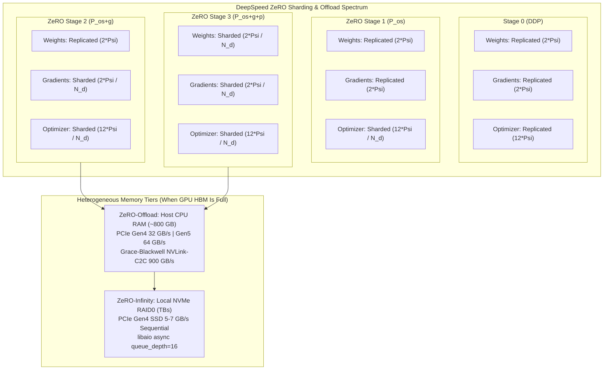
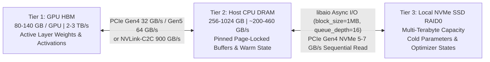
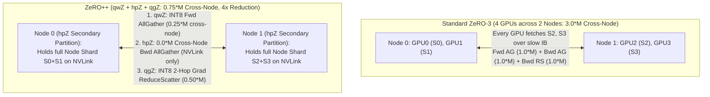
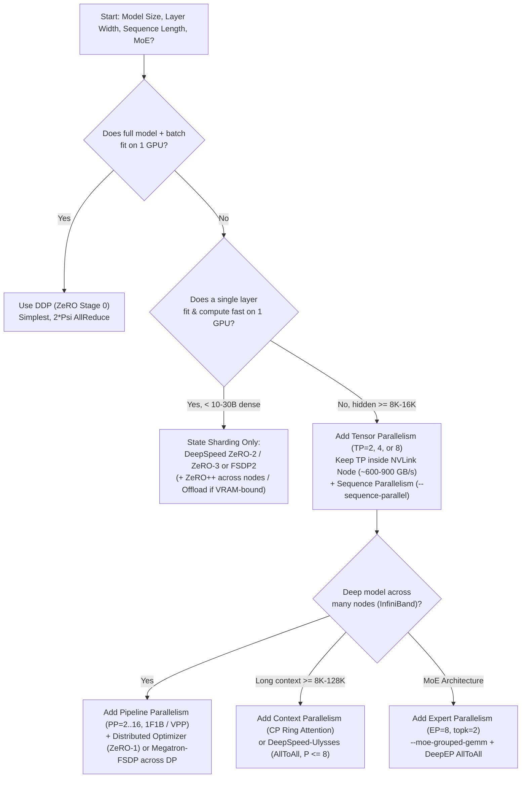

# 14.6 DeepSpeed and ZeRO

| Field | Value |
|---|---|
| Level | Advanced |
| Priority tier | 2 |
| Lab venue | Nebius GPU + Local Python Verification Lab (`code/part14/deepspeed_zero_lab.py`) |
| Part | Part 14: Distributed training and fine-tuning |
| Primary sources | *Distributed AI Systems* (`distributed-ai-systems`, Ch. 5); NVIDIA Zero-to-Hero Volume 13 (`chapter-05-deepspeed-and-zero.md`, `chapter-01-why-distributed-training-exists.md`, `chapter-08-nccl-collectives-and-communication-paths.md`, `chapter-12-volume-13-summary.md`, `index.md`, `labs/lab-01..04`); *AI Systems Performance Engineering* (`ai-systems-performance-engineering`, Ch. 13) |
| Coverage file | `planning/coverage/chapters/14-06.md` |
| Claim & number ledger | `planning/ledgers/14-06.md` |

## Why this matters for AI infrastructure

Before PyTorch introduced native `FSDP` (`Chapter 14.5`), Microsoft Research introduced the **Zero Redundancy Optimizer (`ZeRO`)** (`2019`/`2020`, Rajbhandari et al.) and the **DeepSpeed** engine to break the single-GPU memory wall. While `FSDP2` (`fully_shard()`) is functionally equivalent to **ZeRO Stage 3** on GPU `HBM`, DeepSpeed remains one of the most widely deployed distributed training frameworks in production AI infrastructure because it provides a complete spectrum of state-sharding, heterogeneous memory offloading, communication quantization, and long-context sequence parallelism:

1. **Progressive State Sharding (`ZeRO Stage 1`, `Stage 2`, and `Stage 3`):** Under standard mixed-precision `AdamW` (`16 * Psi` bytes per parameter: `2 B` `FP16`/`BF16` weights + `2 B` `FP16`/`BF16` gradients + `12 B` `FP32` master weights, momentum, and variance), a `70B`-parameter model requires **`1,120 GB`** of model state (`140 GB` weights + `140 GB` gradients + `840 GB` `Adam` state; or **`840 GB`** under the `12 * Psi` convention without a separate `FP32` master copy, and over **`1.2 TB`** with activations—far exceeding an `80 GB` `H100`). Similarly, a `10B`-parameter `FP32` model requires **`160 GB`** per GPU in `DDP` (`40 GB` weights + `40 GB` gradients + `80 GB` `Adam` momentum/variance). Across `N_d = 8` GPUs, `ZeRO Stage 1` (`4 * Psi + 12 * Psi / N_d`) shards optimizer states (`160 GB -> 90 GB` for `10B` `FP32`, `1.78x` reduction; `1,120 GB -> 385 GB` for `70B` mixed precision), `ZeRO Stage 2` (`2 * Psi + 14 * Psi / N_d`) shards gradients and optimizer states (`160 GB -> 55 GB` for `10B` `FP32`, **`~2.9x`** reduction leaving `25 GB` headroom on `80 GB` GPUs; `1,120 GB -> 262.5 GB` for `70B`), and `ZeRO Stage 3` (`16 * Psi / N_d`) shards weights, gradients, and optimizer states (`160 GB -> 20 GB` for `10B` `FP32`, **`8x`** reduction; `1,120 GB -> 140 GB` on `8` GPUs or `70 GB` on `16` GPUs for `70B`).
2. **Heterogeneous Memory Hierarchy (`ZeRO-Offload`, `ZeRO-Infinity`, and `SuperOffload`):** When a `70B` model under `ZeRO-3` (`12 * Psi = 840 GB`) runs on `8` `80 GB` `A100` GPUs, each GPU still requires **`105 GB`**—a **`25 GB` per-GPU shortfall**. **ZeRO-Offload** pages optimizer states and gradients to host CPU `DRAM` (`~800–850 GB` CPU RAM, cutting GPU usage to `60 GB`), and **ZeRO-Infinity** extends this tiering to `PCIe Gen4` `NVMe` SSDs (`5–7 GB/s` sequential read). However, because `PCIe Gen4 x16` (`32 GB/s`) and `PCIe Gen5 x16` (`64 GB/s`) are orders of magnitude slower than GPU `HBM` (`2–3 TB/s`), `ZeRO-3` + CPU offload on `8 x A100` drops `70B` throughput from **`8.5 tokens/sec` (`79 GB` VRAM)** to **`0.4 tokens/sec` (`21x` slower, `12%` GPU utilization)**, and `NVMe` thrashing drops it to **`0.1 tokens/sec` (`65%` CPU `%iowait`, `95%` GPU idle)**. On NVIDIA Grace-Blackwell (`GB200`/`GB300`), **SuperOffload** replaces the `PCIe` bottleneck with coherent **`900 GB/s` `NVLink-C2C`** (`28.125x` `PCIe Gen4`), **Speculation-Then-Validation (`STV`)**, and ARM `SVE` **`GraceAdam`** (`32` vector and `16` predicate registers).
3. **Multi-Node Collective Compression (`ZeRO++`) and Long-Context Attention (`DeepSpeed-Ulysses`):** Because `ZeRO Stage 3` increases per-step collective traffic from **`2 * Psi`** (`Stage 1`/`Stage 2`) to **`3 * Psi`** (`1` forward `AllGather` + `1` backward `AllGather` + `1` backward `ReduceScatter`), multi-node training over InfiniBand can become network-bound. **ZeRO++** combines **`qwZ`** (`INT8` quantized weight `AllGather`, `2x` reduction), **`hpZ`** (hierarchical intra-node secondary weight partitioning), and **`qgZ`** (`INT8` quantized hierarchical gradient `ReduceScatter`) to slash cross-node communication volume by **`4x`** (`3 * M -> 0.75 * M`). For `8K`–`128K+` context windows, **DeepSpeed-Ulysses** replaces complex Ring Attention partial-softmax bookkeeping with two **`AllToAll`** 2D transposes between `(B, S / P, H, d)` and `(B, S, H / P, d)`.
4. **The Two-Axis View (State Sharding vs Computation Sharding):** A core architectural mistake is treating `ZeRO` / `FSDP2` and **Megatron-LM** as competing replacements. `ZeRO` and `FSDP2` shard **state** (storage), assuming a single layer's matrix multiplication (`16K x 16K` or a `175B` MLP's `12,288 x 49,152` matrix = `603.98M` parameters / `1.2 GB` in `FP16`) still fits and executes fast enough on one GPU after `AllGather`. When individual layers, depths, sequences, or Mixture-of-Experts (`MoE`) routers exceed single-GPU compute or activation limits, you must combine state sharding with **computation sharding** (Tensor Parallelism `TP`, Pipeline Parallelism `PP`, Context Parallelism `CP`, and Expert Parallelism `EP`).

## Prerequisites and outcomes

### Prerequisites
- Training memory anatomy (`weights`, `gradients`, `optimizer states`, `activations`, `16 * Psi` vs `12 * Psi` mixed-precision rules) from Chapters `14.1`–`14.3`.
- `DDP` (`AllReduce`), `FSDP1` (`FlatParameter`) vs `FSDP2` (`fully_shard`, `DTensor`), and `NCCL` Ring vs Tree collectives (`AllGather`, `ReduceScatter`, `AllToAll`, `algbw` vs `busbw`) from Chapters `12.15`–`12.17`, `14.4`, and `14.5`.

### Outcomes
After completing this chapter, you will be able to:
1. Compute exact per-GPU static memory across **ZeRO Stage 0 (`16 * Psi`)**, **Stage 1 (`4 * Psi + 12 * Psi / N_d`)**, **Stage 2 (`2 * Psi + 14 * Psi / N_d`)**, and **Stage 3 (`16 * Psi / N_d`)** for `7B`, `10B`, `30B`, and `70B` models under both `16 * Psi` and `12 * Psi` conventions.
2. Derive why **ZeRO Stage 1 and Stage 2** communicate **`2 * Psi`** bytes per step while **ZeRO Stage 3** communicates **`3 * Psi`** bytes per step, and calculate how **ZeRO++ (`qwZ`, `hpZ`, `qgZ`)** reduces cross-node traffic by `4x`.
3. Size and diagnose **ZeRO-Offload (`CPU`)**, **ZeRO-Infinity (`NVMe` `libaio`)**, and **Grace-Blackwell `SuperOffload` (`NVLink-C2C` + `GraceAdam`)**, including `PCIe Gen4` (`32 GB/s`) vs `PCIe Gen5` (`64 GB/s`) vs `NVMe` (`5–7 GB/s`) vs `NVLink-C2C` (`900 GB/s`) throughput limits.
4. Configure and validate production **DeepSpeed JSON configurations** (`train_batch_size` identity, `reduce_bucket_size`, `allgather_bucket_size`, `stage3_prefetch_bucket_size`, `stage3_param_persistence_threshold`, `stage3_max_live_parameters`, `sub_group_size`, and `aio`).
5. Distinguish **State Sharding (`ZeRO` / `FSDP2` / `Megatron-FSDP` / `Distributed Optimizer`)** from **Computation Sharding (`TP`, `PP`, `SP`/`CP`, `DeepSpeed-Ulysses`, `EP`)** and design hybrid configurations for `LLaMA-3 8B`, `70B`, `GPT-3 175B`, and `Mixtral 8x7B`.

---

## 1. The ZeRO Sharding Spectrum: Stage 0, Stage 1, Stage 2, and Stage 3

### 1.1 Eliminating Redundancy Across Data-Parallel Ranks

In standard `DDP` (**ZeRO Stage 0**), every GPU holds an identical copy of the parameters (`P`), gradients (`G`), and optimizer states (`O`). Microsoft's **ZeRO** paper observed that while every GPU needs the active layer's parameters during the forward and backward pass, no GPU ever needs to *store* all parameters, gradients, and optimizer states simultaneously at rest.



Let `Psi` be the parameter count and `N_d` be the data-parallel degree (number of GPUs). We track the three standard memory accounting modes used across *Distributed AI Systems* Chapter 5 and Volume 13 Chapter 5:

1. **Mixed-Precision `16 * Psi` Convention (with `FP32` master weights):**
   - Parameters (`FP16`/`BF16`): `2 * Psi` bytes
   - Gradients (`FP16`/`BF16`): `2 * Psi` bytes
   - `AdamW` Optimizer State (`FP32` master weights `4 * Psi` + `FP32` momentum `4 * Psi` + `FP32` variance `4 * Psi`): `12 * Psi` bytes
   - **Per-GPU Static Memory by Stage:**
     - **Stage 0 (`DDP`):** `16 * Psi`
     - **Stage 1 (`P_os`, shard optimizer states):** `4 * Psi + (12 * Psi) / N_d`
     - **Stage 2 (`P_os+g`, shard gradients + optimizer states):** `2 * Psi + (14 * Psi) / N_d`
     - **Stage 3 (`P_os+g+p`, shard parameters + gradients + optimizer states):** `(16 * Psi) / N_d`
2. **Mixed-Precision `12 * Psi` Convention (without separate `FP32` master weights):**
   - Parameters (`2 * Psi`) + Gradients (`2 * Psi`) + `FP32` momentum/variance (`8 * Psi`) = `12 * Psi` bytes total (`84 GB` for `7B`, `360 GB` for `30B`, `840 GB` for `70B`).
3. **Pure `FP32` `16 * Psi` Convention (Volume 13 Chapter 5 `10B` baseline):**
   - Parameters (`FP32`, `4 * Psi`) + Gradients (`FP32`, `4 * Psi`) + `FP32` momentum/variance (`8 * Psi`) = `16 * Psi` bytes total (`160 GB` for `10B`).

### 1.2 Side-by-Side Memory Math: `7B`, `10B`, `30B`, and `70B` Models

```text
Case 1: 70B Model in Mixed Precision (16*Psi = 1,120 GB total state) on N_d = 8 GPUs (DAI Ch. 5):
  - FP16 Parameters: 70B x 2 B = 140.0 GB
  - FP16 Gradients:  70B x 2 B = 140.0 GB
  - FP32 Adam State (master + m + v): 70B x 12 B = 840.0 GB
  -----------------------------------------------------------------------------------
  * Stage 0 (DDP):    140.0 + 140.0 + 840.0       = 1,120.0 GB / GPU (1.00x)
  * ZeRO Stage 1:     140.0 + 140.0 + (840.0 / 8) =   385.0 GB / GPU (2.91x reduction)
  * ZeRO Stage 2:     140.0 + (140.0 + 840.0) / 8 =   262.5 GB / GPU (4.27x reduction)
  * ZeRO Stage 3:     (140.0 + 140.0 + 840.0) / 8 =   140.0 GB / GPU (8.00x reduction; 70.0 GB on N_d=16)

Case 2: 10B Model in Pure FP32 (16*Psi = 160 GB total state) on N_d = 8 GPUs (Volume 13 Ch. 5):
  - FP32 Parameters: 10B x 4 B = 40.0 GB
  - FP32 Gradients:  10B x 4 B = 40.0 GB
  - FP32 Adam State (m + v): 10B x 8 B = 80.0 GB
  -----------------------------------------------------------------------------------
  * Stage 0 (DDP):    40.0 + 40.0 + 80.0          =   160.0 GB / GPU (1.00x, exceeds 80 GB GPU)
  * ZeRO Stage 1:     40.0 + 40.0 + (80.0 / 8)    =    90.0 GB / GPU (1.78x, still > 80 GB GPU)
  * ZeRO Stage 2:     40.0 + (40.0 + 80.0) / 8    =    55.0 GB / GPU (~2.9x [2.91x], 25 GB headroom on 80 GB GPU)
  * ZeRO Stage 3:     (40.0 + 40.0 + 80.0) / 8    =    20.0 GB / GPU (8.00x reduction)

Case 3: 7B Model in Mixed Precision (12*Psi = 84 GB total state) on N_d = 2 GPUs (DAI Ch. 5):
  - FP16 Parameters (14.0 GB) + FP16 Gradients (14.0 GB) + FP32 Adam m/v (56.0 GB)
  -----------------------------------------------------------------------------------
  * Stage 0 (DDP):    14.0 + 14.0 + 56.0          =    84.0 GB / GPU
  * ZeRO Stage 1:     14.0 + 14.0 + (56.0 / 2)    =    56.0 GB / GPU (optimizer drops 56 -> 28 GB)
  * ZeRO Stage 2:     14.0 + (14.0 / 2) + 28.0    =    49.0 GB / GPU (gradients drop 14 -> 7 GB)
  * ZeRO Stage 3:     (14.0 + 14.0 + 56.0) / 2    =    42.0 GB / GPU (7 + 7 + 28 GB)
```

| Model & Precision Convention | `N_d` GPUs | Stage 0 (`DDP`) | `ZeRO Stage 1` | `ZeRO Stage 2` | `ZeRO Stage 3` | Key Infrastructure Takeaway |
|---|---|---|---|---|---|---|
| **`70B` Mixed (`16 * Psi = 1,120 GB`)** | `8` | `1,120.0 GB` | `385.0 GB` (`2.91x`) | `262.5 GB` (`4.27x`) | **`140.0 GB`** (`8.0x`) | Needs `N_d = 16` (`70.0 GB`/GPU) or offload to fit `80 GB` `H100`. |
| **`70B` Mixed (`12 * Psi = 840 GB`)** | `8` | `840.0 GB` | `350.0 GB` (`2.40x`) | `227.5 GB` (`3.69x`) | **`105.0 GB`** (`8.0x`) | `25.0 GB` shortfall on `80 GB` GPU (`105 - 80 = 25 GB`). |
| **`30B` Mixed (`12 * Psi = 360 GB`)** | `16` | `360.0 GB` | `135.0 GB` (`2.67x`) | **`78.75 GB`** (`75.0 GB` w/ `8B` grad+opt) | **`22.5 GB`** (`16.0x`) | `ZeRO-2` fits on `80 GB` GPUs in `FP16` (`60 + 15 = 75 GB`), but OOMs if weights are `FP32` (`120 + 15 = 135 GB`). |
| **`10B` Pure `FP32` (`16 * Psi = 160 GB`)** | `8` | `160.0 GB` | `90.0 GB` (`1.78x`) | **`55.0 GB`** (`~2.9x`) | **`20.0 GB`** (`8.0x`) | `ZeRO-2` is the sweet spot: fits on `80 GB` GPU with `25 GB` activation headroom. |
| **`7B` Mixed (`12 * Psi = 84 GB`)** | `2` | `84.0 GB` | `56.0 GB` (`1.50x`) | `49.0 GB` (`1.71x`) | **`42.0 GB`** (`2.0x`) | Even `2` GPUs cut `7B` state from `84 GB` to `42 GB` (`10.5 GB` on `8` GPUs). |

### 1.3 Collective Communication Volume: Why Stage 1 and Stage 2 Cost `2 * Psi` While Stage 3 Costs `3 * Psi`

A major advantage of **ZeRO Stage 1 and Stage 2** is that they achieve `1.78x` to `4.27x` memory reduction **without increasing collective communication volume over `DDP`**:

1. **ZeRO Stage 1 (`2 * Psi` communication):**
   - Forward pass: Parameters are replicated on every GPU (`0` communication).
   - Backward pass: Instead of running a full `AllReduce` (`ReduceScatter + AllGather`) on all gradients, `ZeRO-1` runs a **`ReduceScatter`** (`((N_d - 1) / N_d) * M` bytes, where `M = 2 * Psi` is the weight/gradient size in bytes) so each rank receives the averaged gradients for the `1 / N_d` parameter shard whose optimizer state it owns.
   - Optimizer step & Parameter update: Each rank updates its `1 / N_d` parameter shard locally using its `1 / N_d` `Adam` state, then runs an **`AllGather`** (`((N_d - 1) / N_d) * M` bytes) to broadcast the updated weights to all ranks.
   - **Total per step:** `1x ReduceScatter + 1x AllGather` = **`2 * ((N_d - 1) / N_d) * M` (`~2 * M`, identical to `DDP`'s single `AllReduce`)**.
2. **ZeRO Stage 2 (`2 * Psi` communication):**
   - Identical collective volume to Stage 1 (`1x ReduceScatter` during backward + `1x AllGather` after the optimizer step = **`~2 * M`**), except that as each layer's gradient bucket finishes its `ReduceScatter` during backpropagation, the non-local `(N_d - 1) / N_d` gradient slices are **freed immediately** rather than held until the end of the backward pass.
3. **ZeRO Stage 3 (`3 * Psi` communication, `1.5x` Stage 1/2):**
   - Because weights themselves are sharded `1 / N_d` at rest, every layer must run **`1x AllGather` during the forward pass** (`~1 * M` across all layers) and discard the non-local weights immediately after the layer's forward compute (unless `stage3_param_persistence_threshold` keeps tiny tensors resident), then run **`1x AllGather` during the backward pass** (`~1 * M`) and **`1x ReduceScatter` on the gradients** (`~1 * M`).
   - **Total per step:** `2x AllGather + 1x ReduceScatter` = **`3 * ((N_d - 1) / N_d) * M` (`~3 * M`)**—a **`50%` (`1.5x`)** increase in total network bytes (and `2x–3x` higher effective communication overhead on latency-sensitive multi-node fabrics when small layers cannot overlap `AllGather` with compute).
   - For a `70B` `FP16` model (`M = 140.0 GB`) on `N_d = 8` GPUs, Stage 1 and Stage 2 move **`280.0 GB` asymptotically (`245.0 GB` exact ring: `2 * 7/8 * 140 GB`)**, whereas Stage 3 moves **`420.0 GB` asymptotically (`367.5 GB` exact ring: `3 * 7/8 * 140 GB`)**.

---

## 2. ZeRO-Offload, ZeRO-Infinity, and Grace-Blackwell SuperOffload

### 2.1 ZeRO-Offload: Extending Optimizer and Gradient State to Host CPU RAM

What happens when even `ZeRO Stage 3` exceeds GPU `HBM`—or when you only have consumer GPUs (`24 GB` `RTX 4090`) or a single `8 x 80 GB` node (`640 GB` total `HBM`) for a `70B` model?
As shown in Volume 13 Chapter 5, a `70B` model under the `12 * Psi` convention (`840 GB` total state) on `8` GPUs with `ZeRO-3` requires:

```text
Per-GPU state needed: (70B x 12 bytes) / 8 = 105.0 GB
Available per A100/H100 GPU:                 80.0 GB
Per-GPU VRAM Shortfall:                      25.0 GB
```

**ZeRO-Offload** (`offload_optimizer: {"device": "cpu", "pin_memory": true}`, usable with either `Stage 2` or `Stage 3`) moves the `FP32` `AdamW` optimizer states (and optionally gradients or `Stage 3` parameters via `offload_param`) out of GPU `HBM` into host **CPU `DRAM`**:
- **Execution pipeline:** Forward and backward matrix multiplications stay on the GPU (`~2–3 TB/s` `HBM`). As gradients are produced during backward, DeepSpeed streams them over `PCIe` to page-locked (`pin_memory: true`) host `DRAM`, executes the `FP32` `Adam` update on the host CPU (using DeepSpeed's AVX-vectorized `DeepSpeedCPUAdam`), and streams updated `FP16`/`BF16` weights back to the GPU while overlapping with the next step's computation.
- **The `PCIe` Bandwidth Wall (`32 GB/s` vs `64 GB/s` vs `HBM`):**
  - On `PCIe Gen4 x16` (**`32 GB/s`** per direction) or `PCIe Gen5 x16` (**`64 GB/s`** per direction), CPU-GPU transfers are `30x–100x` slower than `HBM`.
  - For moderate models on `Stage 2` where only optimizer states are offloaded and compute per layer is large, *Distributed AI Systems* Chapter 5 notes a **`20–40%` throughput reduction** (e.g., training a `354.3M`-parameter model—`0.71 GB` in `FP16`—with CPU offload keeps peak GPU memory at just **`3.41–3.52 GB`** across steps `0–10`).
  - However, when `ZeRO-3` offloads state for a `70B` model on `8` `A100` GPUs (`60 GB` GPU VRAM used, `~800–850 GB` host CPU RAM used, triggering system swap if host RAM is under-provisioned), Volume 13 Chapter 5 shows training speed collapsing from **`8.5 tokens/sec` (`79 GB` GPU VRAM, no offload)** to **`0.4 tokens/sec` (`21.25x` ~ `21x` slower)** with GPU utilization dropping to **`12%`** (`10–100x` slower when parameter offloading saturates `PCIe`).

### 2.2 ZeRO-Infinity: Three-Tier Memory Hierarchy with NVMe SSDs (`libaio`)

When models reach hundreds of billions or trillions of parameters, even workstation or server CPU `DRAM` (`256–512 GB` or `1 TB`) is exhausted. **ZeRO-Infinity** (`2021`) adds a third tier—local **`NVMe` SSDs**—managed by the **DeepSpeed Infinity Engine**:



- **Storage requirements and `aio` tuning:** Modern `PCIe Gen4` `NVMe` SSDs deliver **`5–7 GB/s`** sequential read throughput per drive. `ZeRO-Infinity` requires:
  1. A **mounted filesystem directory** (`"nvme_path": "/local_nvme"` or `"/mnt/nvme_raid0"`—**never** a raw block device like `/dev/nvme0n1p7`) with free capacity of at least **`2–4x` the model size**.
  2. The Linux native asynchronous I/O library (**`libaio-dev`** on Ubuntu/Debian or **`libaio-devel`** on RHEL/CentOS) and a raised open-file descriptor limit (**`ulimit -n 65535`**) because `ZeRO-Infinity` opens hundreds of shard swap files across ranks.
  3. An `"aio"` configuration block (`"block_size": 1048576` [`1 MB`], `"queue_depth": 16`, `"thread_count": 2`) and `"offload_param"` buffer pool (`"buffer_count": 5`, `"buffer_size": 1e8`).
- **Throughput reality:** `ZeRO-Infinity` is a **feasibility mechanism, not a speed optimization** (`30–50%` slower than CPU offload, and up to `50–85x` slower than pure GPU training—dropping `70B` throughput to **`0.1 tokens/sec`** when both parameters and optimizer states thrash `NVMe` at `65%` CPU `%iowait`).

### 2.3 Grace-Blackwell `SuperOffload` and `GraceAdam` (`900 GB/s` `NVLink-C2C`)

*AI Systems Performance Engineering* Chapter 13 and *Distributed AI Systems* Chapter 5 (`SuperOffload`, `2025`, arXiv:`2502.19811`) show how NVIDIA's **Grace-Blackwell (`GB200`/`GB300`)** architecture fundamentally transforms offloading from a last-resort fallback into a high-throughput production tier:
1. **`900 GB/s` Coherent `NVLink-C2C` Interconnect:** Instead of crossing a `32 GB/s` `PCIe Gen4` bus, the Grace ARM CPU and Blackwell GPU are connected via cache-coherent **`NVLink-C2C` at `900 GB/s`** (**`28.125x`** the bandwidth of `PCIe Gen4 x16`), accessing up to `480–512 GB` of fast `LPDDR5X` host memory per Grace CPU.
2. **Speculation-Then-Validation (`STV`):** In standard `ZeRO-Offload`, the GPU must wait to check for `NaN`/`Inf` gradient norms before the CPU optimizer can step. `SuperOffload`'s **`STV`** protocol speculatively streams gradients over `NVLink-C2C` and starts the CPU optimizer step **concurrently with GPU backpropagation**, validating numerical health asynchronously and rolling back only on the rare step where an overflow occurs.
3. **Heterogeneous Optimizer Partitioning + `GraceAdam`:** `SuperOffload` partitions the optimizer update dynamically between GPU `HBM` and Grace CPU `LPDDR5X` so both processors finish at the same instant, using **`GraceAdam`**—a custom `AdamW` kernel hand-vectorized for the Grace CPU's **ARM Scalable Vector Extension (`SVE`)** instruction set utilizing **`32` vector registers and `16` predicate registers**—maintaining **`> 80%` (`~82%`) GPU utilization**.

---

## 3. ZeRO++ and DeepSpeed-Ulysses: Multi-Node & Long-Context Scaling

### 3.1 ZeRO++: Cutting Cross-Node Collective Volume by `4x` (`qwZ`, `hpZ`, `qgZ`)

When `ZeRO Stage 3` scales across multi-node clusters where intra-node `NVLink` (`600–900 GB/s`) is much faster than inter-node InfiniBand (`25–50 GB/s` per-NIC effective up to `400 Gbps` NDR), its `3 * M` per-step communication becomes the primary bottleneck. **ZeRO++** (`2023`, Wang et al., arXiv:`2306.10209`) introduces three orthogonal collective optimizations:



1. **Quantized Weights (`qwZ`, `"zero_quantized_weights": true`):** Before running the forward `AllGather`, each rank dynamically quantizes its `FP16` (`2`-byte) weight shard into block-based **`INT8` (`1`-byte)** using `CUDAQuantizer`, transmits `INT8` over the network (**halving `AllGather` volume from `1.0 * M` to `0.5 * M`**), and dequantizes back to `FP16` on receipt. Because the `FP32` master weights in the optimizer are never quantized, quantization error does not accumulate across training steps.
2. **Hierarchical Weight Partitioning (`hpZ`, `"zero_hpz_partition_size": 8`):** Instead of discarding gathered weights completely after the forward pass and re-fetching them across slow inter-node InfiniBand during backward, `hpZ` maintains a **secondary parameter partition within each node** (setting `zero_hpz_partition_size` equal to the number of GPUs per node, e.g., `8`, or `2` in a `2`-GPU/node demo). During the backward pass, the `AllGather` happens **purely inside the node over `600–900 GB/s` `NVLink`**, dropping **cross-node backward `AllGather` traffic to `0`**.
3. **Quantized Gradients (`qgZ`, `"zero_quantized_gradients": true`):** Replaces the flat cross-node ring `ReduceScatter` (which touches slow inter-node links `N_d - 1` times) with a **two-hop hierarchical `ReduceScatter`** (intra-node reduction first, then cross-node reduction) using **`INT8` block quantization**, cutting cross-node gradient traffic from `1.0 * M` to **`0.5 * M`**.

Combined, `qwZ + hpZ + qgZ` reduce cross-node communication volume from **`3.0 * M` to `0.75 * M`**—a **`4.0x` reduction** (`420.0 GB -> 105.0 GB` per step for a `70B` `FP16` model).

:::caution ZeRO++ Requires `FP16` (`CUDAQuantizer` Dtype Constraint)
As documented in *Distributed AI Systems* Chapter 5, DeepSpeed's `CUDAQuantizer` for `qwZ` and `qgZ` dequantizes `INT8` buffers directly to **`FP16`**. Enabling `zero_quantized_weights` or `zero_quantized_gradients` alongside `"bf16": {"enabled": true}` will fail with a `dtype` mismatch (`RuntimeError: expected scalar type BFloat16 but found Half`). Use `"fp16": {"enabled": true}` when running `ZeRO++`.
:::

### 3.2 DeepSpeed-Ulysses vs Ring Attention for Long-Context Training (`8K`–`128K+` Tokens)

When sequence length `S` grows to `8K`, `32K`, or `128K` tokens, activation memory (`O(L * B * S * H)`, easily exceeding `40 GB` per GPU at `S = 32K`, `L = 32`, `H = 4096`) becomes the dominant bottleneck. Two sequence/context-parallel strategies partition the sequence of length `S` across `P` GPUs so each GPU starts with a local sequence chunk of shape `(B, S / P, H, d)` (where `H` is the number of attention heads and `d` is `head_dim`):

| Feature | Ring Attention (Megatron Context Parallelism `CP`) | **DeepSpeed-Ulysses (`2D` `AllToAll` Transpose)** |
|---|---|---|
| **Core Mechanism** | Keeps queries local `(B, S / P, H, d)` and rotates `K, V` chunks around a logical ring in `P` steps, accumulating partial softmax denominators (`lse`) across steps. | Executes an **`AllToAll`** before attention to transpose `(B, S / P, H, d)` -> **`(B, S, H / P, d)`** (full sequence, subset of heads), runs standard FlashAttention locally, and runs a reverse **`AllToAll`** back to `(B, S / P, H, d)`. |
| **Implementation Complexity** | High: requires custom online-softmax accumulation and causal-mask load balancing across ring steps. | **Low:** between the two `AllToAll` calls (`all_to_all_seq_to_head` and `all_to_all_head_to_seq`), each GPU runs unmodified standard self-attention on its `H / P` heads. |
| **Communication Volume & Sweet Spot** | Sends `K, V` around `P` ring hops overlapped with attention compute; scales to arbitrary `P` (`100K+` tokens across many nodes). | `1 / P` communication volume per link via simultaneous `AllToAll`; **wins for `P <= 8`** on high-bandwidth intra-node `NVLink` (`P` cannot exceed the number of attention/KV heads `H`). |

---

## 4. Beyond State Sharding: Combining ZeRO/FSDP with Megatron Computation Sharding

### 4.1 Why State Sharding (`ZeRO` / `FSDP2`) Cannot Replace Computation Sharding (`Megatron`)

A pervasive misconception is that `ZeRO-3` or `FSDP2` can replace **Megatron-LM**. As *Distributed AI Systems* Chapter 5 proves, they operate on **two orthogonal axes**:
- **Axis 1 — State Sharding (`ZeRO-1/2/3`, `FSDP2`, `Megatron-FSDP`, `Megatron Distributed Optimizer`):** Shards **storage** at rest. When Layer `l` executes, one GPU must still gather the **entire layer's weight matrix** (`AllGather`) and compute that layer's forward and backward matrix multiplication locally.
- **Axis 2 — Computation Sharding (`Megatron Core`: Tensor Parallelism `TP`, Pipeline Parallelism `PP`, Sequence/Context Parallelism `SP`/`CP`, Expert Parallelism `EP`):** Shards the **computation and active layer memory itself** across GPUs.

Why does this distinction matter?
- In a `7B` model (`hidden_size = 4096`, `ffn_hidden_size = 16384`), a single MLP matrix has `4096 x 16384 = 67.1M` parameters (`~270M` across the MLP block, or **`~500 MB` in `FP16`**), which easily fits and computes on a single GPU after a `ZeRO-3` `AllGather`.
- In a `175B` model (`hidden_size = 12,288`, `ffn_hidden_size = 49,152`), a single MLP matrix has `12,288 x 49,152` = **`603,979,776` (`> 600M`) parameters**, requiring **`1.2 GB` in `FP16`** just for one matrix, or consider a `16K x 16K` attention projection matrix. With **Tensor Parallelism (`TP = 8`)** using `ColumnParallelLinear` (`W = [W_0 | W_1 | ... | W_7]`, zero communication) paired with `RowParallelLinear` (`W' = [W'_0; ...; W'_7]`, requiring just **one `AllReduce` per MLP or Attention block**), that `16K x 16K` matrix is split into eight **`16K x 2K`** slices—no single GPU ever holds or multiplies the full matrix.

### 4.2 Megatron Core's Native State Sharders: `Distributed Optimizer` (`ZeRO-1`) and `Megatron-FSDP` (`ZeRO-3`)

When you use Megatron Core (`nvcr.io/nvidia/pytorch:25.04-py3` or `pip install --no-build-isolation megatron-core[mlm,dev] pybind11`) for `TP`, `PP`, `CP`, or `EP` (`--moe-grouped-gemm`, `--moe-permute-fusion`, and `DeepEP` for `AllToAll` MoE routing), bolting external DeepSpeed `ZeRO-3` onto the same job requires keeping process groups strictly disjoint (or using integrated wrappers like Colossal-AI's `Gemini`). Instead, Megatron Core provides two native, topology-aware state sharders:

1. **Megatron Distributed Optimizer (`--use-distributed-optimizer`, equivalent to `ZeRO Stage 1`):**
   Shards `FP32` master weights, momentum, and variance across the data-parallel group of size `d` (`DP`), copying gradients into contiguous buffers for overlapped `ReduceScatter` (`--overlap-grad-reduce`) and overlapped parameter `AllGather` (`--overlap-param-gather`):

| Precision Configuration | Without Distributed Optimizer (`d = 1`) | With Distributed Optimizer (`d` DP GPUs) | At `d = 8` GPUs | Reduction at `d = 8` |
|---|---|---|---|---|
| **`fp16` params, `fp16` grads** | `20 bytes/param` (`2 + 2 + 16`) | `4 + 16 / d bytes/param` | **`6.0 bytes/param`** | **`3.33x`** |
| **`bf16` params, `fp32` grads** | `18 bytes/param` (`2 + 4 + 12`) | `6 + 12 / d bytes/param` | **`7.5 bytes/param`** | **`2.40x`** |
| **`fp32` params, `fp32` grads** | `16 bytes/param` (`4 + 4 + 8`) | `8 + 8 / d bytes/param` | **`9.0 bytes/param`** | **`1.78x`** |

2. **Megatron-FSDP (`--use-megatron-fsdp --data-parallel-sharding-strategy optim_grads_params`, equivalent to `ZeRO Stage 3`):**
   Understands `TP`/`PP`/`CP`/`EP` process groups natively and uses **`NCCL` `userbuffer` registration** to minimize GPU Streaming Multiprocessor (`SM`) consumption during collectives, delivering **`15–25%` higher throughput** and **`~23%` memory savings** compared to general-purpose `PyTorch FSDP2`. When paired with **Hopper/Ada/Blackwell `FP8` hybrid training** (`--fp8-format hybrid` using `E4M3` forward and `E5M2` backward with `--fp8-amax-history-len 1024 --fp8-amax-compute-algo max`), enabling **`--fp8-param-gather`** gathers sharded weights in `FP8` (`1 byte`), **cutting `AllGather` communication volume in half** while delivering **`1.5–2x` GEMM speedups** over `BF16`.

### 4.3 The Hybrid Parallelism Decision Framework (`70B`, `LLaMA-3 8B`, `GPT-3 175B`, `Mixtral 8x7B`)



Let us verify the four canonical production configurations from *Distributed AI Systems* Chapter 5:
1. **`70B` Dense Model on `64` GPUs (`8` nodes x `8` GPUs/node, `H = 8192`, `L = 80`):**
   - Intra-node `NVLink`: **`TP = 4`** (splits `8192`-dim matrices `4`-way inside the node).
   - Inter-node InfiniBand: **`PP = 2`** (splits `80` layers into two `40`-layer stages using `1F1B` micro-batching).
   - Data Parallelism + State Sharding: Each model replica uses `TP * PP = 4 * 2 = 8` GPUs, leaving **`DP = 64 / (4 * 2) = 8`** data-parallel replicas sharded with `ZeRO`/`FSDP` or `Distributed Optimizer` (`1/8` optimizer state, `1/4` layer compute, `1/2` depth per GPU).
2. **`LLaMA-3 8B` Long-Context (`S = 8192`, `L = 32`, `H = 4096`, `ffn = 14336`, `32` heads, `8` GQA query groups) on `8 x 80 GB` GPUs:**
   - `TP = 1`, `PP = 1`, **`CP = 2`** (splits `8192` tokens into `4096` tokens/GPU), giving **`DP = 8 / (1 * 1 * 2) = 4`**. With `--global-batch-size 128` and `--micro-batch-size 1`, each DP replica processes `128 / 4 = 32` micro-batches per step with `--fp8-format hybrid --fp8-param-gather --use-distributed-optimizer`.
3. **`GPT-3 175B` (`L = 96`, `H = 12288`, `96` heads, `S = 2048`) on `128` GPUs (`16` nodes x `8` GPUs):**
   - **`TP = 8`** (full intra-node `NVLink` domain) x **`PP = 16`** (`96 / 16 = 6` layers per pipeline stage) -> **`DP = 128 / (8 * 16) = 1`**, accumulating across `--global-batch-size 1536`.
4. **`Mixtral 8x7B` MoE (`L = 32`, `H = 4096`, `8` experts, `topk = 2`) on `64` GPUs (`8` nodes x `8` GPUs):**
   - **`EP = 8`** (`--expert-model-parallel-size 8`, `1` expert per GPU), `TP = 1`, **`PP = 4`** (`8` layers/stage), `--moe-grouped-gemm --moe-permute-fusion --sequence-parallel --use-distributed-optimizer`.

---

## 5. Commands and configurations that matter

### 5.1 DeepSpeed Engine Initialization (`deepspeed.initialize()` and `deepspeed.zero.Init()`)

Unlike `DDP`, where you construct `torch.optim.AdamW` manually and wrap the module in `DistributedDataParallel`, DeepSpeed takes a declarative configuration dictionary (or `.json` file) and builds the sharded optimizer, gradient scaler, and communication buckets inside **`deepspeed.initialize()`** (`untested here`):

```python
import deepspeed
import torch

# For models larger than single-GPU RAM/VRAM (e.g., 70B), wrap model creation in
# deepspeed.zero.Init() so parameters are partitioned immediately at construction time:
with deepspeed.zero.Init(config_dict_or_path="ds_zero3_config.json"):
    model = build_transformer_model()

model_engine, optimizer, _, _ = deepspeed.initialize(
    model=model,
    model_parameters=model.parameters(),
    config="ds_zero3_config.json",
)

for batch in dataloader:
    loss = model_engine(batch["input_ids"], labels=batch["labels"])
    model_engine.backward(loss)  # Runs ReduceScatter + prefetches backward AllGather
    model_engine.step()          # Runs sharded optimizer step + clears gradients
```

### 5.2 Production DeepSpeed JSON Configurations: Stage 2, Stage 3, ZeRO-Infinity, and ZeRO++

Every DeepSpeed configuration must satisfy the strict **batch-size identity**:

```text
train_batch_size == train_micro_batch_size_per_gpu x gradient_accumulation_steps x data_parallel_world_size
Example (8 GPUs): 256 == 4 x 8 x 8
```

#### Configuration A: `ZeRO Stage 2` Production Sweet Spot (`ds_zero2.json`)

```json
{
  "train_batch_size": 256,
  "train_micro_batch_size_per_gpu": 4,
  "gradient_accumulation_steps": 8,
  "bf16": { "enabled": true },
  "zero_optimization": {
    "stage": 2,
    "allgather_partitions": true,
    "allgather_bucket_size": 5e8,
    "overlap_comm": true,
    "reduce_scatter": true,
    "reduce_bucket_size": 5e8,
    "contiguous_gradients": true,
    "offload_optimizer": { "device": "none" }
  },
  "optimizer": {
    "type": "AdamW",
    "params": { "lr": 1e-4, "betas": [0.9, 0.999], "eps": 1e-8, "weight_decay": 0.01 }
  }
}
```

#### Configuration B: `ZeRO Stage 3` + `ZeRO-Infinity` (`CPU` + `NVMe` `libaio`) and `ZeRO++` (`ds_zero3_infinity.json`)

```json
{
  "train_batch_size": 256,
  "train_micro_batch_size_per_gpu": 4,
  "gradient_accumulation_steps": 8,
  "fp16": { "enabled": true },
  "zero_optimization": {
    "stage": 3,
    "overlap_comm": true,
    "contiguous_gradients": true,
    "reduce_bucket_size": 5e8,
    "stage3_prefetch_bucket_size": 5e8,
    "stage3_param_persistence_threshold": 1e5,
    "stage3_max_live_parameters": 1e9,
    "sub_group_size": 1e9,
    "zero_quantized_weights": true,
    "zero_hpz_partition_size": 8,
    "zero_quantized_gradients": true,
    "offload_optimizer": {
      "device": "cpu",
      "pin_memory": true
    },
    "offload_param": {
      "device": "nvme",
      "nvme_path": "/mnt/nvme_raid0",
      "pin_memory": true,
      "buffer_count": 5,
      "buffer_size": 1e8
    }
  },
  "aio": {
    "block_size": 1048576,
    "queue_depth": 16,
    "thread_count": 2
  }
}
```

#### Key `zero_optimization` Bucket and Threshold Parameters

| Parameter | Default / Typical Value | Memory Footprint (`FP16`/`BF16`, `2 B/elem`) | Operational Meaning & Tuning Guidance |
|---|---|---|---|
| **`reduce_bucket_size`** | `5e8` (`500M` elements) | **`1.0 GB`** | Number of gradient elements batched together before launching a `ReduceScatter`. Larger values improve `NCCL` bus utilization (`busbw`) but consume more transient buffer VRAM. |
| **`allgather_bucket_size`** | `5e8` (`500M` elements) | **`1.0 GB`** | Number of parameter elements gathered per `AllGather` collective at the end of the `ZeRO-1`/`ZeRO-2` optimizer step. |
| **`stage3_prefetch_bucket_size`** | `5e8` (or `0.9 * H^2`) | **`1.0 GB`** | Size of the lookahead parameter buffer prefetched via asynchronous `AllGather` while the current layer computes in `ZeRO-3`. |
| **`stage3_param_persistence_threshold`** | `1e5` (`100K` elements, or `10 * H`) | **`0.2 MB`** | Parameters smaller than this threshold (e.g., `LayerNorm` weights/biases) are **kept replicated in GPU `HBM`** rather than partitioned and re-gathered on every pass, avoiding tiny latency-bound collectives. |
| **`stage3_max_live_parameters`** | `1e9` (`1B` elements) | **`2.0 GB`** | Hard upper bound on total unsharded parameter elements allowed to reside in GPU `HBM` simultaneously before DeepSpeed forces a wait/free (analogous to `FSDP`'s `limit_all_gathers=True`). |
| **`sub_group_size`** | `1e9` (`1B` elements) | **`2.0 GB`** | Number of parameters updated together in a single optimizer sub-step when offloading or sharding very large models. |

### 5.3 Launch, NVMe Pre-Flight, and Production Monitoring Commands

```bash
# 1. Verify NVMe mountpoint (use a mounted directory, NEVER raw /dev/nvme0n1p7) and install libaio
lsblk -o NAME,SIZE,MOUNTPOINT | grep nvme
sudo apt install -y libaio-dev && ulimit -n 65535

# 2. Launch DeepSpeed across 8 GPUs (or via torchrun)
deepspeed --num_gpus=8 train.py --deepspeed --deepspeed_config ds_zero2.json

# 3. Benchmark NCCL All-Reduce / All-Gather busbw before blaming ZeRO-3 (Lab 02)
./build/all_reduce_perf -b 8 -e 128M -f 2 -g 8

# 4. Monitor ZeRO communication overlap and per-rank step time variance in production
watch -n 5 'grep "overlap" train.log | tail -1'
tail -n 100 train.log | awk '/step_time/ {print}'
```

| Production Signal | Healthy Range | Red Flag | Immediate Triage Action |
|---|---|---|---|
| **Communication % of step time** | **`15–30%`** | **`> 50%`** | Check `nvidia-smi topo -m` (`NV#` vs `PIX`), increase `reduce_bucket_size` / `stage3_prefetch_bucket_size`, or enable `ZeRO++` (`hpZ`, `qwZ`, `qgZ`) / switch to `Stage 2`. |
| **Per-rank step time variance** | **`< 5%`** | **`> 10%`** | Inspect straggler node via `nvidia-smi`, `iftop -n`, `iostat -dx 1`, and `dmesg -T` (`Xid 48`/`63`/`79`). |
| **GPU memory used / total** | **`70–90%`** (flat after warmup) | **`> 95%`** or climbing linearly | Lower `stage3_max_live_parameters` / `reduce_bucket_size` or enable activation checkpointing. |
| **GPU utilization (`%`)** | **`80–95%`** sustained | **`< 50%`** (`12%` on CPU offload, `5%` on NVMe) | Offload `PCIe` / `NVMe` thrashing or dataloader starvation (`iostat -x 1`). |

---

## 6. How it fails

### Failure Mode 1: `ZeRO-3` `All-Gather` Straggler Hang and Collective Timeout

- **Symptom:** A multi-GPU `ZeRO-3` job runs cleanly for hours, then stalls during Layer `15`'s `All-Gather` and aborts (`untested here`):
  ```text
  [14:23:40] Rank 0-7: Step 1-10 complete, avg loss: 4.52
  [14:23:41] NCCL INFO All-Gather started for layer 15
  [14:23:42] Rank 1..6: All-Gather done
  [14:23:47] Rank 7: SLOW in All-Gather (5 second delay)
  [14:24:00] NCCL WARN All-Gather timeout after 20 seconds
  [14:24:00] Error: NCCL operation aborted
  ```
- **Root Cause:** Because `ZeRO-3` issues an `AllGather` on every layer in both forward and backward passes, every rank is tightly synchronized at layer granularity. If `Rank 7` suffers a `5-second` stall (due to local disk I/O contention, CPU throttling, an InfiniBand link flap, or an uncorrectable `ECC` memory error `Xid 48` / `Xid 63`), `Ranks 0–6` block waiting at the collective barrier until the watchdog aborts.
- **Diagnosis & Fix:**
  ```bash
  export NCCL_DEBUG=INFO
  ssh node7 "nvidia-smi && iostat 1 3 && dmesg -T | grep -iE 'oom|xid'"
  ibstat && ibdiagnet
  ```
  Note that collective timeout is a **PyTorch framework setting**, not an `NCCL_TIMEOUT` environment variable: pass `timeout=datetime.timedelta(seconds=1200)` (or `3600` during debugging) to `dist.init_process_group("nccl", timeout=...)` and use `TORCH_NCCL_ASYNC_ERROR_HANDLING=1`.

### Failure Mode 2: `ZeRO-Infinity` `NVMe` Thrashing (`0.1 tokens/sec`, `65%` `%iowait`)

- **Symptom:** Training a `70B` model with `ZeRO-Infinity` on `NVMe` crawls at **`0.1 tokens/sec`** (`50–85x` slower than GPU-only `8.5 tokens/sec`), with GPUs idle **`95%`** of the time:
  ```text
  $ iostat -dx 1
  avg-cpu:  %user   %nice %system %iowait
             15.0    0.0   20.0    65.0  <-- CPU stalled waiting on NVMe I/O!
  Device             r/s     w/s    rMB/s    wMB/s
  nvme0n1         8000   6000    2000     1500  <-- Disk pegged at max
  nvme1n1         7800   5900    1900     1400
  ```
- **Root Cause:** Both `offload_param` and `offload_optimizer` were pointed to `NVMe`, forcing every forward and backward layer to page parameters in and out over `5–7 GB/s` `PCIe Gen4` SSDs (`~3.9 GB/s` combined read + `~2.9 GB/s` write across `nvme0n1` and `nvme1n1`).
- **Fix:** Keep parameters in GPU `HBM` (sharded via `ZeRO-3`) and offload **only optimizer states** (`"offload_optimizer": {"device": "nvme", "nvme_path": "/mnt/nvme_raid0", "pin_memory": true}` or `"device": "cpu"`), or scale out horizontally to `16` GPUs (`52.5 GB`/GPU under `12 * Psi`, `70.0 GB`/GPU under `16 * Psi`) so all state stays in `HBM`.

### Failure Mode 3: Passing Raw Device Path (`/dev/nvme0n1p7`) or Exhausting File Descriptors in `ZeRO-Infinity`

- **Symptom:** `ZeRO-Infinity` crashes at initialization with `NotADirectoryError`, `libaio` initialization failure, or `OSError: [Errno 24] Too many open files`.
- **Root Cause:** `nvme_path` was set to a raw block device (`/dev/nvme0n1p7`) instead of a mounted directory, `libaio-dev` was not installed, or the shell's default `ulimit -n` (`1024`) was exhausted by DeepSpeed's per-rank async swap files.
- **Fix:** Verify the mount point with `lsblk -o NAME,SIZE,MOUNTPOINT | grep nvme`, point `"nvme_path"` to a writable directory on that mounted filesystem (with `2–4x` model size free), install `libaio-dev`, and set `ulimit -n 65535`.

### Failure Mode 4: `ZeRO++` `CUDAQuantizer` `BF16` vs `FP16` Dtype Mismatch

- **Symptom:** Enabling `"zero_quantized_weights": true` (`qwZ`) or `"zero_quantized_gradients": true` (`qgZ`) with `"bf16": {"enabled": true}` crashes on the first `AllGather` with a `Half` vs `BFloat16` tensor type error.
- **Root Cause:** DeepSpeed's `CUDAQuantizer` dequantizes `INT8` communication buffers to `FP16` (`torch.float16`).
- **Fix:** Switch `"bf16": {"enabled": false}` and enable `"fp16": {"enabled": true}` when using `ZeRO++` quantization, or use `Megatron-FSDP` with `--fp8-format hybrid --fp8-param-gather` on Hopper/Blackwell GPUs.

### Failure Mode 5: `PCIe` Fallback (`ACS` Enabled or `nvidia-fabricmanager` Down) Crippling `ZeRO-3`

- **Symptom:** After a node reboot, `ZeRO-3` throughput drops from `950 tokens/sec` to `310 tokens/sec`, and `all_reduce_perf` reports `busbw` of `20–90 GB/s` instead of `~400–800 GB/s`, with `NCCL INFO Using PCIe interface`.
- **Root Cause:** `nvidia-fabricmanager` failed to start after reboot or `PCIe` Access Control Services (`ACS`) is enabled in BIOS, forcing `NVLink` traffic to fall back to `PCIe` (`PIX` instead of `NV#` in `nvidia-smi topo -m`).
- **Fix:** Inspect `nvidia-smi topo -m`, run `sudo systemctl restart nvidia-fabricmanager`, verify `unset NCCL_P2P_DISABLE`, and confirm `busbw` recovers with `./build/all_reduce_perf -b 8 -e 128M -f 2 -g 8`.

---

## 7. Hands-on lab

- **Venue:** Local Python Verification Lab (runs anywhere with standard-library `python3`) + Nebius GPU (`8 x H100` / `H200` for live `deepspeed` and `nccl-tests` execution).
- **Files:** `code/part14/deepspeed_zero.py` and `code/part14/deepspeed_zero_lab.py`.

Run the deterministic verification suite locally:

```bash
python3 -B code/part14/deepspeed_zero_lab.py
```

**Expected output (verified locally):**

```text
=== Chapter 14.6 Lab: DeepSpeed and ZeRO Verification ===
  [PASS] 1. 70B mixed-precision 16*Psi Stage 0 (DDP) requires 1,120.0 GB per GPU (140 GB FP16 weights + 140 GB FP16 grads + 840 GB FP32 Adam master/m/v)
  [PASS] 2. 70B 16*Psi Stage 1 (4*Psi + 12*Psi/N_d) on N_d=8 uses 385.0 GB per GPU (140 + 140 + 105, 2.91x reduction)
  [PASS] 3. 70B 16*Psi Stage 2 (2*Psi + 14*Psi/N_d) on N_d=8 uses 262.5 GB per GPU (140 + 17.5 + 105, 4.27x reduction)
  [PASS] 4. 70B 16*Psi Stage 3 (16*Psi/N_d) on N_d=8 uses 140.0 GB per GPU (17.5 + 17.5 + 105, 8.0x reduction; 70.0 GB on N_d=16)
  [PASS] 5. V13 Ch 5 10B FP32 model on 8 GPUs: DDP = 160.0 GB (40 GB weights + 40 GB grads + 80 GB optimizer); Stage 1 = 90.0 GB (1.78x reduction)
  [PASS] 6. V13 Ch 5 10B FP32 model on 8 GPUs: Stage 2 = 55.0 GB (2.91x ~ 2.9x reduction, 25.0 GB headroom on 80 GB GPU); Stage 3 = 20.0 GB (8.0x reduction)
  [PASS] 7. DAI Ch 5 7B model (12*Psi = 84.0 GB) on 2 GPUs: DDP = 84.0 GB, Stage 1 = 56.0 GB (28 GB optim), Stage 2 = 49.0 GB (7 GB grads), Stage 3 = 42.0 GB (7+7+28)
  [PASS] 8. V13 Ch 5 30B model (360.0 GB 12*Psi) with ZeRO-2 on 16 GPUs uses 78.75 GB exact (60 GB FP16 weights + 3.75 GB grads + 15 GB optim; or 75.0 GB with 8B/param grad+optim vs 135.0 GB with 120 GB FP32 weights); 70B ZeRO-3 on 8 GPUs uses 105.0 GB (25.0 GB shortfall on 80 GB GPU)
  [PASS] 9. ZeRO Stage 1 and Stage 2 move 2*Psi (280.0 GB asymptotic, 245.0 GB exact on N=8 for 70B FP16) vs 3*Psi (420.0 GB asymptotic, 367.5 GB exact, 1.5x) for ZeRO Stage 3
  [PASS] 10. ZeRO++ qwZ (INT8 weight quantization) halves each AllGather volume (1.0*M -> 0.5*M), reducing total Stage 3 volume from 3.0*M (420.0 GB) to 2.0*M (280.0 GB)
  [PASS] 11. Full ZeRO++ (qwZ + hpZ + qgZ) cuts cross-node communication volume by 4.0x (from 3.0*M = 420.0 GB to 0.75*M = 105.0 GB for 70B FP16)
  [PASS] 12. V13 Ch 5 70B on 8 A100s: GPU-only runs at 8.5 tok/s (79 GB VRAM), whereas ZeRO-3 CPU Offload over PCIe Gen4 (32 GB/s vs Gen5 64 GB/s) drops to 0.4 tok/s (21.25x ~ 21x slower, 12% GPU util, 60 GB GPU / 800-850 GB CPU RAM)
  [PASS] 13. V13 Ch 5 & DAI Ch 5 ZeRO-Infinity NVMe offload (5-7 GB/s PCIe Gen4 SSD; iostat 2000+1900 MB/s rMB/s, 1500+1400 wMB/s, 8000+7800 r/s, 65% iowait) drops 70B throughput to 0.1 tok/s (95% GPU idle; 50-85x slower than GPU-only)
  [PASS] 14. AISPE Ch 13 Grace-Blackwell SuperOffload uses 900 GB/s NVLink-C2C (28.125x PCIe Gen4 32 GB/s), STV, and ARM SVE GraceAdam (32 vector / 16 predicate registers) to maintain 82% GPU utilization
  [PASS] 15. DeepSpeed batch identity: train_batch_size (256) == train_micro_batch_size_per_gpu (4) * gradient_accumulation_steps (8) * num_gpus (8)
  [PASS] 16. DeepSpeed bucket sizing (FP16, 2B/elem): reduce_bucket_size=5e8 (1.0 GB), allgather_bucket_size=5e8 (1.0 GB), stage3_prefetch_bucket_size=5e8 (1.0 GB), stage3_max_live_parameters=1e9 (2.0 GB), stage3_param_persistence_threshold=1e5, sub_group_size=1e9
  [PASS] 17. DAI Ch 5 ZeRO++ CUDAQuantizer requires FP16 (enabling BF16 with qwZ/qgZ triggers a dtype mismatch)
  [PASS] 18. DAI Ch 5 State vs Computation Sharding: 16K x 16K matrix split 8-way by TP gives 16K x 2K slices; 175B MLP matrix (12288 x 49152) has >600M params (~1.2 GB FP16)
  [PASS] 19. DAI Ch 5 DeepSpeed-Ulysses transposes (B=2, S/P=8192, H=32, d=128) to (B=2, S=32768, H/P=8, d=128) via 2x AllToAll (1/P communication volume vs Ring Attention for P <= 8)
  [PASS] 20. DAI Ch 5 Hybrid 70B on 64 GPUs (TP=4, PP=2 -> DP=8): Megatron Distributed Optimizer drops bf16_params/fp32_grads from 18 B/param to 6 + 12/8 = 7.5 B/param (2.4x reduction)
  [PASS] 21. DAI Ch 5 Megatron-FSDP delivers 15-25% higher throughput and ~23% memory savings vs PyTorch FSDP2 via NCCL userbuffers; FP8 hybrid (E4M3 fwd, E5M2 bwd, amax history 1024) gives 1.5-2x speedup and halves param AllGather
  [PASS] 22. DAI Ch 5 Real-World Configs: LLaMA-3 8B (8 GPUs, TP=1, PP=1, CP=2 -> DP=4, 32 micro-batches for GBS=128); GPT-3 175B (128 GPUs, TP=8, PP=16 -> DP=1, 6 layers/stage for 96 layers); Mixtral 8x7B (64 GPUs, EP=8, PP=4, topk=2)
  [PASS] 23. V13 Ch 8 NCCL Collectives: 28 GB FP32 gradient AllReduce moves 49.0 GB (~54 ms on 900 GB/s NVLink, 8 hops <0.1 ms) vs 55.9 GB (~2.2 s on 25 GB/s IB across 512 GPUs, where Tree cuts 512 hops to 9 hops)
  [PASS] 24. V13 Ch 5 Interview Tradeoff: 8 GPUs with ZeRO-3 (6x speedup = 75% efficiency) vs 16 GPUs with ZeRO-2 (15x speedup = 93.75% ~ 94% efficiency)
  [PASS] 25. V13 Ch 5 Production Monitoring & Troubleshooting: healthy communication is 15-30% of step time (>50% red flag), per-rank variance <5% (>10% red flag); Rank 7 slow AllGather (5 s delay -> 20 s timeout) & NVMe aio ulimit 65535 / block_size 1048576

Summary: 25 passed, 0 failed
```

---

## Common first mistakes

1. **Creating an external `torch.optim.AdamW` and stepping it alongside `model_engine.step()`:** DeepSpeed constructs and shards its own internal optimizer from the `"optimizer"` block in the JSON config (unless explicitly configured otherwise). Calling `loss.backward()` or `optimizer.step()` directly bypasses `ReduceScatter` and corrupts sharded state—always call `model_engine.backward(loss)` and `model_engine.step()`.
2. **Jumping straight to `ZeRO Stage 3` when `ZeRO Stage 2` fits in `HBM`:** `Stage 2` shards `87.5%` of the mixed-precision state (`14 / 16` bytes: gradients + optimizer state) while keeping `AllGather` out of the forward and backward passes (`2 * Psi` communication vs `3 * Psi` for `Stage 3`). Use `Stage 2` whenever replicated weights (`2 * Psi`) fit in `HBM` with activation headroom.
3. **Enabling `ZeRO-Offload` (`CPU`) or `ZeRO-Infinity` (`NVMe`) for production pre-training instead of horizontal scaling:** Over `PCIe Gen4` (`32 GB/s`), `ZeRO-3` CPU offload slows `70B` training by **`21x`** (`8.5 -> 0.4 tokens/sec`, `12%` GPU utilization), and `NVMe` parameter offload slows it by **`50–85x`** (`0.1 tokens/sec`, `65%` `%iowait`). Reserve `PCIe`/`NVMe` offload for memory-constrained fine-tuning or use Grace-Blackwell `SuperOffload` (`900 GB/s` `NVLink-C2C`).
4. **Expecting `ZeRO-3` or `FSDP2` to split a single gigantic layer (`16K x 16K` or `12,288 x 49,152`) across GPUs:** `ZeRO-3` only shards storage at rest; it still materializes the full layer on every GPU during `AllGather`. If a single layer's weights or activations overflow one GPU, you need **Megatron Tensor Parallelism (`TP`)** and **Sequence/Context Parallelism (`SP`/`CP` or `DeepSpeed-Ulysses`)**.
5. **Restoring a sharded checkpoint without optimizer states, `LR` scheduler, RNG state, or `dist.barrier()` (Lab 04):** Resuming only `model.state_dict()` resets `AdamW` momentum/variance to zero and causes immediate post-resume loss spikes or silent trajectory divergence.

---

## Exercises

1. **ZeRO Stage 0, 1, 2, and 3 Static Memory Math (`70B`, `10B`, and `30B` Models):**
   - **(a)** Using the `16 * Psi` mixed-precision `AdamW` convention (`2 B` `FP16` weights + `2 B` `FP16` gradients + `12 B` `FP32` master weights, momentum, and variance = `1,120.0 GB` total state for a `70B` model), compute the exact per-GPU static memory (`GB`) and reduction factor versus `DDP` on `N_d = 8` GPUs for `Stage 0` (`16 * Psi`), `Stage 1` (`4 * Psi + 12 * Psi / N_d`), `Stage 2` (`2 * Psi + 14 * Psi / N_d`), and `Stage 3` (`16 * Psi / N_d`), plus `Stage 3` on `N_d = 16` GPUs.
   - **(b)** Repeat the calculation for Volume 13 Chapter 5's `10B` pure-`FP32` model (`40 GB` weights + `40 GB` gradients + `80 GB` `Adam` state = `160.0 GB`) on `N_d = 8` GPUs (`80 GB` VRAM per GPU), and for the `30B` model (`360.0 GB` under `12 * Psi`) under `ZeRO-2` on `N_d = 16` GPUs comparing `FP32` weights (`120 GB`) versus `FP16` weights (`60 GB`).
2. **Collective Communication Volume (`2 * Psi` vs `3 * Psi`) and `ZeRO++` (`qwZ`, `hpZ`, `qgZ`):**
   - **(a)** For a `70B` `FP16` model (`M = 140.0 GB` parameter bytes) across `N_d = 8` GPUs, compute both the asymptotic (`N_d -> infinity`) and exact ring (`(N_d - 1) / N_d`) per-GPU bytes communicated per step under `ZeRO Stage 1`, `ZeRO Stage 2`, and `ZeRO Stage 3`.
   - **(b)** On a `64`-GPU (`8` nodes x `8` GPUs/node) `ZeRO Stage 3` job for the same `70B` model, calculate how enabling **`qwZ`** alone changes total `AllGather` + `ReduceScatter` volume, and how enabling full **`ZeRO++` (`qwZ + hpZ + qgZ`)** reduces **cross-node InfiniBand communication volume** (`GB` per step and reduction factor). Why must `"fp16": {"enabled": true}` be used instead of `"bf16"`?
3. **ZeRO-Offload (`CPU`), ZeRO-Infinity (`NVMe`), and Grace-Blackwell `SuperOffload` (`NVLink-C2C`):**
   - **(a)** A `70B` model under the `12 * Psi` (`840.0 GB`) convention runs with `ZeRO-3` on `8` `80 GB` `A100` GPUs. Compute the per-GPU memory requirement without offload, the per-GPU VRAM shortfall, and the slowdown factor when offloading to CPU over `PCIe Gen4 x16` (`32 GB/s`, dropping throughput from `8.5 tokens/sec` to `0.4 tokens/sec` at `12%` GPU utilization and `850 GB` CPU RAM) or to `NVMe` (`5–7 GB/s`, dropping to `0.1 tokens/sec` at `65%` `%iowait` and `95%` GPU idle).
   - **(b)** Compute the link bandwidth ratio between Grace-Blackwell's **`900 GB/s` `NVLink-C2C`** and **`32 GB/s` `PCIe Gen4 x16`**, and explain how **`SuperOffload`** (`STV` + `GraceAdam` with `32` vector and `16` predicate ARM `SVE` registers) keeps GPU utilization above `80%` (`82%`).
4. **DeepSpeed JSON Configuration Validation & Bucket Sizing:**
   - **(a)** Given `"train_micro_batch_size_per_gpu": 4` and `"gradient_accumulation_steps": 8` across `8` GPUs, what must `"train_batch_size"` be set to?
   - **(b)** Calculate the `FP16` (`2 bytes/element`) buffer sizes in `GB` (`10^9` bytes) for `"reduce_bucket_size": 5e8`, `"allgather_bucket_size": 5e8`, `"stage3_prefetch_bucket_size": 5e8`, and `"stage3_max_live_parameters": 1e9`, and explain the role of `"stage3_param_persistence_threshold": 1e5` and `"sub_group_size": 1e9`.
5. **DeepSpeed-Ulysses vs Ring Attention (`2D` `AllToAll` Sequence Parallelism):**
   - **(a)** A Transformer layer processes a batch `B = 2` with sequence length `S = 32,768`, `H = 32` attention heads, and `d = 128` head dimension across `P = 4` sequence-parallel GPUs. Write the exact tensor shape `(batch, seq, heads, head_dim)` on each GPU before and after `DeepSpeed-Ulysses`'s `all_to_all_seq_to_head` collective.
   - **(b)** When does `DeepSpeed-Ulysses` outperform Ring Attention, and what architectural constraint limits `Ulysses`'s maximum parallelism degree `P`?
6. **Hybrid State + Computation Sharding (`Megatron Distributed Optimizer`, `Megatron-FSDP`, and `3D`/`4D` Parallelism):**
   - **(a)** For a `70B` model trained on `64` GPUs (`8` nodes x `8` GPUs) with `TP = 4` and `PP = 2`, compute the data-parallel degree `d` (`DP`) and calculate the per-parameter memory footprint (`bytes/param` and reduction factor) under **Megatron's Distributed Optimizer** for all three precision configurations (`fp16/fp16`, `bf16/fp32`, and `fp32/fp32`).
   - **(b)** Compute the effective `DP` degree, micro-batches per step, or layers per pipeline stage for the three production Megatron configs in Section `4.3`: `LLaMA-3 8B` (`8` GPUs, `TP=1, PP=1, CP=2, GBS=128, MBS=1`), `GPT-3 175B` (`128` GPUs, `96` layers, `TP=8, PP=16`), and `Mixtral 8x7B` (`64` GPUs, `32` layers, `EP=8, TP=1, PP=4, topk=2`).

---

## Interview angles

1. **"Why does ZeRO-2 have less communication overhead than ZeRO-3, even though both shard model state?"**
   - *Strong answer:* "`ZeRO-2` keeps model weights (`2 * Psi`) replicated on every GPU and shards only gradients and optimizer states (`14 * Psi / N_d`). Because every GPU already has the full weights, forward and backward passes require zero weight `AllGather` collectives; `ZeRO-2` only runs a `ReduceScatter` on gradients during backward (`1 * M`) and an `AllGather` on updated weights after the optimizer step (`1 * M`), totaling **`2 * M` (`2 * Psi`)**—the exact same byte volume as `DDP`'s `AllReduce`. `ZeRO-3` additionally shards weights (`16 * Psi / N_d`), so it must run an `AllGather` before every layer's forward pass (`1 * M`) and another `AllGather` before every layer's backward pass (`1 * M`) plus the gradient `ReduceScatter` (`1 * M`), increasing collective volume by **`50%` to `3 * M` (`3 * Psi`)** and introducing per-layer synchronization latency."
2. **"You have a `50B`-parameter model and two cluster options: `8` GPUs with `ZeRO-3` or `16` GPUs with `ZeRO-2`. Which do you choose and why?"**
   - *Strong answer:* "It depends on interconnect bandwidth vs GPU budget. On `8` GPUs (`1` single-node `NVLink` domain at `900 GB/s`), `ZeRO-3` fits the model in `8` GPUs (cutting hardware rental cost in half), and intra-node `NVLink` absorbs the `3 * Psi` `AllGather` traffic with only a `10–25%` overhead (e.g., `6x` speedup on `8` GPUs = **`75%` scaling efficiency**). However, if those GPUs span slow or congested cross-node links (`Ethernet` or oversubscribed InfiniBand), `ZeRO-3`'s per-layer `AllGather` latency dominates; running **`ZeRO-2` on `16` GPUs** avoids forward/backward weight `AllGather`s entirely (`2 * Psi` volume) and can achieve `15x` speedup (**`94%` scaling efficiency**). On a fast single-node `NVLink` box I pick `8` GPUs with `ZeRO-3` for cost efficiency; across slower multi-node links I pick `16` GPUs with `ZeRO-2` (or `ZeRO++` `hpZ`)."
3. **"Walk through the memory math for a `30B` model with `AdamW` using `ZeRO-2` on `16` `80 GB` GPUs. Does it fit?"**
   - *Strong answer:* "Under the `12 * Psi` mixed-precision breakdown (`30B x 12 bytes = 360 GB`), if we mistakenly keep model weights in `FP32` (`30B x 4 B = 120 GB`) and shard the remaining `240 GB` across `16` GPUs (`15 GB`/GPU), each GPU needs `120 + 15 = 135 GB`, which **OOMs on an `80 GB` GPU**. If we store weights in `FP16`/`BF16` (`30B x 2 B = 60 GB`) and shard gradients + optimizer states across `16` GPUs (`240 / 16 = 15 GB`, or `60 / 16 + 240 / 16 = 18.75 GB` -> **`75.0 GB` to `78.75 GB` per GPU**), the model state fits inside `80 GB`, though we must enable **activation checkpointing** so activations fit in the remaining headroom."
4. **"Why can't `FSDP2` or `ZeRO-3` replace Megatron-LM for frontier `175B+` or `MoE` models?"**
   - *Strong answer:* "`ZeRO-3` and `FSDP2` shard **state** (storage at rest), not **computation**. Before computing Layer `l`, each GPU must `AllGather` the entire layer's weight matrix (`e.g., 16K x 16K` or `12,288 x 49,152 = 604M` params / `1.2 GB` in `FP16`) and execute the full matrix multiplication on one device. When a single layer's weights or `32K+` token activations exceed one GPU's `HBM` or compute budget, or when a Mixture-of-Experts model routes tokens across `8–64` experts, you must pair state sharding with **Megatron computation sharding**: Tensor Parallelism (`TP` inside the `NVLink` node), Pipeline Parallelism (`PP` across nodes), Context Parallelism (`CP` / `DeepSpeed-Ulysses`), and Expert Parallelism (`EP`)."

---

## Checkpoint questions (20)

<details>
<summary><strong>1. What are the exact per-GPU static memory formulas for ZeRO Stage 0 (`DDP`), Stage 1, Stage 2, and Stage 3 under the `16 * Psi` mixed-precision `AdamW` convention?</strong></summary>

For `Psi` parameters across `N_d` data-parallel GPUs (`2 * Psi` bytes for `FP16`/`BF16` weights, `2 * Psi` bytes for `FP16`/`BF16` gradients, and `12 * Psi` bytes for `FP32` master weights, momentum, and variance):
- **Stage 0 (`DDP`):** **`16 * Psi`**
- **Stage 1 (`P_os`, shard optimizer states):** **`4 * Psi + (12 * Psi) / N_d`**
- **Stage 2 (`P_os+g`, shard gradients + optimizer states):** **`2 * Psi + (14 * Psi) / N_d`**
- **Stage 3 (`P_os+g+p`, shard weights + gradients + optimizer states):** **`(16 * Psi) / N_d`**
</details>

<details>
<summary><strong>2. For a `70B` model under the `16 * Psi` (`1,120 GB`) convention on `N_d = 8` GPUs, how much static memory does each GPU require in DDP, ZeRO-1, ZeRO-2, and ZeRO-3?</strong></summary>

- **`DDP` (Stage 0):** `140 GB` weights + `140 GB` grads + `840 GB` `Adam` state = **`1,120.0 GB`** (`1.0x`).
- **`ZeRO-1`:** `140 + 140 + (840 / 8)` = **`385.0 GB`** (`2.91x` reduction).
- **`ZeRO-2`:** `140 + (140 + 840) / 8` = **`262.5 GB`** (`4.27x` reduction).
- **`ZeRO-3`:** `1,120 / 8` = **`140.0 GB`** (`8.0x` reduction; **`70.0 GB`** on `N_d = 16` GPUs).
</details>

<details>
<summary><strong>3. For Volume 13 Chapter 5's `10B` pure-`FP32` model (`160 GB` total state) on `8` `80 GB` GPUs, which ZeRO stage is the production "sweet spot" and why?</strong></summary>

- `DDP`: **`160.0 GB`** (OOM).
- `ZeRO Stage 1`: `40 + 40 + (80 / 8)` = **`90.0 GB`** (`1.78x` reduction, still exceeds `80 GB`).
- **`ZeRO Stage 2`:** `40 + (40 + 80) / 8` = **`55.0 GB`** (**`~2.9x`** [`2.91x`] reduction, leaving **`25.0 GB` headroom** on an `80 GB` GPU without incurring `ZeRO-3`'s `3 * Psi` weight `AllGather` overhead).
- `ZeRO Stage 3`: `160 / 8` = **`20.0 GB`** (`8.0x` reduction, but adds `50%` more collective communication).
</details>

<details>
<summary><strong>4. Why do ZeRO Stage 1 and Stage 2 have the same asymptotic communication volume as DDP (`2 * Psi`), whereas ZeRO Stage 3 requires `3 * Psi`?</strong></summary>

In `Stage 1` and `Stage 2`, weights are replicated on all GPUs, so forward and backward passes need no parameter `AllGather`; gradients are summed and sharded via `1x ReduceScatter` (`1 * M`) and updated weights are broadcast after the optimizer step via `1x AllGather` (`1 * M`), totaling **`2 * M` (`2 * Psi`)**—identical to `DDP`'s `AllReduce`. In `Stage 3`, weights are sharded and discarded after each layer, requiring **`1x` forward `AllGather` (`1 * M`) + `1x` backward `AllGather` (`1 * M`) + `1x` backward `ReduceScatter` (`1 * M`) = `3 * M` (`3 * Psi`)**.
</details>

<details>
<summary><strong>5. How does `deepspeed.initialize()` handle optimizer creation differently from PyTorch DDP?</strong></summary>

DeepSpeed builds and wraps the sharded optimizer directly from the `"optimizer"` section of the DeepSpeed config dictionary/JSON passed to `deepspeed.initialize(model=model, model_parameters=model.parameters(), config=ds_config)`. Any external `torch.optim.Adam(...)` created separately is ignored, and the training loop must call `model_engine.backward(loss)` and `model_engine.step()`.
</details>

<details>
<summary><strong>6. What happens when a `70B` model (`840 GB` under `12 * Psi`) runs on `8` `80 GB` A100 GPUs with `ZeRO-3` + CPU Offload over `PCIe Gen4` (`32 GB/s`)?</strong></summary>

Without offload, `840 GB / 8 = 105 GB` per GPU exceeds `80 GB` by **`25 GB`**. Enabling `ZeRO-3` + CPU offload reduces GPU memory to **`60 GB`** by placing **`~800–850 GB`** of gradients and optimizer states in host CPU `DRAM`, but because `PCIe Gen4` (`32 GB/s`, vs `64 GB/s` on `PCIe Gen5` and `2–3 TB/s` on `HBM`) bottlenecks transfers, throughput drops from **`8.5 tokens/sec` (`79 GB` VRAM)** to **`0.4 tokens/sec` (`21x` slower)** with GPU utilization at **`12%`**.
</details>

<details>
<summary><strong>7. How does `ZeRO-Infinity` extend `ZeRO-Offload`, and what Linux system prerequisites are required for `NVMe` offloading?</strong></summary>

`ZeRO-Infinity` adds a third memory tier—local **`NVMe` SSDs** (`5–7 GB/s` sequential read on `PCIe Gen4`)—managed by the Infinity Engine (`offload_param` + `offload_optimizer` with `"device": "nvme"`). It requires: (1) a **mounted filesystem directory** (`"nvme_path"`, **never** a raw `/dev/nvme*` block device) with `2–4x` the model size in free space; (2) the **`libaio-dev` / `libaio-devel`** library for asynchronous I/O (`"aio": {"block_size": 1048576, "queue_depth": 16, "thread_count": 2}`); and (3) raising open file limits via **`ulimit -n 65535`**.
</details>

<details>
<summary><strong>8. What `iostat -dx 1` metrics indicate `NVMe` thrashing in `ZeRO-Infinity`, and what is the fix?</strong></summary>

In Volume 13 Chapter 5's `70B` failure case, `iostat -dx 1` shows **`%iowait` at `65.0%`** and `nvme0n1`/`nvme1n1` pegged at **`8,000` / `7,800` `r/s`** (`2,000` / `1,900 MB/s` read) and **`6,000` / `5,900` `w/s`** (`1,500` / `1,400 MB/s` write), with throughput at **`0.1 tokens/sec`** (`95%` GPU idle). The fix is to stop offloading parameters (`offload_param`) to `NVMe` and offload **only optimizer states** (`offload_optimizer`) to `CPU` or `NVMe` RAID0, or scale horizontally to more GPUs.
</details>

<details>
<summary><strong>9. How does Grace-Blackwell `SuperOffload` overcome the `PCIe` bottleneck of classical `ZeRO-Offload`?</strong></summary>

On Grace-Blackwell (`GB200`/`GB300`), **`SuperOffload`** uses: (1) cache-coherent **`NVLink-C2C` at `900 GB/s`** (**`28.125x`** faster than `32 GB/s` `PCIe Gen4`); (2) **Speculation-Then-Validation (`STV`)** to overlap CPU optimizer updates with GPU backpropagation before `NaN`/`Inf` validation completes; and (3) heterogeneous optimizer partitioning paired with **`GraceAdam`**, vectorized on ARM `SVE` using **`32` vector and `16` predicate registers**, sustaining **`~82%` GPU utilization**.
</details>

<details>
<summary><strong>10. What are the three components of `ZeRO++` (`qwZ`, `hpZ`, `qgZ`), and how much cross-node communication do they save?</strong></summary>

1. **`qwZ` (`"zero_quantized_weights": true`):** Quantizes `FP16` weights to `INT8` during `AllGather` (`2x` reduction: `1.0 * M -> 0.5 * M`).
2. **`hpZ` (`"zero_hpz_partition_size": 8`):** Keeps a secondary full-model parameter copy partitioned across the `8` GPUs **within each node**, eliminating cross-node backward `AllGather` (`1.0 * M -> 0.0 * M` cross-node).
3. **`qgZ` (`"zero_quantized_gradients": true`):** Uses a `2`-hop hierarchical `INT8`-quantized `ReduceScatter` (`1.0 * M -> 0.5 * M` cross-node).
Together, `ZeRO++` cuts cross-node communication volume by **`4.0x` (`3.0 * M -> 0.75 * M`)**.
</details>

<details>
<summary><strong>11. Why does enabling `ZeRO++` (`qwZ` or `qgZ`) with `"bf16": {"enabled": true}` fail at runtime?</strong></summary>

DeepSpeed's `CUDAQuantizer` kernel for `ZeRO++` dequantizes `INT8` communication buffers back to **`FP16` (`torch.float16`)**, not `BF16`. You must use `"fp16": {"enabled": true}` when enabling `qwZ` or `qgZ`.
</details>

<details>
<summary><strong>12. How does `DeepSpeed-Ulysses` parallelize long-context attention (`8K`–`128K+` tokens) compared to Ring Attention?</strong></summary>

Before attention, each of the `P` GPUs holds a local sequence chunk of shape `(B, S / P, H, d)`. `DeepSpeed-Ulysses` executes an **`AllToAll`** (`all_to_all_seq_to_head`) to transpose the tensor to **`(B, S, H / P, d)`** so each GPU holds the **full sequence `S` for `H / P` attention heads**, computes standard self-attention locally with zero partial-softmax bookkeeping, and executes a second **`AllToAll`** (`all_to_all_head_to_seq`) to restore `(B, S / P, H, d)`. For `P <= 8` on `NVLink`, Ulysses achieves `1 / P` communication volume and lower complexity than Ring Attention.
</details>

<details>
<summary><strong>13. In a DeepSpeed JSON config, what do `reduce_bucket_size`, `stage3_prefetch_bucket_size`, `stage3_param_persistence_threshold`, and `stage3_max_live_parameters` control?</strong></summary>

- **`reduce_bucket_size` (`5e8` = `1.0 GB` in `FP16`):** Number of gradient elements batched per `ReduceScatter`.
- **`stage3_prefetch_bucket_size` (`5e8` = `1.0 GB`):** Number of parameter elements prefetched asynchronously ahead of the active layer in `ZeRO-3`.
- **`stage3_param_persistence_threshold` (`1e5`):** Small parameters below this element count stay unsharded on every GPU to avoid high-latency tiny `AllGather`s.
- **`stage3_max_live_parameters` (`1e9` = `2.0 GB`):** Maximum unsharded parameter elements allowed in `HBM` simultaneously before DeepSpeed throttles `AllGather` queuing.
</details>

<details>
<summary><strong>14. Why can't `FSDP2` or `ZeRO-3` replace Megatron-LM's Tensor Parallelism (`TP`) when a single layer has a `16K x 16K` or `12,288 x 49,152` weight matrix?</strong></summary>

`ZeRO-3` and `FSDP2` only shard storage at rest; during compute, one GPU must still gather the full `16K x 16K` or `12,288 x 49,152` (`604M` params = `1.2 GB` `FP16`) matrix and multiply it locally. Megatron's `TP` (`ColumnParallelLinear` + `RowParallelLinear`) splits the `16K x 16K` matrix across `8` GPUs into `16K x 2K` slices and computes the matmul in parallel with a single `AllReduce` per block.
</details>

<details>
<summary><strong>15. How does Megatron's `Distributed Optimizer` (`--use-distributed-optimizer`) reduce per-GPU memory, and what are the exact `bytes/param` formulas?</strong></summary>

Conceptually equivalent to `ZeRO Stage 1`, it shards optimizer states (`FP32` master weights, momentum, variance) across `d` data-parallel GPUs:
- **`fp16` params, `fp16` grads:** `20 B/param -> 4 + 16 / d B/param` (`6.0 B/param` at `d = 8`, `3.33x` reduction).
- **`bf16` params, `fp32` grads:** `18 B/param -> 6 + 12 / d B/param` (**`7.5 B/param` at `d = 8`, `2.4x` reduction**).
- **`fp32` params, `fp32` grads:** `16 B/param -> 8 + 8 / d B/param` (`9.0 B/param` at `d = 8`, `1.78x` reduction).
</details>

<details>
<summary><strong>16. What performance advantages does `Megatron-FSDP` (`--use-megatron-fsdp`) achieve over PyTorch `FSDP2`, and why?</strong></summary>

In NVIDIA's benchmarks (*Distributed AI Systems* Chapter 5), `Megatron-FSDP` delivers **`15–25%` higher throughput** and **`~23%` memory savings** over `PyTorch FSDP2` because it co-optimizes parameter bucketing and communication overlap around Megatron's `TP`/`PP`/`CP`/`EP` groups and uses **`NCCL` `userbuffer` registration** to free GPU `SM`s from communication work.
</details>

<details>
<summary><strong>17. How does Hopper/Blackwell `FP8` hybrid training (`--fp8-format hybrid --fp8-param-gather`) accelerate sharded training?</strong></summary>

`--fp8-format hybrid` uses **`E4M3`** (`4` exponent, `3` mantissa bits) in the forward pass and **`E5M2`** (`5` exponent, `2` mantissa bits) in the backward pass with dynamic scaling tracked over `--fp8-amax-history-len 1024` (`--fp8-amax-compute-algo max`), delivering **`1.5–2x` GEMM speedups** over `BF16` while **`--fp8-param-gather`** gathers sharded weights in `1-byte` `FP8` to **cut `AllGather` communication volume in half**.
</details>

<details>
<summary><strong>18. In a `64`-GPU (`8`-node) hybrid training setup for a `70B` model with `TP = 4` and `PP = 2`, how are the `64` GPUs partitioned and why is `TP` kept inside a node while `PP` spans nodes?</strong></summary>

Each model replica uses `TP x PP = 4 x 2 = 8` GPUs, giving **`DP = 64 / 8 = 8`** data-parallel replicas. `TP = 4` requires an `AllReduce` inside every attention and MLP layer, so it is kept within a single node's `600–900 GB/s` `NVLink` domain; `PP = 2` (`40` layers per stage with `1F1B` micro-batching) only sends point-to-point boundary activations and tolerates cross-node InfiniBand latency; and `ZeRO`/`FSDP` shards optimizer states `8`-way across `DP`.
</details>

<details>
<summary><strong>19. How do you diagnose a `ZeRO-3` training hang where `Rank 7` stalls in `All-Gather` (`5 s` delay -> `20 s` timeout), and how do you configure collective timeouts in PyTorch?</strong></summary>

Enable `export NCCL_DEBUG=INFO` and inspect `node7` via `nvidia-smi` (GPU utilization, thermal clocks, `ECC` `Xid 48`/`63`), `iftop -n` / `ibstat` / `ibdiagnet` (InfiniBand link errors), and `iostat 1` (disk stalls). In PyTorch, there is **no `NCCL_TIMEOUT` environment variable**; pass `timeout=datetime.timedelta(seconds=1200)` to `dist.init_process_group("nccl", timeout=...)` and set `TORCH_NCCL_ASYNC_ERROR_HANDLING=1`.
</details>

<details>
<summary><strong>20. In production `ZeRO` monitoring, what thresholds for communication percentage of step time and per-rank step time variance distinguish a healthy job from a bottlenecked job?</strong></summary>

- **Communication % of step time:** **`15–30%`** is healthy; **`> 50%`** is a red flag indicating a network/collective bottleneck.
- **Per-rank step time variance:** **`< 5%`** is healthy; **`> 10%`** is a red flag indicating a straggler rank or MoE routing skew.
</details>

---

## Sources and review notes

### Primary Sources (Read in Full and Migrated)
1. **Book Corpus Sources:**
   - *Distributed AI Systems* (`distributed-ai-systems`, Chapter 5: *Beyond State Sharding with DeepSpeed and Megatron* — `ZeRO Stage 1`, `Stage 2`, and `Stage 3` memory layout and `deepspeed.initialize()` API [`5,248,000`-param demo `1.06–1.10 GB`]; `7B` model on `2` GPUs [`84 GB` DDP -> `56 GB` Stage 1 -> `49 GB` Stage 2 -> `42 GB` Stage 3] and `70B` `16 * Psi` concrete example on `8` GPUs [`140 GB` `FP16` params + `140 GB` grads + `840 GB` `FP32` `Adam` = `1,120 GB` DDP -> `385 GB` `ZeRO-1` -> `262.5 GB` `ZeRO-2` -> `140 GB` `ZeRO-3`]; `ZeRO-Offload` [`354.3M` params `0.71 GB` `FP16`, `3.41–3.52 GB` GPU peak, `20–40%` slowdown over `32 GB/s` `PCIe 4.0` vs `2 TB/s` `HBM`]; `ZeRO-Infinity` [`5–7 GB/s` `PCIe Gen4` `NVMe`, `libaio-dev`, `ulimit -n 65535`, `block_size: 1048576`, `queue_depth: 16`, `30–50%` slower than CPU offload]; `ZeRO++` [`qwZ` `INT8` weights, `hpZ` intra-node partition, `qgZ` `INT8` grads, `CUDAQuantizer` requiring `FP16`]; State sharding vs Computation sharding [`16K x 16K` matrix -> `16K x 2K` on `TP=8`, `175B` `12,288 x 49,152` MLP = `> 600M` params / `1.2 GB` `FP16`]; `TP`, `PP` (`1F1B`, `VPP`), `SP`/`CP` (Ring Attention), **`DeepSpeed-Ulysses`** (`2D` `AllToAll` transpose `(B, S/P, H, d) -> (B, S, H/P, d)` for `P <= 8`), and `EP` (`Mixtral 8x7B`, `--moe-grouped-gemm`, `DeepEP`); `Megatron Core`, **`Megatron-FSDP`** (`15–25%` higher throughput and `~23%` memory savings vs `PyTorch FSDP2` via `NCCL` `userbuffer`), **`Distributed Optimizer`** (`20 -> 4+16/d`, `18 -> 6+12/d = 7.5 B/param` [`2.4x` at `d=8`], `16 -> 8+8/d`), and `FP8` hybrid (`E4M3`/`E5M2`, `amax` history `1024`, `--fp8-param-gather`, `1.5–2x` speedup); and production configs for `70B` (`64` GPUs `TP=4, PP=2, DP=8`), `LLaMA-3 8B` (`8` GPUs `CP=2, DP=4`), `GPT-3 175B` (`128` GPUs `TP=8, PP=16, DP=1`), and `Mixtral 8x7B` (`64` GPUs `EP=8, PP=4`)).
   - *AI Systems Performance Engineering* (`ai-systems-performance-engineering`, Chapter 13: *Profiling, Tuning, and Scaling PyTorch* — **SuperOffload** on Grace-Blackwell [`900 GB/s` coherent `NVLink-C2C`, Speculation-Then-Validation `STV`, heterogeneous optimizer partitioning, and **`GraceAdam`** vectorized on ARM `SVE` with `32` vector and `16` predicate registers]; `PYTORCH_ALLOC_CONF`; `torch.cuda.MemPool` + `ncclMemAlloc` on `NVLink 5` [`1.8 TB/s` bidirectional]; and TorchTitan `SimpleFSDP` `-28%` memory and `+69%` throughput).
2. **Migrated from `nvidia-devops` — Volume 13 (Distributed Training Foundations):**
   - `nvidia-zero-to-hero/volume-13/chapter-05-deepspeed-and-zero.md` (`10B` `FP32` memory math across `8` GPUs: `40 GB` weights + `40 GB` grads + `80 GB` optimizer = `160 GB` `DDP` [`1x`] -> `90 GB` `ZeRO-1` [`1.78x`] -> `55 GB` `ZeRO-2` [`~2.9x`, `25 GB` headroom on `80 GB` GPU] -> `20 GB` `ZeRO-3` [`8x`]; `70B` `ZeRO-3` on `8` GPUs = `105 GB` [`25 GB` shortfall on `80 GB` GPU] -> `ZeRO-Offload` `60 GB` GPU + `~800–850 GB` CPU RAM over `PCIe Gen4` `32 GB/s` / `Gen5` `64 GB/s`, dropping speed from `8.5 tokens/sec` [`79 GB` GPU] to `0.4 tokens/sec` [`21x` slower, `12%` GPU util]; DeepSpeed JSON config [`train_batch_size: 256`, `train_micro_batch_size_per_gpu: 4`, `gradient_accumulation_steps: 8`, `reduce_bucket_size: 5e8`, `allgather_bucket_size: 5e8`]; `ZeRO-3` `Rank 7` `All-Gather` hang [`5 s` delay -> `20 s` timeout] and `dist.init_process_group` `timeout=datetime.timedelta(seconds=1200)` note; **The NVMe Thrashing Problem** [`iostat -dx 1` `65.0%` `%iowait`, `nvme0n1` `8000 r/s` / `6000 w/s` / `2000 rMB/s` / `1500 wMB/s`, `0.1 tokens/sec`, `95%` GPU idle]; Production Monitoring table [`15–30%` vs `> 50%` comm %, `< 5%` vs `> 10%` step variance]; and Interview Q&A [`ZeRO-2` vs `ZeRO-3` comm, `50B` on `8` GPUs `ZeRO-3` `6x`/`75%` vs `16` GPUs `ZeRO-2` `15x`/`94%`, and `30B` `ZeRO-2` on `16` GPUs `360 GB` -> `135 GB` `FP32` vs `75 GB` `FP16`]).
   - `nvidia-zero-to-hero/volume-13/chapter-01-why-distributed-training-exists.md` (`70B` `Llama-3` `140 GB` weights and `> 1.2 TB` training footprint vs `80 GB` `H100`; `175B` `GPT-3` `FP32` weights = `700 GB` [`8.75x` `80 GB`, `1.46 x 10^18` FLOPs/step = `78 min` on `1` `A100` at `312 TFLOPS` vs `37 s` on `128` `A100`s]; `7B` `FP32` breakdown = `180–190 GB`; and `nvidia-smi` `79,456 MiB / 79,559 MiB` OOM trace).
   - `nvidia-zero-to-hero/volume-13/chapter-08-nccl-collectives-and-communication-paths.md` (`NCCL` Ring vs Double Binary Tree collectives; `28 GB` `FP32` gradient `AllReduce` on `8` GPUs over `900 GB/s` `NVLink` [`49 GB` in `~54 ms`, `< 0.1 ms` hop latency] vs `512` GPUs across `64` nodes over `25–50 GB/s` InfiniBand [`55.9 GB` in `~2.2 s`, `512` ring hops vs `9` tree hops]; MoE `All-to-All` router skew at `25%` throughput / `40–50%` GPU util; and `950 -> 310 tok/s` / `800 -> 90 GB/s` `nvidia-fabricmanager` reboot fallback).
   - `nvidia-zero-to-hero/volume-13/chapter-12-volume-13-summary.md` (Volume 13 synthesis of `DDP`, `FSDP`/`ZeRO`, `3D` parallelism, `NCCL` ring vs tree, sharded checkpointing, symptom-to-command quick-reference table, and `Xid 48` / `Xid 63` `ECC` error + broken `NVLink` bridge `20 GB/s` vs `400 GB/s` `PIX` vs `NV#` runbooks).
   - `nvidia-zero-to-hero/volume-13/index.md` (Volume 13 overview of distributed training strategy tradeoffs across Single GPU, `DDP`, `FSDP`, `Tensor Parallelism`, and `Pipeline Parallelism`).
   - `nvidia-zero-to-hero/volume-13/labs/lab-01-run-multi-gpu-ddp-training.md` (Lab 01 `torchrun` `RANK`/`LOCAL_RANK`/`WORLD_SIZE` verification, `80–95%` scaling efficiency baseline, `find_unused_parameters` hang, and `Xid 79`/`13` checks).
   - `nvidia-zero-to-hero/volume-13/labs/lab-02-benchmark-nccl-collectives.md` (Lab 02 `./build/all_reduce_perf -b 8 -e 128M -f 2 -g 8`, `algbw` vs `busbw = algbw * 2 * (N-1)/N`, `>= 32 MB` plateau, BIOS `ACS` / `NCCL_P2P_DISABLE=1` fallback to `PCIe`).
   - `nvidia-zero-to-hero/volume-13/labs/lab-03-test-sharded-training-with-fsdp.md` (Lab 03 `torchrun --nproc_per_node=4 train_fsdp.py --sharding-strategy FULL_SHARD`, `1/N` memory scaling vs `DDP`, coarse `auto_wrap_policy` failure mode, and `DCP` cross-world-size checkpoint resharding).
   - `nvidia-zero-to-hero/volume-13/labs/lab-04-recover-a-distributed-training-job.md` (Lab 04 deterministic recovery across `5` epochs interrupted at epoch `3`, proving all `4` checkpoint components—weights, `Adam` momentum/variance, `LR` scheduler, and `RNG` state—plus `dist.barrier()` are required to prevent post-resume loss spikes or silent divergence).

### Inferences and Unverified Claims Note
- Multi-GPU and multi-node execution commands (`deepspeed`, `torchrun`, `all_reduce_perf`, `nvidia-smi`, `iostat`, `ibstat`, `ibdiagnet`) and hardware timing examples (`A100`, `H100`, `H200`, `GB200`/`GB300`) are reference patterns from the cited sources and have **not been executed on live multi-node GPU hardware in this build environment** (`untested here`).
- All `ZeRO Stage 0/1/2/3` memory equations (`16 * Psi` and `12 * Psi`), collective communication volumes (`2 * Psi` vs `3 * Psi`), `ZeRO++` `4x` cross-node reduction ratios, `ZeRO-Offload` / `ZeRO-Infinity` / `SuperOffload` bandwidth and slowdown calculations, DeepSpeed JSON config bucket validations, `DeepSpeed-Ulysses` shape transposes, and `Megatron Distributed Optimizer` / `3D` hybrid parallelism calculations are verified deterministically by `code/part14/deepspeed_zero.py` and `code/part14/deepspeed_zero_lab.py` (`25 passed, 0 failed`).

