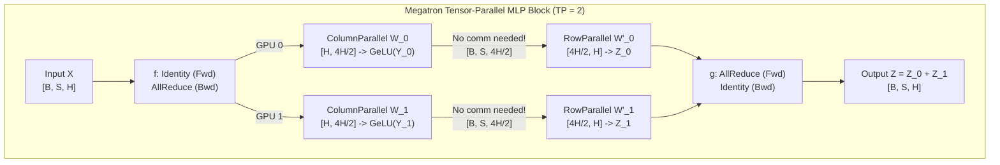
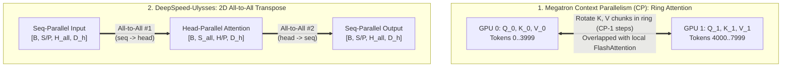
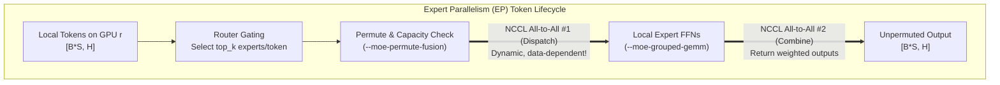
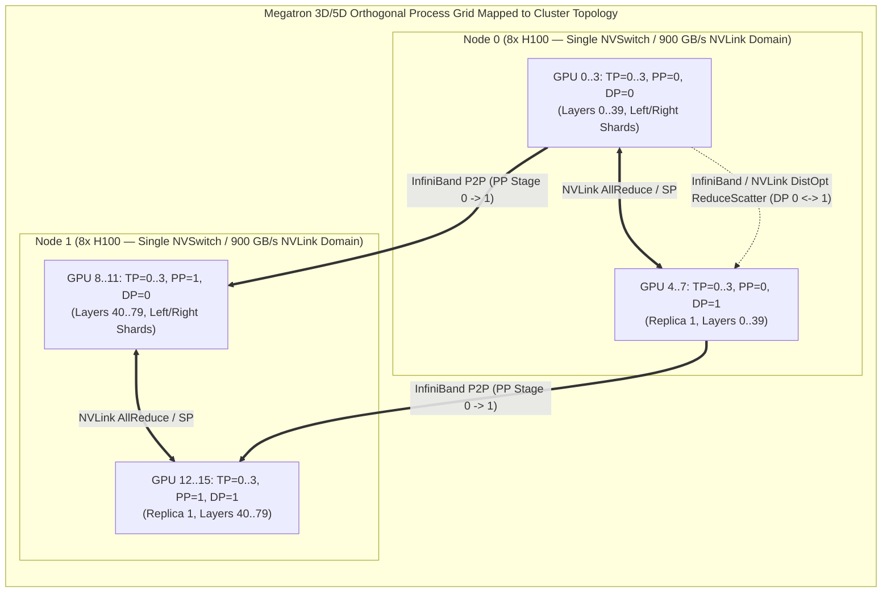
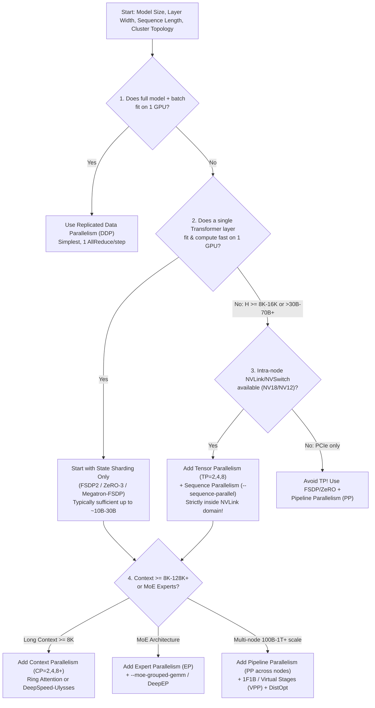

# 14.7 Tensor, pipeline and expert parallelism; Megatron

| Field | Value |
|---|---|
| Level | Advanced |
| Priority tier | 2 |
| Lab venue | Nebius GPU + Local Python Verification Lab (`code/part14/tp_pp_ep_megatron_lab.py`) |
| Part | Part 14: Distributed training and fine-tuning |
| Primary sources | *Distributed AI Systems* (`distributed-ai-systems`, Ch. 2 & Ch. 5); NVIDIA Zero-to-Hero Volume 13 (`chapter-06-tensor-pipeline-and-expert-parallelism.md`, `chapter-07-megatron-lm-architecture.md`, `chapter-01-why-distributed-training-exists.md`, `chapter-08-nccl-collectives-and-communication-paths.md`, `chapter-12-volume-13-summary.md`, `index.md`, `labs/lab-01..04`); *AI Systems Performance Engineering* (`ai-systems-performance-engineering`, Ch. 1 & Ch. 13) |
| Coverage file | `planning/coverage/chapters/14-07.md` |
| Claim & number ledger | `planning/ledgers/14-07.md` |

## Why this matters for AI infrastructure

In Chapters `14.5` and `14.6`, **Fully Sharded Data Parallel (`FSDP2`)** and **DeepSpeed `ZeRO`** solved the **state storage redundancy** problem by partitioning model parameters, gradients, and optimizer states across `N` GPUs. Yet state sharding still assumes that once a single layer's parameters are reconstructed via `AllGather`, **a single GPU can hold and execute that layer's forward and backward computation**. For frontier models (`100B` to `1T+` parameters, `32K–128K+` context windows, or `64–256` Mixture-of-Experts sub-networks), that assumption fails on four physical fronts:

1. **Single-layer matrix dimensions exceed single-GPU efficiency:** In a `7B` model (`hidden_size = 4096`, `ffn_hidden_size = 16384`), one MLP projection matrix holds `4096 x 16384 = 67,108,864` parameters (`~134 MB` in `FP16`, or `~270M` parameters / `~500 MB` across paired projections). In a `175B` `GPT-3` model (`hidden_size = 12288`, `ffn_hidden_size = 49152`), a single MLP matrix holds `12288 x 49152 = 603,979,776` parameters (`> 600M` parameters, **`~1.2 GB`** in `FP16`/`BF16`), and a `16384 x 16384` attention projection holds `268,435,456` parameters (`~537 MB`). A `1-trillion-parameter` (`1T`) model requires **`12 TB`** of mixed-precision state at `12 bytes/param` (`9.4x` more than `16 x 80 GB` `H100`s = `1.28 TB` aggregate `HBM`), and a `100T` model requires `200 TB` of `FP16` weights alone (`~1,110` `B200` `180 GB` GPUs or `~695` `B300` `288 GB` GPUs across `125` or `86` `8`-GPU nodes, with `C ~ 6ND = 1.74 x 10^28 FLOPs` on `29T` tokens).
2. **Per-layer `ZeRO-3` / `FSDP` `AllGather` saturates inter-node fabrics:** Even though `175B` state (`175B x 16 bytes = 2,800 GB`) sharded across `1024` `H100` GPUs is only `2.7 GB/GPU` (`2,800 / 1024`), running `AllGather` across hundreds of nodes on every layer's forward and backward pass stalls on inter-node InfiniBand latency (`~2.2 s` for a `28 GB` collective across `512` GPUs at `25 GB/s` with `512` ring hops vs `9` tree hops, compared to `~54 ms` for `49 GB` over `8`-GPU `900 GB/s` `NVLink`).
3. **Long-context activations explode `HBM`:** At `32K–128K` sequence lengths (`32` layers, `hidden_size = 4096`), intermediate activations exceed **`40–52 GB` per GPU**, overwhelming `HBM` even when weights are sharded.
4. **Compute time on a single device is intractable:** A single `GPT-3` `175B` training step at `batch_size = 2048` and `seq_len = 2048` requires `2 x 175B x 2048 x 2048 ~ 1.46 x 10^18 FLOPs` (or `~6ND` across forward + backward), taking **`4,679 seconds` (`~78 minutes`)** on one `312 TFLOPS` `A100` versus **`~37 seconds`** across `128` GPUs.

**Megatron-LM** and **Megatron Core** solve these walls by introducing **computation sharding (model parallelism)** as an orthogonal second axis alongside state/data sharding:
- **Tensor Parallelism (`TP`)** splits individual matrix multiplications inside each layer (`ColumnParallelLinear` + `RowParallelLinear`) across fast intra-node **`NVLink`** (`900 GB/s` on `H100`, `1.8 TB/s` per GPU / `130 TB/s` rack-wide across `72` GPUs on `GB200`/`GB300` `NVL72`).
- **Sequence Parallelism (`SP`)** and **Context Parallelism (`CP` Ring Attention / `DeepSpeed-Ulysses`)** partition activations and attention `KV` tensors along the token sequence dimension.
- **Pipeline Parallelism (`PP`)** partitions layers by depth across nodes over InfiniBand/RoCEv2 point-to-point (`P2P`) links using **`1F1B`**, **Interleaved `1F1B` (Virtual Pipeline Parallelism)**, or **DeepSeek `DualPipe`** schedules.
- **Expert Parallelism (`EP`)** distributes Mixture-of-Experts (`MoE`) sub-networks across GPUs via **`All-to-All`** token dispatch and combine.

## Prerequisites and outcomes

### Prerequisites
- Training memory anatomy (`7B` `FP32` = `28 GB` weights + `28 GB` grads + `56 GB` `Adam` + `60–80 GB` activations + `5–10 GB` buffers = `180–190 GB`; `70B` `FP16` = `140 GB` weights + `140 GB` grads + `840 GB` `FP32` master/momentum/variance = `1,120 GB` / `> 1.2 TB` with activations; `175B` `FP32` weights = `700 GB` = `8.75x` an `80 GB` GPU) from Chapters `14.1`–`14.3`.
- `NCCL` collectives (`AllReduce`, `AllGather`, `ReduceScatter`, `All-to-All`), ring vs tree latency (`2 * (N - 1)/N * M`), and `algbw` vs `busbw` from Chapters `12.15`–`12.17` and `14.4`.
- `FSDP1`/`FSDP2` (`fully_shard`, `DTensor` `Shard(0)`, `HSDP`) and `DeepSpeed` `ZeRO-1/2/3`, `ZeRO-Offload`, `ZeRO-Infinity`, and `ZeRO++` (`qwZ`, `hpZ`, `qgZ`) from Chapters `14.5` and `14.6`.

### Outcomes
After completing this chapter, you will be able to:
1. Classify any distributed strategy using the **three-question parallelism taxonomy** (computation sharding vs state sharding vs data sharding) and explain why **`FSDP2` cannot replace Megatron**.
2. Derive Megatron **Tensor Parallelism (`TP`)** (`ColumnParallelLinear` followed by `RowParallelLinear` in MLP and Multi-Head Attention), calculate why cross-node `TP` degrades throughput by **`16.7x`** (`1.2 tok/s` vs `20 tok/s`, `36x` slower per `AllReduce` over `25 GB/s` InfiniBand vs `900 GB/s` `NVLink`), and prove how **Sequence Parallelism (`SP`)** cuts non-TP activation memory by `1 / TP` with zero extra collective bytes.
3. Calculate **Pipeline Parallelism (`PP`)** bubble fractions `(PP - 1) / (m + PP - 1)` and `(PP - 1) / (m * v)` across **`GPipe`**, **`1F1B`** (`PP` vs `m` in-flight activation memory), **Interleaved `1F1B`** (`v` virtual stages), and **`DualPipe`**, and eliminate stage-0/stage-15 vocabulary embedding stragglers (`1.2 GB` table causing `~40%` slowdown).
4. Compare **Context Parallelism (`CP` Ring Attention)** against **DeepSpeed-Ulysses (`2D` `All-to-All` transpose)** for `8K–128K+` contexts, and model **Expert Parallelism (`EP`)** `All-to-All` token routing, **Capacity Factor (`CF`)**, grouped GEMM (`--moe-grouped-gemm`), and **`DeepEP`** for `Mixtral 8x7B` and `DeepSeek-V3` (`~671B–680B` total, `37B` active, `9` active experts/token).
5. Architect and validate **3D/4D/5D Hybrid Parallelism** (`DP * TP * PP * CP = WorldSize`) using **Megatron Core**, **Megatron-FSDP** (`15–25%` throughput and `23%` memory savings over `FSDP2`), **Distributed Optimizer** (`6 + 12 / d` bytes/param in `BF16`/`FP32`), and **FP8 Transformer Engine** (`hybrid` `E4M3`/`E5M2`).

---

## 1. State Sharding vs. Computation Sharding: Why FSDP2 Cannot Replace Megatron

### 1.1 The Three Questions for Parallelism Classification

Before combining parallelism dimensions, infrastructure engineers need a rigorous taxonomy separating **data parallelism**, **state sharding**, and **computation sharding (model parallelism)**. As formalized in *Distributed AI Systems* (Chapters 2 and 5), every distributed technique is classified by three questions:
1. **Does it split computation?** Is the mathematical forward/backward execution of a single layer or model divided across devices, or only the storage of model state (parameters, gradients, optimizer buffers)?
2. **Must a single sample cross devices?** Does computing the forward pass of *one input sample* require multiple GPUs to collaborate, or can each GPU evaluate a complete sample independently once weights are present?
3. **Does it introduce new device-to-device collaboration?** Does it require collective or point-to-point coordination across ranks?

| Parallelism Strategy | Category | Sub-Category / What Is Sharded | Phase | Answers to Q1 / Q2 / Q3 | Primary Communication Collective | Representative Systems |
|---|---|---|---|---|---|---|
| **Data Parallel (`DDP`)** | Data | Replicated model, sharded batch | Training | No / No / Yes | `AllReduce` (once per step, bucketed) | PyTorch `DDP`, Horovod |
| **`FSDP` / `FSDP2` (`fully_shard`)** | State | Full state sharding (weights, grads, opt) | Training | No / No / Yes | `AllGather` (fwd/bwd) + `ReduceScatter` (bwd) | PyTorch `FSDP2` (`DTensor`), `SimpleFSDP` |
| **`ZeRO-1` / Distributed Optimizer** | State | Optimizer state sharding (`1 / d`) | Training | No / No / Yes | `ReduceScatter` (grads) + `AllGather` (weights) | DeepSpeed `ZeRO-1`, Megatron DistOpt |
| **`ZeRO-2` (`SHARD_GRAD_OP`)** | State | Optimizer + gradient sharding | Training | No / No / Yes | `AllGather` (fwd) + `ReduceScatter` (bwd) | DeepSpeed `ZeRO-2`, PyTorch `FSDP` |
| **`ZeRO-3` (`FULL_SHARD`)** | State | Parameter + grad + optimizer sharding | Training | No / No / Yes | `2x AllGather` + `1x ReduceScatter` (`3 * Psi`) | DeepSpeed `ZeRO-3`, `Megatron-FSDP` |
| **Tensor Parallelism (`TP`)** | Computation | Intra-layer width (hidden / head split) | Train / Infer | **Yes / Yes / Yes** | `AllReduce` (or `AllGather` + `ReduceScatter` w/ `SP`) every layer | `Megatron-LM`, `Megatron Core`, `vLLM`, `TRT-LLM` |
| **Sequence Parallelism (`SP`)** | Computation | Sequence dimension for `LayerNorm`/Dropout | Training | **Yes / Yes / Yes** | `AllGather` (fwd) + `ReduceScatter` (fwd) paired with `TP` | `Megatron Core` (`--sequence-parallel`) |
| **Context Parallelism (`CP`)** | Computation | Full sequence & attention `KV` split | Train / Infer | **Yes / Yes / Yes** | Ring `P2P` (`Ring Attention`) or `All-to-All` (`Ulysses`) | `Megatron Core` (`--context-parallel-size`), `vLLM` |
| **Pipeline Parallelism (`PP`)** | Computation | Inter-layer depth (contiguous/virtual stages) | Train / Infer | **Yes / Yes / Yes** | `P2P` `send`/`recv` of boundary activations (`InfiniBand`) | `Megatron Core` (`1F1B`, `VPP`), `GPipe`, `DualPipe` |
| **Expert Parallelism (`EP`)** | Computation | Sparse conditional `MoE` expert sub-networks | Train / Infer | **Yes / Yes / Yes** | `All-to-All` token dispatch & combine (`DeepEP`) | `Megatron Core`, `DeepSpeed-MoE`, `DeepSeek-V3` |
| **Operator / `SPMD` Parallelism** | Computation | Generic compiler op-level tensor sharding | Train / Infer | **Yes / Yes / Yes** | Compiler-scheduled collectives | `XLA GSPMD`, `JAX jit`, PyTorch `DTensor` / `AutoParallel` |

### 1.2 Why FSDP2 Cannot Replace Megatron: The Single-Layer Compute & Activation Wall

A common misconception is that `FSDP2` (`fully_shard`) and `Megatron Core` are competing frameworks where you pick one or the other. In reality, **state sharding (`FSDP2`/`ZeRO-3`) and computation sharding (`Megatron`) operate on orthogonal axes**:
- **`FSDP2` shards where parameters live at rest**, but when GPU `0` executes Layer `5`, it must `AllGather` **100% of Layer `5`'s weight matrix** into local `HBM` and execute the full matrix multiplication on its local micro-batch.
- **`Megatron` shards how the layer itself computes**: no single GPU ever holds or multiplies the full layer weight matrix, and no single GPU stores the full unsharded activations.

```text
Why State Sharding Hits a Wall on Frontier Layers (DAI Ch. 5 & V13 Ch. 7):
  1. 7B Model MLP Layer (4096 x 16384):
     - Single matrix: 67,108,864 params (~134 MB FP16; ~270M params / ~500 MB per paired block)
     - Fits easily in one GPU's HBM and L2/Tensor Core pipeline -> FSDP2 / ZeRO-3 alone is sufficient.

  2. 175B GPT-3 MLP Layer (hidden_size = 12288, ffn_hidden_size = 49152):
     - Single MLP weight matrix: 12,288 x 49,152 = 603,979,776 params (> 600M params = ~1.2 GB in FP16/BF16)
     - Or a 16K x 16K (16,384 x 16,384 = 268,435,456 params) attention projection:
       * Under FSDP2 on 8 GPUs: every GPU must AllGather the full 16K x 16K matrix and multiply it locally.
       * Under Megatron TP=8: each GPU permanently holds and multiplies only a 16K x 2K (16,384 x 2,048) slice!

  3. 175B GPT-3 State vs. Network Diameter on 1024 H100 GPUs (V13 Ch. 7 Worked Example):
     - Total mixed-precision Adam state (16 bytes/param): 175B x 16 B = 2,800 GB
     - Pure ZeRO-3 / FSDP across 1024 GPUs: 2,800 GB / 1024 = 2.7 GB/GPU for state alone.
     - Why pure ZeRO-3 still fails at 1024 GPUs: 2.7 GB/GPU is tiny, but ZeRO-3 must run cross-node
       AllGather across 1024 GPUs on EVERY forward and backward layer (96 layers x 2 = 192 global AllGathers/step),
       turning inter-node InfiniBand latency into an insurmountable bottleneck.
```

---

## 2. Tensor Parallelism (`TP`), Sequence Parallelism (`SP`), and Context Parallelism (`CP`)

### 2.1 Megatron Tensor Parallelism: Pairing `ColumnParallelLinear` and `RowParallelLinear`

Introduced by Shoeybi et al. (2019) in *Megatron-LM: Training Multi-Billion Parameter Language Models Using Model Parallelism* (which first demonstrated an `8.3B`-parameter Transformer), **Tensor Parallelism (`TP`)** splits the weight matrices inside each Transformer layer so that `TP` GPUs compute a single matrix multiplication collaboratively.

The architectural genius of Megatron `TP` is **how it pairs a column-wise split (`ColumnParallelLinear`) on the first projection with a row-wise split (`RowParallelLinear`) on the second projection** so that an entire two-layer `MLP` block (or Multi-Head Attention block) requires **only one `AllReduce` in the forward pass and one `AllReduce` in the backward pass**—with **zero communication around the non-linear activation (`GeLU` / `SwiGLU`) or attention head computation**:



Let us trace the exact linear algebra for `TP = 2` (readily generalized to `TP = 8`):
1. **First MLP Layer (`ColumnParallelLinear`):** Given input `X` of shape `[B, S, H]` replicated on both GPUs, we split weight matrix `W` of shape `[H, 4H]` **column-wise** into `W = [W_0 | W_1]`, where each shard `W_i` has shape `[H, 4H / TP]`.
   - GPU `0` computes `Y_0 = GeLU(X * W_0)` of shape `[B, S, 4H / TP]`.
   - GPU `1` computes `Y_1 = GeLU(X * W_1)` of shape `[B, S, 4H / TP]`.
   - Because `GeLU` (or `SwiGLU`) is an element-wise non-linearity along the feature dimension, `GeLU([X * W_0 | X * W_1]) = [GeLU(X * W_0) | GeLU(X * W_1)]`. **Zero communication is required between the first and second linear layers!** (If both layers had been split column-wise, an `AllGather` would be required before `GeLU` or the second GEMM, doubling communication per block.)
2. **Second MLP Layer (`RowParallelLinear`):** We split the second weight matrix `W'` of shape `[4H, H]` **row-wise** (stacked vertically):
   ```text
   W' = [ W'_0 ]   where each W'_i has shape [4H / TP, H]
        [ W'_1 ]
   ```
   - GPU `0` multiplies its local slice `Y_0` (`[B, S, 4H / TP]`) by `W'_0` (`[4H / TP, H]`) to produce partial sum `Z_0 = Y_0 * W'_0` of full output shape `[B, S, H]`.
   - GPU `1` computes partial sum `Z_1 = Y_1 * W'_1` of shape `[B, S, H]`.
   - By block matrix multiplication, the exact output is the sum of the partial matrices: `Z = Z_0 + Z_1`. A single **`AllReduce` (`SUM`)** across the `TP` group sums `Z_0 + Z_1` on every rank before the residual connection and `LayerNorm`.
3. **Multi-Head Attention (`MHA` / `GQA`) Block:** The exact same column-then-row pattern applies to self-attention:
   - The `Q`, `K`, `V` projections (`W_Q`, `W_K`, `W_V`) use **`ColumnParallelLinear`**, partitioning the `num_attention_heads` (`96` heads in `GPT-3` `175B` -> `96 / 8 = 12` heads per GPU at `TP = 8`) across the `TP` ranks. With Grouped-Query Attention (`GQA`, e.g., `32` query heads and `8` query groups in `Llama-3 8B`), `num_query_groups` must be divisible by `TP`.
   - Softmax attention runs completely independently on each GPU's local heads with **zero communication**.
   - The output projection `W_O` uses **`RowParallelLinear`**, followed by **one `AllReduce`** to sum across heads.
4. **Total Collectives per Transformer Layer:** Each Transformer layer executes **`2` `AllReduce` collectives in the forward pass** (`g` operator: `1` after Attention + `1` after MLP) and **`2` `AllReduce` collectives in the backward pass** (`f` conjugate operator: `1` before Attention + `1` before MLP) = **`4` `AllReduce` collectives per layer per training step**. For a `120`-layer Transformer, that is `240` forward `AllReduce`s (`480` total forward + backward collectives, or `~500` collectives per step including embeddings/loss).

### 2.2 Why TP Must Stay Inside the NVLink Domain: Cross-Node Failure Math

Because `TP` sits on the **critical path of every single layer**, the next layer cannot begin until the current layer's `AllReduce` completes (unless overlapped via `--tp-comm-overlap` / `AsyncTP`). As demonstrated in Volume 13 Chapter 6, stretching a `TP` group across node boundaries over InfiniBand destroys throughput:

```text
Cross-Node TP=32 Misconfiguration vs. Intra-Node TP=8 + PP=4 (Volume 13 Ch. 6):
  Cluster: 2 nodes x 16 GPUs/node = 32 GPUs total (or 4 x 8-GPU NVLink domains)
  Model:   120-layer Transformer, 219 MB activation/gradient collective shard per AllReduce
  Links:   Intra-node NVLink = 900 GB/s (< 1 us latency)
           Inter-node InfiniBand = 200 Gbps (~25 GB/s effective, 2-5 us latency)

  Per-AllReduce Transfer Time (219 MB):
    - On NVLink (900 GB/s):     219 MB / 900 GB/s = 0.243 ms (~0.25 ms)
    - On InfiniBand (25 GB/s):  219 MB /  25 GB/s = 8.760 ms (~9.0 ms)  --> 36x slower per collective!

  Cumulative Overhead Across 120 Layers (240 AllReduces):
    - Intra-node NVLink (TP=8): 240 x 0.25 ms =   60 ms overhead per pass
    - Cross-node IB (TP=32):    240 x 9.00 ms = 2160 ms (> 2.1 seconds wasted per pass!)
    - Extreme multi-hop IB case (32 layers x 2-5 s/layer): 64-160 s communication vs 12 s compute (5-13x overhead)

  Observed Cluster Symptom (TP=32 across nodes):
    - Node 0 (GPUs 0-15): 85-90% utilization; Node 1 (GPUs 16-31): 8-12% utilization (stalled waiting)
    - Throughput collapses from 20 tokens/sec (expected) to 1.2 tokens/sec (16.7x slowdown!)
    - Fix (--tensor-model-parallel-size 8 --pipeline-model-parallel-size 4): restores 18 tokens/sec (15x speedup).
```

:::warning Hardware Rule of Thumb for Tensor Parallelism
Never set `--tensor-model-parallel-size` larger than the number of GPUs in a single **all-to-all `NVSwitch`/`NVLink` domain**:
- On standard `8`-GPU `DGX`/`HGX` `A100`, `H100`, `H200`, or `B200` nodes (`nvidia-smi topo -m` showing `NV18`, `NV12`, or `NV4` across all `8` GPUs), keep **`TP <= 8`** (`TP in [1, 2, 4, 8]`).
- On rack-scale **NVIDIA `GB200` / `GB300` `NVL72`** systems (`36` Grace CPUs + `72` Blackwell GPUs connected via `NVLink 5` at `1.8 TB/s` per GPU / `130 TB/s` aggregate across the rack), the `NVLink` domain spans `72` GPUs, allowing larger `TP` or `EP` groups within the rack.
- If `nvidia-smi topo -m` shows `PIX`, `PXB`, or `SYS` (`PCIe Gen4/5` at `16–64 GB/s` instead of `NVLink`), **do not use `TP`**—use `FSDP`/`ZeRO` + `PP` instead.
:::

### 2.3 Sequence Parallelism (`SP`): Sharding LayerNorm and Dropout Without Extra Bandwidth

In standard `TP`, the `MLP` and `Attention` blocks are partitioned across the `TP` ranks, but the operations *between* them—**`LayerNorm` (`RMSNorm`), `Dropout`, and residual additions**—operate on the full replicated `[B, S, H]` activation tensor on every rank in the `TP` group. At long sequence lengths (`S = 8192` to `32768`), those duplicated non-`TP` activations consume tens of gigabytes of `HBM`.

Introduced by Korthikanti et al. (2023) in *Reducing Activation Recomputation in Large Transformer Models*, **Sequence Parallelism (`SP`, `--sequence-parallel`)** eliminates this duplication by noticing a fundamental identity of `NCCL` collectives:

```text
Mathematical Identity Underlying Sequence Parallelism (SP):
  AllReduce(Z)  ===  ReduceScatter(Z, dim=sequence)  followed by  AllGather(Z_shard, dim=sequence)

  Collective Volume Comparison (Activation tensor of size M = B * S * H * bytes across TP ranks):
    - Standard TP (1 AllReduce):              2 x ((TP - 1) / TP) x M bytes
    - SP (1 ReduceScatter + 1 AllGather):     1 x ((TP - 1) / TP) x M  +  1 x ((TP - 1) / TP) x M
                                            = 2 x ((TP - 1) / TP) x M bytes  (IDENTICAL network traffic!)
```

How `SP` works inside each Transformer layer:
1. Instead of ending `RowParallelLinear` with an `AllReduce` that leaves `[B, S, H]` replicated on all `TP` GPUs, `SP` executes a **`ReduceScatter` along the sequence dimension**, leaving each GPU with a disjoint sequence slice of shape **`[B, S / TP, H]`** (for `S = 2048` and `TP = 8`, each GPU holds `256` tokens).
2. **`Dropout`, residual addition, and `LayerNorm` (`RMSNorm`)** execute locally on `[B, S / TP, H]` with **zero communication** because `LayerNorm` normalizes across the hidden dimension `H` independently for each token position! This cuts non-`TP` activation memory and compute by a factor of **`1 / TP`** (`8x` reduction at `TP = 8`).
3. Before the next `ColumnParallelLinear` (`Attention` or `MLP`), `SP` executes an **`AllGather` along the sequence dimension** to reconstruct `[B, S, H]` just in time for the column-parallel GEMM.

Combined with **selective activation recomputation** (recomputing only cheap, high-memory attention `softmax` and `dropout` intermediates while keeping expensive GEMM outputs resident), `SP` + selective recomputation recovers **`70–80%`** of full activation checkpointing's memory savings at a small fraction of full checkpointing's `30–50%` backward-pass compute penalty.

### 2.4 Context Parallelism (`CP` Ring Attention) vs. DeepSpeed-Ulysses for Long Contexts

While `SP` shards only `LayerNorm` and `Dropout` across the `TP` group (`TP <= 8`), training on `32K`, `128K`, or multi-million-token sequences requires sharding **every activation tensor and the self-attention computation itself** across the sequence dimension. Two production architectures dominate long-context sharding:



| Dimension | Megatron Context Parallelism (`CP` — Ring Attention) | DeepSpeed-Ulysses (`2D` `All-to-All` Sequence Parallelism) |
|---|---|---|
| **Core Mechanism** | Splits sequence `[B, S, H]` into `[B, S / CP, H]` across `CP` GPUs (`32K / 4 = 8K` tokens/GPU). Queries `Q_i` stay stationary; `K_j, V_j` chunks rotate around a logical ring in `CP - 1` P2P steps, accumulating blockwise online softmax scores (`FlashAttention`). | Splits sequence `[B, S / P, num_heads, head_dim]` across `P` GPUs. Before attention, runs **`All-to-All` (`seq -> head`)** to transpose into `[B, S, num_heads / P, head_dim]`, runs standard full-sequence attention on local heads, then runs **`All-to-All` (`head -> seq`)**. |
| **Softmax Bookkeeping** | Requires blockwise online softmax log-sum-exp (`lse`) accumulation across `CP` ring stages and causal load balancing (zig-zag token partitioning so rank `0` isn't purely causal-masked). | **Zero partial softmax complexity**: each GPU has the full sequence `S` for its assigned subset of heads `num_heads / P` and calls standard `FlashAttention` directly. |
| **Communication Pattern** | `CP - 1` point-to-point ring transfers of `K, V` per pass, **overlapped** with ongoing attention compute; scales cleanly with `GQA` (only `num_query_groups` `KV` heads move). | `4` `All-to-All` collectives in forward (`Q, K, V` transpose + output reverse transpose) with volume `((P - 1) / P) * M` per tensor. Cannot overlap with attention itself. |
| **Scaling Limit & Best Use Case** | **No head-count ceiling** (`CP` can scale to `16, 32, 64+` across nodes for `100K–1M+` contexts when `S >> 8K`). | **Hard ceiling `P <= num_attention_heads`** (or `num_kv_heads` without `KV` replication); fastest for moderate degrees (`P <= 8`) inside an `NVLink` domain. |

---

## 3. Pipeline Parallelism (`PP`): Micro-batching, Bubble Math, `1F1B`, Interleaved `VPP`, and `DualPipe`

### 3.1 Naive Pipeline vs. `GPipe` vs. `1F1B` (One Forward, One Backward)

When a model is too deep or large for a single `NVLink` node, **Pipeline Parallelism (`PP`)** shards the Transformer depth-wise across `PP` stages (e.g., a `32`-layer model split across `PP = 4` GPUs places Layers `1–8` on GPU `0`, Layers `9–16` on GPU `1`, Layers `17–24` on GPU `2`, and Layers `25–32` on GPU `3`; or a `96`-layer `GPT-3` `175B` split across `PP = 16` places `6` layers per stage). Unlike `TP`, `PP` only transmits a single `[B_micro, S, H]` boundary activation tensor between adjacent stages via point-to-point (`P2P`) `send`/`recv`, making it ideal for crossing inter-node InfiniBand links.

However, if a pipeline processes the entire mini-batch as one monolithic chunk, `PP - 1` stages sit idle at any instant, wasting `(PP - 1) / PP` (`75%` at `PP = 4`) of cluster compute. To fill the pipe, we split the per-DP-replica batch into **`m` micro-batches**:

```mermaid
gantt
    title Pipeline Parallelism Schedules (PP = 4 Stages, m = 8 Micro-batches)
    dateFormat X
    axisFormat %s
    section GPipe (All Fwd then All Bwd: High Memory = m activations)
    F1..F8 (Stage 0) :0, 8
    Bubble (Wait)    :crit, 8, 14
    B1..B8 (Stage 0) :14, 22
    section 1F1B (Steady-State 1 Fwd / 1 Bwd: Capped Memory = PP activations)
    Warmup F1..F4 (Stage 0) :0, 4
    Steady 1F1B (B1,F5..B4,F8) :active, 4, 12
    Cooldown B5..B8 + Bubble :12, 19
```



Let us compare the four production pipeline schedules (`GPipe`, `1F1B`, **Interleaved `1F1B` / Virtual Pipeline Parallelism (`VPP`)**, and **DeepSeek `DualPipe`**):

```text
Pipeline Bubble & In-Flight Activation Memory Equations (PP stages, m micro-batches, v virtual stages):
  1. Time-Fraction Pipeline Bubble Percentage (Volume 13 Ch. 6 & Ch. 7):
       Bubble % = (PP - 1) / (m + PP - 1)

     - PP = 4, m =  8 micro-batches:  (4 - 1) / ( 8 + 4 - 1) =  3 /  11 = 27.27% (~27% idle)
     - PP = 4, m = 16 micro-batches:  (4 - 1) / (16 + 4 - 1) =  3 /  19 = 15.79% (~16% idle)
     - PP = 4, m = 32 micro-batches:  (4 - 1) / (32 + 4 - 1) =  3 /  35 =  8.57% (~8% idle)
     - PP = 8, m = 16 micro-batches:  (8 - 1) / (16 + 8 - 1) =  7 /  23 = 30.43% (~30% idle — Bubble Starvation!)
     - PP = 8, m = 64 micro-batches:  (8 - 1) / (64 + 8 - 1) =  7 /  71 =  9.86% (~10% idle)
     - PP = 8, m = 512 (global=2048, micro=4): (8 - 1) / (512 + 8 - 1) = 7 / 519 = 1.35% (~80 ms on a 6 s step)
     - PP = 16, m = 256 (GPT-3 175B on 1024 GPUs): (16 - 1) / (256 + 16 - 1) = 15 / 271 = 5.54% (~5.5% bubble)

  2. Bubble-to-Useful Compute Ratio (Narayanan et al., SC'21 & DAI Ch. 5):
     - Standard GPipe / 1F1B (v = 1):        Bubble Ratio = (PP - 1) / m
     - Interleaved 1F1B (v virtual stages):  Bubble Ratio = (PP - 1) / (m * v)
       --> Reduces pipeline bubble by a factor of v, at the cost of v times more P2P cross-stage transfers!

  3. Peak In-Flight Stored Micro-Batch Activations on Stage 0:
     - GPipe (all m forwards before any backward):  Stores all m micro-batches  (e.g., m = 256 micro-batches)
     - 1F1B (starts backward as soon as MB1 finishes Stage PP-1): Caps in-flight micro-batches at min(m, PP)
       (e.g., at PP = 16, m = 256, 1F1B stores at most 16 micro-batches vs GPipe's 256 -> 16x activation memory saving!)
```

### 3.2 Virtual Pipeline Parallelism (`VPP` / Interleaved `1F1B`) and Stage Imbalance ("The Ghost Straggler")

Even when `m >> PP`, standard `1F1B` suffers from two production bottlenecks that **Virtual Pipeline Parallelism (`--num-layers-per-virtual-pipeline-stage`)** and **`DualPipe`** address:
1. **Bubble Reduction via Interleaving (`VPP`):** Instead of assigning a single contiguous chunk of `16` layers to GPU `0` (`Layers 0–15`) and `16` layers to GPU `1` (`Layers 16–31`), `VPP` with `v = 2` virtual stages assigns **non-contiguous interleaved chunks**: GPU `0` hosts `Layers 0–7` (Virtual Stage `0`) and `Layers 16–23` (Virtual Stage `2`), while GPU `1` hosts `Layers 8–15` (Virtual Stage `1`) and `Layers 24–31` (Virtual Stage `3`). Because each virtual stage takes `1 / v` of the time of a full stage, the warm-up and cool-down bubbles shrink by **`1 / v`** (`(PP - 1) / (m * v)`), while `P2P` activation transfers increase by `v`.
2. **Stage Imbalance ("The Ghost Straggler", Volume 13 Ch. 7):** In a `96`-layer model split across `PP = 16` (`6` layers per stage), `nsys` profiling frequently reveals **Stage `0` and Stage `15` taking `~40%` longer per micro-batch than middle Stages `1–14`**. Why? Layer *count* is equal (`6` layers each), but Stage `0` also executes the input **vocabulary embedding table** (`50,000` vocab x `12,288` hidden x `2` bytes = **`1.2 GB`** table lookup) and Stage `15` executes the final **`lm_head` projection + cross-entropy loss** (`50,000 x 12,288` compute-bound GEMM). Because a synchronous pipeline runs at the speed of its slowest stage, this `40%` edge-stage straggler stalls all `16` stages!
   - **Fixes:** (a) Assign fewer Transformer layers to Stage `0` and Stage `15` (`5` layers on edges, `6–7` on middle stages); (b) shard the vocabulary embedding and `lm_head` across the `TP` group (`VocabParallelEmbedding`); and (c) enable `VPP` (`--num-layers-per-virtual-pipeline-stage`) to smooth uneven stage work across virtual chunks.
3. **DeepSeek `DualPipe` (Bidirectional Pipeline Overlap):** Introduced in the `DeepSeek-V3` Technical Report (*AI Systems Performance Engineering*, Ch. 1), **`DualPipe`** feeds micro-batches from **both ends of the pipeline simultaneously** (`Stage 0 -> Stage PP-1` and `Stage PP-1 -> Stage 0`) so that each GPU pairs a forward chunk and a backward chunk simultaneously, overlapping `All-to-All` / `P2P` communication completely behind GEMM computation and reducing pipeline bubbles to near zero even on bandwidth-constrained `H800` (`400 GB/s` `NVLink` vs `900 GB/s` `H100`) clusters.

---

## 4. Expert Parallelism (`EP`) and Mixture-of-Experts (`MoE`) Scaling

### 4.1 Sparse Routing, `All-to-All` Dispatch/Combine, and Capacity Factor (`CF`)

Dense Transformers activate `100%` of their parameters for every token (`C ~ 6ND`). **Mixture-of-Experts (`MoE`)** models replace each dense `FFN`/`MLP` block with `E` parallel expert sub-networks and a learned **router (gating network)** that activates only `top_k` experts per token:
- **`Mixtral 8x7B`** uses `E = 8` experts per layer and `top_k = 2` (`--num-experts 8 --moe-router-topk 2`), achieving `8`-expert capacity while executing only `2` experts' FLOPs per token.
- **`DeepSeek-V3` (`671B` / `~680B` total parameters)** uses **`1` shared expert + `8` router-selected experts out of `256` routed experts** (**`9` active experts** and only **`37B` active parameters per token**), allowing frontier training for `< $6M` in compute (vs `~$100M` for `GPT-4` and `~$191M` for `Gemini Ultra`). Similarly, Google's `1.6T` `Switch Transformer` trained `7x` faster than an equivalent dense model, and `DeepSeek-V2` (`236B`, `~472 GB` `BF16` weights) and `DeepSeek-V4-Pro` (`1.6T`, `~3,200 GB` `BF16` weights) follow the same sparse scaling law.

With **Expert Parallelism (`EP`, `--expert-model-parallel-size`)**, the `E` experts are partitioned across `EP` GPUs (`E / EP` local experts per GPU; e.g., `128` experts across `16` GPUs = `8` experts/GPU, or `8` experts across `EP = 8` = `1` expert/GPU):



Why is `EP` communication (`All-to-All`) fundamentally harder to optimize than `TP`/`DDP` (`AllReduce`)?
1. **Data-Dependent, Asymmetric Message Sizes:** In `AllReduce`, every GPU sends and receives the exact same predictable byte count (`2 * (N - 1)/N * M`). In `MoE` `All-to-All`, the number of tokens sent from GPU `i` to GPU `j` depends dynamically on the **router's data-dependent assignments** in that specific micro-batch.
2. **Router Collapse and the Hot-Expert Straggler:** If the router sends **`80%` of all tokens to Expert `0` on GPU `0` and only `2%` to Expert `7` on GPU `7`**, GPU `0` becomes a severe compute and network bottleneck while GPUs `1–7` sit at `40–50%` utilization waiting at the synchronous `All-to-All` barrier (Volume 13 Ch. 8 Scenario 3: `25%` of expected throughput with uniformly low `40–50%` `nvidia-smi` utilization).
3. **Capacity Factor (`CF`) and Load Balancing Strategies:** To bound memory and step time, frameworks enforce an **Expert Capacity** ceiling:
   ```text
   Uniform Expected Tokens per Expert = (Total_Tokens_in_EP_Group x top_k) / E
   Max Expert Capacity (Tokens)       = ceil(CF x (Total_Tokens_in_EP_Group x top_k) / E)
   ```
   For `Mixtral 8x7B` (`E = 8`, `EP = 8`, `top_k = 2`, `B = 2`, `S = 4096` -> `8,192` tokens/GPU, `16,384` dispatched tokens/GPU), uniform load is `16,384` tokens/expert; at `CF = 1.25`, each expert accepts at most **`20,480` tokens** (dropping or residual-passing overflow tokens). Megatron Core prevents collapse using:
   - **`--moe-router-load-balancing-type aux_loss`:** Adds an auxiliary load-balancing penalty to the training loss.
   - **Sinkhorn routing** or **aux-loss-free bias updates** (plus DeepSeek's **Expert Parallelism Load Balancer (`EPLB`)**, which dynamically replicates heavily loaded experts).
4. **Kernel and Transport Acceleration (`--moe-grouped-gemm`, `DeepEP`, Symmetric Memory):**
   - When a GPU hosts multiple experts (`E / EP > 1`), **`--moe-grouped-gemm`** fuses the separate per-expert matrix multiplications into a single grouped GEMM kernel, and **`--moe-permute-fusion`** fuses token permutation.
   - **DeepSeek `DeepEP`** provides custom low-latency GPU kernels for intra-node `NVLink` and cross-node `RDMA` `All-to-All` dispatch/combine.
   - **PyTorch Symmetric Memory (`NVSHMEM` / `triton.nvshmem.put()/get()`)** (`AISPE` Ch. 13) performs one-sided on-device `all_to_all_v` token shuffles without CPU synchronization, eliminating device-to-host (`D2H`) gaps so the entire `MoE` `All-to-All` can be captured inside a **CUDA Graph**.

---

## 5. Megatron Core Architecture, Hybrid 5D Parallelism, and FP8 Optimization

### 5.1 Orthogonal Process Groups and the Two-Axis View

In production, **Megatron Core (`megatron.core`)** orchestrates **state sharding** and **computation sharding** simultaneously across a multi-dimensional process grid (`megatron.core.parallel_state`). Every rank belongs to orthogonal process groups (`TP`, `PP`, `CP`, `EP`, and `DP`) satisfying the fundamental world-size invariant:

```text
Megatron Multi-Dimensional World-Size Invariant:
  WorldSize = DP x TP x PP x CP      (for dense layers; MoE layers replace or combine TP/DP with EP)

  Rank Coordinate Mapping (for 3D grid with WorldSize = DP * TP * PP, e.g., WorldSize = 8, DP = 2, TP = 2, PP = 2):
    - In DAI Ch. 5's exercise indexing:
        dp_rank = rank // (tp * pp)
        tp_rank = (rank // pp) % tp
        pp_rank = rank % pp
    - In Megatron's hardware-aligned default order (TP innermost inside the NVLink node):
        tp_rank = rank % tp
        pp_rank = (rank // tp) % pp
        dp_rank = rank // (tp * pp)
      For WorldSize = 8 (DP = 2, PP = 2, TP = 2):
        * Rank 0 belongs to TP group [0, 1] (NVLink), PP group [0, 2] (P2P), and DP group [0, 4] (AllReduce/ReduceScatter).
```



### 5.2 Worked Sizing Examples: `70B`, `175B` (`GPT-3`), and `1T` Hybrid Configurations

Let us walk through four canonical multi-node sizing derivations from *Distributed AI Systems* (Ch. 5) and Volume 13 (Ch. 6 & Ch. 7):

1. **`70B` Dense Model on `8` GPUs (`ZeRO` State Sharding Baseline, `DAI` Ch. 5 Concrete Memory Example):**
   - In `FP16`/`BF16` with `FP32` `Adam` master weights, momentum, and variance (`12 B/param` optimizer), `70B` requires `140 GB` parameters + `140 GB` gradients + `840 GB` optimizer states = **`1,120 GB` (`> 1 TB`) total** (`840 GB` without `FP32` master weights).
   - On `8` GPUs: `DDP` stores all `1,120 GB`/GPU (impossible); `ZeRO-1` shards optimizer states to `140 + 140 + (840 / 8) = 385 GB`/GPU (`350 GB` without master copy); `ZeRO-3` shards all three to **`140 GB`/GPU** (`105 GB` without master copy).
2. **`70B` Hybrid `3D + FSDP` Configuration on `64` GPUs (`8` Nodes x `8` GPUs/Node, `DAI` Ch. 5):**
   - `hidden_size = 8192`, `80` layers. We set **`TP = 4`** inside each node's `NVLink` domain to split the `8192`-wide matrices, **`PP = 2`** across node pairs (`40` layers per stage over InfiniBand), and **`DP = 64 / (4 x 2) = 8`** data-parallel replicas with `FSDP` / Distributed Optimizer sharding optimizer states `8`-way (`4 x 2 x 8 = 64` GPUs). Each GPU stores `1 / 8` of the optimizer state, computes `1 / 4` of each layer, and holds `1 / 2` of the depth.
3. **`GPT-3` `175B` (`96` Layers, `H = 12288`) on `1024` `H100` GPUs (`128` Nodes x `8` GPUs/Node, Volume 13 Ch. 7 Worked Example):**
   - **Step 1 (State Floor):** `175B x 16 bytes = 2,800 GB` (`2.7 GB/GPU` across `1024` GPUs), but pure `ZeRO-3` stalls on cross-node `AllGather`.
   - **Step 2 (`3D` Grid):** Set **`TP = 8`** (one full `8`-GPU `NVLink` node), **`PP = 16`** (`96 / 16 = 6` Transformer layers per stage), and **`DP = 1024 / (8 x 16) = 8`** (`8 x 16 x 8 = 1024` GPUs). (On `128` GPUs / `16` nodes, `TP = 8, PP = 16` gives `DP = 128 / 128 = 1`.)
   - **Step 3 (Per-GPU Weight & State Footprint):** Each GPU holds `175B / (8 x 16) = 1.367B` (`~1.37B`) parameters. Even *without* sharding across `DP` (`16 bytes/param`), `1.37B x 16 bytes` = **`21.875 GB` (`~22 GB`)** per GPU—fitting comfortably inside an `80 GB` `H100` alongside activations!
   - **Step 4 (Pipeline Bubble):** With `global_batch_size = 2048` and `micro_batch_size = 1`, each of the `8` `DP` groups processes `2048 / 8 = 256` micro-batches (`m = 256`), yielding a pipeline bubble of `(16 - 1) / (256 + 16 - 1) = 15 / 271` = **`5.54%` (`~5.5%`)**.
4. **`1-Trillion-Parameter` (`1T`) Model on `1024` GPUs (`16` Nodes x `64` GPUs/Node, Volume 13 Ch. 6):**
   - Set **`TP = 8`** (intra-node `NVLink`), **`PP = 4`** (cross-node pipeline stages), and **`DP = 1024 / (8 x 4) = 32`** (`8 x 4 x 32 = 1024` GPUs).

### 5.3 Megatron Distributed Optimizer, Megatron-FSDP, and FP8 Transformer Engine

To eliminate redundant optimizer state across the `DP` dimension without external DeepSpeed `ZeRO` wrappers (or integrated alternatives like `Colossal-AI` and its `Gemini` heterogeneous memory manager), Megatron Core provides three native subsystems:

1. **Megatron Distributed Optimizer (`--use-distributed-optimizer`):** Shards `FP32` master weights and `Adam` momentum/variance buffers across the `d = DP` data-parallel ranks (`ReduceScatter` gradients during backward via `--overlap-grad-reduce`, update `1 / d` of the optimizer state locally, and `AllGather` updated parameters via `--overlap-param-gather`):

| Precision Configuration | Memory per Parameter Without Distributed Optimizer | Memory per Parameter With Distributed Optimizer (`d` DP GPUs) | Concrete Value at `d = 8` DP Ranks |
|---|---|---|---|
| **`fp16` params, `fp16` grads** | **`20` bytes/param** (`2B` param + `2B` grad + `16B` `FP32` opt) | **`4 + 16 / d` bytes/param** | **`6.0` bytes/param** (`3.33x` reduction) |
| **`bf16` params, `fp32` grads** | **`18` bytes/param** (`2B` param + `4B` grad + `12B` `FP32` master/mom/var) | **`6 + 12 / d` bytes/param** | **`7.5` bytes/param** (**`2.4x` reduction**) |
| **`fp32` params, `fp32` grads** | **`16` bytes/param** (`4B` param + `4B` grad + `8B` `FP32` mom/var) | **`8 + 8 / d` bytes/param** | **`9.0` bytes/param** (`1.78x` reduction) |

2. **`Megatron-FSDP` (`--use-megatron-fsdp --data-parallel-sharding-strategy optim_grads_params`):** NVIDIA's `TP`/`CP`/`EP`-aware `ZeRO-3` implementation in Megatron Core. By coordinating parameter bucketing with `TP` and using **`NCCL` userbuffers (`ncclMemAlloc`)** to minimize GPU Streaming Multiprocessor (`SM`) usage during collectives, `Megatron-FSDP` delivers **`15–25%` higher training throughput** and **`~23%` lower memory consumption** than general-purpose PyTorch `FSDP2` (while PyTorch's `DTensor`-based `SimpleFSDP` + `torch.compile` in `TorchTitan` achieves up to `28%` memory reduction and `69%` throughput gain over eager `FSDP2`, and `AsyncTP` overlaps `TP` collectives with `SM`-wave GEMMs).
3. **FP8 Training with NVIDIA Transformer Engine (`--fp8-format hybrid`):** On Hopper (`H100`/`H200`), Ada (`RTX 4090`), and Blackwell (`B200`/`GB200`, which also adds `FP4` microscaling and achieves up to `2.6x` per-GPU training and `3.4x` per-GPU inference throughput over Hopper in `MLPerf v5.0`), `FP8` halves memory bandwidth and doubles Tensor Core throughput (`1.5–2x` end-to-end GEMM speedup over `BF16`, up to `6x` vs `A100`).
   - **`hybrid` FP8 format:** Uses **`E4M3`** (`4` exponent bits, `3` mantissa bits — higher precision) for forward-pass weights and activations, and **`E5M2`** (`5` exponent bits, `2` mantissa bits — wider dynamic range) for backward-pass gradients.
   - **Delayed dynamic scaling (`amax`):** Tracks the maximum absolute tensor values over a sliding window (`--fp8-amax-history-len 1024 --fp8-amax-compute-algo max`) and enables **`--fp8-param-gather`** to `AllGather` parameters in `1`-byte `FP8` instead of `2`-byte `BF16` (cutting `AllGather` volume by `2x`, analogous to `ZeRO++` `qwZ`).

### 5.4 Decision Framework: Choosing Your Parallelism Strategy



---

## Commands and configurations that matter

### 1. Hardware Topology,Single-GPU HBM Baseline, and NCCL Collective Microbenchmarks (`DAI` Ch. 2 & `V13` Lab 02)

Before selecting `TP`, `PP`, or `EP`, verify `NVLink` connectivity (`NV18`/`NV12`/`NV4` vs `PIX`/`PXB`/`SYS`), single-GPU `HBM` copy bandwidth (`1.5–2 TB/s` on `A100`, `2–3 TB/s` on `H100`/`H200`, `1,980.45 GB/s` on a `64 MB` `200`-iteration copy test), and `AllReduce` bus bandwidth (`busbw = algbw * 2 * (N - 1) / N`):

```bash
# 1. Inspect GPU compute capability (9.0 on H100, 132 SMs), NVLink matrix, PCIe Gen/width, and IB NICs
nvidia-smi topo -m
nvidia-smi --query-gpu=name,memory.total,pcie.link.gen.max,pcie.link.width.max --format=csv
ibstat

# 2. Run standalone nccl-tests all_reduce_perf (8B to 128MB across 8 GPUs) and verify busbw plateau >= 32MB
./build/all_reduce_perf -b 8 -e 128M -f 2 -g 8

# 3. PyTorch AllReduce microbenchmark (100 MB per GPU, 50 iterations; n=2 -> 39.38 GB/s algbw = busbw)
torchrun --nproc_per_node=2 code/allreduce_microbench.py
```

### 2. Installing Megatron Core and Launching Production Pretraining Recipes (`DAI` Ch. 5)

```bash
# Install Megatron Core or launch the NGC PyTorch container with cuDNN, NCCL, and Transformer Engine
pip install --no-build-isolation megatron-core[mlm,dev] pybind11
# docker run --gpus all -it nvcr.io/nvidia/pytorch:25.04-py3
```

**Configuration A — `Llama-3 8B` Long-Context (`8K` Sequence) on `1` Node (`8 x 80 GB` `H100` GPUs: `TP = 1, PP = 1, CP = 2, DP = 4`):**

```bash
CUDA_DEVICE_MAX_CONNECTIONS=1 torchrun --nproc_per_node=8 pretrain_gpt.py \
  --use-mcore-models \
  --num-layers 32 \
  --hidden-size 4096 \
  --ffn-hidden-size 14336 \
  --num-attention-heads 32 \
  --group-query-attention \
  --num-query-groups 8 \
  --seq-length 8192 \
  --max-position-embeddings 8192 \
  --tensor-model-parallel-size 1 \
  --context-parallel-size 2 \
  --sequence-parallel \
  --fp8-format hybrid \
  --fp8-amax-history-len 1024 \
  --fp8-amax-compute-algo max \
  --fp8-param-gather \
  --use-distributed-optimizer \
  --overlap-grad-reduce \
  --overlap-param-gather \
  --micro-batch-size 1 \
  --global-batch-size 128 \
  --mock-data \
  --bf16
```

**Configuration B — `GPT-3 175B` Scale (`96` Layers, `H = 12288`) on `16` Nodes (`128` GPUs: `TP = 8, PP = 16, DP = 1`) or `128` Nodes (`1024` GPUs: `TP = 8, PP = 16, DP = 8`):**

```bash
CUDA_DEVICE_MAX_CONNECTIONS=1 torchrun --nproc_per_node=8 --nnodes=16 \
  pretrain_gpt.py \
  --use-mcore-models \
  --num-layers 96 \
  --hidden-size 12288 \
  --num-attention-heads 96 \
  --seq-length 2048 \
  --tensor-model-parallel-size 8 \
  --pipeline-model-parallel-size 16 \
  --num-layers-per-virtual-pipeline-stage 2 \
  --sequence-parallel \
  --tp-comm-overlap \
  --use-distributed-optimizer \
  --overlap-grad-reduce \
  --overlap-param-gather \
  --micro-batch-size 1 \
  --global-batch-size 1536 \
  --mock-data \
  --bf16
```

**Configuration C — `Mixtral 8x7B` `MoE` (`8` Experts, `top_k = 2`) on `8` Nodes (`64` GPUs: `EP = 8, TP = 1, PP = 4`):**

```bash
CUDA_DEVICE_MAX_CONNECTIONS=1 torchrun --nproc_per_node=8 --nnodes=8 \
  pretrain_gpt.py \
  --use-mcore-models \
  --num-layers 32 \
  --hidden-size 4096 \
  --num-experts 8 \
  --expert-model-parallel-size 8 \
  --moe-router-topk 2 \
  --moe-router-load-balancing-type aux_loss \
  --moe-grouped-gemm \
  --moe-permute-fusion \
  --tensor-model-parallel-size 1 \
  --pipeline-model-parallel-size 4 \
  --sequence-parallel \
  --use-distributed-optimizer \
  --overlap-grad-reduce \
  --overlap-param-gather \
  --micro-batch-size 1 \
  --global-batch-size 256 \
  --mock-data \
  --bf16
```

**Configuration D — Combining `TP = 4` with `Megatron-FSDP` (`ZeRO-3` equivalent):**

```bash
CUDA_DEVICE_MAX_CONNECTIONS=1 torchrun --nproc_per_node=4 --nnodes=2 \
  --node_rank=0 --master_addr=node0 --master_port=29500 \
  code/train_megatron_mcore.py \
  --use-megatron-fsdp \
  --data-parallel-sharding-strategy optim_grads_params \
  --tensor-model-parallel-size 4 \
  --overlap-grad-reduce \
  --overlap-param-gather
```

:::tip Why `CUDA_DEVICE_MAX_CONNECTIONS=1` Matters for Megatron TP
Setting `CUDA_DEVICE_MAX_CONNECTIONS=1` forces CUDA streams to serialize hardware work-queue connections in deterministic order so that `NCCL` `AllGather`/`ReduceScatter` communication kernels launched for `--tp-comm-overlap` cannot be starved behind later compute kernels on separate hardware work queues.
:::

---

## How it fails

| Signal / Metric | Tensor Parallelism (`TP`) Indicator | Pipeline Parallelism (`PP`) Indicator | Expert Parallelism (`EP`) Indicator |
|---|---|---|---|
| **Communication Overhead** | `> 5%` of step time (intra-node `NVLink`); **`> 50–80%`** if accidentally crossing nodes over InfiniBand | `< 1–2%` on wire (`P2P` boundary activations), but **`10–30%+` idle bubble** if `m` is too small | Spiky `All-to-All` latency (`5–30%+`) if router load balance collapses |
| **GPU Utilization Pattern (`nvidia-smi -l 1`)** | Smooth, constant `~85–95%` across all ranks inside the `NVLink` domain | **Sawtooth pattern** (fills during warmup, steady during `1F1B`, drains during cooldown) | **Uniformly low (`40–50%`) across all ranks** when one hot expert stalls the `All-to-All` barrier |
| **Per-GPU Step Time / Memory Variance** | Identical across `TP` ranks (within `5%`) | Varies by stage (`Stage 0` holds `PP` in-flight activations; `Stage 0` & `PP-1` carry `1.2 GB` vocab straggler) | Skewed memory and GEMM time on ranks hosting overloaded experts |

### Failure Mode 1: Cross-Node Tensor Parallelism (`TP = 32` Across `16`-GPU Nodes)
- **Symptom:** On a `2`-node (`32`-GPU) cluster training a `200B`, `120`-layer model with `--tensor-model-parallel-size 32`, throughput drops from an expected **`20 tokens/sec` to `1.2 tokens/sec` (`16.7x` slowdown)**. Node `0` (`GPUs 0–15`) shows `85–90%` utilization while Node `1` (`GPUs 16–31`) sits at `8–12%` utilization.
- **Diagnosis:** `TP = 32` forces every one of the `240` `AllReduce` operations per pass (`219 MB` shard) across the `25 GB/s` (`200 Gbps`, `2–5 us`) inter-node InfiniBand link instead of `900 GB/s` intra-node `NVLink`. Each `AllReduce` jumps from **`0.25 ms` to `9 ms` (`36x` slower)**, adding **`2,160 ms`** (`> 2.1 s`) of pure network stall per pass vs `60 ms` on `NVLink`.
- **Fix:** Constrain `TP` to the `NVLink` node boundary (`--tensor-model-parallel-size 8`) and scale across nodes with `PP` (`--pipeline-model-parallel-size 4`), restoring **`18 tokens/sec`** (`15x` speedup).

### Failure Mode 2: Pipeline Bubble Starvation (`PP = 8` with Too Few Micro-batches)
- **Symptom:** A `70B` model with `--pipeline-parallel-size 8 --global-batch-size 128 --micro-batch-size 1` (`DP = 8` -> `m = 128 / 8 = 16` micro-batches) achieves only **`6.2 tokens/sec`** instead of `~10 tokens/sec`, with a sawtooth `nvidia-smi` utilization trace.
- **Diagnosis:** With `PP = 8` stages and `m = 16` micro-batches, the pipeline bubble fraction is `(8 - 1) / (16 + 8 - 1) = 7 / 23` = **`30.4%` (`~30%` idle time)**. Stage `7` finishes forward micro-batch `8` and waits `7` time steps for backward micro-batch `1`.
- **Fix:** Increase micro-batch count `m` per `DP` replica (e.g., `--global-batch-size 512` -> `m = 64` micro-batches, cutting the bubble to `7 / 71` = **`9.9%` (`~10%`)** and restoring **`9.7 tokens/sec`**) or enable Virtual Pipeline Parallelism (`--num-layers-per-virtual-pipeline-stage 2`).

### Failure Mode 3: Pipeline Stage Imbalance ("The Ghost Straggler" on Stage `0` and Stage `PP-1`)
- **Symptom:** On a `96`-layer model with `PP = 16` (`6` layers/stage), `nsys` timelines show **Stage `0` and Stage `15` taking `~40%` longer per micro-batch** than Stages `1–14`.
- **Diagnosis:** Stage `0` executes the `50,000 x 12,288 x 2B` = **`1.2 GB` vocabulary embedding table lookup** and Stage `15` executes the `50,000 x 12,288` **`lm_head` projection + loss** on top of their `6` Transformer layers, stalling all `14` middle stages every micro-batch.
- **Fix:** Assign fewer Transformer layers to Stage `0` and Stage `15` (`5` layers on edges, `6–7` on middle stages), shard the vocabulary projection across `TP` (`VocabParallelEmbedding`), or enable interleaved `1F1B` (`--num-layers-per-virtual-pipeline-stage`).

### Failure Mode 4: Monotonic Activation Memory Leak on the Final Pipeline Stage (`Stage PP-1` OOM)
- **Symptom:** A Megatron `PP` job trains cleanly for `200` steps, then memory on **only the last pipeline stage (`Stage PP-1`) climbs monotonically** until it crashes with `CUDA out of memory`.
- **Diagnosis:** Static undersizing OOMs on Step `1`; monotonic growth on `Stage PP-1` indicates a **Python reference leak on the loss/logits output** (such as a custom evaluation/logging callback storing `logits` instead of `logits.detach().item()`), preventing `1F1B` from freeing in-flight micro-batch graphs on the final stage.
- **Fix:** Inspect `torch.cuda.memory_summary()` across steps on the last stage rank and detach all logged scalars (`loss.detach()`).

### Failure Mode 5: MoE `All-to-All` Router Collapse (`25%` Throughput, `40–50%` Uniform GPU Util)
- **Symptom:** An `MoE` job with `--expert-model-parallel-size 8` runs at **`25%` of expected throughput**, while `nvidia-smi` shows **all `8` GPUs equally idle at `40–50%` utilization** with no obvious hardware straggler.
- **Diagnosis:** Router collapse (`80%` of tokens routed to Expert `0`, `2%` to Expert `7`) overloads GPU `0`'s expert FFN and `All-to-All` buffers while GPUs `1–7` block at the synchronous `All-to-All` barrier.
- **Fix:** Inspect per-expert token histograms (`router_stats.pt['tokens_per_expert']`), enable `--moe-router-load-balancing-type aux_loss` (or Sinkhorn / aux-loss-free balancing) with a non-zero coefficient, set an appropriate Capacity Factor (`CF`), and tune `NCCL_ALGO` for small-message `All-to-All`:

```bash
python -c "import torch; print(torch.load('router_stats.pt')['tokens_per_expert'])"
NCCL_DEBUG=INFO NCCL_ALGO=Tree python train_moe.py 2>&1 | grep -i "alltoall"
```

### Failure Mode 6: Hang on Process-Grid Initialization (`TP * PP * DP != WORLD_SIZE` or Broken Link)
- **Symptom:** Launching a `1024`-GPU Slurm job prints `"building process groups..."` and hangs forever until `NCCL WARN Watchdog caught network down! / Call to connect returned Connection timed out` (or drops from `800 GB/s` to `90 GB/s` / `20 GB/s` after a node reboot with `NCCL INFO Using PCIe interface`).
- **Diagnosis:** Either `TP * PP * CP * DP != WORLD_SIZE`, a remote rank crashed/OOM'd (`dmesg -T | grep -i oom` or `Xid 48`/`63` ECC error), or `nvidia-fabricmanager` failed to start after a reboot (`nvidia-smi topo -m` showing `PIX` instead of `NV#`, or BIOS `ACS` enabled).
- **Fix:** Run with `export NCCL_DEBUG=INFO`, `export NCCL_DEBUG_SUBSYS=INIT,ENV`, and `export TORCH_NCCL_ASYNC_ERROR_HANDLING=1`; check `nvidia-smi topo -m`, `systemctl status nvidia-fabricmanager`, and `nvidia-smi -q -d ECC`; and isolate faulty nodes with `mpirun -np 16 -H node1:8,node2:8 ./build/all_reduce_perf -b 8 -e 128M -f 2 -g 1`.

---

## Hands-on lab

### Venue and Scope
- **Venue:** Local Python Verification Lab (runs anywhere with standard Python `3.10+`, zero GPU required) + multi-GPU `torchrun` commands for Nebius GPU (`untested here` on live multi-node hardware).
- **Files:** `code/part14/tp_pp_ep_megatron.py` and `code/part14/tp_pp_ep_megatron_lab.py`.

### Step 1: Run the Self-Checking Megatron 5D Parallelism Lab

Execute the verification suite to validate all `26` mathematical invariants covering `TP` (`ColumnParallel` + `RowParallel`), `SP`, cross-node `TP = 32` failure math, `PP` bubble fractions (`GPipe` vs `1F1B` vs Interleaved `VPP`), Stage `0`/`15` vocabulary stragglers, `CP` (`Ring Attention` vs `DeepSpeed-Ulysses`), `EP` (`Mixtral 8x7B` and `DeepSeek-V3`), Megatron Distributed Optimizer, and `3D/5D` process-grid sizing (`GPT-3 175B`, `Llama-3 8B`, `70B`, `1T`):

```bash
python3 -B code/part14/tp_pp_ep_megatron_lab.py
```

**Expected output (verified):**

```text
=== Chapter 14.7 Lab: Tensor, Pipeline, and Expert Parallelism; Megatron ===
  [PASS] 1. 175B single MLP weight matrix (12288 x 49152) has 603,979,776 params (>600M, ~1.2 GB in FP16) vs 7B (4096 x 16384 = 67,108,864 params)
  [PASS] 2. 16K x 16K attention weight matrix (16384 x 16384 = 268,435,456 params) splits across TP=8 into 16384 x 2048 slices per GPU
  [PASS] 3. GPT-3 175B TP=8 splits ColumnParallelLinear (12288, 49152) -> (12288, 6144), RowParallelLinear -> (6144, 12288), and 96 heads -> 12 heads/GPU
  [PASS] 4. Sequence Parallelism (SP) replaces each TP AllReduce with 1 AllGather + 1 ReduceScatter of identical collective volume while cutting non-TP activation memory by TP=8x (local_seq=256)
  [PASS] 5. Cross-node TP=32 on 120-layer model (240 AllReduces of 219 MB): NVLink takes ~0.243 ms (~0.25 ms, ~60 ms total) vs IB 8.76 ms (~9 ms, ~2160 ms total, 36x slower per collective)
  [PASS] 6. Constraining TP=8 within nodes + PP=4 across nodes restores training throughput from 1.2 tok/s to 18 tok/s (15x recovery vs 16.7x slowdown from 20 tok/s ideal)
  [PASS] 7. PP=4 bubble fraction (PP-1)/(m+PP-1) drops from 3/11 (27.3% ~ 27%) at m=8 to 3/19 (15.8% ~ 16%) at m=16 and 3/35 (8.6% ~ 8%) at m=32
  [PASS] 8. PP=8 bubble starvation (m=16 micro-batches: 7/23 = 30.4% ~ 30% bubble, 6.2 tok/s) drops to 7/71 = 9.9% (~10% bubble, 9.7 tok/s) when m=64
  [PASS] 9. PP=8 with global_batch=2048, micro_batch=4 (m=512 micro-batches) achieves 7/519 = 1.35% bubble (~80 ms on a 6 s step)
  [PASS] 10. 1F1B caps stage-0 in-flight micro-batches at PP=16 vs GPipe m=256 (16x activation memory saving: 8.0 GB vs 128.0 GB), and v=2 interleaved 1F1B halves bubble-to-useful ratio (PP-1)/(m*v)
  [PASS] 11. Stage 0/15 embedding/lm_head table for V=50,000, H=12,288 in BF16 (2B) is 1,228,800,000 bytes (~1.2 GB), explaining the ~40% stage straggler
  [PASS] 12. Context Parallelism (CP=4 on 32K sequence) shards sequence to 8192 tokens/GPU over 3 Ring Attention P2P rotation steps; DeepSpeed-Ulysses transposes (1, 8192, 32, 128) -> (1, 32768, 8, 128)
  [PASS] 13. Mixtral 8x7B (8 experts, EP=8, top_k=2) places 1 expert/GPU, dispatches 16,384 token embeddings/GPU, and sets expert capacity to 20,480 tokens at CF=1.25
  [PASS] 14. DeepSeek-V3 MoE (~671B-680B total, 37B active) uses 1 shared + 8 routed experts out of 256 (9 active experts/token) and places 4 routed experts/GPU at EP=64
  [PASS] 15. Megatron Distributed Optimizer on d=8 DP ranks drops bf16/fp32 memory from 18 B to 6 + 12/8 = 7.5 B/param (2.4x reduction), fp16/fp16 from 20 B to 6.0 B, and fp32/fp32 from 16 B to 9.0 B
  [PASS] 16. GPT-3 175B on 1024 H100s (TP=8, PP=16, DP=8): 6 layers/stage, 1.367B (~1.37B) params/GPU = 21.875 GB (~22 GB) state, m=256 micro-batches/DP, and 15/271 = 5.54% (~5.5%) bubble
  [PASS] 17. GPT-3 175B on 128 GPUs (16 nodes x 8 GPUs, TP=8, PP=16) yields DP=1 and m=1536 micro-batches
  [PASS] 18. Llama-3 8B with 8K context on 8 GPUs (TP=1, PP=1, CP=2) yields DP=4 and 32 micro-batches per DP group
  [PASS] 19. 70B Hybrid config on 64 GPUs (8 nodes x 8 GPUs, TP=4, PP=2) yields DP=8, 40 layers/stage, and TP within NVLink domain
  [PASS] 20. 1T parameter model (12 TB at 12 B/param vs 1.28 TB on 16x80GB H100s = 9.375x ~ 9.4x shortfall) on 1024 GPUs (TP=8, PP=4) yields DP=32
  [PASS] 21. 3D grid (WorldSize=8, DP=2, PP=2, TP=2) forms orthogonal groups: TP=[0,1], PP=[0,2], DP=[0,4]
  [PASS] 22. 70B memory example (DAI Ch 5): 140 GB FP16 params + 140 GB grads + 840 GB Adam state = 1120 GB (>1 TB); on 8 GPUs ZeRO-1 = 385 GB (140+140+105) and ZeRO-3 = 140 GB/GPU
  [PASS] 23. Megatron-FSDP benchmark gains (DAI Ch 5) & TorchTitan SimpleFSDP (AISPE Ch 13): 15-25% throughput and 23% memory savings (Megatron-FSDP), 28% memory and 69% throughput (SimpleFSDP)
  [PASS] 24. Single A100 (312 TFLOPS) GPT-3 175B step (1.46e18 FLOPs) takes ~4,679 s (~78 min) vs ~37 s on 128 GPUs (V13 Ch 1), and 70B on H100 (860 TFLOP / 2.0 s = 430 TFLOPS / 989 TFLOPS) achieves ~43% MFU (DAI Ch 2)
  [PASS] 25. NCCL Ring vs Tree (V13 Ch 8): 28 GB AllReduce moves 49.0 GB in ~54 ms on 8-GPU 900 GB/s NVLink vs 55.9 GB in ~2.2 s on 512-GPU 25 GB/s IB (512 ring hops vs 9 tree hops)
  [PASS] 26. GB200 NVL72 rack (AISPE Ch 1): 36 Grace CPUs + 72 Blackwell GPUs = 13,824 GB (13.5 TB) HBM3e (72 x 192 GB), 1.8 TB/s NVLink 5 per GPU (130 TB/s rack), up to 2.6x training and 3.4x inference per-GPU over Hopper in MLPerf v5.0
Summary: 26 passed, 0 failed
```

---

## Common first mistakes

1. **Setting `--tensor-model-parallel-size` larger than the intra-node `NVLink` domain (`TP = 16` or `TP = 32` across `8`-GPU nodes):** Every layer's `AllReduce` crosses InfiniBand (`9 ms` vs `0.25 ms` on `NVLink`), causing a `15–16.7x` throughput collapse. Keep `TP <= 8` on `DGX`/`HGX` nodes and scale across nodes with `PP` and `DP`.
2. **Enabling `TP` without `--sequence-parallel` on long-context runs:** Without `SP`, `LayerNorm` and `Dropout` activations `[B, S, H]` are duplicated across all `TP` GPUs. Enabling `--sequence-parallel` cuts those activations by `1 / TP` with **zero additional collective communication bytes**.
3. **Starving Pipeline Parallelism of micro-batches (`m <= PP`):** Setting `PP = 8` with only `m = 16` micro-batches leaves GPUs idle `30.4%` of the time (`7 / 23`). Ensure `m >= 4 * PP` to `8 * PP` (e.g., `m = 64` -> `9.9%` bubble, or `m = 256` at `PP = 16` -> `5.5%` bubble) or enable `--num-layers-per-virtual-pipeline-stage`.
4. **Assuming equal layer counts mean equal stage times in `PP`:** Stage `0` (`1.2 GB` embedding table) and Stage `PP-1` (`lm_head` + loss) run up to `40%` slower than middle stages unless rebalanced or interleaved.
5. **Directly loading a checkpoint across different `(TP, PP)` topologies without distributed resharding:** A raw shard checkpoint saved at `TP = 4, PP = 2` has weight shard shapes `(H, 4H / 4)` and cannot be loaded directly into `TP = 8, PP = 1` (`(H, 4H / 8)`) without Megatron's distributed checkpointing / `DCP` resharding utilities.

---

## Exercises

1. **Megatron ColumnParallel + RowParallel Sharding & Sequence Parallelism Math:** A `GPT-3` `175B` layer has `hidden_size = 12288`, `ffn_hidden_size = 49152`, `num_attention_heads = 96`, `batch_size = 1`, `seq_len = 2048`, and `BF16` (`2` bytes). Using `analyze_tensor_and_sequence_parallelism()` in `code/part14/tp_pp_ep_megatron.py`: (a) determine the unsharded parameter count and `MB` of the first MLP weight matrix `W_1`, its per-GPU shard shape under `TP = 8`, the second MLP matrix `W_2`'s per-GPU shard shape, and the number of attention heads per GPU; (b) prove that replacing each `TP` `AllReduce` with `SP`'s `ReduceScatter + AllGather` moves the exact same byte volume while reducing non-`TP` activation memory by `8x` (`local_seq_len = 256`).
2. **Cross-Node Tensor Parallelism Penalty:** Using `simulate_tp_cross_node_penalty()`, calculate the per-collective latency and total pass communication overhead across `120` layers (`240` `AllReduce`s of `219 MB` shards) on `900 GB/s` intra-node `NVLink` vs `25 GB/s` inter-node InfiniBand, and state the per-collective slowdown ratio and end-to-end throughput recovery (`1.2 tok/s` -> `18 tok/s`).
3. **Pipeline Bubble Fractions & `GPipe` vs. `1F1B` Activation Memory:** Using `compute_pipeline_parallel_metrics()`: (a) compute the pipeline bubble percentage `(PP - 1) / (m + PP - 1)` for `PP = 4` at `m = 8, 16, 32` and for `PP = 8` at `m = 16, 64, 512`; (b) for `PP = 16` and `m = 256` micro-batches (`0.5 GB` activation per micro-batch), compare Stage `0`'s peak in-flight activation memory under `GPipe` vs `1F1B`, and calculate the bubble reduction factor when adding `v = 2` virtual pipeline stages.
4. **Long-Context Sharding: `CP` Ring Attention vs. DeepSpeed-Ulysses:** For `B = 1`, `S = 32768`, `num_heads = 32`, `num_kv_heads = 8` (`GQA`), `head_dim = 128`, and degree `CP = P = 4` in `BF16`, use `analyze_context_parallelism_vs_ulysses()` to compute the local sequence length per GPU, the number of Ring Attention rotation steps, and the tensor shapes before and after DeepSpeed-Ulysses's `seq -> head` `All-to-All` transpose.
5. **MoE Expert Parallelism (`Mixtral 8x7B` & `DeepSeek-V3`):** Using `analyze_expert_parallelism_moe()`: (a) for `Mixtral 8x7B` (`E = 8`, `EP = 8`, `top_k = 2`, `B = 2`, `S = 4096`, `H = 4096`, `CF = 1.25`), calculate the local experts per GPU, dispatched token embeddings per GPU, uniform tokens per expert, and maximum expert token capacity; (b) for `DeepSeek-V3` (`1` shared + `8` routed out of `256` experts, `EP = 64`), calculate the total active experts per token and routed experts hosted per GPU.
6. **5D Hybrid Parallelism Grid & Distributed Optimizer Sizing:** Using `validate_hybrid_5d_config()` and `compute_distributed_optimizer_bytes_per_param()`: (a) compute per-parameter memory for `bf16` params / `fp32` grads (`18 B` unsharded) across `d = 8` `DP` ranks (`6 + 12 / 8`); (b) verify the `GPT-3` `175B` configuration on `1024` `H100` GPUs (`TP = 8, PP = 16` -> `DP = 8`, `6` layers/stage, `1.37B` params/GPU = `22 GB` state, `m = 256`, `5.5%` bubble) and the `70B` hybrid configuration on `64` GPUs (`TP = 4, PP = 2` -> `DP = 8`, `40` layers/stage).

---

## Interview angles

1. **"In Megatron's Tensor Parallelism, why is the first Linear layer split column-wise (`ColumnParallelLinear`), while the second Linear layer is split row-wise (`RowParallelLinear`)?"**
   - *Target answer:* Splitting the first MLP matrix `W_1` column-wise (`[H, 4H / TP]`) partitions its output activation along the feature dimension (`Y_i = X * W_{1,i}`). Because the non-linear activation (`GeLU` or `SwiGLU`) is element-wise, each GPU can apply `GeLU(Y_i)` locally on its slice with **zero communication**. Splitting the second matrix `W_2` row-wise (`[4H / TP, H]`) allows each GPU to multiply its local post-`GeLU` slice `GeLU(Y_i)` directly by `W_{2,i}` to produce a partial sum `Z_i` of shape `[B, S, H]`, requiring **only a single `AllReduce` (`SUM`) at the very end of the MLP block**. If both layers were split column-wise, an extra `AllGather` or `AllReduce` would be required between the two GEMMs, doubling collective overhead per block.
2. **"Why can't we run Tensor Parallelism across nodes over InfiniBand or WAN, and how would you architect a `175B` or `1T` training run on `1,024` `H100` GPUs?"**
   - *Target answer:* `TP` executes `2` `AllReduce`s in forward and `2` in backward inside **every single Transformer layer** (`240` `AllReduce`s per pass on a `120`-layer model) on the critical execution path. Moving a `219 MB` shard takes `~0.25 ms` on `900 GB/s` intra-node `NVLink` (`60 ms` total) versus `~9 ms` on `25 GB/s` InfiniBand (`2,160 ms` total, `36x` slower per collective, degrading throughput by `16.7x` from `20 tok/s` to `1.2 tok/s`). Therefore, I start from hardware topology: constrain **`TP = 8`** strictly inside each `8`-GPU `NVSwitch` node, use **`PP = 16`** (`96 / 16 = 6` layers/stage for `175B`, or `PP = 4` on `64`-GPU nodes for `1T`) across nodes via lightweight `P2P` activation transfers, and assign the remaining GPUs to **`DP = 1024 / (8 x 16) = 8`** (or `DP = 32` for `TP = 8, PP = 4`) with Megatron's Distributed Optimizer (`6 + 12 / 8 = 7.5 B/param`).
3. **"Your Megatron job trains cleanly for a few hundred steps, then activation memory climbs steadily until it OOMs—but only on the pipeline's last stage (`Stage PP-1`). What is your hypothesis and how do you confirm it?"**
   - *Target answer:* A static memory misconfiguration would OOM on Step `1`. Monotonic growth isolated to the final pipeline stage (`Stage PP-1`, which computes `lm_head`, logits, and loss) indicates that references to the output logits or loss computation graph are being retained across iterations—for example, a metrics/logging hook appending raw `loss` or `logits` tensors to a Python list without `.detach()`, preventing `1F1B` from freeing in-flight micro-batch activation graphs on the last stage. I confirm by polling `nvidia-smi` and taking periodic `torch.cuda.memory_summary()` / memory snapshot diffs on rank `PP - 1` to verify active tensor growth vs allocator fragmentation, then audit all logging/eval callbacks on the final stage.
4. **"Why is `All-to-All` in Expert Parallelism (`MoE`) harder to optimize than `AllReduce` in `DDP`/`TP`?"**
   - *Target answer:* `AllReduce` has a static, symmetric, data-independent traffic pattern (`2 * (N - 1)/N * M` bytes on every rank) that `NCCL` can schedule optimally via rings or trees. `MoE` `All-to-All` is **dynamic, asymmetric, and data-dependent**: token counts between each `(GPU_i, GPU_j)` pair change every micro-batch based on router decisions and involve many smaller messages where per-message latency, switch buffer contention, and host synchronization (`D2H` gaps) dominate, and router skew (`80%` of tokens to one hot expert) stalls every rank at the collective barrier.

---

## Checkpoint questions (20)

<details>
<summary><strong>1. What are the three classification questions that distinguish computation sharding (model parallelism), state sharding, and data parallelism?</strong></summary>

1. **Does it split computation?**
2. **Must a single sample cross devices?**
3. **Does it introduce new device-to-device collaboration?**
Computation sharding (`TP`, `PP`, `SP`, `CP`, `EP`) answers **Yes / Yes / Yes**. State sharding (`FSDP`, `ZeRO-1/2/3`) and data parallelism (`DDP`) answer **No / No / Yes** because each GPU still computes the full layer on independent samples once weights are gathered.
</details>

<details>
<summary><strong>2. Why can't PyTorch `FSDP2` (`fully_shard`) or `ZeRO-3` replace Megatron Core on `100B+` models?</strong></summary>

`FSDP2` and `ZeRO-3` only shard **storage at rest**. Before computing a layer, every GPU must `AllGather` the **full layer weight matrix** (e.g., `12,288 x 49,152 = 603,979,776` parameters ~ `1.2 GB` in `GPT-3 175B`, or `16K x 16K`) and multiply it on one GPU, while firing cross-node `AllGather`s on every layer. Megatron's `TP` splits the matrix multiplication itself (`16K x 2K` per GPU at `TP = 8`) so no single GPU ever holds or computes the full matrix.
</details>

<details>
<summary><strong>3. How do `ColumnParallelLinear` and `RowParallelLinear` work together in a Megatron `MLP` block to require only one `AllReduce` in the forward pass?</strong></summary>

`ColumnParallelLinear` splits `W_1` by columns (`[H, 4H / TP]`), producing feature-partitioned outputs `Y_i = X * W_{1,i}` on which `GeLU` executes element-wise with **zero communication**. `RowParallelLinear` splits `W_2` by rows (`[4H / TP, H]`), multiplying each local slice `GeLU(Y_i) * W_{2,i}` into a partial sum `Z_i` of shape `[B, S, H]`, which is summed by **a single `AllReduce`** at the end of the block.
</details>

<details>
<summary><strong>4. How does Megatron partition Multi-Head Attention (`MHA`) and Grouped-Query Attention (`GQA`) across a Tensor Parallel group?</strong></summary>

The `Q`, `K`, and `V` projections use `ColumnParallelLinear` to partition attention heads (`num_attention_heads / TP`; e.g., `96 / 8 = 12` heads/GPU in `GPT-3 175B`) across GPUs. Attention `softmax(Q K^T / sqrt(d_k)) V` runs independently per head with zero communication, and the output projection `W_O` uses `RowParallelLinear` followed by one `AllReduce`. Under `GQA`, `num_query_groups` must be divisible by `TP`.
</details>

<details>
<summary><strong>5. How many `AllReduce` operations occur per Transformer layer per training step in standard Megatron `TP`, and why?</strong></summary>

**`4` `AllReduce` operations per layer per step**: `2` in the forward pass (`1` after Attention `RowParallelLinear` + `1` after MLP `RowParallelLinear`, via the `g` conjugate operator) and `2` in the backward pass (`1` before Attention `ColumnParallelLinear` + `1` before MLP `ColumnParallelLinear`, via the `f` operator). Across `120` layers, that equals `240` forward (`480` total) `AllReduce`s per step.
</details>

<details>
<summary><strong>6. Quantify why setting `TP = 32` across two `16`-GPU nodes caused a `16.7x` slowdown (`20 tok/s -> 1.2 tok/s`) in Volume 13 Chapter 6.</strong></summary>

For a `219 MB` collective shard, intra-node `NVLink` (`900 GB/s`) takes `219 MB / 900 GB/s = 0.243 ms` (`~0.25 ms`, or `60 ms` across `240` `AllReduce`s), whereas inter-node InfiniBand (`25 GB/s`) takes `219 MB / 25 GB/s = 8.76 ms` (`~9 ms`, **`36x` slower per collective**, or **`2,160 ms`** wasted across `240` `AllReduce`s). Changing to `TP = 8` (intra-node) + `PP = 4` (inter-node) restored `18 tok/s` (`15x` speedup).
</details>

<details>
<summary><strong>7. How does Sequence Parallelism (`SP`, `--sequence-parallel`) reduce activation memory by `1 / TP` without increasing network communication volume?</strong></summary>

`SP` replaces each `RowParallelLinear` `AllReduce` (volume `2 * ((TP - 1)/TP) * M`) with a **`ReduceScatter` along the sequence dimension** (`((TP - 1)/TP) * M`) followed before the next block by an **`AllGather` along the sequence dimension** (`((TP - 1)/TP) * M`). Total collective traffic is identical (`2 * ((TP - 1)/TP) * M`), while `LayerNorm`, `Dropout`, and residual connections operate on `[B, S / TP, H]`, cutting their stored activation memory by **`1 / TP`**.
</details>

<details>
<summary><strong>8. What is Megatron's selective activation recomputation, and how does it improve upon full activation checkpointing?</strong></summary>

Instead of checkpointing and recomputing an entire Transformer layer (`30–50%` backward compute overhead), selective recomputation discards and recomputes **only the operations that take massive memory but minimal FLOPs**—specifically attention `Q K^T`, `softmax`, and `dropout`—while keeping the expensive `ColumnParallel`/`RowParallel` GEMM outputs in `HBM`, recovering **`70–80%`** of the memory savings for a fraction of the compute cost.
</details>

<details>
<summary><strong>9. Contrast Megatron Context Parallelism (`CP` Ring Attention) with `DeepSpeed-Ulysses` for `32K–128K+` sequences.</strong></summary>

- **Ring Attention (`CP`):** Keeps `[B, S / CP, H]` queries local and rotates `K, V` chunks around a ring in `CP - 1` P2P steps overlapped with `FlashAttention`, requiring blockwise online softmax accumulation (`lse`) and having **no head-count limit**.
- **DeepSpeed-Ulysses:** Uses `All-to-All` before and after attention to transpose `[B, S / P, num_heads, head_dim]` into `[B, S, num_heads / P, head_dim]`, executing standard full-sequence attention on local heads with **zero partial softmax bookkeeping**, but bounded by `P <= num_attention_heads`.
</details>

<details>
<summary><strong>10. What is the pipeline bubble time-fraction formula for `PP` stages and `m` micro-batches, and what are the bubble percentages for `PP = 4` (`m = 8, 16, 32`) and `PP = 8` (`m = 16, 64, 512`)?</strong></summary>

The time-fraction pipeline bubble is **`(PP - 1) / (m + PP - 1)`**:
- `PP = 4`: `m = 8 -> 3/11` (**`27.3%`**); `m = 16 -> 3/19` (**`15.8%`**); `m = 32 -> 3/35` (**`8.6%`**).
- `PP = 8`: `m = 16 -> 7/23` (**`30.4%`** bubble starvation, `6.2 tok/s`); `m = 64 -> 7/71` (**`9.9%`**, `9.7 tok/s`); `m = 512 -> 7/519` (**`1.35%`**, `~80 ms` on a `6 s` step).
</details>

<details>
<summary><strong>11. How does the `1F1B` (One Forward, One Backward) schedule improve upon `GPipe`, and how does Interleaved `1F1B` (`VPP`) further reduce the bubble?</strong></summary>

`GPipe` runs all `m` forward passes before any backward pass, forcing Stage `0` to store activations for all **`m` micro-batches**. `1F1B` alternates `1` forward and `1` backward pass in steady state, capping in-flight stored micro-batches at **`PP`** (`16x` less activation memory when `PP = 16, m = 256`). Interleaved `1F1B` assigns **`v` non-contiguous virtual stages** per GPU (`--num-layers-per-virtual-pipeline-stage`), shrinking the bubble-to-useful ratio from `(PP - 1) / m` to **`(PP - 1) / (m * v)`** at the cost of `v` times more `P2P` transfers.
</details>

<details>
<summary><strong>12. What causes the "Ghost Straggler" on Stage `0` and Stage `PP-1` of a balanced-layer-count pipeline, and how do you fix it?</strong></summary>

Even when every stage has `6` Transformer layers (`96` layers across `PP = 16`), Stage `0` also executes the input vocabulary embedding table (`50,000 x 12,288 x 2B = 1.2 GB`) and Stage `15` executes the `lm_head` projection + cross-entropy loss, making Stages `0` and `15` **`~40%` slower** than Stages `1–14`. Fix by placing fewer Transformer layers on Stage `0` and `PP-1`, sharding the vocabulary across `TP`, or enabling interleaved `1F1B` (`VPP`).
</details>

<details>
<summary><strong>13. How does Expert Parallelism (`EP`) route tokens in `Mixtral 8x7B` and `DeepSeek-V3`, and what is the role of the Capacity Factor (`CF`)?</strong></summary>

In `Mixtral 8x7B` (`8` experts, `EP = 8`, `top_k = 2`), each GPU hosts `1` expert; in `DeepSeek-V3` (`~671B–680B` total, `37B` active), each token activates **`1` shared + `8` routed experts out of `256` (`9` active experts/token)**. A first `All-to-All` dispatches tokens to their selected experts' GPUs, local experts run (`--moe-grouped-gemm`), and a second `All-to-All` combines results back. **Capacity Factor (`CF`)** caps max tokens per expert at `ceil(CF * Total_Tokens * top_k / E)` (`20,480` tokens at `CF = 1.25` for `16,384` uniform tokens) to bound memory and straggler delay.
</details>

<details>
<summary><strong>14. How did `DeepSeek-V3` overcome the `400 GB/s` `NVLink` constraint of `H800` GPUs (versus `900 GB/s` on `H100`)?</strong></summary>

DeepSeek codesigned **`DualPipe`** (bidirectional pipeline parallelism that feeds micro-batches from both ends of the pipeline to overlap forward/backward compute with `All-to-All` and `P2P` communication), **`DeepEP`** (custom low-latency `NVLink` + `RDMA` `All-to-All` kernels), **`EPLB`** (redundant expert load balancing), **`FlashMLA`** (Multi-Head Latent Attention), and **`DeepGEMM`** (`FP8` GEMM kernels).
</details>

<details>
<summary><strong>15. What are the per-parameter memory formulas for Megatron's Distributed Optimizer (`--use-distributed-optimizer`) across `d` data-parallel ranks?</strong></summary>

- **`fp16` params, `fp16` grads:** `20 B` unsharded -> **`4 + 16 / d` bytes/param** (`6.0 B` at `d = 8`).
- **`bf16` params, `fp32` grads:** `18 B` unsharded -> **`6 + 12 / d` bytes/param** (**`7.5 B` at `d = 8`, a `2.4x` reduction**).
- **`fp32` params, `fp32` grads:** `16 B` unsharded -> **`8 + 8 / d` bytes/param** (`9.0 B` at `d = 8`).
</details>

<details>
<summary><strong>16. What is `Megatron-FSDP` (`--use-megatron-fsdp`), and why does it outperform standard PyTorch `FSDP2` inside Megatron Core?</strong></summary>

`Megatron-FSDP` (`--data-parallel-sharding-strategy optim_grads_params`) is NVIDIA's native `TP`/`CP`/`EP`-aware `ZeRO-3` sharding implementation. Using `TP`-coordinated parameter bucketing, aggressive `AllGather`/`ReduceScatter` overlap, and **`NCCL` userbuffer registration (`ncclMemAlloc`)** to reduce GPU `SM` consumption during collectives, it delivers **`15–25%` higher throughput** and **`~23%` memory savings** compared to PyTorch `FSDP2`.
</details>

<details>
<summary><strong>17. How does Megatron's `FP8` training (`--fp8-format hybrid`) manage dynamic range on Hopper/Blackwell Tensor Cores?</strong></summary>

The **`hybrid` `FP8` format** uses **`E4M3`** (`4` exponent, `3` mantissa bits) for forward weights/activations and **`E5M2`** (`5` exponent, `2` mantissa bits) for backward gradients. **Transformer Engine** tracks a rolling window of maximum absolute values (`--fp8-amax-history-len 1024 --fp8-amax-compute-algo max`) to compute per-tensor dynamic scaling factors, and `--fp8-param-gather` halves `AllGather` traffic by transmitting parameters in `FP8`.
</details>

<details>
<summary><strong>18. Walk through the `3D` parallelism math for `GPT-3 175B` (`96` layers) on `1,024` `H100` GPUs (`128` nodes x `8` GPUs/node, `global_batch = 2048`, `micro_batch = 1`).</strong></summary>

- **Grid:** `TP = 8` (intra-node `NVLink`), `PP = 16` (`96 / 16 = 6` layers/stage across nodes), `DP = 1024 / (8 x 16) = 8` (`8 x 16 x 8 = 1024` GPUs).
- **Per-GPU State:** `175B / (8 x 16) = 1.367B` (`~1.37B`) parameters/GPU. At `16 bytes/param`, weights + gradients + optimizer state = **`21.875 GB` (`~22 GB`)** (or `1.367B x 7.5 B = 10.25 GB` with Distributed Optimizer at `DP = 8`).
- **Pipeline Bubble:** `m = 2048 / (8 x 1) = 256` micro-batches per `DP` group -> `(16 - 1) / (256 + 16 - 1) = 15 / 271` = **`5.54%` (`~5.5%`)**.
</details>

<details>
<summary><strong>19. Why does Megatron set `CUDA_DEVICE_MAX_CONNECTIONS=1` when running Tensor Parallelism with communication overlap (`--tp-comm-overlap`)?</strong></summary>

Setting `CUDA_DEVICE_MAX_CONNECTIONS=1` restricts CUDA to a single hardware work queue per context so that kernel launches across compute and communication streams execute in strict launch order, preventing `NCCL` `AllGather`/`ReduceScatter` overlap kernels from being delayed behind later GEMM kernels on independent hardware queues.
</details>

<details>
<summary><strong>20. How does the NVIDIA `GB200`/`GB300` `NVL72` rack architecture change the boundary between `TP`/`EP` and `PP`?</strong></summary>

Traditional `DGX`/`HGX` servers have an `8`-GPU `NVSwitch` domain (`900 GB/s` `NVLink 4` on `H100`), capping `TP <= 8`. A **`GB200`/`GB300` `NVL72`** rack connects **`36` Grace CPUs and `72` Blackwell GPUs** (`13,824 GB` = `13.5 TB` `HBM3e` on `GB200`, `288 GB/GPU` on `GB300`) into a **single `72`-GPU `NVLink 5` domain** at **`1.8 TB/s` bidirectional per GPU (`130 TB/s` aggregate rack bandwidth)**, allowing larger `TP` and `EP` `All-to-All` groups to run at `NVLink` speed across the entire rack (`up to 2.6x` training and `3.4x` inference per-GPU speedup over Hopper in `MLPerf v5.0`).
</details>

---

## Sources and review notes

### Primary Sources (Read in Full and Migrated)
1. **Book Corpus Sources:**
   - *Distributed AI Systems* (`distributed-ai-systems`, Chapter 2: *GPU Hardware, Networking, and Parallelism Strategies* & Chapter 5: *Beyond State Sharding with DeepSpeed and Megatron* — Parallelism taxonomy table & 3 classification questions; `H100` `80 GB` / `989 TFLOPS` `BF16` (`70B` `860 TFLOP / 2.0 s = 430 TFLOPS = 43% MFU`, `1,980.45 GB/s` `64 MB` `HBM` copy, `39.38 GB/s` `2`-GPU `100 MB` `AllReduce`), `H200` `141 GB`, `B200` `192 GB`; `GPT-3 175B` `~350 GB`, `Llama-2 70B` `~140 GB`, `DeepSeek-V2 236B` `~472 GB`, `DeepSeek-V3 671B` `~1,342 GB`, `DeepSeek-V4-Pro 1.6T` `~3,200 GB`; `ZeRO-1/2/3`, `ZeRO-Offload`, `ZeRO-Infinity`, `ZeRO++` (`qwZ`, `hpZ`, `qgZ`); State sharding vs computation sharding (`7B` `4096 x 16384` `~270M` / `~500 MB` vs `175B` `12288 x 49152 > 600M` / `1.2 GB` & `16K x 16K` -> `16K x 2K`); Megatron `TP` (`ColumnParallelLinear` + `RowParallelLinear`), `SP` (`--sequence-parallel`), `CP` (`--context-parallel-size`, Ring Attention vs `DeepSpeed-Ulysses` `2D` `All-to-All`), `PP` (`GPipe`, `1F1B`, Virtual Pipeline Parallelism `--num-layers-per-virtual-pipeline-stage`), `EP` (`--expert-model-parallel-size`, `--moe-grouped-gemm`, `DeepEP`); `Megatron Core`, `Megatron-FSDP` (`15–25%` throughput, `23%` memory savings, `NCCL` userbuffer), Distributed Optimizer (`20 -> 4 + 16/d`, `18 -> 6 + 12/d = 7.5 B` at `d=8` `2.4x`, `16 -> 8 + 8/d`), `FP8` Transformer Engine (`hybrid` `E4M3`/`E5M2`, `amax` history `1024`, `--fp8-param-gather`); and production `pretrain_gpt.py` configs for `Llama-3 8B`, `GPT-3 175B`, `Mixtral 8x7B`, and `70B` hybrid `TP=4, PP=2, DP=8`).
   - *AI Systems Performance Engineering* (`ai-systems-performance-engineering`, Chapter 1: *Introduction and AI System Overview* & Chapter 13: *Profiling, Tuning, and Scaling PyTorch* — `DeepSeek-V3` / `R1` `~680B` total / `37B` active MoE with `1` shared + `8` routed of `256` experts = `9` active/token on `H800` `400 GB/s` `NVLink` vs `H100` `900 GB/s` / `3.35 TB/s` `HBM` for `< $6M` vs `GPT-4` `~$100M` and `Gemini Ultra` `~$191M`; Open-Source Week repos `FlashMLA`, `DeepGEMM`, `DeepEP`, `EPLB`, `DualPipe`, `3FS`; `Switch Transformer` `1.6T` `7x` speedup; `100T` model `C ~ 6ND = 1.74 x 10^28 FLOPs` on `29T` tokens, `200 TB` `FP16` weights requiring `1,110` `B200` `180 GB` or `695` `B300` `288 GB` GPUs; `GB200`/`GB300` `NVL72` `36` Grace CPUs + `72` Blackwell GPUs, `1.8 TB/s` `NVLink 5` per GPU / `130 TB/s` rack, `13,824 GB` = `13.5 TB` `HBM3e` / `30 TB` total, `1.44 EFLOPS` `FP4` / `720 PFLOPS` `FP8`, `120–132 kW`, `MLPerf v5.0` `2.6x` training and `3.4x` inference per-GPU over Hopper; Goodput `10,000 / 12,000 = 83.3%`; PyTorch Symmetric Memory `NVSHMEM` / `triton.nvshmem` for CUDA-Graph-capturable `MoE` `all_to_all_v`; `TorchTitan`, `AsyncTP`, `AutoParallel`, and `SimpleFSDP` `-28%` memory and `+69%` throughput; `HTA` multi-rank profiling; and `MLPerf` `24.0 ms` step breakdown: `10.5 ms` `43.8%` fwd, `9.0 ms` `37.5%` bwd, `4.0 ms` `16.7%` all-reduce, `0.5 ms` `2.1%` other).
2. **Migrated from `nvidia-devops` — Volume 13 (Distributed Training Foundations):**
   - `nvidia-zero-to-hero/volume-13/chapter-06-tensor-pipeline-and-expert-parallelism.md` (`1T` model `12 TB` at `12 B/param` vs `1.28 TB` on `16 x 80 GB` `H100`s = `9.4x` shortfall; `TP` vs `PP` vs `EP` mechanics; Cross-node `TP = 32` failure on `2` nodes x `16` GPUs: `219 MB` shard `AllReduce` takes `0.25 ms` on `900 GB/s` `NVLink` / `60 ms` across `240` `AllReduce`s vs `9 ms` on `25 GB/s` `IB` / `2,160 ms` total, `36x` slower per collective, `1.2 tok/s` vs `20 tok/s` = `16.7x` slowdown, fixed by `TP = 8, PP = 4` -> `18 tok/s`; `PP` bubble formula `(PP - 1) / (m + PP - 1)`: `PP = 4` at `m = 8, 16, 32` -> `27%, 16%, 8%`; `PP = 8` bubble starvation at `m = 16` -> `7/23 = 30%`, `6.2 tok/s` vs `m = 64` -> `7/71 = 10%`, `9.7 tok/s`; `PP = 8, m = 512` -> `7/519 = 1.35%`, `~80 ms` on `6 s` step; `1T` `3D` design on `1024` GPUs: `TP = 8, PP = 4, DP = 32`; and `TP` vs `PP` production monitoring signals).
   - `nvidia-zero-to-hero/volume-13/chapter-07-megatron-lm-architecture.md` (Orthogonal `TP`/`PP`/`DP` process groups; Worked Example sizing `GPT-3 175B` `96` layers on `1024` `H100` GPUs: `2,800 GB` state = `2.7 GB/GPU` under pure `ZeRO-3`, `TP = 8, PP = 16, DP = 8` -> `6` layers/stage, `1.37B` params/GPU = `22 GB` state, `m = 256` micro-batches, `15/271 = 5.5%` bubble; `SP` and selective activation recomputation recovering `70–80%` memory savings vs `30–50%` full recompute slowdown; Troubleshooting Scenario 1 hanging initialization with `TORCH_NCCL_ASYNC_ERROR_HANDLING=1` & `all_reduce_perf`; Scenario 2 "Ghost Straggler" on Stage `0`/`15` from `50K x 12288 x 2B = 1.2 GB` vocab table causing `~40%` slowdown; and Interview Q&A on `ColumnParallel`/`RowParallel`, `175B` `TP` sizing, and `Stage PP-1` monotonic activation leak).
   - `nvidia-zero-to-hero/volume-13/chapter-01-why-distributed-training-exists.md` (`70B` `Llama-3` `140 GB` weights and `> 1.2 TB` training footprint vs `80 GB` `H100`; `175B` `GPT-3` `FP32` weights = `700 GB` = `8.75x` `80 GB`; `7B` `FP32` = `28 + 28 + 56 + 60..80 + 5..10 = 180–190 GB`; and `175B` single-step compute `2 x 175B x 2048 x 2048 = 1.46 x 10^18 FLOPs` taking `4,679 s` = `78 min` on one `312 TFLOPS` `A100` vs `37 s` on `128` GPUs).
   - `nvidia-zero-to-hero/volume-13/chapter-08-nccl-collectives-and-communication-paths.md` (`NCCL` Ring vs Tree collectives; `28 GB` `AllReduce` on `8` GPUs `900 GB/s` `NVLink` moves `49 GB` in `~54 ms` vs `512` GPUs `25–50 GB/s` `IB` moves `55.9 GB` in `~2.2 s` with `512` ring hops vs `9` tree hops; Scenario 1 `NCCL` watchdog timeout, Scenario 2 `PCIe` fallback `nvidia-fabricmanager`, Scenario 3 **All-to-All Collapse in MoE Training** running at `25%` throughput with `40–50%` uniform GPU utilization; and Interview Q&A on why `All-to-All` is harder to optimize than `AllReduce` and `800 GB/s -> 90 GB/s` post-reboot `PCIe` degradation).
   - `nvidia-zero-to-hero/volume-13/chapter-12-volume-13-summary.md` (Volume 13 synthesis of `DDP`, `FSDP`/`ZeRO`, `TP`/`PP`/`EP`, `Megatron-LM`, `NCCL`, `MFU` vs `HFU`, symptom-to-command table, and `Xid 48`/`63` ECC + broken `NVLink` `20 GB/s` vs `400 GB/s` `PIX` vs `NV#` runbooks).
   - `nvidia-zero-to-hero/volume-13/index.md` (Volume 13 roadmap and strategy comparison table across Single GPU, `DDP`, `FSDP`, `Tensor Parallelism`, and `Pipeline Parallelism`).
   - `nvidia-zero-to-hero/volume-13/labs/lab-01-run-multi-gpu-ddp-training.md` (Lab 01 `torchrun` `RANK`/`LOCAL_RANK`/`WORLD_SIZE` verification, `80–95%` scaling efficiency baseline, and `find_unused_parameters` hang).
   - `nvidia-zero-to-hero/volume-13/labs/lab-02-benchmark-nccl-collectives.md` (Lab 02 `./build/all_reduce_perf -b 8 -e 128M -f 2 -g 8`, `algbw` vs `busbw = algbw * 2 * (N - 1)/N`, `>= 32 MB` plateau, and BIOS `ACS` / `NCCL_P2P_DISABLE=1` `PCIe` fallback).
   - `nvidia-zero-to-hero/volume-13/labs/lab-03-test-sharded-training-with-fsdp.md` (Lab 03 `FSDP` `FULL_SHARD` `1/N` memory scaling vs `DDP`, `auto_wrap_policy` granularity, and `DCP` cross-world-size checkpoint resharding).
   - `nvidia-zero-to-hero/volume-13/labs/lab-04-recover-a-distributed-training-job.md` (Lab 04 deterministic checkpoint/resume across `5` epochs interrupted at epoch `3`, restoring weights, `Adam` state, `LR` scheduler, and `RNG` state behind `dist.barrier()`).

### Inferences and Unverified Claims Note
- Multi-GPU and multi-node execution commands (`torchrun`, `pretrain_gpt.py`, `all_reduce_perf`, `mpirun`, `nvidia-smi`, `nsys`) and cluster timing figures are reference patterns from the cited sources and have **not been executed on live multi-node GPU hardware in this build environment** (`untested here`).
- All `TP`/`SP` shard shapes and collective volumes, cross-node `TP` penalty ratios (`36x` per collective, `16.7x` step slowdown), `PP` bubble percentages (`27.3%`, `15.8%`, `8.6%`, `30.4%`, `9.9%`, `1.35%`, `5.54%`), `1F1B` vs `GPipe` activation memory savings (`16x`), `CP` Ring Attention vs `DeepSpeed-Ulysses` shapes, `EP` token routing and Capacity Factor ceilings (`20,480`), Megatron Distributed Optimizer formulas (`7.5 B/param`, `2.4x`), and `3D/5D` process-grid configurations are verified deterministically by `code/part14/tp_pp_ep_megatron.py` and `code/part14/tp_pp_ep_megatron_lab.py` (`26 passed, 0 failed`).

