# 14.8 PyTorch performance: profiling, tuning and scaling

| | |
|---|---|
| Level | Advanced |
| Priority tier | 2 |
| Lab venue | Nebius GPU |
| Part | Part 14: Distributed training and fine-tuning |
| Sources used | *AI Systems Performance Engineering* (Chris Fregly) Ch 13 |
| Coverage file | `planning/coverage/chapters/14-08.md` |
| Claim ledger | `planning/ledgers/14-08.md` |

## Why this matters for AI infrastructure

A distributed training or fine-tuning pipeline rarely stalls in only one place. A single Mixture-of-Experts (`MoE`) or dense Transformer training iteration traverses Python dispatch, host `DataLoader` tokenization and disk `read` syscalls, PCIe or `NVLink-C2C` host-to-device (`H2D`) transfers, `TorchDynamo`/`TorchInductor` compiled subgraphs, CUDA caching allocator buckets, and `NCCL` `all_reduce`, `all_gather`, `reduce_scatter`, or `all_to_all` collectives. Optimizing one layer in isolation without an end-to-end profile frequently shifts the bottleneck elsewhere—or worse, trades a `20%` compute speedup for a `200%` increase in peak reserved VRAM that triggers an out-of-memory (`OOM`) crash three hours into a multi-node job.

Chapter 10.20 established the hardware and single-node profiling foundations across the 4-layer Evidence Ladder (`DCGM`, `Nsight Systems`, `Nsight Compute`, and `torch.profiler`). This chapter turns those diagnostics into an end-to-end **PyTorch tuning and distributed scaling playbook**: how to reconcile operator, NVTX projection, Roofline, and Grace-Blackwell `perf` profiles on a `64`-expert `MoE` training step (`138.0 ms`), cut step time from `248 ms` to `173 ms` (`~30%` faster) with `torch.compile` and regional compilation, eliminate launch jitter and memory fragmentation using `CUDA Graph Trees`, FireworksAI shared graph pools (`[8, 4, 2, 1]`), and `PYTORCH_ALLOC_CONF` (`768 MB` down to `600 MB`), overlap host and fabric transfers with `SuperOffload` (`GraceAdam`), `CUDAPluggableAllocator` (`ncclMemAlloc`), `UCX`, and `PyTorch Symmetric Memory`, and scale cleanly across multi-GPU clusters with `DDP`, `FSDP`, `TorchTitan`, `AsyncTP`, `AutoParallel`, `SimpleFSDP` (`-28%` memory, `+69%` throughput), Meta's `Holistic Trace Analysis` (`HTA`), and `PyTorch HUD` continuous regression gates (`>= 5%` over `3` runs).

## Prerequisites and outcomes

**Prerequisites:**
- Chapter 10.20 (*Profiling tools: Nsight Systems, Nsight Compute, PyTorch profiler*), Chapter 14.5 (*Data parallelism: DDP, ZeRO-1/2/3 and FSDP / FSDP2*), and Chapter 14.6 (*3D parallelism: tensor, pipeline, sequence/context and expert parallelism*).
- Familiarity with PyTorch `nn.Module` training loops, `torch.cuda.Stream`, and `torch.distributed` collectives.

**Outcomes — after completing this chapter, you will be able to:**
1. Instrument a PyTorch training step with `torch.profiler` (`Kineto`) and `NVTX` ranges, reconcile the `138.0 ms` `MoE` operator breakdown (**Table 13-2**) against Nsight Systems' `nvtx_gpu_proj_sum` (**Table 13-3**), Nsight Compute's `matmul` Roofline shift (**Table 13-4**), and Linux `perf` on Grace-Blackwell (`nvidia_nvlink_c2c0_pmu_0/cycles`).
2. Select and debug `torch.compile` modes (**Table 13-5**: `default`, `reduce-overhead`, `max-autotune`, `max-autotune-no-cudagraphs`), apply `nested_compile_region()`, persist `TorchInductor` Mega-Cache artifacts, and compose `SDPA`, `FlexAttention`, `FlexDecoding`, `context_parallel()`, and `torchao` (`FP8`/`INT8` + `2:4` sparsity).
3. Overlap `H2D` copies and `MoE` experts across CUDA streams and events, capture static `CUDAGraph`s and shared-pool `CUDA Graph Trees` in decreasing batch order (`8 -> 4 -> 2 -> 1`), and tune `PYTORCH_ALLOC_CONF` (`roundup_power2_divisions` and `expandable_segments:True`) alongside `SuperOffload` (`GraceAdam`), `CUDAPluggableAllocator` (`MemPool`), `UCX`, and `PyTorch Symmetric Memory`.
4. Scale `torch.compile` with `DDP` (`25 MB` buckets), block-wrapped `FSDP` (`min_num_params=int(1e8)`), `TorchTitan` (`AsyncTP`, `AutoParallel`, `SimpleFSDP`), diagnose multi-GPU stragglers in `HTA` and `Perfetto`, and enforce `TorchBench` / `PyTorch HUD` (`>= 5%` over `3` runs) and `MLPerf Logging` (`:::MLL`, **Table 13-6**) CI gates.

---

## 1. Holistic PyTorch Profiling: From Operator Traces to Host & Interconnect PMUs

```mermaid
flowchart LR
  subgraph S1["1. Profile (138.0 ms MoE Step)"]
    P1["torch.profiler + NVTX\nmatmul 43ms, linear 35.5ms\ndispatch/combine 30.8ms"]
    P2["nsys nvtx_gpu_proj_sum\nFwd 60.5 + Bwd 58.3\n+ Opt 19.2 = 138.0 ms"]
    P3["ncu Roofline & Linux perf\n50%->85% FLOPS; 1.58 IPC\n45% py::forward"]
  end
  subgraph S2["2. Compile & Fuse (248 -> 173 ms)"]
    C1["torch.compile Modes\ndefault / reduce-overhead\nmax-autotune (-30.24%)"]
    C2["Regional Compile & Cache\nnested_compile_region\nTORCHINDUCTOR_CACHE_DIR"]
    C3["Attention & torchao\nSDPA / FlexAttention\nFP8/INT8 + 2:4 Sparsity"]
  end
  subgraph S3["3. Streams, Graphs & Memory"]
    M1["CUDA Streams & Graphs\nwait_event; Graph Trees\n[8, 4, 2, 1] Shared Pool"]
    M2["PYTORCH_ALLOC_CONF\nroundup_power2 (768 MB)\nexpandable_segments (600 MB)"]
    M3["SuperOffload & MemPool\nSTV + GraceAdam (SVE)\nncclMemAlloc + Symmetric Mem"]
  end
  subgraph S4["4. Distributed Scaling & CI"]
    D1["DDP & FSDP + compile\n25 MB buckets; 1e8 wrap\nHYBRID_SHARD / FULL_SHARD"]
    D2["TorchTitan & SimpleFSDP\nAsyncTP Wave Overlap\n-28% Mem, +69% Throughput"]
    D3["HTA, HUD & MLPerf (24 ms)\n8-Rank Trace Alignment\n>=5% x 3 Runs CI Gate"]
  end
  S1 --> S2 --> S3 --> S4
```



### 1.1 The 9-Tool PyTorch Profiling Ecosystem and NVTX Correlation

As introduced in Chapter 10.20, effective PyTorch optimization requires correlating events across Python, the C++ dispatcher, the OS kernel, the CPU-GPU interconnect, and the GPU SMs. NVIDIA Tools Extension (`NVTX`) markers—injected automatically by PyTorch or explicitly via `torch.profiler.record_function("train_step")` and `torch.cuda.nvtx.range_push("forward")` / `range_pop()`—provide the shared time-range anchors across every tool in **Table 13-1** (*AI Systems Performance Engineering*, Chapter 13 Table 13-1).

| Tool | Scope | Key Features | Typical PyTorch Performance Use Case |
|---|---|---|---|
| **PyTorch profiler (`Kineto`)** | In-PyTorch op-level profiling (`CPU`/`GPU`) | `NVTX` support, `record_shapes`, `profile_memory`, `with_stack`, `with_flops`, `CompiledFunction` graph-break markers | Attribute GPU kernel time to `aten::` operators; spot `torch.compile` graph breaks and eager fallbacks |
| **Nsight Systems (`nsys`)** | System-wide timeline (`CPU`, `GPU`, `OS`, `I/O`) | Unified timeline of CPU threads, DMA copy lanes, CUDA streams, `NVTX` projection (`nvtx_gpu_proj_sum`) | Detect `DataLoader` stalls, missing `H2D`/compute overlap, and `NCCL` stream serialization |
| **Nsight Compute (`ncu`)** | Per-kernel GPU hardware analysis | Hardware PM counters, source correlation, Roofline charts, SM occupancy and warp stall reasons | Determine why a hot kernel (`aten::matmul`) is memory-bound vs compute-bound and verify Tensor Core use |
| **PyTorch memory profiler** | GPU memory usage by operation | Memory snapshot timeline (`_dump_snapshot`), per-op peak memory, `memory_stats()`, `mem_get_info()` | Diagnose caching allocator fragmentation and identify which layers trigger peak VRAM spikes |
| **Linux `perf`** | Host CPU & superchip link PMU sampling | CPU cycles, instructions (`IPC`), cache/branch misses, `DWARF` call graphs, `nvidia_nvlink_c2c*` PMUs | Quantify Python interpreter overhead (`py::forward`), `DataLoader` CPU stalls, and `NVLink-C2C` fabric traffic |
| **Holistic Trace Analysis (`HTA`)** | Distributed multi-GPU trace aggregation | Browser-based `Kineto` multi-rank explorer built on `Perfetto`; idle time & overlap reports | Align `8+` GPU timelines, pinpoint straggler ranks, and verify `DDP`/`FSDP` communication overlap |
| **Chrome trace / `Perfetto`** | Offline web-based trace viewing | Interactive flame charts and `Perfetto` SQL query engine over exported `.json` traces (replaces deprecated TensorBoard plugin and legacy `chrome://tracing`) | Sub-millisecond event filtering and cross-team trace sharing without local GPU software |
| **`TorchEval` (metrics)** | Model quality & performance logging | Standardized distributed metrics API for throughput, latency, and validation loss | Verify that large-batch scaling, quantization, or `AsyncTP` optimizations do not degrade model convergence |
| **`ExecuTorch`** | Edge, mobile & embedded runtime | Lightweight export (`.pte`), dynamic memory analysis, and runtime profiling hooks (e.g., Optimum ExecuTorch) | Profile and deploy PyTorch models on constrained edge/wearable devices (such as smart glasses) |

### 1.2 Reconciling `torch.profiler` (Table 13-2), `nsys` Projection (Table 13-3), and `ncu` Roofline (Table 13-4)

Consider profiling a single steady-state training step of a **64-expert Mixture-of-Experts (`MoE`)** causal language model with `batch_size = 4` and `AdamW(..., lr=1e-4, fused=True)` under `torch.autocast(device_type="cuda", dtype=torch.bfloat16)` after **5 warm-up iterations** (so JIT compilation and allocator caches settle; see Chapter 10.20 for the full instrumentation listing). Sorting `prof.key_averages().table(sort_by="self_cuda_time_total", row_limit=10)` produces **Table 13-2**, while running `nsys stats --report=nvtx_gpu_proj_sum profile.nsys-rep` (or `nsys recipe nvtx_gpu_proj_sum profile.nsys-rep`) produces **Table 13-3** (*AI Systems Performance Engineering*, Chapter 13 Tables 13-2 and 13-3).

| Table 13-2 `torch.profiler` Operation | Self CUDA Total (`ms`) | Calls | Share of `138.00 ms` Step | Architectural Role in the `64`-Expert `MoE` Step |
|---|---|---|---|---|
| `aten::matmul` | `43.00 ms` | `128` | `31.16%` | `64` expert FFN GEMMs (`1` forward + `1` backward per expert = `128` calls) |
| `aten::linear` | `35.50 ms` | `64` | `25.72%` | Attention projections & expert gating linear layers (`78.50 ms` = `56.88%` total GEMM with `matmul`) |
| `dispatch` | `18.70 ms` | `2` | `13.55%` | Custom C++/CUDA token-to-expert routing (`1` forward + `1` backward) |
| `combine` | `12.10 ms` | `2` | `8.77%` | Custom C++/CUDA expert-output gather (`30.80 ms` = `22.32%` total routing with `dispatch`) |
| `aten::layer_norm` | `10.20 ms` | `16` | `7.39%` | Pre-attention and pre-FFN normalization layers |
| `aten::softmax` | `5.70 ms` | `4` | `4.13%` | Attention score and router gating probabilities |
| `aten::scatter` | `4.10 ms` | `16` | `2.97%` | Token index scatter across expert buffers |
| `aten::gather` | `3.60 ms` | `16` | `2.61%` | Token index gather across expert buffers |
| `aten::to` | `2.90 ms` | `8` | `2.10%` | Dtype / device tensor casts |
| `aten::add_` | `2.20 ms` | `64` | `1.59%` | In-place parameter/gradient updates (`1` per expert inside `optimizer_step`) |
| **Total (`train_step`)** | **`138.00 ms`** | **`320`** | **`100.00%`** | **Matches `nsys` `nvtx_gpu_proj_sum` (`60.5 ms` fwd + `58.3 ms` bwd + `19.2 ms` opt = `138.0 ms`)** |

| Table 13-3 `nsys` NVTX Range | GPU Time (`ms`) | Self GPU Time (`ms`) | Child GPU Time (`ms`) | Instances (Calls) | CUPTI Host-to-GPU Projection Semantics |
|---|---|---|---|---|---|
| `train_step` | `138.0 ms` | `0.0 ms` | `138.0 ms` | `1` | Outer wrapper; `100%` of GPU work lies inside nested child NVTX ranges |
| `forward` | `60.5 ms` | `60.5 ms` | `0.0 ms` | `130` | `43.84%` of step; `130` device activities (kernels + memcpys) with no deeper NVTX nesting |
| `backward` | `58.3 ms` | `58.3 ms` | `0.0 ms` | `130` | `42.25%` of step; `130` device activities mirrored in backward pass |
| `optimizer_step` | `19.2 ms` | `19.2 ms` | `0.0 ms` | `1` | `13.91%` of step; `1` host NVTX push/pop brackets all `64` asynchronous `aten::add_` launches |

Notice how the two tools complement each other:
- **Operator vs phase attribution:** `torch.profiler` (**Table 13-2**) proves that expert GEMMs (`43.00 + 35.50 = 78.50 ms`, `56.9%`) and token routing (`18.70 + 12.10 = 30.80 ms`, `22.3%`) consume `109.30 ms` (`79.2%`) of the `138.0 ms` step. Nsight Systems (**Table 13-3**) uses `CUPTI` to project asynchronous GPU kernel start/end timestamps back onto the host CPU's NVTX push/pop intervals, confirming `60.5 + 58.3 + 19.2 = 138.0 ms` and grouping all `64` per-expert `aten::add_` launches under the single `optimizer_step` range (`19.2 ms`).
- **Kernel Roofline shift (`ncu`, Table 13-4):** Profiling the top `matmul` kernel with `ncu --target-processes all --kernel-name-regex "matmul"` (with kernel module parameter `NVreg_RestrictProfilingToAdminUsers=0` enabled for non-root hardware counter access) reveals that the **Baseline** kernel achieves only `50%` of peak FLOPS, `70%` of peak HBM bandwidth, and `60%` achieved SM occupancy—stalling on HBM memory transfers (`Memory bound`). Note that while many high-performance kernels hide latency at `25%–50%` occupancy, here `ncu`'s warp stall reasons confirm memory dependency stalls. After applying reduced precision (`BF16`/`TF32` via `torch.set_float32_matmul_precision('high')`), kernel prologue/epilogue fusion, and higher arithmetic intensity, the **Optimized** kernel shifts to **`85%` of peak FLOPS**, **`40%` of peak memory bandwidth**, and **`80%` achieved SM occupancy** (`Compute bound`, near the hardware Roofline).

### 1.3 Host CPU and `NVLink-C2C` Interconnect Profiling with Linux `perf`

GPU profilers only show the symptom (empty gaps between GPU kernels) when the host CPU or data pipeline stalls. Running `perf stat` and `perf record -F 2000 -g --call-graph dwarf` on an ARM Neoverse V2 **Grace-Blackwell** node exposes the exact host and superchip interconnect bottlenecks (*AI Systems Performance Engineering*, Chapter 13):

| `perf` Mode & Command | Measured Counter / Symbol | Value | Architectural Diagnosis & Mitigation Action |
|---|---|---|---|
| `perf stat` (Grace CPU) | `CPUs utilized` / `task-clock` | `0.600` CPUs / `1,200.345 msec` (`1.234567890 s` elapsed) | Single Python control thread drives `60%` of `1` core while GPU executes heavy kernels |
| `perf stat` (Grace CPU) | `cycles` / `instructions` (`IPC`) | `2,400,567,890` cycles (`~2.0 GHz`) / `3,800,123,456` insns (**`1.58` IPC**) | **`1.58` IPC is only `19.75%` of the `8.0` theoretical max IPC** of an ARM Neoverse V2 Grace core -> host stalls on memory/dispatch |
| `perf stat` (Grace CPU) | `cache-misses` / `branch-misses` | `12,345,678` (`0.32%`) / `4,567,890` (`0.12%`) | Low cache and branch miss rates confirm stalls come from interpreter dispatch and I/O waits, not L1/L2 thrashing |
| `perf report` (`-F 2000` `DWARF`) | `py::forward` (`python`) | **`45.0%`** of CPU samples | **Excess Python interpreter overhead** -> wrap model or blocks in `torch.compile` |
| `perf report` (`-F 2000` `DWARF`) | `aten::matmul` (`python`) | **`20.5%`** of CPU samples | **C++ dispatcher & launch overhead across `128` GEMMs** -> fuse via `torch.compile` or custom grouped GEMM |
| `perf report` (`-F 2000` `DWARF`) | `dataloader_iter_next` (`python`) | **`10.2%`** of CPU samples | **DataLoader worker starvation** -> set `num_workers=4` per GPU, `persistent_workers=True`, pre-tokenize offline |
| `perf report` (`-F 2000` `DWARF`) | `ncclAllReduce` (`libnccl.so`) | **`8.7%`** of CPU samples | **Collective synchronization wait** -> tune `DDP` `bucket_cap_mb` (default `25 MB`), overlap backward, or use `FP8` compression |
| `perf report` (`-F 2000` `DWARF`) | `read` (`libc.so.6`) | **`5.3%`** of CPU samples | **Host file I/O syscalls** -> pack small files into contiguous `WebDataset` / `Arrow` / `Parquet` shards, `pin_memory=True`, `prefetch_factor=4` or `8`, NVIDIA `DALI` / `Magnum IO` |
| `perf stat -a -e nvidia_nvlink_c2c0_pmu_0/cycles/` | `nvidia_nvlink_c2c0_pmu_0/cycles` + host `cycles` / `cache-misses` | `3,567,890,123` C2C cycles, `45,678,901` CPU cycles, `7,890,123` misses (`2.345678901 s`) | Device-level link/fabric PMU under `/sys/bus/event_source/devices/nvidia_nvlink_c2c*` correlates coherent CPU-GPU traffic with host CPU activity (note: SM-level counters still require `CUPTI`/`ncu`) |

---

## 2. Compiler-Driven Optimization: `torch.compile`, Regional Compilation, Attention, and `torchao`

### 2.1 How the `torch.compile` Stack Cuts MoE Step Time by `30.24%` (`248 ms -> 173 ms`)

Addressing the #1 CPU hotspot (`45.0%` in `py::forward`) and the small-kernel launch overhead (`dispatch`, `combine`, `layer_norm`, `softmax`, `scatter`, `gather`) requires moving from eager execution to `torch.compile(model)`. Under the hood, `torch.compile` executes a three-stage compiler pipeline:
1. **`TorchDynamo` (Graph Capture):** Intercepts Python frame evaluation (`PEP 523`), traces PyTorch operations into an `FX` graph, and inserts **shape guards** or **graph breaks** when encountering unsupported Python control flow or cross-GPU collectives.
2. **`AOTAutograd` (Ahead-of-Time Autograd):** Captures both the forward and backward computation graphs ahead of time so that backward passes can be fused alongside forward operations.
3. **`TorchInductor` (Backend Codegen & Autotuning):** Lowers the joint forward/backward IR into fused **OpenAI Triton** kernels and `cuBLASLt`/`cuDNN` calls. `TorchInductor` automatically applies **prologue fusion** (e.g., fusing bias-add before a GEMM) and **epilogue fusion** (fusing activation, dropout, and residual add into the GEMM output epilogue so intermediate tensors stay in registers/SRAM rather than round-tripping to HBM) as well as **warp specialization** (separating memory-producer warps from compute-consumer warps).

When timing GPU execution in PyTorch, **never use Python's `time.time()`** without synchronization—or worse, inside a loop where it forces implicit CPU-GPU stalls. Always measure steady-state step times after warmup using `torch.cuda.Event(enable_timing=True)`:

```text
Eager step time (MoE):     248.0 ms
Compiled step time (MoE):  173.0 ms   (mode="max-autotune")
Time saved per step:        75.0 ms   ((248.0 - 173.0) / 248.0 = 30.24% reduction, 1.43x speedup)
Dense single-GEMM model:    < 10%     (already Tensor-Core bound with minimal fusion opportunity)
```

Why does the `64`-expert `MoE` model gain **`~30%` (`30.24%`)** from `torch.compile` while a dense model dominated by one huge GEMM gains **`< 10%`**? Because the `MoE` iteration launches hundreds of medium GEMMs (`128` `aten::matmul` + `64` `aten::linear`) plus routing/permutation ops (`dispatch`, `combine`, `scatter`, `gather`, `layer_norm`). `TorchInductor` fuses the per-token activation, normalization, and routing epilogues directly into adjacent kernels, drastically reducing kernel launch count and HBM bandwidth traffic.

### 2.2 Selecting `torch.compile` Modes (Table 13-5), Regional Compilation, and Mega-Cache

`torch.compile` exposes four primary compilation modes (**Table 13-5**, *AI Systems Performance Engineering*, Chapter 13 Table 13-5):

| Mode (`torch.compile(model, mode=...)`) | Description & Target Workload | Compile Time | Extra Memory Overhead | CUDA Graphs Enabled? | Notable Compiler Features |
|---|---|---|---|---|---|
| **`"default"`** | Balanced optimization for large models where compile time and VRAM must stay moderate | Low–Medium | No | Optional (stable segments only) | General operator fusion and basic `TorchInductor` heuristics |
| **`"reduce-overhead"`** | Minimizes Python/launch overhead for small batches or short iterations | Medium | **Yes** (persistent workspace caching) | **Yes (`CUDA Graph Trees`)** | Wraps compiled regions in `CUDA Graph Trees`; skips graphs automatically if dynamic shapes are detected |
| **`"max-autotune"`** | Maximizes steady-state speed for long training runs or high-volume serving | **High** (minutes on large LLMs) | Maybe (when graphs are captured) | **Yes** (by default on GPU) | Exhaustive `Triton` tile-size / `cuBLASLt` autotuning + `CUDA Graphs` |
| **`"max-autotune-no-cudagraphs"`** | Full kernel autotuning without CUDA Graph capture | High | No | **No** | Ideal for **dynamic token routing (`MoE`)**, variable sequence lengths, or debugging issues masked by CUDA Graphs |

**Three production compiler workflows every infrastructure engineer should enforce:**
1. **Regional Compilation (`torch.compiler.nested_compile_region`):** Compiling a `60`-layer Transformer or `64`-expert `MoE` end-to-end from scratch can take minutes of cold-start time. By decorating the repeated `TransformerBlock` (or `MoEBlock`) with `@torch.compiler.nested_compile_region`, PyTorch compiles the block structure **once** and reuses the compiled artifact across all `N` identical layers, cutting cold-start compile time and recompilation churn by an order of magnitude while achieving nearly identical steady-state throughput. If input `shape`, `dtype`, `device`, `stride`, or `globals` change, the region transparently recompiles.
2. **PyTorch Mega-Cache (`save_cache_artifacts` / `TORCHINDUCTOR_CACHE_DIR`):** Across multi-node training fleets or autoscaled serving pods, persist compiled kernels to a shared filesystem mounted at an identical path on every node (`export TORCHINDUCTOR_CACHE_DIR=/mnt/shared/inductor_cache`) and serialize artifacts programmatically with `bytes_blob, cache_info = torch.compiler.save_cache_artifacts()` and `torch.compiler.load_cache_artifacts(bytes_blob)`. Ensure exact `CUDA`, `PyTorch`, and `Triton` version parity across all nodes sharing a cache.
3. **Debugging Graph Breaks (`explain()` and `TORCH_LOGS`):** When `torch.compile` underperforms, run `torch._dynamo.explain(model)(sample_input)` to list every graph break count, break reason, and fallback subgraph. Set `TORCH_LOGS="+dynamo,+inductor"` for verbose compilation logs, use `torch._dynamo.mark_dynamic(tensor, dim)` to declare variable batch or sequence dimensions upfront (preventing shape-guard recompilations), and set `TORCHINDUCTOR_UNIQUE_KERNEL_NAMES=1` and `TORCHINDUCTOR_BENCHMARK_KERNEL=1` to emit standalone benchmark harnesses and unique kernel names in `nsys`/`ncu` traces.

### 2.3 Optimized Attention (`SDPA`, `FlexAttention`, `FlexDecoding`, `context_parallel`) and `torchao`

Even with `torch.compile`, attention and low-precision matrix math require specialized APIs:
- **`torch.nn.functional.scaled_dot_product_attention` (`SDPA`):** Automatically dispatches to the fastest hardware-supported backend (`FlashAttention-2/3`, Memory-Efficient Attention, or CuTe/math fallback) based on `dtype`, head dimension, and mask.
- **`FlexAttention` and `FlexDecoding`:** When a model uses custom attention variants (sliding window, prefix LM, document masking, ALiBi, soft-capping, or block-sparse masks) that standard `SDPA` cannot fuse, `FlexAttention` (`torch.nn.attention.flex_attention`) compiles a user-defined Python `score_mod` or `mask_mod` function via `torch.compile` into a fused `FlashAttention`-speed Triton kernel with zero materialization of the `O(S^2)` score matrix. Its inference counterpart, **`FlexDecoding`**, optimizes autoregressive token generation (`decode`) with dynamic KV-cache layouts across time steps.
- **`context_parallel()` (`CP`):** For long-context training (`128K–1M+` tokens), `torch.distributed.tensor.experimental.context_parallel()` shards the sequence dimension (`QKV`) across ranks and overlaps ring/all-gather communication with local `SDPA` computation.
- **`torchao` (PyTorch Architecture Optimization):** Unifies `FX`-graph post-training quantization (`PTQ`), quantization-aware training (`QAT`), `QConfigMapping`, `FP8`/`INT8`/`INT4` weight and activation casting (`torchao.quantization`), and **2:4 structured semi-structured sparsity** and block sparsity (`torchao.sparsity`, `torchao.pruning`). Because `torchao` is built natively on `torch.compile`, `TorchInductor` fuses the dequantization/quantization scales and 2:4 sparse Tensor Core instructions directly into the surrounding compiled graph.

---

## 3. Concurrency, CUDA Graphs, and Memory Hierarchy Tuning

### 3.1 Overlapping H2D Transfers and MoE Experts with CUDA Streams and Events

By default, PyTorch enqueues all operations onto `stream 0` (the default CUDA stream), serializing execution. Modern GPUs provide multiple independent **DMA copy engines** alongside compute SMs, enabling two high-leverage multi-stream patterns:
1. **Dedicated `transfer_stream` + `compute_stream` with `CUDA Events`:** Create a non-default stream `transfer_stream = torch.cuda.Stream()` and a lightweight synchronization event `transfer_done = torch.cuda.Event(enable_timing=False)` (`enable_timing=False` avoids timestamp overhead). While `compute_stream` runs `forward()`, `backward()`, and `optimizer.step()` on batch `i`, `transfer_stream` asynchronously copies batch `i + 1` from pinned host RAM (`batch.to(device, non_blocking=True)`) and records `transfer_done.record(stream=transfer_stream)`. At the start of step `i + 1`, calling `compute_stream.wait_event(transfer_done)` (or `compute_stream.wait_stream(transfer_stream)`) makes **only** `compute_stream` wait on the GPU hardware scheduler without blocking the host CPU thread or stalling other streams (unlike a global `torch.cuda.synchronize()`).
2. **Parallel `MoE` Expert Streams:** Because tokens routed to different experts in an `MoE` layer are computationally independent, each expert (or group of experts) can execute on a separate non-default CUDA stream and join via `wait_event()` before the `combine` aggregation. **Critical safety rule:** Each expert must write strictly to its own disjoint slice of a preallocated output tensor; overlapping writes across concurrent streams cause nondeterministic data corruption. Validate multi-stream custom kernels with NVIDIA **`Compute Sanitizer`** (`compute-sanitizer --tool racecheck`) and isolate ordering bugs with `CUDA_LAUNCH_BLOCKING=1`.

### 3.2 `CUDAGraph` Capture, `CUDA Graph Trees`, and the FireworksAI `[8, 4, 2, 1]` Shared Graph Pool

When GPU kernels execute in microseconds, CPU launch overhead (`5–15 us` per kernel) leaves idle gaps between kernels. Capturing a sequence of operations into a `torch.cuda.CUDAGraph` replays the entire iteration with a single CPU driver launch:
- **Strict Capture Protocol:** All input, output, intermediate, and optimizer state buffers must be **preallocated at their maximum required dimensions** during warm-up on a dedicated **non-default** `capture_stream = torch.cuda.Stream()`. Any dynamic allocation inside `with torch.cuda.graph(g, stream=capture_stream):` raises `"operation not permitted when stream is capturing"`. Call `torch.cuda.empty_cache()` **once** immediately prior to capture to consolidate contiguous blocks (never call `empty_cache()` inside a regular training loop, as it flushes the caching allocator and degrades performance). Synchronize `capture_stream.synchronize()` both before entering and after exiting the capture context. To replay on new data, copy in-place via `static_input.copy_(new_batch)`, call `g.replay()`, and `clone()` `static_output` if the result must persist across steps. If your normal max batch size is `64` but spikes to `96`, capture at worst-case batch size `96`.
- **`CUDA Graph Trees` (`mode="reduce-overhead"`):** Static `CUDAGraph`s require fixed memory addresses, which breaks when shapes or control flow branch. PyTorch's compiler solves this internally with **`CUDA Graph Trees`**, organizing piecewise graph captures into a tree of static subgraphs indexed by input shape and sharing a single memory pool across forward and backward passes (the same piecewise capture principle used by `vLLM`).
- **FireworksAI Decreasing-Batch Shared Memory Pool (`[8, 4, 2, 1]`):** By default, every `CUDAGraph` instance allocates its own private memory pool, multiplying VRAM usage when serving or training across multiple batch-size buckets. By passing a shared `pool = torch.cuda.graph_pool_handle()` to `torch.cuda.graph(g, pool=pool)` and **capturing graph variants in strictly decreasing order of batch size (`8 -> 4 -> 2 -> 1`)**, the largest graph (`batch_size = 8`) allocates the high-water-mark buffers (including `PagedAttention` `block_tables`), and smaller variants (`4`, `2`, `1`) reuse those exact preallocated memory segments with **zero additional VRAM overhead** (*AI Systems Performance Engineering*, Chapter 13).

### 3.3 Tuning the CUDA Caching Allocator (`PYTORCH_ALLOC_CONF`), `SuperOffload`, `MemPool`, and `Symmetric Memory`

In `MoE` and variable-length LLM workloads, the number of tokens routed to each expert changes every step, causing variable-sized tensor allocations that split the PyTorch caching allocator into non-contiguous fragments. First, preallocate fixed-size expert buffers sized to the maximum token capacity. Second, tune **`PYTORCH_ALLOC_CONF`**:

```bash
# Pattern A: Power-of-two sub-bucket rounding + async allocator (ASP Ch 13)
export PYTORCH_ALLOC_CONF="max_split_size_mb:256,roundup_power2_divisions:[256:1,512:2,1024:4,>:8],backend:cudaMallocAsync"

# Pattern B: Expandable virtual-memory segments + proactive GC (768 MB -> 600 MB reserved VRAM)
export PYTORCH_ALLOC_CONF="expandable_segments:True,max_split_size_mb:128,garbage_collection_threshold:0.8"
```

Understand the exact mathematics of each allocator knob:
1. **`roundup_power2_divisions:[256:1,512:2,1024:4,>:8]`:** Divides each power-of-two interval `[2^k, 2^(k+1)]` of width `2^k` into `M` equal sub-buckets of step `2^k / M`. In the `[512 MB, 1,024 MB]` interval (`width = 512 MB`), `512:2` creates `2` sub-buckets of step `512 / 2 = 256 MB`, placing bucket boundaries at `[512 MB, 768 MB, 1,024 MB]`. Consequently, a **`600 MB` tensor allocation request rounds up to `768 MB`** (`168 MB` of internal bucket padding) so subsequent requests between `513 MB` and `768 MB` reuse the same cached block without splitting.
2. **`expandable_segments:True,max_split_size_mb:128,garbage_collection_threshold:0.8`:** Instead of rounding a `600 MB` request up to a rigid `768 MB` block or failing when free blocks are fragmented, `expandable_segments:True` uses CUDA virtual memory APIs (`cuMemAddressReserve` / `cuMemMap`) to stitch physical pages into an expandable segment matching the **`600 MB`** demand—**reducing reserved VRAM from `768 MB` to `600 MB` (`168 MB` or `21.88%` savings)** while `garbage_collection_threshold:0.8` proactively reclaims unused cached blocks once VRAM utilization reaches `80%`, and `max_split_size_mb:128` (or `256`) prevents splitting large contiguous blocks above that threshold.

Beyond allocator tuning, PyTorch provides four advanced memory and data-movement mechanisms for large-scale clusters (*AI Systems Performance Engineering*, Chapter 13):
- **Selective Activation Checkpointing (`torch.utils.checkpoint`):** Recomputes intermediate `TransformerBlock` and expert `FFN` activations during `backward()` instead of storing them in HBM during `forward()`, while leaving lightweight layers (`LayerNorm`, embeddings) uncheckpointed—trading abundant GPU Tensor Core FLOPS for massive HBM capacity savings so larger batch sizes fit in memory.
- **`SuperOffload` and `GraceAdam` on Grace-Blackwell Superchips:** While DeepSpeed `ZeRO-Infinity` and `GPUDirect Storage` (`GDS`) stream weights/optimizer states from CPU RAM or NVMe over PCIe, superchips (`GH200`, `GB200`, `GB300`, `Vera Rubin`) connect Grace ARM CPUs to Blackwell GPUs over coherent **`NVLink-C2C`**. **`SuperOffload`** exploits this link via four innovations: (1) **Speculation-Then-Validation (`STV`)**, which runs speculative optimizer updates on the CPU concurrently with GPU backpropagation and validates gradients afterward; (2) **heterogeneous optimizer partitioning** between GPU SMs and CPU cores; (3) **superchip-aware dtype casts** shifted to the GPU across `NVLink-C2C`; and (4) **`GraceAdam`**, a vectorized Adam implementation tailored to ARM's **Scalable Vector Extension (`SVE`)** with **`32` vector registers and `16` predicate registers**.
- **Pluggable Memory Allocators (`CUDAPluggableAllocator` & `MemPool` with `ncclMemAlloc`):** On **Blackwell `NVLink 5`** (`1.8 TB/s` bidirectional / `900 GB/s` unidirectional bandwidth per GPU) and `InfiniBand` fabrics with in-network **NVIDIA `SHARP`**, standard `cudaMalloc` buffers force SMs to copy data during reductions. Binding NCCL's native allocator (`backend.mem_allocator` / `ncclMemAlloc` and `ncclMemFree` via `CUDAPluggableAllocator`) into a `torch.cuda.memory.MemPool` and registering it with `backend.register_mem_pool(nccl_pool)` aligns collective buffers for zero-copy `NVSwitch` / `GPUDirect RDMA` / `SHARP` offload, freeing GPU SMs for compute. Memory history can be tracked across allocators with `torch.cuda.memory._record_memory_history(max_entries=100000)` and exported via `_dump_snapshot('memory_snapshot.pkl')`.
- **Peer-to-Peer DMA (`UCX`) and `PyTorch Symmetric Memory`:** Within an `NVL72` rack, `torch.cuda.can_device_access_peer(i, j)` enables direct `cudaMemcpyPeerAsync` P2P DMA. Across racks, setting `NCCL_NET=UCX`, `NCCL_PLUGIN_P2P=ucx`, and `UCX_TLS=rc,self,gdr_copy,cuda_copy` enables RDMA-accelerated cross-node P2P. For latency-critical `MoE` `all_to_all` token shuffles, **`PyTorch Symmetric Memory`** exposes a Partitioned Global Address Space (`PGAS`) across GPUs so kernels issue one-sided `triton.nvshmem.put()` / `get()`, `all_to_all_v`, and `one_shot_all_reduce` directly on-device without CPU handshakes—eliminating device-to-host (`D2H`) synchronization gaps and allowing the entire `MoE` `all_to_all` to be captured inside a `CUDAGraph`.

---

## 4. Scaling Distributed Training (`DDP`, `FSDP`, `TorchTitan`, `SimpleFSDP`, `AsyncTP`) and CI Governance

### 4.1 Composing `torch.compile` with `DDP` (`25 MB` Buckets) and Block-Wrapped `FSDP` (`1e8` Params)

A common misconception is that `torch._dynamo.explain()` showing graph breaks at `DDP` or `FSDP` communication points indicates a bug. In distributed PyTorch, **graph breaks at collective boundaries are intentional and essential for compute-communication overlap**:
- **`DDP` + `torch.compile`:** `DistributedDataParallel` groups gradients into buckets of **`25 MB` by default** (`bucket_cap_mb=25`). `TorchDynamo` compiles each bucket's backward computation into a separate fused subgraph and inserts a graph break between buckets so `NCCL` `all_reduce` for bucket `k` launches asynchronously while the GPU computes bucket `k + 1`. If you override `DDP` to use one giant bucket covering the entire model, `TorchDynamo` emits one monolithic backward graph followed by a single massive exposed `all_reduce` at the very end—destroying communication overlap.
- **`FSDP` + `torch.compile`:** Wrapping an entire LLM in a single top-level `FSDP(model)` instance creates the same anti-pattern (one giant graph with no layer-wise overlap and massive peak memory). Instead, always wrap at **`TransformerBlock` granularity** using `transformer_auto_wrap_policy` with `min_num_params=int(1e8)` (`100,000,000` parameters), `use_orig_params=True` (mandatory so `torch.compile` sees unflattened parameters per module), and `BackwardPrefetch.BACKWARD_PRE`. During execution, `FSDP` materializes only one `TransformerBlock`'s full weights at a time via `all_gather`, executes the block's compiled forward/backward graph, and overlaps the next block's `all_gather` / `reduce_scatter` behind the current block's compute:

| `FSDP` Sharding Strategy | Equivalent ZeRO Stage | Sharded State | Network vs Memory Trade-Off |
|---|---|---|---|
| `ShardingStrategy.FULL_SHARD` | **ZeRO Stage-3** | Parameters, gradients, and optimizer states across all ranks | Lowest per-GPU memory footprint; requires high-bandwidth multi-node fabric (`NVLink` / `InfiniBand`) |
| `ShardingStrategy.HYBRID_SHARD` | **Hybrid ZeRO-3 (intra-node) + DDP (inter-node)** | Full shard within each node (`NVLink`), replicated across nodes | Higher throughput when inter-node bandwidth is slower than intra-node `NVLink`, at slightly higher per-node VRAM cost |
| `ShardingStrategy.SHARD_GRAD_OP` | **ZeRO Stage-2** | Gradients and optimizer states only (weights stay materialized) | Lower collective volume (`no forward all-gather`) when network is slow or model weights fit comfortably in HBM |

### 4.2 `TorchTitan`, `AsyncTP`, `AutoParallel`, and `SimpleFSDP` (`-28%` Memory, `+69%` Throughput)

PyTorch's **TorchTitan** reference architecture composes `DTensor`-based parallelism with compiler-native optimizations that outperform eager distributed wrappers (*AI Systems Performance Engineering*, Chapter 13):
1. **`SimpleFSDP` (`-28%` Memory, `+69%` Throughput):** Reimplements `FSDP` directly on `DTensor` primitives and selective activation checkpointing so `torch.compile` can trace through parameter sharding without opaque C++ wrapper breaks. `TorchInductor` buckets and reorders intermediate representation (`IR`) nodes to maximize compute-communication overlap, **reducing peak memory usage by up to `~28%`** (e.g., `64.0 GB -> 46.08 GB`) and **increasing training throughput by up to `~69%`** (e.g., `10,000 -> 16,900 tokens/s`) compared to the traditional eager `FSDP2` path.
2. **`AsyncTP` (Asynchronous Tensor Parallelism):** Traditional Tensor Parallelism (`TP`) places an `all_gather` or `reduce_scatter` directly on the critical path of every column/row-parallel GEMM. `AsyncTP` (enabled via `torch.compile`) decomposes the GEMM and collective across **dual CUDA streams with an SM-wave-aware schedule**, staggering `TP` collectives and overlapping late-arriving `all_gather` chunks with the next SM wave's matrix multiplications. In our lab model, overlapping a `4.0 ms` `TP` `all_gather` at `85%` efficiency behind a `12.0 ms` compute wave cuts total layer latency from `16.0 ms` to **`12.6 ms` (`21.25%` step-time reduction)**.
3. **`AutoParallel`:** Builds on `DTensor`'s operator-strategy cost model to automatically search and apply hybrid `FSDP + TP + PP` sharding plans across a model graph given cluster memory and interconnect bandwidth constraints.

### 4.3 Multi-GPU Profiling with `HTA` and Continuous Regression Gates (`PyTorch HUD` & `MLPerf` Table 13-6)

When scaling across `8` to `10,000+` GPUs, inspecting individual rank traces is impossible, and the legacy PyTorch TensorBoard profiler plugin is **deprecated as of 2025**. Modern distributed profiling and continuous governance rely on three pillars:
1. **Meta's Holistic Trace Analysis (`HTA`) and `Perfetto`:** Each rank records a `Kineto` JSON trace over a few steps using `torch.profiler.schedule(wait=1, warmup=1, active=3, repeat=1)` into a shared directory. `HTA` ingests all rank traces simultaneously, aligns `NVTX` ranges on a unified timeline, decomposes GPU time into **compute, communication, and idle time**, and pinpoints **stragglers** (e.g., if Rank `7` takes `21.0 ms` of compute while Ranks `0–6` finish in `18.0–19.5 ms`, forcing Rank `0` to sit idle for `2.0 ms` waiting at `ncclAllReduce`).
2. **`TorchBench` CI and `PyTorch HUD` (`>= 5%` Regression Over `3` Consecutive Runs):** Performance gains erode silently ("bit rot") as code and upstream PyTorch versions evolve. Integrate a `TorchBench` CI job (`torchbench run --model moe --iters 10 --batch-size 4 --json results.json`) on dedicated hardware runners that compares throughput, `torch.cuda.max_memory_allocated()`, data-loading time, and `torch.allclose` numerical accuracy against `baseline.json`. To prevent false alarms from runner noise, follow the **`PyTorch HUD`** (`pytorch/test-infra`) rule: **flag a build failure when throughput regresses by `>= 5.0%` sustained across `3` consecutive runs** (and recalibrate baselines whenever migrating hardware, such as `B200` to `GB300`).
3. **Structured `MLPerf Logging` (`:::MLL`, Table 13-6):** Emit millisecond-timestamped `:::MLL` JSON lines pairing throughput with target validation accuracy and decomposing every step into forward, backward, collective, and host overhead (**Table 13-6**, *AI Systems Performance Engineering*, Chapter 13 Table 13-6):

| Table 13-6 `MLPerf` Step Component | Time per Iteration (`ms`) | Share of `24.0 ms` Step | Optimization Target Guided by the Breakdown |
|---|---|---|---|
| **Forward pass** (`forward_ms`) | `10.5 ms` | `43.8%` | `torch.compile`, `BF16`/`FP8` Tensor Cores, `SDPA` / `FlexAttention` (`19.5 ms` = `81.3%` total compute with backward) |
| **Backward pass** (`backward_ms`) | `9.0 ms` | `37.5%` | `AOTAutograd` epilogue fusion, selective activation checkpointing |
| **All-reduce grad sync** (`allreduce_ms`) | `4.0 ms` | **`16.7%` (`1/6` of step)** | **Primary scaling bottleneck:** overlap `DDP`/`FSDP` buckets, enable `AsyncTP`, `ncclMemAlloc` `MemPool` + `SHARP`, or delayed all-reduce (slack) |
| **Other overhead** (`other_ms`) | `0.5 ms` | `2.1%` | Host `DataLoader` (`num_workers`, `pin_memory=True`, `prefetch_factor`) and `CUDA Graphs` |
| **Total step time** (`step_time_ms`) | **`24.0 ms`** | **`100.0%`** | End-to-end iteration latency monitored across multi-day training runs |

---

## 5. Commands and configurations that matter

### 5.1 Multi-Level Profiling CLI (`nsys`, `ncu`, and Grace-Blackwell `perf`)

```bash
# 1. Nsight Systems trace capture + NVTX GPU projection summary (Table 13-3: 138.0 ms step)
nsys profile --output=profile --stats=true -t cuda,nvtx python train.py
nsys stats --report=nvtx_gpu_proj_sum profile.nsys-rep
# Or recipe equivalent for CI pipelines:
nsys recipe nvtx_gpu_proj_sum profile.nsys-rep

# 2. Nsight Compute Roofline profiling for expert matmul kernels (Table 13-4: 50% -> 85% FLOPS)
# Ensure non-root hardware counter access is enabled on the host:
# sudo modprobe nvidia NVreg_RestrictProfilingToAdminUsers=0
ncu --target-processes all \
  --kernel-name-regex "matmul" \
  --metrics gpu__time_duration.avg,gpu__dram_throughput.avg.pct_of_peak_sustained_elapsed,lts__throughput.avg.pct_of_peak_sustained_elapsed,sm__sass_thread_inst_executed_op_fp32_pred_on.sum,sm__warps_active.avg.pct_of_peak_sustained_active \
  --csv full -o matmul_roofline_report python train.py

# 3. Linux perf CPU IPC, DWARF 2000 Hz call-graph, and Grace-Blackwell NVLink-C2C PMU counters
perf stat -e cycles,instructions,cache-misses,branch-misses python train.py
perf record -F 2000 -g --call-graph dwarf -o perf.data python train.py
perf report --stdio -n -g -i perf.data
perf list | grep -i nvidia
perf stat -a -e nvidia_nvlink_c2c0_pmu_0/cycles/ -e cycles,cache-misses python train.py
```

### 5.2 Compiler Diagnostics, Caching Allocator (`PYTORCH_ALLOC_CONF`), and `NCCL-UCX`

```bash
# Compiler graph-break debugging, kernel benchmarking, and shared Mega-Cache directory
export TORCH_LOGS="+dynamo,+inductor"
export TORCHINDUCTOR_UNIQUE_KERNEL_NAMES=1
export TORCHINDUCTOR_BENCHMARK_KERNEL=1
export TORCHINDUCTOR_CACHE_DIR="/mnt/shared/torchinductor_cache"

# CUDA Caching Allocator Pattern A: Power-of-two sub-bucket rounding (600 MB -> 768 MB in [512, 1024] with 512:2)
export PYTORCH_ALLOC_CONF="max_split_size_mb:256,roundup_power2_divisions:[256:1,512:2,1024:4,>:8],backend:cudaMallocAsync"

# CUDA Caching Allocator Pattern B: Expandable segments + proactive GC (reduces reserved VRAM from 768 MB to 600 MB)
export PYTORCH_ALLOC_CONF="expandable_segments:True,max_split_size_mb:128,garbage_collection_threshold:0.8"

# Cross-rack / multi-node NCCL over Unified Communication X (UCX) with GPUDirect RDMA
export NCCL_NET=UCX
export NCCL_PLUGIN_P2P=ucx
export UCX_TLS=rc,self,gdr_copy,cuda_copy
```

### 5.3 End-to-End `FSDP` + `torch.compile` + Activation Checkpointing + `NCCL` `MemPool` Recipe

```python
import functools
import torch
import torch.nn as nn
import torch.distributed as dist
from torch.cuda.memory import CUDAPluggableAllocator, MemPool
from torch.distributed.distributed_c10d import _get_default_group
from torch.distributed.fsdp import (
    FullyShardedDataParallel as FSDP,
    BackwardPrefetch,
    CPUOffload,
    MixedPrecision,
    ShardingStrategy,
)
from torch.distributed.fsdp.wrap import transformer_auto_wrap_policy
from torch.distributed.algorithms._checkpoint.checkpoint_wrapper import (
    apply_activation_checkpointing,
    checkpoint_wrapper,
)

# 1. Enable TF32 for eligible FP32 matmuls on Hopper/Blackwell Tensor Cores
torch.set_float32_matmul_precision("high")  # {'highest' | 'high' | 'medium'}

# 2. Register NCCL native allocator (ncclMemAlloc) into a PyTorch MemPool for zero-copy NVSwitch/SHARP reductions
dist.init_process_group(backend="nccl")
local_rank = dist.get_rank() % torch.cuda.device_count()
torch.cuda.set_device(local_rank)
default_pg = _get_default_group()
nccl_backend = default_pg._get_backend(torch.device(f"cuda:{local_rank}"))
nccl_pool = MemPool(nccl_backend.mem_allocator)
nccl_backend.register_mem_pool(nccl_pool)

# 3. Compile with reduce-overhead (CUDA Graph Trees) and wrap at TransformerBlock granularity (min_num_params=1e8)
compiled_model = torch.compile(model, mode="reduce-overhead")
auto_wrap_policy = functools.partial(
    transformer_auto_wrap_policy,
    transformer_layer_cls={
        nn.TransformerEncoderLayer,
        nn.TransformerDecoderLayer,
        nn.MultiheadAttention,
    },
    min_num_params=int(1e8),
)
apply_activation_checkpointing(
    compiled_model,
    checkpoint_wrapper_fn=checkpoint_wrapper,
    check_fn=lambda m: isinstance(
        m, (nn.TransformerEncoderLayer, nn.TransformerDecoderLayer, nn.MultiheadAttention)
    ),
)

fsdp_model = FSDP(
    compiled_model,
    auto_wrap_policy=auto_wrap_policy,
    sharding_strategy=ShardingStrategy.HYBRID_SHARD,
    cpu_offload=CPUOffload(offload_params=True),
    use_orig_params=True,
    mixed_precision=MixedPrecision(
        param_dtype=torch.bfloat16,
        reduce_dtype=torch.bfloat16,
        buffer_dtype=torch.bfloat16,
    ),
    backward_prefetch=BackwardPrefetch.BACKWARD_PRE,
)
```

---

## 6. How it fails

| Failure Mode | Observable Symptom | Root Cause Diagnosis | Concrete Remediation |
|---|---|---|---|
| **1. Monolithic `FSDP` or `DDP` Bucket Destroying Overlap** | `HTA` / `nsys` shows a huge exposed `ncclAllReduce` or `ncclReduceScatter` gap at the end of `backward()` (`allreduce_ms >= 16.7%` of step) | Wrapping the entire model in a single root `FSDP(model)` instance or setting `DDP` `bucket_cap_mb` to multiple gigabytes compiles one monolithic graph with zero inter-block communication points | Wrap `FSDP` per `TransformerBlock` (`transformer_auto_wrap_policy`, `min_num_params=int(1e8)`, `use_orig_params=True`, `BACKWARD_PRE`) and keep `DDP` buckets near `25 MB` |
| **2. `CUDAGraph` Capture Crash or Stale Unsynced Reads** | Runtime error `"operation not permitted when stream is capturing"`, or silent NaN/corrupted outputs after `g.replay()` | Dynamic tensor creation inside `torch.cuda.graph()`, cross-stream activity on the default stream during capture, or reading `static_output` without stream sync | Warm up on a dedicated non-default `capture_stream`, preallocate buffers at worst-case size (`96` vs `64`), call `capture_stream.synchronize()` before/after capture, and sync or `clone()` after `g.replay()` |
| **3. `MoE` Dynamic-Routing Memory Fragmentation OOM** | Reserved VRAM (`memory_stats()`) climbs steadily across hours until `CUDA out of memory` despite constant model size | Variable token counts per expert allocate different tensor sizes every step, splitting `256 MB+` blocks into unusable fragments | Preallocate fixed max-token expert buffers and set `PYTORCH_ALLOC_CONF="expandable_segments:True,max_split_size_mb:128,garbage_collection_threshold:0.8"` (`768 MB -> 600 MB` reserved) |
| **4. Accidental CPU-GPU Synchronization & `time.time()` Profiling Bias** | `nsys` shows `cudaStreamSynchronize` stalls inside the training loop; GPU SM utilization drops with periodic gaps | Calling `.item()`, `print(tensor)`, synchronous `.to("cpu")` without `non_blocking=True`, or timing GPU blocks with Python's `time.time()` | Replace `time.time()` with `torch.cuda.Event(enable_timing=True)`, use `wait_event()` (`enable_timing=False`) across streams, and accumulate loss on-device before logging |
| **5. Silent Tensor Core Fallback to `FP32`** | `aten::matmul` takes `2x–4x` longer than expected; `ncu` reports `0%` Tensor Pipe activity (`sm__inst_executed_pipe_tensor`) | Running `FP32` weights without `torch.autocast(device_type="cuda", dtype=torch.bfloat16)` and leaving `float32_matmul_precision` at `'highest'` | Enable `torch.set_float32_matmul_precision('high')` (allows `TF32` on Tensor Cores) and wrap `forward` + `loss` in `torch.autocast(..., dtype=torch.bfloat16)` |

---

## 7. Hands-on lab

> **Verification status:** The companion Python lab (`code/part14/pytorch_performance_scaling_lab.py`) is **tested and verified locally** (`25 passed, 0 failed`). The multi-GPU `nsys`, `ncu`, Grace-Blackwell `perf`, and `FSDP` snippets in Section 5 are **not run on live GPU hardware during handbook build**; run them on a Nebius `H100`/`H200` or `GB200` node when live hardware is attached.

Run the self-checking lab to verify every table (`Tables 13-1` through `13-6`), the `138.0 ms` `MoE` step breakdown, the `248 ms -> 173 ms` `torch.compile` speedup, the `PYTORCH_ALLOC_CONF` `600 MB -> 768 MB` rounding and `768 MB -> 600 MB` expandable-segment savings, `SimpleFSDP` (`-28%` memory, `+69%` throughput), `AsyncTP` wave overlap, `HTA` `8`-rank straggler detection, and the `PyTorch HUD` `>= 5%` over `3` runs CI gate:

```bash
python3 -B code/part14/pytorch_performance_scaling_lab.py
```

Expected output:

```text
=== Chapter 14.8 Lab: PyTorch Performance — Profiling, Tuning & Scaling (ASP Ch 13) ===
  [PASS] ASP Ch13 Table 13-1: 9 profiling & visualization tools (PyTorch Kineto, nsys, ncu, Memory Profiler, Linux perf, HTA, Perfetto, TorchEval, ExecuTorch)
  [PASS] ASP Ch13 Table 13-2 MoE Top-10 CUDA Ops: Sum == 138.00 ms; aten::matmul = 43.00 ms (128 calls, 64 experts x 2 passes) + aten::linear = 35.50 ms (64 calls) == 78.50 ms (56.9%)
  [PASS] ASP Ch13 Table 13-2 MoE routing kernels: dispatch (18.70 ms, 2 calls) + combine (12.10 ms, 2 calls) == 30.80 ms (22.3%)
  [PASS] ASP Ch13 Table 13-2 remaining ops: layer_norm=10.20 ms (16), softmax=5.70 ms (4), scatter=4.10 ms (16), gather=3.60 ms (16), to=2.90 ms (8), add_=2.20 ms (64) == 28.70 ms (20.8%)
  [PASS] ASP Ch13 Table 13-3 Nsight Systems nvtx_gpu_proj_sum: forward (60.5 ms) + backward (58.3 ms) + optimizer_step (19.2 ms) == train_step (138.0 ms child GPU time, 0.0 ms self)
  [PASS] ASP Ch13 Table 13-3 NVTX instances: forward=130, backward=130, optimizer_step=1 (brackets 64 aten::add_ launches via CUPTI projection)
  [PASS] ASP Ch13 Table 13-4 Nsight Compute matmul Roofline: Baseline (50% FLOPS, 70% mem BW, 60% occ, Memory bound) -> Optimized (85% FLOPS, 40% mem BW, 80% occ, Compute bound)
  [PASS] ASP Ch13 Linux perf stat on Grace-Blackwell: 0.600 CPUs, 1,200.345 msec task-clock (1.234567890 s), 2,400,567,890 cycles (~2.0 GHz), 3,800,123,456 instructions (1.58 IPC vs 8 max IPC on ARM Neoverse V2), 12,345,678 cache-misses (0.32%), 4,567,890 branch-misses (0.12%)
  [PASS] ASP Ch13 Linux perf report (-F 2000 --call-graph dwarf): py::forward=45.0%, aten::matmul=20.5%, dataloader_iter_next=10.2%, ncclAllReduce=8.7%, read=5.3% (89.7% top-5)
  [PASS] ASP Ch13 Grace-Blackwell NVLink-C2C PMU perf stat: nvidia_nvlink_c2c0_pmu_0/cycles = 3,567,890,123; CPU cycles = 45,678,901; cache-misses = 7,890,123; elapsed = 2.345678901 s
  [PASS] ASP Ch13 MoE torch.compile step time: Eager 248.0 ms -> Compiled 173.0 ms (75.0 ms saved, ~30% / 30.24% reduction, 1.43x speedup vs < 10% on single-GEMM dense models)
  [PASS] ASP Ch13 Table 13-5 torch.compile modes: default, reduce-overhead (CUDA Graph Trees), max-autotune (Triton autotune + CUDA Graphs), max-autotune-no-cudagraphs (dynamic shapes)
  [PASS] ASP Ch13 FireworksAI shared CUDA Graph pool & worst-case batch sizing: decreasing batch order (8, 4, 2, 1) reuses max buffer; worst-case capture batch 96 covers normal 64
  [PASS] ASP Ch13 PYTORCH_ALLOC_CONF roundup_power2_divisions:[256:1,512:2,1024:4,>:8]: 600 MB request in [512, 1024] with 512:2 (256 MB step) rounds up to 768 MB
  [PASS] ASP Ch13 PYTORCH_ALLOC_CONF expandable_segments:True,max_split_size_mb:128,garbage_collection_threshold:0.8: reduces reserved VRAM from 768 MB to 600 MB (168 MB / 21.88% saved)
  [PASS] ASP Ch13 SuperOffload / GraceAdam on ARM SVE & MemPool: 32 vector + 16 predicate registers; Blackwell NVLink 5 == 1.8 TB/s bidir (900 GB/s unidir); max_entries=100,000
  [PASS] ASP Ch13 TorchTitan SimpleFSDP, FSDP & DDP defaults: SimpleFSDP cuts memory by 28.0% (64.0 GB -> 46.08 GB) and boosts throughput by 69.0% (10,000 -> 16,900 tok/s); DDP bucket=25 MB; FSDP min_num_params=1e8
  [PASS] ASP Ch13 TorchTitan AsyncTP dual-stream SM-wave overlap: 12.0 ms compute + 4.0 ms TP all-gather (16.0 ms seq) hides 3.4 ms -> 12.6 ms (21.25% step reduction)
  [PASS] ASP Ch13 HTA 8-GPU trace aggregation: pinpoints straggler rank 7 (21.0 ms compute) and most-idle rank 0 (2.0 ms idle gap waiting on collective)
  [PASS] ASP Ch13 TorchBench CI (--iters 10 --batch-size 4) & PyTorch HUD regression gate: >= 5.0% drop sustained across 3 consecutive runs fails CI; 2-run dip recovers without false alarm
  [PASS] ASP Ch13 Table 13-6 MLPerf step breakdown: 24.0 ms total = 10.5 ms forward (43.8%) + 9.0 ms backward (37.5%) + 4.0 ms allreduce (16.7%) + 0.5 ms other (2.1%)
  [PASS] ASP Ch13 Table 13-6 MLPerf compute share: forward (10.5 ms) + backward (9.0 ms) == 19.5 ms (81.2% / 81.3% of 24.0 ms step); all-reduce is 1/6 (16.7%)
  [PASS] Rejects non-positive requested_mb in caching allocator rounding helper
  [PASS] Rejects non-positive eager_ms in torch.compile speedup helper
  [PASS] Rejects non-positive forward_ms in MLPerf breakdown helper
Summary: 25 passed, 0 failed (total 25)
```

---

## 8. Common first mistakes

1. **Profiling iteration 0 without warm-up steps:** Capturing `torch.profiler` or `nsys` on the very first iteration records `TorchInductor` JIT compilation, `cuBLAS` handle initialization, and initial caching allocator page faults rather than steady-state performance. Always execute at least `5` unprofiled warm-up steps first.
2. **Calling `torch.cuda.empty_cache()` every iteration:** Treating `empty_cache()` as a per-step memory cleanup forces synchronous CUDA driver `cuMemFree` calls and destroys PyTorch's caching allocator reuse. Call `empty_cache()` **only once** immediately before capturing a `CUDAGraph`.
3. **Using `mode="max-autotune"` on dynamic-shape `MoE` routing without graph guards:** When token counts per expert vary every iteration, `CUDA Graphs` inside `max-autotune` or `reduce-overhead` trigger repeated graph recaptures or address errors. Start with `max-autotune-no-cudagraphs` or pad expert buffers to fixed capacities.
4. **Capturing shared-pool `CUDAGraph`s in increasing batch order (`1 -> 2 -> 4 -> 8`):** If smaller batch sizes are captured first into a shared memory pool, each larger batch size must allocate additional memory segments on top of the smaller buffers. Always capture in **decreasing batch order (`8 -> 4 -> 2 -> 1`)** so `batch_size = 8` establishes the high-water mark and smaller graphs reuse it.
5. **Trying to inspect SM warp occupancy with Linux `perf` on Grace-Blackwell:** While `perf stat -e nvidia_nvlink_c2c0_pmu_0/cycles/` reads device-level interconnect counters exposed via `sysfs`, SM pipeline utilization, warp stall reasons, and HBM throughput require `CUPTI` (`Nsight Compute`).

---

## 9. Exercises

1. **Reconciling `torch.profiler` (Table 13-2) and `Nsight Systems` `nvtx_gpu_proj_sum` (Table 13-3):** Given the `64`-expert `MoE` profile in Tables 13-2 and 13-3, calculate: (a) the combined GPU time and percentage of the `138.0 ms` step spent in GEMM operations (`aten::matmul` + `aten::linear`) versus custom routing kernels (`dispatch` + `combine`), (b) why `aten::matmul` executes `128` times while `aten::add_` executes `64` times, and (c) how `nsys` reports `19.2 ms` across `1` instance of `optimizer_step` when `64` separate `aten::add_` kernels run inside it.
2. **Roofline Shift (Table 13-4) and Grace-Blackwell `perf` Triage:** Using Table 13-4 and Section 1.3, explain why a baseline `matmul` kernel at `60%` SM occupancy, `50%` peak FLOPS, and `70%` peak HBM bandwidth is memory-bound, how the optimized metrics (`85%` FLOPS, `40%` mem BW, `80%` occupancy) confirm a Roofline shift to compute-bound, and state the exact architectural remediation for each of the `5` `perf report` hotspots (`45.0%` `py::forward`, `20.5%` `aten::matmul`, `10.2%` `dataloader_iter_next`, `8.7%` `ncclAllReduce`, `5.3%` `read`) when Grace CPU `IPC` is `1.58` out of `8.0`.
3. **`torch.compile` Modes (Table 13-5), Speedup Math, and Regional Compilation:** Compute the exact time saved (`ms`), percentage reduction, and speedup factor when `torch.compile(model, mode="max-autotune")` lowers `MoE` step time from `248 ms` to `173 ms`. Explain why an `MoE` model achieves `~30%` (`30.24%`) reduction while a dense single-GEMM model sees `< 10%`, and describe how `@torch.compiler.nested_compile_region` and `TORCHINDUCTOR_CACHE_DIR` solve cold-start compilation latency across multi-node clusters.
4. **CUDA Caching Allocator Rounding (`600 MB -> 768 MB`) vs Expandable Segments (`768 MB -> 600 MB`) and Shared Graph Pools:** (a) Under `PYTORCH_ALLOC_CONF="max_split_size_mb:256,roundup_power2_divisions:[256:1,512:2,1024:4,>:8],backend:cudaMallocAsync"`, prove mathematically why a `600 MB` allocation rounds up to `768 MB`. (b) Calculate the exact megabytes and percentage of reserved VRAM saved when switching to `PYTORCH_ALLOC_CONF="expandable_segments:True,max_split_size_mb:128,garbage_collection_threshold:0.8"` (`768 MB -> 600 MB`). (c) Explain why FireworksAI compiles shared-pool `CUDAGraph`s in `[8, 4, 2, 1]` batch order.
5. **Distributed Scaling (`SimpleFSDP`, `AsyncTP`, `SuperOffload`, `MemPool`, `Symmetric Memory`):** Given a baseline eager `FSDP2` training run using `64.0 GB` peak memory per GPU at `10,000 tokens/s` and a `TP` layer with `12.0 ms` compute and `4.0 ms` `all_gather` (`85%` overlap efficiency under `AsyncTP`), calculate: (a) the new memory footprint (`GB`) and throughput (`tokens/s`) under `SimpleFSDP` (`-28%` memory, `+69%` throughput), (b) the sequential vs `AsyncTP` layer latency (`ms`) and percentage reduction, and (c) how `SuperOffload` (`STV` + `GraceAdam` on `32` vector / `16` predicate `SVE` registers), `ncclMemAlloc` `MemPool` (`1.8 TB/s` NVLink 5), and `PyTorch Symmetric Memory` eliminate communication stalls.
6. **`HTA` Straggler Triage, `MLPerf` Step Breakdown (Table 13-6), and `PyTorch HUD` CI Gate:** (a) In an `8`-GPU `HTA` trace with a `24.0 ms` wall step where Ranks `0–6` spend `[18.0, 19.5, 19.5, 19.5, 19.5, 19.5, 19.5] ms` in compute and `4.0 ms` in communication while Rank `7` spends `21.0 ms` in compute and `2.5 ms` in communication, identify the straggler rank and the rank with the largest idle gap (`ms`). (b) Verify the component percentages of the `24.0 ms` `MLPerf` step in Table 13-6 (`10.5 ms` forward, `9.0 ms` backward, `4.0 ms` all-reduce, `0.5 ms` other). (c) Determine whether a `TorchBench` CI sequence of `[9,400, 9,450, 9,800] tok/s` or `[9,400, 9,450, 9,480] tok/s` against a `10,000 tok/s` baseline fails the `PyTorch HUD` regression gate (`>= 5%` over `3` consecutive runs).

---

## 10. Interview angles

1. **"We turned on `torch.compile` with `FSDP` and `torch._dynamo.explain()` shows dozens of graph breaks at `all_gather` and `reduce_scatter`. How do we eliminate those graph breaks?"**
   - *Trap to avoid:* Trying to wrap the entire model in a single root `FSDP` unit or setting `fullgraph=True` across distributed collectives.
   - *Strong answer:* You **want** graph breaks at `DDP` (`25 MB` buckets) and `FSDP` (`TransformerBlock` boundaries with `min_num_params=int(1e8)` and `use_orig_params=True`) communication points. `TorchDynamo` compiles each block's compute into a fused subgraph and breaks at the shard boundary so `NCCL` `all_gather` (forward) and `reduce_scatter` (backward) execute asynchronously between subgraphs—preserving compute-communication overlap. If you want compiler-traced collectives without manual wrapper breaks, migrate to `DTensor`-based **`SimpleFSDP`** in `TorchTitan`, which lets `TorchInductor` reorder IR nodes and achieves up to **`-28%` memory** and **`+69%` throughput** vs eager `FSDP2`.
2. **"Why did `torch.compile` speed up our `64`-expert `MoE` training step by `30%` (`248 ms -> 173 ms`), whereas our dense `70B` layer benchmark only improved by `6%`?"**
   - *Strong answer:* Dense layers are dominated by a few massive GEMMs that already saturate Tensor Cores via `cuBLASLt`, leaving little room for kernel fusion or Python dispatch removal (`< 10%` gain). An `MoE` step executes `128` medium expert `aten::matmul`s (`43.00 ms`), `64` `aten::linear`s (`35.50 ms`), `dispatch`/`combine` (`30.80 ms`), `scatter`/`gather`, `layer_norm`, and `64` `aten::add_` optimizer updates (`138.0 ms` total in Table 13-2), while `py::forward` consumes `45.0%` of CPU cycles (`perf report`). `TorchInductor` fuses prologue/epilogue elementwise ops into adjacent kernels and eliminates Python interpreter and launch overhead.
3. **"How do you serve or train multiple batch sizes with `CUDA Graphs` without multiplying GPU memory consumption across every bucket?"**
   - *Strong answer:* Share a single memory pool (`torch.cuda.graph_pool_handle()`) across all graph variants—or rely on `torch.compile(mode="reduce-overhead")` `CUDA Graph Trees`—and capture the graphs in **strictly decreasing batch-size order (`8 -> 4 -> 2 -> 1`, the FireworksAI pattern)**. Capturing `batch_size = 8` first allocates the high-water-mark buffers in the shared pool; subsequent captures for `4`, `2`, and `1` reuse those exact addresses without allocating extra VRAM.
4. **"In an `MLPerf` or production distributed run, how do you prove whether scaling is bottlenecked by compute, gradient sync, or a single straggler GPU?"**
   - *Strong answer:* First, emit structured `:::MLL` JSON logs (**Table 13-6**: e.g., `24.0 ms` step = `10.5 ms` [`43.8%`] forward + `9.0 ms` [`37.5%`] backward = `19.5 ms` [`81.3%`] compute vs `4.0 ms` [`16.7%` = `1/6`] `all_reduce` + `0.5 ms` [`2.1%`] other). Second, capture scheduled `Kineto` traces across all ranks and load them into Meta's **Holistic Trace Analysis (`HTA`)** (or `Perfetto`), which aligns `NVTX` markers across all `8+` GPUs to distinguish a global `all_reduce` bandwidth ceiling from a single straggler rank that enters `backward` late and forces peers to sit idle.

---

## 11. Checkpoint questions (20)

<details>
<summary><strong>1. Why are NVTX markers essential when using multiple profilers across the PyTorch stack (Table 13-1)?</strong></summary>

`NVTX` markers (`torch.profiler.record_function("train_step")` and `torch.cuda.nvtx.range_push("forward")` / `range_pop()`) inject low-overhead named time ranges on the host that are ingested and aligned by `torch.profiler` (`Kineto`), `Nsight Systems` (`nsys`), `Nsight Compute` (`ncu`), `Holistic Trace Analysis` (`HTA`), and `Perfetto`, enabling exact cross-tool correlation of phases (`forward`, `backward`, `optimizer_step`).
</details>

<details>
<summary><strong>2. Which visualization tools replaced the deprecated PyTorch TensorBoard profiler plugin and legacy chrome://tracing viewer?</strong></summary>

As of 2025, the PyTorch TensorBoard profiler plugin and legacy `chrome://tracing` are deprecated. Use **`Perfetto`** (web UI and SQL query engine) for single-trace timeline inspection and Meta's **Holistic Trace Analysis (`HTA`)** (which incorporates a `Perfetto` backend) for multi-GPU/multi-node trace aggregation.
</details>

<details>
<summary><strong>3. In Table 13-2 (`138.00 ms` MoE step), which operations dominate GPU execution time and why are there `128` calls to `aten::matmul`?</strong></summary>

Matrix multiplications dominate: `aten::matmul` takes `43.00 ms` (`128` calls) and `aten::linear` takes `35.50 ms` (`64` calls), totaling `78.50 ms` (`56.9%` of the `138.00 ms` step), followed by `dispatch` (`18.70 ms`, `2` calls) and `combine` (`12.10 ms`, `2` calls) at `30.80 ms` (`22.3%`). There are `128` `aten::matmul` calls because the model has `64` experts and each expert executes a `matmul` in both the forward and backward passes (`64 x 2 = 128`).
</details>

<details>
<summary><strong>4. How does Nsight Systems' `nvtx_gpu_proj_sum` report (Table 13-3) reconcile with Table 13-2, and why does `optimizer_step` show only `1` instance?</strong></summary>

`nsys stats --report=nvtx_gpu_proj_sum` uses `CUPTI` to project asynchronous GPU kernel execution intervals onto host-defined NVTX push/pop ranges. It reports `forward = 60.5 ms` (`130` instances), `backward = 58.3 ms` (`130` instances), and `optimizer_step = 19.2 ms` (`1` instance), summing to `train_step = 138.0 ms` (`0.0 ms` self, `138.0 ms` child)—matching Table 13-2's `138.00 ms` total. `optimizer_step` shows `1` instance because a single host NVTX push/pop pair brackets all `64` per-expert `aten::add_` kernel launches (`2.20 ms` self CUDA time in Table 13-2 plus optimizer overhead).
</details>

<details>
<summary><strong>5. In Table 13-4 (`ncu` Roofline analysis), how do the metrics change between the Baseline and Optimized expert `matmul` kernel?</strong></summary>

The **Baseline** kernel achieves `50%` of peak FLOPS, `70%` of peak memory bandwidth, and `60%` achieved SM occupancy (`Memory bound`, stalling on HBM transfers). After precision reduction (`BF16`/`TF32`), kernel fusion, and increased arithmetic intensity, the **Optimized** kernel achieves **`85%` of peak FLOPS**, **`40%` of peak memory bandwidth**, and **`80%` achieved SM occupancy** (`Compute bound`, near the hardware Roofline).
</details>

<details>
<summary><strong>6. What does `perf stat` reveal on the ARM Neoverse V2 Grace CPU during MoE training, and what are the 5 hotspots in `perf report`?</strong></summary>

`perf stat` records `0.600` CPUs utilized (`1,200.345 msec` task-clock, `1.234567890 s` elapsed), `2,400,567,890` cycles (`~2.0 GHz`), `3,800,123,456` instructions (**`1.58` IPC**, far below the **`8.0` max theoretical IPC** of a Grace Neoverse V2 core), `12,345,678` cache misses (`0.32%`), and `4,567,890` branch misses (`0.12%`). Sampling at `-F 2000` Hz with `--call-graph dwarf`, `perf report` attributes CPU samples to: (1) `py::forward` (`45.0%`), (2) `aten::matmul` (`20.5%`), (3) `dataloader_iter_next` (`10.2%`), (4) `ncclAllReduce` (`8.7%`), and (5) `read` syscalls (`5.3%`).
</details>

<details>
<summary><strong>7. Which hardware counters can Linux `perf` sample on Grace-Blackwell (`nvidia_pmu`), and which counters still require `CUPTI` / `Nsight Compute`?</strong></summary>

Linux `perf` can sample device-level interconnect and fabric PMUs exposed under `/sys/bus/event_source/devices/nvidia_nvlink_c2c*`, such as `perf stat -a -e nvidia_nvlink_c2c0_pmu_0/cycles/` (`3,567,890,123` cycles alongside `45,678,901` host cycles and `7,890,123` cache misses over `2.345678901 s`). However, SM-level kernel counters (Tensor pipeline utilization, warp stall reasons, HBM bandwidth) are **not** exposed to `perf` and require `CUPTI` or `Nsight Compute` (with `NVreg_RestrictProfilingToAdminUsers=0`).
</details>

<details>
<summary><strong>8. How much faster is `torch.compile` on the MoE training step (`248 ms -> 173 ms`), and why must GPU timing use `torch.cuda.Event(enable_timing=True)` instead of `time.time()`?</strong></summary>

`torch.compile` lowers MoE step time from `248 ms` (eager) to `173 ms` (compiled), saving `75 ms` per iteration (**`30.24%` / `~30%` reduction**, or **`1.43x` speedup**), primarily by fusing small routing/activation prologue and epilogue kernels in `TorchInductor`. Timing GPU code with Python's `time.time()` either measures only asynchronous host launch overhead (if unsynchronized) or forces expensive global CPU-GPU synchronizations; `torch.cuda.Event(enable_timing=True)` records hardware timestamps directly on the GPU stream without extra stalls.
</details>

<details>
<summary><strong>9. Compare the four `torch.compile` modes in Table 13-5 (`default`, `reduce-overhead`, `max-autotune`, `max-autotune-no-cudagraphs`).</strong></summary>

- `default`: Low–Medium compile time, no extra memory, balanced fusion.
- `reduce-overhead`: Medium compile time, extra workspace memory, uses `CUDA Graph Trees` to eliminate launch overhead (ideal for small batches; skips graphs on dynamic shapes).
- `max-autotune`: High compile time, aggressive Triton/cuBLAS autotuning + `CUDA Graphs` on GPU for maximum steady-state speed.
- `max-autotune-no-cudagraphs`: High compile time, no extra graph memory; gives full kernel autotuning without `CUDA Graph` capture for dynamic-shape workloads (such as dynamic `MoE` token routing) or debugging.
</details>

<details>
<summary><strong>10. How do Regional Compilation (`nested_compile_region`) and PyTorch Mega-Cache (`save_cache_artifacts`) reduce compilation overhead?</strong></summary>

`torch.compiler.nested_compile_region()` marks a repeated module (such as a `TransformerBlock`) so `TorchDynamo`/`TorchInductor` compiles it once and reuses the compiled code across all `N` layers, slashing cold-start compile time. `torch.compiler.save_cache_artifacts()` / `load_cache_artifacts()` and `TORCHINDUCTOR_CACHE_DIR` persist compiled kernels to shared storage so subsequent runs and multi-node workers reload precompiled artifacts without recompiling.
</details>

<details>
<summary><strong>11. When should you use `scaled_dot_product_attention` (`SDPA`), `FlexAttention`, `FlexDecoding`, `context_parallel()`, and `torchao`?</strong></summary>

Use `SDPA` for standard causal/dense attention backed by `FlashAttention`. Use `FlexAttention` when custom score/mask modifications (sliding window, document masks, soft-capping) need compiled `FlashAttention`-speed kernels, and `FlexDecoding` for autoregressive KV-cache decoding. Use `context_parallel()` to shard long sequences across ranks during attention. Use `torchao` for compiler-integrated `FP8`/`INT8`/`INT4` quantization (`PTQ`/`QAT`) and `2:4` / block sparsity.
</details>

<details>
<summary><strong>12. How do CUDA streams and `torch.cuda.Event(enable_timing=False)` overlap `H2D` transfers with compute without stalling the GPU?</strong></summary>

A dedicated `transfer_stream` enqueues asynchronous pinned-memory copies (`.to(device, non_blocking=True)`) for batch `i + 1` and records `transfer_done.record(stream=transfer_stream)` while `compute_stream` executes batch `i`. Calling `compute_stream.wait_event(transfer_done)` enforces a lightweight GPU-side stream dependency without blocking the host CPU thread or stalling other streams (unlike `torch.cuda.synchronize()`).
</details>

<details>
<summary><strong>13. What are the strict requirements for capturing a `torch.cuda.CUDAGraph`, and how does the FireworksAI `[8, 4, 2, 1]` shared pool pattern save VRAM?</strong></summary>

All buffers (inputs, outputs, intermediates, optimizer states) must be preallocated at their maximum dimensions (e.g., worst-case batch `96` vs normal `64`) during warm-up on a dedicated non-default `capture_stream`, with `capture_stream.synchronize()` called before and after `with torch.cuda.graph(g, stream=capture_stream):`. FireworksAI passes a single shared `pool` across batch-size graphs and captures them in **decreasing batch order (`8 -> 4 -> 2 -> 1`)** so `batch_size = 8` allocates the maximum buffer once and batch sizes `4, 2, 1` reuse that exact memory without extra allocations.
</details>

<details>
<summary><strong>14. How does `PYTORCH_ALLOC_CONF` work under both `roundup_power2_divisions:[256:1,512:2,1024:4,>:8]` (`600 MB -> 768 MB`) and `expandable_segments:True` (`768 MB -> 600 MB`)?</strong></summary>

With `512:2`, the `[512 MB, 1,024 MB]` power-of-two range (`512 MB` span) is split into `2` sub-buckets of `256 MB` (`[512 MB, 768 MB, 1,024 MB]`), rounding a `600 MB` request up to `768 MB` to standardize block reuse. Switching to `PYTORCH_ALLOC_CONF="expandable_segments:True,max_split_size_mb:128,garbage_collection_threshold:0.8"` uses CUDA virtual memory stitching to allocate `600 MB` without rounding up to `768 MB`—reducing reserved VRAM from `768 MB` to `600 MB` (`168 MB` / `21.88%` saved) while garbage-collecting cached blocks at `80%` threshold.
</details>

<details>
<summary><strong>15. What are the four architectural innovations in `SuperOffload` and `GraceAdam` on Grace-Blackwell superchips?</strong></summary>

Over coherent `NVLink-C2C`, `SuperOffload` introduces: (1) **Speculation-Then-Validation (`STV`)** to run speculative CPU optimizer updates concurrently with GPU backpropagation, (2) **heterogeneous optimizer partitioning** between GPU SMs and CPU cores, (3) **superchip-aware dtype conversions and copies** shifted toward the GPU, and (4) **`GraceAdam`**, an Adam optimizer vectorized for ARM `SVE`'s **`32` vector registers and `16` predicate registers**.
</details>

<details>
<summary><strong>16. How do `CUDAPluggableAllocator` / `MemPool` (`ncclMemAlloc`), `NCCL-UCX`, and `PyTorch Symmetric Memory` accelerate multi-GPU communication?</strong></summary>

Registering NCCL's `backend.mem_allocator` (`ncclMemAlloc`/`ncclMemFree`) in `torch.cuda.memory.MemPool` places collective buffers in memory aligned for zero-copy `NVSwitch`, `GPUDirect RDMA`, and in-network `SHARP` reductions across `1.8 TB/s` bidirectional (`900 GB/s` unidirectional) Blackwell `NVLink 5` links, freeing GPU SMs. Across racks, `NCCL_NET=UCX`, `NCCL_PLUGIN_P2P=ucx`, and `UCX_TLS=rc,self,gdr_copy,cuda_copy` enable RDMA P2P. `PyTorch Symmetric Memory` exposes a cross-GPU `PGAS` for one-sided `triton.nvshmem.put()/get()` and `all_to_all_v`, removing host handshakes so `MoE` `all_to_all` shuffles can be captured inside `CUDA Graphs`.
</details>

<details>
<summary><strong>17. Why are graph breaks expected when combining `torch.compile` with `DDP` (`25 MB` buckets) and `FSDP` (`transformer_auto_wrap_policy`)?</strong></summary>

`TorchDynamo` intentionally breaks the graph at each `DDP` bucket (`25 MB` default) or `FSDP` `TransformerBlock` boundary (`min_num_params=int(1e8)`, `use_orig_params=True`) so each segment's compute is fused while `all_reduce`, `all_gather`, and `reduce_scatter` collectives execute between compiled subgraphs—overlapping communication with the next block's or bucket's computation.
</details>

<details>
<summary><strong>18. What are `TorchTitan`, `AsyncTP`, `AutoParallel`, and `SimpleFSDP`, and what quantitative gains does `SimpleFSDP` achieve?</strong></summary>

`TorchTitan` is PyTorch's composable large-scale training suite built on `DTensor`. `AsyncTP` uses dual streams and SM-wave scheduling to overlap `TP` collectives with matmuls. `AutoParallel` automatically selects hybrid `FSDP + TP + PP` sharding plans using `DTensor` cost heuristics. `SimpleFSDP` reimplements `FSDP` in a compiler-traceable `DTensor` graph with selective activation checkpointing, **reducing memory usage by up to `~28%`** and **improving training throughput by up to `~69%`** versus eager `FSDP2`.
</details>

<details>
<summary><strong>19. How does `PyTorch HUD` and `TorchBench` CI prevent performance "bit rot" without false alarms?</strong></summary>

A `TorchBench` CI workflow (`torchbench run --model moe --iters 10 --batch-size 4 --json results.json`) runs on dedicated hardware runners and checks throughput, `max_memory_allocated()`, data-loading latency, and `torch.allclose` numerical accuracy against `baseline.json`. To filter transient runner variance, `PyTorch HUD` (`pytorch/test-infra`) requires a **`>= 5%` regression sustained across `3` consecutive runs** before failing the build.
</details>

<details>
<summary><strong>20. In the `24.0 ms` `MLPerf Logging` (`:::MLL`) training step (Table 13-6), what are the exact component times and percentages, and what optimization does the breakdown point to?</strong></summary>

In Table 13-6 (`24.0 ms` total step time): `forward_ms = 10.5 ms` (`43.8%`), `backward_ms = 9.0 ms` (`37.5%`, giving `19.5 ms` or `81.3%` total compute), `allreduce_ms = 4.0 ms` (**`16.7%`**, or **`1/6` of the step**), and `other_ms = 0.5 ms` (`2.1%`). Because gradient synchronization consumes `1/6` (`16.7%`) of every step while `other_ms` is only `2.1%`, optimization effort should target overlapping or compressing the `4.0 ms` `all_reduce` (bucket tuning, `AsyncTP`, `SHARP`, or delayed all-reduce slack) rather than the host data loader.
</details>

---

## 12. Sources and review notes

### Primary Sources
1. **Chris Fregly, *AI Systems Performance Engineering* (`ai-systems-performance-engineering`), O'Reilly, Chapter 13: *Profiling, Tuning, and Scaling PyTorch* (read in full).**
   - Source for **Table 13-1** (`9` profiling and visualization tools: `PyTorch profiler (Kineto)`, `Nsight Systems (nsys)`, `Nsight Compute (ncu)`, `PyTorch memory profiler`, `Linux perf`, `Holistic Trace Analysis (HTA)`, `Chrome trace/Perfetto`, `TorchEval`, `ExecuTorch`), **Table 13-2** (`64`-expert `MoE` top-10 `self_cuda_time_total` operators summing to `138.00 ms`: `aten::matmul` `43.00 ms`/`128` calls, `aten::linear` `35.50 ms`/`64` calls, `dispatch` `18.70 ms`/`2` calls, `combine` `12.10 ms`/`2` calls, `aten::layer_norm` `10.20 ms`/`16` calls, `aten::softmax` `5.70 ms`/`4` calls, `aten::scatter` `4.10 ms`/`16` calls, `aten::gather` `3.60 ms`/`16` calls, `aten::to` `2.90 ms`/`8` calls, `aten::add_` `2.20 ms`/`64` calls), **Table 13-3** (`nsys stats --report=nvtx_gpu_proj_sum`: `train_step` `138.0 ms` child = `forward` `60.5 ms`/`130` instances + `backward` `58.3 ms`/`130` instances + `optimizer_step` `19.2 ms`/`1` instance), **Table 13-4** (`ncu` `matmul` Roofline shift from `50%` FLOPS / `70%` mem BW / `60%` occ to `85%` FLOPS / `40%` mem BW / `80%` occ), Grace-Blackwell `perf stat` (`0.600` CPUs, `1,200.345 msec`, `2,400,567,890` cycles, `3,800,123,456` instructions = `1.58` IPC vs `8` max IPC on ARM Neoverse V2, `12,345,678` cache misses [`0.32%`], `4,567,890` branch misses [`0.12%`], `1.234567890 s`), `perf record -F 2000 -g --call-graph dwarf` / `perf report` (`45.0%` `py::forward`, `20.5%` `aten::matmul`, `10.2%` `dataloader_iter_next`, `8.7%` `ncclAllReduce`, `5.3%` `read`), `nvidia_nvlink_c2c0_pmu_0/cycles` (`3,567,890,123` cycles, `45,678,901` CPU cycles, `7,890,123` cache misses, `2.345678901 s`), `torch.compile` `MoE` speedup (`248 ms` eager -> `173 ms` compiled = `~30%` / `30.24%` faster vs `< 10%` on dense single-GEMM models), **Table 13-5** (`default`, `reduce-overhead`, `max-autotune`, `max-autotune-no-cudagraphs`), `nested_compile_region()`, `save_cache_artifacts()` / `TORCHINDUCTOR_CACHE_DIR`, `SDPA` / `FlexAttention` / `FlexDecoding` / `context_parallel()` / `torchao`, `CUDA Graph Trees` and FireworksAI decreasing-batch (`[8, 4, 2, 1]`) shared graph pool (`96` worst-case batch vs `64` normal max), `PYTORCH_ALLOC_CONF` (`max_split_size_mb:256`, `roundup_power2_divisions:[256:1,512:2,1024:4,>:8]` rounding `600 MB -> 768 MB`, and `expandable_segments:True,max_split_size_mb:128,garbage_collection_threshold:0.8` reducing reserved VRAM from `768 MB` to `600 MB`), `SuperOffload` (`STV` + `GraceAdam` on ARM `SVE` `32` vector and `16` predicate registers), `CUDAPluggableAllocator` + `MemPool` (`ncclMemAlloc` on `1.8 TB/s` bidir / `900 GB/s` unidir Blackwell `NVLink 5`, `max_entries=100000`), `NCCL-UCX` (`NCCL_NET=UCX`, `NCCL_PLUGIN_P2P=ucx`, `UCX_TLS=rc,self,gdr_copy,cuda_copy`), `PyTorch Symmetric Memory` (`all_to_all_v`, `one_shot_all_reduce`, `triton.nvshmem.put()/get()`), `DDP` (`25 MB` default bucket), `FSDP` (`transformer_auto_wrap_policy`, `min_num_params=int(1e8)`), `TorchTitan` (`AsyncTP`, `AutoParallel`, `SimpleFSDP` `-28%` memory and `+69%` throughput vs eager `FSDP2`), `HTA` multi-GPU profiling, `TorchBench` (`--iters 10 --batch-size 4`) & `PyTorch HUD` (`>= 5%` over `3` runs), and **Table 13-6** (`MLPerf Logging` `:::MLL` `24.0 ms` step = `10.5 ms` [`43.8%`] forward + `9.0 ms` [`37.5%`] backward + `4.0 ms` [`16.7%`] all-reduce + `0.5 ms` [`2.1%`] other).

### Cross-References & Review Notes
- **Cross-reference to Chapter 10.20:** Chapter 10.20 covers the 4-layer hardware profiling Evidence Ladder (`DCGM`, `nsys`, `ncu`, `torch.profiler`) and low-level GPU counter mechanics; this chapter (`14.8`) focuses on applying those profiles to PyTorch compiler tuning, memory allocator & superchip offload engineering, multi-GPU distributed scaling (`DDP`, `FSDP`, `SimpleFSDP`, `AsyncTP`), `HTA` multi-rank trace alignment, and CI regression governance.
- **Labelled inferences and worked lab extensions:** The specific numerical inputs used in the companion lab's worked scaling examples—applying `SimpleFSDP`'s book-cited `-28%` memory and `+69%` throughput gains to a `64.0 GB` / `10,000 tok/s` baseline (`46.08 GB` / `16,900 tok/s`), evaluating `AsyncTP` wave overlap on a `12.0 ms` compute + `4.0 ms` `all_gather` layer at `85%` overlap efficiency (`16.0 ms -> 12.6 ms`, `21.25%` reduction), and the `8`-rank `HTA` straggler distribution (`18.0–21.0 ms` compute across a `24.0 ms` step)—are deterministic pedagogical models in `code/part14/pytorch_performance_scaling.py` built around the exact mechanisms and percentages in *AI Systems Performance Engineering* Chapter 13.

