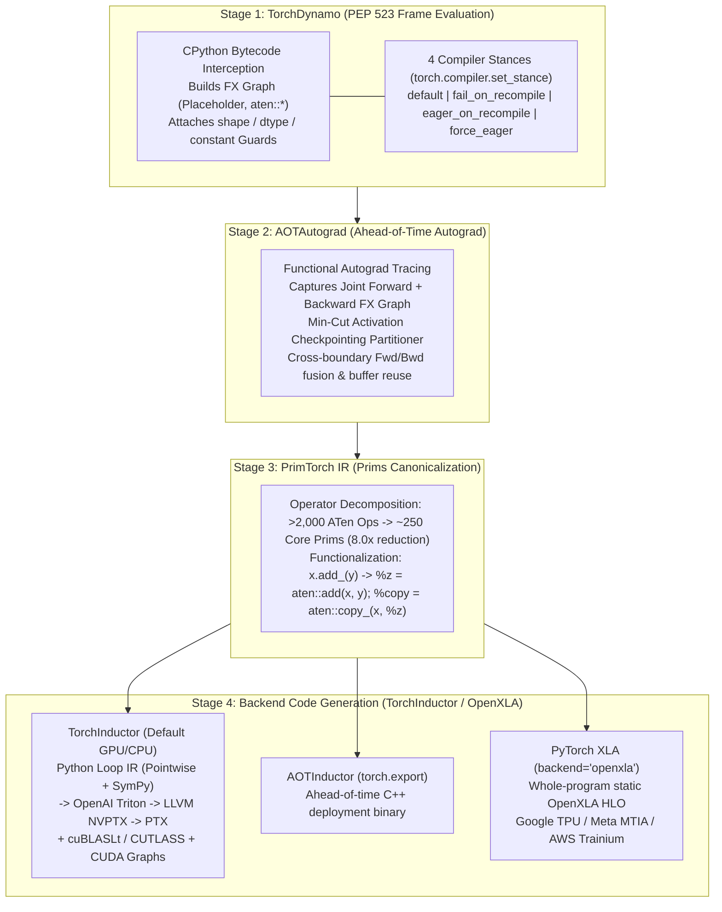

# 14.9 PyTorch compilers and kernels: torch.compile

| Field | Value |
|---|---|
| Level | Advanced |
| Priority tier | 2 |
| Lab venue | Nebius GPU + Local Python Verification Lab (`code/part14/pytorch_compilers_torch_compile_lab.py`) |
| Part | Part 14: Distributed training and fine-tuning |
| Primary sources | *AI Systems Performance Engineering* (`ai-systems-performance-engineering`, Chris Fregly), Chapter 14 (*PyTorch Compiler, OpenAI Triton, and XLA Backends*, read in full); cross-reference Chapter `10.19` (*Triton language and compilers: OpenAI Triton, torch.compile, XLA*) |
| Code | `code/part14/pytorch_compilers_torch_compile.py`, `code/part14/pytorch_compilers_torch_compile_lab.py` |
| Coverage file | `planning/coverage/chapters/14-09.md` |
| Claim & number ledger | `planning/ledgers/14-09.md` |

## Why this matters for AI infrastructure

In Chapter `10.19`, we examined how OpenAI Triton, `torch.compile`, and `OpenXLA` lower high-level Python tensor operations down to GPU hardware instructions (`PTX`, Tensor Memory Accelerator [`TMA`], and Blackwell `tcgen05` `TMEM`). In distributed training and fine-tuning (Part 14), `torch.compile` plays a uniquely critical role: unlike inference (which only runs a forward pass), training must trace, fuse, and memory-plan **both the forward pass and the backward pass simultaneously** while coordinating with `DDP` gradient buckets and `FSDP` (`use_original_params=True`) parameter shards (*AI Systems Performance Engineering*, Chapter 14).

Every stage of the PyTorch 2.x compilation stack directly attacks one of the three primary training bottlenecks:
1. **Eliminating Python Dispatch and Kernel-Launch Overhead (`TorchDynamo` + `PEP 523`):** In eager mode, CPython dispatches each PyTorch operator one by one, paying host-side Python overhead and launching separate fine-grained CUDA kernels. **`TorchDynamo`** hooks into CPython's Frame Evaluation API (**`PEP 523`**) to intercept Python bytecode at runtime, aggregate tensor operations into an **FX Graph**, attach runtime **guards** (checking tensor shapes, dtypes, devices, and Python constants), and hand the captured graph to downstream compiler passes.
2. **Slashing HBM Memory Bandwidth and Peak Activation Memory (`AOTAutograd` + `PrimTorch`):** **`AOTAutograd`** (*Ahead-of-Time Autograd*) traces the Dynamo FX graph through PyTorch's functional autograd engine ahead of time to capture a **joint forward-and-backward FX graph**, using a **min-cut activation checkpointing partitioner** to decide which intermediate activations to save versus recompute and fusing elementwise chains across the forward/backward boundary. For a `batch = 4`, `seq_len = 2,048` (`8,192` tokens), `hidden_dim = 4,096` `BF16` (`2 B`) block (`67,108,864` bytes = `67.11 MB` per tensor), fusing a `5`-op forward + `5`-op backward chain (`10` eager kernels, `24` HBM passes = **`1.6106 GB`**) into `2` compiled kernels (`1` forward + `1` backward, `6` HBM passes = **`0.4027 GB`**) cuts HBM traffic by **`4.0x` (`75.0%` bandwidth saved)**. **`PrimTorch`** (`PrimTorch IR` / `Prims`) then decomposes PyTorch's **`> 2,000` (`2,000+`) ATen operators** down to **`~250` core primitive ops** (**`8.0x` / `87.5%` reduction**) and converts in-place mutations (`x.add_(y)`) into pure functional ops plus explicit copies (`aten::add` + `aten::copy_`).
3. **Generating Autotuned Hardware Kernels without Breaking Autograd (`TorchInductor`, `@triton_op`, `Proton`, and `OpenXLA`):** **`TorchInductor`** lowers the joint graph into a Python loop-level IR (`Pointwise` with `sympy.Expr` indexing) and emits **OpenAI Triton** kernels (compiled directly to NVIDIA `PTX` via **LLVM NVPTX** without invoking `nvcc`), routes large GEMMs to `cuBLAS`/`cuBLASLt`/`CUTLASS`, and compiles **`FlexAttention`** to **`85%–90%` (`85.0%–90.0%`)** of modern FlashAttention performance in both forward and backward passes. When custom kernels are needed for training, **`@torch.library.triton_op`** + **`wrap_triton`** + **`register_autograd`** expose custom Triton kernels to `AOTAutograd` and `TorchInductor` without graph breaks—achieving **`159.352 ms`** (`4,312.421` Proton score) with `matmul_kernel_persistent` versus **`174.920 ms`** (`3,928.623`) for `cuBLAS` (**`1.10x` speedup, `8.90%` faster**) on an `[M=8192, N=8192, K=512]` benchmark.

:::note Benchmark context and cross-reference
The Triton `Proton` profiler numbers (`159.352 ms` persistent Triton, `165.349 ms` tiled Triton, `174.671 ms` `torch.matmul`, `174.920 ms` `cuBLAS`, and `168.314 ms` `ROOT` across `[M=8192, N=8192, K=512]`) are taken verbatim from *AI Systems Performance Engineering* Chapter 14. Because a single `8,192 x 8,192 x 512` GEMM performs `2 x 8,192 x 8,192 x 512 = 68,719,476,736` FLOPs (`68.72 GFLOPs`), these millisecond totals represent multi-iteration benchmark scopes or illustrative metric tables; interpret their relative ratios (`1.10x` / `8.90%`). See Chapter `10.19` for the lower-level GPU/CUDA perspective on Triton and PTX; this chapter focuses on training/autograd compilation, `DDP`/`FSDP` integration, guard recompilation budgets, and compiler diagnostics.
:::

## Prerequisites and outcomes

### Prerequisites
- GPU memory hierarchy (`HBM`, `L2`, shared memory / `SMEM`, registers, Blackwell `256 KB`/SM `TMEM`, and `TMA`) and Triton `SPMD` fundamentals from Chapter `10.19`.
- Training memory anatomy (`6PD` FLOPs, activation checkpointing, `AMP`) from Chapters `14.1` and `14.3`, plus `DDP` (`14.4`) and `FSDP` (`14.5`).

### Outcomes
After completing this chapter, you will be able to:
1. Trace the **4-stage `torch.compile` training pipeline** (`TorchDynamo` `PEP 523` bytecode capture `->` `AOTAutograd` joint forward-backward FX graph & min-cut partitioner `->` `PrimTorch` `> 2,000` ATen to `~250` Prims decomposition & functionalization `->` `TorchInductor` Triton/C++ codegen) and select the right compilation mode (`default`, `reduce-overhead`, `max-autotune`, `max-autotune-no-cudagraphs`) and compiler stance (`default`, `fail_on_recompile`, `eager_on_recompile`, `force_eager`).
2. Quantify **`AOTAutograd` memory-bandwidth fusion savings** and explain how `torch.compile` interacts with **`DDP` all-reduce buckets**, **`FSDP` (`use_original_params=True`) per-block wrappers**, **NVIDIA Transformer Engine (`TE`)**, and **`FlexAttention` (`85%–90%` of FlashAttention)**.
3. Manage **dynamic shapes** in variable-length LLM training using **`SymPy` symbolic shapes** (`sequence_length <= 256 -> sequence_length <= 1024` guards, `torch._dynamo.mark_dynamic(tensor, dim)` vs `dynamic=True`, why dynamic shapes disable CUDA Graphs, and the `±10%–20%` bucket-padding rule of thumb).
4. Diagnose and eliminate **graph breaks and guard recompilations** (`recompile_limit = 8`, `accumulated_recompile_limit = 64`) using **`torch._dynamo.explain()`** (`toy_example`: `3` graphs / `2` breaks / `5` ops `->` `1` graph / `0` breaks via `if not torch._dynamo.is_compiling():` + `torch.where` or `torch.cond`), **`torch.compiler.allow_in_graph`**, **Table 14-1 (`11` `TORCH_LOGS` flags)**, `TORCH_COMPILE_DEBUG=1`, `TORCH_TRACE` + `tlparse`, and **`TORCHDYNAMO_REPRO_LEVEL=4`**.
5. Register custom **OpenAI Triton** kernels for training and autograd via **`@torch.library.triton_op`** + **`wrap_triton`** + **`register_autograd(backward, setup_context=setup_context)`**, enforce **`16-byte` TMA leading-stride alignment** in `matmul_kernel_persistent` (`grid = min(65536, MT * NT)`), profile with **Triton `Proton`**, and contrast `TorchInductor` with **`PyTorch XLA` / `OpenXLA`** (`backend="openxla"`).

---

## 1. The Four-Stage `torch.compile` Training Pipeline (`ASP Ch. 14`, Figs. 14-1 to 14-4)

When you wrap a model or training step with `compiled_model = torch.compile(model, mode="max-autotune")`, PyTorch executes a four-stage compilation pipeline (**Figures 14-1 through 14-4** in *AI Systems Performance Engineering*, Chapter 14):



### 1.1 Stage 1 — `TorchDynamo`: `PEP 523` Frame Evaluation, FX Graph Capture, Guards, and Stances

`TorchDynamo` (or simply `Dynamo`) is the front-end tracer of `torch.compile`:
- **`PEP 523` Bytecode Interception:** Normally, the CPython interpreter evaluates each Python frame opcode by opcode. `TorchDynamo` hooks into the **CPython Frame Evaluation API (`PEP 523`)** to intercept Python bytecode safely at runtime. Whenever Dynamo encounters PyTorch tensor operations, it does not execute them eagerly; instead, it appends each operation as a node in an **FX Graph** (`torch.fx.GraphModule`). For example (`ASP Ch. 14`):
  ```python
  def f(x, y):
      z = x.sin() + y
      return z.sum()
  ```
  is captured by `TorchDynamo` into the following FX intermediate representation (`IR`):
  ```text
  graph():  # FX IR captured by TorchDynamo
      %x : Tensor = Placeholder[target=x]
      %y : Tensor = Placeholder[target=y]
      %sin : Tensor = torch.sin(%x)      # aten::sin
      %add : Tensor = torch.add(%sin, %y) # aten::add
      %sum : Tensor = torch.sum(%add)     # aten::sum
      return %sum
  ```
- **Guards and Cache Validation (Figure 14-3):** Along with the FX Graph, `TorchDynamo` emits **guards**—fast runtime assertions on input properties that affected the trace, including tensor shapes (`s0 == 512` or `s0 <= 1024`), `dtype`, `device`, strides/contiguity, and Python-level constants or globals. On subsequent calls, if all guards pass, PyTorch bypasses Python tracing and executes the cached compiled artifact directly. If a guard fails (for example, `dtype` changes or a Python scalar argument changes), the cached graph is invalidated and Dynamo triggers a **recompilation** (up to `torch._dynamo.config.recompile_limit = 8` per frame and `accumulated_recompile_limit = 64` globally before falling back to eager mode).
- **The Four Compiler Stances (`torch.compiler.set_stance`):** You can control how strictly `TorchDynamo` handles graph breaks and guard recompilations using `torch.compiler.set_stance(stance)` (`ASP Ch. 14`):

| Compiler Stance (`torch.compiler.set_stance`) | Behavior on Graph Break or Guard Failure | Primary Infrastructure Use Case |
|---|---|---|
| **`"default"`** | Compiles supported bytecode regions into FX graphs; silently falls back to Python eager execution across graph breaks and recompiles on guard misses (up to `recompile_limit = 8`). | Standard production training and inference runs. |
| **`"fail_on_recompile"`** | Raises an immediate runtime exception if a graph break, unsupported operation, or unexpected recompilation occurs. | Development debugging and **CI regression gates** to prevent PRs from silently introducing graph breaks or recompile storms. |
| **`"eager_on_recompile"`** | Reuses already-cached compiled graphs when their guards match, but runs in eager mode whenever a new input would otherwise trigger a recompilation. | Latency-sensitive workloads where mid-run JIT compilation spikes cannot be tolerated after warm-up. |
| **`"force_eager"`** | Ignores all `torch.compile` directives and executes everything in standard PyTorch eager mode. | A/B benchmarking and isolating numerical or runtime bugs without editing `@torch.compile` decorators. |

### 1.2 Stage 2 — `AOTAutograd`: Joint Forward-Backward Graph Capture and Min-Cut Partitioning

In eager PyTorch training, the forward pass executes op by op while the C++ autograd engine records a dynamic backward tape; during `loss.backward()`, each backward operator launches separately without knowing what the forward pass or subsequent backward ops will do. **`AOTAutograd`** (*Ahead-of-Time Autograd*) replaces this dynamic tape during `torch.compile`:
1. **Ahead-of-Time Joint Graph Tracing:** `AOTAutograd` runs the Dynamo-captured forward FX graph through PyTorch's autograd engine in **functional mode** (`torch.autograd.forward_ad` / functional tracing) *before* any GPU kernel is generated. This produces a single **joint forward-and-backward FX graph** containing both the forward operations and the exact gradient operations needed for `backward()`.
2. **Min-Cut Activation Checkpointing Partitioner and Cross-Pass Fusion:** Because `AOTAutograd` sees the entire forward + backward dataflow graph ahead of time, it solves a **min-cut graph partitioning problem** to partition the joint graph into a `forward` subgraph and a `backward` subgraph:
   - Rather than blindly saving every intermediate activation tensor for `backward()` (which exhausts HBM) or blindly recomputing everything, the **min-cut partitioner** identifies the minimum-memory cut of tensors to save across the forward-to-backward boundary, automatically recomputing cheap elementwise intermediates inside the fused backward kernel instead of reading/writing them to HBM.
   - It performs **common-subexpression elimination (`CSE`)**, **cross-boundary operator fusion**, and **buffer reuse** across the forward and backward passes, guaranteeing identical numerical semantics to eager autograd while drastically cutting HBM bandwidth.
3. **Concrete Bandwidth Math (`code/part14/pytorch_compilers_torch_compile.py`):** Consider a Transformer post-GEMM elementwise block (`5` forward elementwise ops such as bias-add, dropout mask, residual add, RMSNorm scale, and activation, plus `5` corresponding backward gradient ops = **`10` eager kernels**) operating on `batch_size = 4`, `seq_len = 2,048` (`8,192` tokens), `hidden_dim = 4,096` in `BF16` (`2` bytes/element, so `1` tensor = `8,192 x 4,096 x 2 = 67,108,864` bytes = **`67.11 MB`**):
   - **Eager mode (`10` kernels):** Each of the `5` forward ops reads `1` input and writes `1` output (`10` HBM tensor passes), and each of the `5` backward ops reads `1` grad and writes `1` grad plus reads `4` saved forward activation tensors (`14` HBM passes), totaling `24` HBM passes = `24 x 67,108,864 B = 1,610,612,736 B` (**`1.6106 GB`**).
   - **Compiled with `AOTAutograd` + `TorchInductor` (`2` kernels):** The `5` forward ops fuse into **`1` forward kernel** (`1` input read + `1` output write + `1` min-cut saved tensor write = `3` HBM passes) and the `5` backward ops fuse into **`1` backward kernel** (`1` grad read + `1` min-cut saved tensor read + `1` grad write = `3` HBM passes), totaling `6` HBM passes = `6 x 67,108,864 B = 402,653,184 B` (**`0.4027 GB`**)—a **`4.0x` reduction in HBM traffic (`75.0%` memory bandwidth saved)** and a **`5.0x` reduction in kernel launches (`10 -> 2`)**.

### 1.3 Stage 3 — `PrimTorch` (`PrimTorch IR` / `Prims`): `> 2,000` ATen Ops to `~250` Functional Primitives

PyTorch's full C++ `ATen` operator library exposes **`> 2,000` (`2,000+`)** operators—many of them overlapping, high-level, or mutating tensors in place. Writing a compiler backend that supports `> 2,000` operators for every new GPU or ASIC is intractable. **`PrimTorch IR`** (`Prims`) solves this in two steps (`ASP Ch. 14`):
1. **Operator Decomposition (`> 2,000` ATen Ops `->` `~250` Prims):** `PrimTorch` decomposes complex high-level `aten` operators into a canonical core set of roughly **`~250` primitive operations** (basic arithmetic, reductions, broadcast, reshape, copy)—an **`8.0x` reduction (`87.5%` smaller operator surface)**. A new hardware backend (`TorchInductor`, `OpenXLA`, or a custom ASIC compiler) only needs to lower these `~250` primitives.
2. **Functionalization (Eliminating In-Place Mutations and Aliasing):** In-place PyTorch operations like `x.add_(y)` or `x.relu_()` create hidden side effects and storage aliasing that prevent loop reordering and kernel fusion. `PrimTorch` **functionalizes** the graph by lowering every in-place mutation into a pure out-of-place functional operation followed by an explicit `aten::copy_` node at the end of the graph (`ASP Ch. 14`):
   ```text
   %z = aten::add(x, y)       # pure functional out-of-place addition
   %copy = aten::copy_(x, %z) # explicit storage write-back into x
   ```
   Because intermediate nodes are now `100%` side-effect-free, `TorchInductor`'s fusion planner and memory planner can fuse across the entire graph without aliasing hazards.

### 1.4 Stage 4 — `TorchInductor`, Compilation Modes, `FlexAttention`, and Distributed `DDP` / `FSDP`

**`TorchInductor`** (`Inductor`) is PyTorch's default compiler backend for NVIDIA GPUs, AMD GPUs, and CPUs (`ASP Ch. 14`):
- **Python Define-by-Run Loop IR (`Pointwise` + `SymPy`):** Inductor lowers the `aten` + `PrimTorch` FX Graph into a Python loop-level IR where tensor indexing is represented symbolically via **`SymPy`** (`sympy.Expr`). For example, `z = x.permute(1, 0) + x[2, :]` on a `[size0, size1]` tensor is lowered into a single fused `Pointwise` loop nest (`ASP Ch. 14`):
  ```python
  def inner_fn(index: list[sympy.Expr]):
      i1, i0 = index                        # symbolic loop indices
      tmp0 = ops.load("x", i1 + i0 * size1) # coalesced/transposed x[i1, i0]
      tmp1 = ops.load("x", 2 * size1 + i0)  # broadcast row x[2, i0]
      return ops.add(tmp0, tmp1)            # fused register-level add

  torchinductor.ir.Pointwise(
      device=torch.device("cuda"),
      dtype=torch.float32,
      inner_fn=inner_fn,
      ranges=[size0, size1],
  )
  ```
- **Direct Triton `->` LLVM NVPTX `->` PTX Codegen (No `nvcc`) and Ahead-of-Time `AOTInductor`:** For GPU targets, `TorchInductor` emits **OpenAI Triton** Python code for fusible pointwise/reduction/epilogue blocks and uses the Triton JIT compiler to lower directly to **NVIDIA `PTX` via LLVM NVPTX**—never invoking `nvcc`. Large matrix multiplications (`GEMMs`) are routed to **`cuBLAS` / `cuBLASLt`**, **`CUTLASS`**, or autotuned Triton persistent GEMM templates, with surrounding LayerNorm, residual add, and activation epilogues fused directly around or into the GEMM. For C++-only production serving or packaging without a Python runtime, `torch.export()` paired with **`AOTInductor`** compiles the Inductor IR ahead of time into a standalone shared library (Figure 14-4).
- **The Four `torch.compile` Modes (`ASP Ch. 14`):**

| `torch.compile(..., mode=...)` | CUDA Graphs Enabled? | Triton / GEMM Autotuning? | Compile Time | Best Training / Inference Scenario |
|---|---|---|---|---|
| **`"default"`** | No (`False`) | Basic heuristics (`False`) | Fast (seconds) | Large-model training startup, variable shapes, and rapid iteration where compile overhead must stay low. |
| **`"reduce-overhead"`** | **Yes (`True`)** | Basic heuristics (`False`) | Medium | Small/medium models or fixed-shape decoding where Python/CPU launch overhead dominates; **requires static shapes** (disabled if `dynamic=True`). |
| **`"max-autotune"`** | **Yes (`True`)** | **Exhaustive (`True`)** | High (minutes) | Long production training or static-shape inference runs that amortize benchmarking multiple Triton `BLOCK_*`/`num_warps`/`num_stages` and `cuBLASLt`/`CUTLASS` candidates. |
| **`"max-autotune-no-cudagraphs"`** | No (`False`) | **Exhaustive (`True`)** | High (minutes) | Large-scale LLM training with **dynamic sequence lengths** or custom allocator patterns where you want exhaustive kernel autotuning without CUDA Graph static-address constraints. |

- **Explicit NVIDIA Transformer Engine (`TE`), `SDPA`, and `FlexAttention` (`85%–90%` of FlashAttention):**
  * `torch.compile` **does not** automatically swap standard `torch.nn.Linear` or `nn.TransformerEncoderLayer` modules for **NVIDIA Transformer Engine (`TE`)** kernels; you must explicitly instantiate `transformer_engine.pytorch.layers` in your model, and `torch.compile` will then fuse operations around the TE layers (`ASP Ch. 14`).
  * For attention, enabling the PyTorch SDPA fast-path flags (`torch.backends.cuda.enable_flash_sdp(True)` and `enable_mem_efficient_sdp(True)`) plus **`torch.nn.attention.flex_attention` (`FlexAttention`)** allows `TorchInductor` to compile custom score modifications (`ALiBi`, soft-capping, document masking, block-sparsity) into fused Triton kernels that achieve **`~85%–90%` (`85.0%–90.0%`) of modern FlashAttention performance** in both forward and backward passes (`ASP Ch. 14`).
- **Combining `torch.compile` with `DDP` and `FSDP` (`use_original_params=True`, Figure 14-5):**
  * **Intentional Communication Graph Breaks:** In `DDP` and `FSDP`, `TorchDynamo` **intentionally inserts graph breaks** at collective communication boundaries (`All-Reduce` gradient buckets in `DDP`; `All-Gather` and `Reduce-Scatter` boundaries in `FSDP`, **Figure 14-5**). Without these graph breaks, a single monolithic graph would serialize communication and computation; breaking at bucket/shard boundaries lets backward computation of bucket `k + 1` overlap with `NCCL` communication of bucket `k`.
  * **`FSDP` Submodule Wrapping Rule:** When combining `FSDP` with `torch.compile`, pass **`use_original_params=True`** to `FullyShardedDataParallel` and wrap **each Transformer block as its own `FSDP` submodule** (rather than wrapping only the top-level model). `AOTAutograd` and `TorchInductor`'s memory planner then fuse forward and backward passes *inside each shard*, keeping only the active unsharded parameter slice and minimal intermediates resident in HBM (`ASP Ch. 14`).

---

## 2. Dynamic Shapes, Graph Breaks (`explain`), and Compiler Diagnostics (`ASP Ch. 14`, Table 14-1)

### 2.1 Dynamic Shapes (`SymPy`), `mark_dynamic`, and the `±10%–20%` Bucket-Padding Rule

LLM training and inference frequently encounter variable sequence lengths. In traditional static compilers, every new sequence length triggers a costly recompilation unless all inputs are padded to the maximum context length (wasting FLOPs on pad tokens). `torch.compile` handles variable dimensions using **`SymPy` symbolic shapes** (`ASP Ch. 14`):
1. **How `dynamic=None` (Default) vs `mark_dynamic` vs `dynamic=True` Works:**
   - **Default (`dynamic=None`):** On step `1` (say `sequence_length = 256`), `TorchDynamo` specializes on the observed static shape (`s0 == 256` or guard `sequence_length <= 256`). On the first step where `sequence_length` changes (say `512`), the guard fails and triggers **one extra recompilation** (`2` compilations total, `1` guard failure). On that recompile, `TorchInductor` promotes the varying dimension to a **`SymPy` symbol** (`s0`), propagates symbolic expressions such as `z.size(0) = x.size(0) + y.size(0)` through the IR, and emits a generalized kernel with an expanded guard (`sequence_length <= 1024`).
   - **Preempting the Recompile with `torch._dynamo.mark_dynamic(tensor, dim)`:** If you already know dimension `dim` (such as batch `0` or sequence length `1`) will vary, call `torch._dynamo.mark_dynamic(input_ids, 1)` *before* invoking the compiled model. This compiles dimension `1` symbolically on step `1` (**`1` compilation total, `0` guard failures**) while keeping static dimensions (`hidden_dim = 4096`) specialized for fast vectorization.
   - **Why `dynamic=True` Is a Blunt Instrument:** Passing `torch.compile(model, dynamic=True)` forces *every* tensor dimension to be symbolic upfront. Crucially, **CUDA Graphs require fixed static shapes and fixed memory addresses**, so setting `dynamic=True` (or having unbucketed dynamic shapes) **disables CUDA Graph capture**, nullifying the launch-overhead benefit of `mode="reduce-overhead"`.
2. **The `±10%–20%` Sequence-Length Bucket-Padding Rule of Thumb (`ASP Ch. 14`):**
   - If your input sequence lengths vary by only **`10%–20%`** (`10.0%–20.0%`), **pad to a fixed size** so `TorchInductor` can use static shapes + **CUDA Graphs** (`mode="reduce-overhead"` or `"max-autotune"`).
   - If sequence lengths vary widely (e.g., `128` to `8,192` tokens), use a **hybrid bucketing strategy**: bucket inputs into a small number of size ranges (padded within `±10%–20%`) or pair `mark_dynamic` with `mode="default"` / `mode="max-autotune-no-cudagraphs"`.

### 2.2 Diagnosing and Eliminating Graph Breaks with `torch._dynamo.explain()`

A **graph break** occurs whenever `TorchDynamo` encounters Python code it cannot safely trace into the FX Graph:
- **Side-effecting Python built-ins / I/O:** `print()`, `logging`, file/socket I/O, or mutating global Python state.
- **Data-dependent control flow:** `if tensor.sum() < 0:` or `while tensor.item() > eps:`, because the branch direction depends on runtime GPU tensor values unknown at trace time.
- **Non-PyTorch Python containers or third-party C/CUDA extensions:** Dynamically growing Python lists of tensors (prefer `torch.stack()` or preallocated tensors), `math.*` / `numpy.*` calls, or unregistered C++/CUDA ops.

`ASP Ch. 14` walks through a concrete diagnostic workflow using **`torch._dynamo.explain()`** on `toy_example`:

```python
import torch
import torch._dynamo as dynamo

def toy_example(a: torch.Tensor, b: torch.Tensor) -> torch.Tensor:
    x = a / (torch.abs(a) + 1)
    print("woo")          # Break Reason 1: side-effecting stdio print
    if b.sum() < 0:       # Break Reason 2: data-dependent Python jump
        b = -b
    return x * b

explanation = dynamo.explain(toy_example)(torch.randn(10), torch.randn(10))
print(explanation)
```

Running `dynamo.explain(toy_example)` produces the following report (`ASP Ch. 14`):
```text
Graph Count: 3
Graph Break Count: 2
Op Count: 5
Break Reasons:
  Break Reason 1:
    Reason: builtin: print [...ConstantVariable] False
    User Stack: <frame at toy_example: line 3, in toy_example>
  Break Reason 2:
    Reason: generic_jump TensorVariable()
    User Stack: <frame at toy_example: line 5, in toy_example>
```

Because of the **`2` graph breaks**, `TorchDynamo` chops `5` simple tensor operations (`abs`, `add`, `div`, `sum`, `lt`, `neg`, `mul` grouped into `5` traced ops) into **`3` separate subgraphs**, returning to the slow Python interpreter twice between subgraphs and preventing whole-graph fusion or CUDA Graph capture.

We eliminate both graph breaks (`Graph Count: 3 -> 1`, `Graph Break Count: 2 -> 0`) using two canonical patterns (`ASP Ch. 14`):
1. **Guard trace-time side effects with `if not torch._dynamo.is_compiling():`** so `print("do not print during tracing/compiling")` only runs in eager mode and is skipped during Dynamo bytecode capture.
2. **Replace data-dependent Python `if` branches with `torch.where()` (preferred) or `torch.cond()`:**
   - **Option A — Pure-Tensor Masking with `torch.where()` (Simpler, Zero Restrictions):**
     ```python
     def model_where(a: torch.Tensor, b: torch.Tensor) -> torch.Tensor:
         x = a / (torch.abs(a) + 1)
         if not torch._dynamo.is_compiling():
             print("do not print during tracing/compiling")
         # b.sum() < 0 is a 0-dim bool tensor broadcast across b
         b = torch.where(b.sum() < 0, -b, b)
         return x * b
     ```
   - **Option B — Structured Control Flow with `torch.cond()`:** When both branches are expensive subgraphs and you only want one executed at runtime, `torch.cond(predicate, true_fn, false_fn, operands)` traces and compiles both callables as graph subroutines (`ASP Ch. 14`):
     ```python
     def model_cond(a: torch.Tensor, b: torch.Tensor) -> torch.Tensor:
         x = a / (torch.abs(a) + 1)
         if not torch._dynamo.is_compiling():
             print("do not print during tracing/compiling")
         b = torch.cond(
             b.sum() < 0,         # 0-dim bool tensor predicate
             lambda b: -b,        # true_fn
             lambda b: b.clone(), # false_fn (clone() avoids aliasing; same shape/dtype required)
             (b,),                # operands tuple
         )
         return x * b
     ```
   - **Escape Hatch — `torch.compiler.allow_in_graph` (`torch._dynamo.allow_in_graph`):** If a helper function uses a construct Dynamo conservatively rejects, yet you guarantee the function is `100%` pure (depends only on tensor inputs, has zero side effects, and always returns the same output structure), decorating it with `@torch.compiler.allow_in_graph` (or `@torch._dynamo.allow_in_graph`) forces Dynamo to inline it into the FX Graph without breaking. Use this sparingly: if the function actually has side effects or hidden state, compiled execution will silently produce wrong results (`ASP Ch. 14`).

### 2.3 Compiler Logging (**Table 14-1**: `11` `TORCH_LOGS` Flags), `tlparse`, and `TORCHDYNAMO_REPRO_LEVEL=4`

To inspect every decision inside `TorchDynamo`, `AOTAutograd`, and `TorchInductor` without modifying model code, set `TORCH_LOGS` (or call `torch._logging.set_logs()`). **Table 14-1** in *AI Systems Performance Engineering* Chapter 14 defines the **`11` core `TORCH_LOGS` flags**:

| # | `TORCH_LOGS` Value | Stage / Subsystem | Exact Diagnostic Output (`ASP Ch. 14`, Table 14-1) |
|---|---|---|---|
| `1` | **`graph_breaks`** | `TorchDynamo` | Logs every graph break event, reason, and Python user stack line. |
| `2` | **`dynamo`** | `TorchDynamo` | Verbose bytecode-tracing logs from `TorchDynamo`. |
| `3` | **`aot_graphs`** | `AOTAutograd` | Verbose logging from `AOTAutograd`, including the captured joint forward and backward FX graphs. |
| `4` | **`inductor`** | `TorchInductor` | Verbose lowering, fusion, scheduling, and memory-planning logs from `TorchInductor`. |
| `5` | **`graph_outputs`** | `TorchDynamo` | Prints the compiled FX graph nodes and output tensors. |
| `6` | **`graph_code`** | `TorchDynamo` | Dumps the equivalent executable Python code for each FX graph produced by `TorchDynamo`. |
| `7` | **`dynamic`** | `SymPy` / Dynamic Shapes | Traces decisions around dynamic shapes and logs when/why tensor dimensions are marked symbolic (`s0`, `s1`). |
| `8` | **`perf_hints`** | `TorchInductor` | Logs missed performance optimizations (e.g., `"PerfHint: CUDA Graph not used because input is mutated"` or `"PerfHint: fell back to eager for random op"`). |
| `9` | **`output_code`** | `TorchInductor` | Prints the exact generated source code (Triton kernels, C++ wrappers, and kernel launch grids) for each compiled graph. |
| `10` | **`recompiles`** | `TorchDynamo` Guards | Logs every recompilation trigger and the exact guard condition that failed. |
| `11` | **`guards`** | `TorchDynamo` Guards | Logs all generated guards (`shape`, `dtype`, `stride`, `constant`) and their runtime evaluations. |

Beyond `TORCH_LOGS`, `ASP Ch. 14` highlights three essential debugging and numerical-accuracy workflows:
1. **Disk Artifact Dumps (`TORCH_COMPILE_DEBUG=1`) and `TORCH_TRACE` + `tlparse`:**
   - Setting `TORCH_COMPILE_DEBUG=1` writes a per-process directory `/tmp/torchinductor_<user>_<pid>/...` containing `.fx` graphs, `fx_graph_runnable.py`, Inductor IR dumps, `output_code.py` (with generated `.triton` kernels), and compiled `PTX` (where you can verify `mma.sync` or `tcgen05` Tensor Core instructions).
   - Setting `TORCH_TRACE="/tmp/tracedir"` and running **`tlparse /tmp/tracedir`** renders a hierarchical stack-frame tree (`[2/2] [2/3] .../torch/_dynamo/convert_frame.py`) and Perfetto timeline with low enough overhead to run in production.
2. **Pinpointing Numerical Discrepancies with the Minifier (`TORCHDYNAMO_REPRO_AFTER="aot"` and `TORCHDYNAMO_REPRO_LEVEL=4`):**
   - If a compiled training step diverges or produces `NaN`/mismatched outputs compared to eager mode, set:
     ```bash
     export TORCHDYNAMO_REPRO_AFTER="aot"
     export TORCHDYNAMO_REPRO_LEVEL=4
     ```
   - `TORCHDYNAMO_REPRO_AFTER="aot"` instructs Dynamo to inspect the graph *after* `AOTAutograd` (testing both forward and backward passes rather than only Dynamo capture). **`TORCHDYNAMO_REPRO_LEVEL=4`** automatically runs every dumped subgraph in both eager mode and compiled mode, compares their tensor outputs numerically, and—the instant a mismatch is detected—invokes the **TorchDynamo / TorchInductor minifier** to reduce a multi-thousand-line model down to a minimal standalone reproduction script.
3. **Random Number Consistency (`fallback_random=True`) and `cuBLAS` Bitwise Determinism (`CUBLAS_WORKSPACE_CONFIG=:4096:8`):**
   - Because `TorchInductor` fuses and reorders parallel Philox PRNG calls in Triton, compiled dropout/random numbers differ from eager PRNG sequences by default; set `torch._inductor.config.fallback_random = True` when debugging numerical parity.
   - To enforce bitwise determinism across runs (`torch.use_deterministic_algorithms(True)`), you must also disable non-deterministic `cuBLAS` split-K reductions by exporting **`CUBLAS_WORKSPACE_CONFIG=:4096:8`** (`8` workspace buffers of `4,096 KB` = `32,768 KB` = **`32 MB`**) or **`:16:8`** (`8` buffers of `16 KB` = **`128 KB`**) before launching Python (`ASP Ch. 14`).

---

## 3. OpenAI Triton Custom Kernels and `@torch.library.triton_op` Registration (`ASP Ch. 14`)

When `TorchInductor`'s built-in fusion rules cannot fuse a domain-specific operator (such as a custom sparse attention mask, fused RoPE + QKV norm, or quantized activation), writing an unregistered C++/CUDA extension causes a `TorchDynamo` graph break. Instead, `ASP Ch. 14` recommends writing the kernel in **OpenAI Triton** and registering it with PyTorch via **`@torch.library.triton_op`**.

### 3.1 Triton `SPMD` Programming Model vs CUDA `SIMT` (`vector_add_kernel`, `BLOCK_SIZE`, `num_warps`)

Unlike CUDA's thread-level **Single-Instruction, Multiple-Thread (`SIMT`)** execution model (where you index individual threads via `threadIdx.x`), Triton uses a block-level **Single-Program, Multiple-Data (`SPMD`)** model (`ASP Ch. 14`):
- Each Triton program instance (`pid = tl.program_id(axis=0)`) maps to **one CUDA thread block (Cooperative Thread Array, `CTA`)** and operates on an entire vector of `BLOCK_SIZE` elements (`offsets = pid * BLOCK_SIZE + tl.arange(0, BLOCK_SIZE)`).
- **Decoupling `BLOCK_SIZE` from `num_warps`:** `BLOCK_SIZE` (`tl.constexpr`, e.g., `1,024` elements) is the number of data elements processed per program instance, whereas the number of hardware CUDA threads per block is `num_warps x 32`.
  * By default, Triton launches **`num_warps = 4`** (`4 x 32 = 128` threads/block), so at `BLOCK_SIZE = 1,024`, each thread processes `1,024 / 128 = 8.0` elements. For a vector of `n_elements = 10,000`, `grid = (triton.cdiv(10000, 1024),) = (10,)` launches **`10` program instances** (`10,240` slots, with the final `240` out-of-bounds lanes predicated off via `mask = offsets < n_elements`).
  * On modern GPUs with larger register files and shared memory, `ASP Ch. 14` gives a concrete scaling rule for compute-heavy kernels: increase **`num_warps` to `8` (`256` threads)** when **`BLOCK_SIZE >= 2,048`**, and increase **`num_warps` to `16` (`512` threads)** when **`BLOCK_SIZE >= 4,096`** (using `@triton.autotune` across `num_warps in {4, 8, 16}` and `num_stages in {2, 3, 4}`).
- **Note on Competing Python GPU DSLs (`ASP Ch. 14`):** In `2025`, NVIDIA introduced Python-native libraries (`cuTile`, `CuTe Python DSL`, `CUTLASS Python DSL`, and `cuPyNumeric`) that compete with Triton, though `TorchInductor` continues to use OpenAI Triton as its primary GPU codegen backend.

### 3.2 Registering Custom Triton Kernels for Training and Autograd (`@triton_op`, `wrap_triton`, `register_autograd`)

If you launch a raw `@triton.jit` kernel directly inside `forward()`, `TorchDynamo` treats the custom launch as an opaque side effect or breaks the graph, and `AOTAutograd` does not know how to differentiate it during `backward()`. `ASP Ch. 14` shows the complete pattern for registering a Triton kernel as a first-class, compiler-visible PyTorch operator with full training/autograd support:

```python
import torch
import triton
import triton.language as tl
from torch import Tensor
from torch.library import triton_op, wrap_triton

# 1. Define the SPMD Triton compute kernel
@triton.jit
def vector_add_kernel(
    x_ptr, y_ptr, out_ptr, n_elements,
    BLOCK_SIZE: tl.constexpr,
):
    pid = tl.program_id(0)
    start = pid * BLOCK_SIZE
    offsets = start + tl.arange(0, BLOCK_SIZE)
    mask = offsets < n_elements
    x = tl.load(x_ptr + offsets, mask=mask)
    y = tl.load(y_ptr + offsets, mask=mask)
    tl.store(out_ptr + offsets, x + y, mask=mask)

# 2. Register as a compiler-visible PyTorch operator via @triton_op + wrap_triton
@triton_op("my_triton_lib::vector_add", mutates_args=())
def vector_add(x: Tensor, y: Tensor) -> Tensor:
    assert x.device.type == "cuda" and y.device.type == "cuda"
    n = x.numel()
    out = torch.empty_like(x)
    grid_fn = lambda meta: (triton.cdiv(n, meta["BLOCK_SIZE"]),)
    wrap_triton(vector_add_kernel)[grid_fn](x, y, out, n, BLOCK_SIZE=1024)
    return out

# 3. Register backward pass for AOTAutograd training support
def setup_context(ctx, inputs, output):
    # Save any tensors or metadata required for backward()
    x, y = inputs
    ctx.save_for_backward(x, y)

def backward(ctx, grad_out: Tensor):
    # d(x + y)/dx = 1, d(x + y)/dy = 1
    return grad_out, grad_out

vector_add.register_autograd(backward, setup_context=setup_context)
```

Why this three-part registration (`@triton_op` + `wrap_triton` + `register_autograd`) matters for `torch.compile`:
1. **`@triton_op("my_triton_lib::vector_add", mutates_args=())`** declares the operator schema and explicitly tells `PrimTorch` / `TorchInductor` that no input arguments are mutated in place (`mutates_args=()`), enabling FakeTensor shape propagation without allocating GPU memory during tracing.
2. **`wrap_triton(vector_add_kernel)`** exposes the Triton AST to `TorchInductor` so the compiler can inline, reorder, or fuse surrounding pointwise operations into the custom kernel without a graph break.
3. **`vector_add.register_autograd(backward, setup_context=setup_context)`** allows `AOTAutograd` to trace right through `torch.ops.my_triton_lib.vector_add(a, b)` during joint forward-backward graph capture, fusing the backward pass into the compiled training step (`ASP Ch. 14` notes `register_autograd` is preferred over legacy `torch.autograd.Function` for `torch.compile` composability).

---

## 4. Advanced Triton GEMM Kernels (`TMA`, Persistent Threads, Warp Specialization), `Proton` Profiling, and `OpenXLA` (`ASP Ch. 14`)

### 4.1 TMA Tensor Descriptors (`16-Byte` Alignment), Warp Specialization, and `matmul_kernel_persistent`

To reach peak Tensor Core utilization on Hopper (`sm_90`) and Blackwell (`sm_100`), `TorchInductor` and custom Triton kernels combine four hardware mechanisms (`ASP Ch. 14`):
1. **Tensor Descriptors (`tl.make_tensor_descriptor`) and the `16-Byte` TMA Alignment Rule:**
   - Rather than issuing manual pointer arithmetic `tl.load(ptr + offsets)`, Triton stages 2D tiles into shared memory using `A_desc = tl.make_tensor_descriptor(A_ptr, shape=[M, K], strides=[stride_am, stride_ak], block_shape=[BLOCK_M, BLOCK_K])`.
   - On Hopper and Blackwell, `A_desc.load([m0, k0])` lowers directly to hardware **Tensor Memory Accelerator (`TMA`)** asynchronous bulk transfers, and **`tl.dot(a_cur, b_cur)`** lowers to Blackwell **`tcgen05` (`UMMA`)** instructions accumulating in **`~256 KB` per SM of dedicated Tensor Memory (`TMEM`)** rather than general-purpose registers.
   - **Strict Hardware Alignment Rule (`ASP Ch. 14`):** NVIDIA TMA descriptors require that **(a) all leading dimension strides are multiples of `16 bytes`** (e.g., `8` elements in `FP16`/`BF16` or `4` elements in `FP32`), and **(b) the innermost (last) dimension is contiguous (`stride == 1`)**. If a leading stride is `12 bytes` (not divisible by `16`), TMA descriptor creation is invalid.
2. **Software Pipelining (`num_stages > 1`), Warp Specialization (`warp_specialize=True`), and the Tile-Survival Rule:**
   - Passing `tl.range(0, K_tiles, num_stages=NUM_STAGES, warp_specialize=True)` splits the thread block's warps into **producer (memory/TMA)** warps and **consumer (compute/Tensor Core)** warps (`ASP Ch. 14` autotune config: `BLOCK_M=128, BLOCK_N=128, BLOCK_K=64, num_warps=8, num_stages=2, num_consumer_groups=2, num_buffers_warp_spec=3`).
   - **Critical Pipeline Survival Rule (`prefetch-next -> compute-current -> swap`):** When `num_stages > 1`, you must keep the `a_cur` / `b_cur` references live until `acc += tl.dot(a_cur, b_cur)` finishes, prefetching `a_next = A_desc.load([m0, next_k])` into a *separate* variable and swapping (`a_cur = a_next`) only at the end of the loop body (`ASP Ch. 14`). If you overwrite `a_cur` before `tl.dot` or drop its reference early, the compiler can legally hoist/sink the next TMA copy across the current compute, **silently collapsing load/compute overlap**.
3. **1D Persistent GEMM (`matmul_kernel_persistent`, `grid = min(65536, MT * NT)`):**
   - A standard 2D tiled GEMM (`tiled_gemm_kernel`) launches `MT x NT = cdiv(M, BLOCK_M) x cdiv(N, BLOCK_N)` thread blocks (`1` output tile per block). When `K` is large (**`K > 1,024`**) or `M x N` is huge, **`matmul_kernel_persistent`** launches a bounded **1D grid of persistent programs** (`grid = lambda META: (min(65536, MT * NT),)`), where each program `pid = tl.program_id(0)` loops across multiple output tiles in steps of `nprog = tl.num_programs(0)`:
     ```text
     tile_idx = pid
     while tile_idx < TILE_COUNT:   # TILE_COUNT = MT * NT
         pid_m = tile_idx // NT
         pid_n = tile_idx % NT
         # ... TMA prefetch-next -> tl.dot compute-current -> swap over K_tiles ...
         tile_idx += nprog          # persistent stride to next output tile
     ```
   - For `[M=8192, N=8192, K=512]` with `BLOCK_M=128, BLOCK_N=128, BLOCK_K=64`: `MT = 64`, `NT = 64`, `TILE_COUNT = 64 x 64 = 4,096` output tiles (`1` tile/program since `4,096 <= 65,536`), and `K_tiles = 512 / 64 = 8` K-loop iterations per output tile. For `[M=65536, N=65536, K=2048]`, `TILE_COUNT = 512 x 512 = 262,144` tiles, which `min(65536, 262144)` caps at **`65,536` persistent programs (`4` output tiles per program)**.

### 4.2 Triton `Proton` Profiler (`159.352 ms` vs `174.920 ms` `cuBLAS`) and `PyTorch XLA` (`OpenXLA`)

To profile Triton kernels and emit NVTX ranges that correlate directly with **NVIDIA Nsight Systems** and **Nsight Compute**, `ASP Ch. 14` uses the **Triton `Proton` profiler** (`proton.start("matmul", hook="triton")` and `with proton.scope("name", metadata):`). On the `[M=8192, N=8192, K=512]` matrix multiplication benchmark (`ASP Ch. 14`), `Proton` produces the following hierarchical timing and metric table:

```text
168.314 ms 16331.291 ROOT
├─ 174.920 ms  3928.623 cublas [M=8192,N=8192,K=512]
├─ 165.349 ms  4156.033 matmul_kernel [M=8192,N=8192,K=512]
├─ 159.352 ms  4312.421 matmul_kernel_persistent [M=8192,N=8192,K=512]
└─ 174.671 ms  3934.214 torch [M=8192,N=8192,K=512]
```

| Kernel Implementation (`[M=8192, N=8192, K=512]`) | Proton Time (`ms`) | Proton Metric Score | Speedup / Time Saved vs `cuBLAS` (`174.920 ms`) |
|---|---|---|---|
| **`cublas` (`cuBLAS` baseline)** | **`174.920 ms`** | **`3,928.623`** | `1.00x` (`0.000 ms` saved, `0.00%`) |
| **`torch` (`torch.matmul`)** | **`174.671 ms`** | **`3,934.214`** | `1.00x` (`0.249 ms` saved, `0.14%` faster) |
| **`matmul_kernel` (2D tiled Triton + TMA)** | **`165.349 ms`** | **`4,156.033`** | **`1.06x` (`9.571 ms` saved, `5.47%` faster)** |
| **`matmul_kernel_persistent` (1D persistent Triton + TMA + TMEM + warp spec)** | **`159.352 ms`** | **`4,312.421`** | **`1.10x` (`15.568 ms` saved, `8.90%` faster)** |

Finally, when targeting non-NVIDIA accelerators, **`PyTorch XLA`** (`torch.compile(model, backend="openxla")`, **Figure 14-6** in `ASP Ch. 14`) lowers PyTorch graphs into **`OpenXLA` StableHLO / HLO** executables for **Google Cloud TPUs**, **Meta `MTIA`** (*Meta Training & Inference Accelerator*), and **AWS `Trainium` / `Inferentia`** (via the open-source **AWS Neuron SDK**):

| Compiler Dimension | `TorchInductor` (`backend="inductor"`, Default) | `PyTorch XLA` (`backend="openxla"`) |
|---|---|---|
| **Primary Target Hardware** | NVIDIA GPUs (`Ampere`, `Hopper`, `Blackwell`), AMD GPUs, x86/ARM CPUs | **Google Cloud TPUs**, **Meta `MTIA`**, **AWS `Trainium` & `Inferentia`** (`AWS Neuron SDK`) |
| **Compilation Model** | Incremental subgraph JIT compilation (falls back to eager on breaks) or `AOTInductor` export | **Whole-program ahead-of-time static graph compilation** cached per input shape signature |
| **Dynamic Shape Behavior** | Native **`SymPy` symbolic shapes** (`mark_dynamic`, range guards `s0 <= 1024`) | **Static or bounded shapes**; unseen shapes trigger expensive **whole-program recompilation** (requires fixed-size bucketing/padding) |
| **Kernel Codegen Path** | Python Loop IR `->` **OpenAI Triton** `->` **LLVM NVPTX** `->` `PTX` + `cuBLASLt`/`CUTLASS` | PyTorch Lazy Tensor / FX `->` **XLA HLO IR** `->` target XLA hardware runtime |

---

## Commands and configurations that matter

### 1. Enabling Fast TF32 Matmuls, SDPA Flash/Mem-Efficient Paths, and `torch.compile` Modes (`ASP Ch. 14`)

```python
# (untested here — production PyTorch 2.x compiler & hardware fast-path configuration from ASP Ch 14)
import torch
from torch.distributed.fsdp import FullyShardedDataParallel as FSDP

# 1. Enable TF32 Tensor Core fast paths and SDPA FlashAttention / Memory-Efficient kernels early
torch.set_float32_matmul_precision("high")       # maps FP32 matmuls to TF32/BF16 fast paths ('highest' for pure FP32)
torch.backends.cuda.matmul.allow_tf32 = True
torch.backends.cudnn.allow_tf32 = True
torch.backends.cuda.enable_flash_sdp(True)
torch.backends.cuda.enable_mem_efficient_sdp(True)
torch.backends.cuda.enable_math_sdp(True)

# 2. Preempt dynamic-shape recompilation on known varying sequence dimension (dim=1)
torch._dynamo.mark_dynamic(input_ids, 1)

# 3. For FSDP + torch.compile: wrap each Transformer block as an FSDP submodule with use_original_params=True
for idx, layer in enumerate(model.layers):
    model.layers[idx] = FSDP(layer, use_original_params=True)
model = FSDP(model, use_original_params=True)

# 4. Enforce strict graph capture in CI / dev, then compile with max-autotune (or max-autotune-no-cudagraphs)
torch.compiler.set_stance("fail_on_recompile")
compiled_model = torch.compile(model, mode="max-autotune-no-cudagraphs")
```

### 2. Inspecting Compiler Phases, Graph Breaks, `tlparse`, and the Level-4 Minifier (`Table 14-1`)

```bash
# (untested here — runtime diagnostic and minifier commands from ASP Ch 14)

# Log graph breaks, guard evaluations, and recompilation triggers during training
TORCH_LOGS="graph_breaks,guards,recompiles" python3 train.py

# Log missed optimization opportunities (e.g., mutated inputs disabling CUDA Graphs) and generated Triton code
TORCH_LOGS="perf_hints,output_code" python3 train.py

# Dump FX graphs (.fx), runnable FX Python code, Inductor IR, Triton kernels, and PTX to /tmp/torchinductor_*
TORCH_COMPILE_DEBUG=1 python3 train.py

# Capture low-overhead compilation trace logs and render stack-frame tree with tlparse
TORCH_TRACE="/tmp/tracedir" python3 train.py
tlparse /tmp/tracedir

# Isolate numerical discrepancies after AOTAutograd and auto-generate a minified repro script (Level 4)
TORCHDYNAMO_REPRO_AFTER="aot" TORCHDYNAMO_REPRO_LEVEL=4 python3 train.py

# Enforce bitwise determinism across cuBLAS split-K reductions (32 MB workspace = 8 x 4096 KB, or :16:8)
export CUBLAS_WORKSPACE_CONFIG=:4096:8
```

---

## How it fails

| # | Failure Mode & Symptom | Root Cause (`ASP Ch. 14`) | Diagnosis Command / Signal | Production Fix |
|---|---|---|---|---|
| **1** | **Silent Eager Fallback & Modest Speedup (`Graph Count: 3, Graph Break Count: 2`)** | Side-effecting Python ops (`print("woo")`, `logging`), dynamically growing Python lists, or data-dependent control flow (`if b.sum() < 0:`) inside `forward()` interrupt `TorchDynamo` `PEP 523` capture. | Run `torch._dynamo.explain(model)(*inputs)` or `TORCH_LOGS="graph_breaks"`; look for `builtin: print` and `generic_jump TensorVariable()`. | Guard prints with `if not torch._dynamo.is_compiling():`, replace Python lists with `torch.stack()`, and rewrite tensor conditionals with `torch.where()` or `torch.cond()`. |
| **2** | **Recompilation Storm & Iteration Stalls After Warm-up (`hit_recompile_limit = 8`)** | Passing changing Python scalars (step counter, learning rate float, random seed) or varying sequence lengths without `mark_dynamic` invalidates Dynamo guards on every iteration until `recompile_limit = 8` (`accumulated = 64`) is exhausted. | Run `TORCH_LOGS="recompiles,guards"` or set `torch.compiler.set_stance("fail_on_recompile")` in CI to see which guard expression failed. | Wrap changing scalars in `0-D` `torch.Tensor`s, call `torch._dynamo.mark_dynamic(x, dim)` upfront, or bucket sequence lengths within `±10%–20%`. |
| **3** | **CUDA Graphs Disabled Despite `mode="reduce-overhead"` or `"max-autotune"`** | Enabling `dynamic=True` (or unbucketed varying shapes) or mutating model inputs in place before/during `forward()` violates CUDA Graph fixed-address and static-shape invariants. | Run `TORCH_LOGS="perf_hints"`; look for `"PerfHint: CUDA Graph not used because input is mutated"` or dynamic shape disabling logs. | Eliminate in-place input mutations (`x.add_()` `->` `x = x + ...`), pad shapes varying by `< 10%–20%` to static buckets, or switch to `mode="max-autotune-no-cudagraphs"`. |
| **4** | **Custom Triton Kernel Causes Graph Break or Fails During `loss.backward()`** | Launching a raw `@triton.jit` kernel directly inside `forward()` makes it opaque to `TorchDynamo`, or registering `@triton_op` without `register_autograd` leaves `AOTAutograd` unable to trace the backward pass. | `TORCH_LOGS="graph_breaks,aot_graphs"` shows a custom-op graph break or missing backward formula error during joint graph capture. | Wrap the kernel with `@torch.library.triton_op("ns::op", mutates_args=())`, launch via `wrap_triton(kernel)[grid]`, and register `op.register_autograd(backward, setup_context=setup_context)`. |
| **5** | **Silent Load/Compute Overlap Collapse or TMA Alignment Error in Pipelined Triton GEMM** | Leading tensor stride is not a multiple of **`16 bytes`** (or inner dim is non-contiguous) in `tl.make_tensor_descriptor`, or the `tl.range(..., num_stages=2)` loop overwrites `a_cur` before `tl.dot(a_cur, b_cur)` completes. | Triton compilation error on TMA descriptor alignment, or **Triton `Proton` / Nsight Compute** showing stalled TMA stages and `0%` copy/compute overlap. | Ensure `stride * dtype_bytes % 16 == 0` and contiguous inner dim; strictly follow `prefetch-next (a_next) -> compute-current (tl.dot(a_cur, b_cur)) -> swap (a_cur = a_next)`. |
| **6** | **Numerical Mismatch Between `torch.compile` and Eager Mode (or Non-Deterministic `cuBLAS` Crash)** | Fused Triton Philox PRNG order differs from eager dropout, fused `BF16` accumulation changes rounding order, or `torch.use_deterministic_algorithms(True)` is called without `CUBLAS_WORKSPACE_CONFIG`. | Run `TORCHDYNAMO_REPRO_AFTER="aot" TORCHDYNAMO_REPRO_LEVEL=4` to isolate the failing stage and generate a minified reproducer. | Set `torch._inductor.config.fallback_random = True`, test with `torch.set_float32_matmul_precision("highest")`, and export `CUBLAS_WORKSPACE_CONFIG=:4096:8` (or `:16:8`). |

---

## Hands-on lab

**Venue:** Local Python 3 standard-library verification lab (`code/part14/pytorch_compilers_torch_compile_lab.py`) + Nebius GPU for live Triton/`torch.compile` execution.

Run the deterministic verification suite:

```bash
python3 -B code/part14/pytorch_compilers_torch_compile_lab.py
```

Expected output (`26 passed, 0 failed`):

```text
=== Chapter 14.9 Lab: PyTorch Compilers and Kernels: torch.compile (ASP Ch 14) ===
  [PASS] 1. 4-stage torch.compile pipeline order: TorchDynamo (PEP 523) -> AOTAutograd -> PrimTorch -> TorchInductor
  [PASS] 2. PrimTorch IR operator reduction: decomposes >2,000 ATen ops to ~250 primitive ops (8.0x / 87.5% reduction)
  [PASS] 3. Compilation modes: default, reduce-overhead, max-autotune, max-autotune-no-cudagraphs with exact CUDA Graph & autotune rules
  [PASS] 4. torch.compiler.set_stance supports 4 stances: default, fail_on_recompile, eager_on_recompile, force_eager
  [PASS] 5. FlexAttention reaches 85.0%-90.0% of FlashAttention performance in forward and backward passes
  [PASS] 6. AOTAutograd + TorchInductor kernel launch fusion: 10 eager kernels (5 fwd + 5 bwd) fuse into 2 kernels (1 fwd + 1 bwd)
  [PASS] 7. AOTAutograd min-cut partitioner HBM savings: 1.6106 GB eager (24 passes of 67.1089 MB) -> 0.4027 GB compiled (6 passes) = 4.0x (75.0% saved)
  [PASS] 8. dynamo.explain(toy_example): print('woo') + 'if b.sum() < 0:' -> Graph Count=3, Graph Break Count=2, Op Count=5
  [PASS] 9. Refactored model_where / model_cond: if not is_compiling() + torch.where/torch.cond -> Graph Count=1, Graph Break Count=0
  [PASS] 10. FSDP / DDP intentional communication breaks: 2 collective boundaries yield 3 subgraphs for compute-communication overlap
  [PASS] 11. Guard-failure recompilation budget: changing Python scalar hits recompile_limit=8 (accumulated=64) and falls back to eager; fail_on_recompile raises on step 2
  [PASS] 12. Dynamic shape guards & mark_dynamic: auto-dynamic takes 2 compiles (1 recompile, sequence_length <= 256 -> 1024); mark_dynamic takes 1 compile (0 recompiles) and disables CUDA Graphs
  [PASS] 13. Table 14-1 TORCH_LOGS: all 11 diagnostic flags registered and mapped cleanly by symptom selector
  [PASS] 14. Numerical accuracy repro & cuBLAS workspace: TORCHDYNAMO_REPRO_LEVEL=4 and CUBLAS_WORKSPACE_CONFIG=:4096:8 (32,768 KB = 32 MB) or :16:8 (128 KB)
  [PASS] 15. @triton_op registration & training autograd: wrap_triton + register_autograd(backward, setup_context=...) prevents graph breaks; missing autograd breaks training graph
  [PASS] 16. Triton SPMD vector_add_kernel (n_elements=10,000, BLOCK_SIZE=1,024): cdiv(10000, 1024) = 10 programs, 4 warps (128 threads, 8.0 elems/thread)
  [PASS] 17. Triton num_warps scaling & warp specialization: BLOCK_SIZE=2,048 -> 8 warps (256 threads); BLOCK_SIZE=4,096 -> 16 warps (512 threads), num_consumer_groups=2, num_buffers_warp_spec=3
  [PASS] 18. TMA tensor descriptor alignment & Blackwell TMEM: 16-byte leading stride + contiguous inner dim required; TMEM = 256 KB/SM
  [PASS] 19. matmul_kernel_persistent on [M=8192, N=8192, K=512] (128x128x64): MT=64, NT=64, TILE_COUNT=4,096 tiles, K_tiles=8, grid=4,096
  [PASS] 20. matmul_kernel_persistent 65,536 grid cap & K > 1,024 rule: 65536x65536 has 262,144 tiles capped at 65,536 programs (4 tiles/program)
  [PASS] 21. Proton profiler [M=8192,N=8192,K=512] timings & scores: persistent 159.352 ms (4312.421) < tiled 165.349 ms (4156.033) < torch 174.671 ms (3934.214) < cublas 174.920 ms (3928.623), ROOT 168.314 ms (16331.291)
  [PASS] 22. Proton speedup & single-GEMM FLOPs: persistent saves 15.568 ms (8.90% reduction, 1.10x speedup vs cuBLAS; tiled saves 5.47%); single 8192x8192x512 GEMM = 68.72 GFLOPs
  [PASS] 23. Rejects @triton_op qualname missing 'namespace::op_name'
  [PASS] 24. Rejects Triton BLOCK_SIZE not divisible by 32
  [PASS] 25. Rejects unknown symptom in Table 14-1 TORCH_LOGS selector
  [PASS] 26. Persistent matmul K==0 edge case: K=0 yields k_tiles == 0 (masked zero-store path) and force_eager stance runs 0 compilations

Summary: 26 passed, 0 failed
```

---

## Common first mistakes

1. **Combining `mode="reduce-overhead"` with `dynamic=True` expecting CUDA Graph speedups:** `mode="reduce-overhead"` relies on CUDA Graph capture, which requires static tensor shapes and fixed device memory addresses. Passing `dynamic=True` disables CUDA Graphs (`ASP Ch. 14`). Use `mode="reduce-overhead"` only with static/padded shapes (`±10%–20%` variation), and use `mode="default"` or `mode="max-autotune-no-cudagraphs"` with `torch._dynamo.mark_dynamic()` for widely varying sequence lengths.
2. **Assuming `torch.compile` automatically swaps in NVIDIA Transformer Engine (`TE`) kernels:** `torch.compile` never replaces standard `torch.nn.Linear` layers with `TE` FP8/BF16 kernels automatically; you must explicitly construct your model with `transformer_engine.pytorch.layers`, after which `torch.compile` will fuse around them (`ASP Ch. 14`).
3. **Trying to eliminate `DDP` or `FSDP` communication graph breaks:** Seeing graph breaks at `all_reduce`, `all_gather`, or `reduce_scatter` in `torch._dynamo.explain()` is **expected and required** (`Figure 14-5`). Those breaks allow `NCCL` communication of one bucket/shard to overlap with backward computation of the next bucket/shard.
4. **Warming up `@triton.autotune` or `mode="max-autotune"` on tiny toy tensors:** Both Triton's autotuner and `TorchInductor` cache the winning `triton.Config` (`BLOCK_M`, `BLOCK_N`, `BLOCK_K`, `num_warps`, `num_stages`) keyed by input shape metadata. Warming up on a tiny `[32, 32]` tensor caches a configuration that is suboptimal for production `[8192, 8192]` shapes—and triggers an unexpected autotuning stall the first time a real production batch arrives (`ASP Ch. 14`).
5. **Using undocumented inline PTX cache hints instead of Triton's portable cache modifiers:** Hardcoding undocumented PTX load instructions (such as non-coherent + L1 no-allocate + `256B` L2 prefetch strings) can break silently across CUDA driver updates and GPU architectures; prefer Triton's `eviction_policy="evict_last"` and `cache_modifier` arguments (`ASP Ch. 14`).

---

## Exercises

1. **PrimTorch IR Reduction and Functionalization Math:**
   - **(a)** Given PyTorch's full operator surface of `> 2,000` (`2,000`) `ATen` operators and `PrimTorch IR`'s canonical set of `~250` (`250`) primitive operations (`ASP Ch. 14`), compute the exact operator-surface reduction ratio and percentage reduction.
   - **(b)** Write the exact two-line `aten` IR lowered by `PrimTorch` for the in-place operation `x.add_(y)` and explain why this transformation is required before `TorchInductor` runs kernel fusion.
2. **`AOTAutograd` Joint Graph Fusion and Min-Cut Bandwidth Savings:**
   - **(a)** For a Transformer training block with `batch_size = 4`, `seq_len = 2,048` (`8,192` tokens), `hidden_dim = 4,096`, and `BF16` (`2` bytes/element), compute the size of a single activation tensor in bytes and megabytes (`MB`, base `10^6`).
   - **(b)** Using `evaluate_aot_autograd_fusion_savings()` (`5` forward elementwise ops + `5` backward elementwise ops, `4` saved tensors in eager mode vs `1` min-cut saved tensor in compiled mode), calculate the total kernel launches, total HBM tensor passes, total HBM traffic in `GB` (`10^9` bytes), traffic reduction ratio, and percentage of HBM bandwidth saved by `AOTAutograd` + `TorchInductor`.
3. **`torch._dynamo.explain()` Graph-Break Analysis and Refactoring:**
   - **(a)** For `toy_example(a, b)` in `ASP Ch. 14` (containing `x = a / (torch.abs(a) + 1)`, `print("woo")`, `if b.sum() < 0: b = -b`, `return x * b`), state the exact `Graph Count`, `Graph Break Count`, `Op Count`, and the `2` break reason strings returned by `torch._dynamo.explain(toy_example)`.
   - **(b)** Show how to refactor `toy_example` using `if not torch._dynamo.is_compiling():` and `torch.where()` (or `torch.cond()`), and state the resulting `Graph Count`, `Graph Break Count`, and CUDA Graph eligibility when shapes are static.
4. **Dynamic Shapes (`mark_dynamic`) and Guard Recompilation Budget (`recompile_limit = 8`):**
   - **(a)** Using `simulate_guard_recompilations()`, compare the total compilations triggered and guard failures across `4` steps with sequence lengths `(256, 512, 768, 1024)` under default `dynamic=None` versus pre-marking sequence dimension `1` with `torch._dynamo.mark_dynamic(x, 1)`. What is the initial guard and expanded guard expression in `ASP Ch. 14`?
   - **(b)** What happens across `10` training steps `(128, 256, ..., 2048)` if a developer passes a changing Python scalar step counter each iteration under `stance="default"` (`recompile_limit = 8`, `accumulated_recompile_limit = 64`) versus `stance="fail_on_recompile"`?
5. **Custom Triton Kernel Registration (`@triton_op`) and SPMD Launch Geometry:**
   - **(a)** For `vector_add_kernel` launched on `n_elements = 10,000` with `BLOCK_SIZE = 1,024`, `2,048`, and `4,096` (`ASP Ch. 14`), calculate the number of Triton program instances `cdiv(10000, BLOCK_SIZE)`, recommended `num_warps`, total CUDA threads per block, and elements processed per thread for each `BLOCK_SIZE`.
   - **(b)** What `3` PyTorch library functions/decorators are required so that a custom Triton kernel is both inlined/fused by `TorchInductor` and differentiated without graph breaks by `AOTAutograd` during training? What `2` hardware alignment conditions must a tensor satisfy to use `tl.make_tensor_descriptor` (`TMA`)?
6. **Persistent Triton GEMM (`matmul_kernel_persistent`) and `Proton` Profiler Analysis:**
   - **(a)** Using `plan_persistent_matmul_grid()` with `BLOCK_M = 128, BLOCK_N = 128, BLOCK_K = 64`, calculate `MT`, `NT`, `TILE_COUNT`, `K_tiles`, the 1D persistent grid size `min(65536, MT * NT)`, and max output tiles per program for `[M=8192, N=8192, K=512]` and for `[M=65536, N=65536, K=2048]`.
   - **(b)** From the `ASP Ch. 14` `Proton` benchmark on `[M=8192, N=8192, K=512]` (`cublas` = `174.920 ms` [`3,928.623`], `torch` = `174.671 ms` [`3,934.214`], `matmul_kernel` = `165.349 ms` [`4,156.033`], `matmul_kernel_persistent` = `159.352 ms` [`4,312.421`], `ROOT` = `168.314 ms` [`16,331.291`]), compute the single-GEMM FLOPs (`GFLOPs`), exact milliseconds saved, percentage runtime reduction, and speedup factor of `matmul_kernel_persistent` and `matmul_kernel` over `cuBLAS`.

---

## Interview angles

1. **"Walk me through all four stages of `torch.compile` during a model training step. Why does training need `AOTAutograd` and `PrimTorch` instead of sending the `TorchDynamo` graph straight to `TorchInductor`?"**
   - *Strong answer:* First, **`TorchDynamo`** uses CPython's **`PEP 523`** Frame Evaluation API to intercept bytecode at runtime, capturing tensor operations into an FX Graph and attaching runtime **guards** on tensor shapes, dtypes, and Python constants. Second, because training requires gradients, **`AOTAutograd`** traces that forward FX Graph ahead of time through functional autograd to build a **joint forward-and-backward FX graph**; it runs a **min-cut activation checkpointing partitioner** to choose the minimal set of forward activations to save vs recompute and fuses operations across the forward/backward boundary (cutting HBM traffic by **`4.0x` / `75.0%`** from `1.6106 GB` to `0.4027 GB` on a `5`-op `BF16` block). Third, **`PrimTorch IR` (`Prims`)** canonicalizes PyTorch's **`> 2,000` ATen operators** down to **`~250` primitive ops (`8.0x` reduction)** and **functionalizes** in-place mutations (`x.add_(y) -> aten::add + aten::copy_`) so there are no aliasing hazards. Fourth, **`TorchInductor`** lowers those `~250` functional primitives into a Python loop-level IR (`Pointwise` + `SymPy` indexing) and emits **OpenAI Triton** kernels compiled directly to NVIDIA `PTX` via **LLVM NVPTX** (without `nvcc`), while routing large GEMMs to `cuBLASLt`/`CUTLASS`.
2. **"Your team enabled `torch.compile(model, mode='reduce-overhead')` on an LLM fine-tuning job with variable sequence lengths, but step time got *slower* for the first 8 steps and then matched eager mode. How do you diagnose and fix this?"**
   - *Strong answer:* Two things went wrong. First, variable sequence lengths violated `TorchDynamo`'s static shape guards on every new batch length, triggering repeated recompilations until hitting `recompile_limit = 8` (or `accumulated_recompile_limit = 64`) or caused by a changing Python scalar passed into `forward()`. Second, `mode="reduce-overhead"` relies on **CUDA Graphs**, which require fixed static shapes and fixed memory addresses; variable shapes disable CUDA Graph replay (`ASP Ch. 14`). To diagnose, I run `TORCH_LOGS="recompiles,guards,perf_hints"` and `torch._dynamo.explain()`. To fix it: (1) wrap any changing Python scalars (step, LR) into `0-D` tensors, (2) if sequence lengths vary by only **`10%–20%`**, pad to fixed buckets so `reduce-overhead` / `max-autotune` can keep CUDA Graphs enabled, or (3) if lengths vary widely, mark the sequence dimension upfront with `torch._dynamo.mark_dynamic(input_ids, 1)` (reducing compiles from `2` to `1` with `0` guard failures) and use `mode="default"` or `mode="max-autotune-no-cudagraphs"`.
3. **"When we ran `torch._dynamo.explain()` on our FSDP training job and on a custom Triton kernel, we saw multiple graph breaks. Which graph breaks should we eliminate, and which ones must we keep?"**
   - *Strong answer:* We must distinguish **accidental user-code graph breaks** from **intentional distributed communication graph breaks**. In user code (`toy_example`), `print()` statements (`builtin: print`) and data-dependent conditionals (`if b.sum() < 0:` `->` `generic_jump TensorVariable()`) fragment `5` ops into `3` graphs (`2` breaks); we eliminate those by guarding prints with `if not torch._dynamo.is_compiling():` and rewriting branches with `torch.where()` or `torch.cond()`. For a custom **OpenAI Triton** kernel, launching `@triton.jit` directly breaks the graph or fails autograd; we eliminate that break by registering the kernel with **`@torch.library.triton_op("ns::op", mutates_args=())`**, wrapping the launch with **`wrap_triton`**, and registering the backward pass via **`op.register_autograd(backward, setup_context=setup_context)`**. By contrast, in **`DDP`** and **`FSDP`** (`use_original_params=True` with per-Transformer-block `FSDP` wrappers), the graph breaks at `All-Reduce`, `All-Gather`, and `Reduce-Scatter` boundaries (**Figure 14-5**) are **intentional and mandatory**: they allow `NCCL` collective communication on shard `k` to overlap asynchronously with backward computation on shard `k + 1`.
4. **"How does Triton's `matmul_kernel_persistent` beat `cuBLAS` (`159.352 ms` vs `174.920 ms`) on modern NVIDIA GPUs, and what mistake silently destroys its software-pipelined overlap?"**
   - *Strong answer:* In `ASP Ch. 14`, `matmul_kernel_persistent` combines four hardware optimizations: (1) **1D persistent thread blocks** (`grid = min(65536, MT * NT)`) where each CTA loops across multiple output tiles (`tile_idx += tl.num_programs(0)`), amortizing launch overhead and keeping L2/shared memory hot (especially when `K > 1,024`), (2) **`tl.make_tensor_descriptor` (`TMA`)** hardware bulk async copies (requiring `16-byte` aligned leading strides and a contiguous inner dimension), (3) **Blackwell `tcgen05` (`UMMA`) Tensor Core instructions** via `tl.dot` accumulating `FP32` partial sums in **`256 KB`/SM `TMEM`** instead of general registers, and (4) **warp specialization + multistage pipelining** (`tl.range(0, K_tiles, num_stages=NUM_STAGES, warp_specialize=True)` with `num_consumer_groups=2, num_buffers_warp_spec=3`). On the `[M=8192, N=8192, K=512]` `Proton` benchmark, this cuts runtime from `174.920 ms` (`cuBLAS`) and `165.349 ms` (2D tiled Triton) down to **`159.352 ms` (`8.90%` faster, `1.10x` speedup)**. The classic bug that silently destroys overlap is overwriting or dropping the `a_cur` / `b_cur` reference before `acc += tl.dot(a_cur, b_cur)` finishes; you must strictly preserve **`prefetch-next (`a_next`) -> compute-current (`tl.dot(a_cur, b_cur)`) -> swap (`a_cur = a_next`)`**.

---

## Checkpoint questions (20)

<details>
<summary><strong>1. What are the four stages of the `torch.compile` pipeline in exact execution order (`ASP Ch. 14`, Figure 14-2)?</strong></summary>

1. **`TorchDynamo`:** Intercepts CPython bytecode via the **`PEP 523`** Frame Evaluation API, extracts tensor operations into an **FX Graph**, and generates runtime **guards**.
2. **`AOTAutograd` (*Ahead-of-Time Autograd*):** Traces the forward FX Graph through functional autograd to capture a **joint forward-and-backward FX graph**, applies a **min-cut activation checkpointing partitioner**, and fuses across the forward/backward boundary.
3. **`PrimTorch IR` (`Prims`):** Decomposes **`> 2,000` ATen operators** down to **`~250` primitive ops (`8.0x` reduction)** and **functionalizes** in-place mutations (`x.add_(y) -> aten::add + aten::copy_`).
4. **`TorchInductor` (or `OpenXLA`):** Lowers the primitive FX Graph into a Python loop-level IR (`Pointwise` + `SymPy`) and generates **OpenAI Triton** kernels (`->` **LLVM NVPTX** `->` `PTX`) or C++/OpenXLA device code.
</details>

<details>
<summary><strong>2. How does `TorchDynamo` capture an FX Graph without requiring users to rewrite Python code, and what FX Graph does it produce for `def f(x, y): z = x.sin() + y; return z.sum()`?</strong></summary>

`TorchDynamo` hooks into CPython's **`PEP 523` Frame Evaluation API** to inspect Python opcodes dynamically at runtime. For `f(x, y)`, it produces an FX Graph with two `Placeholder` inputs (`%x`, `%y`) followed by `%sin = torch.sin(%x)` (`aten::sin`), `%add = torch.add(%sin, %y)` (`aten::add`), `%sum = torch.sum(%add)` (`aten::sum`), and `return %sum`.
</details>

<details>
<summary><strong>3. What are the four compiler stances supported by `torch.compiler.set_stance()`, and when should each be used (`ASP Ch. 14`)?</strong></summary>

1. **`"default"`:** Compiles supported regions and silently falls back to eager mode on graph breaks or after exhausting the recompile budget (standard production default).
2. **`"fail_on_recompile"`:** Raises a hard error on any graph break, unsupported op, or guard recompile (ideal for local debugging and CI performance-regression gates).
3. **`"eager_on_recompile"`:** Uses cached compiled graphs when guards pass, but executes in eager mode instead of recompiling when a guard fails (prevents latency spikes after warm-up).
4. **`"force_eager"`:** Ignores all `torch.compile` directives and runs everything in eager mode (for A/B debugging without code changes).
</details>

<details>
<summary><strong>4. How does `AOTAutograd` optimize model training compared to PyTorch's eager autograd engine, and how much HBM traffic does it save on the 5-op `BF16` `[batch=4, seq=2048, hidden=4096]` elementwise block?</strong></summary>

Instead of executing backward operations one by one via a dynamic tape, `AOTAutograd` captures a **joint forward-and-backward FX graph** ahead of time, uses a **min-cut partitioner** to minimize saved activations, reuses intermediate buffers, and fuses across forward and backward passes. On the `5`-op forward + `5`-op backward `[8192, 4096]` `BF16` block (`67.11 MB` per tensor), it fuses **`10` eager kernels (`24` HBM passes = `1.6106 GB`)** into **`2` compiled kernels (`6` HBM passes = `0.4027 GB`)**, cutting HBM traffic by **`4.0x` (`75.0%` bandwidth saved)**.
</details>

<details>
<summary><strong>5. Why does `PrimTorch IR` reduce `> 2,000` ATen operators to `~250` primitives, and how does it handle in-place mutations like `x.add_(y)` (`ASP Ch. 14`)?</strong></summary>

Reducing **`> 2,000` ATen ops to `~250` core primitives (`8.0x` / `87.5%` reduction)** gives compiler backends (`TorchInductor`, `OpenXLA`) a small, stable operator surface to implement. `PrimTorch` **functionalizes** in-place mutations like `x.add_(y)` into a pure functional op `%z = aten::add(x, y)` followed by an explicit write-back `%copy = aten::copy_(x, %z)`, eliminating aliasing and side effects so downstream passes can fuse aggressively.
</details>

<details>
<summary><strong>6. How does `TorchInductor` represent `z = x.permute(1, 0) + x[2, :]` in its intermediate representation, and does it invoke `nvcc` to compile GPU kernels?</strong></summary>

`TorchInductor` lowers operations to a Python define-by-run loop-level IR (`torchinductor.ir.Pointwise`) over `ranges=[size0, size1]` using **`SymPy`** index expressions (`i1, i0 = index`, `ops.load("x", i1 + i0 * size1)`, `ops.load("x", 2 * size1 + i0)`, `ops.add(tmp0, tmp1)`). It lowers this IR to **OpenAI Triton** and compiles Triton directly to **NVIDIA `PTX` via LLVM NVPTX**—it **does not invoke `nvcc`**.
</details>

<details>
<summary><strong>7. Compare the four `torch.compile` modes (`default`, `reduce-overhead`, `max-autotune`, `max-autotune-no-cudagraphs`) in terms of CUDA Graphs, kernel autotuning, and dynamic-shape compatibility.</strong></summary>

- **`"default"`:** No CUDA Graphs, heuristic tuning, fast compile time.
- **`"reduce-overhead"`:** Enables **CUDA Graphs** to eliminate CPU launch overhead, heuristic tuning; requires **static shapes**.
- **`"max-autotune"`:** Enables both **exhaustive Triton/`cuBLASLt`/`CUTLASS` autotuning** and **CUDA Graphs**; highest compile time, requires static shapes for CUDA Graphs.
- **`"max-autotune-no-cudagraphs"`:** Enables **exhaustive kernel autotuning without CUDA Graphs**, making it ideal for variable-length LLM training.
</details>

<details>
<summary><strong>8. Does `torch.compile` automatically substitute NVIDIA Transformer Engine (`TE`) kernels, and what performance does `FlexAttention` achieve (`ASP Ch. 14`)?</strong></summary>

- **Transformer Engine (`TE`):** **No.** `torch.compile` does not automatically replace standard PyTorch layers with `TE` kernels; you must explicitly call `transformer_engine.pytorch.layers` in your model, and `torch.compile` will fuse around them.
- **`FlexAttention`:** Compiled by `TorchInductor` into fused Triton kernels that reach **`~85%–90%` (`85.0%–90.0%`) of modern FlashAttention performance** in both forward and backward passes while supporting custom masks and block-sparsity.
</details>

<details>
<summary><strong>9. How does `torch.compile` handle dynamic shapes under `dynamic=None` vs `torch._dynamo.mark_dynamic(tensor, dim)` vs `dynamic=True`, and what is the `±10%–20%` padding rule of thumb?</strong></summary>

- **`dynamic=None` (default):** Compiles step `1` with a static guard (`sequence_length <= 256`); on the first shape change, it triggers **`1` extra recompile** (`2` compiles total) using **`SymPy`** symbolic shapes (`sequence_length <= 1024`).
- **`torch._dynamo.mark_dynamic(tensor, dim)`:** Marks only the specified dimension symbolic before step `1`, achieving **`1` compile (`0` extra recompiles)**.
- **`dynamic=True`:** Forces all dimensions symbolic upfront and **disables CUDA Graphs**.
- **Rule of thumb:** If sequence lengths vary by only **`10%–20%`**, pad to a fixed length so static shapes + **CUDA Graphs** can be used; otherwise bucket inputs and use `mark_dynamic`.
</details>

<details>
<summary><strong>10. In `ASP Ch. 14`, what does `torch._dynamo.explain(toy_example)` output, why do the two breaks happen, and how do `model_where` and `model_cond` reduce `Graph Count` to `1`?</strong></summary>

`dynamo.explain(toy_example)` reports **`Graph Count: 3`**, **`Graph Break Count: 2`**, and **`Op Count: 5`**.
- **Break 1 (`builtin: print [...ConstantVariable] False` at line 3):** `print("woo")` writes to `stdio`; fixed by guarding with `if not torch._dynamo.is_compiling():`.
- **Break 2 (`generic_jump TensorVariable()` at line 5):** `if b.sum() < 0:` branches on a runtime GPU tensor value; fixed by replacing the Python `if` with pure tensor masking **`torch.where(b.sum() < 0, -b, b)`** or structured **`torch.cond(b.sum() < 0, lambda b: -b, lambda b: b.clone(), (b,))`**, yielding **`Graph Count: 1, Graph Break Count: 0`**.
</details>

<details>
<summary><strong>11. Why do `DDP` and `FSDP` (`use_original_params=True`) intentionally cause graph breaks during `torch.compile`, and how should `FSDP` submodules be wrapped (`ASP Ch. 14`, Figure 14-5)?</strong></summary>

`DDP` and `FSDP` intentionally break the graph at collective communication boundaries (`All-Reduce` buckets in `DDP`; `All-Gather` / `Reduce-Scatter` in `FSDP`) so that `NCCL` communication of one bucket/shard can **overlap asynchronously with computation** of the next subgraph. For `FSDP`, pass **`use_original_params=True`** and wrap **each Transformer block in its own `FSDP` submodule** so `AOTAutograd` and `TorchInductor` fuse forward/backward passes and reuse memory buffers within each shard.
</details>

<details>
<summary><strong>12. Name all `11` `TORCH_LOGS` options in Table 14-1 (`ASP Ch. 14`) and state which ones diagnose missed CUDA Graphs, generated Triton source code, and guard failures.</strong></summary>

The **`11` Table 14-1 `TORCH_LOGS` flags** are: `graph_breaks`, `dynamo`, `aot_graphs`, `inductor`, `graph_outputs`, `graph_code`, `dynamic`, `perf_hints`, `output_code`, `recompiles`, and `guards`.
- **Missed CUDA Graphs / fusions:** `perf_hints`
- **Generated Triton/C++ source code:** `output_code` (or `TORCH_COMPILE_DEBUG=1`)
- **Guard evaluations & recompile triggers:** `guards` and `recompiles`.
</details>

<details>
<summary><strong>13. How do you isolate a numerical accuracy bug between eager mode and `torch.compile`, and how do you enforce bitwise determinism for `cuBLAS` matmuls (`ASP Ch. 14`)?</strong></summary>

- **Isolating compiler numerical bugs:** Export **`TORCHDYNAMO_REPRO_AFTER="aot"`** and **`TORCHDYNAMO_REPRO_LEVEL=4`** to run every post-`AOTAutograd` subgraph in both eager and compiled mode and automatically invoke the **minifier** on the first numerical mismatch (and set `torch._inductor.config.fallback_random = True` if PRNG ordering matters).
- **Enforcing `cuBLAS` determinism:** Call `torch.use_deterministic_algorithms(True)` and export **`CUBLAS_WORKSPACE_CONFIG=:4096:8`** (`32,768 KB` = `32 MB`) or **`:16:8`** (`128 KB`) so `cuBLAS` avoids non-deterministic split-K reductions.
</details>

<details>
<summary><strong>14. How does OpenAI Triton's `SPMD` programming model differ from CUDA's `SIMT` model, and how does `BLOCK_SIZE` relate to `num_warps` in `vector_add_kernel` (`n_elements = 10,000`, `BLOCK_SIZE = 1,024`)?</strong></summary>

In CUDA `SIMT`, a kernel describes a single thread (`threadIdx.x`). In Triton **`SPMD`**, each program instance (`tl.program_id(0)`) maps to an entire **CUDA thread block (`CTA`)** operating on vectors of size `BLOCK_SIZE` (`tl.arange(0, BLOCK_SIZE)`). `BLOCK_SIZE` (`1,024` elements) is decoupled from the thread count (`num_warps x 32`): with default `num_warps = 4` (`128` threads), `vector_add_kernel` on `10,000` elements launches `cdiv(10000, 1024) = 10` programs where each thread processes `1,024 / 128 = 8.0` elements. For compute-heavy kernels, push `num_warps` to **`8` (`256` threads)** when `BLOCK_SIZE >= 2,048` and **`16` (`512` threads)** when `BLOCK_SIZE >= 4,096`.
</details>

<details>
<summary><strong>15. How do you register a custom Triton kernel with PyTorch so `torch.compile` can inline/fuse it in `forward()` and differentiate it in `backward()` without graph breaks (`ASP Ch. 14`)?</strong></summary>

1. Decorate the Python wrapper with **`@torch.library.triton_op("my_triton_lib::vector_add", mutates_args=())`**.
2. Launch the `@triton.jit` kernel inside the wrapper via **`wrap_triton(vector_add_kernel)[grid_fn](...)`**.
3. Register the backward pass via **`vector_add.register_autograd(backward, setup_context=setup_context)`**.
</details>

<details>
<summary><strong>16. What hardware instructions do `tl.make_tensor_descriptor` and `tl.dot` map to on NVIDIA Blackwell GPUs, and what are the exact descriptor alignment rules (`ASP Ch. 14`)?</strong></summary>

- **`tl.make_tensor_descriptor` (`.load` / `.store`):** Lowers to hardware **Tensor Memory Accelerator (`TMA`)** asynchronous coalesced transfers between HBM and shared memory.
- **`tl.dot`:** Lowers to Blackwell **`tcgen05` (`UMMA`)** Tensor Core instructions accumulating `FP32` results in **`~256 KB`/SM of Tensor Memory (`TMEM`)** instead of general registers.
- **Alignment rules:** Leading dimension strides must be **multiples of `16 bytes`**, and the innermost dimension must be **contiguous (`stride == 1`)**.
</details>

<details>
<summary><strong>17. How does warp specialization work in Triton (`tl.range` and `triton.Config`), and what rule prevents silent load/compute overlap collapse when `num_stages > 1` (`ASP Ch. 14`)?</strong></summary>

- **Warp specialization:** Setting `warp_specialize=True` in `tl.range(0, K_tiles, num_stages=NUM_STAGES, warp_specialize=True)` (or `num_consumer_groups=2, num_buffers_warp_spec=3` in `triton.Config` with `BLOCK_M=128, BLOCK_N=128, BLOCK_K=64, num_warps=8, num_stages=2`) partitions warps into producer (TMA memory prefetch) and consumer (Tensor Core compute) roles.
- **Overlap survival rule:** Keep `a_cur` / `b_cur` live across the loop body using **`prefetch-next (`a_next`) -> compute-current (`tl.dot(a_cur, b_cur)`) -> swap (`a_cur = a_next`)`**. Overwriting or dropping `a_cur` before `tl.dot` finishes allows the compiler to reorder copies past compute, collapsing pipeline overlap.
</details>

<details>
<summary><strong>18. How does `matmul_kernel_persistent` structure its launch grid (`min(65536, MT * NT)`) and tile loop, and when does it outperform standard 2D tiled GEMM (`ASP Ch. 14`)?</strong></summary>

Instead of launching `MT x NT` separate thread blocks that exit after computing `1` output tile, `matmul_kernel_persistent` launches a 1D grid of `min(65536, MT * NT)` persistent programs. Each program starts at `tile_idx = tl.program_id(0)` and steps by `tile_idx += tl.num_programs(0)` in a `while tile_idx < TILE_COUNT:` loop (`pid_m = tile_idx // NT`, `pid_n = tile_idx % NT`). It outperforms sequences of smaller/non-persistent kernels especially when **`K > 1,024`** (`262,144` tiles at `65536 x 65536` are capped at `65,536` programs = `4` tiles/program).
</details>

<details>
<summary><strong>19. In the `ASP Ch. 14` Triton `Proton` benchmark for `[M=8192, N=8192, K=512]`, what are the exact timings (`ms`) and scores for `ROOT`, `cublas`, `torch`, `matmul_kernel`, and `matmul_kernel_persistent`?</strong></summary>

- **`ROOT`:** `168.314 ms` (`16,331.291`)
- **`cublas`:** `174.920 ms` (`3,928.623`)
- **`torch` (`torch.matmul`):** `174.671 ms` (`3,934.214`)
- **`matmul_kernel` (2D tiled Triton):** `165.349 ms` (`4,156.033`, **`5.47%` faster** than `cuBLAS`)
- **`matmul_kernel_persistent` (1D persistent Triton):** **`159.352 ms` (`4,312.421`)**, saving **`15.568 ms`** (**`8.90%` reduction, `1.10x` speedup** vs `cuBLAS`).
</details>

<details>
<summary><strong>20. How do you activate the `PyTorch XLA` backend (`OpenXLA`), which accelerators use it, and how does its dynamic-shape behavior differ from `TorchInductor` (`ASP Ch. 14`, Figure 14-6)?</strong></summary>

- **Activation & Targets:** `torch.compile(model, backend="openxla")` targets **Google Cloud TPUs**, **Meta `MTIA`**, and **AWS `Trainium` / `Inferentia`** (`AWS Neuron SDK`).
- **Difference from `TorchInductor`:** Whereas `TorchInductor` compiles subgraphs incrementally and handles dynamic shapes symbolically via **`SymPy`**, `OpenXLA` performs **whole-program static ahead-of-time graph compilation** cached per input shape signature. Encountering an unseen shape in `OpenXLA` triggers an expensive **whole-graph recompilation**, making fixed-size bucketing/padding mandatory for latency-sensitive workloads.
</details>

---

## Sources and review notes

### Primary Sources (Read in Full and Mapped)
1. **Book Corpus — *AI Systems Performance Engineering* (`ai-systems-performance-engineering`, Chris Fregly):**
   - **Chapter 14 (`14. PyTorch Compiler, OpenAI Triton, and XLA Backends`, read in full):**
     * **PyTorch Compiler Deep Dive (Figures 14-1 to 14-4):** `torch.compile(model, mode="max-autotune")`; **`TorchDynamo`** bytecode capture via CPython Frame Evaluation API (**`PEP 523`**), FX Graph IR (`Placeholder`, `aten::sin`, `aten::add`, `aten::sum`), shape/dtype/constant guards, and `torch.compiler.set_stance` (`"default"`, `"fail_on_recompile"`, `"eager_on_recompile"`, `"force_eager"`); **`AOTAutograd`** (`AOT Autograd`) functional forward-backward tracing (`torch.autograd.forward_ad`), joint forward-backward FX graph capture, min-cut activation checkpointing partitioner, cross-pass fusion, and buffer reuse; **`PrimTorch IR` (`Prims`)** decomposing **`> 2,000` (`2,000+`)** ATen ops to **`~250`** primitive operations (`8.0x` / `87.5%` reduction) and functionalizing in-place mutations (`x.add_(y) -> %z = aten::add(x, y); %copy = aten::copy_(x, %z)`); and **`TorchInductor`** loop-level Python IR (`Pointwise` with `sympy.Expr` indices `i1 + i0*size1` and `2*size1 + i0`), `torch.export()` + **`AOTInductor`**, lowering to **OpenAI Triton `->` LLVM NVPTX `->` NVIDIA `PTX`** without `nvcc`, compilation modes (`default`, `reduce-overhead`, `max-autotune`, `max-autotune-no-cudagraphs`), explicit **NVIDIA Transformer Engine (`TE`)** usage (`transformer_engine.pytorch.layers`), and **`FlexAttention`** (`85%–90%` of FlashAttention performance in forward and backward passes).
     * **Dynamic Shapes, Graph Breaks, and Diagnostics (Figure 14-5, Table 14-1):** **`SymPy`** symbolic shape propagation (`z.size(0) = x.size(0) + y.size(0)`), guard progression (`sequence_length <= 256 -> sequence_length <= 1024`), `torch._dynamo.mark_dynamic(tensor, dim)` vs `dynamic=True` (disabling CUDA Graphs), and the **`±10%–20%`** bucket-padding rule of thumb; `@torch.compiler.disable` and `backend="eager"`; **`torch._dynamo.explain()`** on `toy_example` (`Graph Count: 3, Graph Break Count: 2, Op Count: 5` from `print("woo")` and `if b.sum() < 0:` `->` fixed to `1` graph via `if not torch._dynamo.is_compiling():` + `torch.where` or `torch.cond`), `torch.compiler.allow_in_graph`, guard-failure recompilation limits (`recompile_limit = 8`, `accumulated_recompile_limit = 64`), and intentional `DDP` / `FSDP` (`use_original_params=True`) communication graph breaks (**Figure 14-5**); **Table 14-1** (`11` `TORCH_LOGS` flags: `graph_breaks`, `dynamo`, `aot_graphs`, `inductor`, `graph_outputs`, `graph_code`, `dynamic`, `perf_hints`, `output_code`, `recompiles`, `guards`), `TORCH_COMPILE_DEBUG=1`, `TORCH_TRACE` + `tlparse`, **`TORCHDYNAMO_REPRO_AFTER="aot"`** + **`TORCHDYNAMO_REPRO_LEVEL=4`** minifier, `fallback_random=True`, and `torch.use_deterministic_algorithms(True)` + **`CUBLAS_WORKSPACE_CONFIG=:4096:8`** (`or :16:8`).
     * **OpenAI Triton, Custom Op Registration, Persistent GEMM, `Proton`, and `OpenXLA` (Figure 14-6):** Triton **`SPMD`** vs CUDA `SIMT` (`vector_add_kernel` with `BLOCK_SIZE = 1,024`, `n_elements = 10,000` `->` `10` programs, `num_warps = 4` [`128` threads] `->` `8` [`256` threads] at `BLOCK_SIZE >= 2,048` `->` `16` [`512` threads] at `BLOCK_SIZE >= 4,096`), `2025` NVIDIA Python DSLs (`cuTile`, `CuTe`, `CUTLASS`, `cuPyNumeric`), **`@torch.library.triton_op("my_triton_lib::vector_add", mutates_args=())`** + **`wrap_triton`** + **`register_autograd(backward, setup_context=setup_context)`**, `@triton.autotune` (`triton.Config` with `BLOCK_M=128, BLOCK_N=128, BLOCK_K=64, num_warps=8, num_stages=2, num_consumer_groups=2, num_buffers_warp_spec=3`), **`tl.make_tensor_descriptor`** (`16-byte` leading stride alignment + contiguous inner dim `->` hardware **`TMA`**), **`tl.dot`** (`->` Blackwell **`tcgen05` `UMMA`** + **`256 KB`/SM `TMEM`**), `prefetch-next -> compute-current -> swap` survival rule, `tiled_gemm_kernel`, `pipelined_matmul`, **`matmul_kernel_persistent`** (`grid = min(65536, MT * NT)`, `K > 1,024`), **Triton `Proton` profiler** `[M=8192, N=8192, K=512]` benchmark (`ROOT` `168.314 ms` [`16,331.291`], `cublas` `174.920 ms` [`3,928.623`], `torch` `174.671 ms` [`3,934.214`], `matmul_kernel` `165.349 ms` [`4,156.033`], `matmul_kernel_persistent` **`159.352 ms` [`4,312.421`]**), portable `eviction_policy="evict_last"` vs undocumented `256B` PTX hints, and **`PyTorch XLA` / `OpenXLA`** (`backend="openxla"`, Google Cloud TPUs, Meta `MTIA`, AWS `Trainium` / `Inferentia`).
2. **Internal Handbook Cross-Reference:**
   - **Chapter `10.19` (`10.19 Triton language and compilers: OpenAI Triton, torch.compile, XLA`):** Cross-referenced for lower-level GPU/CUDA kernel execution, PTX instruction lowering, and hardware memory hierarchy details.

### Inferences and Verification Notes
- All GPU/CUDA CLI and PyTorch/Triton snippets that require an NVIDIA GPU runtime (`torch.compile`, `@triton.jit`, `tlparse`, `Proton`) are marked `(untested here)` where not executed on live GPU hardware in this build environment.
- All `26` mathematical models and compiler invariants (`4`-stage pipeline, `2,000 -> 250` Prims `8.0x` / `87.5%` reduction, `AOTAutograd` `1.6106 GB -> 0.4027 GB` [`4.0x` / `75.0%`] fusion savings, `dynamo.explain` `3 -> 1` graphs, `recompile_limit = 8`, `mark_dynamic`, Table 14-1 `11` `TORCH_LOGS` flags, `@triton_op` autograd registration, `16-byte` TMA alignment, `min(65536, MT * NT)` persistent grid, and `Proton` `159.352 ms` vs `174.920 ms` [`1.10x` / `8.90%`] speedup) are verified deterministically by `code/part14/pytorch_compilers_torch_compile_lab.py` (`26 passed, 0 failed`).

