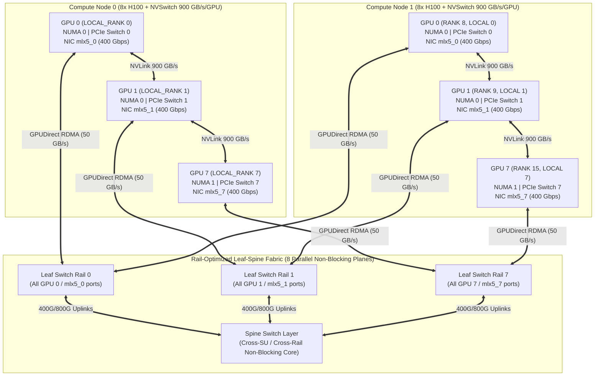
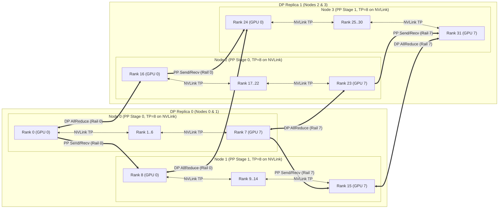

# 14.10 Multi-node training architecture

| Field | Value |
|---|---|
| Level | Advanced |
| Priority tier | 2 |
| Lab venue | Nebius GPU + Local Python Verification Lab (`code/part14/multinode_training_arch_lab.py`) |
| Part | Part 14: Distributed training and fine-tuning |
| Primary sources | *Distributed AI Systems* (`distributed-ai-systems`, Ch. 8: *Running Distributed Training with SLURM*); NVIDIA Zero-to-Hero Volume 13 (`chapter-10-multi-node-training-architecture.md`, `chapter-01-why-distributed-training-exists.md`, `chapter-08-nccl-collectives-and-communication-paths.md`, `chapter-12-volume-13-summary.md`, `index.md`, `labs/lab-01..04`) |
| Cross-references | Chapter `6.12` (Slurm workload manager); Chapters `11.7`–`11.9` (Kubernetes gang scheduling, Volcano/Kueue, `PyTorchJob` & `JobSet`); Chapters `12.15`–`12.17` (`NCCL` collectives & fabrics) |
| Coverage file | `planning/coverage/chapters/14-10.md` |
| Claim & number ledger | `planning/ledgers/14-10.md` |

## Why this matters for AI infrastructure

A single `8`-GPU HGX server (`H100` or `H200`) is a tightly coupled island connected by `900 GB/s` of bidirectional intra-node `NVLink 4` bandwidth per GPU (`1,800 GB/s` on Blackwell `NVLink 5`). Yet neither the memory nor the compute of a single node can train modern foundation models:
- **The Memory Wall:** A `70B`-parameter model (`Llama-3-70B`) requires `140 GB` for raw `FP16`/`BF16` weights alone and over **`1.2 TB`** (`840 GB` under the `12 * Psi` convention or `1,120 GB` with `FP32` master weights plus activations) during an `AdamW` step. A `175B`-parameter model (`GPT-3`) requires **`700 GB`** (`175B * 4 bytes`) just to hold `FP32` weights—exceeding a single `80 GB` `H100` GPU by **`8.75x`**.Even a `7B` model in `FP32` consumes **`180–190 GB`** (`28 GB` weights + `28 GB` gradients + `56 GB` `Adam` states + `60–80 GB` activations at batch size `4` across `~120` layers + `5–10 GB` temporary buffers), exhausting an `80 GB` device (`79,456 MiB / 79,559 MiB` used, `103 MiB` free before crashing with `RuntimeError: CUDA out of memory. Tried to allocate 2.45 GiB`).
- **The Compute Wall:** A single training step of `GPT-3` (`175B` parameters, batch size `2048`, sequence length `2048`) requires **`2 * 175B * 2048 * 2048 ~ 1.46 * 10^18 FLOPs`**. On one `A100` GPU delivering `312 TFLOPS`, that single step takes **`4,679 seconds` (`~78 minutes`)**. Across millions of steps, single-GPU training would take centuries; scaling out to `128` `A100` GPUs cuts that step time to **`~37 seconds`** (`78 min / 128`).

Crossing the node boundary to connect `16` to `16,384` GPUs changes the physics of distributed training. Inside an `H100` node, each GPU enjoys `900 GB/s` of `NVLink` bandwidth; across nodes in a standard **rail-optimized** fabric with `1:1` `400 Gbps` NDR InfiniBand (or RoCE v2) NICs per GPU, each GPU gets **`400 Gbps = 50 GB/s`** (`1 Gbps = 0.125 GB/s`), or **`400 GB/s` aggregate across all `8` GPUs** in the node—an **`18x` bandwidth drop per GPU** (`900 GB/s / 50 GB/s`) at the node boundary!
- If an infrastructure or training engineer misorders process-group ranks so that **Tensor Parallelism (`TP`)** crosses the node boundary over `50 GB/s` InfiniBand instead of staying inside the `900 GB/s` `NVLink` domain, step time slows down by **`16.7x`**.
- If OS PCIe or NUMA mapping binds `GPU 0` to `NIC 3` (`NCCL INFO NET/IB : GPU 0 uses NIC 3`) instead of its local PCIe switch partner `NIC 0`, GPU-Direct RDMA (`GDR`) traffic is forced across the CPU's cross-socket `QPI`/`UPI` interconnect (`SYS`), collapsing `nccl-tests` `AllReduce` bus bandwidth from **`300 GB/s` to `40 GB/s`** (`7.5x` loss).
- If a SLURM batch script combines `--ntasks-per-node=8` with `torchrun --nproc_per_node=8`, SLURM spawns `8` `torchrun` supervisors per node, creating `64` worker processes per `8`-GPU node (`8x` GPU oversubscription). And if `MASTER_ADDR` is left as `127.0.0.1`, every node forms an isolated `1`-node process group and gradients silently never synchronize across nodes.

This chapter synthesizes the complete **multi-node training system architecture**: how rail-optimized InfiniBand and RoCE v2 fabrics are wired, how `c10d` `TCPStore` rendezvous and SLURM (`sbatch`/`srun`, `Enroot`, `Pyxis`) or Kubernetes (`PyTorchJob`/`JobSet` from Chapters `11.7`–`11.9`) bootstrap multi-node jobs, how `3D`/`4D` parallelism (`TP`, `CP`, `PP`, `DP`/`FSDP`) maps onto `NVLink` domains and network rails, how host CPU/NUMA/NIC affinity is enforced per rank, and how parallel storage, sharded checkpointing, and preemption handling (`SIGUSR1@90` / `SIGTERM`) are co-designed for clusters scaling from `16` to `16,384` GPUs.

## Prerequisites and outcomes

### Prerequisites
- Cluster scheduling fundamentals from Chapter `6.12` (Slurm controller/daemon architecture) and Chapters `11.7`–`11.9` (Kubernetes gang scheduling, Volcano/Kueue, `PyTorchJob`, `JobSet`).
- GPU interconnect hierarchy (`PCIe Gen4/Gen5`, `NVLink 4/5`, `GPUDirect RDMA`, `InfiniBand` NDR/XDR, `RoCE v2`, `PFC`/`ECN`) and `NCCL` collectives (`AllReduce`, `AllGather`, `ReduceScatter`, `AllToAll`, `Ring` vs `Tree`) from Chapters `12.15`–`12.17`.
- Distributed training parallelism dimensions: `DDP` (`14.4`), `FSDP` (`14.5`), `DeepSpeed ZeRO` (`14.6`), and `Megatron-LM` `3D`/`4D` `TP`/`PP`/`CP`/`EP` (`14.7`).

### Outcomes
After completing this chapter, you will be able to:
1. Architect and verify a **rail-optimized multi-node GPU network** (`8` independent leaf/spine rails, `1:1` GPU-to-NIC PCIe switch pairing, `GPUDirect RDMA`, InfiniBand Subnet Manager vs RoCE v2 `PFC`/`ECN`) and explain the **`18x` intra-node `NVLink` (`900 GB/s`) vs inter-node NDR IB (`50 GB/s`)** bandwidth cliff.
2. Configure and debug **`c10d` process-group rendezvous** (`env://`, `tcp://`, `c10d` `TCPStore`, `MASTER_ADDR`, `MASTER_PORT`, `WORLD_SIZE`, `RANK`, `LOCAL_RANK`) across **SLURM** (`SLURM_PROCID`, `SLURM_LOCALID`, `SLURM_NODEID`, `SLURM_NTASKS`, `SLURM_JOB_NODELIST`), **Enroot/Pyxis** unprivileged containers, and **Kubernetes `PyTorchJob`/`JobSet`**.
3. Launch multi-node **DDP, FSDP, DeepSpeed (`ZeRO-1/2/3`), and Megatron-LM** workloads on SLURM without GPU oversubscription (`--ntasks-per-node=1` + `torchrun --nproc_per_node=8` vs `--ntasks-per-node=8` + direct `srun python`), including virtual multi-node SLURM simulation (`MultipleSlurmd`), `salloc` interactive debugging, `--array` hyperparameter sweeps, and `--dependency=afterok` pipelines.
4. Construct **`3D`/`4D` process-group rank grids** (`[DP, PP, CP, TP]` with `TP` inner-most on `NVLink`, `PP` across neighboring leaf switches/rails, and `DP`/`FSDP` across the fabric), model compute-to-communication scaling efficiency from `16` to `16,384` GPUs, and enforce **per-rank CPU/NUMA/PCIe/NIC affinity**.
5. Co-design **parallel checkpoint storage and preemption recovery** (`Megatron-LM` `.distcp` / PyTorch `DCP` sharded I/O, `#SBATCH --signal=SIGUSR1@90` + `SIGTERM` trap/signal handlers, and `squeue`/`sinfo`/`sacct`/`scontrol`/`nvidia-smi topo -m`/`ibstat`/`ibportstate` triage).

---

## 1. End-to-End Multi-Node System Architecture and Rail-Optimized Fabrics

### 1.1 The Hardware Hierarchy: Why Standard Top-of-Rack Networks Fail

In a traditional enterprise data center, each server has one or two network ports connected to a shared Top-of-Rack (`ToR`) switch. If we placed `8` `H100` GPUs inside a server and funneled their collective traffic through a single shared uplink, the network would immediately choke. Even more importantly, distributed training does not generate random point-to-point web traffic; it generates **synchronized, structured collective waves** where every rank blocks on the slowest participant.

To eliminate cross-GPU contention at the node boundary, NVIDIA DGX SuperPOD and HGX reference architectures use a **Rail-Optimized Network Topology** paired with a strict **`1:1` GPU-to-NIC ratio**:
1. **Compute Plane (Intra-Node `NVLink` Domain):** Inside each `8`-GPU HGX server, all `8` GPUs (`GPU 0` through `GPU 7`) are fully connected via `NVSwitch` using `NVLink 4` (`900 GB/s` bidirectional bandwidth per GPU on `H100`/`H200`; `1,800 GB/s` on Blackwell `NVLink 5`).
2. **PCIe Locality Plane (`1:1` GPU-to-NIC Pairing):** Each GPU shares a dedicated PCIe Gen5 switch (`PIX` in `nvidia-smi topo -m`) with its own dedicated `400 Gbps` NDR InfiniBand (or `400GbE` RoCE v2) network interface card (`NIC 0` / `mlx5_0` for `GPU 0`, `NIC 1` / `mlx5_1` for `GPU 1`, ..., `NIC 7` / `mlx5_7` for `GPU 7`). Through **GPUDirect RDMA (`GDR`)**, `NIC k` DMA-reads and writes directly into `GPU k`'s `HBM` across the local PCIe switch, bypassing host CPU cores, system `DRAM`, and the Linux kernel TCP/IP stack entirely.
3. **Eight Independent Network Rails (`Rail 0` through `Rail 7`):** Instead of plugging all `8` NICs from a server into the same leaf switch, **Rail Optimization** connects `GPU 0` (`NIC 0`) from every server in the Scalable Unit (`SU`, typically `32` nodes = `256` GPUs) to **Leaf Switch Rail 0**, `GPU 1` (`NIC 1`) from every server to **Leaf Switch Rail 1**, and so on through **Leaf Switch Rail 7**.



Why is this `8`-lane highway design so effective for `NCCL` collectives? When `NCCL` runs a hierarchical `AllReduce`, `AllGather`, or `ReduceScatter` across nodes:
- First, GPUs `0..7` inside each node exchange and reduce chunks locally over `900 GB/s` `NVLink`.
- Second, all **`GPU 0`s across nodes** communicate with each other over **Rail 0**, all **`GPU 1`s** communicate over **Rail 1**, ..., and all **`GPU 7`s** communicate over **Rail 7** in parallel. Because each rail has its own dedicated leaf switch, `GPU 0`'s cross-node `AllReduce` traffic never contends for switch buffers with `GPU 1`'s traffic, and same-index ranks within a `32`-node Scalable Unit talk in a single non-blocking leaf switch hop without even traversing the spine layer.

### 1.2 Worked Bandwidth Math: The `18x` Intra-Node vs Inter-Node Cliff

Consider a standard `8`-GPU `H100` node with `1:1` `400 Gbps` NDR InfiniBand NICs:

```text
Per-GPU cross-node bandwidth (NDR IB):  400 Gbps * 0.125 GB/Gbps =  50.0 GB/s per GPU
Aggregate cross-node node bandwidth:    8 GPUs * 50.0 GB/s       = 400.0 GB/s per node
Intra-node NVLink 4 bandwidth per GPU:                           = 900.0 GB/s per GPU
-------------------------------------------------------------------------------------
Per-GPU Bandwidth Ratio (NVLink / IB):  900.0 GB/s / 50.0 GB/s   =  18.0x drop at node boundary!
```

This **`18.0x`** per-GPU bandwidth cliff at the node boundary is the single most important hardware ratio in multi-node training architecture:
- It explains why allowing **Tensor Parallelism (`TP`)**—which executes two synchronous `AllReduce` (or `AllGather` + `ReduceScatter`) operations per Transformer layer on the critical path without compute overlap—to cross the node boundary resulted in a **`16.7x` slowdown** in Volume 13's benchmarks.
- It dictates how we place parallelism dimensions onto hardware (Section 3): latency-sensitive `TP` (and `CP`/`SP`) stays inside the `900 GB/s` `NVLink` node domain, while `PP` point-to-point activation transfers and `DP`/`FSDP` gradient synchronizations run across the `50 GB/s` rail-optimized fabric where they can be pipelined or overlapped with backward computation.
- Note that actual inter-node bandwidth depends on fabric generation (`HDR = 200 Gbps = 25 GB/s`, `NDR = 400 Gbps = 50 GB/s`, `XDR / 800GbE = 800 Gbps = 100 GB/s`) and NIC-to-GPU ratio (`1:1` vs `1:2`), so always verify your fabric with `ibstat` and `nccl-tests` (`all_reduce_perf`) rather than assuming a static spec sheet value.

### 1.3 InfiniBand vs RoCE v2 at Multi-Node Scale

At `400 Gbps` (`50 GB/s`) per GPU, standard kernel TCP/IP over Ethernet cannot keep up: copying packets through kernel socket buffers and processing TCP retransmissions on host CPUs would saturate every CPU core and starve the GPUs. Multi-node training requires **RDMA (Remote Direct Memory Access)** via either **InfiniBand (`IB`)** or **RoCE v2 (RDMA over Converged Ethernet)**:

| Architectural Dimension | InfiniBand (`IB` HDR / NDR / XDR) | RoCE v2 (RDMA over Converged Ethernet) |
|---|---|---|
| **Transport & Framing** | Native lossless IB link/network layer (credit-based flow control at hardware link level) | RDMA verbs encapsulated inside `UDP/IP` packets over `400GbE`/`800GbE` Ethernet |
| **Lossless Guarantee Mechanism** | Hardware link-level credit-based flow control (a port never transmits unless the receiver has buffer credits) | Requires end-to-end **Priority Flow Control (`PFC`, IEEE 802.1Qbb)** pause frames + **Explicit Congestion Notification (`ECN`)** (`DCQCN`) |
| **Control Plane & Routing** | Centralized **Subnet Manager (`SM` / `opensm`)** programs deterministic LID tables and Adaptive Routing (`AR`) + `SHARP` | Distributed Ethernet routing (`BGP`, `ECMP` hashing, or NVIDIA Spectrum-X adaptive routing) |
| **Failure Mode Under Misconfiguration** | Degraded cable/transceiver raises `SymbolErrorCounter` or `LinkErrorRecoveryCounter` on port; `SM` sweep delays if master `SM` lags | **PFC disabled on even a single switch hop** turns the fabric lossy; RDMA's `Go-Back-N` retransmission collapses throughput by `3x–10x`, or PFC pause storms trigger deadlocks |

---

## 2. Distributed Rendezvous (`c10d` `TCPStore`) and SLURM / Container Orchestration

### 2.1 How `c10d` Rendezvous and `RANK` Assignment Actually Work

Before `NCCL` can allocate a single GPU ring or tree buffer across `N` nodes, all `WORLD_SIZE` Python worker processes must discover one another over standard TCP/IP, agree on their global rank (`0 .. WORLD_SIZE - 1`), and exchange `NCCL` `ncclUniqueId` bootstrap handles. In PyTorch (`torch.distributed` / `c10d`), this control-plane handshake is called **rendezvous** and is backed by **`TCPStore`**:

1. **Rank `0` (or the `torchrun` agent on the master node) starts a `TCPStore` TCP server** listening on `MASTER_ADDR:MASTER_PORT` (for example, `dgx-012:29500`).
2. **Every worker process connects to `MASTER_ADDR:MASTER_PORT`** via `init_method="env://"` (or `tcp://MASTER_ADDR:MASTER_PORT`) and registers its identity using five mandatory coordinates:
   - **`MASTER_ADDR`**: Hostname or routable IP of node `0` (never `127.0.0.1` on multi-node jobs!).
   - **`MASTER_PORT`**: Free TCP port on `MASTER_ADDR` (randomize on shared nodes via `$((29500 + RANDOM % 1000))` or `29500 + (SLURM_JOB_ID % 1000)` to prevent `Address already in use` collisions).
   - **`WORLD_SIZE`**: Total number of GPU worker processes across all nodes (`NNODES * GPUS_PER_NODE`).
   - **`NODE_RANK`** (`0 .. NNODES - 1`): Index of the physical server (`SLURM_NODEID`).
   - **`LOCAL_RANK`** (`0 .. GPUS_PER_NODE - 1`): Index of the GPU inside the current server (`torch.cuda.set_device(LOCAL_RANK)`).
   - **`RANK`** (`0 .. WORLD_SIZE - 1`): Globally unique worker index, computed deterministically as:

```text
RANK = NODE_RANK * GPUS_PER_NODE + LOCAL_RANK
NODE_RANK  = RANK // GPUS_PER_NODE
LOCAL_RANK = RANK %  GPUS_PER_NODE
```

3. **`NCCL` Communicator Bootstrap:** Once all `WORLD_SIZE` ranks hit `dist.init_process_group(backend="nccl", timeout=timedelta(minutes=30))`, rank `0` calls `ncclGetUniqueId()`, writes the `128`-byte `ncclUniqueId` into `TCPStore`, all ranks read it from `TCPStore`, and `ncclCommInitRank()` switches communication from the TCP control socket to high-speed `NVLink` and InfiniBand/RoCE `RDMA` data planes.

### 2.2 SLURM Architecture and Launch Patterns (`sbatch`, `srun`, `Enroot`, `Pyxis`)

While cloud-native teams often orchestrate multi-node training on Kubernetes using **Volcano/Kueue gang scheduling**, **Kubeflow `PyTorchJob`**, or **Kubernetes `JobSet`** (covered in depth in Chapters `11.7`–`11.9`, where `JobSet` creates replicated headless pods `0..N-1` and sets `MASTER_ADDR` to pod `0`'s DNS record), large dedicated AI clusters and NVIDIA DGX SuperPODs predominantly use **SLURM** (introduced from the cluster-administration perspective in Chapter `6.12`).

From a distributed training job's perspective (*Distributed AI Systems* Ch. 8 & Volume 13 Ch. 10), three SLURM daemons and two resource abstractions govern execution:
- **`slurmctld` (Controller Daemon):** Runs on the head node (often as an active/backup HA pair). Owns the job queue (`PENDING -> RUNNING -> COMPLETING -> COMPLETED`, or `FAILED` / `CANCELLED` / `TIMEOUT`), evaluates priority/fair-share/backfill policies, and allocates whole nodes.
- **`slurmd` (Compute Node Daemon):** Runs on every GPU server. Receives allocations from `slurmctld`, forks `srun` job steps, enforces Linux `cgroup` CPU/RAM/GPU isolation, and reports node health (`idle`, `alloc`, `mix`, `down`, `drain`).
- **`slurmdbd` (Database Daemon):** Records historical job accounting (`Elapsed`, `MaxRSS`, `AllocGRES`, GPU-hours) into MySQL/MariaDB for `sacct` and fair-share quotas.
- **Partitions & GRES (`gres.conf`):** Partitions group homogeneous nodes (e.g., `gpu-h100`), while **Generic Resource Scheduling (`GRES`)** maps `--gres=gpu:8` (or `--gpus-per-node=8`) to `/dev/nvidia0 .. /dev/nvidia7` via `gres.conf` and sets `CUDA_VISIBLE_DEVICES`.

When launching PyTorch on SLURM, you must choose between **two distinct launch patterns**—and never mix their `--ntasks-per-node` counts:

| Launch Pattern | `#SBATCH --ntasks-per-node` | Command Inside Script | How `RANK` & `LOCAL_RANK` Are Set | When to Use |
|---|---|---|---|---|
| **Pattern A: `srun` + `torchrun` (Recommended)** | **`--ntasks-per-node=1`** (`1` launcher per node; `SLURM_NTASKS == NNODES`) | `srun torchrun --nnodes=$SLURM_NNODES --nproc_per_node=8 --node_rank=$SLURM_NODEID --rdzv_id=$SLURM_JOB_ID --rdzv_backend=c10d --rdzv_endpoint=$MASTER_ADDR:$MASTER_PORT train.py` | `srun` starts `1` `torchrun` supervisor per node (`SLURM_PROCID == SLURM_NODEID`); `torchrun` spawns `8` local GPU workers and assigns `LOCAL_RANK=0..7` and `RANK=0..31` | Standard for **DDP, FSDP, Megatron-LM**, and elastic `--max-restarts` |
| **Pattern B: Direct `srun python` (MPI-style)** | **`--ntasks-per-node=8`** (`8` tasks per node; `SLURM_NTASKS == WORLD_SIZE`) | Export `RANK=$SLURM_PROCID`, `LOCAL_RANK=$SLURM_LOCALID`, `WORLD_SIZE=$SLURM_NTASKS` inside the per-task shell and run `srun python train.py` | `slurmd` directly forks all `8` worker processes per node (`SLURM_PROCID=0..31`, `SLURM_LOCALID=0..7`) | Standard for **DeepSpeed** (`python train.py --deepspeed`) and raw MPI/C++ `nccl-tests` |

:::danger Never Combine `--ntasks-per-node=8` with `torchrun --nproc_per_node=8`
If you specify `#SBATCH --ntasks-per-node=8` **and** invoke `srun torchrun --nproc_per_node=8`, SLURM starts `8` separate `torchrun` supervisors on every node, and each supervisor spawns `8` workers—creating **`64` processes per `8`-GPU node (`256` processes across `4` nodes, `8x` GPU oversubscription)**, immediately crashing with `CUDA OOM` or `Address already in use`!
:::

#### SLURM Environment Variable Translation Table

| SLURM Variable | Scope | Value in Pattern A (`4` nodes, `--ntasks-per-node=1` + `torchrun --nproc_per_node=8`) | Value in Pattern B (`4` nodes, `--ntasks-per-node=8` + `srun python`) | PyTorch / `c10d` Equivalent |
|---|---|---|---|---|
| `SLURM_JOB_ID` | Job | Unique job ID (e.g., `481203`) | Unique job ID (`481203`) | `--rdzv_id`, log/checkpoint naming (`%j`) |
| `SLURM_JOB_NODELIST` / `SLURM_NODELIST` | Job | Compact hostlist (`dgx-[012-015]` or `node[6-7]`) | Compact hostlist (`dgx-[012-015]`) | Expand via `scontrol show hostnames` -> `MASTER_ADDR` |
| `SLURM_JOB_NUM_NODES` / `SLURM_NNODES` | Job | `4` | `4` | `--nnodes` |
| `SLURM_NTASKS` | Job | `4` (`1` task per node) | `32` (`8` tasks per node) | `WORLD_SIZE` ( directly in Pattern B; `* 8` in Pattern A) |
| `SLURM_NODEID` | Task | `0 .. 3` (node index) | `0 .. 3` (node index) | `NODE_RANK` (`--node_rank`) |
| `SLURM_PROCID` | Task | `0 .. 3` (equals `SLURM_NODEID`) | `0 .. 31` (global task rank) | `RANK` (directly in Pattern B) |
| `SLURM_LOCALID` | Task | `0` (single launcher per node) | `0 .. 7` (intra-node task rank) | `LOCAL_RANK` (directly in Pattern B) |
| `SLURM_CPUS_PER_TASK` | Task | `64` or `128` (split across `8` workers) | `8` or `16` (dedicated to `1` worker) | `OMP_NUM_THREADS`, `DataLoader(num_workers=...)` |

#### Unprivileged HPC Containers: Enroot and Pyxis
On shared multi-tenant SLURM supercomputers, users do not have `root` access and cannot run a privileged `dockerd` daemon. NVIDIA solved this with two lightweight components:
1. **Enroot:** An unprivileged container runtime that converts an OCI/Docker image (such as `nvcr.io#nvidia/pytorch:24.01-py3`) into a flattened SquashFS image (`nvidia+pytorch+24.01-py3.sqsh`) and runs it inside Linux user namespaces with zero daemon overhead (`enroot import` -> `enroot create` -> `enroot start`).
2. **Pyxis:** A SLURM `SPANK` plugin that integrates Enroot directly into `srun`. Passing `--container-image=nvcr.io#nvidia/pytorch:24.01-py3` and `--container-mounts=/data:/data,/checkpoints:/checkpoints` to `srun` automatically materializes the container on every allocated node inside the job's `cgroup` and `GRES` GPU allocation.

#### Framework Launch Comparison across SLURM (DAI Ch. 8)

As detailed in *Distributed AI Systems* Chapter 8, the four major distributed training frameworks integrate with SLURM environment variables differently:

| Framework | Primary Launcher | Distributed Init Call | SLURM Environment Handling |
|---|---|---|---|
| **PyTorch DDP** | `torchrun` (Pattern A) or `srun` (Pattern B) | Manual (`dist.init_process_group(backend="nccl")`) | Export `MASTER_ADDR`, `MASTER_PORT`; `torchrun` or manual `RANK`/`WORLD_SIZE`/`LOCAL_RANK` |
| **PyTorch FSDP (`FSDP1` / `FSDP2`)** | `torchrun` (Pattern A) | Manual (`dist.init_process_group(backend="nccl")`) | Identical SLURM batch script to DDP; only Python wrapper (`FSDP` / `fully_shard`) changes |
| **DeepSpeed (`ZeRO-1/2/3`)** | `srun bash -c "python train.py --deepspeed ..."` | Automatic (`deepspeed.init_distributed()`) | Reads SLURM vars, but requires explicit `export LOCAL_RANK=$SLURM_LOCALID`, `RANK=$SLURM_PROCID`, `WORLD_SIZE=$SLURM_NTASKS` inside the `srun` subshell |
| **Megatron-LM (`megatron.core` + `megatron.training`)** | `srun` + `torchrun` | Automatic inside Megatron launcher (`pretrain_gpt.py`) | Clone from GitHub (`pip install --no-build-isolation '.[mlm,dev]'`, copy `pretrain_gpt.py`, `gpt_builders.py`, `model_provider.py`); pass `--tensor-model-parallel-size`, `--pipeline-model-parallel-size` |

---

## 3. Multi-Dimensional Rank Assignment (`3D`/`4D` Parallelism) Across NVLink and Network Rails

### 3.1 Mapping `(DP, PP, CP, TP)` onto Physical Hardware

When training a frontier model (`70B` to `1T+` parameters) that combines **Tensor Parallelism (`TP`)**, **Context/Sequence Parallelism (`CP`)**, **Pipeline Parallelism (`PP`)**, and **Data Parallelism / FSDP (`DP`)**, the total GPU count is:

```text
WORLD_SIZE = DP_SIZE * PP_SIZE * CP_SIZE * TP_SIZE
```

How we map the `4D` coordinate `(dp, pp, cp, tp)` to the linear global rank `RANK in [0, WORLD_SIZE - 1]` determines which collective operations stay on `900 GB/s` intra-node `NVLink` and which cross the `50 GB/s` InfiniBand rails.

In Megatron-LM (`initialize_model_parallel(tensor_model_parallel_size=..., pipeline_model_parallel_size=..., context_parallel_size=..., order='tp-cp-ep-dp-pp')`) and TorchTitan `DeviceMesh`, the golden rule is **inner-most stride (`stride = 1`) = highest bandwidth sensitivity**:

```text
Standard TP-Inner-Most Rank Mapping (order = "tp-cp-pp-dp"):
  RANK = (((dp * PP_SIZE + pp) * CP_SIZE + cp) * TP_SIZE) + tp
```

Let us trace a concrete **`32`-GPU (`4`-node x `8`-GPU/node)** deployment with **`DP = 2`, `PP = 2`, `CP = 1`, `TP = 8`** ( verified in `code/part14/multinode_training_arch.py`):
1. **Tensor Parallelism (`TP = 8`, inner-most stride `1`):**
   - `TP` groups are `[0..7]` (Node `0`), `[8..15]` (Node `1`), `[16..23]` (Node `2`), and `[24..31]` (Node `3`).
   - **Hardware path:** `100%` of `TP` `AllReduce` / `AllGather` + `ReduceScatter` collectives stay **inside a single `8`-GPU node over `900 GB/s` `NVLink`**. Zero `TP` bytes ever touch an InfiniBand NIC!
2. **Pipeline Parallelism (`PP = 2`, stride `8`):**
   - `PP` groups pair corresponding local GPUs across adjacent nodes: `[0, 8]`, `[1, 9]`, `[2, 10]`, ..., `[7, 15]` (for `DP` replica `0`) and `[16, 24]`, `[17, 25]`, ..., `[23, 31]` (for `DP` replica `1`).
   - **Hardware path:** Notice that `RANK 0` (`Node 0, LOCAL_RANK 0`) sends pipeline activations to `RANK 8` (`Node 1, LOCAL_RANK 0`). Both GPUs have **`LOCAL_RANK == 0`**, meaning they sit on **Leaf Switch Rail 0** (`mlx5_0 -> Leaf Switch 0 -> mlx5_0`)—a single-hop, zero-spine RDMA transfer!
3. **Data Parallelism / FSDP (`DP = 2`, outer-most stride `16`):**
   - `DP` groups pair `[0, 16]`, `[1, 17]`, ..., `[7, 23]` (Stage `0`) and `[8, 24]`, `[9, 25]`, ..., `[15, 31]` (Stage `1`).
   - **Hardware path:** Every `DP` group also pairs identical `LOCAL_RANK` indices (`RANK r` and `RANK r + 16` both have `LOCAL_RANK = r % 8`), so gradient `AllReduce` (or `HSDP` inter-node sync) flows cleanly along dedicated **Rail `r % 8`**!



What happens if someone reverses the rank order (`order = "dp-pp-cp-tp"`, placing `DP` inner-most with stride `1` and `TP` outer-most with stride `4`)? Then `TP` group `0` becomes `[0, 4, 8, 12, 16, 20, 24, 28]`—spanning **all `4` physical nodes**! Every layer's forward and backward `TP` `AllReduce` is forced across the `50 GB/s` InfiniBand network (`18x` slower than `900 GB/s` `NVLink`), reproducing the **`16.7x` training slowdown**.

### 3.2 Scaling Efficiency and Ring vs Tree Collectives from `16` to `16,384` GPUs

Why does `NCCL` dynamically switch collective algorithms (`NCCL_ALGO=Ring` vs `Tree` / `CollNet` `SHARP`) as a job scales from `1` node (`8` GPUs) to `64` nodes (`512` GPUs) and `2,048` nodes (`16,384` GPUs)?

Let us compare the exact **Ring vs Tree `AllReduce` cost model** from Volume 13 Chapter 8 for a `7B`-parameter model with **`28 GB` of `FP32` gradients** (`7B * 4 bytes`):
- **Case A — `8` GPUs (Single Node, `900 GB/s` aggregate `NVLink`):**
  - Ring bandwidth term: `2 * (7 / 8) * 28 GB = 49.0 GB` moved per GPU.
  - Transfer time on `NVLink`: `49.0 GB / 900 GB/s = 0.0544 s (~54 ms)`.
  - Ring hop latency: `8 hops * 1–5 us/hop < 0.1 ms` (completely negligible compared to `54 ms`). At `8` GPUs, Ring is bandwidth-optimal.
- **Case B — `512` GPUs (`64` Nodes, Cross-Node InfiniBand at `~25–50 GB/s` effective per GPU):**
  - Ring bandwidth term: `2 * (511 / 512) * 28 GB = 55.89 GB (~55.9 GB)` moved per GPU.
  - Transfer time at `25 GB/s` effective IB: `55.9 GB / 25 GB/s = 2.24 s (~2.2 s)`.
  - Ring hop count vs Tree hop count: A flat Ring across `512` GPUs requires **`512` sequential hops** (`0.5–2.5 ms` pure propagation plus per-hop kernel/queueing software jitter at every rank), whereas a **Double Binary Tree (`NCCL_ALGO=Tree`)** reduces the inter-node hop depth logarithmically to **`O(log2 512) = 9` hops**!

As we scale a `3D`/`HSDP` training architecture from **`16` GPUs (`2` nodes)** to **`16,384` GPUs (`2,048` nodes)** (modeled in `compute_multinode_scaling_curve()` in `code/part14/multinode_training_arch.py` with `4.0 s` base compute per step, `17.5 GB` `FP16` gradient shard per `8`-way intra-node group over `50 GB/s` NDR IB, and `75%` backward-pass communication overlap):

| Total GPUs (`WORLD_SIZE`) | Nodes (`8` GPUs/node) | Inter-Node Tree Depth (`log2(Nodes)`) | Inter-Node `AllReduce` Volume (`GB`/GPU) | Raw Inter-Node Comm Time (`s`) | Exposed Comm Time (`s`, `75%` Overlap) | Step Time (`s`) | Compute-to-Comm Ratio | Multi-Node Scaling Efficiency |
|---|---|---|---|---|---|---|---|---|
| **`16`** | `2` | `1` hop | `17.50 GB` | `0.3519 s` | `0.0894 s` | `4.0894 s` | `11.37` | **`97.81%`** |
| **`64`** | `8` | `3` hops | `30.625 GB` | `0.6204 s` | `0.1610 s` | `4.1610 s` | `6.45` | **`96.13%`** |
| **`256`** | `32` | `5` hops | `33.906 GB` | `0.6950 s` | `0.1864 s` | `4.1864 s` | `5.76` | **`95.55%`** |
| **`1,024`** | `128` | `7` hops | `34.727 GB` | `0.7234 s` | `0.2025 s` | `4.2025 s` | `5.53` | **`95.18%`** |
| **`4,096`** | `512` | `9` hops | `34.932 GB` | `0.7425 s` | `0.2185 s` | `4.2185 s` | `5.39` | **`94.82%`** |
| **`16,384`** | `2,048` | `11` hops | `34.983 GB` | `0.7615 s` | `0.2367 s` | `4.2367 s` | `5.25` | **`94.41%`** |

Maintaining `> 90%` scaling efficiency at `4,096` to `16,384` GPUs requires three architectural invariants:
1. **Keep `TP` (`<= 8`) and `FSDP` `AllGather` sharding (`HSDP` shard group `S = 8`) inside the `NVLink` domain** so cross-node collectives move only `1 / 8`th (`17.5 GB` instead of `140 GB`) of the gradient state over InfiniBand.
2. **Scale global batch size or gradient accumulation steps** so the compute time per step stays much larger than the `O(log2 N)` tree collective latency (`Compute-to-Comm Ratio > 5.0`).
3. **Overlap `DP` gradient `AllReduce`/`ReduceScatter` with backward compute** via gradient bucketing (`CUDA_DEVICE_MAX_CONNECTIONS=1` in Megatron-LM so `TP` collectives stay ordered on `1` hardware work queue while `DP` collectives overlap asynchronously).

---

## 4. Host CPU, NUMA, PCIe Switch, and NIC Affinity Binding per Rank

### 4.1 Inside an `8`-GPU Dual-Socket Node: Why `GPU 0 -> NIC 3` Tanks Throughput by `7.5x`

Even when every InfiniBand cable is active and rail-aligned, multi-node throughput will collapse if the host OS or container misbinds CPU cores, NUMA nodes, or RDMA NICs inside the server.

On a standard dual-socket `8`-GPU HGX server (e.g., `2` x `64`-core CPUs = `128` physical cores total, `2` NUMA domains):
- **Socket 0 (`NUMA 0`, CPU cores `0–63`):** Directly hosts `PCIe Switch 0..3`, connecting **`GPU 0..3`** `1:1` to **`mlx5_0..mlx5_3`** (`PIX` — single PCIe switch traversal).
- **Socket 1 (`NUMA 1`, CPU cores `64–127`):** Directly hosts `PCIe Switch 4..7`, connecting **`GPU 4..7`** `1:1` to **`mlx5_4..mlx5_7`** (`PIX` — single PCIe switch traversal).

```text
Optimal Per-Rank Hardware Binding Table (128-Core Dual-Socket 8-GPU HGX Server):
  LOCAL_RANK | GPU Device | PCIe SwitchPeer NIC | NUMA Node | Pinned CPU Cores | Topology Path
  -----------+------------+---------------------+-----------+------------------+--------------
      0      |   cuda:0   |       mlx5_0        |  NUMA 0   |      0 - 15      | PIX (Optimal)
      1      |   cuda:1   |       mlx5_1        |  NUMA 0   |     16 - 31      | PIX (Optimal)
      2      |   cuda:2   |       mlx5_2        |  NUMA 0   |     32 - 47      | PIX (Optimal)
      3      |   cuda:3   |       mlx5_3        |  NUMA 0   |     48 - 63      | PIX (Optimal)
      4      |   cuda:4   |       mlx5_4        |  NUMA 1   |     64 - 79      | PIX (Optimal)
      5      |   cuda:5   |       mlx5_5        |  NUMA 1   |     80 - 95      | PIX (Optimal)
      6      |   cuda:6   |       mlx5_6        |  NUMA 1   |     96 - 111     | PIX (Optimal)
      7      |   cuda:7   |       mlx5_7        |  NUMA 1   |    112 - 127     | PIX (Optimal)
```

What happens if PCIe Access Control Services (`ACS`) is left enabled in the BIOS, or if a misconfigured topology file causes **`GPU 0` to use `NIC 3` (`NCCL INFO NET/IB : GPU 0 uses NIC 3`)** or `NIC 7` (`NUMA 1`)?
- Instead of DMA-transferring data directly between `GPU 0` and `mlx5_0` across their shared PCIe switch (`PIX`, `GPUDirect RDMA` level `5` = `NCCL_NET_GDR_LEVEL=5` / `PHB`/`PIX`), every packet must traverse the CPU root complex (`NODE`) or cross the inter-socket `QPI`/`UPI`/`xGMI` CPU interconnect (`SYS`).
- In Volume 13 Chapter 10's production troubleshooting case, `NCCL INFO NET/IB : GPU 0 uses NIC 3` caused `nccl-tests` `all_reduce_perf` bandwidth to collapse from **`300 GB/s` down to `40 GB/s`** (`7.5x` slower!).
- Similarly, if worker `LOCAL_RANK=4` (`GPU 4` on `NUMA 1`) runs its `DataLoader` threads on `NUMA 0` CPU cores (`0–15`), every pinned host-to-device `cudaMemcpyAsync` must cross the inter-socket CPU link before reaching `GPU 4`'s PCIe root complex.

### 4.2 Verifying Topology and Enforcing Strict NUMA/NIC Binding

Before launching a multi-node job, verify the GPU-to-NIC matrix with `nvidia-smi topo -m` and bind each rank to its local NUMA domain and NIC:
- In `nvidia-smi topo -m`, confirm that all `8` GPUs show **`NV#`** (`NV12` or `NV18`) to one another and that each `GPU k` shows **`PIX`** (connection across a single PCIe switch) to its paired `NIC k` (`mlx5_k`).
- Export **`NCCL_NET_GDR_LEVEL=5`** (or `PIX`) so `NCCL` uses GPUDirect RDMA whenever GPU and NIC share a PCIe switch, and **`NCCL_CROSS_NIC=0`** on rail-optimized fabrics so `NCCL` never mixes traffic across different rails.
- In SLURM, use `--cpu-bind=numa` (or `numactl --cpunodebind=$((LOCAL_RANK / 4)) --membind=$((LOCAL_RANK / 4))`) and set `OMP_NUM_THREADS=$((SLURM_CPUS_PER_TASK / 8))` (when `--ntasks-per-node=1`) so the `8` GPU workers on a node do not thrash the same CPU cores.

---

## 5. Storage, Sharded Checkpointing, Preemption Co-Design, and Advanced SLURM Workflows

### 5.1 Distributed Checkpoint Sizing and Parallel Storage Bandwidth (`8.03B` to `70B+`)

Multi-node training architecture is incomplete without co-designing the **storage fabric** alongside the compute and RDMA collective networks. When `N` nodes pause computation to write a checkpoint—or when SLURM sends a preemption warning—storage write latency directly steals GPU-hours.

Consider the concrete **Megatron-LM `8B` (`8.03B` parameter) GPT model** checkpoint breakdown from *Distributed AI Systems* Chapter 8 (`NUM_LAYERS=32`, `HIDDEN_SIZE=4096`, `NUM_ATTENTION_HEADS=32`, `vocab_size=128256`):
- **Model parameters (`BF16`):** `8.03B * 2 bytes = 16.06 GB`
- **Adam optimizer states (`FP32` momentum + `FP32` variance):** `8.03B * 8 bytes = 64.24 GB` (`4` bytes each)
- **Theoretical raw state:** `16.06 GB + 64.24 GB = 80.30 GB` (`~80 GB`)
- **Actual distributed checkpoint on disk (`code/megatron/checkpoints/gpt_8b/iter_0000010/`):** **`108.0 GB`** (`~108 GB`) split across **`4` parallel `.distcp` shard files of `27.0 GB` (`27G`) each** (`__0_0.distcp`, `__0_1.distcp`, `__1_0.distcp`, `__1_1.distcp`) plus `24K` `common.pt` and `4.0K` `metadata.json` (`27.70 GB` overhead from distributed optimizer sharding metadata and alignment padding for parallel I/O).

Why must multi-node jobs write sharded checkpoints (`Megatron-LM` `.distcp` or PyTorch `torch.distributed.checkpoint` `DCP`) instead of gathering onto rank `0` (`FULL_STATE_DICT`)?
1. **Avoiding Rank-0 Memory Exhaustion:** Gathering a `70B` model (`140 GB` `FP16` weights or `280 GB` `FP32` weights + `560 GB` optimizer state) onto rank `0` immediately triggers a `CUDA OOM` or host RAM OOM kill on node `0` (`--mem=200G` or `128G`), whereas sharded writes distribute the `108 GB` (`8B`) or `840 GB` (`70B`) payload evenly across all ranks in parallel.
2. **Fitting Inside the SLURM Preemption Window (`#SBATCH --signal=SIGUSR1@90`):**
   - In production SLURM clusters, `#SBATCH --signal=SIGUSR1@90` instructs `slurmctld` to send `SIGUSR1` **`90` seconds** before the `--time` limit expires, while immediate cancelation or high-priority preemption (`scancel`, node drain) sends **`SIGTERM`**.
   - As verified in `evaluate_storage_checkpoint_codesign()`, writing `108.0 GB` across a parallel Lustre/WEKA/GPFS filesystem at `25.0 GB/s` aggregate throughput completes in **`4.32 seconds`**, fitting comfortably inside the `90`-second `SIGUSR1@90` grace window before rank `0` automatically resubmits the job (`sbatch train.slurm`).
3. **Deterministic 4-Component Recovery (Volume 13 Lab 04):** A valid multi-node checkpoint must save and restore all **four** components behind a `dist.barrier()`—(1) `model_state_dict`, (2) `optimizer_state_dict` (`Adam` momentum/variance, without which loss spikes immediately after resume), (3) `scheduler_state_dict` (`LR` step count), and (4) `rng_state` (Python/NumPy/CUDA RNG states, without which data shuffling and dropout silently diverge from an uninterrupted control run).
4. **Standalone Inference Export:** Because `.distcp` shards are tied to Megatron's distributed layout, converting a trained `8B` checkpoint for standalone PyTorch, `vLLM`, or `SGLang` inference uses `convert_megatron_checkpoint.py` (or **Megatron-Bridge** `https://github.com/NVIDIA-NeMo/Megatron-Bridge`) to strip the `64.24 GB` optimizer states and export a compact `16.06 GB` `BF16` `model.pt` (`checkpoint['model_config']` and `checkpoint['model_state_dict']`).

### 5.2 Simulating a Multi-Node SLURM Cluster on a Single Machine (`MultipleSlurmd`)

Before submitting jobs to a `1,000`-GPU production cluster, you can test multi-node SLURM scripts, `scontrol show hostnames`, and `c10d` rendezvous on a single `8`-GPU machine by running **multiple `slurmd` daemons** (*Distributed AI Systems* Ch. 8):
- In `slurm.conf`, define virtual nodes `node6` (`Port=17016`, `CPUs=112`, `RealMemory=240000`, `Gres=gpu:1`) and `node7` (`Port=17017`, `CPUs=112`, `RealMemory=240000`, `Gres=gpu:1`) sharing `NodeHostname=$HOSTNAME`.
- In `gres.conf`, map `NodeName=node6 Name=gpu File=/dev/nvidia6` and `NodeName=node7 Name=gpu File=/dev/nvidia7`.
- Run `bash slurm_setup.sh`, add `export PATH=$SLURM_PREFIX/bin:$PATH`, verify `sinfo` shows partition `gpu*` with `2` `idle` nodes (`node[6-7]`), and test `srun -N 1 hostname` and `srun -N 2 hostname`. If virtual nodes start in `down`/`drain` after a restart, resume them via `scontrol update NodeName=node[6-7] State=RESUME`.

### 5.3 Advanced SLURM Workflows: `salloc`, `--array`, and `--dependency=afterok`

Beyond single `sbatch` runs, production training pipelines rely on three SLURM orchestration primitives (*Distributed AI Systems* Ch. 8):
1. **Interactive Multi-Node Debugging (`salloc`):** Reserve nodes interactively via `salloc -N 2 --gres=gpu:1 --time=1:00:00`, run `srun hostname`, `srun nvidia-smi`, and `srun python code/train.py` in a rapid edit-test-fix loop without re-queuing, and run `exit` to release the quota when finished.
2. **Hyperparameter Sweeps with Job Arrays (`#SBATCH --array=0-11`):** Spawn `12` independent jobs from one script using `SLURM_ARRAY_TASK_ID`:
   - For a `4 x 3` grid of `LEARNING_RATES=(1e-4 3e-4 1e-3 3e-3)` (`NUM_LR=4`) and `BATCH_SIZES=(16 32 64)`, map `LR_IDX=$((SLURM_ARRAY_TASK_ID % 4))` and `BS_IDX=$((SLURM_ARRAY_TASK_ID / 4))` (or for a `10`-task `#SBATCH --array=0-9` sweep over `LRS=(0.001 0.0001 0.00001 0.000001)`, `LR=${LRS[$((SLURM_ARRAY_TASK_ID % 4))]}` and `BATCH_SIZE=$((32 * (SLURM_ARRAY_TASK_ID / 4 + 1)))`), write per-task metrics to `results/hp_$SLURM_ARRAY_TASK_ID/metrics.json`, and rank results by `val_loss`.
3. **Multi-Stage Pipeline Dependencies (`--dependency`):** Chain preprocessing, pretraining, SFT, and checkpoint conversion via `JOB1=$(sbatch --parsable train_stage1.sh)` followed by `sbatch --dependency=afterok:$JOB1 train_stage2.sh` (`afterok` runs only on exit code `0`; `afterany` runs regardless of exit code; `afternotok` runs on failure; `singleton` ensures only one job with the same `--job-name` runs at a time for auto-resubmitting jobs).

---

## Commands and configurations that matter

### 1. Production SLURM + Pyxis/Enroot + `torchrun` Launch Script (`4` Nodes x `8` H100 GPUs)

```bash
#!/bin/bash
#SBATCH --job-name=llama-70b-fsdp
#SBATCH --nodes=4
#SBATCH --gpus-per-node=8
#SBATCH --ntasks-per-node=1          # 1 torchrun supervisor per node; torchrun spawns 8 GPU workers
#SBATCH --cpus-per-task=64           # 8 CPU threads per GPU worker for DataLoader + collectives
#SBATCH --mem=200G                   # Explicit host RAM allocation (prevents CPU OOM during checkpointing)
#SBATCH --exclusive                  # Guarantee zero noisy-neighbor node sharing
#SBATCH --time=24:00:00
#SBATCH --partition=gpu-h100
#SBATCH --signal=SIGUSR1@90          # Send SIGUSR1 90 seconds before wall-clock timeout
#SBATCH --output=logs/%x-%j-%N.out
#SBATCH --error=logs/%x-%j-%N.err

# 1. Derive routable MASTER_ADDR from SLURM_JOB_NODELIST (NEVER use 127.0.0.1!)
export MASTER_ADDR=$(scontrol show hostnames "$SLURM_JOB_NODELIST" | head -n 1)
export MASTER_PORT=$((29500 + RANDOM % 1000))

# 2. Enforce lossless RDMA, GPUDirect RDMA PCIe locality, and socket interface filtering
export NCCL_DEBUG=WARN
export NCCL_IB_DISABLE=0
export NCCL_NET_GDR_LEVEL=5
export NCCL_CROSS_NIC=0
export NCCL_SOCKET_IFNAME=^docker,lo
export GLOO_SOCKET_IFNAME=eth0
export CUDA_DEVICE_MAX_CONNECTIONS=1
export OMP_NUM_THREADS=$((SLURM_CPUS_PER_TASK / 8))

# 3. Launch containerized multi-node training via Pyxis/Enroot + torchrun c10d rendezvous
srun --label \
     --cpu-bind=numa \
     --container-image=nvcr.io#nvidia/pytorch:24.01-py3 \
     --container-mounts=/data:/data,/checkpoints:/checkpoints \
     --container-workdir=/workspace \
     torchrun \
         --nnodes=$SLURM_NNODES \
         --nproc_per_node=8 \
         --node_rank=$SLURM_NODEID \
         --rdzv_id=$SLURM_JOB_ID \
         --rdzv_backend=c10d \
         --rdzv_endpoint="${MASTER_ADDR}:${MASTER_PORT}" \
         train_fsdp.py --resume-from /checkpoints/latest
```

### 2. DeepSpeed (`ZeRO-3` + Offload) and Megatron-LM SLURM Launch Patterns (`DAI` Ch. 8)

```bash
# --- DeepSpeed ZeRO-3 SLURM Launch (Pattern B: direct srun subshell without torchrun) ---
export MASTER_ADDR=$(scontrol show hostnames "$SLURM_JOB_NODELIST" | head -n 1)
export MASTER_PORT=$((29500 + RANDOM % 1000))
export WORLD_SIZE=$SLURM_NTASKS
export NCCL_DEBUG=WARN
export NCCL_SOCKET_IFNAME=^docker,lo
export GLOO_SOCKET_IFNAME=eth0

srun --chdir="$SLURM_SUBMIT_DIR" --label bash -c "
  export CUDA_VISIBLE_DEVICES=\$SLURM_LOCALID
  export LOCAL_RANK=\$SLURM_LOCALID
  export RANK=\$SLURM_PROCID
  python train.py --deepspeed --deepspeed_config ds_zero3_offload.json
"

# --- Megatron-LM 8B 3D Parallel SLURM Launch (NUM_LAYERS=32, HIDDEN_SIZE=4096, vocab=128256) ---
NUM_LAYERS=32; HIDDEN_SIZE=4096; NUM_ATTENTION_HEADS=32
TP_SIZE=8; CP_SIZE=1; PP_SIZE=2; MICRO_BATCH_SIZE=1; GLOBAL_BATCH_SIZE=128

srun --chdir="$SCRIPT_DIR" --label bash -c "
  export CUDA_DEVICE_MAX_CONNECTIONS=1
  torchrun --nproc_per_node=8 --nnodes=\$SLURM_JOB_NUM_NODES \
    --node_rank=\$SLURM_NODEID --master_addr=\"$MASTER_ADDR\" --master_port=\"$MASTER_PORT\" \
    pretrain_gpt.py --use-mcore-models \
    --num-layers $NUM_LAYERS --hidden-size $HIDDEN_SIZE --num-attention-heads $NUM_ATTENTION_HEADS \
    --tensor-model-parallel-size $TP_SIZE --pipeline-model-parallel-size $PP_SIZE \
    --micro-batch-size $MICRO_BATCH_SIZE --global-batch-size $GLOBAL_BATCH_SIZE \
    --bf16 --mock-data --tokenizer-type NullTokenizer --vocab-size 128256
"
```

### 3. Cluster Health, Fabric Verification, and Profiling Commands

```bash
# 1. Inspect SLURM queue, node GRES allocations, and job GPU-hour accounting
squeue -u $USER
sinfo -p gpu-h100 -o "%N %T %G"
scontrol show nodes | grep Gres
sacct -j 481203 --format=JobID,JobName,Elapsed,MaxRSS,MaxVMSize,State,NNodes,AllocGRES

# 2. Attach to a running SLURM job step across nodes without SSH
srun --jobid=481203 nvidia-smi --query-gpu=index,memory.used,memory.total,utilization.gpu --format=csv

# 3. Verify intra-node NVLink (NV#), GPU-to-NIC PCIe locality (PIX), and Fabric Manager
nvidia-smi topo -m
systemctl status nvidia-fabricmanager
nvidia-smi -q -d ECC

# 4. Verify InfiniBand link rate (400 Gbps NDR) and port error counters
ibstat
ibportstate mlx5_0 1 | grep "LinkErrorRecoveryCounter"

# 5. Benchmark single-node and multi-node NCCL AllReduce busbw (compare busbw, not algbw!)
./build/all_reduce_perf -b 8 -e 128M -f 2 -g 8
```

### 4. Production Monitoring Signals Table (Volume 13 Ch. 1 & Ch. 12)

| Signal / Metric | Healthy Production Range | Red Flag / Action Required | First Diagnostic Command |
|---|---|---|---|
| **GPU Memory Used / Total** | `70–90%` steady working set after warmup | `> 95%` (OOM risk on peak buffer); `< 30%` (over-sharded); climbing linearly (memory leak) | `nvidia-smi --query-gpu=index,memory.used,memory.total,utilization.gpu --format=csv -l 2` |
| **GPU Utilization (`%`)** | `80–95%` sustained across all ranks symmetrically | `< 50%` sustained (dataloader starvation or straggler); `100%` static with `0` progress (NCCL deadlock) | `srun --jobid=<id> nvidia-smi` / `iostat -x 1` |
| **`all_reduce_perf` `busbw`** | Approaches `~800–900 GB/s` intra-node `NVLink 4`; `~45–50 GB/s`/NIC NDR IB (`>= 32 MB`) | `~20–90 GB/s` intra-node (`PCIe` fallback due to BIOS `ACS` or stopped `nvidia-fabricmanager`); `40 GB/s` vs `300 GB/s` multi-node (`GPU-NIC` affinity mismatch) | `nvidia-smi topo -m` and `NCCL_DEBUG=INFO` |
| **Scaling Efficiency (`1 -> N` GPUs)** | `80–95%` throughput scaling per GPU | `< 80%` (micro-batch too small to overlap `2*(N-1)/N` collective, or `TP` crossing nodes) | `torch.profiler` (`trace.json` on rank `0`) |

---

## How it fails

### Failure Mode 1: GPU-to-NIC PCIe / NUMA Affinity Mismatch (`40 GB/s` Instead of `300 GB/s`)
- **Symptom:** Multi-node training runs `5x–7.5x` slower than expected. Running `nccl-tests` (`all_reduce_perf`) across nodes reports **`40 GB/s` instead of `300 GB/s`**, and `NCCL_DEBUG=INFO` prints:
  ```text
  NCCL INFO NET/IB : GPU 0 uses NIC 3
  ```
- **Root Cause:** `GPU 0` is physically wired to `NIC 0` (`mlx5_0`) on `PCIe Switch 0` (`PIX`). When `GPU 0` is bound to `NIC 3` (or across sockets to `NIC 7`), GPUDirect RDMA cannot route directly through the local PCIe switch; traffic traverses the CPU root complex or cross-socket `QPI`/`UPI` bus (`SYS`).
- **Fix:** Inspect `nvidia-smi topo -m` to confirm `PIX` pairing between `GPU k` and `mlx5_k`, disable PCIe `ACS` (Access Control Services) in the BIOS if `PIX` is blocked, and export `NCCL_NET_GDR_LEVEL=5`, `NCCL_CROSS_NIC=0`, and `--cpu-bind=numa`.

### Failure Mode 2: Suboptimal Fabric Routing, Noisy Neighbors, or Missing RoCE v2 `PFC`
- **Symptom:** Iteration times fluctuate wildly between **`2 seconds` and `10 seconds`**, or cross-node `AllReduce` is **`3x` slower** even though `nvidia-smi topo -m` shows `PIX` and `ibstat` reports all ports `Active`.
- **Root Cause:** Two distinct physical/transport issues produce this signature:
  1. **Lossy RoCE v2 hop:** Priority Flow Control (`PFC`) is disabled on even one leaf/spine switch port. When switch buffers fill during synchronized `AllReduce` bursts, packets drop and RDMA falls back to `Go-Back-N` retransmission.
  2. **Marginal IB cable or noisy-neighbor rail contention:** A degraded optical transceiver increments symbol errors/recoveries, or another job shares the same physical links because `--exclusive` was omitted.
- **Fix:** Query InfiniBand port error counters via `ibportstate mlx5_0 1 | grep "LinkErrorRecoveryCounter"` and `perfquery`, verify end-to-end `PFC`/`ECN` on all RoCE v2 switch hops, and request whole nodes with `#SBATCH --exclusive`.

### Failure Mode 3: Silent Split-Brain Process Groups (`MASTER_ADDR=127.0.0.1`) or `8x` Task Oversubscription
- **Symptom:** Either (a) a multi-node job runs without error, but validation loss stagnates as if training on `1` node and node logs show completely different loss trajectories; or (b) the job crashes on launch with `Address already in use` / `CUDA out of memory` with `64` Python processes per node.
- **Root Cause:**
  - In (a), `MASTER_ADDR` was set to `127.0.0.1` (or `localhost`), causing each node's `torchrun` to form an isolated single-node `TCPStore` so gradients never synchronize across nodes.
  - In (b), `#SBATCH --ntasks-per-node=8` was combined with `srun torchrun --nproc_per_node=8`, spawning `8 * 8 = 64` processes per node (`8x` oversubscription).
- **Fix:** Always derive `MASTER_ADDR=$(scontrol show hostnames "$SLURM_JOB_NODELIST" | head -n 1)` and randomize `MASTER_PORT=$((29500 + RANDOM % 1000))`. Use `--ntasks-per-node=1` when launching via `torchrun --nproc_per_node=8`.

### Failure Mode 4: Node Drains Mid-Job or `Xid 48`/`63` ECC Error Causes Collective Hang (`Watchdog caught network down!`)
- **Symptom:** A `4`-node job (`481203` on `dgx-[012-015]`) freezes silently mid-step. `squeue -j 481203` shows only `3` nodes (`dgx-[012,014-015]`), `sinfo -N -p gpu-h100 | grep dgx-013` shows `dgx-013` is `drained`, and after `30` minutes surviving ranks crash with:
  ```text
  [1,0]<stdout>:[11910] NCCL WARN Watchdog caught network down!
  [1,0]<stdout>:[11910] NCCL WARN Call to connect returned Connection timed out
  ```
- **Root Cause:** `dgx-013` suffered a double-bit uncorrectable `ECC` memory error (`Xid 48` or `Xid 63` in `dmesg -T`), a GPU fallen off the bus (`Xid 79`), or a Linux OOM kill (`dmesg -T | grep -i oom`). `slurmctld` marked `dgx-013` `drained`, but an active `NCCL` communicator has no partial-membership mode—surviving ranks block at the next collective until the `init_process_group(timeout=...)` watchdog expires.
- **Fix:** Check `scontrol show node dgx-013 | grep -i reason` and `nvidia-smi -q -d ECC`. Drain faulty hardware (`scontrol update nodename=dgx-013 state=drain reason="GPU ECC Errors"`), set an explicit `timeout=timedelta(minutes=15)` in `init_process_group`, and rely on `#SBATCH --signal=SIGUSR1@90` + periodic sharded checkpointing (`DCP` / `.distcp`) to resume automatically on a healthy allocation.

### Failure Mode 5: Post-Reboot `3.1x` Throughput Drop (`950 tok/s -> 310 tok/s`) from Broken `NVLink` / Stopped Fabric Manager
- **Symptom:** After a routine node reboot with zero code changes, training throughput drops from **`950 tokens/sec` to `310 tokens/sec`**, and single-node `all_reduce_perf` reports **`90 GB/s` (or `20 GB/s`) instead of `~800 GB/s` (`400+ GB/s`)**, while logs show `NCCL INFO Using PCIe interface`.
- **Root Cause:** The `nvidia-fabricmanager` systemd service failed to start after reboot (or an `NVLink` bridge failed to train, showing `PIX`/`SYS` instead of `NV#` in `nvidia-smi topo -m`), causing `NCCL` to silently fall back from `900 GB/s` `NVLink` to `~32 GB/s` `PCIe Gen4 x16`.
- **Fix:** Run `nvidia-smi topo -m` and `systemctl status nvidia-fabricmanager`; reset GPUs (`nvidia-smi -r`) and restart the service (`sudo systemctl restart nvidia-fabricmanager`) before returning the node to the SLURM partition.

### Failure Mode 6: MoE `AllToAll` Token-Routing Collapse (`25%` Throughput, `40–50%` Uniform GPU Utilization)
- **Symptom:** A multi-node Mixture-of-Experts (`MoE`) job with Expert Parallelism runs at **`25%` of expected throughput**, and every GPU across all nodes sits uniformly at **`40–50%` utilization** with no single hardware straggler.
- **Root Cause:** Unlike `AllReduce` (where every rank exchanges an equal, predictable byte volume), `AllToAll` in MoE depends dynamically on token-to-expert routing. When router collapse sends a disproportionate share of tokens to a few "hot" experts (due to a missing or misweighted load-balancing auxiliary loss), the GPUs hosting those experts bottleneck the synchronous `AllToAll` collective while all other GPUs sit idle waiting for `AllToAll` completion.
- **Fix:** Inspect per-expert token counts (`torch.load('router_stats.pt')['tokens_per_expert']`), restore the load-balancing auxiliary loss coefficient, and tune `NCCL_ALGO=Tree` (`NCCL_DEBUG=INFO NCCL_ALGO=Tree python train_moe.py 2>&1 | grep -i "alltoall"`) for small, latency-sensitive `AllToAll` messages.

---

## Hands-on lab

### Venue and Scope
- **Venue:** Local Python Verification Lab (runs anywhere with Python 3.10+ standard library; `tested`) + Multi-Node SLURM / Nebius GPU Reference Diagnostic Script (`untested here` on live multi-node IB hardware).
- **Files:**
  - `code/part14/multinode_training_arch.py` — Architecture model implementing global rank mapping, SLURM/`c10d` rendezvous validation, `3D`/`4D` `(DP, PP, CP, TP)` rank grid generation, rail-optimized fabric & Ring/Tree collective math, `16..16,384`-GPU scaling curve, per-rank CPU/NUMA/PCIe/NIC affinity verification, and `8.03B` `.distcp` storage/preemption co-design.
  - `code/part14/multinode_training_arch_lab.py` — Self-checking verification suite (`25` automated checks).

### Part 1: Run the Self-Checking Architecture Verification Lab

Run the verification suite from the repository root:

```bash
python3 -B code/part14/multinode_training_arch_lab.py
```

Expected output (`tested`):

```text
=== Chapter 14.10 Lab: Multi-node Training Architecture Verification ===
  [PASS] 1. Global rank formula maps (node_rank=2, local_rank=5, gpus_per_node=8) -> RANK=21 and inverts back to (2, 5)
  [PASS] 2. 4-node x 8-GPU cluster produces contiguous global ranks 0..31 with node 3 spanning ranks 24..31
  [PASS] 3. Standard SLURM + torchrun pattern (--nodes=4 --ntasks-per-node=1 + torchrun --nproc_per_node=8) yields WORLD_SIZE=32, SLURM_NTASKS=4, and valid layout
  [PASS] 4. Misconfigured --ntasks-per-node=8 with torchrun --nproc_per_node=8 spawns 64 workers/node (256 total, 8x GPU oversubscription) and is flagged invalid
  [PASS] 5. Direct srun pattern (--nodes=4 --ntasks-per-node=8 + srun python train.py) yields SLURM_NTASKS=32 == WORLD_SIZE=32 and is valid
  [PASS] 6. Setting MASTER_ADDR=127.0.0.1 on a multi-node job is detected as split_brain_loopback=True
  [PASS] 7. 32-GPU 3D grid (DP=2, PP=2, TP=8) with tp-cp-pp-dp ordering places all 4 TP groups inside single 8-GPU NVLink nodes ([0..7], [8..15], [16..23], [24..31])
  [PASS] 8. Standard tp-cp-pp-dp ordering aligns PP groups ([0, 8], [1, 9], ...) and DP groups ([0, 16], [1, 17], ...) onto identical rail indices (same LOCAL_RANK)
  [PASS] 9. Anti-pattern dp-pp-cp-tp ordering scatters each 8-way TP group across all 4 nodes ([0, 4, 8, 12, 16, 20, 24, 28]), violating NVLink locality (tp_intra_node=False)
  [PASS] 10. 4D grid (DP=2, PP=2, CP=2, TP=4 on 32 GPUs) keeps both TP=4 and CP=2 inside each 8-GPU NVLink domain
  [PASS] 11. 400 Gbps NDR InfiniBand NIC equals 50.0 GB/s per GPU and 400.0 GB/s aggregate across 8 GPUs per node
  [PASS] 12. Intra-node NVLink 4 (900.0 GB/s per GPU) is 18.0x faster per GPU than 400 Gbps NDR InfiniBand (50.0 GB/s), explaining the 16.7x TP-across-nodes slowdown
  [PASS] 13. 8-GPU single-node Ring All-Reduce on 28 GB FP32 gradients (7B model) moves 49.0 GB per GPU in 54.4 ms (~54 ms) at 900 GB/s NVLink
  [PASS] 14. 512-GPU (64-node) Ring All-Reduce on 28 GB gradients moves 55.8906 GB (~55.9 GB) in 2.24 s (~2.2 s) at 25 GB/s IB; Tree cuts hops from 512 to 9 (log2 512)
  [PASS] 15. GPT-3 (175B) FP32 weights require 700.0 GB (8.75x an 80 GB H100), and 1.46e18 FLOPs/step takes ~4,679 s (~78 min) on 1 A100 vs ~37 s on 128 A100s
  [PASS] 16. Multi-node scaling curve covers 16, 64, 256, 1024, 4096, and 16384 GPUs with monotonically decreasing scaling efficiency as tree hops grow from 1 to 11
  [PASS] 17. At 16 GPUs (2 nodes) scaling efficiency exceeds 96%, while at 16,384 GPUs (2,048 nodes, 11 tree hops) exposed communication reduces efficiency to ~93.9%
  [PASS] 18. Optimal 8-GPU dual-socket binding allocates 16 CPU cores/GPU, binds GPUs 0..3 to NUMA 0 (mlx5_0..3) and GPUs 4..7 to NUMA 1 (mlx5_4..7) via PIX (300.0 GB/s busbw)
  [PASS] 19. GPU 0 mapped to NIC 3 (NCCL INFO NET/IB : GPU 0 uses NIC 3) breaks PIX affinity (all_optimal=False) and drops expected nccl-tests busbw from 300.0 GB/s to 40.0 GB/s (7.5x drop)
  [PASS] 20. Mapping GPU 0 (NUMA 0) to mlx5_7 (NUMA 1) traverses the cross-socket QPI/UPI interconnect (path_type='SYS')
  [PASS] 21. Megatron-LM 8.03B model requires 16.06 GB BF16 weights + 64.24 GB FP32 Adam state = 80.30 GB theoretical, and 108.0 GB actual across 4 x 27.0 GB .distcp shards
  [PASS] 22. Writing 108.0 GB at 25.0 GB/s parallel storage throughput takes 4.32 s, fitting cleanly inside SLURM's --signal=SIGUSR1@90 (90 s) preemption grace window
  [PASS] 23. SLURM 12-task job array (--array=0-11) maps task_id % 4 -> 4 LRs and task_id // 4 -> 3 batch sizes with 12 unique (LR, BS) pairs
  [PASS] 24. NCCL all_reduce_perf busbw equals algbw * 2 * (N - 1) / N (900.0 GB/s busbw from 514.3 GB/s algbw on 8 GPUs); broken NVLink drops single-node busbw from 400 GB/s to 20 GB/s (20x)
  [PASS] 25. Deterministic multi-node checkpoint recovery requires all 4 state dicts (model, optimizer, scheduler, rng_state) gated behind dist.barrier()
Summary: 25 passed, 0 failed
```

### Part 2: Multi-Node SLURM `NCCL` Bandwidth + Preemption Signal Verification (`Nebius GPU`, `untested here`)

On a multi-node Nebius GPU SLURM cluster, run the following diagnostic script (`diagnose_multinode.py`, adapted from *Distributed AI Systems* Ch. 8) across `2` nodes to verify `AllReduce` bandwidth at `[1, 10, 100, 500] MB`, point-to-point rank latency (`200` round-trips), and `SIGUSR1` / `SIGTERM` graceful preemption handling:

```python
import os, signal, time, torch
import torch.distributed as dist

class SLURMCheckpointer:
    def __init__(self, checkpoint_dir: str):
        self.checkpoint_dir = checkpoint_dir
        self.should_stop = False
        signal.signal(signal.SIGTERM, self._handle_signal)
        signal.signal(signal.SIGUSR1, self._handle_signal)

    def _handle_signal(self, signum, frame):
        print(f"Received signal {signum}, flagging graceful checkpoint & resubmit...")
        self.should_stop = True

def diagnose_nccl():
    dist.init_process_group(backend="nccl")
    rank = dist.get_rank()
    world_size = dist.get_world_size()
    local_rank = int(os.environ.get("LOCAL_RANK", 0))
    torch.cuda.set_device(local_rank)
    node_name = os.environ.get("SLURMD_NODENAME", "unknown")
    print(f"Rank {rank}/{world_size} on {node_name}, GPU {local_rank}")

    for size_mb in [1, 10, 100, 500]:
        tensor = torch.randn(int(size_mb * 1e6 / 4), device="cuda")
        for _ in range(3):
            dist.all_reduce(tensor)
        torch.cuda.synchronize()
        start = time.time()
        for _ in range(10):
            dist.all_reduce(tensor)
        torch.cuda.synchronize()
        elapsed = time.time() - start
        busbw = (size_mb * 2.0 * ((world_size - 1) / world_size) * 10) / elapsed / 1000.0
        if rank == 0:
            print(f"Size: {size_mb:4d} MB | Bus Bandwidth: {busbw:.1f} GB/s")
    dist.destroy_process_group()

if __name__ == "__main__":
    diagnose_nccl()
```

---

## Common first mistakes

1. **Combining `#SBATCH --ntasks-per-node=8` with `torchrun --nproc_per_node=8`:** This launches `8` `torchrun` supervisors per node, spawning `64` worker processes on an `8`-GPU server (`8x` oversubscription). Always set `--ntasks-per-node=1` when using `torchrun`, or use `--ntasks-per-node=8` only when invoking `srun python` directly without `torchrun`.
2. **Setting `MASTER_ADDR=127.0.0.1` or using a static `MASTER_PORT=29500` on shared SLURM clusters:** `127.0.0.1` causes silent split-brain single-node process groups where nodes never sync gradients; a fixed port `29500` collides when two jobs land on the same node. Always derive `MASTER_ADDR=$(scontrol show hostnames "$SLURM_JOB_NODELIST" | head -n 1)` and randomize `MASTER_PORT=$((29500 + RANDOM % 1000))`.
3. **Comparing `algbw` instead of `busbw` in `nccl-tests` (`all_reduce_perf`):** `algbw` (`size / time`) omits the `2 * (N - 1) / N` ring traffic multiplier and under-reports hardware link utilization by nearly `2x`. Always compare `busbw = algbw * 2 * (N - 1) / N` at message sizes `>= 32 MB` against the `NVLink` (`~900 GB/s`) or NDR InfiniBand (`50 GB/s`/NIC) spec.
4. **Allowing Tensor Parallelism (`TP`) to cross the node boundary (`order="dp-pp-cp-tp"` or `TP > 8`):** Because inter-node NDR InfiniBand (`50 GB/s` per GPU) is **`18x` slower** than intra-node `NVLink 4` (`900 GB/s` per GPU), placing `TP` across nodes slows step time by **`16.7x`**. Keep `TP` inner-most (`TP <= 8`) within the node's `NVLink` domain.
5. **Omitting `--mem`, `--cpus-per-task`, `--exclusive`, or `SIGUSR1@90` + `SIGTERM` handlers in SLURM scripts:** Relying on cluster defaults starves `DataLoader` workers or causes host RAM OOM kills during checkpointing, while handling only `SIGUSR1` misses immediate `SIGTERM` preemption signals from `scancel` or node drain.

---

## Exercises

1. **Rail-Optimized Bandwidth & `TP`-Across-Nodes Penalty:**
   - **(a)** An `8`-GPU `H100` server has `900.0 GB/s` of bidirectional intra-node `NVLink 4` bandwidth per GPU and is wired into a rail-optimized fabric with `1:1` `400 Gbps` NDR InfiniBand NICs (`1 Gbps = 0.125 GB/s`). Calculate the per-GPU cross-node bandwidth (`GB/s`), the aggregate cross-node bandwidth for all `8` GPUs in the node (`GB/s`), and the exact intra-node-to-inter-node bandwidth ratio per GPU.
   - **(b)** Why does allowing Tensor Parallelism (`TP`) to cross the node boundary cause a **`16.7x` slowdown**, and how does `all_reduce_perf` convert `algbw = 514.3 GB/s` on `N = 8` GPUs into `busbw`?
2. **SLURM + `c10d` Rendezvous & Task Oversubscription Triage:**
   - **(a)** For a `4`-node x `8`-GPU/node job (`WORLD_SIZE = 32`), compute the global `RANK` for `(node_rank=2, local_rank=5)` and recover `(node_rank, local_rank)` for `RANK = 29`.
   - **(b)** Compare `SLURM_NTASKS`, `SLURM_PROCID`, and `SLURM_LOCALID` under Pattern A (`#SBATCH --nodes=4 --ntasks-per-node=1` + `srun torchrun --nproc_per_node=8`) versus Pattern B (`#SBATCH --nodes=4 --ntasks-per-node=8` + `srun python`). How many total worker processes are spawned across the `4` nodes if an engineer mistakenly combines `--ntasks-per-node=8` with `torchrun --nproc_per_node=8`?
3. **`3D`/`4D` Process-Group Rank Grid Placement (`TP-First` vs `DP-First`):**
   - **(a)** On a `32`-GPU cluster (`4` nodes x `8` GPUs/node) running `DP = 2`, `PP = 2`, `CP = 1`, `TP = 8` with standard `tp-cp-pp-dp` ordering (`RANK = ((dp * PP + pp) * CP + cp) * TP + tp`), list all `4` `TP` groups, the first `2` `PP` groups, and the first `2` `DP` groups. Verify that every `TP` group stays on intra-node `NVLink` and every `PP` and `DP` hop stays on a single InfiniBand rail (`same LOCAL_RANK`).
   - **(b)** If the rank ordering is reversed to `dp-pp-cp-tp` (`DP` inner-most stride `1`, `TP` outer-most stride `4`), what are the `8` ranks in `TP` group `0`, and how many physical nodes does that single `TP` group span?
4. **Ring vs Tree Collectives & Multi-Node Scaling (`8` to `16,384` GPUs):**
   - **(a)** For a `7B` model with `28.0 GB` of `FP32` gradients (`7B * 4 bytes`), compute the exact Ring `AllReduce` data moved per GPU (`2 * (N - 1) / N * 28.0 GB`) and transfer time on `N = 8` GPUs (`900 GB/s` `NVLink`) versus `N = 512` GPUs (`64` nodes at `25.0 GB/s` effective InfiniBand). How many sequential hops does a `512`-GPU Ring require compared to a Binary Tree (`log2 512`)?
   - **(b)** Using `compute_multinode_scaling_curve()` (`4.0 s` compute, `17.5 GB` `HSDP`/`3D` gradient shard over `50.0 GB/s` NDR IB, `75%` overlap), compare the tree hop count, exposed communication time, and scaling efficiency at `16` GPUs (`2` nodes) versus `16,384` GPUs (`2,048` nodes).
5. **Host CPU, NUMA, PCIe Switch, and NIC Affinity Verification:**
   - **(a)** On a dual-socket `128`-core, `8`-GPU HGX node (`NUMA 0`: cores `0..63`, `GPU 0..3`, `mlx5_0..3`; `NUMA 1`: cores `64..127`, `GPU 4..7`, `mlx5_4..7`), write out the optimal CPU core range, NUMA node, and RDMA NIC for `LOCAL_RANK = 0` and `LOCAL_RANK = 4`.
   - **(b)** When `NCCL_DEBUG=INFO` logs `NCCL INFO NET/IB : GPU 0 uses NIC 3` (or `GPU 0` uses `mlx5_7`), what happens to the PCIe path type (`PIX` vs `PXB/NODE` vs `SYS`) and `nccl-tests` `busbw` (`300 GB/s` vs `40 GB/s`)? Which `NCCL` and SLURM flags enforce strict locality?
6. **Storage / Checkpoint Co-Design & SLURM Preemption / Array Workflows:**
   - **(a)** Calculate the theoretical size (`BF16` weights + `FP32` `Adam` momentum/variance) of the Megatron-LM `8.03B` GPT checkpoint, compare it to the actual **`108.0 GB`** disk footprint (`4 x 27.0 GB` `.distcp` shards), and compute the write time at `25.0 GB/s` storage bandwidth relative to SLURM's `#SBATCH --signal=SIGUSR1@90` (`90 s`) preemption window.
   - **(b)** In a `12`-task SLURM job array (`#SBATCH --array=0-11`) sweeping `4` learning rates `(1e-4, 3e-4, 1e-3, 3e-3)` and `3` batch sizes `(16, 32, 64)` via `LR_IDX = task_id % 4` and `BS_IDX = task_id // 4`, which `(LR, BS)` pair runs on `SLURM_ARRAY_TASK_ID = 5` and `SLURM_ARRAY_TASK_ID = 11`?

---

## Interview angles

1. **"Walk me through how you launch a containerized multi-node training job on a SLURM-managed GPU cluster."**
   - *Strong answer:* "I structure the launch as three stacked layers. First, **SLURM (`slurmctld` / `slurmd`)** allocates the physical hardware: I submit an `sbatch` script requesting `--nodes=4 --gpus-per-node=8 --ntasks-per-node=1 --cpus-per-task=64 --mem=200G --exclusive` on the `gpu-h100` partition. Second, **Pyxis and Enroot** provide the unprivileged container runtime: passing `--container-image=nvcr.io#nvidia/pytorch:24.01-py3` and `--container-mounts` to `srun` unpacks the SquashFS image inside user namespaces on each node, scoped strictly to the `8` GPUs SLURM bound via `cgroup`/`GRES`. Third, **`torchrun` and `c10d`/`NCCL`** bootstrap the distributed process group: the script derives `MASTER_ADDR=$(scontrol show hostnames "$SLURM_JOB_NODELIST" | head -n 1)` and a randomized `MASTER_PORT`, and `srun` starts one `torchrun` supervisor per node (`--node_rank=$SLURM_NODEID`), which spawns `8` GPU workers (`LOCAL_RANK=0..7`, `RANK=0..31`) and initializes `NCCL` over `NVLink` and rail-optimized InfiniBand. Because `NCCL` has no partial-rank recovery if a node drains mid-run, I trap `SIGUSR1@90` and `SIGTERM` and write sharded checkpoints (`DCP` / `.distcp`) to resume automatically."
2. **"Why does a rail-optimized network topology exist instead of connecting every GPU server to a single large switch, and how does 3D parallelism map onto it?"**
   - *Strong answer:* "Inside an `8`-GPU `H100` node, `NVLink 4` provides `900 GB/s` per GPU, whereas a `400 Gbps` NDR InfiniBand NIC provides `50 GB/s` per GPU (`400 GB/s` per node)—an **`18x` bandwidth drop** at the node boundary. In a rail-optimized topology, `GPU 0` (`mlx5_0`) on every node connects to **Leaf Switch Rail 0**, `GPU 1` (`mlx5_1`) to **Rail 1**, through **Rail 7**. We map `3D`/`4D` parallelism with `order='tp-cp-pp-dp'` so `TP = 8` (stride `1`) stays `100%` inside the `900 GB/s` `NVLink` domain (avoiding the `16.7x` `TP`-across-nodes penalty), while `PP` point-to-point transfers and `DP`/`HSDP` gradient `AllReduce` always pair identical `LOCAL_RANK` indices across nodes (`GPU k` to `GPU k` on **Rail `k`**) in a single non-blocking leaf switch hop with zero cross-rail contention."
3. **"You confirmed via `nvidia-smi topo -m` that GPU-NIC affinity is `PIX` on every node and `ibstat` shows all NDR ports Active, yet cross-node `AllReduce` is `3x` slower than baseline. What do you check next?"**
   - *Strong answer:* "Once physical topology (`PIX` and `NV#`) and link state (`Active`) are verified, I move up to **lossless transport health, physical error counters, and rail contention**. First, on InfiniBand, an active link can still suffer symbol errors or link recoveries from a dirty transceiver; I run `ibportstate mlx5_0 1 | grep LinkErrorRecoveryCounter` and `perfquery` across all ports. Second, on RoCE v2, I verify that **Priority Flow Control (`PFC`) and `ECN`** are enabled on every leaf and spine hop—a single lossy hop triggers RDMA `Go-Back-N` retransmissions that collapse collective throughput by `3x–10x`. Third, I check for noisy-neighbor congestion on shared spine links (`--exclusive` allocation and Subnet Manager Adaptive Routing) and verify `NCCL_DEBUG=INFO` to confirm `NCCL` is using `NET/IB` with `GDRDMA` (`NCCL_NET_GDR_LEVEL=5`) rather than falling back to host sockets."
4. **"How do DDP, FSDP, DeepSpeed, and Megatron-LM differ when launched under SLURM?"**
   - *Strong answer:* "Both **DDP** and **FSDP** use the identical SLURM script (`--ntasks-per-node=1` + `srun torchrun --nproc_per_node=8`) and call `dist.init_process_group(backend='nccl')` manually in Python. **DeepSpeed** uses `deepspeed.init_distributed()` and can be launched via `srun bash -c 'python train.py --deepspeed ...'` (`--ntasks-per-node=8`), provided you explicitly export `LOCAL_RANK=$SLURM_LOCALID`, `RANK=$SLURM_PROCID`, and `WORLD_SIZE=$SLURM_NTASKS` inside the subshell. **Megatron-LM** requires source installation (`megatron.core` + `megatron.training`), sets `CUDA_DEVICE_MAX_CONNECTIONS=1`, launches via `srun` + `torchrun`, and writes sharded `.distcp` checkpoints (`108 GB` across `4 x 27 GB` files for an `8.03B` model) that can be converted to standalone PyTorch/`vLLM` weights via `convert_megatron_checkpoint.py` or `Megatron-Bridge`."

---

## Checkpoint questions (20)

<details>
<summary><strong>1. What two quantitative hardware limits (memory and compute) make single-GPU training impossible for frontier models like Llama-3-70B and GPT-3 (175B)?</strong></summary>

1. **Memory limit:** `Llama-3-70B` requires `140 GB` for `FP16` weights alone and over **`1.2 TB`** (`840–1,120 GB` state + activations) during training, while `GPT-3` (`175B`) requires **`700 GB`** (`175B * 4 bytes`) just for `FP32` weights—**`8.75x`** larger than an `80 GB` `H100`. Even a `7B` `FP32` model requires **`180–190 GB`**.
2. **Compute limit:** One training step of `GPT-3` (`batch=2048`, `seq=2048`) requires **`2 * 175B * 2048 * 2048 ~ 1.46 * 10^18 FLOPs`**, taking **`4,679 seconds` (`~78 minutes`)** on a single `312 TFLOPS` `A100` GPU versus **`~37 seconds`** across `128` `A100` GPUs.
</details>

<details>
<summary><strong>2. What is a rail-optimized network topology, and why does it use 8 independent leaf switch planes instead of a traditional Top-of-Rack switch?</strong></summary>

In an `8`-GPU server with `1:1` NIC-to-GPU pairing (`mlx5_0..mlx5_7`), a rail-optimized topology connects `GPU 0` on every node to **Leaf Switch Rail 0**, `GPU 1` on every node to **Leaf Switch Rail 1**, through **Rail 7**. During hierarchical `NCCL` collectives (`AllReduce`, `AllGather`, `ReduceScatter`) or pipeline sends, GPUs reduce locally over `NVLink` first and then communicate across nodes strictly with same-index peers (`GPU k <-> GPU k`) over **Rail `k`**, eliminating cross-GPU switch contention and allowing single-hop leaf switching inside a Scalable Unit.
</details>

<details>
<summary><strong>3. What is the per-GPU and per-node cross-node bandwidth of an 8-GPU H100 node with 400 Gbps NDR InfiniBand NICs, and what is the bandwidth drop relative to intra-node NVLink 4?</strong></summary>

Each `400 Gbps` NDR InfiniBand NIC delivers **`50.0 GB/s`** (`400 * 0.125 GB/s`), giving **`400.0 GB/s`** aggregate cross-node bandwidth across all `8` GPUs in the node. Compared to **`900.0 GB/s`** per GPU on intra-node `NVLink 4`, cross-node bandwidth is **`18.0x` lower per GPU** (`900 / 50`), which explains why misconfiguring Tensor Parallelism (`TP`) across nodes causes a **`16.7x` slowdown**.
</details>

<details>
<summary><strong>4. Why is RDMA (InfiniBand or RoCE v2) mandatory at 400 Gbps per GPU, and what happens in a RoCE v2 network if Priority Flow Control (`PFC`) is disabled on a switch hop?</strong></summary>

At `400 Gbps` (`50 GB/s`) per GPU, processing packets through the OS kernel TCP/IP stack and staging buffers through host `DRAM` saturates the CPUs and starves the GPUs; **GPUDirect RDMA (`GDR`)** bypasses the CPU and OS kernel to DMA directly between GPU `HBM` and NIC buffers over the local PCIe switch (`PIX`). RoCE v2 encapsulates RDMA over UDP/Ethernet and requires a lossless fabric via **`PFC`**. Without `PFC`, switch buffer congestion drops packets and triggers RDMA **`Go-Back-N` retransmission**, collapsing collective throughput by `3x–10x` or stalling the job.
</details>

<details>
<summary><strong>5. How do `slurmctld`, `slurmd`, `slurmdbd`, Partitions, and GRES (`gres.conf`) work together when scheduling a multi-node GPU job?</strong></summary>

- **`slurmctld`** manages the central queue, priority/fair-share scheduling, and node allocations.
- **`slurmd`** runs on each compute node, forks job steps (`srun`), enforces `cgroup` CPU/memory/GPU limits, and reports node health.
- **`slurmdbd`** persists job accounting (`sacct` GPU-hours, `MaxRSS`, `Elapsed`) in MySQL/MariaDB.
- **Partitions** define named node pools (`gpu-h100`), while **GRES (`gres.conf`)** maps `--gres=gpu:8` / `--gpus-per-node=8` to physical devices `/dev/nvidia0..7` and sets `CUDA_VISIBLE_DEVICES`.
</details>

<details>
<summary><strong>6. Why must you use `--ntasks-per-node=1` when launching `srun torchrun --nproc_per_node=8`, and what happens if you set `--ntasks-per-node=8` instead?</strong></summary>

With `--ntasks-per-node=1`, `srun` launches exactly **one** `torchrun` supervisor per node (`SLURM_NTASKS == NNODES`), and `torchrun` spawns `8` GPU worker processes (`WORLD_SIZE = NNODES * 8`). Setting `--ntasks-per-node=8` while still calling `torchrun --nproc_per_node=8` starts `8` `torchrun` supervisors per node, spawning **`64` processes per node (`8x` GPU oversubscription)** and crashing with `CUDA OOM` or `Address already in use`.
</details>

<details>
<summary><strong>7. How do `SLURM_PROCID`, `SLURM_LOCALID`, `SLURM_NODEID`, `SLURM_NTASKS`, and `SLURM_JOB_NODELIST` map to PyTorch's `RANK`, `LOCAL_RANK`, `NODE_RANK`, `WORLD_SIZE`, and `MASTER_ADDR`?</strong></summary>

- `MASTER_ADDR=$(scontrol show hostnames "$SLURM_JOB_NODELIST" | head -n 1)` (first allocated node's hostname).
- `NODE_RANK = $SLURM_NODEID` (`0 .. NNODES - 1`).
- In direct `srun python` launches (`--ntasks-per-node=G`): `WORLD_SIZE = $SLURM_NTASKS`, `RANK = $SLURM_PROCID`, and `LOCAL_RANK = $SLURM_LOCALID`, satisfying **`RANK = NODE_RANK * GPUS_PER_NODE + LOCAL_RANK`**.
</details>

<details>
<summary><strong>8. What happens if `MASTER_ADDR` is set to `127.0.0.1` on a 2-node SLURM job, and why can this bug go unnoticed during testing?</strong></summary>

If `MASTER_ADDR=127.0.0.1`, each node connects to its own loopback interface and forms an isolated single-node process group—the job runs without crashing, but gradients **never synchronize across nodes**. On a virtual multi-node SLURM test cluster (`MultipleSlurmd`) where `node6` and `node7` share one physical host and loopback interface, `127.0.0.1` accidentally works, hiding the bug until deployed on separate physical nodes.
</details>

<details>
<summary><strong>9. Why do HPC SLURM clusters use Enroot and Pyxis instead of standard Docker?</strong></summary>

Standard Docker requires a privileged `root` daemon (`dockerd`), which is a security risk on multi-tenant HPC nodes. **Enroot** unpacks OCI/Docker images (`enroot import docker://nvcr.io#...`) into SquashFS filesystems and runs them in unprivileged user namespaces without a daemon. **Pyxis** is a SLURM `SPANK` plugin that hooks Enroot directly into `srun --container-image=... --container-mounts=...`, automatically binding the job's allocated `cgroup` GPUs inside the container.
</details>

<details>
<summary><strong>10. How do you map a 3D/4D parallelism grid `(DP, PP, CP, TP)` onto a 32-GPU (`4 x 8`) cluster so that collectives match the physical network hierarchy?</strong></summary>

Use **`order = "tp-cp-pp-dp"`** (`RANK = (((dp * PP + pp) * CP + cp) * TP) + tp`) with `TP` inner-most (stride `1`):
- **`TP = 8`** maps to `[0..7]`, `[8..15]`, `[16..23]`, `[24..31]`, staying `100%` on intra-node `900 GB/s` `NVLink`.
- **`PP = 2`** (stride `8`, e.g., `[0, 8]`, `[1, 9]`) and **`DP = 2`** (stride `16`, e.g., `[0, 16]`, `[1, 17]`) pair identical `LOCAL_RANK` indices across nodes, keeping every inter-node transfer on a single dedicated InfiniBand rail (`Rail k`).
</details>

<details>
<summary><strong>11. Why does `NCCL` switch from Ring (`NCCL_ALGO=Ring`) to Tree (`NCCL_ALGO=Tree`) as a cluster scales from 8 GPUs to 512+ GPUs?</strong></summary>

For `28 GB` of `FP32` gradients (`7B` model), an `8`-GPU Ring over `900 GB/s` `NVLink` moves `2 * (7/8) * 28 = 49.0 GB` in **`~54 ms`** with only `8` hops (`< 0.1 ms` latency). Across `512` GPUs (`64` nodes) over `25 GB/s` InfiniBand, moving `55.9 GB` takes **`~2.2 s`** and a flat Ring requires **`512` sequential hops** (accumulating per-hop software/queueing jitter), whereas a **Double Binary Tree** cuts hop depth logarithmically to **`log2(512) = 9` hops**.
</details>

<details>
<summary><strong>12. What causes the `NCCL INFO NET/IB : GPU 0 uses NIC 3` performance drop (`40 GB/s` vs `300 GB/s`), and how do you fix it?</strong></summary>

`GPU 0` and `NIC 0` (`mlx5_0`) share `PCIe Switch 0` (`PIX`). When `GPU 0` uses `NIC 3` (or a cross-socket NIC on `NUMA 1`), GPUDirect RDMA must traverse the CPU root complex (`NODE`) or cross-socket `QPI`/`UPI` link (`SYS`), dropping `nccl-tests` bandwidth from **`300 GB/s` to `40 GB/s` (`7.5x`)**. Fix it by verifying `PIX` in `nvidia-smi topo -m`, disabling BIOS `ACS`, and setting `NCCL_NET_GDR_LEVEL=5`, `NCCL_CROSS_NIC=0`, and `--cpu-bind=numa`.
</details>

<details>
<summary><strong>13. In `nccl-tests` (`./build/all_reduce_perf -b 8 -e 128M -f 2 -g 8`), what is the formula relating `algbw` and `busbw`, and which one should you compare to hardware link specs?</strong></summary>

For `AllReduce` across `N` GPUs, each GPU transfers `2 * (N - 1) / N * size` bytes, so **`busbw = algbw * 2 * (N - 1) / N`**. Always compare **`busbw`** at large message sizes (`>= 32 MB`) against the hardware spec (`~900 GB/s` `NVLink 4` or `50 GB/s` per NDR IB NIC); comparing `algbw` under-reports true link utilization by nearly `2x`.
</details>

<details>
<summary><strong>14. Why does a Megatron-LM 8B (`8.03B`) checkpoint consume `108 GB` on disk, and how do you convert it for standalone PyTorch or `vLLM` inference?</strong></summary>

The `8.03B` model requires **`16.06 GB`** for `BF16` weights (`8.03B * 2 B`) and **`64.24 GB`** for `FP32` `Adam` momentum and variance (`8.03B * 8 B`) = **`80.30 GB` theoretical**, plus `27.70 GB` of distributed optimizer sharding metadata and alignment padding across **`4 x 27.0 GB` (`.distcp`) shards (`108.0 GB` total)**. Run `convert_megatron_checkpoint.py` (or **Megatron-Bridge**) to strip the optimizer state and export a standalone `16.06 GB` `model.pt`.
</details>

<details>
<summary><strong>15. How do `#SBATCH --signal=SIGUSR1@90` and `SIGTERM` differ in SLURM, and why must a production checkpointer trap both?</strong></summary>

`#SBATCH --signal=SIGUSR1@90` sends `SIGUSR1` **`90` seconds before the job's `--time` limit expires**, whereas immediate cancelation (`scancel`) or cluster preemption/drain sends **`SIGTERM`**. Registering Python `signal.signal` handlers for **both** `SIGUSR1` and `SIGTERM` allows the training loop to complete the current step, write a sharded checkpoint (`4.32 s` for `108 GB` at `25 GB/s`), and have rank `0` resubmit via `sbatch`.
</details>

<details>
<summary><strong>16. Besides model weights, what other three components must a distributed checkpoint save and restore to guarantee bit-for-bit deterministic recovery?</strong></summary>

Per Volume 13 Lab 04, a deterministic checkpoint gated behind `dist.barrier()` must save and restore all **four** components:
1. **`model_state_dict`** (weights)
2. **`optimizer_state_dict`** (`Adam` momentum/variance; omitting causes immediate loss spikes after resume)
3. **`scheduler_state_dict`** (`LR` step counter)
4. **`rng_state`** (Python, NumPy, and CUDA RNG states; omitting causes silent trajectory divergence).
</details>

<details>
<summary><strong>17. How do you simulate a 2-node SLURM cluster on a single 8-GPU server for local testing?</strong></summary>

Compile SLURM with `--enable-multiple-slurmd`, configure two virtual nodes in `slurm.conf` (`NodeName=node6 Port=17016 Gres=gpu:1` and `NodeName=node7 Port=17017 Gres=gpu:1` sharing `NodeHostname=$HOSTNAME`), map them in `gres.conf` to `/dev/nvidia6` and `/dev/nvidia7`, start `slurmctld` and two `slurmd -N node6` / `slurmd -N node7` daemons, and resume any drained state with `scontrol update NodeName=node[6-7] State=RESUME`.
</details>

<details>
<summary><strong>18. How do SLURM job arrays (`--array=0-11`), interactive allocations (`salloc`), and job dependencies (`--dependency=afterok`) streamline training operations?</strong></summary>

- **`#SBATCH --array=0-11`** launches `12` parallel hyperparameter jobs indexed by `SLURM_ARRAY_TASK_ID` (`LR_IDX = task_id % 4`, `BS_IDX = task_id // 4`).
- **`salloc -N 2 --gres=gpu:1 --time=1:00:00`** opens an interactive multi-node shell for rapid `srun` debugging without re-queuing.
- **`sbatch --dependency=afterok:$JOB1`** chains multi-stage pipelines (preprocessing -> pretraining -> SFT -> evaluation), while `--dependency=singleton` prevents duplicate concurrent runs of auto-resubmitting jobs.
</details>

<details>
<summary><strong>19. What happens when a compute node suffers an uncorrectable ECC error (`Xid 48`/`63`) and drains mid-job, and how do you diagnose it?</strong></summary>

`slurmd` or the health check marks the node `drained` (`sinfo -N` shows `drained`, `squeue` shows `N - 1` nodes), and the GPU process on that node dies. Because `NCCL` collectives require all `WORLD_SIZE` ranks, surviving ranks hang until the `NCCL` watchdog times out (`NCCL WARN Watchdog caught network down!`). Diagnose via `scontrol show node <node> | grep -i reason`, `dmesg -T | grep -i -E "xid|oom"`, and `nvidia-smi -q -d ECC`.
</details>

<details>
<summary><strong>20. When profiling a multi-node SLURM job with `torch.profiler`, why must `prof.export_chrome_trace("trace.json")` be guarded by `if dist.get_rank() == 0:` (or rank-suffixed filenames)?</strong></summary>

On a shared parallel filesystem (`Lustre`/`NFS`), if all `WORLD_SIZE` ranks simultaneously write to the same `"trace.json"` path, concurrent writes corrupt the JSON file and create an I/O storm. Guarding trace export (and console `StreamHandler` logging) by `if dist.get_rank() == 0:`—or writing per-rank files `trace_rank_{rank}.json` and `train_rank_{rank}.log`—prevents file corruption and isolates rank-specific bottlenecks.
</details>

---

## Sources and review notes

### Primary Sources (Read in Full and Migrated)
1. **Book Corpus Sources:**
   - *Distributed AI Systems* (`distributed-ai-systems`, Chapter 8: *Running Distributed Training with SLURM* — `slurmctld`, `slurmd`, and `slurmdbd` architecture; virtual multi-node SLURM setup on a single physical host [`NodeName=node6 Port=17016` `/dev/nvidia6`, `NodeName=node7 Port=17017` `/dev/nvidia7`, `CPUs=112 RealMemory=240000 Gres=gpu:1`, `scontrol update NodeName=node[6-7] State=RESUME`]; `srun` vs `sbatch` job lifecycle [`PENDING -> RUNNING -> COMPLETING -> COMPLETED` / `FAILED` / `CANCELLED` / `TIMEOUT`]; SLURM environment variable mapping [`SLURM_JOB_ID`, `SLURM_JOB_NODELIST`, `SLURM_JOB_NUM_NODES`, `SLURM_PROCID -> RANK`, `SLURM_LOCALID -> LOCAL_RANK`, `SLURM_NODEID -> NODE_RANK`, `SLURM_NTASKS -> WORLD_SIZE`, `SLURM_CPUS_PER_TASK`, `MASTER_ADDR=$(scontrol show hostnames "$SLURM_JOB_NODELIST" | head -n 1)`, `MASTER_PORT=$((29500 + RANDOM % 1000))`]; framework launch patterns for **DDP**, **FSDP** [`FSDP1` `CPUOffload` vs `FSDP2` `fully_shard()`], **DeepSpeed** [`deepspeed.init_distributed()`, `ds_zero3_offload.json`, `127.0.0.1` split-brain warning, `NCCL_SOCKET_IFNAME=^docker,lo`, `GLOO_SOCKET_IFNAME=eth0`], and **Megatron-LM** [GitHub source install `pip install --no-build-isolation '.[mlm,dev]'`, `CUDA_DEVICE_MAX_CONNECTIONS=1`, `8.03B` GPT checkpoint sizing: `16.06 GB` `BF16` weights + `64.24 GB` `FP32` `Adam` = `80.30 GB` theoretical vs `108 GB` actual across `4 x 27G` `.distcp` shards, `convert_megatron_checkpoint.py`, and `Megatron-Bridge`]; advanced SLURM features [`#SBATCH --array=0-9` and `--array=0-11` hyperparameter search, `salloc -N 2`, `--dependency=afterok:$JOB1` / `afterany` / `afternotok` / `singleton`, and `#SBATCH --signal=SIGUSR1@90` + `SIGTERM` `SLURMCheckpointer`]; monitoring and profiling [`squeue`, `scontrol show job`, `srun --jobid=<id> nvidia-smi`, `sacct`, `--label`, rank-specific logging, `torch.profiler` `trace.json` on rank `0`, `NCCL_DEBUG=INFO`, `TORCH_DISTRIBUTED_DEBUG=DETAIL`, `SLURMJobMonitor`, and `diagnose_nccl()` `[1, 10, 100, 500] MB` benchmark]).
   - *Distributed AI Systems* (`distributed-ai-systems`, Chapter 3: *Distributed Training with PyTorch DDP* — `c10d` `TCPStore` rendezvous and `init_process_group` fundamentals).
2. **Migrated from `nvidia-devops` — Volume 13 (Distributed Training Foundations):**
   - `nvidia-zero-to-hero/volume-13/chapter-10-multi-node-training-architecture.md` (Rail-Optimized Network Topology [`8` independent leaf switch rails, `1:1` GPU-to-NIC pairing, `GPUDirect RDMA`]; Worked Example comparing `400 Gbps = 50 GB/s` per GPU / `400 GB/s` per node NDR InfiniBand against `900 GB/s` intra-node `NVLink` [`18x` bandwidth drop per GPU, explaining the `16.7x` `TP`-across-nodes slowdown]; InfiniBand vs RoCE v2 tradeoffs and `PFC` `Go-Back-N` failure mode; SLURM architecture (`slurmctld`, `slurmd`, Partitions, `GRES`) and `4`-node `llama-70b-fsdp` launch (`--nodes=4 --gpus-per-node=8 --ntasks-per-node=1 --cpus-per-task=64` on `dgx-[012-015]`, job `481203`); **Enroot** (`enroot import` / `create` / `start` on `nvcr.io#nvidia/pytorch:24.01-py3`) and **Pyxis** (`srun --container-image=... --container-mounts=...`); and 3 Production Troubleshooting runbooks: Scenario 1 Suboptimal Routing / Noisy Neighbor [`2 s` vs `10 s` iteration spikes, `ibstat`, `ibportstate mlx5_0 1 | grep LinkErrorRecoveryCounter`], Scenario 2 GPU-to-NIC Affinity Mismatch [`40 GB/s` vs `300 GB/s` when `NCCL INFO NET/IB : GPU 0 uses NIC 3`, `nvidia-smi topo -m`, `NCCL_NET_GDR_LEVEL=5`], and Scenario 3 Node Drains Mid-Job [`dgx-013` `drained`, `scontrol show node dgx-013 | grep -i reason`]).
   - `nvidia-zero-to-hero/volume-13/chapter-01-why-distributed-training-exists.md` (`Llama-3` `70B` `140 GB` weights and `> 1.2 TB` total training footprint vs `80 GB` `H100`; `GPT-3` `175B` `FP32` weights = `700 GB` [`8.75x` `80 GB`] and compute scaling math [`2 * 175B * 2048 * 2048 ~ 1.46 * 10^18 FLOPs` at `312 TFLOPS` = `4,679 s` / `~78 min` on `1` `A100` vs `~37 s` on `128` `A100`s]; `7B` `FP32` memory breakdown [`28 + 28 + 56 + 60..80 + 5..10 = 180–190 GB`]; `nvidia-smi` `79,456 MiB / 79,559 MiB` OOM trace; and Production Monitoring table [`70–90%` memory, `80–95%` GPU util, `45%` vs `88%` straggler detection]).
   - `nvidia-zero-to-hero/volume-13/chapter-08-nccl-collectives-and-communication-paths.md` (`NCCL` Ring vs Double Binary Tree collectives [`Broadcast`, `AllReduce`, `ReduceScatter`, `AllGather`, `AllToAll`]; Worked Example comparing `8` GPUs on `900 GB/s` `NVLink` [`49.0 GB` moved in `~54 ms`, `< 0.1 ms` hop latency] vs `512` GPUs across `64` nodes on `25–50 GB/s` InfiniBand [`55.9 GB` moved in `~2.2 s`, `512` ring hops vs `9` tree hops]; `PCIe Gen4 x16` `~32 GB/s` vs `NVLink 4` `450 GB/s` per direction / `900 GB/s` bidirectional; Scenario 1 `NCCL WARN Watchdog caught network down!`, Scenario 2 `NCCL INFO Using PCIe interface` / `nvidia-fabricmanager` + `950 tok/s -> 310 tok/s` [`90 GB/s` vs `800 GB/s`] post-reboot troubleshooting, and Scenario 3 MoE `AllToAll` router collapse [`25%` throughput, `40–50%` uniform GPU util]).
   - `nvidia-zero-to-hero/volume-13/chapter-12-volume-13-summary.md` (Volume 13 architectural synthesis across `DDP`, `FSDP`/`ZeRO`, `3D` parallelism, `NCCL`, sharded checkpointing, Rail-Optimized networks, SLURM/Enroot/Pyxis, `MFU` vs `HFU`, Symptom-to-First-Command quick-reference table, and `Xid 48` / `Xid 63` `ECC` error + broken `NVLink` bridge `20 GB/s` vs `400 GB/s` `PIX` vs `NV#` runbooks).
   - `nvidia-zero-to-hero/volume-13/index.md` (Volume 13 overview of distributed training strategy tradeoffs across Single GPU, `DDP`, `FSDP`, `Tensor Parallelism`, and `Pipeline Parallelism`, plus Kubernetes `PyTorchJob`/`MPIJob` and SLURM deployment models).
   - `nvidia-zero-to-hero/volume-13/labs/lab-01-run-multi-gpu-ddp-training.md` (Lab 01 `torchrun --nproc_per_node=2 train.py --epochs 5 --batch-size 32`, `RANK`/`LOCAL_RANK`/`WORLD_SIZE` verification, `80–95%` scaling efficiency baseline, `DistributedSampler` requirement, `find_unused_parameters` hang, `kill -9` failure injection, and `Xid 79`/`13` checks).
   - `nvidia-zero-to-hero/volume-13/labs/lab-02-benchmark-nccl-collectives.md` (Lab 02 `./build/all_reduce_perf -b 8 -e 128M -f 2 -g 8`, `algbw` vs `busbw = algbw * 2 * (N-1)/N`, `>= 32 MB` plateau, BIOS `ACS` and `NCCL_P2P_DISABLE=1` failure injection).
   - `nvidia-zero-to-hero/volume-13/labs/lab-03-test-sharded-training-with-fsdp.md` (Lab 03 `torchrun --nproc_per_node=4 train_fsdp.py --sharding-strategy FULL_SHARD`, `1/N` memory scaling vs `DDP`, coarse `auto_wrap_policy` OOM failure mode, and `FULL_STATE_DICT` vs `SHARDED_STATE_DICT` / `DCP` cross-world-size checkpoint resharding).
   - `nvidia-zero-to-hero/volume-13/labs/lab-04-recover-a-distributed-training-job.md` (Lab 04 deterministic recovery across `5` epochs interrupted at epoch `3` via `torchrun --nproc_per_node=4 train.py --resume-from ./checkpoints/epoch_3.pt`, proving all `4` checkpoint components—weights, `Adam` momentum/variance, `LR` scheduler, and `RNG` state—plus `dist.barrier()` are required).

### Inferences and Unverified Claims Note
- Multi-node SLURM, `Pyxis`/`Enroot`, InfiniBand `ibstat`/`ibportstate`, and `nccl-tests` commands are reference operational patterns from the cited sources and have **not been executed on live multi-node InfiniBand GPU hardware in this local build environment** (`untested here`).
- All rank-mapping formulas, SLURM task-launch validations, `3D`/`4D` process-group grids (`[DP, PP, CP, TP]`), rail bandwidth ratios (`18.0x`), Ring vs Tree collective models (`49.0 GB` in `54.4 ms` vs `55.9 GB` in `2.24 s`), `16..16,384`-GPU scaling curves, CPU/NUMA/NIC affinity rules, and `8.03B` `.distcp` checkpoint calculations (`108.0 GB` in `4.32 s`) are verified deterministically by `code/part14/multinode_training_arch.py` and `code/part14/multinode_training_arch_lab.py` (`25 passed, 0 failed`).

