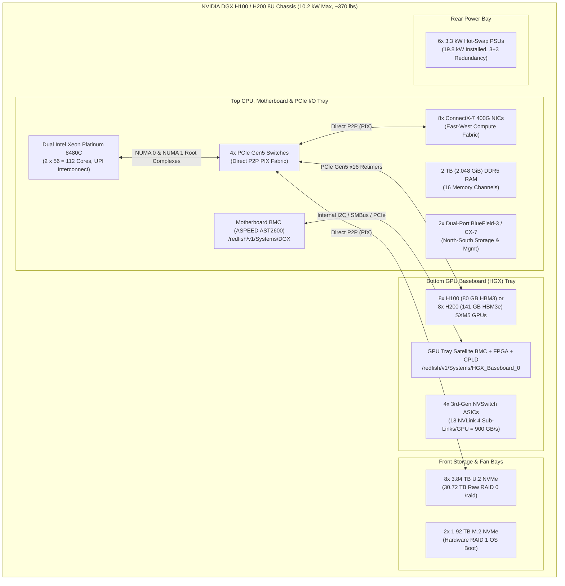
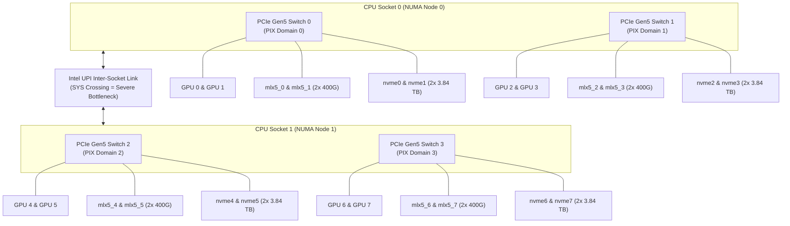

# 9.2 Inside a DGX H100 and H200 system

| | |
|---|---|
| **Status** | Drafted (`dgx_h100_h200_lab.py`: 30 checks pass; hardware commands **untested** on live DGX) |
| **Level** | Intermediate |
| **Priority tier** | 1b |
| **Lab venue** | none (design / reading) + self-checking Python model (`code/part09/dgx_h100_h200_lab.py`) |
| **Part** | Part 9: NVIDIA systems and reference architectures |
| **Sources used** | `nvidia-devops` V5 Ch. 2; `nvidia-devops` V7 Ch. 2; `nvidia-devops` V10 Ch. 1; *AI Systems Performance Engineering* Ch. 2; *Distributed AI Systems* Ch. 2; *NVIDIA Base Command Manager 11 Administrator Manual* (`bcm11-admin`) §14.5 |

## Why this matters for AI infrastructure

When a distributed training job slows to half its expected throughput or a node returns from a firmware maintenance window with all eight GPUs stuck in a `pending` state, you cannot debug the problem if you treat an 8-GPU server as a black box. Inside its 8U (14-inch tall) chassis, an **NVIDIA DGX H100** or **DGX H200** is not a single motherboard—it is a tightly coupled, multi-board supercomputer split across physically separate compute, accelerator, storage, and power trays, governed by **two independent Baseboard Management Controllers** and **46 distinct firmware images**.

Understanding how those trays are wired together—how the four 3rd-generation NVSwitches bond 18 NVLink sub-links per GPU, how the four PCIe Gen5 switches pair each GPU with its dedicated 400G ConnectX-7 NIC and local U.2 NVMe drive to bypass the dual Intel Xeon processors, how the H200 swaps 80 GB of HBM3 for 141 GB of HBM3e inside the exact same 700W SXM5 socket, and why GPU-tray firmware updates require a full Redfish **AC power cycle** rather than a board-level DC reboot—is what separates guesswork from deterministic operations.

:::info Corpus scope note
Standalone *NVIDIA DGX H100 / H200 System User Guide* and *NVIDIA DGX H100 / H200 Service Manual* PDFs are not in the local book corpus. The component specifications, PCIe/NVSwitch topology, Redfish paths, and 46-component firmware inventory in this chapter are drawn from `nvidia-devops` Volume 05 Chapter 2, Volume 07 Chapter 2, and Volume 10 Chapter 1, *AI Systems Performance Engineering* Chapter 2, *Distributed AI Systems* Chapter 2, and the *NVIDIA Base Command Manager 11 Administrator Manual* (`bcm11-admin`, Section 14.5).
:::

## Prerequisites and outcomes

**Prerequisites:**
- Chapter `9.1` (DGX system families, workload-first sizing, and the three physical network planes).
- Basic familiarity with PCIe lanes, NUMA sockets, and Redfish out-of-band management (from Part 7).

**Outcomes:** After completing this chapter, you will be able to:
1. Map the physical trays of an 8U DGX H100/H200 chassis and explain why the host CPU/motherboard tray is mechanically, thermally, and electrically decoupled from the bottom HGX GPU tray.
2. Contrast the **DGX H100** (640 GB HBM3 at 26.8 TB/s) and **DGX H200** (1,128 GB HBM3e at 38.4 TB/s, reported as `143771 MiB` per GPU in `nvidia-smi`), and calculate **Model FLOPs Utilization (MFU)** against the 989 TFLOPS BF16 peak per GPU.
3. Trace the internal **4-switch PCIe Gen5 P2P routing** (`PIX` vs `NODE` vs `SYS` vs `NV18` in `nvidia-smi topo -m`) and diagnose cross-socket Intel UPI bottlenecks when a GPU is paired with the wrong ConnectX-7 NIC.
4. Audit the **46 firmware components** split between the motherboard tray (16 components) and the GPU tray (30 `HGX_FW_*` components), and explain why activating GPU-tray firmware requires cutting all AC power inputs rather than issuing a standard DC reset.

---

## Concepts: basics → intermediate → advanced

## 1. The 8U dual-tray physical architecture

An 8U DGX H100 or H200 is a modular, front- and rear-serviceable chassis that physically separates the 5.6 kW GPU heat source from the host CPUs, DDR5 memory, PCIe switches, and NVMe drives.

Think of a double-decker airplane where the lower cargo hold carries eight jet engines with their own dedicated air ducts and control telemetry, while the upper deck houses the cockpit, navigation computers, and passenger cabins. If all of those components were crammed onto a single flat circuit board, heat from the eight 700-watt GPUs would bake the CPUs, DIMMs, and optical network transceivers, and replacing a single failed part would require unbolting the entire server from the rack.



Inside the 8U enclosure, components are organized into four physical zones:
1. **The Bottom GPU Tray (HGX Baseboard Tray):** Slides out on heavy-duty rails for servicing. Houses the **8 SXM5 GPUs** topped with tall copper and vapor-chamber heatsinks, **4 third-generation NVSwitch ASICs**, **8 PCIe Gen5 retimers**, a tray FPGA, Complex Programmable Logic Devices (CPLDs), Hardware Root-of-Trust (`ERoT`) chips for each GPU and NVSwitch, and a dedicated **GPU Tray Satellite BMC** (`HGX_FW_BMC_0`).
2. **The Top CPU, Motherboard, and PCIe I/O Tray:** Houses **dual Intel Xeon Platinum 8480C CPUs**, **2 TB of DDR5 system memory**, the **primary Motherboard BMC** (ASPEED AST2600), **4 major PCIe Gen5 switches**, **8 single-port ConnectX-7 400G compute NICs**, and **2 dual-port BlueField-3 DPUs** (or ConnectX-7 NICs) for storage and in-band management.
3. **The Front NVMe Storage and Cooling Fan Bays:** Houses **2x 1.92 TB M.2 NVMe** drives in hardware RAID 1 for DGX OS and **8x 3.84 TB U.2 NVMe** drives (`30.72 TB` raw) in RAID 0 mounted at `/raid`, cooled by redundant hot-swappable high-static-pressure fan modules.
4. **The Rear Power Supply Bay:** Houses **6x 3.3 kW power supplies** (`PSU_0` through `PSU_5`, 19.8 kW total installed capacity) arranged in **3+3 feed redundancy** across Power Feed A and Power Feed B to sustain the **10.2 kW** peak chassis draw.

:::tip In one minute
- The **8U DGX H100/H200 chassis** physically separates the **bottom GPU tray** (8x 700W SXM5 GPUs + 4x NVSwitches) from the **top CPU/motherboard/PCIe tray** (dual Xeon 8480C + 2 TB DDR5 + 4x PCIe Gen5 switches + 10 network adapters).
- Because the trays are decoupled, the system has **two management controllers**: the **Motherboard BMC** (`/redfish/v1/Systems/DGX`) and the **GPU Tray Satellite BMC** (`/redfish/v1/Systems/HGX_Baseboard_0`), connected internally via I2C/SMBus.
- Six **3.3 kW PSUs** (19.8 kW total capacity) provide **3+3 power-feed redundancy** for the 10.2 kW chassis.
:::

---

## 2. The GPU tray: SXM5 modules, 4-NVSwitch fabric, and H100 vs H200 physics

The bottom tray holds the **HGX 8-GPU baseboard**, where all eight accelerators operate as a single coherent intra-node memory and compute domain.

Think of the four NVSwitch chips on the baseboard as a private 8-lane highway cloverleaf built exclusively for the eight GPUs. Instead of exiting onto slow city streets (the PCIe bus and CPU sockets) to pass tensors to a neighbor, any GPU can drive at 900 GB/s directly into any other GPU's memory in a single crossbar hop.

### 2.1 The 18-sub-link NVLink 4.0 and 4-NVSwitch crossbar

Each H100 or H200 SXM5 GPU exposes **18 fourth-generation NVLink sub-links**. Every individual sub-link runs at **50 GB/s bidirectional** (~25 GB/s per direction):
- **Per-GPU NVLink bandwidth:** `18 sub-links × 50 GB/s = 900 GB/s bidirectional` (450 GB/s transmit + 450 GB/s receive simultaneously)—roughly **7× the bidirectional bandwidth** of a 16-lane PCIe Gen5 slot (128 GB/s bidirectional).
- **The 4-NVSwitch full mesh:** None of the 8 GPUs wire directly to each other point-to-point. Instead, the 18 NVLink lanes from each of the 8 GPUs (144 NVLink endpoints total) fan out across **four 3rd-generation NVSwitch ASICs** (`HGX_FW_NVSwitch_0` through `HGX_FW_NVSwitch_3`) soldered onto the baseboard.
- **Bisection and aggregate bandwidth:** Together, the four NVSwitches provide a **non-blocking all-to-all crossbar** delivering **3.6 TB/s of bisection bandwidth** (**7.2 TB/s of aggregate bidirectional bandwidth**) across the 8 GPUs, plus hardware multicast and in-network reduction engines (SHARP-over-NVLink) that accelerate `ncclAllReduce` operations without burning GPU Streaming Multiprocessors.
- **Direct peer memory coherency:** Through the NVSwitch fabric, `GPU 0` can issue load/store instructions or `cudaMemcpyPeerAsync()` transfers directly into `GPU 7`'s High Bandwidth Memory without any host CPU involvement.

### 2.2 DGX H100 versus DGX H200: same 8U chassis, HBM3e leap

The **DGX H100** and **DGX H200** share the exact same 8U mechanical chassis, 10.2 kW power budget, 700W per-GPU TDP, dual Intel Xeon Platinum 8480C host CPUs, 4-NVSwitch 900 GB/s fabric, and 989 TFLOPS (BF16) / 1,979 TFLOPS (FP8 dense) Tensor Core math engines. What changes between them is the **High Bandwidth Memory (HBM) stack on each SXM5 package**:

| Specification | NVIDIA DGX H100 | NVIDIA DGX H200 | Operational Impact (`H200` vs `H100`) |
|---|---|---|---|
| **GPU SKU & TDP** | 8x `H100` SXM5 @ **700W** | 8x `H200` SXM @ **700W** | Drop-in thermal and power compatibility (**10.2 kW** max node) |
| **Memory Technology** | **HBM3** | **HBM3e** | Faster pin speeds and denser DRAM dies per stack |
| **Per-GPU VRAM Capacity** | **80 GB** (`81920 MiB`) | **141 GB** (`143771 MiB` in `nvidia-smi`) | **1.76× more VRAM** per GPU (fewer GPUs needed for 70B–405B models) |
| **Total Node GPU Memory** | **640 GB** HBM3 | **1,128 GB** (~1.13 TB) HBM3e | Fits a 405B FP8 model + massive KV cache inside **a single 8-GPU node** |
| **Per-GPU HBM Bandwidth** | **3.35 TB/s** | **4.8 TB/s** | **1.43× higher memory bandwidth** (~43% faster bandwidth-bound LLM decode) |
| **Aggregate Node HBM Bandwidth** | **26.8 TB/s** | **38.4 TB/s** | Faster local reductions, fused attention kernels, and KV-cache reads |
| **NVLink 4 Fabric** | 18 links/GPU = **900 GB/s** (**7.2 TB/s** agg) | 18 links/GPU = **900 GB/s** (**7.2 TB/s** agg) | Identical `NV18` full-mesh topology across 4 NVSwitch ASICs |

### 2.3 Measuring real training efficiency: Model FLOPs Utilization (MFU)

When benchmarking a DGX H100 or H200 node, `nvidia-smi` GPU utilization (`utilization.gpu`) only tells you whether *at least one* Streaming Multiprocessor had an active warp during the sampling window—it can report `99%` even while the GPU is stalled waiting on memory or slow collectives. The true measure of hardware efficiency is **Model FLOPs Utilization (MFU)**:

```text
MFU = (Model FLOPs per iteration / Iteration time in seconds) / Peak Hardware FLOPS
```

For a dense transformer, forward + backward pass work is approximately **`6 × Parameters × Tokens per iteration`**. Using the worked 70B training example on an H100 GPU (where the datasheet non-sparse BF16 Tensor Core peak is **989 TFLOPS**):
- **Theoretical work per iteration** (at 2,048 tokens): `6 × 70 × 10^9 × 2,048 ≈ 860.16 TFLOP` (~860 TFLOP).
- **Measured step time:** `2.0 seconds` per iteration.
- **Achieved throughput:** `860 TFLOP / 2.0 s = 430 TFLOPS` per GPU.
- **MFU:** `430 TFLOPS / 989 TFLOPS ≈ 43.48%` (**~43% MFU**), which sits squarely inside the **40%–60% MFU** target range for well-tuned large-model training clusters. If MFU drops to 20%, your DGX node is either starving on data loading, hitting memory bandwidth limits with tiny microbatches, or suffering from a PCIe/NUMA network misconfiguration.

:::tip In one minute
- Each SXM5 GPU on the bottom tray has **18 NVLink 4.0 sub-links** (`18 × 50 GB/s = 900 GB/s` bidirectional) wired across **4 third-generation NVSwitch ASICs** (`3.6 TB/s` bisection / `7.2 TB/s` aggregate bidirectional bandwidth).
- The **DGX H200** keeps the exact same 8U chassis, 10.2 kW power envelope, and 989 TFLOPS BF16 compute as the **DGX H100**, but upgrades each GPU from **80 GB HBM3 (`3.35 TB/s`)** to **141 GB HBM3e (`143771 MiB`, `4.8 TB/s`)**—delivering **1,128 GB** (`1.76×`) of node VRAM and **38.4 TB/s** (`1.43×`) of HBM bandwidth.
- Evaluate training efficiency with **MFU** (`Achieved TFLOPS / 989 TFLOPS BF16 peak`), targeting **40%–60%** on large transformers.
:::

---

## 3. The CPU and motherboard tray: dual Xeon 8480C, NUMA domains, and 2 TB DDR5

Slide out the top tray of a DGX H100 or H200 and you will find the x86 host complex that boots the OS, runs data-loading pipelines, launches CUDA kernels, and orchestrates network collectives.

### 3.1 Dual Intel Xeon Platinum 8480C and NUMA split

The DGX H100 and H200 motherboard houses **two Intel Xeon Platinum 8480C processors** (Sapphire Rapids generation, **56 physical cores per socket = 112 physical cores / 224 threads total**):
- **NUMA Node 0 (Socket 0):** Cores 0–55, 1 TB of local DDR5 RAM across 8 memory channels, and PCIe Gen5 lanes feeding the first half of the PCIe switch complex (**GPUs 0–3**, **NICs `mlx5_0`–`mlx5_3`**, and **NVMe drives 0–3**).
- **NUMA Node 1 (Socket 1):** Cores 56–111, 1 TB of local DDR5 RAM across 8 memory channels, and PCIe Gen5 lanes feeding the second half of the PCIe switch complex (**GPUs 4–7**, **NICs `mlx5_4`–`mlx5_7`**, and **NVMe drives 4–7**).
- **Inter-socket link (Intel UPI):** The two CPU sockets communicate over Intel **Ultra Path Interconnect (UPI)** links. UPI is designed for CPU cache coherence, *not* for carrying hundreds of gigabytes per second of GPU tensor traffic. Every PyTorch worker process (`LOCAL_RANK 0..3` vs `LOCAL_RANK 4..7`) must be pinned to the CPU cores and memory of its own NUMA node (`numactl --hardware`) so kernel launches and host memory transfers never cross UPI.

### 3.2 Why a DGX node ships with 2 TB (2,048 GiB) of DDR5 RAM

Both the DGX H100 and DGX H200 ship with **2 TB (`2,048 GiB`) of DDR5 system memory** populated across **16 memory channels** (8 channels per Xeon socket). Why does a GPU server need 2 TB of host CPU RAM when the matrix math runs in GPU HBM?
1. **The 2×–3× (and 1.5×–2× minimum) host-RAM-to-VRAM staging rule:** During distributed training, host RAM holds memory-mapped dataset shards, CPU-side image decoding and tokenization workers (such as 32–64 PyTorch `DataLoader` processes using `/dev/shm` shared memory), pinned (`cudaMallocHost`) DMA staging buffers, and asynchronous model checkpoints offloaded from GPU HBM so training steps can resume immediately while the checkpoint writes to storage in the background.
2. **Comparing H100 vs H200 staging ratios:** On a **DGX H100** (640 GB total HBM3), 2,048 GB of DDR5 provides a generous **3.2× host-to-GPU memory ratio** (exceeding the 2×–3× DGX design rule). On a **DGX H200** (1,128 GB total HBM3e), the same 2,048 GB of DDR5 provides a **1.82× host-to-GPU memory ratio** (**my inference**, comparing the 640 GB vs 1,128 GB node VRAM capacities against the 2,048 GB host RAM specification), which still comfortably satisfies the **1.5×–2× minimum host RAM rule** for 8-GPU training nodes—though operators offloading full unsharded 1.1 TB H200 states to `/dev/shm` must watch shared-memory limits carefully.

:::tip In one minute
- The top tray houses **dual 56-core Intel Xeon Platinum 8480C CPUs (112 physical cores)** split across **NUMA Node 0** (GPUs 0–3, `mlx5_0..3`) and **NUMA Node 1** (GPUs 4–7, `mlx5_4..7`).
- **2 TB (2,048 GiB) of 16-channel DDR5 RAM** provides **3.2×** the GPU memory of a DGX H100 (640 GB) and **1.82×** the GPU memory of a DGX H200 (1,128 GB) for `/dev/shm` `DataLoader` workers, pinned DMA buffers, and async checkpoint staging.
- Always bind GPU worker processes (`LOCAL_RANK 0..7`) to their matching NUMA socket so host-to-device traffic never crosses the Intel **UPI** inter-socket link.
:::

---

## 4. The PCIe Gen5 switch complex, networking, and storage wiring

Before a tensor packet can enter a 400G optical cable or read a training shard from an NVMe drive, it must escape the GPU package and traverse the internal PCIe bus.

Think of a cheap server without PCIe switches like an office building with no internal hallways between ground-floor loading docks: to move a crate from Dock A (the GPU) to Dock B (the 400G NIC) five feet away, workers must take the freight elevator all the way up to the penthouse executive suite (the CPU Root Complex), sign a clipboard, and ride another elevator back down. In a DGX H100/H200, NVIDIA solders **four high-radix PCIe Gen5 switches** directly between the devices so Dock A and Dock B share a private ground-floor hallway.



### 4.1 The four PCIe Gen5 switch groups (`PIX` domains)

Inside the I/O tray, **four PCIe Gen5 switches** (each providing 64 GB/s unidirectional / 128 GB/s bidirectional per x16 link) organize the 8 GPUs, 8 compute NICs, and 8 U.2 NVMe drives into **four symmetric Peer-to-Peer (`PIX`) groups** (**my inference**, numbering the 4-switch symmetric pairing of 2 GPUs + 2 ConnectX-7 NICs + 2 U.2 NVMe drives per switch across NUMA 0 and NUMA 1):
- **PCIe Switch 0 (NUMA 0):** `GPU 0`, `GPU 1`, `mlx5_0`, `mlx5_1`, `nvme0`, `nvme1`
- **PCIe Switch 1 (NUMA 0):** `GPU 2`, `GPU 3`, `mlx5_2`, `mlx5_3`, `nvme2`, `nvme3`
- **PCIe Switch 2 (NUMA 1):** `GPU 4`, `GPU 5`, `mlx5_4`, `mlx5_5`, `nvme4`, `nvme5`
- **PCIe Switch 3 (NUMA 1):** `GPU 6`, `GPU 7`, `mlx5_6`, `mlx5_7`, `nvme6`, `nvme7`

Because `GPU i`, `mlx5_i`, and `nvme_i` sit under the exact same PCIe Gen5 switch:
1. **GPUDirect RDMA (`GPU i ↔ mlx5_i`):** When `GPU 0` sends gradients to another node over `mlx5_0`, the packet exits `GPU 0`'s PCIe Gen5 x16 interface, hits **PCIe Switch 0**, and turns immediately into `mlx5_0` at **~50 GB/s (400 Gbps)** wire speed without ever touching the Intel Xeon CPU or DDR5 memory.
2. **GPUDirect Storage (`GPU i ↔ nvme_i`):** When `GPU 2` reads cached dataset shards from `nvme2` or `nvme3` on `/raid` via `cuFile`, the NVMe controller DMAs blocks directly across **PCIe Switch 1** into `GPU 2`'s HBM3/HBM3e memory.

### 4.2 Network and storage bay summary

- **8x single-port ConnectX-7 HCAs (East-West Compute Fabric):** Configured as 400 Gbps NDR InfiniBand or 400 GbE RoCEv2 (**3.2 Tbps / 400 GB/s** total node injection bandwidth), wired 1:1 to the 8 GPUs via the 4 PCIe Gen5 switches.
- **2x dual-port BlueField-3 DPUs or ConnectX-7 NICs (North-South Storage & In-Band Management Fabric):** Provide up to 4x 200/400 GbE ports dedicated to the shared Parallel File System (Lustre, WEKA, GPFS, VAST), cluster control plane (Slurm/Kubernetes), and monitoring.
- **Storage bay:** **2x 1.92 TB M.2 NVMe** in Hardware RAID 1 for DGX OS, plus **8x 3.84 TB U.2 NVMe** (`30.72 TB` raw) in RAID 0 mounted at `/raid` for ephemeral local caching.

:::tip In one minute
- Four **PCIe Gen5 switches** partition the node into **four `PIX` Peer-to-Peer domains**, each coupling **2 GPUs, 2 ConnectX-7 400G NICs, and 2 U.2 NVMe drives** so GPUDirect RDMA and GPUDirect Storage never touch the host CPUs.
- Each PCIe Gen5 x16 link delivers **64 GB/s unidirectional (128 GB/s bidirectional)**—more than enough to saturate a **400 Gbps (50 GB/s)** ConnectX-7 port when routed locally (`PIX`).
:::

---

## 5. Reading `nvidia-smi topo -m` and diagnosing the cross-NUMA `SYS` trap

Senior infrastructure engineers never trust cabling diagrams on paper—they verify how the Linux kernel and NVIDIA driver see the physical board traces by running `nvidia-smi topo -m`.

### 5.1 Decoding the topology matrix symbols

When you run `nvidia-smi topo -m` on a DGX H100 or DGX H200, every cell in the matrix reports one of six path symbols between row device `A` and column device `B`:

| Symbol | Meaning | Hardware Path | Impact on GPUDirect RDMA & P2P |
|---|---|---|---|
| **`X`** | Self | Same physical device | N/A |
| **`NV18`** | 18 bonded NVLink sub-links | Traverses the **4x NVSwitch baseboard** (**900 GB/s** bidirectional per GPU) | **Ideal GPU-to-GPU path.** Full 900 GB/s bandwidth, zero CPU/PCIe traffic. |
| **`PIX`** | Single PCIe switch | Traverses **at most one PCIe Gen5 switch** (e.g., `GPU 0 ↔ mlx5_0` or `GPU 0 ↔ mlx5_1`) | **Ideal GPU-to-NIC / GPU-to-NVMe path.** Direct hardware P2P DMA (**64 GB/s** uni), bypasses CPU. |
| **`PXB`** | Multiple PCIe switches | Traverses multiple cascaded PCIe switches without hitting the CPU host bridge | Good P2P path; slightly higher switch hop latency than `PIX`, still bypasses CPU. |
| **`PHB` / `NODE`** | Same NUMA node via CPU Root Complex | `PHB` crosses a PCIe Host Bridge; `NODE` crosses host bridges within **one NUMA socket** (e.g., `GPU 0` on Switch 0 to `mlx5_2` on Switch 1, both on NUMA 0) | **Degraded.** Traffic bounces through the Intel Xeon PCIe Root Complex; NCCL's default GDR distance limit may disable GPUDirect RDMA. |
| **`SYS`** | Cross-socket NUMA traversal | Crosses the **Intel UPI inter-socket link** between **NUMA Node 0 and NUMA Node 1** (e.g., `GPU 0` on NUMA 0 to `mlx5_6` on NUMA 1) | **Catastrophic.** Saturates the CPU UPI link and cuts multi-node collective throughput by **~50%**. |

On a healthy DGX H100 or H200, the 8×8 GPU block shows **`NV18`** in every off-diagonal cell, while the diagonal of the GPU-to-NIC block shows **`PIX`** matching each GPU pair to its local ConnectX-7 pair (`GPU0/GPU1` → `mlx5_0/mlx5_1` = `PIX`, `GPU0/GPU1` → `mlx5_2/mlx5_3` = `NODE`, `GPU0/GPU1` → `mlx5_4..7` = `SYS`):

```text
        GPU0    GPU1    GPU2    GPU3    GPU4    GPU5    GPU6    GPU7    mlx5_0  mlx5_1  mlx5_2  mlx5_6  CPU Affinity    NUMA Affinity
GPU0     X      NV18    NV18    NV18    NV18    NV18    NV18    NV18    PIX     PIX     NODE    SYS     0-55,112-167    0
GPU1    NV18     X      NV18    NV18    NV18    NV18    NV18    NV18    PIX     PIX     NODE    SYS     0-55,112-167    0
GPU2    NV18    NV18     X      NV18    NV18    NV18    NV18    NV18    NODE    NODE    PIX     SYS     0-55,112-167    0
GPU3    NV18    NV18    NV18     X      NV18    NV18    NV18    NV18    NODE    NODE    PIX     SYS     0-55,112-167    0
GPU4    NV18    NV18    NV18    NV18     X      NV18    NV18    NV18    SYS     SYS     SYS     NODE    56-111,168-223  1
GPU5    NV18    NV18    NV18    NV18    NV18     X      NV18    NV18    SYS     SYS     SYS     NODE    56-111,168-223  1
GPU6    NV18    NV18    NV18    NV18    NV18    NV18     X      NV18    SYS     SYS     SYS     PIX     56-111,168-223  1
GPU7    NV18    NV18    NV18    NV18    NV18    NV18    NV18     X      SYS     SYS     SYS     PIX     56-111,168-223  1
```

### 5.2 Real-world failure: the `GPU 0 ↔ mlx5_6` (`SYS`) mis-binding

Suppose a customer runs a multi-node PyTorch training job across four DGX H100 nodes and sees half the expected `AllReduce` bandwidth, even though all 8 GPUs and all 8 400G InfiniBand ports show `Active`. When you inspect their launch script or Kubernetes device plugin allocation, you discover that the container runtime or a hard-coded `NCCL_IB_HCA` list bound `GPU 0` (on **NUMA 0 / PCIe Switch 0**) to `mlx5_6` (on **NUMA 1 / PCIe Switch 3**).

Look at row `GPU0`, column `mlx5_6` in the matrix above: the path is **`SYS`**. Every byte of gradient data leaving `GPU 0` is forced to climb up PCIe Switch 0 to **CPU 0**, cross the narrow **Intel UPI inter-socket link** to **CPU 1**, and travel down PCIe Switch 3 to `mlx5_6`. To fix it:
1. Dump the topology graph that NCCL computed at startup by setting `NCCL_TOPO_DUMP_FILE=/tmp/nccl_topo.xml` and `NCCL_DEBUG=INFO`.
2. Remove the broken `NCCL_IB_HCA` override (or enable the Kubernetes **Topology Manager** with `--topology-manager-policy=single-numa-node` and CPU Manager `static` policy when running partial-node pods) so `GPU 0` binds strictly to its `PIX`-adjacent NIC (`mlx5_0`).

:::tip In one minute
- In `nvidia-smi topo -m`, every GPU-to-GPU cell on a DGX H100/H200 must read **`NV18`** (900 GB/s via NVSwitch), and every GPU's primary compute NIC must read **`PIX`** (shared PCIe Gen5 switch).
- **`NODE`** means traffic hits the CPU root complex within the same NUMA socket; **`SYS`** means traffic crosses the **Intel UPI link** between Socket 0 and Socket 1, cutting RDMA throughput by ~50%.
- Use `NCCL_TOPO_DUMP_FILE=/tmp/nccl_topo.xml` and `NCCL_DEBUG=INFO` to verify that NCCL pairs each GPU with its `PIX`-local `mlx5_*` adapter.
:::

---

## 6. Dual-tray Redfish telemetry and the 46-component firmware lifecycle

Because an 8U DGX H100/H200 is split into two major hardware trays, both out-of-band Redfish monitoring and firmware updates reflect that physical boundary.

### 6.1 Dual Redfish endpoints: `/Systems/DGX` and `/Systems/HGX_Baseboard_0`

When you query the DGX BMC over HTTPS (`/redfish/v1`), the URI tree exposes separate objects for the host system and the bottom GPU baseboard:
- **`/redfish/v1/Systems/DGX`:** Reports the host motherboard state (`PowerState`, `ProcessorSummary.Model = "Intel(R) Xeon(R) Platinum 8480C"`, `Count = 2`, `MemorySummary.TotalSystemMemoryGiB = 2048`), `/Bios` attributes, and `/SecureBoot`.
- **`/redfish/v1/Systems/HGX_Baseboard_0`:** Represents the bottom 8-GPU HGX tray managed by the GPU Tray Satellite BMC, exposing per-GPU environment and power telemetry at `/redfish/v1/Systems/HGX_Baseboard_0/Processors/GPU_SXM_<1..8>/EnvironmentMetrics`.
- **`/redfish/v1/Chassis/DGX/Sensors` and `/Managers/BMC/LogServices/SEL`:** Provide chassis-wide thermal/power readings and the System Event Log.

### 6.2 The 46 firmware components across the motherboard tray and GPU tray

In production clusters managed by NVIDIA Base Command Manager (BCM) or Redfish `/redfish/v1/UpdateService`, firmware for a DGX H100 is packaged into two distinct `.fwpkg` bundles corresponding to the two physical trays—totalling **46 individual firmware components**:

| Physical Tray & Package | Count | Exact Component Identifiers (`cmsh` `firmware status`) | What They Control |
|---|---|---|---|
| **1. Motherboard Tray (Chassis)** (`nvfw_dgx-h100_*.fwpkg`) | **16** | `CPLDMB_0`, `CPLDMID_0`, `EROT_BIOS_0`, `EROT_BMC_0`, `HostBIOS_0`, `HostBMC_0`, `PCIeRetimer_0`, `PCIeRetimer_1`, `PCIeSwitch_0`, `PCIeSwitch_1`, `PSU_0`, `PSU_1`, `PSU_2`, `PSU_3`, `PSU_4`, `PSU_5` | Host motherboard CPLDs, midplane CPLD, BIOS/BMC hardware roots of trust (`ERoT`), System BIOS (`HostBIOS_0`), primary BMC (`HostBMC_0`), host PCIe retimers/switches, and all six 3.3 kW PSUs (`PSU_0..5`). |
| **2. GPU Tray (HGX Baseboard)** (`nvfw_dgx-hgx-h100x8_*.fwpkg`) | **30** | `HGX_FW_BMC_0`, `HGX_FW_ERoT_BMC_0`, `HGX_FW_ERoT_FPGA_0`, `HGX_FW_ERoT_NVSwitch_0..3` (4), `HGX_FW_ERoT_PCIeSwitch_0`, `HGX_FW_FPGA_0`, `HGX_FW_GPU_SXM_1..8` (8), `HGX_FW_NVSwitch_0..3` (4), `HGX_FW_PCIeRetimer_0..7` (8), `HGX_FW_PCIeSwitch_0` | GPU tray satellite BMC (`HGX_FW_BMC_0`), 7 hardware roots of trust (`HGX_FW_ERoT_*`), tray FPGA (`HGX_FW_FPGA_0`), all 8 SXM GPU VBIOSes (`HGX_FW_GPU_SXM_1..8`), all 4 NVSwitch ASIC firmwares (`HGX_FW_NVSwitch_0..3`), 8 GPU-tray PCIe Gen5 retimers (`HGX_FW_PCIeRetimer_0..7`), and the baseboard PCIe switch (`HGX_FW_PCIeSwitch_0`). |

### 6.3 Why GPU-tray firmware requires a full AC power cycle (not a DC reset)

This is one of the most common day-2 operational traps on a DGX H100/H200. When you flash the GPU-tray firmware package (`nvfw_dgx-hgx-h100x8_*.fwpkg`), the 30 `HGX_FW_*` components stage their new versions (for example, `HGX_FW_GPU_SXM_1: 96.00.70.00.01 -> 96.00.74.00.01`), and `firmware status` reports:
- **State:** `pending`
- **Result:** `success: AC power cycle to activate`

If an operator runs a standard reboot (`sudo reboot`) or a standard board-level power reset (`cmsh` `device power reset`, which performs a **DC power cycle**), **the new GPU-tray firmware does NOT activate.** Why? Because the GPU Tray Satellite BMC (`HGX_FW_BMC_0`), the 7 `HGX_FW_ERoT_*` security controllers, the tray FPGA (`HGX_FW_FPGA_0`), and the 8 PCIe retimers remain powered by the 6 PSUs' **standby power rails** whenever AC mains cords are plugged in.

To transition the 30 GPU-tray components from `pending` to `completed (success: activated)`, you must execute a **Redfish AC power cycle**—cutting all AC power inputs to the server simultaneously (either by toggling the six outlet relays off and on via your intelligent rack PDUs, issuing a full chassis AC cycle action, or physically pulling all six AC power leads during local maintenance) so the standby rails drain completely and every FPGA, CPLD, ERoT, NVSwitch, and SXM GPU reloads its newly flashed image from cold power-on. (Similarly, after updating the host BMC firmware itself, NVIDIA's update procedure uses `ipmitool -I lanplus -H <bmc-ip> -U <user> -P <pass> mc reset cold` to cold-reset the BMC processor.)

:::tip In one minute
- Redfish separates the host system (`/redfish/v1/Systems/DGX`) from the 8-GPU baseboard (`/redfish/v1/Systems/HGX_Baseboard_0/Processors/GPU_SXM_<1..8>/EnvironmentMetrics`).
- A DGX H100 tracks **46 firmware components**: **16 on the motherboard tray** (`HostBIOS_0`, `HostBMC_0`, `CPLDMB_0`, `PSU_0..5`, etc.) and **30 on the GPU tray** (`HGX_FW_BMC_0`, `HGX_FW_GPU_SXM_1..8`, `HGX_FW_NVSwitch_0..3`, `HGX_FW_PCIeRetimer_0..7`, `HGX_FW_FPGA_0`, `HGX_FW_ERoT_*`).
- Standard reboots or DC board resets (`power reset`) **cannot** activate GPU-tray firmware because standby rails keep the satellite BMC, ERoT, and FPGA alive. You must perform a full **AC power cycle** (cutting all AC inputs via intelligent PDUs) to reach `completed (success: activated)`.
:::

---

## Commands and configurations that matter

The commands below verify the internal topology, HBM capacity/PCIe link width, Redfish dual-tray telemetry, and 46-component firmware state of a DGX H100 or DGX H200 (**untested** on live DGX hardware in this authoring environment; rules and outputs verified in `code/part09/dgx_h100_h200_lab.py`).

### 1. Inspect GPU model, HBM capacity (`81920 MiB` vs `143771 MiB`), and PCIe Gen5 x16 link state

```bash
# Query GPU SKU, total MiB (81920 on H100 vs 143771 on H200), and PCIe Gen5 x16 width
nvidia-smi --query-gpu=index,name,memory.total,pcie.link.gen.current,pcie.link.gen.max,pcie.link.width.current,pcie.link.width.max \
  --format=csv

# Inspect the 8x8 NV18 NVSwitch matrix and GPU-to-NIC PIX/NODE/SYS pairings
nvidia-smi topo -m

# Verify CPU NUMA node layout (Socket 0: cores 0-55, Socket 1: cores 56-111, 1 TB DDR5 each)
numactl --hardware
```

### 2. Query dual-tray Redfish endpoints (`/Systems/DGX` and `/Systems/HGX_Baseboard_0`)

```bash
# 1. Authenticate a Redfish session and capture X-Auth-Token
TOKEN=$(curl -sk -X POST "https://${BMC_IP}/redfish/v1/SessionService/Sessions" \
  -H "Content-Type: application/json" \
  -d "{\"UserName\":\"${BMC_USER}\",\"Password\":\"${BMC_PASS}\"}" -D - \
  | awk '/X-Auth-Token:/ {print $2}' | tr -d '\r')

# 2. Query host motherboard tray (Dual Xeon 8480C, 2048 GiB DDR5)
curl -sk -H "X-Auth-Token: ${TOKEN}" \
  "https://${BMC_IP}/redfish/v1/Systems/DGX" \
  | jq '{Model, PowerState, ProcessorSummary, MemorySummary}'

# 3. Query GPU 1 environment metrics on the bottom HGX baseboard tray
curl -sk -H "X-Auth-Token: ${TOKEN}" \
  "https://${BMC_IP}/redfish/v1/Systems/HGX_Baseboard_0/Processors/GPU_SXM_1/EnvironmentMetrics" | jq .
```

### 3. Flash and verify the 46 DGX H100 firmware components in BCM (`cmsh`)

```text
# 1. Inspect all 46 firmware components (16 motherboard tray + 30 GPU tray)
[basecm11->device]% firmware -n node001 status

# 2. Flash the 30 GPU-tray (HGX) components using the signed .fwpkg bundle
[basecm11->device[node001]]% firmware flash nvfw_dgx-hgx-h100x8_0002_230705.1.1.fwpkg

# 3. Check pending activation status (shows "pending" / "success: AC power cycle to activate")
[basecm11->device[node001]]% firmware status | grep nvfw

# 4. After cutting and restoring all 6 AC PDU outlets (AC power cycle), verify activation
[basecm11->device]% firmware -n node001 status
# Expect State = "completed" and Result = "success: activated" across all 30 HGX_FW_* rows
```

---

## How it fails

| Failure mode | Symptom | Root cause | Diagnosis & fix |
|---|---|---|---|
| **1. Cross-socket `SYS` GPU-to-NIC pairing** | Multi-node PyTorch training on a DGX H100/H200 achieves **~50% of expected `AllReduce` bus bandwidth**, and `perf` / `pcm` shows heavy traffic saturating the Intel UPI links between CPU 0 and CPU 1. | A container orchestrator or manual `NCCL_IB_HCA` setting paired a GPU on **NUMA 0** (such as `GPU 0`) with a ConnectX-7 NIC on **NUMA 1** (such as `mlx5_6`), forcing every RDMA packet across the **`SYS`** path (`GPU 0 → Switch 0 → CPU 0 → Intel UPI → CPU 1 → Switch 3 → mlx5_6`). | Run `nvidia-smi topo -m` and dump NCCL's topology via `NCCL_TOPO_DUMP_FILE=/tmp/nccl_topo.xml`. Ensure each GPU uses its **`PIX`**-paired NIC on the same PCIe Gen5 switch (`GPU 0/1 ↔ mlx5_0/1`, `GPU 2/3 ↔ mlx5_2/3`, `GPU 4/5 ↔ mlx5_4/5`, `GPU 6/7 ↔ mlx5_6/7`), and enable Kubernetes Topology Manager (`single-numa-node`) for partial-node pods. |
| **2. GPU-tray firmware stuck in `pending` after reboot** | After flashing `nvfw_dgx-hgx-h100x8_*.fwpkg` and rebooting the node (or running `cmsh` `power reset`), all 30 `HGX_FW_*` components remain at their old versions with `State: pending` and `Result: success: AC power cycle to activate`. | A standard OS reboot or board-level DC power reset leaves the 6 PSUs' standby power rails active, so the GPU Tray Satellite BMC (`HGX_FW_BMC_0`), 7 `ERoT` security chips, FPGA (`HGX_FW_FPGA_0`), and 8 PCIe retimers never cold-boot into the newly flashed firmware. | Perform a full **AC power cycle** by powering off all 6 AC outlets feeding the server on PDU A and PDU B (or physically disconnecting all 6 AC power leads), waiting for standby rails to drain, and restoring AC power. Confirm `firmware status` transitions to `completed` / `success: activated`. |
| **3. PCIe link width or generation downgrade (`Gen1/Gen3` or `x8`)** | A single GPU's `ib_write_bw --use_cuda` or `gdsio` throughput drops from **~45–50 GB/s** to **~8–16 GB/s**, stalling synchronous `AllReduce` across the entire 8-GPU ring. | Dust or seating issues on the SXM5 mezzanine socket, or a degraded GPU-tray PCIe retimer (`HGX_FW_PCIeRetimer_0..7`), caused the link between the GPU and its PCIe Gen5 switch to train down from **Gen5 x16 (64 GB/s)** to **Gen3 x16** or **Gen5 x8**. | Run `nvidia-smi --query-gpu=index,pcie.link.gen.current,pcie.link.width.current --format=csv` under load. If `gen.current < 5` or `width.current < 16`, verify retimer firmware alignment (`HGX_FW_PCIeRetimer_*`), perform an AC power cycle, and reseat or RMA the affected GPU tray if link training still downgrades. |
| **4. `/dev/shm` exhaustion by PyTorch `DataLoader` workers** | Training crashes mid-epoch with `RuntimeError: DataLoader worker (pid ...) is killed by signal: Bus error` even though `free -h` shows hundreds of gigabytes of free DDR5 RAM on the 2 TB host. | Docker or Kubernetes defaults `/dev/shm` (POSIX shared memory backed by host DDR5 RAM) to **64 MB**, starving the 32–64 CPU `DataLoader` workers that stage batches for the 8 H100/H200 GPUs. | Pass `--shm-size=256g` (or `--ipc=host`) to Docker/containerd, or mount an `emptyDir` with `medium: Memory` and `sizeLimit: 256Gi` at `/dev/shm` in the Kubernetes Pod spec so workers can utilize the node's 2,048 GiB DDR5 pool. |
| **5. Unpinned CPU workers crossing NUMA sockets** | GPU kernel launch latency spikes and step times jitter by 15%–25% across iterations on an 8-GPU job. | The training launcher spawned 8 Python processes without NUMA CPU affinity, so the Linux scheduler migrated `LOCAL_RANK 0` (controlling `GPU 0` on NUMA 0) onto CPU cores `56–111` (Socket 1 / NUMA 1). | Pin ranks `0–3` to NUMA Node 0 (`cores 0-55,112-167`) and ranks `4–7` to NUMA Node 1 (`cores 56-111,168-223`) using `torchrun` NUMA binding, Slurm `--cpu-bind=ldoms`, or `numactl --cpunodebind=$((LOCAL_RANK/4)) --membind=$((LOCAL_RANK/4))`. |

---

## Hands-on lab

This chapter's self-checking Python model (`code/part09/dgx_h100_h200.py`) and lab script (`code/part09/dgx_h100_h200_lab.py`) encode:
1. The exact hardware comparison between **DGX H100** (`80 GB HBM3`, `81920 MiB`, `3.35 TB/s`, `640 GB` node) and **DGX H200** (`141 GB HBM3e`, `143771 MiB`, `4.8 TB/s`, `1,128 GB` node) inside the shared 8U, 10.2 kW chassis.
2. The **Host DDR5 RAM to GPU VRAM staging ratio validator** (`3.2×` on DGX H100 vs `1.82×` on DGX H200).
3. The **4-switch PCIe Gen5 and 4-NVSwitch topology classifier** (`X`, `NV18`, `PIX`, `NODE`, and `SYS` across GPUs `0..7`, `mlx5_0..7`, and `nvme0..7`).
4. The **Model FLOPs Utilization (MFU)** calculator (`6 × N × T` transformer FLOP estimate and the 70B H100 worked example at `860 TFLOP / 2.0 s = 430 TFLOPS / 989 BF16 peak = 43.48% MFU`).
5. The **46-component DGX H100 firmware activation state machine** (16 motherboard-tray components vs 30 `HGX_FW_*` GPU-tray components, proving why `dc_reset` leaves GPU-tray components `pending` while `ac_power_cycle` activates them).

Run the lab from the repository root:

```bash
python3 -B code/part09/dgx_h100_h200_lab.py
```

Expected output (verified in this repository):

```text
=== Chapter 9.2 Lab: Inside a DGX H100 and H200 System ===
  [PASS] DGX H100 & H200 share 8U chassis, dual Xeon Platinum 8480C (112 cores), 2048 GB DDR5 across 16 channels
  [PASS] Each GPU has 18 NVLink 4.0 sub-links at 50 GB/s = 900 GB/s per GPU across 4 NVSwitches
  [PASS] NVSwitch baseboard delivers 3.6 TB/s bisection and 7.2 TB/s aggregate bidirectional bandwidth
  [PASS] DGX H100 provides 8x 80 GB HBM3 = 640 GB total at 26.8 TB/s aggregate bandwidth
  [PASS] DGX H200 upgrades to 8x 141 GB HBM3e (143,771 MiB in nvidia-smi) = 1,128 GB at 38.4 TB/s
  [PASS] H200 provides 1.76x VRAM capacity and 1.43x HBM bandwidth over H100 in same 10.2 kW envelope
  ...
  [PASS] BCM 11 p.758: Motherboard tray has 16 firmware components and GPU tray has 30 (46 total)
  [PASS] BCM 11 p.761: DC board reset after GPU-tray flash leaves 30 HGX components pending AC power cycle
  [PASS] BCM 11 p.761: Full AC power cycle activates all 30 GPU-tray firmware components
  [PASS] Motherboard-tray firmware package updates 16 components and leaves 30 GPU-tray components untouched

Summary: 30 passed, 0 failed (total 30)
```

---

## Exercises

1. Run `python3 -B code/part09/dgx_h100_h200_lab.py`. Find the checks about the firmware state machine. Explain in your own words why a DC reset leaves the 30 GPU-tray components `pending`.
2. Work out the MFU of a GPU that does a training step of 1,200 TFLOP in 3.0 seconds on an H100 (989 TFLOPS BF16 peak). Is that in the healthy 40%–60% range? What would you check first if it were 18%?
3. A row of `nvidia-smi topo -m` shows GPU 5 with `SYS` to `mlx5_0` and `mlx5_1`, and `PIX` to `mlx5_4` and `mlx5_5`. Which NICs should GPU 5 use? What would you lose if `NCCL_IB_HCA` forced it onto `mlx5_0`?
4. Write the three commands you would run to confirm that a Kubernetes pod using 4 GPUs is pinned to one NUMA node. Say what output you expect.
5. A colleague says: "We rebooted the node after flashing the GPU tray, so the firmware is live." Write a short reply that explains what to check (`firmware status`) and what to do next.
6. Compute the host-RAM-to-GPU-memory ratio for a DGX H100 and a DGX H200. Which one has less spare host RAM per GB of GPU memory, and what does that change in how you size `/dev/shm`?

## Checkpoint questions (20)

<details>
<summary><strong>1. Why does an 8U DGX H100/H200 physically separate the bottom GPU tray from the top CPU/motherboard tray, and how are the two trays managed out-of-band?</strong></summary>

Eight 700-watt SXM5 GPUs and four NVSwitch ASICs generate **>5.6 kW of concentrated heat**. Decoupling the bottom HGX GPU tray from the top CPU/DDR5/PCIe I/O tray prevents GPU exhaust heat from thermally throttling the CPUs, DIMMs, and 400G optical transceivers, and allows either tray to slide out on rails for independent servicing. Because of this physical split, the top tray has the primary **Motherboard BMC** (`/redfish/v1/Systems/DGX`) while the bottom tray has its own **GPU Tray Satellite BMC, FPGA, and CPLDs** (`/redfish/v1/Systems/HGX_Baseboard_0`), linked over internal I2C/SMBus.
</details>

<details>
<summary><strong>2. How does the NVSwitch fabric on a DGX H100/H200 achieve 900 GB/s per GPU and 3.6 TB/s of bisection bandwidth?</strong></summary>

Each of the 8 SXM5 GPUs exposes **18 fourth-generation NVLink sub-links**, and each sub-link runs at **50 GB/s bidirectional** (`18 × 50 GB/s = 900 GB/s` bidirectional per GPU, or 450 GB/s in each direction simultaneously). All 144 NVLink sub-links (`8 GPUs × 18 links`) wire into **four 3rd-generation NVSwitch ASICs** on the HGX baseboard, creating an all-to-all crossbar with **3.6 TB/s bisection bandwidth** (`7.2 TB/s` aggregate bidirectional bandwidth).
</details>

<details>
<summary><strong>3. What exact specifications change between a DGX H100 and a DGX H200, and what stays identical?</strong></summary>

- **Identical:** 8U chassis, **10.2 kW** max power, **700W** per-GPU TDP, dual 56-core **Intel Xeon Platinum 8480C** CPUs (112 cores), **2 TB DDR5** RAM, 4x NVSwitches (**900 GB/s** per GPU), 8x ConnectX-7 400G NICs, and **989 TFLOPS BF16** Tensor compute per GPU.
- **Upgraded on DGX H200:** Swaps 80 GB HBM3 (`3.35 TB/s`) for **141 GB HBM3e** (`143771 MiB` in `nvidia-smi`, **4.8 TB/s**) per GPU—increasing total node GPU memory from **640 GB to 1,128 GB (1.76×)** and aggregate node HBM bandwidth from **26.8 TB/s to 38.4 TB/s (1.43×)**.
</details>

<details>
<summary><strong>4. A 70B transformer training step on an H100 processes ~860 TFLOP of work per GPU in 2.0 seconds. What is the Model FLOPs Utilization (MFU), and why is MFU a better metric than `nvidia-smi` GPU utilization?</strong></summary>

- **Achieved FLOP/s:** `860 TFLOP / 2.0 s = 430 TFLOPS`.
- **MFU:** `430 TFLOPS / 989 TFLOPS (H100 BF16 peak) = 43.48%` (~43% MFU, within the healthy 40%–60% target band).
`nvidia-smi` `utilization.gpu` only measures the percentage of sample intervals in which *any* warp was active on the GPU (so a memory-starved kernel can show 99% utilization while achieving 10% of peak math throughput), whereas MFU measures useful mathematical work completed relative to silicon peak.
</details>

<details>
<summary><strong>5. Why does a DGX H100/H200 ship with 2 TB (2,048 GiB) of DDR5 host RAM across 16 channels?</strong></summary>

To keep 8 Hopper GPUs fed without stalling on I/O, host RAM must hold memory-mapped dataset shards, tens of gigabytes of `/dev/shm` shared memory for 32–64 PyTorch `DataLoader` workers, pinned DMA buffers, and asynchronous checkpoints copied off GPU HBM. The 2,048 GB pool provides **3.2×** the 640 GB VRAM of a DGX H100 (and **1.82×** the 1,128 GB VRAM of a DGX H200).
</details>

<details>
<summary><strong>6. How are GPUs, ConnectX-7 NICs, and U.2 NVMe drives grouped across the four PCIe Gen5 switches inside a DGX H100/H200?</strong></summary>

Each of the **four PCIe Gen5 switches** couples **two GPUs, two 400G ConnectX-7 NICs, and two 3.84 TB U.2 NVMe drives** into a local **`PIX`** Peer-to-Peer domain (`Switch 0`: GPUs 0–1, `mlx5_0..1`, `nvme0..1`; `Switch 1`: GPUs 2–3, `mlx5_2..3`, `nvme2..3` on NUMA 0; `Switch 2`: GPUs 4–5, `mlx5_4..5`, `nvme4..5`; `Switch 3`: GPUs 6–7, `mlx5_6..7`, `nvme6..7` on NUMA 1). This allows GPUDirect RDMA and GPUDirect Storage transfers to turn directly inside the local PCIe switch without touching the Xeon CPUs.
</details>

<details>
<summary><strong>7. Explain the difference between `PIX`, `NODE`, and `SYS` in `nvidia-smi topo -m` when looking at the cell between a GPU and an `mlx5_*` NIC.</strong></summary>

- **`PIX`:** The GPU and NIC share a single PCIe Gen5 switch—packets flow peer-to-peer at full 64 GB/s PCIe Gen5 speed without touching the CPU.
- **`NODE`:** The GPU and NIC sit on different PCIe switches attached to the *same* CPU socket (NUMA node), forcing packets to traverse the CPU PCIe Root Complex.
- **`SYS`:** The GPU and NIC sit on *different* CPU sockets (NUMA 0 vs NUMA 1), forcing every packet across the **Intel UPI inter-socket link** and cutting RDMA bandwidth by roughly 50%.
</details>

<details>
<summary><strong>8. How many firmware components are tracked across a DGX H100 in BCM (`cmsh` `firmware status`), and how are they divided between the two `.fwpkg` bundles?</strong></summary>

A DGX H100 tracks **46 firmware components** across two tray packages:
1. **Motherboard tray (`nvfw_dgx-h100_*.fwpkg`, 16 components):** `CPLDMB_0`, `CPLDMID_0`, `EROT_BIOS_0`, `EROT_BMC_0`, `HostBIOS_0`, `HostBMC_0`, `PCIeRetimer_0..1`, `PCIeSwitch_0..1`, and `PSU_0..5`.
2. **GPU tray (`nvfw_dgx-hgx-h100x8_*.fwpkg`, 30 components):** `HGX_FW_BMC_0`, 7 `HGX_FW_ERoT_*` chips, `HGX_FW_FPGA_0`, 8 `HGX_FW_GPU_SXM_1..8` VBIOSes, 4 `HGX_FW_NVSwitch_0..3` ASICs, 8 `HGX_FW_PCIeRetimer_0..7` retimers, and `HGX_FW_PCIeSwitch_0`.
</details>

<details>
<summary><strong>9. Why does a regular reboot or `cmsh` `power reset` fail to activate newly flashed GPU-tray (`HGX_FW_*`) firmware on a DGX H100, and what action is required instead?</strong></summary>

A regular reboot or `power reset` performs a board-level **DC power cycle**, which leaves the 6 power supplies' standby rails energized. Because the GPU Tray Satellite BMC, ERoT security roots of trust, FPGA, and retimers run on standby power, they never re-initialize and remain in `State: pending` (`Result: success: AC power cycle to activate`). You must perform a full **AC power cycle**—cutting all AC power inputs via PDU outlet control or pulling all 6 AC power cords—so standby power drains completely and all 30 GPU-tray components activate (`State: completed`, `Result: success: activated`).
</details>

<details>
<summary><strong>10. Why is `nvidia-smi` reporting 143771 MiB per GPU a useful way to tell an H200 from an H100?</strong></summary>

An H100 reports about 81920 MiB (80 GB). An H200 reports about 143771 MiB (141 GB). The two GPUs share a chassis and most specs, so the memory size shown by `nvidia-smi` is a quick check that the node really has H200 GPUs.
</details>

<details>
<summary><strong>11. How many NVLink sub-links does each H100/H200 GPU have, and how many NVLink endpoints are wired into the NVSwitches in total?</strong></summary>

Each GPU has 18 sub-links. With 8 GPUs that is 144 endpoints, spread over the four NVSwitch chips.
</details>

<details>
<summary><strong>12. What does a `NV18` cell mean in `nvidia-smi topo -m`?</strong></summary>

The two GPUs are connected by 18 NVLink sub-links through the NVSwitches. This is the best GPU-to-GPU path (900 GB/s) and uses no PCIe or CPU bandwidth.
</details>

<details>
<summary><strong>13. What is the difference between `PIX`, `NODE` and `SYS` for a GPU-to-NIC path?</strong></summary>

`PIX` means one PCIe switch in between, the best path. `NODE` means the traffic goes through the CPU's PCIe root complex on the same socket, which is worse. `SYS` means it crosses the UPI link between the two CPU sockets, which is the worst and cuts multi-node bandwidth by about half.
</details>

<details>
<summary><strong>14. Why should each training process be pinned to its own NUMA node?</strong></summary>

Ranks 0–3 use GPUs, NICs and drives attached to socket 0, and ranks 4–7 use those on socket 1. If a process runs on the wrong socket, its host memory traffic and kernel launches cross the slow UPI link and the step time becomes uneven.
</details>

<details>
<summary><strong>15. What are the two management controllers in a DGX H100, and which Redfish path belongs to each?</strong></summary>

The motherboard BMC in the top tray (`/redfish/v1/Systems/DGX`) and the GPU-tray satellite BMC in the bottom tray (`/redfish/v1/Systems/HGX_Baseboard_0`). They talk to each other over an internal bus.
</details>

<details>
<summary><strong>16. How many firmware components does a DGX H100 track, and how are they split?</strong></summary>

46 in total. 16 belong to the motherboard tray (BIOS, BMC, CPLDs, PCIe retimers and switches, six PSUs) and 30 belong to the GPU tray (`HGX_FW_*`: GPUs, NVSwitches, retimers, FPGA, roots of trust, satellite BMC).
</details>

<details>
<summary><strong>17. Why does the GPU-tray firmware need an AC power cycle and not just a reboot?</strong></summary>

The satellite BMC, the roots of trust, the FPGA and the retimers stay powered from the PSUs' standby rails while AC cords are plugged in. A reboot or DC reset does not cut that power, so they never reload the new image. Only removing all AC input lets them cold-start.
</details>

<details>
<summary><strong>18. A training job crashes with a "Bus error" from a `DataLoader` worker while `free -h` shows hundreds of GB free. What is the likely cause and fix?</strong></summary>

The container's `/dev/shm` is probably at its 64 MB default. Start the container with `--shm-size=256g` or `--ipc=host`, or in Kubernetes mount a memory-backed `emptyDir` with a large `sizeLimit` at `/dev/shm`.
</details>

<details>
<summary><strong>19. A GPU's PCIe link shows `Gen3 x16` instead of `Gen5 x16`. What does this do and what do you do?</strong></summary>

Bandwidth falls from about 64 GB/s to a fraction of that, so the affected GPU slows every synchronous step. Check the retimer firmware, do an AC power cycle, and reseat or RMA the GPU tray if the link still trains down.
</details>

<details>
<summary><strong>20. Why does the 2 TB of host DDR5 matter in a GPU server?</strong></summary>

It holds dataset shards, `DataLoader` workers, pinned staging buffers and checkpoints being copied out of GPU memory. Without enough host RAM, training steps wait on data or checkpoints.
</details>

---

## Sources and review notes

### Sources read in full for this chapter
1. **`nvidia-devops` Volume 05 Chapter 2 (`nvidia-zero-to-hero/volume-05/chapter-02-inside-a-dgx-system.md`, 1,176 words):**
   - Modular 8U chassis trays, HGX H100 8-GPU baseboard, 18 NVLink 4.0 sub-links at 50 GB/s = 900 GB/s per GPU across 4 third-generation NVSwitches (3.6 TB/s bisection), dual Intel Xeon Platinum 8480C (112 cores) + 2 TB DDR5 across 16 channels, 4 PCIe Gen5 switches pairing GPUs/NICs/NVMe drives, 8x ConnectX-7 400G + 2x dual-port BlueField-3/CX-7, 8x 3.84 TB U.2 RAID 0 + 2x 1.92 TB M.2 RAID 1, `nvidia-smi topo -m` (`NV18`, `PIX`, `NODE`, `SYS`), and the `GPU 0 ↔ mlx5_6` (`SYS`) troubleshooting scenario.
2. **Chris Fregly, *AI Systems Performance Engineering* (`ai-systems-performance-engineering`), Chapter 2 (pp. 20–55):**
   - Hopper vs Blackwell SXM node architecture, NVLink/NVSwitch topology, and PCIe Gen5 vs NVLink bandwidth hierarchy.
3. ***Distributed AI Systems* (`distributed-ai-systems`), Chapter 2 (*GPU Hardware, Networking, and Parallelism Strategies*, chunks 0–10):**
   - `nvidia-smi` output on an 8-GPU H200 system (`NVIDIA H200, 143771 MiB, 5, 16`), `nvidia-smi topo -m` `NV18` all-to-all matrix, NUMA CPU affinity (`numactl --hardware`), 1.5×–2× host RAM staging rule, and the 70B H100 Model FLOPs Utilization (MFU) worked calculation (`860 TFLOP / 2.0 s = 430 TFLOPS / 989 TFLOPS BF16 peak ≈ 43% MFU`).
4. ***NVIDIA Base Command Manager 11 Administrator Manual* (`bcm11-admin`), Section 14.5 (*BIOS And Firmware Management*, pp. 758–762):**
   - Complete 46-component firmware table for DGX H100 (16 motherboard-tray components in `nvfw_dgx-h100_*.fwpkg` and 30 GPU-tray `HGX_FW_*` components in `nvfw_dgx-hgx-h100x8_*.fwpkg`), version transition states, and the mandatory Redfish **AC power cycle** requirement (`pending: success: AC power cycle to activate` → `completed: success: activated`).
5. **`nvidia-devops` Volume 07 Chapter 2 (`chapter-02-pcie-numa-and-host-data-paths.md`) and Volume 10 Chapter 1 (`01-bare-metal-and-bmc-redfish-lifecycle.md`):**
   - PCIe Gen5 x16 (64 GB/s per direction), CPU Root Complex vs PCIe Switch P2P (`PIX` vs `NODE` vs `SYS`), Intel UPI cross-socket penalty, Kubernetes Topology Manager (`single-numa-node`), and DGX H100/H200 dual-BMC Redfish URI tree (`/redfish/v1/Systems/DGX` and `/redfish/v1/Systems/HGX_Baseboard_0`).

### Not in the corpus
- Standalone *NVIDIA DGX H100 / H200 System User Guide* and *NVIDIA DGX H100 / H200 Service Manual* PDFs are not in `~/Desktop/books-toon-rag/`.

### Corrections to the sources
- **DGX H100 CPU vendor (*Distributed AI Systems* Chapter 2, chunk 9):** A passing sentence in *Distributed AI Systems* Chapter 2 states *"A DGX H100 is a pre-integrated server with 8 H100s, AMD EPYC CPUs..."* That was true for the **DGX A100** (which used dual 64-core AMD EPYC 7742 CPUs), whereas the **DGX H100 and DGX H200** use **dual 56-core Intel Xeon Platinum 8480C** CPUs, as verified in `nvidia-devops` Volume 05 Chapter 2 and the Redfish `/redfish/v1/Systems/DGX` output (`"Model": "Intel(R) Xeon(R) Platinum 8480C", "Count": 2`) in Volume 10 Chapter 1.

### Run here
- `python3 -B code/part09/dgx_h100_h200_lab.py` — **30 passed, 0 failed**.

### My own choices and inferences, labelled in the text
1. **DGX H200 host-RAM-to-VRAM ratio (`1.82×` in Section 3.2 and `compute_host_ram_staging_ratio` in `code/part09/dgx_h100_h200.py`):** Comparing the 2,048 GB DDR5 host memory against the 1,128 GB HBM3e pool of a DGX H200 (`1.82×`) versus the 640 GB HBM3 pool of a DGX H100 (`3.2×`), and noting that `1.82×` satisfies the `1.5×–2×` host RAM guideline in *Distributed AI Systems* Chapter 2 while falling slightly below the `2×–3×` H100 ratio in Volume 05 Chapter 2, is **my inference**.
2. **Numbered 4-switch `PIX` domain groupings (Section 4.1 and `classify_dgx_topology_hop` in `code/part09/dgx_h100_h200.py`):** Explicitly numbering the four symmetric PCIe Gen5 switch groups as `(GPU 2k, GPU 2k+1, mlx5_2k, mlx5_2k+1, nvme 2k, nvme 2k+1)` for `k = 0..3` across NUMA 0 (`k = 0,1`) and NUMA 1 (`k = 2,3`) is **my inference** representing the 4-switch pairing described in Volume 05 Chapter 2.

### Not verified on live hardware
- `nvidia-smi topo -m`, `numactl --hardware`, Redfish queries against `/redfish/v1/Systems/DGX` and `/redfish/v1/Systems/HGX_Baseboard_0`, and `cmsh` `firmware flash` / `firmware status` commands were not run against a live DGX H100/H200 in this authoring environment.

