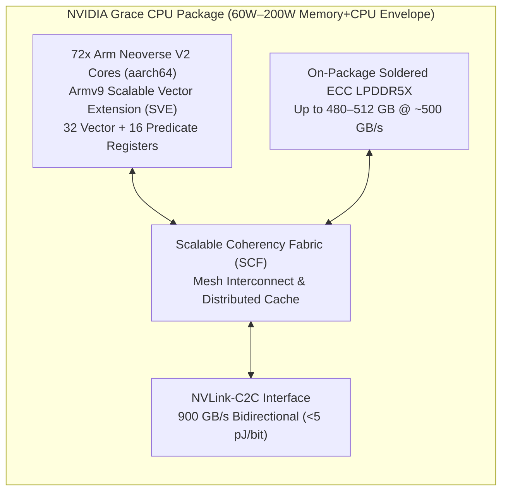
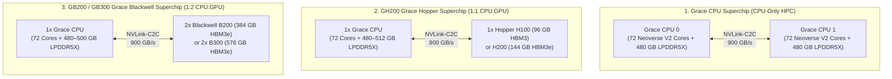
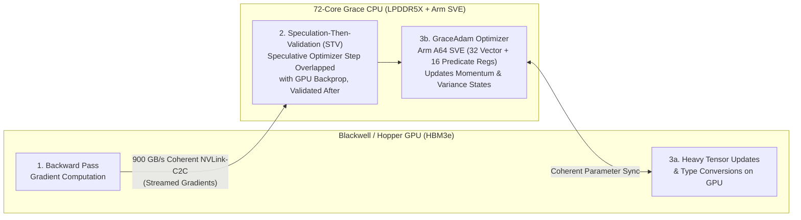

# 9.4 Grace CPU, GH200 and GB200 superchips

| | |
|---|---|
| **Status** | Drafted (`grace_superchips_lab.py`: 30 checks pass; hardware commands **untested** on live Grace Superchip nodes) |
| **Level** | Intermediate |
| **Priority tier** | 1b |
| **Lab venue** | none (design / reading) + self-checking Python model (`code/part09/grace_superchips_lab.py`) |
| **Part** | Part 9: NVIDIA systems and reference architectures |
| **Sources used** | `nvidia-devops` V4 Ch. 7; `nvidia-devops` V5 Ch. 7; *AI Systems Performance Engineering* Ch. 2, Ch. 3, Ch. 13; *Distributed AI Systems* Ch. 2; *NVIDIA DGX SuperPOD Reference Architecture Featuring NVIDIA DGX GB300 Systems* (`superpod-gb300-ra`) |

## Why this matters for AI infrastructure

For fifteen years, accelerated computing lived with an architectural compromise: even as GPU High Bandwidth Memory (HBM) soared past 3 TB/s to 8 TB/s, the host CPU remained stranded on the other side of a **PCIe bus capped at 64 GB/s per direction** (PCIe Gen5 x16). Whenever a deep-learning recommender model needed to look up multi-terabyte embedding tables, an LLM serving engine needed to offload hundreds of gigabytes of long-context KV cache, or a graph neural network needed to sample a 1.2 TB graph, the GPU sat idle paying **the "PCIe tax"**—waiting for bytes to crawl across a narrow I/O bus designed for network cards and SSDs.

To eliminate the PCIe wall between CPU and GPU, NVIDIA designed its own data center processor—the **72-core Arm Neoverse V2 Grace CPU** with on-package **LPDDR5X** memory—and fused it directly to Hopper and Blackwell GPUs over **NVLink-C2C (Chip-to-Chip)** at **900 GB/s bidirectional** with hardware cache coherence and a single unified virtual address space. Understanding how **Grace**, **GH200**, **GB200**, and **GB300** Superchips work—and what they do *not* magically solve (such as why GPU-to-GPU caches are still non-coherent across NVSwitch, why hot tensors must stay in HBM, and how `SuperOffload`, `GraceAdam`, and Linux hugepages must be tuned)—is essential for operating modern rack-scale AI factories.

:::info Corpus scope note
Standalone *NVIDIA Grace CPU Superchip Architecture Whitepaper* and *NVIDIA GH200 Grace Hopper Superchip Datasheet* PDFs are not in the local book corpus. The architectural specifications, NVLink-C2C coherence model, memory placement rules, and `SuperOffload` / `GraceAdam` algorithms in this chapter are drawn from `nvidia-devops` Volume 04 Chapter 7 and Volume 05 Chapter 7, *AI Systems Performance Engineering* Chapters 2, 3, and 13, *Distributed AI Systems* Chapter 2, and `superpod-gb300-ra` (pp. 8–10).
:::

## Prerequisites and outcomes

**Prerequisites:**
- Chapters `9.1` to `9.3` (DGX and HGX system families, PCIe Gen5 switch complexes, and NUMA domains).

**Outcomes:** After completing this chapter, you will be able to:
1. Quantify the **PCIe Gen5 tax** (`64 GB/s` unidirectional / `128 GB/s` bidirectional) versus **NVLink-C2C** (`450 GB/s` unidirectional / `900 GB/s` bidirectional at `< 5 picojoules/bit`).
2. Explain the internal design of the **NVIDIA Grace CPU** (72 Arm Neoverse V2 cores, Armv9 SVE vector units with 32 vector + 16 predicate registers, and soldered ECC LPDDR5X delivering `~500 GB/s` at `60W–200W`).
3. Contrast the **Grace CPU Superchip** (`144` cores), **GH200 Grace Hopper** (`1` Grace + `1` Hopper), **GB200 Grace Blackwell** (`1` Grace + `2` B200 GPUs), **GB300 Grace Blackwell Ultra** (`1` Grace + `2` B300 GPUs), and the **Vera Rubin (`VR200` / `VR300`)** roadmap.
4. Distinguish **CPU–GPU hardware cache coherence** (over NVLink-C2C with Address Translation Services) from **GPU–GPU memory sharing** (over NVSwitch, which requires explicit `NCCL` / `NVSHMEM` synchronization), and configure Linux NUMA pinning, hugepages, and **SuperOffload (`STV` + `GraceAdam`)** for superchip workloads.

---

## Concepts: basics → intermediate → advanced

## 1. The bottleneck: the "PCIe tax" on x86 GPU servers

In a traditional x86 server (Intel Xeon or AMD EPYC), the CPU and GPU live on separate circuit boards with completely separate physical memory pools, connected by a 16-lane PCIe bus.

Think of the GPU's HBM3e memory as a factory floor moving materials on conveyor belts at **8,000 GB/s**, and the host CPU's DDR5 RAM as a giant warehouse across the street. Connecting them with a PCIe Gen5 x16 slot (**64 GB/s per direction**) is like connecting the warehouse to the factory with a single narrow garden hose: as long as all materials fit inside the factory floor, production flies; the instant the factory runs out of room and has to fetch parts from the warehouse across the street, the machines grind to a halt.

### 1.1 Quantifying the PCIe Gen5 bandwidth gap

Compare the three memory and interconnect speeds inside a traditional x86 Hopper or Blackwell server:
- **GPU HBM3 / HBM3e bandwidth:** **3,350 GB/s** (`H100`), **4,800 GB/s** (`H200`), or **8,000 GB/s** (`B200`).
- **GPU-to-GPU NVLink bandwidth:** **900 GB/s** (`Hopper`) or **1,800 GB/s** (`Blackwell`) bidirectional.
- **CPU-to-GPU PCIe Gen5 x16 bandwidth:** **64 GB/s unidirectional** (**128 GB/s bidirectional**)—more than **50× to 125× slower** than GPU HBM.

Whenever a workload exceeds local HBM capacity and relies on host CPU memory, it pays **the PCIe tax**:
1. **Giant Recommendation Models (DLRMs):** Require multi-terabyte embedding tables stored in host RAM and queried on every mini-batch.
2. **Long-context LLM KV-cache offloading and MoE expert streaming:** Evicting inactive KV-cache blocks or unscheduled Mixture-of-Experts (MoE) weights to host DDR5 RAM stalls the decode loop if H2D/D2H transfers are throttled to 64 GB/s.
3. **Massive Graph Neural Networks (GNNs):** A 1.2 TB (1,200 GB) fraud-detection graph cannot fit in 80 GB of GPU HBM. Streaming 1,200 GB of node features across a 64 GB/s PCIe Gen5 bus requires **`1,200 GB / 64 GB/s = 18.75 seconds`** of pure bus transfer time per pass (**my inference**, dividing the 1,200 GB payload from our portfolio GNN scenario by the 64 GB/s PCIe Gen5 x16 unidirectional limit), leaving the GPU compute cores idle for days.

:::tip In one minute
- A 16-lane **PCIe Gen5** bus delivers only **64 GB/s unidirectional (128 GB/s bidirectional)**—over **50× slower** than Hopper HBM3 (`3.35 TB/s`) and **125× slower** than Blackwell HBM3e (`8.0 TB/s`).
- Workloads that spill embeddings, graph features, optimizer states, or long-context KV caches to host RAM pay **the PCIe tax**, starving the GPU SMs while waiting on host-to-device DMA copies.
:::

---

## 2. Inside the NVIDIA Grace CPU: 72 Arm Neoverse V2 cores and on-package LPDDR5X

To remove the CPU-to-GPU bottleneck, NVIDIA engineered a data center CPU from a clean sheet of paper specifically to feed GPUs: the **NVIDIA Grace CPU**.

Think of a general-purpose x86 server CPU as a Swiss Army knife carrying decades of legacy attachments for 1990s desktop software, whereas the Grace CPU is a purpose-built fuel pump designed solely to pre-process tensors, orchestrate CUDA graphs, and stream memory into attached GPUs at maximum bandwidth per watt.



### 2.1 72 Arm Neoverse V2 cores and Armv9 Scalable Vector Extension (SVE)

Instead of licensing x86, NVIDIA built Grace around the **Armv9 `aarch64`** architecture:
- **72 high-performance Arm Neoverse V2 cores** per Grace CPU socket, linked by a high-bandwidth on-die mesh (Scalable Coherency Fabric) so all 72 cores feed data loaders, tokenizers, and network rings without legacy x86 decode overhead.
- **Arm Scalable Vector Extension (SVE):** For CPU-side math—such as running offloaded Adam optimizer steps (`GraceAdam`) or data augmentations—Grace implements Arm's long-vector **SVE** architecture featuring **32 vector registers** and **16 predicate registers** per core. (Note for operators migrating containers: any C++/Cython Python wheel that hard-codes x86 `AVX2` or `AVX-512` intrinsics will fail to run on Grace and must be compiled for `aarch64` / Arm SVE.)

### 2.2 Soldered on-package ECC LPDDR5X memory (`~500 GB/s` at `60W–200W`)

Look at a Grace Superchip board and you will notice something surprising: **there are no DIMM slots.** Instead of using socketed DDR5 RDIMMs, NVIDIA solders **low-power server-grade ECC LPDDR5X memory** directly onto the module substrate millimeters from the Grace CPU die:
- **Capacity:** Up to **480 GB** (and **500–512 GB** on high-capacity GH200/GB300 SKUs) of Error-Correcting Code (ECC) LPDDR5X per Grace CPU.
- **Bandwidth:** Approximately **500 GB/s** of sustained memory bandwidth per Grace CPU, matching or beating bulky 8-channel/12-channel x86 DDR5 DIMM subsystems.
- **Power efficiency:** Together, the Grace CPU and its soldered LPDDR5X memory operate within a **60W to 200W** envelope—a fraction of the power and board area consumed by dual x86 CPUs and 16 to 32 DDR5 DIMMs. That saved power and board area can then be allocated directly to the GPUs and liquid cold plates.

:::tip In one minute
- The **NVIDIA Grace CPU** integrates **72 Arm Neoverse V2 (`aarch64`) cores** with **Arm SVE** (**32 vector registers and 16 predicate registers**) for fast data preprocessing and CPU-offloaded optimizer math.
- Instead of bulky DDR5 DIMM slots, Grace solders **up to 480–512 GB of ECC LPDDR5X** directly onto the package, delivering **~500 GB/s** of memory bandwidth within a **60W–200W** power envelope.
:::

---

## 3. NVLink-C2C and the hardware-coherent unified memory model

Having a fast Arm CPU with 480–512 GB of LPDDR5X only helps if the attached GPU can read and write that memory without squeezing through a 64 GB/s PCIe straw. That bridge is **NVLink-C2C (Chip-to-Chip)**.

### 3.1 Physical specs of NVLink-C2C vs PCIe Gen5 x16

**NVLink-C2C** is a custom, ultra-short-reach die-to-die / package-to-package coherent interconnect etched directly onto the Superchip substrate between the Grace CPU and its paired Hopper or Blackwell GPU(s):

| Metric | Traditional x86 PCIe Gen5 x16 | NVIDIA NVLink-C2C (Superchip) | Advantage (`NVLink-C2C` vs `PCIe Gen5`) |
|---|---|---|---|
| **Unidirectional Bandwidth** | **64 GB/s** | **450 GB/s** | **7.03× higher** one-way throughput |
| **Bidirectional Bandwidth** | **128 GB/s** | **900 GB/s** | **7.03× higher** aggregate throughput |
| **Energy Efficiency** | ~25+ picojoules/bit across PCB traces | **`< 5 picojoules/bit`** | **`> 5×` more energy-efficient** per bit moved |
| **Memory Address Space** | Separate host RAM and GPU BAR spaces | **Single Unified Virtual Address Space** with hardware **Address Translation Services (ATS)** | CPU and GPU threads share standard pointers without explicit `cudaMemcpy()` |
| **Hardware Cache Coherence** | Non-coherent by default | **Full hardware cache coherence** between Grace CPU caches and GPU memory | Zero software staging buffer overhead for CPU–GPU access |

### 3.2 What hardware cache coherence means—and the crucial GPU-to-GPU boundary

On a Grace Hopper (`GH200`) or Grace Blackwell (`GB200` / `GB300`) Superchip, **NVLink-C2C** implements hardware **Address Translation Services (ATS)** and cache coherence across the Grace CPU and its paired GPU(s):
- A CUDA kernel running on the GPU can dereference a pointer residing in the Grace CPU's **480–512 GB LPDDR5X** memory at **450 GB/s per direction (900 GB/s bidirectional)** without the programmer writing a single `cudaMemcpy()` call or allocating a page-locked staging buffer.
- Conversely, on a **DGX GB300 compute tray** (which contains **two GB300 Superchips** = 2 Grace CPUs + 4 B300 GPUs), a coherent **NVLink-C2C link bridges the two Superchips**, allowing both Superchips on the tray to act as **a single logical unit under one Linux OS instance**.

:::caution Critical distinction: CPU–GPU coherence vs GPU–GPU non-coherence
Do not confuse **CPU–GPU coherence over NVLink-C2C** with **GPU–GPU memory sharing over NVSwitch**. As detailed in *AI Systems Performance Engineering*, **only the CPU-to-GPU path over NVLink-C2C is hardware cache-coherent.** Across multiple GPUs connected by NVLink and NVSwitch (such as the 4 GPUs on a compute tray or the 72 GPUs in an NVL72 rack), there is a shared global physical address space for peer-to-peer loads/stores, **but GPU L1/L2 caches are NOT globally hardware cache-coherent across GPUs.** Multi-GPU communication still requires explicit software synchronization and memory ordering via **NCCL** collectives or **NVSHMEM** symmetric memory barriers.
:::

### 3.3 Real-world impact: solving the 1.2 TB Graph Neural Network bottleneck

Return to the financial-services team from Section 1 whose **1.2 TB (1,200 GB) fraud-detection Graph Neural Network (GNN)** took 4 days per training epoch on an x86 + H100 PCIe server because streaming 1,200 GB of graph node features across a 64 GB/s PCIe Gen5 slot took **`18.75 seconds`** per pass.

When that workload moves onto **two GH200 Grace Hopper Superchips** (each with **480 GB LPDDR5X + 144 GB HBM3e = 624 GB** of coherent memory, or **1,248 GB total across two superchips**):
1. The entire **1,200 GB** dataset (`240 GB` of hot GNN weights and active mini-batch activations in HBM3e + `960 GB` of graph feature tables in Grace LPDDR5X) resides inside the **1,248 GB hardware-coherent memory pool**.
2. When the Hopper GPUs sample graph neighbors stored in Grace LPDDR5X, they read the features directly over the **450 GB/s per-direction (900 GB/s bidirectional) NVLink-C2C** highway (**`2.67 seconds`** for a full 1,200 GB pass at 450 GB/s—a **7.03× link speedup** over PCIe Gen5, **my inference** from our transfer estimator in `code/part09/grace_superchips.py`), collapsing epoch times from days to hours.

:::tip In one minute
- **NVLink-C2C** links the Grace CPU to its paired GPU(s) at **900 GB/s bidirectional (450 GB/s per direction)**—**7.03× faster** than PCIe Gen5 x16 (`128 GB/s` bi / `64 GB/s` uni)—consuming **`< 5 picojoules/bit`**.
- **Only the CPU–GPU NVLink-C2C path is hardware cache-coherent** (with ATS unified virtual addressing); **GPU–GPU caches across NVSwitch are not globally coherent** and still require `NCCL` or `NVSHMEM` synchronization.
:::

---

## 4. The Superchip lineup: Grace CPU Superchip, GH200, GB200, GB300, and the Vera Rubin roadmap

NVIDIA packages the Grace CPU and NVLink-C2C into four production Superchip modules today, with the next-generation **Vera Rubin** and **Feynman** architectures already on the roadmap:



### 4.1 Complete comparison of Grace-based Superchip modules

| Superchip Module | CPU Configuration | On-Package LPDDR5X & Bandwidth | Paired GPU(s) | Total GPU HBM & Bandwidth | Total Coherent Memory Pool | Module TDP Envelope |
|---|---|---|---|---|---|---|
| **Grace CPU Superchip** | **2x Grace CPUs** (**144 Arm Neoverse V2 cores**) linked via NVLink-C2C | **Up to 960 GB** ECC LPDDR5X @ **~1.0 TB/s** | None (CPU-only HPC / cloud server) | 0 GB | **960 GB** | ~500W (including memory) |
| **GH200 Grace Hopper (96 GB SKU)** | **1x Grace CPU** (**72 Arm cores**) | **480 GB** (or **512 GB** SKU) LPDDR5X @ **~500 GB/s** | **1x Hopper GPU** (H100-class) | **96 GB HBM3** @ **4.0 TB/s** | **576 GB** (`480+96`) or **608 GB** (`512+96`) | ~1,000W |
| **GH200 Grace Hopper (144 GB SKU)** | **1x Grace CPU** (**72 Arm cores**) | **480 GB** LPDDR5X @ **~500 GB/s** | **1x Hopper H200-class GPU** | **144 GB HBM3e** @ **4.9 TB/s** | **624 GB** (`480 + 144 GB`) | ~1,000W |
| **GB200 Grace Blackwell Superchip** | **1x Grace CPU** (**72 Arm cores**) | **Up to 480 GB** LPDDR5X @ **~500 GB/s** | **2x Blackwell B200 GPUs** (dual-reticle dies each) | **384 GB HBM3e** (`2 × 192 GB`, or `360 GB` usable on 180 GB SKU) @ **16.0 TB/s** | **Up to 864 GB** (`480 + 384 GB`) per Superchip | ~2,700W (liquid-cooled) |
| **GB300 Grace Blackwell Ultra Superchip** | **1x Grace CPU** (**72 Arm cores**) | **~500 GB** LPDDR5X @ **~500 GB/s** (`18 TB` across 36 modules) | **2x Blackwell Ultra B300 GPUs** (1.5× FP4 compute vs B200) | **576 GB HBM3e** (`2 × 288 GB`, **1.5× B200**) @ **16.0 TB/s** | **~1,076 GB (~1.08 TB)** per Superchip (**~2.15 TB** per 2-superchip compute tray) | ~2,800W+ (liquid-cooled) |

:::note Reconciling GH200 and GB200 memory SKU numbers across sources
In `nvidia-devops` Volume 04 Chapter 7, the GH200 is cited with **480 GB LPDDR5X** plus **96 GB HBM3** (`576 GB` total) or **144 GB HBM3e** (`624 GB` total), whereas *Distributed AI Systems* Chapter 2 cites the **512 GB LPDDR5X + 96 GB HBM3 = 608 GB** GH200 configuration. Similarly, for **GB200**, Volume 04 Chapter 6/7 and the architectural overview in *AI Systems Performance Engineering* Chapter 2 cite **384 GB HBM3e** (`2 × 192 GB`) + **480 GB LPDDR5X** = **864 GB**, whereas the NVL72 system table in *AI Systems Performance Engineering* Chapter 2 lists **180 GB per B200 GPU** (`13.4 TB` HBM3e + `17 TB` LPDDR5X = **~30 TB** across 36 Superchips). For **GB300**, *AI Systems Performance Engineering* Chapter 2 lists **288 GB HBM3e per B300 GPU** (`576 GB` per Superchip, **~20.7 TB HBM3e + ~18 TB LPDDR5X = ~38 TB** across a 36-Superchip NVL72 rack).
:::

### 4.2 Why GB200 and GB300 move from a 1:1 (`GH200`) to a 1:2 (`1 Grace : 2 GPUs`) ratio

Notice the architectural shift from **GH200** (`1 Grace CPU : 1 Hopper GPU`) to **GB200 / GB300** (`1 Grace CPU : 2 Blackwell GPUs`):
- Because a single 72-core Grace CPU with 500 GB/s of LPDDR5X and 900 GB/s of NVLink-C2C has more than enough CPU cores (`36 cores per GPU`) and memory capacity to drive **two** GPUs simultaneously, pairing **one Grace CPU with two Blackwell GPUs** on each Superchip doubles GPU compute density per 1U tray.
- In a **GB200 or GB300 NVL72 compute tray (1U)**, two Superchips sit side-by-side (**2 Grace CPUs = 144 Arm cores + 4 Blackwell GPUs**) bridged by a coherent NVLink-C2C link so a single Linux OS kernel manages all 144 Arm cores and 4 GPUs as one node. Multiply that 1U tray by **18 compute trays per rack** and you get **36 Grace CPUs (2,592 Arm Neoverse V2 cores) and 72 Blackwell GPUs** in a single rack.

### 4.3 The multi-year Superchip roadmap: Vera Rubin (`VR200` / `VR300`) and Feynman

As documented in *AI Systems Performance Engineering* Chapter 2, NVIDIA's roadmap continues the 1-CPU-to-2-GPU Superchip paradigm across three upcoming generations:
1. **Vera Rubin Superchip (`VR200`, 2026):** Combines one **Vera** Arm CPU (TSMC 3nm process, more cores, and **LPDDR6 memory running at ~1 TB/s**) with two **Rubin** GPUs (~200 SMs per die, **288 GB HBM4 at ~13–14 TB/s**, and **6th-generation NVLink 6** doubling CPU–GPU and GPU–GPU bandwidth).
2. **Vera Rubin Ultra (`VR300` / `R300`, 2027):** Moves to a **quad-die Rubin Ultra GPU module** (4 GPU dies and 16 HBM stacks totaling **1 TB of HBM per GPU module**) in **NVL144** and **NVL576** rack configurations (~3–4 ExaFLOPS per rack).
3. **Feynman (`2028`):** Expected to transition to a 2nm process node, HBM5, multi-tier on-package memory, and on-package optical NVLink interconnects for reasoning-era inference scaling.

:::tip In one minute
- **Grace CPU Superchip** links **2 Grace CPUs (144 cores, 960 GB LPDDR5X)** for CPU-only HPC; **GH200** pairs **1 Grace + 1 Hopper** (`576–624 GB` coherent pool); **GB200** pairs **1 Grace + 2 B200 GPUs** (`384 GB HBM3e + 480 GB LPDDR5X = 864 GB`); **GB300** pairs **1 Grace + 2 B300 GPUs** (`576 GB HBM3e + 500 GB LPDDR5X ≈ 1.08 TB`).
- Two **GB200/GB300 Superchips** sit inside each 1U NVL72 compute tray (**2 Grace CPUs + 4 Blackwell GPUs**), bridged by coherent NVLink-C2C under a single Linux OS instance.
- The **Vera Rubin (`VR200`)** successor upgrades the CPU to **Vera** (~1 TB/s LPDDR6) and the GPUs to **Rubin** (~13–14 TB/s HBM and NVLink 6).
:::

---

## 5. Software co-design on Grace Superchips: data placement, NUMA, hugepages, and SuperOffload

Having a 900 GB/s coherent NVLink-C2C link between CPU and GPU does not mean you can ignore memory hierarchy physics or Linux OS tuning.

### 5.1 Two-tier memory placement: keeping "hot" tensors in HBM and "cold/overflow" in LPDDR5X

Even though Grace LPDDR5X (`~500 GB/s`) and NVLink-C2C (`450 GB/s` per direction) are over 7× faster than PCIe Gen5, **Blackwell HBM3e runs at `8,000 GB/s` per GPU** (`16,000 GB/s` across the two GPUs on a GB200/GB300 Superchip)—roughly **16× to 32× faster than LPDDR5X**.

Therefore, treat a Grace Superchip as an **explicit two-tier coherent memory complex**:
1. **Tier 1 — GPU HBM3 / HBM3e (`4.0–8.0 TB/s` per GPU):** Always place **"hot" working-set tensors** here—active layer weights, forward/backward activations, and active KV-cache blocks accessed on every token decode step.
2. **Tier 2 — Grace CPU LPDDR5X (`~500 GB/s`, accessed at `450 GB/s` per direction via NVLink-C2C):** Place **"cold" or overflow structures** here—unscheduled Mixture-of-Experts (MoE) expert weights, master FP32 weights, Adam optimizer momentum/variance buffers, massive DLRM/GNN feature tables, and evicted multi-turn KV-cache blocks.
3. **Hide NVLink-C2C latency with asynchronous prefetching:** Rather than letting CUDA kernels stall on on-demand page faults across NVLink-C2C, use `cudaMallocAsync` with framework caching allocators and explicitly prefetch upcoming layer weights or expert slices from Grace LPDDR5X into GPU HBM using **`cudaMemPrefetchAsync()`** on a secondary CUDA stream while the GPU SMs compute the current layer.

### 5.2 Linux NUMA pinning, `pin_memory`, and Transparent Hugepages (THP) on Grace

How does the Linux kernel view a Grace Hopper or Grace Blackwell compute tray?
- **Separate NUMA nodes in Linux:** Even though NVLink-C2C is hardware cache-coherent, Linux still models each **Grace CPU's LPDDR5X as a CPU NUMA node** and each **GPU's HBM as a distinct memory domain**. On a dual-Superchip compute tray (`2 Grace CPUs + 4 Blackwell GPUs`), crossing from `Grace CPU 0` to a GPU attached to `Grace CPU 1` adds hop latency (on dual-socket systems, local NUMA memory latency is **~80 ns** versus **~139 ns** cross-node—a **~75% latency penalty**.). Always pin each training rank and its PyTorch `DataLoader` workers (`worker_init_fn`) to the local Grace CPU NUMA node (`numactl --cpunodebind=$NODE --membind=$NODE`).
- **`pin_memory=True` vs Coherent Unified Memory + Large Pages:** On standard x86 PCIe servers, `pin_memory=True` (page-locked memory) is mandatory to achieve 2–3× faster DMA copies. On Grace Superchips, CPU–GPU transfers already use the coherent NVLink-C2C path without explicit page-locking, *provided* you enable **Linux Hugepages (2 MB or 1 GB pages)** so the CPU and GPU Translation Lookaside Buffers (TLBs) do not thrash on millions of 4 KB page translations. However, when the `DataLoader` thread is CPU-bound (such as heavy LLM tokenization), combining `pin_memory=True` (or hugepages, with `ulimit -l unlimited`) + `non_blocking=True` + `persistent_workers=True` remains recommended—and always verify overlap with **Nsight Systems**.
- **Transparent Hugepages (`THP`) for training vs inference:**
  - For **throughput-oriented training** on Grace Superchips, enabling **Transparent Hugepages (`always`)** yields a **~3%–5% throughput gain** by reducing page faults and TLB misses across multi-hundred-gigabyte LPDDR5X allocations.
  - For **latency-sensitive real-time LLM inference**, set Transparent Hugepages to **`madvise` or `never`** (`transparent_hugepage=never`) and use explicit `hugetlbfs` / `vm.nr_hugepages` instead, because kernel background THP compaction and defragmentation threads cause unpredictable latency spikes that violate P99 ITL targets.

### 5.3 SuperOffload and `GraceAdam`: superchip-native training optimization

Traditional CPU offload engines (such as standard ZeRO-Offload designed for slow 64 GB/s PCIe buses) wait for global gradient reductions and NaN/Inf norm checks to finish on the GPU before copying gradients to the CPU, running the CPU Adam step sequentially, and copying updated weights back. On a Grace Superchip, that sequential barrier wastes both the 72 Arm cores and the 900 GB/s NVLink-C2C link.

**SuperOffload** (detailed in *AI Systems Performance Engineering* Chapter 13) re-architects CPU–GPU offloading around four Grace-native mechanisms:



1. **Speculation-Then-Validation (STV):** Instead of waiting for the entire backward pass and global gradient norm check to complete before starting CPU optimizer updates, STV **speculatively executes the optimizer parameter updates on the Grace CPU in parallel while backpropagation is still running on the GPU**, and then validates (commits or rolls back) the updates once the global check completes—eliminating the end-of-step synchronization bubble.
2. **Heterogeneous Optimizer Computation:** Rather than running 100% of the optimizer on the CPU or 100% on the GPU, SuperOffload partitions optimizer work across both chips simultaneously: compute-heavy tensor updates run on the GPU's Tensor/SIMT cores while lighter state updates (such as Adam first- and second-moment momentum buffers in LPDDR5X) run on the 72 Grace CPU cores.
3. **Superchip-Aware Type Casts and Copies:** Because NVLink-C2C provides 900 GB/s of coherent bandwidth, SuperOffload shifts FP32↔BF16/FP8 precision conversions onto the GPU rather than burning CPU memory bandwidth on type casting before transfer.
4. **`GraceAdam` (Arm SVE Vectorized Optimizer):** Standard x86 PyTorch CPU Adam kernels rely on x86 AVX intrinsics. SuperOffload replaces them with **`GraceAdam`**, an Adam implementation hand-tuned for the Grace CPU's **Arm A64 Scalable Vector Extension (SVE)**—exploiting all **32 SVE vector registers and 16 predicate registers** to maximize parameter-update throughput per watt across all 72 Neoverse V2 cores.

:::tip In one minute
- Keep **hot tensors** (active weights, activations, active KV cache) in **GPU HBM (`4–8 TB/s`)** and place **overflow/cold states** (optimizer states, unscheduled MoE experts, giant embeddings) in **Grace LPDDR5X (`~500 GB/s`)**, using **`cudaMemPrefetchAsync()`** to hide NVLink-C2C transfer latency.
- Pin worker threads to the local Grace NUMA node (`~80 ns` local vs `~139 ns` remote latency); enable **THP (`always`)** for training throughput (`+3%–5%`), but use **`madvise` or `never`** with explicit hugepages for low-latency LLM inference.
- **SuperOffload** unlocks Grace Superchip performance via **Speculation-Then-Validation (STV)**, **heterogeneous CPU+GPU optimizer partitioning**, and **`GraceAdam`** compiled for **Arm SVE (`32` vector + `16` predicate registers)**.
:::

---

## Commands and configurations that matter

Use these commands on a Grace Hopper (`GH200`) or Grace Blackwell (`GB200` / `GB300`) node to inspect the Arm Neoverse V2 CPU, verify NVLink-C2C coherence and NUMA topology, configure hugepages, and pin PyTorch workers (**untested** on live Grace Superchip hardware in this authoring environment; rules verified in `code/part09/grace_superchips_lab.py`).

### 1. Inspect the 72-core / 144-core Grace Arm Neoverse V2 CPU and SVE capabilities

```bash
# 1. Verify aarch64 architecture, 72 cores per socket (144 cores on dual-Superchip tray), and SVE flags
lscpu | grep -E "Architecture:|Model name:|Socket\(s\):|Core\(s\) per socket:|NUMA node|Flags:"

# 2. Confirm Arm Scalable Vector Extension (sve / sve2) support in /proc/cpuinfo
grep -m 1 -oE "sve[^ ]*" /proc/cpuinfo
```

### 2. Inspect Grace LPDDR5X + GPU HBM NUMA topology and NVLink-C2C links

```bash
# 1. View CPU and memory NUMA nodes (LPDDR5X vs GPU memory nodes)
numactl --hardware

# 2. View GPU-to-GPU NVLink and CPU/NUMA affinity matrix
nvidia-smi topo -m

# 3. Query NVLink link speeds and active sub-links
nvidia-smi nvlink --status
```

### 3. Tune Linux virtual memory, locked memory limits, and Transparent Hugepages (THP)

```bash
# 1. Disable swapping on GPU/Superchip compute nodes so LPDDR5X never swaps to NVMe
sudo sysctl -w vm.swappiness=0
sudo swapoff -a

# 2. Ensure unlimited locked (pinned) memory in /etc/security/limits.conf or container ulimits
ulimit -l unlimited

# 3. For throughput training: enable Transparent Hugepages (2 MB pages reduce TLB pressure by ~3-5%)
echo always | sudo tee /sys/kernel/mm/transparent_hugepage/enabled

# 4. For latency-sensitive LLM inference: use madvise (or never) to prevent background compaction pauses
echo madvise | sudo tee /sys/kernel/mm/transparent_hugepage/enabled
```

### 4. Launch a training process pinned to each GPU's local Grace CPU NUMA node

```bash
# Dynamically query each GPU's local NUMA node from nvidia-smi topo -m and bind CPU + memory
for GPU in 0 1 2 3; do
  NODE=$(nvidia-smi topo -m -i "$GPU" | awk '/NUMA Affinity/ {print $NF}')
  numactl --cpunodebind="$NODE" --membind="$NODE" \
    bash -c "CUDA_VISIBLE_DEVICES=$GPU python3 train.py --gpu $GPU" &
done
wait
```

---

## How it fails

| Failure mode | Symptom | Root cause | Diagnosis & fix |
|---|---|---|---|
| **1. Assuming GPU-to-GPU caches are hardware cache-coherent across NVSwitch** | Custom multi-GPU CUDA kernels reading/writing peer GPU memory directly across NVLink produce silent stale-cache data corruption or race conditions on a GB200/GB300 node. | Engineers hear *"Grace Blackwell has coherent unified memory"* and assume all 4 or 72 GPUs have globally coherent L1/L2 caches. In reality, **only the CPU–GPU NVLink-C2C link is hardware cache-coherent**; GPU-to-GPU memory across NVSwitch has a shared global address space but **non-coherent GPU caches**. | Use **NCCL** collectives or **NVSHMEM** symmetric memory APIs (`nvshmem_barrier_all()`, `triton.nvshmem.put()/get()`) to enforce explicit memory ordering and cache invalidation across GPUs. |
| **2. Placing "hot" activations or active KV cache in Grace LPDDR5X** | A model fits inside the 864 GB coherent pool of a GB200 Superchip without OOM errors, but step time or decode ITL is **8× to 15× slower** than expected. | Relying blindly on automatic CUDA Unified Memory placed frequently accessed ("hot") weights, activations, or active KV-cache tensors in **Grace LPDDR5X (`~500 GB/s`, accessed at `450 GB/s` over NVLink-C2C)** instead of **GPU HBM3e (`8,000 GB/s`)**. | Explicitly place hot weights, activations, and active KV cache in **GPU HBM3e**, restrict LPDDR5X to cold/overflow tiers (optimizer states, unscheduled MoE experts, historical KV blocks), and stream upcoming layers into HBM ahead of use via **`cudaMemPrefetchAsync()`**. |
| **3. Using Unified Memory on Grace without Hugepages (`4 KB` TLB thrashing)** | Profiling with Nsight Systems shows frequent CPU/GPU page-translation stalls and high kernel overhead during coherent CPU–GPU memory access. | The workload accesses hundreds of gigabytes of unified virtual memory across NVLink-C2C using default **4 KB Linux pages** without `pin_memory=True` or hugepages, flooding the CPU and GPU Address Translation Services (ATS) / TLBs. | Enable **2 MB Transparent Hugepages** (`always` for training; `madvise` + explicit `hugetlbfs` for low-latency inference), set `ulimit -l unlimited`, and verify H2D/D2H overlap in Nsight Systems. |
| **4. `Illegal instruction (core dumped)` or 10× slower CPU preprocessing on Grace** | Moving an x86 Docker container or custom C++ optimizer extension onto a GH200/GB200 node either fails to start (`exec format error` / `SIGILL`) or runs CPU Adam updates painfully slowly. | The Grace CPU is **Armv9 `aarch64` (Neoverse V2)** with **Arm SVE** (`32` vector + `16` predicate registers), not x86_64. Containers built for `amd64` or C++ extensions compiled with x86 `AVX2`/`AVX-512` intrinsics either crash or fall back to scalar C loops. | Build multi-arch (`linux/arm64`) NGC containers, recompile native wheels with `-march=armv9-a+sve2`, and use **`GraceAdam` / SuperOffload** to vectorize offloaded optimizer updates on Arm SVE. |
| **5. Unbound DataLoader workers migrating across dual Grace Superchips** | On a 2-Superchip compute tray (`144` Arm cores, `4` GPUs), training throughput fluctuates by 5%–10% with periodic GPU launch bubbles. | Linux CFS migrated `DataLoader` workers for `GPU 0` (attached to `Grace CPU 0`) onto `Grace CPU 1` cores, incurring a **~75% remote NUMA memory latency penalty** (`~139 ns` vs `~80 ns`). | Bind both the main rank process (`numactl --cpunodebind --membind`) and every forked `DataLoader` worker (`worker_init_fn` with `psutil.Process().cpu_affinity()` + `libnuma`) to the GPU's local Grace CPU NUMA node, and set `persistent_workers=True`. |

---

## Hands-on lab

This chapter's self-checking Python model (`code/part09/grace_superchips.py`) and lab runner (`code/part09/grace_superchips_lab.py`) implement:
1. The **NVLink-C2C vs PCIe Gen5 x16 bandwidth and transfer-time calculator** (`450 GB/s` vs `64 GB/s` unidirectional = `7.03×` speedup, `900 GB/s` vs `128 GB/s` bidirectional, `< 5 pJ/bit`, and the `1.2 TB` GNN pass taking `18.75 s` on PCIe Gen5 vs `2.67 s` on NVLink-C2C).
2. The **Superchip Architecture Catalog** (`Grace CPU Superchip` 144 cores / 960 GB; `GH200-96GB` 576 GB; `GH200-144GB` 624 GB; `GB200` 384 GB HBM3e + 480 GB LPDDR5X = 864 GB; `GB300` 576 GB HBM3e + 500 GB LPDDR5X = 1,076 GB, scaling to `2,592` Arm cores, `20,736 GB` HBM3e, and `18,000 GB` LPDDR5X across a 36-Superchip NVL72 rack).
3. The **Two-Tier Coherent Memory Placement Evaluator** (verifying whether hot working sets fit in HBM3/HBM3e and how overflow spills into Grace LPDDR5X).
4. The **Grace Superchip Runtime & OS Configuration Auditor** (checking CPU–GPU vs GPU–GPU cache-coherence assumptions, local Grace NUMA pinning, large-page enablement for unified memory, `THP=always` vs `madvise` for low-latency inference, hot tensor placement, and Arm A64 SVE vs x86 AVX compatibility).

Run the lab from the repository root:

```bash
python3 -B code/part09/grace_superchips_lab.py
```

Expected output (verified in this repository):

```text
=== Chapter 9.4 Lab: Grace CPU, GH200, GB200 & GB300 Superchips ===
  [PASS] PCIe Gen5 x16 is 64 GB/s unidirectional and 128 GB/s bidirectional
  [PASS] NVLink-C2C is 450 GB/s unidirectional and 900 GB/s bidirectional (7.03x PCIe Gen5)
  [PASS] Grace CPU Superchip bonds 2x 72-core Arm Neoverse V2 CPUs (144 cores) + up to 960 GB LPDDR5X at ~1 TB/s
  [PASS] GH200-96GB combines 72-core Grace (480 GB LPDDR5X) + H100 (96 GB HBM3) = 576 GB coherent memory
  [PASS] GH200-144GB HBM3e variant delivers 480 + 144 = 624 GB coherent memory
  [PASS] GB200 combines 1x 72-core Grace + 2x B200 GPUs (384 GB HBM3e @ 16 TB/s + 480 GB LPDDR5X = 864 GB)
  [PASS] GB300 combines 1x Grace + 2x B300 GPUs (2x 288 GB = 576 GB HBM3e + 500 GB LPDDR5X = 1,076 GB)
  ...
  [PASS] 1.2 TB (1,200 GB) host-to-GPU pass takes 18.75 s over PCIe Gen5 x16 vs 2.67 s over NVLink-C2C
  [PASS] Rejects unknown superchip SKU
  [PASS] Rejects negative payload in transfer time estimator
  [PASS] Rejects unsupported link_type in transfer time estimator
  [PASS] Unidirectional NVLink-C2C (450 GB/s) is 7.03x unidirectional PCIe Gen5 x16 (64 GB/s)

Summary: 30 passed, 0 failed (total 30)
```

---

## Exercises

1. Run `python3 -B code/part09/grace_superchips_lab.py`. Pick the check that compares PCIe Gen5 and NVLink-C2C transfer time for the 1,200 GB graph. Reproduce the two numbers (18.75 s and 2.67 s) by hand.
2. Work out the total coherent memory of one GB300 Superchip and of the whole 36-Superchip NVL72 rack, using the numbers in section 4.1. Which two numbers in the chapter should you compare when sizing a model that must stay in HBM?
3. You have a GB200 node and a 600 GB model with a 200 GB KV cache. Sketch which tensors you would place in HBM and which in LPDDR5X, and say what you would prefetch and when.
4. Write the three commands that show whether a node is `aarch64`, has SVE, and how many NUMA nodes it has. Say what you expect on a GB200 compute tray.
5. A teammate moves an x86 container to a GH200 node and gets `exec format error`. Write the checklist you would give them (image build, wheels, native code).
6. Explain in five lines to a colleague why "unified memory" on a Grace Superchip does not mean the 864 GB behaves like HBM.

## Checkpoint questions (20)

<details>
<summary><strong>1. Compare the unidirectional and bidirectional bandwidth of NVLink-C2C against PCIe Gen5 x16, and state its energy efficiency per bit.</strong></summary>

- **PCIe Gen5 x16:** **64 GB/s** unidirectional (**128 GB/s** bidirectional).
- **NVLink-C2C:** **450 GB/s** unidirectional (**900 GB/s** bidirectional)—a **7.03×** bandwidth increase—consuming **less than 5 picojoules per bit** (`< 5 pJ/bit`, more than 5× more energy-efficient than standard PCB PCIe Gen5 traces).
</details>

<details>
<summary><strong>2. Why does the NVIDIA Grace CPU solder ECC LPDDR5X memory directly onto the package instead of using standard DDR5 DIMM slots?</strong></summary>

Soldering server-grade ECC LPDDR5X millimeters from the 72 Arm Neoverse V2 cores delivers **~500 GB/s of sustained memory bandwidth** (up to 480–512 GB per Grace CPU) inside a compact **60W–200W** total CPU+memory power envelope—a fraction of the power and board space consumed by 8- to 12-channel x86 DDR5 DIMMs.
</details>

<details>
<summary><strong>3. Contrast the CPU-to-GPU ratio and coherent memory capacity across the `GH200`, `GB200`, and `GB300` Superchips.</strong></summary>

- **GH200 Grace Hopper (`1:1`):** 1x 72-core Grace CPU (**480–512 GB LPDDR5X**) + 1x Hopper GPU (**96 GB HBM3** or **144 GB HBM3e**) = **576 GB to 624 GB** coherent memory.
- **GB200 Grace Blackwell (`1:2`):** 1x 72-core Grace CPU (**480 GB LPDDR5X**) + 2x Blackwell B200 GPUs (**384 GB HBM3e**, or 360 GB on 180 GB SKUs, at **16 TB/s**) = **up to 864 GB** coherent memory.
- **GB300 Grace Blackwell Ultra (`1:2`):** 1x 72-core Grace CPU (**~500 GB LPDDR5X**) + 2x Blackwell Ultra B300 GPUs (**2 × 288 GB = 576 GB HBM3e**, 1.5× B200 capacity) = **~1,076 GB (~1.08 TB)** coherent memory per Superchip.
</details>

<details>
<summary><strong>4. On a Grace Blackwell NVL72 system, is memory hardware cache-coherent between two GPUs, or only between a Grace CPU and its paired GPUs? Why does this matter for programmers?</strong></summary>

**Only the CPU-to-GPU path over NVLink-C2C is hardware cache-coherent** (with Address Translation Services). Across GPUs over NVLink/NVSwitch, there is a shared global physical address space for peer-to-peer access, **but GPU L1/L2 caches are not globally hardware cache-coherent across GPUs**. Programmers must still use **NCCL** collectives or **NVSHMEM** synchronization barriers to maintain consistency across GPUs.
</details>

<details>
<summary><strong>5. If a GB200 Superchip has an 864 GB unified virtual address space, why must you still carefully separate "hot" tensors from "cold/overflow" tensors?</strong></summary>

Because **Blackwell HBM3e delivers 8,000 GB/s per GPU (16,000 GB/s per Superchip)** whereas **Grace LPDDR5X delivers ~500 GB/s (accessed at 450 GB/s per direction over NVLink-C2C)**—roughly an **18× bandwidth difference**. Active weights, forward/backward activations, and active KV caches ("hot" data) must reside in HBM3e, while LPDDR5X holds overflow layers, optimizer states, or cold embeddings prefetched into HBM asynchronously via `cudaMemPrefetchAsync()`.
</details>

<details>
<summary><strong>6. How many GB300 Superchips reside on a single DGX GB300 compute tray, and how are they connected to run under a single OS instance?</strong></summary>

Each 1U DGX GB300 compute tray houses **two GB300 Superchips** (**2 Grace CPUs = 144 Arm cores + 4 B300 GPUs**). A coherent **NVLink-C2C interconnect bridges the two Superchips**, allowing them to operate as a single logical SMP system under one Linux OS instance.
</details>

<details>
<summary><strong>7. How should Transparent Hugepages (THP) be configured on a Grace Superchip node for throughput-focused training versus low-latency LLM inference, and why?</strong></summary>

- **Training:** Set THP to **`always`** (2 MB pages reduce page-fault overhead and TLB misses across huge LPDDR5X/unified memory pools, improving throughput by **~3%–5%**).
- **Low-latency LLM inference:** Set THP to **`madvise` or `never`** (`transparent_hugepage=never`) and use explicit `hugetlbfs` hugepages instead, because kernel background THP compaction causes unpredictable latency pauses.
</details>

<details>
<summary><strong>8. What are the three core innovations in `SuperOffload` and `GraceAdam` for Grace-based Superchips?</strong></summary>

1. **Speculation-Then-Validation (STV):** Overlaps speculative CPU optimizer updates with GPU backpropagation before global gradient checks complete, then validates afterward to eliminate synchronization stalls.
2. **Heterogeneous Optimizer Computation:** Splits optimizer work between the GPU (compute-heavy tensor updates and precision casts) and the 72 Grace CPU cores (lighter momentum/variance buffer updates in LPDDR5X).
3. **`GraceAdam` on Arm SVE:** Vectorizes CPU Adam updates using the Grace CPU's **Arm A64 Scalable Vector Extension (SVE)** with **32 vector registers and 16 predicate registers**.
</details>

<details>
<summary><strong>9. What is the Vera Rubin (`VR200` / `VR300`) Superchip on NVIDIA's post-Blackwell roadmap?</strong></summary>

The **Vera Rubin Superchip (`VR200`, 2026)** pairs one **Vera** Arm CPU (TSMC 3nm, **LPDDR6 at ~1 TB/s**) with two **Rubin** GPUs (~200 SMs per die, **288 GB HBM at ~13–14 TB/s**, and **NVLink 6**), followed by **Vera Rubin Ultra (`VR300` / `R300`, 2027)** with quad-die GPU modules (**1 TB HBM per GPU module**) in NVL144/NVL576 racks.
</details>

<details>
<summary><strong>10. What is the "PCIe tax"?</strong></summary>

It is the slowdown a GPU suffers when it needs data from host RAM over a PCIe Gen5 x16 link (64 GB/s per direction), which is far slower than the GPU's own HBM. Workloads like huge embedding tables, long KV caches or big graphs pay it.
</details>

<details>
<summary><strong>11. How many cores and how much memory does a Grace CPU have, and why is its memory soldered?</strong></summary>

72 Arm Neoverse V2 cores and up to about 480–512 GB of LPDDR5X. It is soldered close to the CPU to get about 500 GB/s of bandwidth inside a small power budget (60–200 W together with the CPU).
</details>

<details>
<summary><strong>12. What does NVLink-C2C let a CUDA kernel do that PCIe does not?</strong></summary>

With hardware coherence and a single virtual address space, a GPU kernel can use a pointer to Grace's LPDDR5X memory directly, with no `cudaMemcpy` and no page-locked staging buffer.
</details>

<details>
<summary><strong>13. What is the CPU-to-GPU ratio in a GH200 and in a GB200, and why did it change?</strong></summary>

GH200 is 1 Grace to 1 Hopper. GB200 and GB300 are 1 Grace to 2 Blackwell GPUs. One 72-core Grace has enough cores, memory and link bandwidth to drive two GPUs, so the tray holds more GPUs.
</details>

<details>
<summary><strong>14. How many Arm cores and GPUs are in one NVL72 compute tray, and in the whole rack?</strong></summary>

A tray has 2 Grace CPUs (144 cores) and 4 GPUs. The rack has 18 trays, so 36 Grace CPUs (2,592 cores) and 72 GPUs.
</details>

<details>
<summary><strong>15. Why are the 864 GB (GB200) and the 8,000 GB/s HBM figures not interchangeable?</strong></summary>

864 GB is the size of the coherent pool (HBM plus LPDDR5X). HBM is much faster than LPDDR5X (about 8,000 vs 500 GB/s), so only the hot data should live in HBM.
</details>

<details>
<summary><strong>16. What does `cudaMemPrefetchAsync()` do for you on a Grace node?</strong></summary>

It moves upcoming weights or expert slices from LPDDR5X into HBM on a second stream while the GPU computes the current layer, so kernels do not stall on page faults.
</details>

<details>
<summary><strong>17. How does Linux see a Grace compute tray, and what should you pin?</strong></summary>

Each Grace CPU's LPDDR5X is a NUMA node and the GPUs have their own memory domains. Pin each rank and its `DataLoader` workers to the NUMA node of the Grace CPU attached to its GPU with `numactl --cpunodebind --membind`.
</details>

<details>
<summary><strong>18. Do you still need `pin_memory=True` on a Grace Superchip?</strong></summary>

Not for coherent transfers if you use hugepages. When the `DataLoader` is CPU-bound, the chapter still recommends pinned memory with `non_blocking=True` and `persistent_workers=True`, and says to check the overlap in Nsight Systems.
</details>

<details>
<summary><strong>19. Why must C++ or Python extensions be rebuilt for Grace?</strong></summary>

Grace is Armv9 `aarch64`, not x86. Code with AVX2 or AVX-512 intrinsics will crash or fall back to slow scalar code. Build `linux/arm64` images and compile native code for Arm SVE.
</details>

<details>
<summary><strong>20. Give one fact about the Vera Rubin roadmap from this chapter.</strong></summary>

The `VR200` Superchip (2026) pairs a Vera Arm CPU (LPDDR6 at about 1 TB/s) with two Rubin GPUs (288 GB HBM at about 13–14 TB/s) and NVLink 6. `VR300` (2027) moves to quad-die GPU modules with 1 TB of HBM each.
</details>

---

## Sources and review notes

### Sources read in full for this chapter
1. **`nvidia-devops` Volume 04 Chapter 7 (`nvidia-zero-to-hero/volume-04/chapter-07-grace-cpu-and-superchips.md`, 1,007 words) and Volume 05 Chapter 7 (`chapter-07-dgx-gh200-and-gb200-systems.md`, 982 words):**
   - The "PCIe tax" (64 GB/s unidirectional / 128 GB/s bidirectional PCIe Gen5 x16 vs 3,350 GB/s HBM3), the 72-core Arm Neoverse V2 Grace CPU with soldered ECC LPDDR5X (~500 GB/s at 60W–200W), NVLink-C2C (900 GB/s bidirectional, `< 5 pJ/bit`, coherent unified virtual address space with ATS), the Superchip lineup (`Grace CPU Superchip` 144 cores / 960 GB, `GH200` 480 GB LPDDR5X + 96 GB HBM3 or 144 GB HBM3e = up to 624 GB, `GB200` 480 GB LPDDR5X + 384 GB HBM3e = 864 GB), and the 1.2 TB Graph Neural Network customer scenario.
2. **Chris Fregly, *AI Systems Performance Engineering* (`ai-systems-performance-engineering`):**
   - Chapter 2 (*AI System Hardware Overview*, pp. 20–55, chunks 1, 6–9): Grace Blackwell Superchip architecture, CPU–GPU NVLink-C2C hardware cache coherence vs GPU–GPU non-coherent caches across NVSwitch (requiring NCCL/NVSHMEM), Blackwell Ultra `GB300` (288 GB HBM3e per B300 GPU, 1.5× FP4 compute, ~20.7 TB HBM + ~18 TB LPDDR across 36 modules in NVL72), and the `Vera Rubin` (`VR200` / `VR300`) and `Feynman` roadmap.
   - Chapter 3 (*OS, Docker, and Kubernetes Tuning for GPU-Based Environments*, lines 49–331): NUMA awareness and CPU pinning on Grace Superchips (~80 ns local vs ~139 ns remote NUMA latency), `numactl` + `worker_init_fn` affinity, `pin_memory=True` vs coherent unified memory, and Transparent Hugepages (`always` for training +3%–5% vs `madvise`/`never` for low-latency inference).
   - Chapter 13 (*Profiling, Tuning, and Scaling PyTorch*, chunk 71 & summary): Two-tier HBM vs LPDDR5X data placement (`cudaMemPrefetchAsync`), **SuperOffload**, **Speculation-Then-Validation (STV)**, heterogeneous optimizer computation, and **`GraceAdam`** on Arm A64 **Scalable Vector Extension (SVE)** (32 vector registers and 16 predicate registers).
3. ***NVIDIA DGX SuperPOD Reference Architecture Featuring NVIDIA DGX GB300 Systems* (`superpod-gb300-ra`, pp. 8–10) & *Distributed AI Systems* (`distributed-ai-systems`, Chapter 2, chunk 9):**
   - Dual GB300 Superchips per 1U compute tray bridged by coherent NVLink-C2C acting as a single logical unit under one OS instance, and the 512 GB LPDDR5X + 96 GB HBM3 = 608 GB GH200 variant.

### Not in the corpus
- Standalone *NVIDIA Grace CPU Superchip Architecture Whitepaper* and *NVIDIA GH200 Grace Hopper Superchip Datasheet* PDFs are not in `~/Desktop/books-toon-rag/`.

### Run here
- `python3 -B code/part09/grace_superchips_lab.py` — **30 passed, 0 failed**.

### My own choices and inferences, labelled in the text
1. **Unidirectional 1.2 TB (1,200 GB) host-to-GPU pass transfer-time comparison (`estimate_host_to_gpu_transfer_seconds` in `code/part09/grace_superchips.py` and Sections 1.1 & 3.3):** Dividing the 1,200 GB GNN feature payload from Volume 04 Chapter 7 by the 64 GB/s PCIe Gen5 x16 unidirectional limit (`18.75 seconds`) versus the 450 GB/s NVLink-C2C unidirectional limit (`2.67 seconds`, a `7.03×` link speedup) is **my inference** to make the customer scenario's bandwidth math concrete and testable.

### Not verified on live hardware
- `lscpu`, `numactl --hardware`, `nvidia-smi topo -m`, and `sysfs` Transparent Hugepage toggles were not executed on a live Grace Superchip node in this authoring environment.

