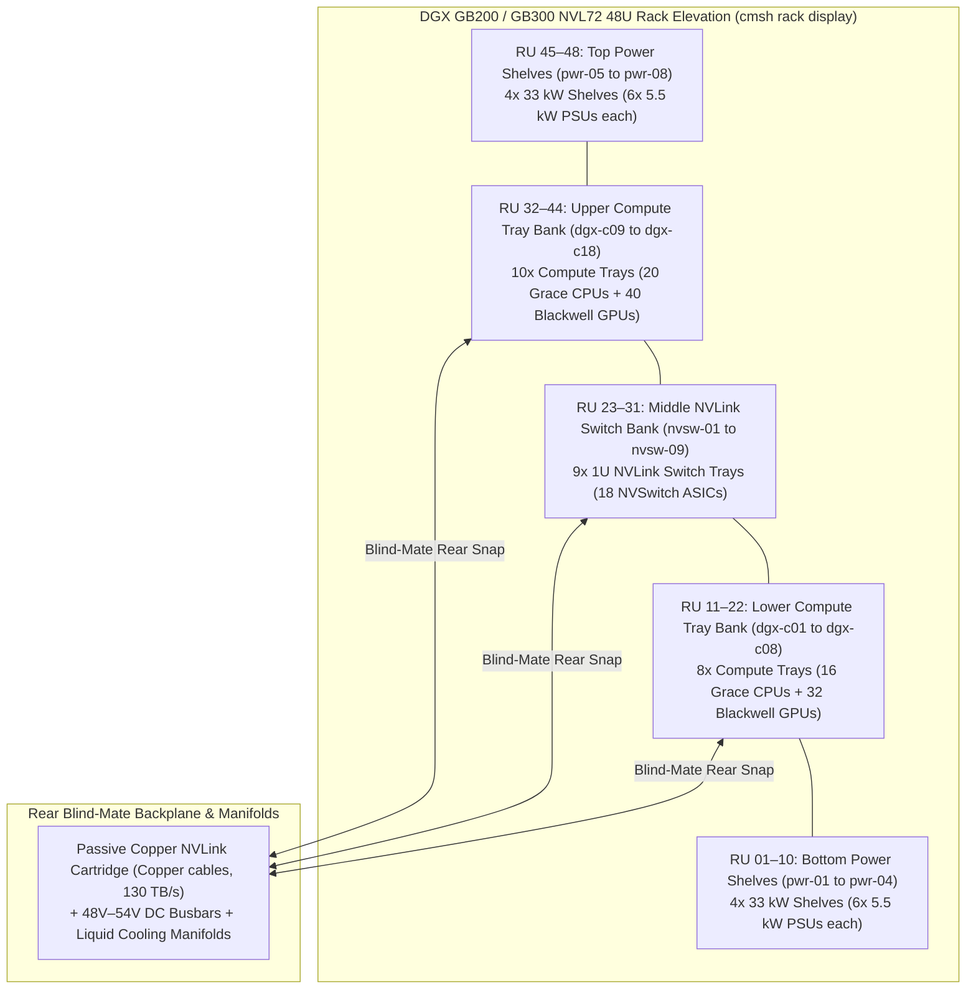
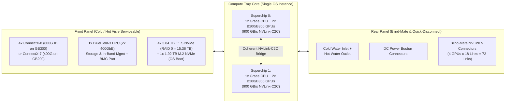
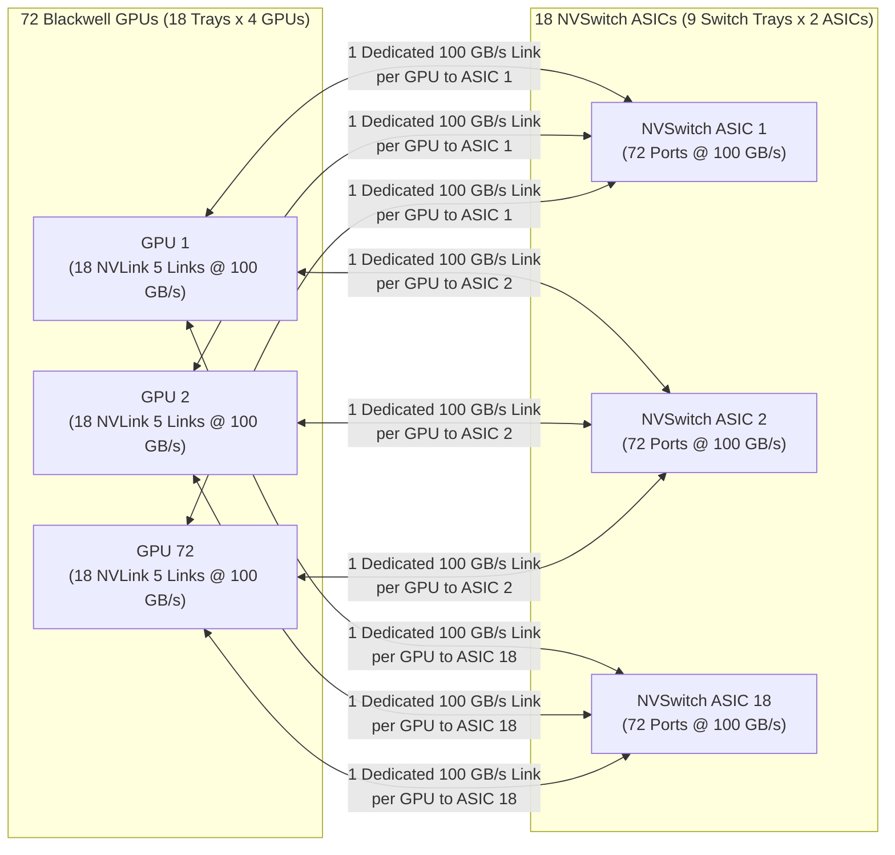
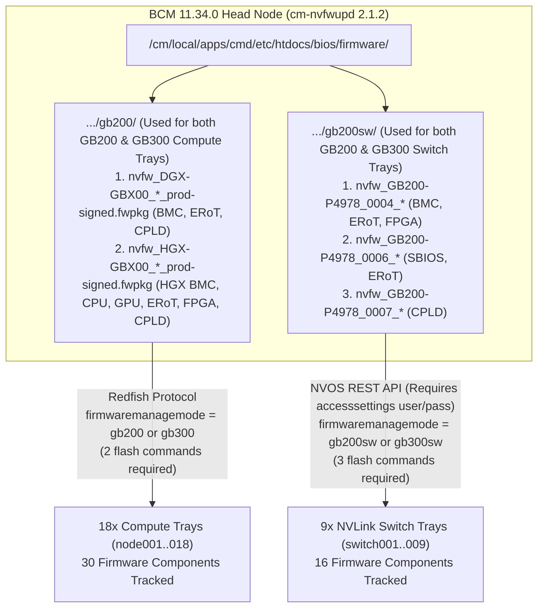

# 9.5 GB200 and GB300 NVL72 rack-scale systems

| | |
|---|---|
| **Status** | Drafted (`nvl72_rack_lab.py`: 30 checks pass; hardware commands **untested** on live NVL72 racks) |
| **Level** | Advanced |
| **Priority tier** | 1b |
| **Lab venue** | none (design / reading) + self-checking Python model (`code/part09/nvl72_rack_lab.py`) |
| **Part** | Part 9: NVIDIA systems and reference architectures |
| **Sources used** | `nvidia-devops` V5 Ch. 7; `nvidia-devops` V6 Ch. 7; *AI Systems Performance Engineering* Ch. 2; *NVIDIA DGX SuperPOD Reference Architecture Featuring NVIDIA DGX GB300 Systems* (`superpod-gb300-ra`); *NVIDIA Base Command Manager 11 Administrator Manual* (`bcm11-admin`) §3.16, §14.5 |

## Why this matters for AI infrastructure

For nearly a decade, the boundary of an NVLink domain was the sheet-metal lid of an 8-GPU server. Inside that 8-GPU box, GPUs exchanged tensors at 600–1,800 GB/s over an internal NVSwitch baseboard; the moment a model needed a 9th GPU in the next server, communication dropped by up to 18× onto 400G/800G network cards. For frontier 1-trillion- to 2-trillion-parameter Mixture-of-Experts (MoE) and long-horizon reasoning models, that 8-GPU boundary became a wall: splitting expert-parallel and tensor-parallel groups across nine separate 8-GPU servers forced synchronous `AllToAll` and `AllReduce` collectives across slower host NICs, causing real-time inference Time to First Token (TTFT) to balloon past 5 seconds and per-GPU decode throughput to crawl at 3.4 tokens per second.

The **NVIDIA GB200 NVL72** and **DGX GB300 NVL72** solve that problem by changing the fundamental unit of computing: **the rack, not the server, is now the computer.** By disaggregating 36 Grace CPUs and 72 Blackwell (`B200` or `B300`) GPUs across **18 1U compute trays** and linking them through **9 1U NVLink switch trays** over a passive rear **copper backplane** (thousands of coaxial copper cables delivering **130 TB/s** of aggregate NVLink 5 bandwidth), an entire 130–150 kW liquid-cooled rack operates as a single 72-GPU NVLink domain. On that same 1.8-trillion-parameter MoE benchmark, moving onto an NVL72 rack jumps per-GPU throughput from **3.4 tokens/sec to 150 tokens/sec** while cutting TTFT from **>5,000 ms to ~50 ms**.

:::info Corpus scope note
Standalone *NVIDIA Mission Control Rack Bring-Up and Installation Guide* and *NVIDIA GB200 NVL72 Hardware User Guide* PDFs are not in the local book corpus. The 48U rack slot map, compute-tray and switch-tray port layouts, 1-stage NVLink 5 crossbar math, 8x 33 kW power shelf specs, NVLink SHARP (`NVLS`) / NCCL `PAT` algorithms, and BCM 11.34.0 dual-protocol firmware workflows in this chapter are drawn from `superpod-gb300-ra` (pp. 1–20), *AI Systems Performance Engineering* Chapter 2 (pp. 26–40), `bcm11-admin` Sections 3.16 and 14.5, and `nvidia-devops` Volumes 05 and 06 (Chapter 7).
:::

## Prerequisites and outcomes

**Prerequisites:**
- Chapters `9.1` to `9.4` (DGX/HGX baseboards, PCIe vs NVLink fabrics, and Grace Blackwell `GB200`/`GB300` Superchips).
- Basic familiarity with BCM device/rack management (`cmsh` from Part 8).

**Outcomes:** After completing this chapter, you will be able to:
1. Map the physical **48U rack elevation** of a DGX GB200 / GB300 NVL72 system across its five vertical zones (bottom power shelves, lower compute bank, middle NVLink switch bank, upper compute bank, and top power shelves).
2. Dissect the front and rear of a **1U Compute Tray** (`2x GB200/GB300 Superchips = 2 Grace CPUs + 4 Blackwell GPUs`, `4x ConnectX-7/8` NICs, `1x BlueField-3` DPU, `4x 3.84 TB E1.S` RAID 0 + `1x 1.92 TB M.2` OS drive, liquid cold-plate manifolds, and blind-mate rear connectors).
3. Prove the **1-stage NVLink 5 crossbar math** (`72 GPUs × 18 links = 1,296 links` wired 1-to-1 across `9 switch trays × 2 NVSwitch ASICs = 18 ASICs`, `144 ports/tray` at `100 GB/s` = `129.6 TB/s` / `~130 TB/s` aggregate) and explain **NVLink SHARP (`NVLS`)**, **NCCL Parallel Aggregated Tree (`PAT`)**, and **NMX-M**.
4. Contrast **DGX GB200 NVL72** (`30.4 TB` fast memory, `130 kW`) with **DGX GB300 NVL72** (`38.7 TB` fast memory, `800G ConnectX-8`, `150 kW` / `1.2 MW` per 8-rack SU), and execute the **BCM 11.34.0 (`cm-nvfwupd` 2.1.2)** firmware update across Redfish (2 packages for compute trays) and the **NVOS REST API** (3 packages for switch trays).

---

## Concepts: basics → intermediate → advanced

## 1. Breaking the 8-GPU wall: why the rack became the computer

In a traditional 8-GPU server, the NVSwitch fabric is trapped inside a single 4U–10U box. Scaling a model beyond 8 GPUs forces tensor-parallel and expert-parallel collectives to drop from **1,800 GB/s** (NVLink 5) down to **50–100 GB/s** (400G–800G InfiniBand/RoCE NICs)—an **18× to 36× bandwidth cliff**.

Think of nine 8-GPU servers connected by InfiniBand like nine separate office buildings connected by single-lane footbridges: workers inside the same building can hand documents across a desk instantly, but collaborating across all 72 workers creates a massive queue at the doors. An **NVL72 rack** puts all 72 workers in one tall building with 18 fast elevator shafts running through the middle.

### 1.1 From DGX GH200 to MGX and GB200 / GB300 NVL72

NVIDIA first proved multi-node NVLink at rack scale with the **DGX GH200**, which used a two-tier **NVLink Switch System** to connect up to **256 Grace Hopper (`GH200`) Superchips** into a single **144 TB** shared memory space. With the arrival of the 1,000W–1,400W Blackwell generation, NVIDIA consolidated that multi-rack concept into a **single, dense, liquid-cooled 48U MGX rack**: the **GB200 NVL72** and **DGX GB300 NVL72**.

Why couldn't NVIDIA connect 72 GPUs across multiple racks using optical fiber cables?
- **The 20 kW optical power penalty:** Optical transceivers (lasers and DSP retimers) for 72 GPUs running at 1.8 TB/s each would consume **roughly 20 kW of extra electrical power per rack just to light the fibers**, while adding transceiver failure points and dollar cost.
- **The passive copper backplane solution:** By packing all **18 compute trays (72 GPUs)** and **9 NVLink switch trays (18 NVSwitch ASICs)** vertically into a **single 48U rack**, every GPU sits within a few feet of the switch trays in the middle of the rack. That short physical reach allows the trays to snap directly (blind-mate) into a rear **Copper Backplane cartridge made of passive copper cables**—delivering **130 TB/s of aggregate NVLink 5 bandwidth** with zero optical transceiver power penalty.

### 1.2 The five vertical zones of the 48U NVL72 rack elevation

Why are the **9 NVLink switch trays** mounted in the exact middle of the rack (`RU 23–31` in the `cmsh` `rack display` elevation) with **10 compute trays above them** and **8 compute trays below them**? To minimize the maximum copper trace length from the farthest top and bottom compute trays to the middle switch bank.



Walking the 48U rack from bottom to top (as recorded in Base Command Manager's `rack display` layout for `a05-p1-dgx-01`):
1. **Bottom Power Shelf Zone (`RU 01–10`, `pwr-01` to `pwr-04`):** Four 33 kW DGX Power Shelves feeding the lower busbar section.
2. **Lower Compute Tray Bank (`RU 11–22`, `c01` to `c08`):** Eight compute trays (`16 Grace CPUs + 32 Blackwell GPUs`).
3. **Middle NVLink Switch Tray Bank (`RU 23–31`, `nvsw-01` to `nvsw-09`):** Nine 1U NVLink Switch Trays (`18 NVSwitch ASICs`) positioned at the vertical midpoint of the rack.
4. **Upper Compute Tray Bank (`RU 32–44`, `c09` to `c18`):** Ten compute trays (`20 Grace CPUs + 40 Blackwell GPUs`).
5. **Top Power Shelf Zone (`RU 45–48`, `pwr-05` to `pwr-08`):** Four additional 33 kW DGX Power Shelves (bringing the rack total to **8 power shelves**).

:::tip In one minute
- The **GB200 / GB300 NVL72** turns a **48U rack** into a single 72-GPU computer by placing **9 NVLink switch trays (`nvsw-01..09`)** in the middle of the rack between **8 lower compute trays (`c01..c08`)** and **10 upper compute trays (`c09..c18`)**, flanked by **8x 33 kW power shelves (`pwr-01..08`)** at the top and bottom.
- Keeping all 72 GPUs inside one rack allows a **passive rear copper backplane (copper cables)** to carry **130 TB/s** of NVLink 5 bandwidth while saving **~20 kW of optical transceiver power** per rack.
:::

---

## 2. Dissecting the Compute Tray, Switch Tray, and Power Shelves

Every tray in an NVL72 rack is engineered so that **all optical/copper network cables and NVMe drives are serviced from the front (cold/hot) aisle**, while **liquid cooling, DC power, and NVLink 5 connections blind-mate at the rear**.

### 2.1 Inside a 1U DGX GB200 / GB300 Compute Tray

Each of the **18 compute trays** is a self-contained, liquid-cooled 1U Linux compute node:



1. **Two Grace Blackwell Superchips (`2 Grace CPUs + 4 Blackwell GPUs`):**
   - Each Superchip pairs **one 72-core Grace CPU** with **two B200 or B300 GPUs** over a **900 GB/s NVLink-C2C** link.
   - A coherent **NVLink-C2C bridge** connects the two Superchips on the tray so they operate as **a single logical SMP unit under one Linux OS instance** (`144 Arm cores + 4 GPUs` per tray).
2. **Front-panel network interfaces (intentionally placed on the front aisle for easy cabling):**
   - **East-West Compute Network:** **4x ConnectX-8 NICs** supporting **800 Gbps Quantum-X800 (XDR) InfiniBand** on `DGX GB300` (or **4x ConnectX-7 400 Gbps NDR** on `DGX GB200`)—providing a strict **1:1 GPU-to-NIC ratio** (`4 GPUs : 4 Compute NICs` per tray = **72 Compute NICs per rack**).
   - **North-South Storage & In-Band Management Network:** **1x dual-port BlueField-3 DPU** providing **2x 400 Gbps** Ethernet connectivity (400 Gbps line-rate to High-Performance RoCEv2 Storage plus bonded 200 Gbps to the In-Band Management network), alongside the out-of-band BMC port.
3. **Front-panel local NVMe storage:**
   - **OS Image Drive:** **1x 1.92 TB M.2 NVMe** drive.
   - **Local Ephemeral Scratch (`RAID 0`):** **4x 3.84 TB E1.S (EDSFF) NVMe** drives configured as **RAID 0** (`15.36 TB` raw per compute tray, or **`18 × 15.36 TB = 276.48 TB`** of fast NVMe scratch across the rack).
4. **Rear-panel blind-mate and liquid-cooling connections:**
   - **Cold water inlet** and **hot water outlet** dripless quick-disconnect manifolds feeding the direct-to-chip cold plates on the Grace CPUs and Blackwell GPUs.
   - **DC power connectors** mating with the rack busbar.
   - **Blind-mate NVLink 5 connectors** mating directly into the rear copper cable cartridge.

### 2.2 Inside a 1U NVLink Switch Tray (`9 per rack`)

Each of the **9 NVLink Switch Trays** (`nvsw-01` to `nvsw-09`) is a 1U sled containing:
- **Two 5th-generation NVSwitch ASICs** per tray (`9 trays × 2 ASICs = 18 NVSwitch ASICs` across the rack), liquid-cooled and blind-mated into the rear copper NVLink cartridge.
- **Front-panel management ports:** Each switch tray exposes **two RJ45 COMe ports for NVOS** (the switch operating system managed by **NVIDIA Network Manager eXperience, `NMX-M`**, and BCM) and **one RJ45 BMC module port** for out-of-band hardware telemetry.

### 2.3 Inside a DGX Power Shelf (`8 per rack`, `33 kW` each)

To deliver 130 kW to 150 kW of DC power without voltage droop when 72 GPUs jump from idle to full load in microseconds, the rack incorporates **eight DGX Power Shelves** (`pwr-01` to `pwr-08`):
- **6x 5.5 kW Power Supply Units (PSUs) per shelf:** Configured as `N` redundant to deliver up to **33 kW per shelf** (`8 shelves × 33 kW = 264 kW` total installed PSU shelf capacity across the rack).
- **Enhanced internal energy storage (capacitor banks):** On the DGX GB300 power shelf, larger internal energy storage smooths extreme millisecond-scale GPU load transients so sudden training step spikes do not destabilize the data center utility grid.
- **Management and Power Brake ports:** Each power shelf has a **front RJ45 BMC port** and **rear RJ45 ports used for hardware power brakes** (fast hardware throttling if a power fault occurs) and out-of-band management.

:::tip In one minute
- Each **1U Compute Tray (`18/rack`)** holds **2 Superchips (`2 Grace CPUs + 4 GPUs`)** under one OS, with **4x ConnectX-8 800G NICs** (`ConnectX-7 400G` on GB200), **1x BlueField-3 (2x400G) DPU**, **4x 3.84 TB E1.S RAID 0 (`15.36 TB`)**, and **1x 1.92 TB M.2 OS drive** on the front panel, and liquid/DC/NVLink blind-mate connectors on the rear.
- Each **1U NVLink Switch Tray (`9/rack`)** holds **2 NVSwitch ASICs** (`18 ASICs/rack`) with **2x COMe RJ45 ports (NVOS)** and **1x BMC RJ45 port** on the front.
- **Eight 33 kW DGX Power Shelves (`6x 5.5 kW PSUs` each)** with built-in energy storage and rear **RJ45 power-brake ports** feed the rack busbar.
:::

---

## 3. The 1-stage NVLink 5 crossbar math, NVLink SHARP (`NVLS`), and MoE scaling

How does an NVL72 rack guarantee that **any of its 72 GPUs can talk to any other GPU in a single switch hop (`GPU → NVSwitch → GPU`) at full 1.8 TB/s bisection bandwidth**?

### 3.1 Proving the 1,296-port 1-stage NVLink 5 crossbar

Walk through the exact port arithmetic verified by `verify_nvl72_crossbar_topology()` in `code/part09/nvl72_rack.py`:



1. **Per-GPU NVLink 5 lanes:** Each Blackwell `B200` or `B300` GPU exposes **18 fifth-generation NVLink ports**. Each NVLink 5 port runs at **100 GB/s bidirectional** (`50 GB/s` per direction)—double the 50 GB/s link speed of Hopper NVLink 4:
   ```text
   Per-GPU NVLink 5 Bandwidth = 18 links × 100 GB/s = 1,800 GB/s = 1.8 TB/s bidirectional
   ```
2. **Total NVSwitch ASICs in the rack:** Each of the **9 NVLink Switch Trays** contains **2 NVSwitch ASICs**, giving **`9 × 2 = 18 NVSwitch ASICs`** in the rack.
3. **The 1-to-1 plane wiring rule:** Notice that the number of NVLink 5 ports per GPU (**`18`**) equals the exact number of NVSwitch ASICs in the rack (**`18`**). Through the rear copper backplane:
   - `Link 1` of all 72 GPUs connects to **`NVSwitch ASIC 1`** (`72 ports`).
   - `Link 2` of all 72 GPUs connects to **`NVSwitch ASIC 2`** (`72 ports`).
   - ...
   - `Link 18` of all 72 GPUs connects to **`NVSwitch ASIC 18`** (`72 ports`).
4. **Port and aggregate bandwidth totals:**
   - **Ports per NVSwitch ASIC:** `72 ports` at 100 GB/s.
   - **Ports per 1U NVLink Switch Tray (2 ASICs):** `2 × 72 = 144 NVLink 5 ports` at 100 GB/s.
   - **Total backplane NVLink 5 ports across the rack:** `9 switch trays × 144 ports = 1,296 ports` (`= 72 GPUs × 18 links`).
   - **Exact aggregate NVLink 5 bandwidth:** `72 GPUs × 1.8 TB/s = 129.6 TB/s` (quoted as **`~130 TB/s`**), with **1 to 2 microsecond** small-message latency across any pair of GPUs in the rack.

### 3.2 NVLink SHARP (`NVLS`), NCCL Parallel Aggregated Tree (`PAT`), and `NMX-M`

Beyond raw point-to-point bandwidth, the 18 NVSwitch ASICs inside an NVL72 rack include dedicated in-silicon collective engines:
- **NVLink SHARP (`NVLS`):** Integrates **Scalable Hierarchical Aggregation and Reduction Protocol (SHARP)** arithmetic units directly inside the NVSwitch ASICs. During an `AllReduce` or `ReduceScatter`, instead of every GPU sending full gradient buffers to every other GPU to sum on their SMs, GPUs stream operands into the NVSwitch fabric and the **NVSwitch ASICs perform the floating-point reductions in-network** and multicast the result back—cutting traffic volume and freeing GPU SMs for compute.
- **NCCL Parallel Aggregated Tree (`PAT`) algorithm:** Modern NCCL releases include the **PAT** collective algorithm specifically tuned for NVLink Switch topologies like NVL72 to exploit full 18-plane parallelism with minimal synchronization latency.
- **NVIDIA Network Manager eXperience (`NMX-M`):** Just as Unified Fabric Manager (`UFM`) manages the external InfiniBand fabric, **`NMX-M`** is the dedicated management and real-time telemetry control plane that operates the 9 NVLink switch trays (`NVOS`) and configures NVLink partitions across the rack.

### 3.3 Why NVL72 transforms 1.8-trillion-parameter MoE inference (`3.4` vs `150` tokens/sec/GPU)

Consider the real-world benchmark from *AI Systems Performance Engineering* Chapter 2 for serving a **1.8-trillion-parameter Mixture-of-Experts (MoE)** model:
- **On 8-GPU H100 nodes over InfiniBand:** Because the 1.8T model and its active experts span multiple 8-GPU servers, every token's expert-parallel `AllToAll` shuffle and tensor-parallel `AllReduce` must cross 50 GB/s InfiniBand links (5–10+ µs latency). The system achieves only **~3.4 tokens/second per GPU** with a Time to First Token (TTFT) of **over 5 seconds (>5,000 ms)**—unusable for interactive users.
- **On a single GB200 NVL72 rack:** All 72 GPUs hold **13.4–13.8 TB of HBM3e** (`20.7 TB` on GB300) inside **one 1.8 TB/s NVLink 5 domain** with 1–2 µs latency and FP4 Tensor Cores. Per-GPU generation jumps to **~150 tokens/second per GPU** (an exact arithmetic ratio of **`150 / 3.4 = 44.12×`**, **my inference** computing the exact quotient of the two benchmark figures that the book's prose summarizes as *"roughly 30×"* real-time throughput improvement) while TTFT drops from **>5,000 ms to ~50 ms** (**100× faster first-token response**).

:::tip In one minute
- Each of the **72 GPUs** wires its **18 NVLink 5 links (`100 GB/s` each = `1.8 TB/s`)** 1-to-1 to the **18 NVSwitch ASICs** (`9 switch trays × 2 ASICs`, `144 ports/tray`, `1,296 total ports`), forming a **1-hop non-blocking crossbar** with **129.6 TB/s (`~130 TB/s`)** aggregate bandwidth and **1–2 µs** latency.
- **NVLink SHARP (`NVLS`)** offloads collective reductions into the 18 NVSwitch ASICs, **NCCL `PAT`** optimizes tree reductions on NVSwitch domains, and **`NMX-M`** manages the NVLink switch fabric.
- Keeping a 1.8T MoE model inside one NVL72 rack jumps throughput from **3.4 to 150 tokens/sec/GPU** and cuts TTFT from **>5,000 ms to ~50 ms**.
:::

---

## 4. Comparing DGX GB200 NVL72 versus DGX GB300 NVL72

The **DGX GB300 NVL72** (powered by Grace CPUs and **Blackwell Ultra `B300`** GPUs) is a drop-in rack-scale evolution of the **GB200 NVL72**, using the exact same 18-compute-tray + 9-switch-tray mechanical architecture and NVLink 5 backplane while expanding HBM3e capacity by **1.5×**, FP4 attention/compute throughput by **1.5×** (**45%–50% higher inference throughput**), and East-West InfiniBand bandwidth by **2×**:

| Rack Specification | NVIDIA GB200 NVL72 | NVIDIA DGX GB300 NVL72 | Generational Delta (`GB300` vs `GB200`) |
|---|---|---|---|
| **Compute Trays & Superchips** | **18 Compute Trays** (`36x GB200` Superchips) | **18 Compute Trays** (`36x GB300` Superchips) | Identical 18-node, 36-Superchip tray density |
| **CPUs & GPUs per Rack** | **36x Grace CPUs** (2,592 cores) + **72x `B200` GPUs** | **36x Grace CPUs** (2,592 cores) + **72x `B300` GPUs** | B300 adds **1.5× AI compute** & larger attention engines |
| **Per-GPU & Total HBM3e** | **180 GB** (`13.4 TB` usable; `192 GB` / `13.8 TB` raw) @ **576 TB/s** | **288 GB** per B300 GPU = **20,736 GB (~20.7 TB)** @ **576 TB/s** | **1.5× HBM3e capacity** (+7.3 TB HBM3e per rack) |
| **Total Grace LPDDR5X** | **~17.0 TB** (`36 × 480 GB`) | **~18.0 TB** (`36 × 500 GB`) | **~38.7 TB (~38 TB) combined fast memory** per rack (vs ~30.4 TB) |
| **NVLink 5 Switch Fabric** | **9 Switch Trays** (`18 ASICs`), **1.8 TB/s** per GPU (**130 TB/s** agg) | **9 Switch Trays** (`18 ASICs`), **1.8 TB/s** per GPU (**130 TB/s** agg) | Same 1-stage NVLink 5 crossbar & switch tray hardware |
| **East-West Compute NICs** | **4x `ConnectX-7` (400 Gbps)** per tray = `72 × 400G` (**28.8 Tbps**) | **4x `ConnectX-8` (800 Gbps Quantum-X800 XDR IB)** per tray = `72 × 800G` (**57.6 Tbps**) | **2× inter-rack network bandwidth** (`3.2 Tbps` per tray) |
| **Storage & In-Band DPU** | **1x `BlueField-3` DPU** per tray (2x 200G/400G) | **1x `BlueField-3` DPU** per tray (**2x 400 Gbps**; 400G RoCE HPS + 200G bonded In-Band) | 720-port / 64x800G Spectrum-4 SN5600 storage fabric |
| **Local NVMe per Tray / Rack** | 4x 3.84 TB E1.S RAID 0 + 1x 1.92 TB M.2 OS | **4x 3.84 TB E1.S RAID 0** (`15.36 TB/tray` = **276.48 TB/rack**) + **1x 1.92 TB M.2 OS** | Identical per-tray E1.S RAID 0 + M.2 OS layout |
| **Power, Cooling & Weight** | **~120–130 kW** (`18 × 6 kW + ~20 kW` overhead), DLC, **~3,000 lbs (1.3–1.4 t)** | **~150 kW** (**1.2 MW** per 8-rack SU), **8x 33 kW shelves**, hybrid liquid+air cooling | Enhanced capacitor energy storage in GB300 power shelves |

:::tip In one minute
- **DGX GB300 NVL72** upgrades each GPU from **180 GB (`B200`)** to **288 GB (`B300`)** of HBM3e—raising rack HBM from **13.4 TB to 20.7 TB** and total fast memory (`HBM3e + LPDDR5X`) from **~30.4 TB to ~38.7 TB**—while doubling inter-rack compute networking to **4x 800 Gbps ConnectX-8 NICs per tray** (`72 × 800G = 57.6 Tbps` per rack).
- A loaded NVL72 rack weighs **~3,000–3,200 lbs (1.3–1.4 metric tons)** with hardware and coolant and draws **130–150 kW** (`18 trays × ~6 kW + ~20 kW` NVSwitch/cooling overhead on GB200; **1.2 MW** across an 8-rack, 576-GPU GB300 Scalable Unit).
:::

---

## 5. Dual-protocol firmware management on GB200 and GB300 NVL72 (`cm-nvfwupd` 2.1.2)

How do you inspect and flash firmware across 18 compute trays and 9 NVLink switch trays in a GB200 or GB300 NVL72 rack? As documented in the *NVIDIA Base Command Manager 11 Administrator Manual* (Section 14.5, introduced with `cm-nvfwupd` module version `2.1.2` in BCM `11.34.0`), **compute trays and NVLink switch trays use different management protocols, different `firmwaremanagemode` settings, and different numbers of `.fwpkg` bundles.**

### 5.1 Compute Trays (Redfish, 2 `.fwpkg` bundles, 30 components) vs Switch Trays (NVOS REST API, 3 `.fwpkg` bundles, 16 components)



| Attribute | NVL72 Compute Tray (`c01..c18`) | NVL72 NVLink Switch Tray (`nvsw-01..09`) |
|---|---|---|
| **BCM `firmwaremanagemode`** | `gb200` or `gb300` | `gb200sw` or `gb300sw` |
| **Management Protocol** | **DMTF Redfish** (via compute tray BMC) | **NVOS REST API** (requires setting `username` and `password` in `cmsh` `device -> accesssettings`) |
| **Head Node Staging Directory** | `/cm/local/apps/cmd/etc/htdocs/bios/firmware/gb200/` (used for *both* GB200 and GB300.) | `/cm/local/apps/cmd/etc/htdocs/bios/firmware/gb200sw/` (used for *both* GB200 and GB300.) |
| **Required `.fwpkg` Bundles** | **2 packages** (must flash *both*):<br/>1. `nvfw_DGX-GBX00_*` (`GB200-BMC`: BMC, ERoT, CPLD)<br/>2. `nvfw_HGX-GBX00_*` (`GB200-Compute`: HGX BMC, CPU 0/1, GPU 0..3, ERoT, FPGA 0/1, CPLD) | **3 packages** (must flash *all three*):<br/>1. `nvfw_GB200-P4978_0004_*` (BMC, ERoT, FPGA)<br/>2. `nvfw_GB200-P4978_0006_*` (SBIOS and ERoT)<br/>3. `nvfw_GB200-P4978_0007_*` (CPLD) |
| **Tracked Component Count** | **30 components:** `CX8_0..3` (4), `FW_BMC_0`, `FW_CPLD_0..1`, `FW_ERoT_BMC_0`, `HGX_FW_BMC_0`, `HGX_FW_CPLD_0`, `HGX_FW_CPU_0..1` (2), `HGX_FW_ERoT_BMC_0`, `HGX_FW_ERoT_CPU_0..1` (2), `HGX_FW_ERoT_FPGA_0..1` (2), `HGX_FW_FPGA_0..1` (2), `HGX_FW_GPU_0..3` (4), `HGX_InfoROM_GPU_0..3` (4), `HGX_PCIeSwitchConfig_0`, `NIC_1` (`NIC_0` on GB300), `UEFI` | **16 components:** `ASIC`, `BIOS`, `BMC`, `CPLD1..4` (4), `EROT`, `EROT-ASIC1..2` (2), `EROT-BMC`, `EROT-CPU`, `EROT-FPGA`, `FPGA`, `SSD`, `transceiver` |

:::caution Two critical operational rules from the BCM 11 manual
1. **Never flash only a subset of the `.fwpkg` files on a tray:** Each `.fwpkg` file requires its own `firmware flash` command invocation (**2 commands** for a compute tray; **3 commands** for an NVLink switch tray). Flashing only one of the two compute packages or two of the three switch packages leaves the tray in a **partially updated, inconsistent state**.
2. **Same directory and identical switch-tray hardware for GB200 and GB300:** Both GB200 and GB300 store their packages under the `gb200/` and `gb200sw/` subdirectories. The NVLink switch tray hardware and 16-component `firmware status` output are 100% identical between GB200 and GB300 racks, and on the compute tray the only component-name difference is that the BlueField DPU row is reported as **`NIC_1` on GB200** and **`NIC_0` on GB300**.
:::

:::tip In one minute
- In BCM `11.34.0` (`cm-nvfwupd` `2.1.2`), **compute trays** use `firmwaremanagemode` `gb200`/`gb300` over **Redfish** and require flashing **2 `.fwpkg` packages** (`nvfw_DGX-GBX00_*` + `nvfw_HGX-GBX00_*`, tracking **30 components**).
- **NVLink switch trays** use `firmwaremanagemode` `gb200sw`/`gb300sw` over the **NVOS REST API** (requiring `accesssettings` credentials) and require flashing **3 `.fwpkg` packages** (`_0004`, `_0006`, `_0007`, tracking **16 components**).
:::

---

## Commands and configurations that matter

The `cmsh` and Linux commands below display the 48U NVL72 rack layout, configure NVOS REST API access on the 9 NVLink switch trays, inspect the 30 compute-tray and 16 switch-tray firmware components, and flash all 5 `.fwpkg` bundles (**untested** on live GB200/GB300 NVL72 hardware in this authoring environment; rules verified in `code/part09/nvl72_rack_lab.py`).

### 1. Inspect the 48U NVL72 rack slot elevation in BCM (`cmsh`)

```text
# View the 48U slot map (pwr-01..04, c01..c08, nvsw-01..09, c09..c18, pwr-05..08)
[basecm11->rack]% display | less -R
```

### 2. Stage `.fwpkg` files and configure NVOS REST API credentials for NVLink switch trays

```bash
# 1. Verify the 2 compute-tray packages and 3 switch-tray packages on the BCM head node
ls -l /cm/local/apps/cmd/etc/htdocs/bios/firmware/gb200/
# Expect: nvfw_DGX-GBX00_*_prod-signed.fwpkg and nvfw_HGX-GBX00_*_prod-signed.fwpkg

ls -l /cm/local/apps/cmd/etc/htdocs/bios/firmware/gb200sw/
# Expect: nvfw_GB200-P4978_0004_*, nvfw_GB200-P4978_0006_*, nvfw_GB200-P4978_0007_*
```

```text
# 2. Configure NVOS REST API credentials on the NVLink switch trays in cmsh
[basecm11->device[switch001]]% set firmwaremanagemode gb300sw
[basecm11->device*[switch001*]]% accesssettings
[basecm11->device*[switch001*]->accesssettings]% set username admin
[basecm11->device*[switch001*]->accesssettings*]% set password <password>
[basecm11->device*[switch001*]->accesssettings*]% commit
```

### 3. Inspect and flash all 2 compute-tray packages and 3 switch-tray packages

```text
# 1. Verify available packages and inspect the 30 compute-tray and 16 switch-tray components
[basecm11->device[node001]]% firmware info
[basecm11->device]% firmware status -n node001
[basecm11->device]% firmware status -n switch001

# 2. Flash BOTH packages on the compute tray (DGX-side + HGX-side)
[basecm11->device[node001]]% firmware flash nvfw_DGX-GBX00_0023_250901.1.0_custom_prod-signed.fwpkg
[basecm11->device[node001]]% firmware flash nvfw_HGX-GBX00_0023_250908.1.0_custom_prod-signed.fwpkg

# 3. Flash ALL THREE packages on the NVLink switch tray (BMC/EROT/FPGA + SBIOS/EROT + CPLD)
[basecm11->device[switch001]]% firmware flash nvfw_GB200-P4978_0004_250821.1.0_prod-signed.fwpkg
[basecm11->device[switch001]]% firmware flash nvfw_GB200-P4978_0006_250710.1.1_prod-signed.fwpkg
[basecm11->device[switch001]]% firmware flash nvfw_GB200-P4978_0007_250831.1.0_prod-signed.fwpkg
```

---

## How it fails

| Failure mode | Symptom | Root cause | Diagnosis & fix |
|---|---|---|---|
| **1. NVLink switch tray firmware flash fails with authentication / connection error** | `firmware info` or `firmware flash` works on compute trays (`node001..018`) but fails to connect to `switch001..009` even though the switch tray BMC is reachable. | Unlike compute trays (which use Redfish), **NVLink switch trays execute firmware commands over the NVOS REST API** on the COMe management interface and require `firmwaremanagemode` (`gb200sw` / `gb300sw`) plus explicit `username` and `password` configured in `cmsh` `device -> accesssettings`. | In `cmsh`, set `firmwaremanagemode` to `gb200sw` (or `gb300sw`), enter `accesssettings`, set the NVOS `username` and `password`, `commit`, and verify connectivity to the switch tray's NVOS COMe IP. |
| **2. Partially updated compute tray or switch tray after flashing only one `.fwpkg`** | After a maintenance window, `firmware status -n node001` shows `FW_BMC_0` updated but `HGX_FW_GPU_0..3` and `HGX_FW_CPU_0..1` still on old versions (or `switch001` has updated BMC/FPGA but stale SBIOS/CPLD). | The admin ran `firmware flash` for only one `.fwpkg` file. A GB200/GB300 compute tray requires **two separate `firmware flash` invocations** (`nvfw_DGX-GBX00_*` and `nvfw_HGX-GBX00_*`), and an NVLink switch tray requires **three separate invocations** (`_0004`, `_0006`, and `_0007`). | Always flash both packages on every compute tray and all three packages on every NVLink switch tray before activating the firmware across the rack. |
| **3. Treating NVL72 as "one single GPU" without explicit TP/PP/DP sharding** | A developer attempts to launch a single-process CUDA script expecting automatic transparent memory striping across all 72 GPUs (`13.4–20.7 TB`), and only `GPU 0` (`180–288 GB`) is used before throwing an OOM error. | Marketing calls NVL72 "one giant GPU," but at the CUDA/OS level **an NVL72 rack is 18 separate Linux OS instances managing 4 GPUs each (72 CUDA devices total)**, and GPU L1/L2 caches are not hardware coherent across GPUs. | Partition the model explicitly across the 72 GPUs using Tensor Parallelism (TP), Pipeline Parallelism (PP), Expert Parallelism (EP), and Data Parallelism (DP/FSDP), using **NCCL** (`PAT` / `NVLS`) or **NVSHMEM** for collective synchronization across the 1.8 TB/s NVLink 5 fabric. |
| **4. Blind-mate NVLink pin misalignment or failed switch tray degrading the 18-plane crossbar** | `nvidia-smi nvlink --status` or `NMX-M` reports that every GPU in the rack has lost 2 of its 18 NVLink 5 lanes (`16/18 active`, dropping per-GPU NVLink bandwidth from `1.8 TB/s` to `1.6 TB/s`). | Because each of the 9 NVLink switch trays holds **2 NVSwitch ASICs** and terminates **1 link from each of the 72 GPUs (`144 ports/tray`)**, an unseated or powered-off NVLink switch tray removes 2 of the 18 NVLink planes across all 72 GPUs simultaneously. | Inspect `NMX-M` telemetry and `cmsh` `firmware status -n switch001..009`. Reseat the affected 1U NVLink switch tray into the rear blind-mate copper cartridge and verify all 144 ports on that tray train to 100 GB/s. |
| **5. Raised-floor structural overload from the 3,000+ lb (1.3–1.4 metric ton) rack** | Standard raised-floor tiles deflect or crack during rack roll-in when a fully populated NVL72 rack filled with coolant is moved into position. | An NVL72 rack with 18 liquid-cooled compute trays, 9 switch trays, 8 power shelves, manifolds, and rear copper cartridges weighs **~3,000–3,200 lbs (1.3–1.4 metric tons)** concentrated on a single rack footprint. | Verify slab and raised-floor point/distributed load ratings with structural engineers before delivery, reinforce raised floors with heavy-duty pedestals/struts or mount on a concrete slab, and use rated transport rigging. |

---

## Hands-on lab

This chapter's self-checking Python model (`code/part09/nvl72_rack.py`) and lab runner (`code/part09/nvl72_rack_lab.py`) implement:
1. The **1-stage NVLink 5 Crossbar Verifier** (`18 compute trays × 4 GPUs = 72 GPUs`, `9 switch trays × 2 ASICs = 18 NVSwitch ASICs`, `18 links/GPU @ 100 GB/s = 1.8 TB/s`, `72 ports/ASIC`, `144 ports/switch tray`, `1,296 total backplane ports`, and `129.6 TB/s` / `~130 TB/s` aggregate bandwidth).
2. The **DGX GB200 NVL72 vs DGX GB300 NVL72 Rack Specification Catalog** (`13.4 TB` vs `20.7 TB` HBM3e, `30.4 TB` vs `38.7 TB` total fast memory, `400G ConnectX-7` vs `800G ConnectX-8` = `57.6 Tbps` per rack, `276.48 TB` aggregate E1.S RAID 0 scratch, `8 × 33 kW = 264 kW` power shelves, `130 kW` vs `150 kW` rack draw, and `1.2 MW` per 8-rack GB300 Scalable Unit).
3. The **48U NVL72 Rack Elevation Zone Mapper** (`RU 01–10` `pwr-01..04`, `RU 11–22` `c01..c08`, `RU 23–31` `nvsw-01..09`, `RU 32–44` `c09..c18`, `RU 45–48` `pwr-05..08`).
4. The **1.8T MoE Inference Speedup Calculator** (`3.4` vs `150` tokens/sec/GPU = `44.12×` exact ratio / `~30×` prose summary, and `5,000 ms` vs `50 ms` TTFT = `100×` speedup).
5. The **BCM 11.34.0 (`cm-nvfwupd` 2.1.2) Dual-Protocol Firmware Validator** (30 compute-tray components over Redfish with 2 `.fwpkg` files vs 16 switch-tray components over the NVOS REST API with 3 `.fwpkg` files and `accesssettings`).

Run the lab from the repository root:

```bash
python3 -B code/part09/nvl72_rack_lab.py
```

Expected output (verified in this repository):

```text
=== Chapter 9.5 Lab: GB200 and GB300 NVL72 Rack-Scale Systems ===
  [PASS] 18 compute trays * 4 GPUs == 72 GPUs and 9 switch trays * 2 ASICs == 18 NVSwitch ASICs
  [PASS] 18 NVLink 5 links/GPU matches 18 NVSwitch ASICs for a 1-hop non-blocking crossbar
  [PASS] Each NVSwitch ASIC terminates 72 ports and each 1U switch tray terminates 144 ports (1,296 total)
  [PASS] Per-GPU NVLink 5 bandwidth is 1.8 TB/s and exact 72-GPU aggregate is 129.6 TB/s (~130 TB/s)
  [PASS] Rejects non-positive compute_trays in crossbar verifier
  [PASS] GB200 NVL72 has 36 Grace CPUs, 72 B200 GPUs, 13.4 TB HBM3e + 17.0 TB LPDDR5X = 30.4 TB fast memory
  [PASS] GB300 NVL72 upgrades to 288 GB/GPU = 20.7 TB HBM3e + 18.0 TB LPDDR5X = 38.7 TB fast memory
  ...
  [PASS] ASP Ch2 chunk 9 power decomposition: 18 compute trays * 6 kW + 22 kW NVSwitch/cooling == 130 kW
  [PASS] superpod-gb300-ra p.5: 8x DGX GB300 NVL72 racks per Scalable Unit == 576 GPUs and 1.2 MW (1,200 kW) TDP
  [PASS] Total E1.S local NVMe scratch across 18 compute trays in a rack == 18 * 15.36 TB == 276.48 TB
  [PASS] Total East-West ConnectX-8 ports across 18 compute trays in a GB300 rack == 72 x 800 Gbps (57.6 Tbps)
  [PASS] Detects broken 1-stage crossbar if switch_trays != 9 (16 ASICs != 18 links/GPU)

Summary: 30 passed, 0 failed (total 30)
```

---

## Exercises

1. Run `python3 -B code/part09/nvl72_rack_lab.py`. Re-derive the 1,296 ports and the 129.6 TB/s aggregate by hand from the numbers 72 GPUs, 18 links and 100 GB/s.
2. Draw the 48U rack from bottom to top with RU ranges: power shelves, 8 compute trays, 9 switch trays, 10 compute trays, power shelves. Explain why the switch trays sit in the middle.
3. A GPU in an NVL72 rack reports 16 of 18 NVLink links active, and so does every other GPU in the rack. Which hardware is the likely cause and how many ports does that hardware terminate?
4. Write the `cmsh` steps that let BCM flash an NVLink switch tray. Which `firmwaremanagemode` do you set, which credentials do you add, and how many `.fwpkg` files must you flash afterwards?
5. A developer says "NVL72 is one big GPU, so I will run one Python process on it." Write a short reply explaining what is true and what is not, using failure mode 3.
6. Using the GB200 and GB300 columns of section 4, compute the rack HBM and the rack network bandwidth for both and state the ratio of each.

## Checkpoint questions (20)

<details>
<summary><strong>1. How are the 18 compute trays, 9 NVLink switch trays, and 8 power shelves physically arranged from bottom to top in a 48U NVL72 rack, and why do the switch trays sit in the middle?</strong></summary>

From bottom to top (`RU 01` to `RU 48` in `cmsh` `rack display`):
1. **Bottom Power Shelves (`RU 01–10`):** 4x 33 kW shelves (`pwr-01..04`).
2. **Lower Compute Tray Bank (`RU 11–22`):** 8x compute trays (`c01..c08`, 32 GPUs).
3. **Middle NVLink Switch Bank (`RU 23–31`):** 9x 1U NVLink switch trays (`nvsw-01..09`, 18 NVSwitch ASICs).
4. **Upper Compute Tray Bank (`RU 32–44`):** 10x compute trays (`c09..c18`, 40 GPUs).
5. **Top Power Shelves (`RU 45–48`):** 4x 33 kW shelves (`pwr-05..08`).
Placing the 9 NVLink switch trays in the vertical center of the rack minimizes the maximum passive copper trace distance to the farthest top and bottom compute trays in the rear blind-mate backplane.
</details>

<details>
<summary><strong>2. Prove mathematically why any GPU in an NVL72 rack can reach any other GPU in a single NVSwitch hop (`GPU → NVSwitch → GPU`) at 1.8 TB/s per GPU.</strong></summary>

Each of the **72 GPUs** exposes **18 NVLink 5 ports** at **100 GB/s bidirectional** per port (`18 × 100 GB/s = 1,800 GB/s = 1.8 TB/s` per GPU). Each of the **9 NVLink switch trays** contains **2 NVSwitch ASICs**, totaling **`9 × 2 = 18 NVSwitch ASICs`** in the rack. Because the number of links per GPU (`18`) equals the number of NVSwitch ASICs (`18`), every GPU connects **one dedicated 100 GB/s link to each of the 18 NVSwitch ASICs** (`72 ports/ASIC`, `144 ports/switch tray`, `1,296 total ports`, and `72 × 1.8 TB/s = 129.6 TB/s ≈ 130 TB/s` aggregate). Therefore, every NVSwitch ASIC connects to all 72 GPUs directly in a single hop.
</details>

<details>
<summary><strong>3. List all front-panel and rear-panel components of a single 1U DGX GB300 Compute Tray.</strong></summary>

- **Internal compute:** **2x GB300 Superchips** (`2x 72-core Grace CPUs + 4x B300 288 GB GPUs` bridged by coherent NVLink-C2C under a single OS instance).
- **Front panel (cold/hot aisle):** **4x ConnectX-8 NICs** (800 Gbps Quantum-X800 XDR InfiniBand), **1x BlueField-3 DPU** (`2x 400 Gbps` Ethernet for RoCE High-Performance Storage and bonded In-Band Management), BMC management port, **4x 3.84 TB E1.S NVMe drives in RAID 0** (`15.36 TB` scratch), and **1x 1.92 TB M.2 NVMe OS drive**.
- **Rear panel:** **Cold water inlet** and **hot water outlet** manifolds, **DC power busbar blind-mate connectors**, and **72 blind-mate NVLink 5 lanes** (`4 GPUs × 18 links`).
</details>

<details>
<summary><strong>4. How much power does a single DGX GB300 Power Shelf deliver, how many PSUs are inside each shelf, and what two special features are built into the GB300 power shelf?</strong></summary>

Each DGX GB300 Power Shelf contains **6x 5.5 kW PSUs** (`N` redundant) delivering up to **33 kW per shelf** (**8 shelves per rack = 264 kW** total shelf rating). Compared to earlier shelves, the GB300 power shelf adds:
1. **Larger internal energy storage** to smooth peak GPU load transients on the data center utility supply.
2. **Rear RJ45 ports for hardware power brakes** (plus a front RJ45 BMC port for out-of-band management).
</details>

<details>
<summary><strong>5. Contrast the total HBM3e capacity, total Grace LPDDR5X capacity, and East-West InfiniBand NIC speed between a `GB200 NVL72` rack and a `DGX GB300 NVL72` rack.</strong></summary>

- **GB200 NVL72:** `72 × 180 GB = 13.4 TB` usable HBM3e (`13.8 TB` raw at 192 GB/GPU) + `~17.0 TB` LPDDR5X (**~30.4 TB** total fast memory), with **4x 400 Gbps ConnectX-7** NICs per tray (`72 × 400G = 28.8 Tbps`).
- **DGX GB300 NVL72:** `72 × 288 GB = 20.7 TB` HBM3e (**1.5× B200**) + `~18.0 TB` LPDDR5X (**~38.7 TB** total fast memory), with **4x 800 Gbps ConnectX-8** NICs per tray (`72 × 800G = 57.6 Tbps`, **2×** inter-rack bandwidth).
</details>

<details>
<summary><strong>6. What are `NVLS` (NVLink SHARP), `PAT` (Parallel Aggregated Tree), and `NMX-M` in an NVL72 rack?</strong></summary>

- **`NVLS` (NVLink SHARP):** Hardware reduction engines built directly into the 18 NVSwitch ASICs that perform floating-point collective reductions and multicast replication inside the switch silicon, offloading GPU SMs.
- **`PAT` (Parallel Aggregated Tree):** The collective reduction algorithm in NCCL optimized specifically for high-radix NVLink Switch topologies like NVL72.
- **`NMX-M` (NVIDIA Network Manager eXperience):** The management and telemetry software plane that operates the NVLink switches (`NVOS`) across the rack.
</details>

<details>
<summary><strong>7. Why does BCM 11.34.0 (`cm-nvfwupd` 2.1.2) require configuring `accesssettings` username/password on NVLink switch trays (`switch001..009`) before flashing firmware, whereas compute trays do not require that extra step?</strong></summary>

Compute trays (`firmwaremanagemode = gb200` or `gb300`) execute firmware commands via **Redfish** over their BMC settings, whereas NVLink switch trays (`firmwaremanagemode = gb200sw` or `gb300sw`) execute firmware commands over the **NVOS REST API** on the switch tray's COMe processor—requiring explicit NVOS credentials in `cmsh` `device -> accesssettings`.
</details>

<details>
<summary><strong>8. How many `.fwpkg` firmware files must be flashed on a GB200/GB300 compute tray versus an NVLink switch tray in BCM, and what happens if an administrator flashes only one package on a tray?</strong></summary>

- **Compute tray (`gb200/` directory):** **2 packages** (`nvfw_DGX-GBX00_*` for BMC/ERoT/CPLD and `nvfw_HGX-GBX00_*` for HGX BMC/CPU/GPU/ERoT/FPGA/CPLD, covering **30 components**).
- **NVLink switch tray (`gb200sw/` directory):** **3 packages** (`nvfw_GB200-P4978_0004_*` for BMC/ERoT/FPGA, `_0006_*` for SBIOS/ERoT, and `_0007_*` for CPLD, covering **16 components**).
Each package requires its own `firmware flash` command; flashing only a subset leaves the tray in a **partially updated, inconsistent state**.
</details>

<details>
<summary><strong>9. Why does NVL72 use passive copper inside one rack instead of optical links between racks?</strong></summary>

Optical transceivers for 72 GPUs at 1.8 TB/s would use roughly 20 kW of extra power per rack (NVIDIA's figure as cited in the author's notes) and add more parts that can fail. Inside one rack the distances are short enough for passive copper.
</details>

<details>
<summary><strong>10. What does one NVLink switch tray contain, and what ports are on its front?</strong></summary>

Two 5th-generation NVSwitch chips. The front has two RJ45 COMe ports for the NVOS switch operating system and one RJ45 BMC port.
</details>

<details>
<summary><strong>11. What is inside one compute tray?</strong></summary>

Two Superchips (2 Grace CPUs and 4 Blackwell GPUs) under one OS, four ConnectX NICs, one BlueField-3 DPU, four 3.84 TB E1.S drives in RAID 0, and one 1.92 TB M.2 OS drive.
</details>

<details>
<summary><strong>12. How much power can one DGX power shelf deliver, and what is special about the GB300 shelf?</strong></summary>

33 kW from six 5.5 kW PSUs. The GB300 shelf has bigger internal energy storage to smooth fast GPU load swings. It also has rear RJ45 ports for hardware power brakes.
</details>

<details>
<summary><strong>13. How many NVLink ports does one GPU have and how are they wired to the switch chips?</strong></summary>

18 ports at 100 GB/s each. Port 1 of all 72 GPUs goes to NVSwitch chip 1, port 2 to chip 2, and so on, so each chip terminates 72 ports.
</details>

<details>
<summary><strong>14. What is NVLink SHARP (NVLS)?</strong></summary>

The NVSwitch chips do the arithmetic of a reduction (such as part of AllReduce) inside the switch and send the result back. This cuts traffic and frees GPU cores.
</details>

<details>
<summary><strong>15. What is NMX-M?</strong></summary>

The management and telemetry tool for the NVLink switch trays and NVLink partitions, in the way UFM manages the InfiniBand fabric.
</details>

<details>
<summary><strong>16. What is the benchmark behind "3.4 vs 150 tokens per second per GPU", and what should you remember about it?</strong></summary>

It is a 1.8-trillion-parameter MoE model, on H100 nodes over InfiniBand versus one NVL72 rack, as reported in the performance-engineering book. The book calls the gain "roughly 30×". The 44× figure in this chapter is the author's own division, so treat it as an estimate.
</details>

<details>
<summary><strong>17. What changes between GB200 and GB300 NVL72, and what stays the same?</strong></summary>

Same trays, switch fabric and NVLink 5 backplane. GB300 raises HBM per GPU from about 180–192 GB to 288 GB, FP4 compute by about 1.5×, and network speed per NIC from 400G to 800G, with about 150 kW of power.
</details>

<details>
<summary><strong>18. How many `.fwpkg` files must you flash on a compute tray and on a switch tray, and why does it matter?</strong></summary>

Two on a compute tray and three on a switch tray. If you flash only some of them the tray is left partly updated and inconsistent.
</details>

<details>
<summary><strong>19. Which management protocol does BCM use for compute trays and which for switch trays?</strong></summary>

Compute trays use Redfish through their BMC. Switch trays use the NVOS REST API and need a username and password set in `accesssettings`.
</details>

<details>
<summary><strong>20. Why must you check floor load before delivery of an NVL72 rack?</strong></summary>

A loaded rack weighs about 3,000 lb (1.3–1.4 t) on one footprint. Tiles can crack or deflect, so check ratings and use rated rigging.
</details>

---

## Sources and review notes

- **Correction (review pass):** an earlier draft quoted a cable count of "more than 5,000". That number is not in any book or `nvidia-devops` note in the corpus, so it was removed. The ~20 kW copper-versus-optics saving comes from `nvidia-devops` Volume 05 Chapter 7 (NVIDIA's figure as cited there).

### Sources read in full for this chapter
1. **Chris Fregly, *AI Systems Performance Engineering* (`ai-systems-performance-engineering`), Chapter 2 (pp. 26–40, chunks 6–9) and Chapter 17/Summary:**
   - GB200/GB300 NVL72 rack architecture (18 compute trays × 4 GPUs = 72 GPUs, 9 switch trays × 2 NVSwitch ASICs = 18 ASICs, 144 ports/tray at 100 GB/s, 1-hop non-blocking crossbar with 129.6 TB/s / ~130 TB/s aggregate NVLink 5 bandwidth and 1–2 µs latency), NVLink SHARP (`NVLS`), NCCL Parallel Aggregated Tree (`PAT`), the 1.8T MoE benchmark (3.4 tokens/sec/GPU & >5s TTFT on H100 vs 150 tokens/sec/GPU & ~50 ms TTFT on GB200 NVL72), rack power breakdown (`130 kW = 18 nodes × 6 kW + ~20 kW NVSwitch/cooling/overhead`), rack weight (~3,000 lbs / 1.3–1.4 metric tons), and GB300 NVL72 memory specs (72 × 288 GB = ~20.7 TB HBM3e + 36 × 500 GB = ~18 TB LPDDR5X = ~38 TB fast memory).
2. ***NVIDIA DGX SuperPOD: Next Generation Scalable Infrastructure for AI Factories Reference Architecture Featuring NVIDIA DGX GB300 Systems* (`superpod-gb300-ra`, pp. 1–20):**
   - DGX GB300 NVL72 rack, compute tray front and rear anatomy (4x ConnectX-8 800 Gbps Quantum-X800 IB NICs + 1x BlueField-3 2x400G DPU at front cold/hot aisle, 4x 3.84 TB E1.S RAID 0 + 1x 1.92 TB M.2 OS NVMe, rear liquid-cooling inlet/outlet, DC power, and blind-mate NVLink connectors), 9 NVLink switch trays (2x COMe RJ45 ports for NVOS + 1x BMC RJ45 port, managed by `NMX-M`), 8x 33 kW DGX Power Shelves (6x 5.5 kW PSUs per shelf, larger energy storage, front BMC port, rear RJ45 power-brake ports), and 1.2 MW TDP per 8-rack Scalable Unit.
3. ***NVIDIA Base Command Manager 11 Administrator Manual* (`bcm11-admin`), Section 3.16 (pp. 190–191) and Section 14.5 (pp. 762–765):**
   - Exact 48U NVL72 rack slot map (`pwr-01..04`, `c01..c08`, `nvsw-01..09`, `c09..c18`, `pwr-05..08`), `cm-nvfwupd` 2.1.2 (BCM 11.34.0) GB200/GB300 firmware management (`gb200`/`gb300` over Redfish with 2 `.fwpkg` bundles and 30 components; `gb200sw`/`gb300sw` over the NVOS REST API with `accesssettings` and 3 `.fwpkg` bundles and 16 components; `NIC_1` on GB200 vs `NIC_0` on GB300).
4. **`nvidia-devops` Volume 05 Chapter 7 (`chapter-07-dgx-gh200-and-gb200-systems.md`, 982 words) and Volume 06 Chapter 7 (`chapter-07-gb200-nvl72-rack-scale-architecture.md`, 1,098 words):**
   - Breaking the 8-GPU ceiling, DGX GH200 (up to 256 Superchips / 144 TB), passive rear copper backplane (copper cables, saving ~20 kW of optical transceiver power), MGX modular rack shift, and 1T MoE serving scenario.

### Not in the corpus
- Standalone *NVIDIA Mission Control Rack Bring-Up and Installation Guide* and *NVIDIA GB200 NVL72 Hardware User Guide* PDFs are not in `~/Desktop/books-toon-rag/`.

### Run here
- `python3 -B code/part09/nvl72_rack_lab.py` — **30 passed, 0 failed**.

### My own choices and inferences, labelled in the text
1. **Exact arithmetic ratio `44.12×` for the 1.8T MoE benchmark (`150 / 3.4` in Section 3.3 and `compare_moe_inference_h100_vs_nvl72` in `code/part09/nvl72_rack.py`):** Computing `150.0 / 3.4 = 44.12×` alongside the prose summary of *"roughly 30×"* in *AI Systems Performance Engineering* Chapter 2 (chunk 6) is **my inference** so the lab can verify the exact ratio of the two stated token/sec numbers.

### Not verified on live hardware
- `cmsh` `rack display`, `firmware info`, `firmware status`, and `firmware flash` commands on live GB200/GB300 NVL72 compute trays and NVOS switch trays were not executed in this authoring environment.

