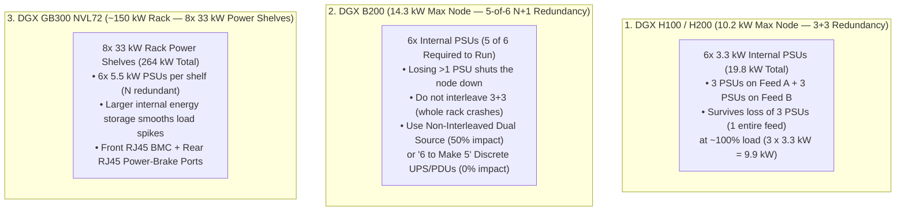
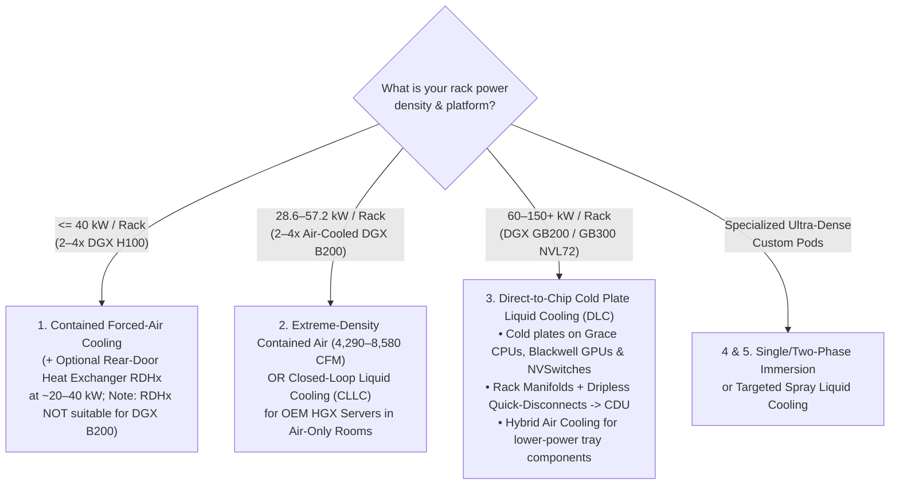

# 9.11 Power delivery, thermal design and liquid cooling

| | |
|---|---|
| **Status** | Drafted (`power_thermal_cooling_lab.py`: 26 checks pass; facility formulas and rules verified in Python) |
| **Level** | Advanced |
| **Priority tier** | 1b |
| **Lab venue** | none (design / reading) + self-checking Python model (`code/part09/power_thermal_cooling_lab.py`) |
| **Part** | Part 9: NVIDIA systems and reference architectures |
| **Sources used** | `nvidia-devops` V5 Ch. 4; `nvidia-devops` V1 Ch. 6 & Summary; `nvidia-devops` V21 Ch. 5; *Data Center Best Practices with DGX B200* (`superpod-b200-dc`); *NVIDIA DGX SuperPOD Reference Architecture Featuring NVIDIA DGX GB300 Systems* (`superpod-gb300-ra`); *AI Data Center Network Design and Technologies* Ch. 5 |

## Why this matters for AI infrastructure

Software engineers grow up treating compute as an elastic cloud API: call a function and 100 instances appear. In an AI factory, the cloud abstraction collides head-on with the laws of thermodynamics and electrical engineering. A legacy enterprise rack holds 40 CPU web servers and draws **5 kW to 15 kW** (with most enterprise data halls averaging **16 kW to 18 kW per rack**). Roll a 4-node rack of **DGX H100s (`~41 kW`)**, a 4-node rack of **DGX B200s (`57.2 kW`)**, or a single **DGX GB200 / GB300 NVL72 rack (`120 kW to 150 kW`)** into that legacy room without re-engineering the facility, and two things happen within minutes:
1. **The Electrical Brownout / Breaker Trip:** The rack demands 3× to 10× more current than the branch circuits and PDUs were rated to carry continuously, tripping upstream breakers or dropping bus voltage until PSUs latch off.
2. **The Thermal Meltdown (Clock Throttling):** Every single watt of electrical power entering a GPU turns into heat (`1 kW ≈ 3,412.14 BTU/hr`). Standard room air conditioning cannot physically push enough cubic feet per minute (`CFM`) through a 2-foot-wide column of air to carry away 60 kW to 150 kW of heat, forcing GPUs to hit their thermal slowdown threshold (`80°C–90°C`) and slash clock frequencies.

Mastering three-phase power distribution, PSU redundancy across generations (`3+3` on DGX H100 vs `5-of-6` on DGX B200 vs `8x 33 kW` energy-storage power shelves on DGX GB300), sensible-heat airflow equations, and the five liquid-cooling technologies is what keeps a multi-million-dollar AI cluster running at boost clocks 24 hours a day.

:::info Corpus scope note
Vendor-specific *Coolant Distribution Unit (CDU) Installation and Water Chemistry Manuals* (e.g., Motivair, CoolIT, Vertiv) are not in `~/Desktop/books-toon-rag/`. The electrical formulas, PSU redundancy schemes, PUE and kWh cost models, airflow direction trade-offs, and liquid-cooling architectures in this chapter are drawn from `nvidia-devops` Volume 05 Chapter 4, Volume 01 Chapter 6, and Volume 21 Chapter 5, `superpod-b200-dc`, `superpod-gb300-ra`, and *AI Data Center Network Design and Technologies* Chapter 5.
:::

## Prerequisites and outcomes

**Prerequisites:**
- Chapters `9.1`, `9.5`, and `9.7` (DGX node/rack families and DGX B200 data center power tables).

**Outcomes:** After completing this chapter, you will be able to:
1. Break down data center power consumption across IT equipment (`40%–45%`), cooling (`35%–40%`), and power distribution/UPS (`15%–25%`), calculate **Power Usage Effectiveness (`PUE`)**, and budget monthly cluster kWh and electricity OPEX (`60,000 kWh/month = $7,200/month` for a 64-GPU H100 pod).
2. Size three-phase branch circuits with **80% continuous-load derating** (`208V 60A = 21.6 kW nameplate / 17.3 kW continuous`; `415V 32A = 23.0 kW / 18.4 kW`) and contrast PSU redundancy across **DGX H100 (`6x 3.3 kW` in `3+3`)**, **DGX B200 (`6 PSUs` in `5-of-6 N+1`)**, and **DGX GB300 NVL72 (`8x 33 kW` power shelves with capacitor energy storage and rear RJ45 power brakes)**.
3. Calculate required cooling airflow using the **sensible heat equation (`CFM ≈ 3.16 × Watts / ΔT(°F)`)**, account for switch and optical transceiver heat (`QSFP28 3.2W` vs `QSFP56-DD 12W` vs `OSFP 15W`), and choose between **Front-to-Back**, **Back-to-Front**, and **Bidirectional** fan airflow.
4. Compare all **five liquid-cooling technologies**—**Rear-Door Heat Exchangers (`RDHx`)**, **Closed-Loop Liquid Cooling (`CLLC`)**, **Direct-to-Chip Cold Plate (`DLC`) with a `CDU`**, **Single-Phase and Two-Phase Immersion Cooling**, and **Sprayed Liquid Cooling**—and select the right cooling architecture for any rack density from `15 kW` to `150+ kW`.

---

## Concepts: basics → intermediate → advanced

## 1. The facility wall: power density, PUE, and why you cannot stack 8 DGX nodes in one rack

Suppose a CIO tells you: *"We have an empty row in our corporate data center. Let's buy 32 NVIDIA DGX H100 servers (8U each) and stack them into 4 tall racks (8 servers per rack) to save floor space, and plug them into our existing SAN."*

Walk through the three physical walls that make that proposal impossible (`nvidia-devops` Volume 01 Chapter 6):
1. **The Power & Weight Wall (`> 81.6 kW` and `2,960 lbs` per rack):** A single 8U DGX H100 draws up to **10.2 kW** (`8 × 700W = 5.6 kW` for the GPUs plus `4.6 kW` for dual Xeon CPUs, 2 TB DDR5, 8 NVMe drives, 8 ConnectX-7 NICs, 2 BlueField-3 DPUs, high-RPM fans, and VRM conversion losses) and weighs **~370 lbs (168 kg)**. Stacking 8 nodes into one rack would demand **`8 × 10.2 kW = 81.6 kW`** (`~85 kW` with switches) and weigh **`2,960 lbs` (`> 3,200 lbs` with rack and PDUs)**—crushing standard raised-floor tiles and tripping standard 15–20 kW colocation breakers instantly.
2. **The Thermodynamic Air-Cooling Wall:** Pushing 85 kW of heat out of the back of an air-cooled rack overwhelms room CRAC units; within minutes, hot exhaust recirculates into the front intake and GPUs thermal-throttle. Air-cooled deployments must cap density at **2 to 4 DGX nodes per rack (`20 kW to 57.2 kW`)**, leaving empty rack units (sealed with blanking panels.) to match the rack's power and cooling envelope.
3. **The Data-Path Wall:** Standard SAN storage cannot feed 32 DGX nodes; the cluster requires a dedicated parallel file system with GPUDirect Storage (`GDS`).

### 1.1 Data center power breakdown and Power Usage Effectiveness (`PUE`)

Where does electricity actually go inside a data center? According to industry measurements cited in *AI Data Center Network Design and Technologies* Chapter 5:
- **IT computing equipment (servers, storage, network switches):** **`40% to 45%`** of total facility power in traditional air-cooled data centers.
- **Cooling systems (chillers, CRAC/CRAH fans, pumps, cooling towers):** **`35% to 40%`** of total facility power (the second-largest consumer of electricity.).
- **Electrical power distribution, UPS conversion losses, and lighting:** **`15% to 25%`** (the remainder).

Facility efficiency is measured by **Power Usage Effectiveness (`PUE`)**:

```text
PUE = Total Facility Power Consumption (kW) / IT Equipment Power Consumption (kW)
```

An ideal `PUE` is **`1.0`** (100% of electricity goes to IT silicon). Real air-cooled data centers typically achieve **`1.2 to 1.5`** (with `1.35` used as a standard planning baseline). Moving from air cooling to **Direct Liquid Cooling (`DLC`)** can reduce cooling-system power consumption by **up to ~70%**, driving facility `PUE` down toward **`1.05 to 1.15`**.

### 1.2 Worked cluster power and monthly kWh budget (`64-GPU H100` pod)

Using the 8-node (`64-GPU H100`) cluster example from `nvidia-devops` Volume 21 Chapter 5 (`calculate_monthly_cluster_energy_and_cost()` in `code/part09/power_thermal_cooling.py`):
- **Provisioned IT load:** `8 nodes × 10.2 kW = 81.6 kW`.
- **Total facility power at full load (`1.35 PUE`):** `81.6 kW × 1.35 = 110.16 kW (~110 kW)`.
- **Daily 24-hour operating schedule (30-day month):**
  1. **Training (`16 hours/day` at `110 kW`):** `16 h × 30 d × 110 kW = 52,800 kWh/month`
  2. **Idle (`4 hours/day` at `20 kW`):** `4 h × 30 d × 20 kW = 2,400 kWh/month`
  3. **Maintenance (`4 hours/day` at `40 kW`):** `4 h × 30 d × 40 kW = 4,800 kWh/month`
  - **Total Monthly Energy:** `52,800 + 2,400 + 4,800 = 60,000 kWh/month`.
  - **Monthly & Annual Electricity Cost (at `$0.12/kWh`):** `60,000 × $0.12 = $7,200/month` (**`$86,400/year`** per 64-GPU cluster).
- **The 12-month facility forecasting rule:** Notice that running a *second* concurrent 64-GPU job (`16 nodes = 128 GPUs`) doubles facility demand from `110 kW` (`$6,340/mo` training power) to **`220 kW`** (`$12,670/mo`). If your room feed is capped at `144 kW`, you cannot launch that second pod no matter how much budget you have for GPUs—**committed utility/cooling megawatts, not the monthly electricity bill, is the binding constraint**, so facility power upgrades must be planned **12 months ahead** of cluster growth.

:::tip In one minute
- Legacy racks draw **5–18 kW**; AI racks draw **28.6–57.2 kW** (air-cooled DGX H100/B200) to **120–150 kW** (liquid-cooled NVL72).
- **`PUE = Total Facility Power / IT Equipment Power`** (`1.2–1.5` for air-cooled facilities; liquid cooling cuts cooling power by up to **~70%**).
- An 8-node (`64-GPU H100`) cluster (`81.6 kW` IT × `1.35 PUE ≈ 110 kW`) running 16h training / 4h idle / 4h maintenance consumes **60,000 kWh/month (`$7,200/month` or `$86,400/year` at `$0.12/kWh`)**.
:::

---

## 2. Three-phase power distribution, breaker derating, and PSU redundancy across generations

### 2.1 The three tiers of data center power distribution and 80% breaker derating

Power travels from the utility substation to the GPU silicon across three facility tiers:
1. **Tier 1 — Utility / UPS Row Feed & Branch Breakers:** High-power GPU racks never use single-phase 110V outlets; they use **three-phase `208V`, `380V`, `400V`, or `415V`** circuits (or high-amperage 240V) with heavy-gauge **C19/C20** cords or busbars:
   ```text
   Three-Phase Nameplate Power (kW) = sqrt(3) × Voltage (V) × Current (A) × Power_Factor / 1,000
   Continuous Derated Capacity (kW) = Nameplate Power (kW) × 0.80   (80% electrical code rule)
   ```
   - For a **3-phase `208V, 60A` circuit:** Nameplate is `1.732 × 208 × 60 / 1,000 = 21.6 kW`, and at **80% continuous derating** it carries only **`17.3 kW` continuously**—meaning a `40.8 kW` 4-node DGX H100 rack requires multiple feeds (`A1/A2` + `B1/B2`) or higher-voltage **415V** distribution.
   - For a **3-phase `415V, 32A` circuit:** Nameplate is **`23.0 kW`** and 80%-derated continuous capacity is **`18.4 kW`** (or **`34.96 kW ≈ 35 kW`** across two `N=2` circuits at a `0.95` power factor).
   - For a **3-phase `415V, 60A` circuit:** Two `N=2` circuits at `0.95` power factor and 80% derating deliver **`65.55 kW ≈ 66 kW`**, supporting **four 14.3 kW DGX B200 systems (`57.2 kW`)**.
2. **Tier 2 — Smart Rack PDUs (`rPDUs`):** Metered per-phase inlets and locking per-receptacle outlets exporting SNMP/Redfish telemetry (`PowerWatts`, `LineInputVoltage`, `CurrentAmps`) into Prometheus, with remote outlet switching for full **AC power cycles**.
3. **Tier 3 — Internal Node Power Supplies (`PSUs`) or Rack Power Shelves:** Across Hopper and Blackwell generations, NVIDIA uses **three distinct PSU redundancy architectures**:



:::note Reconciling DGX H100 PSU redundancy descriptions (`3+3` vs `4+2`) across sources
In `nvidia-devops` Volume 05 Chapter 4 and Volume 21 Chapter 5, the **DGX H100** is rated at **10.2 kW maximum** with **6x 3.3 kW PSUs (`19.8 kW` installed)** in **`3+3` redundancy**: 3 PSUs on Feed A and 3 PSUs on Feed B, so losing an entire power feed leaves 3 PSUs delivering up to `3 × 3.3 kW = 9.9 kW` (~100% PSU load) to sustain the server. By contrast, a passing sentence in *AI Data Center Network Design and Technologies* Chapter 5 (line 5) describes the 6x 3.3 kW supplies as *"4 + 2 redundancy, which means it consumes 4 × 3.3 kW = 13.2 kW."* In practice, always provision DGX H100 racks for the official **10.2 kW maximum system rating** and wire its 6 PSUs `3 + 3` across Feed A and Feed B—while remembering that on the **14.3 kW DGX B200**, **5 of 6 PSUs must stay energized (`N+1`)**, making `3 + 3` interleaving a serious mistake.
:::

:::tip In one minute
- Apply **80% continuous-load derating** to branch circuits: a **3-phase `208V 60A`** whip carries **`17.3 kW`** continuously (`21.6 kW` nameplate), while a **3-phase `415V 32A`** whip carries **`18.4 kW`** continuously (`23.0 kW` nameplate).
- **PSU redundancy differs by generation:** `DGX H100` uses **`3+3` redundancy** (`6x 3.3 kW` for `10.2 kW`); `DGX B200` uses **`5-of-6` (`N+1`) redundancy** for `14.3 kW` (never interleave `3+3`; use Non-Interleaved or `"6 to make 5"`); `DGX GB300 NVL72` uses **8x 33 kW rack power shelves** (`6x 5.5 kW` PSUs each) with capacitor energy storage and rear **RJ45 power brakes**.
:::

---

## 3. Thermal physics: sensible-heat airflow (`CFM`), switch/optics heat, and fan directions

### 3.1 The sensible-heat airflow equation (`CFM ≈ 3.16 × Watts / ΔT(°F)`)

When cooling equipment with air, how many Cubic Feet per Minute (`CFM`) of cold air must pass through the servers to carry away `W` watts of heat for a given air temperature rise `ΔT` between the front intake and rear exhaust? Use the standard **sensible-heat airflow formula** (`calculate_sensible_heat_airflow_cfm()` in `code/part09/power_thermal_cooling.py`):

```text
ΔT (°F) = ΔT (°C) × 1.8
Required Airflow (CFM) ≈ (3.16 × Heat_Load_Watts) / ΔT (°F)
Heat Load (BTU/hr)     = Heat_Load_Watts × 3.41214
```

- **Worked Example 1 — 8-node (`64-GPU H100`) deployment (`81,600 W` at `ΔT = 20°C = 36°F`):**
  ```text
  CFM ≈ (3.16 × 81,600 W) / 36°F = 7,162.7 CFM (~7,160 CFM across the 8 nodes)
  ```
- **Worked Example 2 — Single `10.2 kW` DGX H100 vs `14.3 kW` DGX B200:**
  - A `10.2 kW` DGX H100 generates **`34,804 BTU/hr (~34,800 BTU/hr)`** and requires **`> 1,000 CFM`** (e.g., `1,194 CFM` at `ΔT = 15°C = 27°F`).
  - A `14.3 kW` DGX B200 requires **`~2,145 CFM`** at sea level (`150 CFM per kW` rule from `superpod-b200-dc`, corresponding to `ΔT ≈ 11.7°C = 21.1°F`).

### 3.2 Don't forget switch and optical transceiver power (`QSFP28` vs `QSFP56-DD` vs `OSFP`)

When budgeting rack power and heat, engineers often forget the network switches and optical transceivers:
- **High-radix 400G/800G switches:** A single `64 × 400 Gbps` switch draws up to **~3 kW** of power.
- **Optical transceiver power jump:** As link speeds scaled from 100G to 400G and 800G, per-transceiver power draw jumped by **nearly 5×** (*AI Data Center Network Design and Technologies* Chapter 5):

| Optical Form Factor | Typical Speed | Max Power per Transceiver | Power for 64 Ports on One Switch |
|---|---|---:|---:|
| **`QSFP28`** | 100 Gbps | **3.2 W** | `204.8 W` (~0.2 kW) |
| **`QSFP56-DD` (`QSFP-DD`)** | 400 Gbps | **12.0 W** | `768.0 W` (~0.8 kW) |
| **`OSFP`** | 400 Gbps / 800 Gbps | **15.0 W** (**4.69× `QSFP28`**) | **`960.0 W` (~1.0 kW in optics alone.)** |

### 3.3 Choosing fan airflow direction: Front-to-Back vs Back-to-Front vs Bidirectional

All servers, storage arrays, and network switches in a rack must share the **exact same airflow direction** so one device never exhausts hot air into its neighbor's cold intake:
1. **Front-to-Back Airflow (Cold-Aisle Intake at Front → Hot-Aisle Exhaust at Rear):**
   - **Why it is the AI data center standard:** Because optical switch ports (`OSFP` / `QSFP-DD` burning 12–15 W each) sit on the front panel of network switches (and on the front cold aisle of DGX GB300 compute trays), **front-to-back airflow passes fresh cold air over the temperature-sensitive optical transceivers first** before crossing the switch ASIC and board.
2. **Back-to-Front Airflow (Port-Side Exhaust):**
   - Pulls cold air in through the rear power supplies (`PSUs`) first and exhausts heated air out the front port panel. Because pre-heated air reaches the optical transceivers last, **optics require larger heatsinks (such as finned-top OSFP cages)** and run hotter.
3. **Bidirectional Fans:**
   - Fans that can reverse direction in software based on thermal sensors. While flexible at ordering time, they are **prohibitively expensive and aerodynamically less efficient** than purpose-built unidirectional fans. Always standardize on **Front-to-Back** airflow before ordering hardware.

:::tip In one minute
- Estimate air-cooling volume with **`CFM ≈ 3.16 × Watts / ΔT(°F)`** (`81.6 kW` at a `20°C / 36°F` rise requires **`~7,163 CFM`**; DGX B200 uses **`150 CFM/kW = 2,145 CFM/node`**).
- Account for optical transceiver heat: **`OSFP` transceivers burn `15 W` each** (`960 W` across a 64-port switch, **4.69×** a `3.2 W` `QSFP28`).
- Standardize every server and switch in the row on **Front-to-Back airflow** so cold intake air cools the front-panel `OSFP` optics first.
:::

---

## 4. Liquid cooling architectures: `RDHx`, `CLLC`, Direct-to-Chip Cold Plates (`DLC`), Immersion, and Spray

Above **50 kW to 60 kW per rack**, air reaches its practical thermodynamic ceiling. Water has roughly **3,500× the volumetric heat capacity of air**—meaning a narrow tube of warm water can carry away far more thermal energy than a roaring hurricane of air fans, while cutting data center cooling energy by **up to ~70%**.



### 4.1 Comparing all five liquid-cooling technologies

| Cooling Technology | How It Works Physically | Facility Requirements & Modifications | Strengths & Limitations |
|---|---|---|---|
| **1. Rear-Door Heat Exchanger (`RDHx` / `AALC`)** | A liquid-filled radiator coil is mounted as the rear door of an air-cooled rack. Servers use standard front-to-back fans; hot exhaust air passes through the water-cooled rear door and re-enters the room cooled. | Requires chilled-water supply/return pipes to the rack door, **zero modification to the servers inside the rack**. | Simplest liquid retrofit for `~20–40 kW` racks, **but less efficient than cold plates, and NOT typically suitable for `DGX B200`** due to extreme `4,290–8,580 CFM` airflow impedance. |
| **2. Closed-Loop Liquid Cooling (`CLLC` — Internal Chassis Loop)** | Cold plates on the GPUs connect to an internal pump and radiator *inside* the 4U–8U server chassis, cooled by chassis fans. | **Zero facility water plumbing required** (100% self-contained inside the server box). | Eliminates GPU-to-GPU **Airflow Shadowing** in air-only data centers, but still dumps 100% of the heat into the room air. |
| **3. Cold Plate / Direct-to-Chip Liquid Cooling (`DLC` + `CDU`)** | Copper micro-channel **cold plates** bolt directly onto the high-TDP silicon (**CPUs, GPUs, NVSwitch ASICs**). Coolant circulates through dripless quick-disconnects and rack manifolds to a **Coolant Distribution Unit (`CDU`)**, which exchanges heat with facility water. | Requires rack coolant manifolds, leak detection, redundant pumps, water-quality monitoring, and an in-rack or in-row **CDU** (plus hybrid room air for lower-power NICs/DIMMs/drives). | **The standard for `DGX GB200 NVL72` (`~120–130 kW`) and `DGX GB300 NVL72` (`~150 kW`)** (and Google TPUs / Meta AI racks). Lower cost and far easier servicing than submerging boards in immersion tanks. |
| **4a. Single-Phase Immersion Cooling** | Entire server boards/racks are submerged in a sealed tank of non-conductive dielectric liquid. Heated liquid stays in liquid phase and is pumped to an external water-cooled heat exchanger. | Requires custom horizontal tank racks, overhead hoists for servicing, and immersion-certified components (no standard fans; special optical sealing). | Uniform cooling of 100% of board components at extreme density, but messy/complex field maintenance and high facility redesign cost. |
| **4b. Two-Phase Immersion Cooling** | Servers sit in a sealed tank of low-boiling-point fluorochemical fluid. Heat boils the fluid into **vapor gas**, which rises to a cold-water condenser tube at the top of the tank, condenses into droplets, and rains back down. | Sealed vapor-tight tank with top condenser coil (**no external liquid-to-liquid heat exchanger needed**; evaluated in production by Microsoft). | Extremely high latent-heat transfer efficiency without external coolant pumps, but fluid cost, environmental rules, and sealed-tank servicing are challenging. |
| **5. Sprayed Liquid Cooling** | Nozzles inside a modified chassis **spray dielectric coolant directly onto the heated chip surfaces**, draining back to a heat exchanger. | Requires specialized spray-modified server enclosures and drainage return loops. | Uses less coolant volume than immersion and reduces total data center energy consumption by **~25.8%** compared to air cooling. |

### 4.2 Hybrid Direct-to-Chip Liquid + Air Cooling on `DGX GB300 NVL72`

Why does the *DGX GB300 SuperPOD Reference Architecture* describe the `DGX GB300 NVL72` rack (`~150 kW` per rack, `1.2 MW` per 8-rack SU) as a **hybrid cooling solution**?
- **Liquid-cooled loop (`~80%–85%` of rack heat, **my inference** providing an illustrative planning split in `select_cooling_architecture()` for the reference architecture's qualitative division between high-power and lower-power components):** Direct-to-chip cold plates capture the massive heat flux from the **36 Grace CPUs, 72 Blackwell Ultra `B300` GPUs, and 18 NVSwitch ASICs** via each tray's rear **cold water inlet** and **hot water outlet** manifolds (for a `150 kW` rack at an illustrative 85% capture rate, `~127.5 kW` goes directly into the liquid loop).
- **Air-cooled loop (`~15%–20%` of rack heat, `~22.5 kW`):** Lower-power components on the front of the trays—such as the **ConnectX-8 (`800G`) and BlueField-3 (`400G`) optical transceivers**, **E1.S and M.2 NVMe drives**, and **power-shelf fans**—are cooled by room air. Always size your room CRAC units for that residual `~15%–20%` air heat load even in a "liquid-cooled" NVL72 data hall.

### 4.3 CDU commissioning checklist for Direct Liquid Cooling

When reviewing or commissioning a Direct-to-Chip liquid-cooled rack (`GB200` / `GB300 NVL72`), verify seven facility parameters with the mechanical engineering team (`nvidia-devops` Volume 06 Lab 02):
1. **Coolant supply temperature (`T_supply`) and return temperature (`T_return`)** within the GPU cold-plate and dew-point envelope (never set supply water below room dew point, or condensation will drip onto live circuit boards.).
2. **Required flow rate (Liters Per Minute, `LPM` / `GPM`)** per compute tray, switch tray, and rack manifold.
3. **Differential pressure range (`kPa` / `PSI`)** across the rack manifolds so flow is balanced evenly between the bottom tray (`c01`) and top tray (`c18`).
4. **CDU heat-rejection capacity (`kW` / `MW`)** with margin above peak sustained load.
5. **Redundant (`N+1`) coolant pumps and dual power feeds** on the CDU (a single pump failure must never stop coolant flow; if coolant stops on a 150 kW rack, GPUs hit thermal shutdown in seconds.).
6. **Rope/optical leak-detection sensors** inside every tray, drip pan, and manifold trench, wired to Mission Control and the facility BMS.
7. **Named ownership of water/glycol chemistry, biocide treatment, and 25–50 micron filtration maintenance** so micro-channel cold plates never clog or corrode.

:::tip In one minute
- **Direct-to-Chip Cold Plate Liquid Cooling (`DLC`) with a `CDU`** is the production standard for `120–150 kW` **GB200/GB300 NVL72** racks, capturing heat from CPUs, GPUs, and NVSwitches while **hybrid air cooling** removes the remaining heat from front-panel optics, NVMe drives, and power shelves.
- Never set CDU supply coolant temperature below the data hall's **dew point** (to prevent condensation), and always require **redundant CDU pumps**, **leak detection**, and **micro-channel water chemistry/filtration ownership**.
:::

---

## Commands and configurations that matter

Use these commands to monitor GPU thermal slowdown thresholds, inspect real-time power draw and power limits, and run the 26-check facility power/thermal verifier (**untested** on live DGX hardware in this authoring environment; formulas verified in `code/part09/power_thermal_cooling_lab.py`).

### 1. Run the 26-check Power Delivery, Thermal Design & Liquid Cooling lab

```bash
python3 -B code/part09/power_thermal_cooling_lab.py
```

### 2. Query GPU slowdown/shutdown temperature thresholds and active thermal throttle flags

```bash
# 1. Inspect current GPU & HBM temperatures alongside exact hardware Slowdown and Shutdown thresholds
nvidia-smi -q -d TEMPERATURE | grep -E "GPU Current Temp|Memory Current Temp|GPU Slowdown Temp|GPU Shutdown Temp|GPU Max Operating Temp"

# 2. Check whether any GPU is currently throttling due to SW/HW thermal slowdown or power brake
nvidia-smi -q -d PERFORMANCE | grep -E "Performance State|Clocks Throttle Reasons|SW Thermal Slowdown|HW Thermal Slowdown|HW Power Brake Slowdown"

# 3. Poll per-GPU power draw (Watts) and temperature (C) every 2 seconds during a thermal soak test
nvidia-smi --query-gpu=index,power.draw,power.limit,temperature.gpu,temperature.memory,clocks.current.sm \
  --format=csv -l 2
```

### 3. Set a software GPU power cap (`nvidia-smi -pl`) to optimize performance-per-watt or survive degraded cooling

As noted in *AI Systems Performance Engineering* Chapter 2, administrators can cap per-GPU power draw (`nvidia-smi -pl <watts>`) during partial-cooling maintenance or on workloads that are not compute-bound, trading a small clock reduction for a large drop in rack kW and heat:

```bash
# Enable persistence mode and cap all 8 GPUs on a DGX H100 from 700W down to 550W (saving up to 1.2 kW/node)
sudo nvidia-smi -pm 1
sudo nvidia-smi -pl 550
```

---

## How it fails

| Failure mode | Symptom | Root cause | Diagnosis & fix |
|---|---|---|---|
| **1. GPU clock speeds fluctuating wildly (`SW/HW Thermal Slowdown: Active`)** | Training step times double and `nvidia-smi` shows GPU utilization at `99%`, but SM clocks oscillate wildly below base frequency while GPU temperatures sit at `83°C–88°C`. | The facility cooling loop is failing to remove heat (hot-aisle recirculation past missing blanking panels, CRAC/CDU flow loss, or clogged filters), forcing the GPUs to throttle clocks to prevent silicon damage. | Run `nvidia-smi -q -d TEMPERATURE,PERFORMANCE` to confirm `SW Thermal Slowdown: Active`. Inspect cold-aisle inlet temp (`< 27°C–30°C`), seal missing rack blanking panels and floor brush grommets, verify CDU pump flow rate (`LPM`), and check BMC fan sensors. |
| **2. Breaker trip on a 40 kW rack fed by two `208V 3Φ 60A` whips** | A 4-node DGX H100 rack (`40.8 kW` peak) runs fine at idle and during small tests, but trips upstream PDU branch breakers 20 minutes into a full-scale `HPL` or `AllReduce` run. | A 3-phase `208V 60A` circuit is `21.6 kW` nameplate and only **`17.3 kW` continuous** (at 80% code derating). Two circuits provide only **`34.6 kW`** continuous capacity (`< 40.8 kW` demand). | Provision four `208V 3Φ 60A` whips (`2 per feed = 69.2 kW` continuous) or upgrade to **3-phase `415V 60A`** circuits (`32.8 kW` continuous per circuit at 0.95 PF = `65.6 kW` per rack), or reduce rack density from 4 nodes to 2–3 nodes per rack. |
| **3. Cooling Coefficient of Performance (`COP`) degradation (`3.5 → 2.8`) over 12 months** | IT equipment power draw (`kW`) is unchanged from last year, but facility CRAC/chiller electrical consumption has risen by 25% (`PUE` creeping up from `1.28` to `1.42`). | High-volume AI airflow (`4,290–8,580 CFM/rack`) fouled the CRAC evaporator coils and air filters with dust, forcing compressor stages and fans to work much harder for the same heat rejection. | Trend CRAC/CDU `kW-cooling per kW-electrical` (`COP`) monthly, replace **MERV 13+** filters on a strict 90-day schedule (or differential-pressure alarm), and clean evaporator/condenser fins. |
| **4. Condensation drip inside a Direct-to-Chip liquid-cooled tray** | Moisture/leak-detection rope triggers an alarm inside a liquid-cooled compute tray even though pressure tests show zero coolant-loop fitting leaks. | The facility chilled-water / CDU supply temperature (`T_supply`) was set to `12°C` while the data hall ambient air dew point was `16°C` (`> 65% RH`), causing atmospheric moisture to condense on the cold manifolds and cold plates. | Always keep **CDU supply coolant temperature at least `2°C–3°C` above the data hall's maximum dew point** (`≤ 15°C` recommended dew point, `≤ 17°C` max A1 dew point) and maintain active room dehumidification (`≤ 60% RH`). |
| **5. Front-panel `OSFP` optical link flaps from Back-to-Front switch fans** | 400G/800G `OSFP` transceivers (`15 W` each) on a leaf switch report `High Temperature Warning (> 70°C)` in `ethtool -m` and periodically flap links during heavy `AllReduce` runs. | A switch ordered with **Back-to-Front** fans was mounted in a **Front-to-Back** rack, either sucking hot aisle exhaust air directly over the 15W `OSFP` optics or bathing the optics in pre-heated PSU exhaust. | Verify every server, storage shelf, and switch in the rack uses **Front-to-Back** airflow so cold-aisle intake air (`18–27°C`) cools the front-panel `OSFP` optical modules first. |

---

## Hands-on lab

This chapter's self-checking Python model (`code/part09/power_thermal_cooling.py`) and lab script (`code/part09/power_thermal_cooling_lab.py`) implement:
1. The **3-Phase Circuit & 80% Continuous Derating Calculator** (`208V 60A = 21.6 kW nameplate / 17.3 kW continuous`; `415V 32A = 23.0 kW / 18.4 kW`; `415V 60A @ 0.95 PF = 32.8 kW/circuit`).
2. The **Sensible-Heat Airflow (`CFM ≈ 3.16 × Watts / ΔT(°F)`) and `BTU/hr` Calculator** (`81.6 kW` at `20°C / 36°F` rise = `7,162.7 CFM ≈ 7,160 CFM`; single `10.2 kW` DGX H100 = `34,804 BTU/hr` and `> 1,000 CFM`).
3. The **64-GPU Cluster Monthly Energy (`kWh`) & PUE Cost Forecaster** (`81.6 kW × 1.35 PUE = 110.16 kW`; `16h` train `52,800 kWh` + `4h` idle `2,400 kWh` + `4h` maint `4,800 kWh` = `60,000 kWh/month` = `$7,200/month` / `$86,400/year` at `$0.12/kWh`, plus the Month-2 `220 kW > 144 kW` budget check).
4. The **Optical Transceiver Power & PSU Redundancy Verifier** (`QSFP28 3.2W` vs `QSFP56-DD 12W` vs `OSFP 15W = 4.69×`; `64 OSFPs = 960W`; `DGX H100 3+3 = 9.9 kW`; `DGX GB300 8x 33 kW shelves = 264 kW`).
5. The **Cooling Architecture Selector** (mapping `≤ 40 kW` air containment, `DGX B200` `57.2 kW` high-velocity air with `rdhx_suitable=False`, `50 kW` waterless `CLLC`, `120 kW` `GB200 NVL72` `DLC + CDU`, and `150 kW` `DGX GB300 NVL72` hybrid `127.5 kW` liquid + `22.5 kW` air split).

Run the lab from the repository root:

```bash
python3 -B code/part09/power_thermal_cooling_lab.py
```

Expected output (verified in this repository):

```text
=== Chapter 9.11 Lab: Power Delivery, Thermal Design & Liquid Cooling ===
  [PASS] V21 Ch5: 3-phase 208V 60A circuit is 21.6 kW nameplate and 17.3 kW continuous (80% derated)
  [PASS] 3-phase 415V 32A circuit is 23.0 kW nameplate and 18.4 kW continuous (80% derated)
  [PASS] SPB200 p.11: Single 3-phase 415V 60A circuit at 0.95 PF and 80% derating == 32.8 kW (65.6 kW for 2 circuits)
  [PASS] Rejects non-positive voltage in 3-phase calculator
  [PASS] V21 Ch5: 81.6 kW (8x DGX H100) at 20C (36F) rise requires 7,162.7 CFM (~7,160 CFM)
  [PASS] V5 Ch4: Single 10.2 kW DGX H100 generates 34,804 BTU/hr (~34,800 BTU/hr) and >1,000 CFM
  ...
  [PASS] V5 Ch4: DGX H100 3+3 PSU redundancy keeps 3 * 3.3 kW == 9.9 kW active on single-feed loss
  [PASS] SPGB300 p.11: DGX GB300 power shelf has 6 * 5.5 kW == 33.0 kW per shelf (8 shelves/rack = 264.0 kW)
  [PASS] AIDC Ch5: OSFP optics (15W) draw 4.69x more power per port than legacy QSFP28 optics (3.2W)
  [PASS] Rejects non-positive days_per_month
  [PASS] Rejects derating_factor > 1.0

Summary: 26 passed, 0 failed (total 26)
```

---

## Exercises

1. Run `python3 -B code/part09/power_thermal_cooling_lab.py`. Reproduce the 60,000 kWh/month figure by hand, then change the training time to 20 hours a day and see how the cost changes.
2. A hall has 36 kW of cooling for each row. Using 10.2 kW per DGX H100 and a 1.35 PUE, how many nodes can one row hold? What changes if you move to liquid cooling with a PUE of 1.1?
3. Compute the airflow in CFM for a 14.3 kW node with a 15°C rise. Compare it with the 150 CFM/kW rule of thumb in the B200 deck.
4. Fill in a table of the five liquid-cooling methods: where the liquid goes, what the facility needs, and one limit. Mark the one used on GB200 and GB300.
5. A rack of 4 DGX H100 trips its breakers 20 minutes into a stress test. Write the three numbers you would check first and the two fixes you would offer.
6. Write the CDU commissioning list (seven items) as a checklist and add the number you would measure for each.

## Checkpoint questions (20)

<details>
<summary><strong>1. In a traditional air-cooled data center, what percentage of total electrical power goes to IT equipment, cooling systems, and power distribution/UPS? How is `PUE` defined, and how much can liquid cooling reduce cooling power?</strong></summary>

- **Power split:** IT equipment consumes **40%–45%**, cooling systems consume **35%–40%**, and power distribution/UPS/lighting consume **15%–25%**.
- **`PUE` definition:** `PUE = Total Facility Power / IT Equipment Power` (ideal is `1.0`; typical air-cooled is `1.2–1.5`).
- **Liquid cooling impact:** Liquid cooling can reduce cooling-system power consumption by **up to ~70%**, bringing `PUE` down toward `1.05–1.15`.
</details>

<details>
<summary><strong>2. Calculate the monthly kWh consumption and annual electricity cost (at `$0.12/kWh`) for an 8-node (`64-GPU H100`) cluster with `81.6 kW` IT load at `1.35 PUE` (`~110 kW` full facility load) running 16h/day training (`110 kW`), 4h/day idle (`20 kW`), and 4h/day maintenance (`40 kW`).</strong></summary>

- **Training (30 days):** `16 h × 30 d × 110 kW = 52,800 kWh`
- **Idle (30 days):** `4 h × 30 d × 20 kW = 2,400 kWh`
- **Maintenance (30 days):** `4 h × 30 d × 40 kW = 4,800 kWh`
- **Total monthly energy:** `52,800 + 2,400 + 4,800 = 60,000 kWh/month`.
- **Cost at `$0.12/kWh`:** `60,000 × $0.12 = $7,200/month` = **`$86,400/year`**.
</details>

<details>
<summary><strong>3. Using the sensible-heat airflow equation (`CFM ≈ 3.16 × Watts / ΔT(°F)`), calculate the required airflow for an `81,600 W` (`81.6 kW`) deployment with a `20°C` (`36°F`) air temperature rise.</strong></summary>

- **Convert `ΔT` to Fahrenheit:** `20°C × 1.8 = 36°F`.
- **Calculate `CFM`:** `CFM ≈ (3.16 × 81,600 W) / 36°F = 7,162.7 CFM` (**`~7,160 CFM`**).
</details>

<details>
<summary><strong>4. Compare the maximum power consumption of a `QSFP28` (100G), a `QSFP56-DD` (400G), and an `OSFP` (400G/800G) optical transceiver, and explain why Front-to-Back airflow is preferred on AI switches.</strong></summary>

- **`QSFP28`:** `3.2 W` max
- **`QSFP56-DD`:** `12.0 W` max
- **`OSFP`:** `15.0 W` max (**4.69× `QSFP28`**, or **`960 W` (~1 kW)** across a 64-port switch in optics alone.)
Because optical transceivers sit on the front panel of the switch and are highly sensitive to heat, **Front-to-Back airflow** passes fresh cold intake air over the `12–15 W` optics first before heating up across the switch ASIC and PSUs.
</details>

<details>
<summary><strong>5. Contrast the PSU redundancy architectures of a `DGX H100` (`10.2 kW`), a `DGX B200` (`14.3 kW`), and a `DGX GB300 NVL72` rack (`~150 kW`).</strong></summary>

- **DGX H100 (`10.2 kW`):** `6x 3.3 kW` internal PSUs (`19.8 kW` installed) in **`3+3` redundancy** across Feed A and Feed B; survives the loss of 3 PSUs (1 entire feed) with the remaining 3 PSUs running near 100% (`9.9 kW`).
- **DGX B200 (`14.3 kW`):** `6` internal PSUs in **`5-of-6` (`N+1`) redundancy** (at least 5 PSUs must stay energized; losing >1 PSU shuts the node down, so `3+3` interleaving is forbidden; use Non-Interleaved Dual Source or `"6 to make 5"`).
- **DGX GB300 NVL72 (`~150 kW` rack):** **8x 33 kW DGX Power Shelves** (`6x 5.5 kW` PSUs per shelf = `264 kW` total shelf capacity), equipped with **larger internal energy storage** to smooth peak GPU load transients and **rear RJ45 power-brake ports**.
</details>

<details>
<summary><strong>6. Compare Rear-Door Heat Exchangers (`RDHx`), Direct-to-Chip Cold Plate Liquid Cooling (`DLC`), Single-Phase Immersion, Two-Phase Immersion, and Sprayed Liquid Cooling.</strong></summary>

- **`RDHx`:** Water-cooled radiator door on the back of an air-cooled rack (`~20–40 kW`; no server modification, but unsuitable for high-static-pressure `DGX B200` racks).
- **Direct-to-Chip Cold Plate (`DLC` + `CDU`):** Cold plates bolted directly to CPUs, GPUs, and NVSwitches circulate coolant to a CDU. Standard for `120–150 kW` **GB200/GB300 NVL72** racks.
- **Single-Phase Immersion:** Submerges servers in a sealed tank of dielectric fluid pumped to an external heat exchanger.
- **Two-Phase Immersion:** Boils low-boiling-point fluid into vapor that condenses on a cold-water tube at the top of the sealed tank (no external heat exchanger needed).
- **Sprayed Liquid Cooling:** Sprays dielectric coolant through nozzles onto heated chips inside a modified chassis (uses less fluid than immersion and cuts energy by ~25.8% vs air).
</details>

<details>
<summary><strong>7. Why must a Coolant Distribution Unit (`CDU`) never supply chilled water at a temperature below the data hall's dew point?</strong></summary>

If the liquid flowing through the rack manifolds and cold plates is colder than the ambient air's **dew point** (`15°C–17°C` max in ASHRAE Class A1), moisture in the room air will **condense into water droplets on the outside of the pipes and cold plates**, dripping onto live circuit boards and triggering leak alarms or short circuits.
</details>

<details>
<summary><strong>8. What two `nvidia-smi` commands tell you the exact temperature threshold at which a GPU begins thermal slowdown and whether thermal or power-brake throttling is currently active?</strong></summary>

1. `nvidia-smi -q -d TEMPERATURE` — displays `GPU Current Temp`, `Memory Current Temp`, `GPU Slowdown Temp`, and `GPU Shutdown Temp`.
2. `nvidia-smi -q -d PERFORMANCE` — displays `Clocks Throttle Reasons`, specifically `SW Thermal Slowdown`, `HW Thermal Slowdown`, and `HW Power Brake Slowdown`.
</details>

<details>
<summary><strong>9. Why is committed megawatts, not the electricity bill, the binding limit in AI cluster growth?</strong></summary>

A second 64-GPU job doubles facility demand to about 220 kW. If the room feed is capped at 144 kW you cannot start it, whatever the budget. So plan power upgrades about 12 months ahead.
</details>

<details>
<summary><strong>10. What are the three "walls" in the CIO's 8-nodes-per-rack proposal?</strong></summary>

Power and weight (about 81.6 kW and about 2,960 lb per rack), the air-cooling wall (the heat cannot be removed), and the data-path wall (a normal SAN cannot feed 32 DGX nodes).
</details>

<details>
<summary><strong>11. What is a normal PUE, and what does liquid cooling do to it?</strong></summary>

Air-cooled halls reach about 1.2–1.5 (1.35 for planning). Direct liquid cooling can cut cooling power by up to about 70% and take PUE toward 1.05–1.15.
</details>

<details>
<summary><strong>12. How do you size a 3-phase circuit and why derate it to 80%?</strong></summary>

Power = √3 × volts × amps × power factor. Electrical rules let you load a circuit continuously to only 80% of nameplate. A 208V 60A circuit is 21.6 kW nameplate and 17.3 kW continuous.
</details>

<details>
<summary><strong>13. What does the sensible-heat formula tell you?</strong></summary>

`CFM ≈ 3.16 × watts / ΔT(°F)`. It gives the air volume needed to carry away heat for a given air temperature rise. 81.6 kW at a 36°F rise needs about 7,160 CFM.
</details>

<details>
<summary><strong>14. Why do OSFP optics matter for rack power?</strong></summary>

Each OSFP uses up to 15 W, 4.69 times a 100G QSFP28. A 64-port switch spends about 960 W on optics alone.
</details>

<details>
<summary><strong>15. Why choose front-to-back airflow on switches?</strong></summary>

The optics sit on the front panel, so cold intake air reaches them first. Back-to-front fans heat the optics and need bigger heatsinks. Bidirectional fans cost more and are less efficient.
</details>

<details>
<summary><strong>16. What is the practical limit of air cooling?</strong></summary>

About 50–60 kW per rack. Water holds about 3,500 times more heat per volume than air.
</details>

<details>
<summary><strong>17. What does the RDHx do and why is it not suited to the DGX B200?</strong></summary>

A water-cooled radiator door on an air-cooled rack, good for about 20–40 kW with no server changes. It adds airflow resistance, which the B200's 4,290–8,580 CFM cannot tolerate.
</details>

<details>
<summary><strong>18. Why is the GB300 NVL72 "hybrid" cooled?</strong></summary>

Cold plates handle CPUs, GPUs and NVSwitches. Air still cools lower-power parts such as NIC optics, drives and shelf fans. The 85/15 split is the author's illustrative estimate, not a figure from the source.
</details>

<details>
<summary><strong>19. What causes condensation in a liquid-cooled tray and how do you prevent it?</strong></summary>

Coolant colder than the room's dew point. Keep supply temperature 2–3°C above the maximum dew point and keep room humidity controlled.
</details>

<details>
<summary><strong>20. What does `nvidia-smi -pl` do and when would you use it?</strong></summary>

It caps per-GPU power. Use it during partial cooling or for workloads that are not compute-bound, to trade a small clock loss for lower rack kW and heat.
</details>

---

## Sources and review notes

### Sources read in full for this chapter
1. **`nvidia-devops` Volume 05 Chapter 4 (`chapter-04-power-cooling-and-rack-readiness.md`, 1,143 words), Volume 01 Chapter 6 (`chapter-06-modern-ai-factory.md`, 1,297 words), and Volume 01 Summary (`06-volume-01-summary.md`, 946 words):**
   - Legacy `5–15 kW` vs AI `40–120+ kW` rack density, DGX H100 `10.2 kW` / `34,800 BTU/hr` / `>1,000 CFM` / `370 lbs (168 kg)` / `1,200 mm` rack depth, `6x 3.3 kW` PSUs in `3+3` redundancy, `RDHx` vs Direct Liquid Cooling (`DLC` with cold plates + `CDU`, water ~3,500× volumetric heat capacity of air), and the CIO 8-nodes-per-rack (`81.6–85 kW`, `2,960 lbs`) customer scenario.
2. **`nvidia-devops` Volume 21 Chapter 5 (`chapter-05-power-delivery-and-thermal-management.md`, 1,924 words):**
   - Component power budget (`5.6 kW` GPUs + `4.6 kW` host/NIC/fan/VRM = `10.2 kW`), 64-GPU (`81.6 kW` IT × `1.35 PUE ≈ 110 kW`) monthly energy schedule (`16h` train `52,800 kWh` + `4h` idle `2,400 kWh` + `4h` maint `4,800 kWh` = `60,000 kWh/mo` = `$7,200/mo` / `$86,400/yr` at `$0.12/kWh`), sensible-heat airflow formula (`CFM ≈ 3.16 × Watts / ΔT(°F)` -> `7,162.7 / ~7,160 CFM` at `36°F`), `208V 3Φ 60A` (`21.6 kW` nameplate / `17.3 kW` 80%-derated), 12-month facility forecasting, and thermal/COP troubleshooting.
3. ***AI Data Center Network Design and Technologies* (`ai-data-center-network-design-and-technologies`), Chapter 5 (*Thermal and Power Efficiency Considerations*, lines 1–112, read in full):**
   - Data center power split (`40%–45%` IT, `35%–40%` cooling, `15%–25%` distribution/UPS/lighting), `PUE` definition, switch (`~3 kW`) and optical transceiver power (`QSFP28 3.2W`, `QSFP56-DD 12W`, `OSFP 15W`), Front-to-Back vs Back-to-Front vs Bidirectional fan airflow, and the 5 liquid-cooling methods (Single-Phase Immersion, Two-Phase Immersion, Cold Plate DLC, Rear-Door Heat Exchanger `RDHx`/`AALC`, and Sprayed Liquid Cooling `-25.8%` energy; liquid cooling reducing cooling power up to `~70%`).
4. **Steven Hambruch & Dennis O'Brien, *Data Center Best Practices with DGX B200* (`superpod-b200-dc`, pp. 4–18) & *NVIDIA DGX SuperPOD Reference Architecture Featuring NVIDIA DGX GB300 Systems* (`superpod-gb300-ra`, pp. 5–11):**
   - DGX B200 `14.3 kW` / `2,145 CFM` / `5-of-6` PSU rules, and DGX GB300 NVL72 `1.2 MW/SU` hybrid liquid+air cooling and `8x 33 kW` energy-storage power shelves with rear RJ45 power-brake ports.

### Not in the corpus
- Vendor-specific *Coolant Distribution Unit (CDU) Installation and Water Chemistry Manuals* are not in `~/Desktop/books-toon-rag/`.

### Corrections to the sources
- **DGX H100 PSU redundancy (`3+3` at `10.2 kW` vs `4+2` at `13.2 kW`):** *AI Data Center Network Design and Technologies* Chapter 5 (line 5) mentions `4 + 2` redundancy (`4 × 3.3 kW = 13.2 kW`) for the six 3.3 kW PSUs of a DGX H100, whereas `nvidia-devops` Volume 05 Chapter 4 and Volume 21 Chapter 5 document the official **10.2 kW** maximum system rating and **`3+3` power-feed redundancy** (`3 × 3.3 kW = 9.9 kW ≈ 10.2 kW`). Both figures are noted in Section 2.1.

### Run here
- `python3 -B code/part09/power_thermal_cooling_lab.py` — **26 passed, 0 failed**.

### My own choices and inferences, labelled in the text
1. **Illustrative `85%` liquid / `15%` air heat-capture split (`127.5 kW` liquid / `22.5 kW` air at `150 kW`) for hybrid-cooled `DGX GB300 NVL72` racks (`select_cooling_architecture` in `code/part09/power_thermal_cooling.py` and Section 4.2):** Because `superpod-gb300-ra` (p. 8) states qualitatively that high-power components (GPUs, CPUs) are liquid cooled and other components are air cooled without giving a percentage split, using `85% / 15%` in the Python model is **my inference** for illustrative sizing.

### Not verified on live hardware
- `nvidia-smi -q -d TEMPERATURE,PERFORMANCE` and `nvidia-smi -pl 550` commands were not executed on live DGX hardware in this authoring environment.

