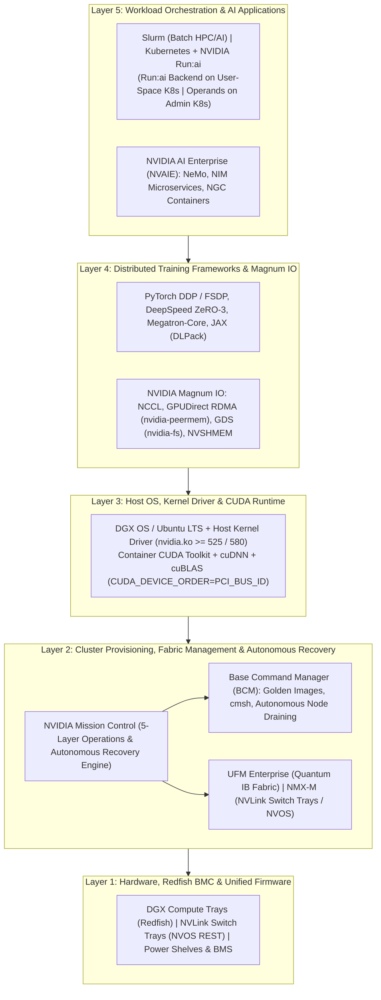

# 9.12 Software stack and management in an AI factory

| | |
|---|---|
| **Status** | Drafted (`ai_factory_software_lab.py`: 26 checks pass; cluster commands **untested** on live SuperPOD) |
| **Level** | Intermediate |
| **Priority tier** | 1b |
| **Lab venue** | none (design / reading) + self-checking Python model (`code/part09/ai_factory_software_lab.py`) |
| **Part** | Part 9: NVIDIA systems and reference architectures |
| **Sources used** | `nvidia-devops` V21 Ch. 6 & Ch. 10; `nvidia-devops-legacy-v10` Ch. 1; *NVIDIA Base Command Manager 11 Administrator Manual* (`bcm11-admin`) §3.16, §6.5, §9, §14.5; *NVIDIA DGX SuperPOD Reference Architecture Featuring NVIDIA DGX GB300 Systems* (`superpod-gb300-ra`, pp. 13–14, 32–34) |

## Why this matters for AI infrastructure

An AI factory of 128 or 9,216 GPUs with liquid cooling and 800 Gbps InfiniBand is inert silicon until the **software stack** binds it into a single coherent machine. If a data scientist launches a standard single-process Python script on a $50 million cluster, it runs on one CPU core and leaves 99.9% of the factory idle. Worse, if one node in a 64-node training job boots with a slightly older NVIDIA kernel driver, an inconsistent PCIe device ordering (`CUDA_DEVICE_ORDER`), or a plain Kubernetes `Job` that schedules 63 of 64 pods and waits forever for the 64th, the entire cluster hangs until `NCCL operation timed out` kills the job 30 minutes later.

Operating an AI factory requires mastering **five interlocking software layers**:
1. **Cluster Provisioning, Firmware & Fabric Management (`NVIDIA Mission Control`, `BCM`, `UFM Enterprise`, `NMX-M`):** Ensuring every compute tray, NVLink switch tray, and InfiniBand switch boots from an identical golden image and firmware matrix, with automated node draining and self-healing.
2. **Host Kernel Driver & Containerized CUDA Runtime Alignment (`NGC`, Minor-Version Compatibility):** Matching the host OS `nvidia.ko` driver branch (`≥ 450` for CUDA 11.x, `≥ 525` for CUDA 12.x, `≥ 580` for CUDA 13.x) to the CUDA toolkit, `cuDNN`, and `NCCL` bundled inside pre-validated **NVIDIA NGC** containers.
3. **Distributed Framework & Memory Sharding (`PyTorch DDP`, `DeepSpeed ZeRO-1/2/3`, `Megatron-Core`, `DLPack`):** Sharding model weights, gradients, and Adam optimizer states across `WORLD_SIZE` ranks (`RANK`, `LOCAL_RANK`) via `torchrun`.
4. **Gang-Scheduled Workload Orchestration (`Slurm`, `Kubernetes PyTorchJob / Kueue / Volcano`, `NVIDIA Run:ai`):** Guaranteeing that all `N` ranks of a multi-node job are placed and started simultaneously.
5. **SLO-Driven Observability & Incident Response (`DCGM`, `Prometheus`, `Grafana`, Playbooks):** Scraping real hardware utilization (`DCGM_FI_PROF_SM_ACTIVE`, `DCGM_FI_PROF_PIPE_TENSOR_ACTIVE`) and paging on-call engineers before thermal slowdown or stragglers breach business SLAs.

:::info Corpus scope note
Standalone *NVIDIA Mission Control Administration Manual* and *NVIDIA AI Enterprise (NVAIE) Sizing & Licensing Guide* PDFs are not in `~/Desktop/books-toon-rag/`. The software stack integration rules, CUDA compatibility boundaries, `torchrun` DDP and DeepSpeed `ZeRO-3` configurations, Kubernetes `Indexed` Job vs gang-scheduling patterns, and Prometheus/DCGM SLO alerting rules in this chapter are drawn from `nvidia-devops` Volume 21 Chapters 6 and 10, `nvidia-devops-legacy-v10` Chapter 1, `superpod-gb300-ra` (pp. 13–14, 32–34), and `bcm11-admin` (Sections 3.16, 6.5, 9, and 14.5).
:::

## Prerequisites and outcomes

**Prerequisites:**
- Chapters `8.1`, `8.4`, `8.8`, `8.9`, and `8.16` (Base Command Manager provisioning, Slurm/Kubernetes integration, and Mission Control concepts).
- Chapters `9.6` and `9.8` (SuperPOD fabrics and GB300 reference architecture).

**Outcomes:** After completing this chapter, you will be able to:
1. Map the **five-layer AI factory software stack** from bare-metal `BCM` golden images, `UFM`, and `NMX-M` up through `NVIDIA Mission Control`, `Magnum IO`, `NVAIE`, `Slurm`, and `NVIDIA Run:ai`.
2. Verify **CUDA minor-version compatibility** between host kernel drivers and NGC container toolkits (`CUDA 11.x ≥ 450`, `CUDA 12.x ≥ 525`, `CUDA 13.x ≥ 580`), and configure `CUDA_DEVICE_ORDER=PCI_BUS_ID` and `PYTORCH_CUDA_ALLOC_CONF=expandable_segments:True`.
3. Calculate per-GPU model-state memory across **vanilla DDP (`Stage 0`, `16 B/param`)**, **`ZeRO-1`**, **`ZeRO-2`**, and **`ZeRO-3` (`16 B/param / WORLD_SIZE`)**, configure `torchrun` rendezvous, and use **`DLPack`** for zero-copy GPU tensor sharing between PyTorch and JAX.
4. Contrast a plain Kubernetes `Indexed` `Job` + headless `Service` against true **gang schedulers** (`Kueue`, `Volcano`, `PyTorchJob`, `Run:ai`), and implement the **five SLO-driven Prometheus/DCGM alert rules** and **3-phase GPU failure incident response playbook**.

---

## Concepts: basics → intermediate → advanced

## 1. The AI factory software pyramid: from BCM and fabric managers to Mission Control

Think of an AI factory's software stack like a symphony orchestra:
- **The instrument tuners (`BCM` + `cm-nvfwupd`):** Ensure every violin and cello (`compute tray` and `NVSwitch tray`) is tuned to the exact same pitch (`golden OS image` and `firmware bundle`) before the concert begins.
- **The section principals (`UFM Enterprise` + `NMX-M`):** Manage the InfiniBand and NVLink sections so messages flow without collisions.
- **The conductor (`NVIDIA Mission Control` + `Slurm` / `Run:ai`):** Assigns every musician their seat (`RANK` and `LOCAL_RANK`), starts the piece on the exact same downbeat (`gang scheduling`), and swaps in a reserve player (`autonomous recovery` + `in-memory checkpointing`) if a string snaps mid-performance.



### 1.1 How `Mission Control`, `BCM`, `UFM`, `NMX-M`, and `Run:ai` divide responsibilities

In a modern SuperPOD (such as the `DGX GB300 SuperPOD` covered in Chapter `9.8`), six infrastructure management platforms cooperate without overlapping:
1. **NVIDIA Base Command Manager (`BCM`):** The bare-metal foundation (`CMDaemon` + `cmsh`). Provisions compute nodes from immutable **golden software images** (`/cm/images/<image>`), tracks physical rack and chassis slot coordinates (`rackposition`, `chassisposition`), flashes compute-tray and switch-tray firmware via `cm-nvfwupd` (`2.1.2`), and executes **autonomous hardware/job recovery** (using the `draining` action and `autonomous_Default` profile to cordon unhealthy nodes and requeue interrupted jobs; see chapters `8.5` and `8.16`).
2. **NVIDIA Unified Fabric Manager (`UFM Enterprise`):** Appliance that manages the scale-out **Compute InfiniBand Fabric** (`Quantum-2` NDR or `Quantum-X800 Q3400-RD` XDR), configuring Subnet Manager partitions, Adaptive Routing (`AR`), `SHARPv3` trees, `SHIELD` self-healing, and predictive cable/transceiver failure analytics.
3. **NVIDIA Network Manager eXperience (`NMX-M`):** Manages the scale-up **Multi-Node NVLink (`MN-NVL`)** switch trays (`NVOS`), providing real-time NVLink telemetry and partition control across the 72-GPU rack domain.
4. **NVIDIA Mission Control:** The unified 5-layer operations umbrella built on top of BCM, UFM, NMX-M, and the facility Building Management System (`BMS`), delivering **automated failure detection & self-recovery**, **workload migration**, **unified infrastructure + application diagnostics**, and **in-memory checkpointing**.
5. **Slurm and NVIDIA Run:ai:** Provide the two workload scheduling paradigms—**Slurm** for batch multi-node training and **NVIDIA Run:ai** for cloud-native Kubernetes GPU orchestration (with the **Run:ai control plane** on the **user-space Kubernetes cluster** and **Run:ai cluster operands** on the **administrative Kubernetes infrastructure**).
6. **NVIDIA AI Enterprise (`NVAIE`) & NGC:** Provides the commercial enterprise support boundary, pre-tested **NGC** framework containers (`nvcr.io/nvidia/pytorch:*`), **NeMo / Megatron-Core** for 3D-parallel training, and **NVIDIA NIM** microservices for production inference.

:::tip In one minute
- **`BCM`** owns bare-metal golden-image provisioning, rack/chassis inventory, firmware flashing (`cm-nvfwupd`), and node draining; **`UFM Enterprise`** owns the InfiniBand fabric; **`NMX-M`** owns the NVLink switch trays; and **`NVIDIA Mission Control`** unifies them with BMS telemetry, autonomous recovery, and in-memory checkpointing.
- Workload scheduling runs through **Slurm** (batch HPC/training) and **NVIDIA Run:ai** (Kubernetes dynamic scheduling, split across user-space K8s and administrative K8s).
:::

---

## 2. Host driver vs container CUDA alignment and runtime memory hygiene

When a container starts on a GPU node, two separate pieces of NVIDIA software must shake hands across the container boundary:
1. **The Host Kernel Driver (`nvidia.ko`, installed in the host OS / BCM golden image):** Talks directly to the physical GPU hardware and sets the **maximum CUDA version** the node can support (`nvidia-smi` top-right banner).
2. **The User-Space CUDA Runtime & Libraries (`libcudart.so`, `cuBLAS`, `cuDNN`, `NCCL`, bundled inside the container image):** Linked directly by PyTorch or JAX inside the container.

### 2.1 CUDA minor-version compatibility rules (`CUDA 11.x`, `12.x`, `13.x`)

Historically, upgrading the CUDA toolkit inside a container required immediately upgrading the kernel driver on every host in the cluster. Modern CUDA releases use **minor-version compatibility** (`verify_cuda_driver_compatibility()` in `code/part09/ai_factory_software.py`):
- **Within a single CUDA major family (`11.x`, `12.x`, or `13.x`), any CUDA toolkit minor version can run on a host driver at or above that major family's minimum driver branch** (with minor feature restrictions for features introduced in newer driver branches):
  - **CUDA `11.x` containers:** require host driver branch **`≥ 450`** (and `< 525` if not using cross-major compat).
  - **CUDA `12.x` containers:** require host driver branch **`≥ 525`** (for example, a CUDA `12.6` NGC container runs cleanly on a host running driver branch `535` or `550`).
  - **CUDA `13.x` containers:** require host driver branch **`≥ 580`**.
- **Across CUDA major versions:** Jumping from CUDA `11.x` to `12.x` or from `12.x` to `13.x` requires upgrading the host kernel driver to at least the new major family's minimum branch (or installing NVIDIA's explicit CUDA forward-compatibility user-space driver package).
- **The Fleet Homogeneity Rule:** Every node participating in a distributed training job **must run the exact same NGC container image digest and the exact same host driver branch**. Never mix driver branches or NCCL versions across ranks in the same communicator.

### 2.2 Three mandatory CUDA / PyTorch runtime settings for multi-GPU nodes

Before calling any CUDA API in a distributed training script, enforce three runtime rules (`nvidia-devops` Volume 21 Chapter 6 Part 1.2):
1. **Consistent device ordering (`CUDA_DEVICE_ORDER="PCI_BUS_ID"`):** By default, CUDA orders GPUs by a heuristic (`FASTEST_FIRST`), which can differ from the physical PCIe bus order shown in `nvidia-smi` and `nvidia-smi topo -m`. Always set `export CUDA_DEVICE_ORDER=PCI_BUS_ID` so `LOCAL_RANK 0..7` maps deterministically to physical `GPU 0..7` and its `PIX`-paired `mlx5_0..7` NIC.
2. **Preventing caching-allocator fragmentation (`PYTORCH_CUDA_ALLOC_CONF="expandable_segments:True"`):** Set `export PYTORCH_CUDA_ALLOC_CONF=expandable_segments:True` (or `max_split_size_mb:256,backend:cudaMallocAsync` for variable-shape MoE workloads) *before* the first CUDA allocation so PyTorch's caching allocator can expand existing virtual memory segments instead of throwing `OutOfMemoryError` when total free HBM is fragmented. (Remember that `torch.cuda.memory_reserved()` reports total memory held by the caching allocator, whereas `torch.cuda.memory_allocated()` reports memory actively occupied by tensors.)
3. **Never set `CUDA_LAUNCH_BLOCKING=1` in production:** Setting `CUDA_LAUNCH_BLOCKING=1` forces the CPU to block synchronously after every single CUDA kernel launch—destroying CPU–GPU pipelining and CUDA Graph capture. Leave `CUDA_LAUNCH_BLOCKING=0` in production (use `1` only when pinpointing the exact line of a synchronous kernel crash on a dev box).

:::tip In one minute
- **CUDA minor-version compatibility** lets any container within a CUDA major version run on a host driver meeting that family's minimum branch (**`CUDA 11.x ≥ 450`**, **`CUDA 12.x ≥ 525`**, **`CUDA 13.x ≥ 580`**).
- Always pin an identical **NGC container image** and **host driver branch** across every node, set **`CUDA_DEVICE_ORDER=PCI_BUS_ID`** and **`PYTORCH_CUDA_ALLOC_CONF=expandable_segments:True`**, and keep **`CUDA_LAUNCH_BLOCKING=0`** in production.
:::

---

## 3. Distributed training glue: `torchrun` DDP, DeepSpeed `ZeRO-1/2/3` memory math, and `DLPack`

### 3.1 How `torchrun` initializes `RANK`, `LOCAL_RANK`, and `WORLD_SIZE`

When you launch a 64-GPU training job across 8 nodes (`8 GPUs/node`), you do not SSH into 8 servers and start 64 Python processes by hand, nor do you use the deprecated `torch.distributed.launch` utility. You use **`torchrun`** with the `c10d` rendezvous backend:

```bash
# Executed on each of the 8 nodes (or launched across all 8 via Slurm srun / K8s PyTorchJob)
torchrun \
  --nproc_per_node=8 \
  --nnodes=8 \
  --rdzv_id=job_42 \
  --rdzv_backend=c10d \
  --rdzv_endpoint=node001:29500 \
  train_script.py
```

`torchrun` spawns 8 worker processes per node (`64` processes total) and injects three environment variables into each worker:
- **`WORLD_SIZE` (`64`):** Total number of GPU processes across the job.
- **`RANK` (`0` to `63`):** Global process index across the entire cluster (`Rank 0` handles logging and coordinator tasks).
- **`LOCAL_RANK` (`0` to `7`):** Process index on the local server. The script calls `torch.cuda.set_device(local_rank)` so each worker binds exclusively to its own physical GPU (`GPU 0..7`) before calling `dist.init_process_group(backend="nccl", timeout=timedelta(minutes=30))`.

### 3.2 Vanilla DDP (`Stage 0`) vs DeepSpeed `ZeRO Stage 1, 2, and 3` memory math

Why can't vanilla PyTorch `DistributedDataParallel` (`DDP`) train a 70B-parameter model on 80 GB H100 GPUs?
Recall from Chapter `9.6` that mixed-precision AdamW training stores **16 bytes per parameter** of model state:
- **BF16 model weights:** `2 bytes/param` (`70B × 2 B = 140 GB`)
- **BF16 gradients:** `2 bytes/param` (`70B × 2 B = 140 GB`)
- **FP32 master weights (`4 B`) + FP32 Adam momentum `m` (`4 B`) + FP32 Adam variance `v` (`4 B`):** `12 bytes/param` (`70B × 12 B = 840 GB`)
- **Total unsharded model state:** **`16 bytes/param` = `1,120 GB`**.

Vanilla **DDP (`Stage 0`)** replicates all `1,120 GB` on *every single GPU*, causing an instant Out-Of-Memory (`OOM`) crash on an 80 GB H100. **DeepSpeed ZeRO** (and PyTorch **FSDP**) eliminates that redundancy by sharding the model state across all `W = WORLD_SIZE` data-parallel ranks (`calculate_zero_stage_memory_per_gpu()` in `code/part09/ai_factory_software.py`, where combining the `2 + 2 + 12 = 16 B/param` breakdown with the `ZeRO-1/2/3` sharding formulas is **my inference**):

| Sharding Stage | What is Replicated vs Sharded Across `W` GPUs | Per-GPU Model-State Formula (`GB`) | 70B Model across `W = 64` GPUs (`80 GB` H100s) |
|---|---|---|---|
| **DDP (`ZeRO-0`)** | Replicates **Weights (`2B`) + Gradients (`2B`) + Optimizer (`12B`)** on every GPU | `16 × P` | **`1,120.00 GB / GPU`** *(OOM on 80 GB H100.)* |
| **`ZeRO Stage 1`** | Shards **Optimizer states (`12B / W`)**; replicates Weights + Gradients | `4 × P + (12 × P) / W` | `140 + 140 + (840 / 64)` = **`293.12 GB / GPU`** *(OOM on 80 GB)* |
| **`ZeRO Stage 2`** | Shards **Optimizer + Gradients (`14B / W`)**; replicates Weights | `2 × P + (14 × P) / W` | `140 + (980 / 64)` = **`155.31 GB / GPU`** *(OOM on 80 GB)* |
| **`ZeRO Stage 3` / `FSDP`** | Shards **Weights + Gradients + Optimizer (`16B / W`)** across all `W` GPUs | `(16 × P) / W` | `1,120 / 64` = **`17.50 GB / GPU`** *(Fits easily in 80 GB with 62.5 GB left for activations & batches.)* |

Also note how DeepSpeed computes the **Effective Global Batch Size**:
```text
Global_Batch_Size = train_micro_batch_size_per_gpu × gradient_accumulation_steps × world_size
Example (64 GPUs): 4 (micro-batch) × 8 (grad_accum) × 64 (world_size) = 2,048 sequences per step
```

### 3.3 Zero-copy PyTorch ↔ JAX tensor sharing with `DLPack`

If a pipeline combines PyTorch data preprocessing with JAX/XLA model execution on the same GPU, **never convert GPU tensors via `.cpu().numpy()`**, which forces an expensive Device-to-Host and Host-to-Device PCIe copy round-trip. Instead, pass GPU memory pointers directly across frameworks with zero copies using **`DLPack`** (`torch.utils.dlpack.to_dlpack(t)` / `jax.dlpack.from_dlpack(dlpack_capsule)` or the native `__dlpack__` protocol).

:::tip In one minute
- Launch multi-node jobs with **`torchrun --rdzv_backend=c10d`** (never deprecated `torch.distributed.launch`); each worker binds to `LOCAL_RANK` (`0..7`) before initializing `nccl`.
- For a 70B model (`1,120 GB` active AdamW state at `16 B/param`) across **64 GPUs**, **`ZeRO Stage 3` / `FSDP`** cuts per-GPU model state from **`1,120 GB` (`DDP`)** down to **`17.50 GB / GPU`** (`1,120 / 64`).
- Use **`DLPack`** for zero-copy in-VRAM tensor handoffs between PyTorch and JAX.
:::

---

## 4. Kubernetes distributed training orchestration and why gang scheduling is mandatory

How do you launch an 8-node (`64-GPU`) `torchrun` job on Kubernetes so that each pod gets all 8 GPUs of one node, knows its node rank (`0..7`), and resolves `Rank 0`'s hostname for `c10d` rendezvous?

### 4.1 Anatomy of an `Indexed` Job + Headless `Service`—and its fatal flaw without Gang Scheduling

In Kubernetes (`nvidia-devops` Volume 21 Chapter 6 Part 3.2), the low-level building blocks for a multi-node job are:
1. **A Headless `Service` (`clusterIP: None`):** Creates predictable DNS A-records for every pod matching the job selector (`<job-name>-<index>.<service-name>`, so Pod 0 resolves at `llama-70b-training-0.llama-train`).
2. **An `Indexed` `Job` (`completionMode: Indexed`, `parallelism: 8`, `completions: 8`):** Injects `JOB_COMPLETION_INDEX` (`0..7`) into each pod, which you pass to `torchrun --node_rank=$JOB_COMPLETION_INDEX --master_addr=llama-70b-training-0.llama-train`.
3. **`podAntiAffinity` + `nvidia.com/gpu: 8`:** Ensures each pod claims an entire 8-GPU node (`1 pod per node`) alongside RDMA/InfiniBand devices injected by the **NVIDIA Network Operator**.

**Why a plain Kubernetes `Indexed` `Job` fails in multi-tenant production:**
The default Kubernetes `kube-scheduler` places pods **one by one**, not as an all-or-nothing group. Suppose two researchers submit 8-node (`64-GPU`) plain `Indexed` Jobs at the same time to an 8-node cluster:
- Job A gets **4 nodes** (`32 GPUs`) and starts `torchrun` on ranks `0..3`.
- Job B gets the other **4 nodes** (`32 GPUs`) and starts `torchrun` on ranks `0..3`.
- **Deadlock.** Neither job can ever place its remaining 4 pods. Both jobs sit burning 100% of the cluster's 64 GPUs doing zero useful work for 30 minutes until `NCCL` / `c10d` rendezvous times out.

To prevent partial-placement deadlocks, production AI factories **never** submit multi-node jobs as bare Kubernetes Jobs—they enforce **Gang Scheduling** (all-or-nothing pod admission) using **Kueue**, **Volcano**, the **Kubeflow Training Operator (`PyTorchJob`)**, or **NVIDIA Run:ai** (or run batch training on **Slurm**, which gang-schedules nodes natively).

:::tip In one minute
- On Kubernetes, multi-node `torchrun` jobs use a **Headless `Service` (`clusterIP: None`)** for pod DNS discovery (`<job>-0.<svc>`), `JOB_COMPLETION_INDEX` for `--node_rank`, and **`nvidia.com/gpu: 8`** with **NVIDIA Network Operator** RDMA access.
- Always pair Kubernetes training workloads with a **Gang Scheduler (`Kueue`, `Volcano`, `PyTorchJob`, or `NVIDIA Run:ai`)** so partial pod placements never deadlock the cluster until rendezvous timeout.
:::

---

## 5. AI factory observability, SLO-driven alerting, and incident response playbooks

In a 1,000-GPU AI factory, waiting for a data scientist to message you on Slack that *"training feels slow today"* means your SLA is already breached.

### 5.1 What to scrape in Prometheus (and why `DCGM_FI_DEV_GPU_UTIL` is not enough)

As detailed in `nvidia-devops` Volume 21 Chapter 10, a production AI factory Prometheus server scrapes four exporter tiers at matched intervals:
1. **`nvidia-dcgm` (`dcgm-exporter:9400`, scraped every `10s`):**
   - **Why `DCGM_FI_DEV_GPU_UTIL` (`nvidia-smi` GPU-Util) is misleading:** It reports the percentage of time *at least one* warp was active on *any* SM—so a GPU stalled on a slow PCIe transfer or single-warp kernel can report `100%` utilization while doing almost no math.
   - **What to track instead:** Track **`DCGM_FI_PROF_SM_ACTIVE`** (fraction of SMs actively executing warps) and **`DCGM_FI_PROF_PIPE_TENSOR_ACTIVE`** (fraction of cycles the Tensor Core math pipes are active), alongside **`DCGM_FI_DEV_GPU_TEMP`**, **`DCGM_FI_DEV_POWER_USAGE`**, **`DCGM_FI_DEV_SM_CLOCK`**, and **`DCGM_FI_DEV_XID_ERRORS`**.
2. **`training-app` / `inference-app` (`:8000`, scraped every `10s`):** Application-level `training_throughput_tokens_per_sec`, `training_loss`, exposed `AllReduce` latency, and inference `TTFT` / `ITL` percentiles.
3. **`gpu-nodes` (`node_exporter:9100`, scraped every `30s`):** Host CPU, DDR5/LPDDR5X memory, `/dev/shm`, and NVMe `/raid` I/O latency.
4. **`infiniband` (`ib-exporter:9600` / `UFM`, scraped every `60s`):** Port link state, `SymbolErrorCounter`, `PortXmitWait`, and RoCE PFC/ECN counters.

### 5.2 The five SLO-driven Prometheus alerting rules

Tie every paging alert directly to an SLO breach or hardware degradation signature and include a `runbook` annotation (`evaluate_ai_factory_slo_alerts()` in `code/part09/ai_factory_software.py`):

| Alert Name | PromQL Condition (`V21 Ch. 10`) | Duration (`for:`) | Operational Meaning & Runbook Action |
|---|---|---|---|
| **1. `TrainingThroughputLow`** | `training_throughput_tokens_per_sec < 0.9 * <baseline>` | `5m` | Throughput dropped **> 10% below baseline**. Check SM activity, exposed `AllReduce` time, straggler clocks, and IB congestion. |
| **2. `GPUTemperatureHigh`** | `DCGM_FI_DEV_GPU_TEMP > 80` *(or model slowdown temp)* | `1m` | GPU approaching thermal slowdown. Check `nvidia-smi -q -d PERFORMANCE` throttle reasons, cold-aisle temp, blanking panels, and CDU flow. |
| **3. `InferenceLatencyP99High`** | `inference_latency_p99_ms > 500` | `3m` | P99 Time to First Token (`TTFT`) breached the **500 ms SLA**. Check regional QPS load, KV-cache pressure, and scale up inference replicas. |
| **4. `GPUFailureDetected`** | `increase(gpu_failure_count[10m]) > 0` *(or `DCGM_FI_DEV_XID_ERRORS`)* | Immediate | Hardware `Xid` fault or fallen-off-the-bus GPU detected. Trigger the **3-Phase GPU Failure Playbook** below. |
| **5. `CostAnomalyDetected`** | `(cluster_power_kw - cluster_power_kw_avg_7d) / cluster_power_kw_avg_7d > 0.3` | `10m` | Cluster power draw is **> 30% above its 7-day average**. Audit for runaway/zombie training jobs or hung spin-wait loops. |

### 5.3 The three-phase GPU failure incident response playbook (`5 min → 15 min → 30–60 min`)

When `GPUFailureDetected` pages on-call during a 64-GPU training run (or when `Mission Control` / `BCM` executes this sequence autonomously):
1. **Phase 1 — Initial Response (`≤ 5 minutes`):**
   - Confirm the GPU fault via `nvidia-smi` / `dmesg` (`Xid`) / DCGM health watch.
   - Identify whether the affected node is running **batch training** or **online inference** (inference traffic fails over automatically to `N+1` replicas with zero user impact).
   - **Terminate/drain the hung training job immediately** so the other 63 healthy GPUs do not sit burning electricity waiting on a dead rank (`1` dead GPU stalls `64/64` GPUs in synchronous training.).
2. **Phase 2 — Mitigation (`≤ 15 minutes`):**
   - Attempt an automated node reset (GPU reset, OS reboot, or Redfish power cycle).
   - **If reset succeeds and `dcgmi diag -r 2` passes:** Resume training from the most recent sharded checkpoint.
   - **If reset fails:** Cordon/drain the faulty node (`cmsh` `drain` / `scontrol update State=DRAIN` / `kubectl cordon`), allocate a spare node from the pool, and resume training from the last checkpoint.
3. **Phase 3 — Recovery & Post-Incident (`30–60 minutes`):**
   - Collect `nvidia-bug-report.sh` / `nvsm dump health` + BMC logs and dispatch an OEM/NVIDIA hardware RMA for the cordoned node.
   - Total lost training work is bounded strictly by your **checkpoint interval + 15-minute mitigation time**.

:::tip In one minute
- Track **`DCGM_FI_PROF_SM_ACTIVE`** and **`DCGM_FI_PROF_PIPE_TENSOR_ACTIVE`** (scraped every `10s` from `dcgm-exporter:9400`) instead of relying on `nvidia-smi` `GPU-Util` alone.
- Configure the **5 SLO alerts**: `TrainingThroughputLow` (`< 90%` baseline for `5m`), `GPUTemperatureHigh` (`> 80°C` for `1m`), `InferenceLatencyP99High` (`> 500 ms` for `3m`), `GPUFailureDetected` (`> 0` in `10m`), and `CostAnomalyDetected` (`> +30%` power vs 7d avg for `10m`).
- Follow the **3-phase GPU failure playbook**: **5 min** (confirm fault & stop stalled synchronous job), **15 min** (reboot or swap to spare node & resume from checkpoint), **30–60 min** (RMA faulty node).
:::

---

## Commands and configurations that matter

### 1. Verify host driver, container CUDA, PyTorch, NCCL, and NVLink P2P alignment

```bash
# 1. Inspect host kernel driver version and maximum supported CUDA version
nvidia-smi

# 2. Inside the NGC container: verify bundled CUDA, NCCL, and peer-to-peer (P2P) access across all 8 GPUs
python3 -c '
import os, torch
os.environ.setdefault("CUDA_DEVICE_ORDER", "PCI_BUS_ID")
os.environ.setdefault("PYTORCH_CUDA_ALLOC_CONF", "expandable_segments:True")
print("PyTorch:", torch.__version__, "| CUDA:", torch.version.cuda, "| NCCL:", torch.cuda.nccl.version())
n = torch.cuda.device_count()
p2p_ok = all(torch.cuda.can_device_access_peer(i, j) for i in range(n) for j in range(n) if i != j)
print(f"GPUs visible: {n} | Full all-to-all P2P access: {p2p_ok}")
'
```

### 2. Production `DeepSpeed ZeRO Stage 3` configuration (`ds_config.json`)

```json
{
  "train_micro_batch_size_per_gpu": 4,
  "gradient_accumulation_steps": 8,
  "bf16": { "enabled": true },
  "optimizer": {
    "type": "AdamW",
    "params": { "lr": 1e-4, "betas": [0.9, 0.999], "eps": 1e-8, "weight_decay": 0.01 }
  },
  "zero_optimization": {
    "stage": 3,
    "reduce_scatter": true,
    "contiguous_gradients": true
  },
  "gradient_clipping": 1.0
}
```

### 3. Run the 26-check AI Factory Software Stack & SLO Alerting verifier

```bash
python3 -B code/part09/ai_factory_software_lab.py
```

---

## How it fails

| Failure mode | Symptom | Root cause | Diagnosis & fix |
|---|---|---|---|
| **1. `RuntimeError: NCCL operation timed out` at job startup on Kubernetes** | A multi-node training job starts 6 of its 8 pods, sits at `0%` GPU compute for 30 minutes, and crashes with `NCCL operation timed out` during `dist.init_process_group()`. | Either the job was submitted as a **plain Kubernetes `Indexed` `Job` without a gang scheduler** (so 2 pods stayed `Pending` for lack of resources while 6 pods waited at the `c10d` barrier), or `MASTER_ADDR` DNS (`<job>-0.<headless-svc>`) failed to resolve. | Always schedule multi-node Kubernetes jobs through a **Gang Scheduler (`Kueue`, `Volcano`, `PyTorchJob`, or `NVIDIA Run:ai`)** so 0 pods start until all 8 nodes are reserved, and verify headless Service DNS resolution for `MASTER_ADDR`. |
| **2. Cross-major CUDA container failure (`cudaErrorInsufficientDriver`)** | Launching a new NGC PyTorch container built on **CUDA `12.6`** (or `13.0`) fails immediately with `Error 35: CUDA driver version is insufficient for CUDA runtime version`. | The host OS kernel driver is on a legacy branch (e.g., `470.xx` for CUDA 11.x, or `535.xx` when running a CUDA 13.x container that requires **`≥ 580`**). Minor-version compatibility only works *within* the same CUDA major version (`12.x ≥ 525`, `13.x ≥ 580`). | Upgrade the BCM golden software image's host NVIDIA driver branch (`≥ 525` for CUDA 12.x; `≥ 580` for CUDA 13.x) via `cm-chroot-sw-img` + `createramdisk`, or select the NGC container tag matching your validated host driver branch. |
| **3. Wrong GPU-to-NIC pairing because `CUDA_DEVICE_ORDER` was unset** | `nvidia-smi topo -m` shows `GPU 0` is `PIX` to `mlx5_0`, yet when `LOCAL_RANK 0` runs, NCCL routes traffic across the CPU (`NODE` / `SYS`). | Without `export CUDA_DEVICE_ORDER=PCI_BUS_ID`, the CUDA runtime ordered device ordinals using `FASTEST_FIRST`, which did not match the PCIe bus order used by `nvidia-smi` and the launcher's NIC binding script. | Set **`export CUDA_DEVICE_ORDER=PCI_BUS_ID`** globally in the container environment before initializing PyTorch or CUDA. |
| **4. 10× slower throughput after setting `CUDA_LAUNCH_BLOCKING=1`** | A developer sets `CUDA_LAUNCH_BLOCKING=1` in a production training script thinking it helps CUDA Graphs or determinism, and step time slows down by 5× to 10×. | `CUDA_LAUNCH_BLOCKING=1` disables asynchronous kernel launches, forcing the CPU to wait for each GPU kernel to finish before launching the next one and breaking CUDA Graph capture. | Keep **`CUDA_LAUNCH_BLOCKING=0`** in production; enable CUDA Graphs via `torch.cuda.CUDAGraph()` or `torch.compile(mode="reduce-overhead")`. |
| **5. False-green `99% GPU-Util` while training throughput drops by 50%** | Grafana shows `DCGM_FI_DEV_GPU_UTIL` at `99%`, so no utilization alert fires, even though `tokens/sec` dropped from `60,000` to `28,000` due to a network straggler. | `DCGM_FI_DEV_GPU_UTIL` (`nvidia-smi` GPU-Util) only measures whether *any* warp is resident on the GPU (including a single NCCL polling kernel spinning while waiting on a slow link). | Alert directly on **application `training_throughput_tokens_per_sec < 0.9 * baseline`** (`TrainingThroughputLow`) and track **`DCGM_FI_PROF_SM_ACTIVE`** and **`DCGM_FI_PROF_PIPE_TENSOR_ACTIVE`**. |

---

## Hands-on lab

This chapter's self-checking Python model (`code/part09/ai_factory_software.py`) and lab script (`code/part09/ai_factory_software_lab.py`) implement:
1. The **CUDA Toolkit & Host Driver Compatibility Verifier** (`CUDA 11.x ≥ 450`, `CUDA 12.x ≥ 525`, `CUDA 13.x ≥ 580`, plus fleet-wide container/driver homogeneity checks).
2. The **DDP (`Stage 0`) vs DeepSpeed `ZeRO Stage 1, 2, and 3` Memory & Global Batch Calculator** (`70B` model across `64 GPUs`: `1,120.0 GB` on `Stage 0`, `293.12 GB` on `Stage 1`, `155.31 GB` on `Stage 2`, and `17.50 GB` on `Stage 3`, with `4 × 8 × 64 = 2,048` global batch size).
3. The **Distributed Training Runtime & Gang-Scheduling Auditor** (`CUDA_DEVICE_ORDER=PCI_BUS_ID`, `CUDA_LAUNCH_BLOCKING=0`, `torchrun` vs deprecated `torch.distributed.launch`, `DLPack` vs `.numpy()` host copies, and gang-scheduled K8s jobs).
4. The **Five-Rule AI Factory SLO Alerting Engine** (`TrainingThroughputLow`, `GPUTemperatureHigh`, `InferenceLatencyP99High`, `GPUFailureDetected`, and `CostAnomalyDetected`).

Run the lab from the repository root:

```bash
python3 -B code/part09/ai_factory_software_lab.py
```

Expected output (verified in this repository):

```text
=== Chapter 9.12 Lab: Software Stack & Management in an AI Factory ===
  [PASS] CUDA 12.x container on host driver 550 (>=525) is compatible via minor-version compatibility
  [PASS] CUDA 13.x container on host driver 580 (>=580) is compatible
  [PASS] CUDA 12.x container on legacy 470 driver (<525) is rejected (host_driver_too_old)
  [PASS] V21 Ch6: Flags mismatched container image or driver branch across cluster nodes
  [PASS] Rejects unsupported CUDA major version
  [PASS] 70B unsharded DDP (Stage 0) requires 1,120.0 GB per GPU; global batch (4*8*64) == 2,048
  [PASS] 70B ZeRO-1 across 64 GPUs (shards 840 GB optimizer) requires 140 + 140 + 13.125 == 293.12 GB/GPU
  [PASS] 70B ZeRO-2 across 64 GPUs (shards optimizer + grads) requires 140 + (980/64) == 155.31 GB/GPU
  [PASS] 70B ZeRO-3 across 64 GPUs (shards weights + grads + optimizer) requires 1120 / 64 == 17.50 GB/GPU
  ...
  [PASS] V21 Ch10: GPU failure / Xid increase > 0 in 10m fires GPUFailureDetected
  [PASS] V21 Ch10: Cluster power > 30% above 7-day average fires CostAnomalyDetected
  [PASS] Simultaneous degradation across all 5 SLO metrics fires all 5 alerts
  [PASS] CUDA 11.x container on host driver 470 (>=450) is compatible
  [PASS] K8s Indexed Job paired with Kueue/Volcano gang scheduler passes runtime audit

Summary: 26 passed, 0 failed (total 26)
```

---

## Exercises

1. Run `python3 -B code/part09/ai_factory_software_lab.py`. Recompute the per-GPU model-state memory of a 13B model across 16 GPUs for ZeRO-0, 1, 2 and 3, using `16 B/param`. Which stages fit on an 80 GB GPU?
2. A node has driver 535 and a teammate wants to run an NGC container built on CUDA 13.0. Write the check you would run, what you expect, and the two ways to fix it.
3. Write the `torchrun` command for 4 nodes with 8 GPUs each and explain what `WORLD_SIZE`, `RANK` and `LOCAL_RANK` will be for the process that controls GPU 3 on node 2.
4. Two 4-node jobs are submitted to a 4-node cluster as plain Kubernetes Jobs. Draw what happens, and then draw it again with a gang scheduler.
5. Write the five alert rules from section 5.2 with your own thresholds for a cluster whose baseline throughput is 50,000 tokens/s. Add a runbook line to each.
6. List what you do in the first 5, 15 and 60 minutes after a GPU falls off the bus in the middle of a 64-GPU job.

## Checkpoint questions (20)

<details>
<summary><strong>1. How do `BCM`, `UFM Enterprise`, `NMX-M`, and `NVIDIA Mission Control` divide management responsibilities inside a DGX SuperPOD?</strong></summary>

- **`BCM` (Base Command Manager):** Provisions bare-metal compute nodes from golden OS images, manages rack/chassis coordinates, flashes firmware (`cm-nvfwupd`), and executes node draining.
- **`UFM Enterprise`:** Manages the scale-out Quantum InfiniBand compute fabric (`SHARPv3`, Adaptive Routing, `SHIELD`, cable/switch telemetry).
- **`NMX-M` (Network Manager eXperience):** Manages the scale-up NVLink switch trays (`NVOS`).
- **`NVIDIA Mission Control`:** The 5-layer operations platform sitting across BCM, UFM, NMX-M, and the facility BMS to orchestrate autonomous failure recovery, workload migration, unified diagnostics, in-memory checkpointing, and Slurm / Run:ai scheduling.
</details>

<details>
<summary><strong>2. State the minimum host NVIDIA driver branch required for `CUDA 11.x`, `CUDA 12.x`, and `CUDA 13.x` containers, and explain what CUDA minor-version compatibility allows.</strong></summary>

- **`CUDA 11.x`:** Requires host driver **`≥ 450`**.
- **`CUDA 12.x`:** Requires host driver **`≥ 525`**.
- **`CUDA 13.x`:** Requires host driver **`≥ 580`**.
Within a single CUDA major version, **minor-version compatibility** allows newer CUDA toolkit minor versions inside an NGC container (e.g., CUDA `12.6`) to run on an older host driver from the same major family (e.g., driver `535`), whereas crossing major versions (`11.x → 12.x → 13.x`) requires upgrading the host driver.
</details>

<details>
<summary><strong>3. Calculate the per-GPU model-state VRAM required for a 70B parameter model (`16 bytes/param` active AdamW state = `1,120 GB` total) across 64 GPUs under vanilla DDP (`ZeRO-0`), `ZeRO-1`, `ZeRO-2`, and `ZeRO-3`.</strong></summary>

With `2 B` BF16 weights (`140 GB`), `2 B` BF16 gradients (`140 GB`), and `12 B` FP32 master weights + Adam states (`840 GB`):
- **DDP (`ZeRO-0`):** `140 + 140 + 840 = 1,120.00 GB / GPU`.
- **`ZeRO-1` (shards optimizer across 64 GPUs):** `140 + 140 + (840 / 64) = 293.12 GB / GPU`.
- **`ZeRO-2` (shards optimizer + gradients):** `140 + (980 / 64) = 155.31 GB / GPU`.
- **`ZeRO-3` / `FSDP` (shards weights + gradients + optimizer):** `1,120 / 64 = 17.50 GB / GPU`.
</details>

<details>
<summary><strong>4. Why must you set `CUDA_DEVICE_ORDER=PCI_BUS_ID` and `PYTORCH_CUDA_ALLOC_CONF=expandable_segments:True` in multi-GPU training scripts, and why must `CUDA_LAUNCH_BLOCKING` stay at `0`?</strong></summary>

- **`CUDA_DEVICE_ORDER=PCI_BUS_ID`:** Ensures CUDA device ordinals (`0..7`) match the physical PCIe bus order seen by `nvidia-smi topo -m` and NIC-binding scripts (instead of `FASTEST_FIRST`).
- **`PYTORCH_CUDA_ALLOC_CONF=expandable_segments:True`:** Allows the PyTorch caching allocator to expand virtual memory segments on demand, preventing fragmentation-induced OOM errors.
- **`CUDA_LAUNCH_BLOCKING=0`:** Setting it to `1` forces synchronous CPU blocking on every kernel launch, destroying throughput and breaking CUDA Graph capture.
</details>

<details>
<summary><strong>5. How do you transfer a GPU tensor from PyTorch to JAX without copying data through host CPU RAM?</strong></summary>

Use the zero-copy **`DLPack`** protocol (`torch.utils.dlpack.to_dlpack` and `jax.dlpack.from_dlpack`, or the `__dlpack__` protocol), which exchanges the underlying GPU HBM pointer directly in VRAM. Never convert via `.numpy()`, which forces a Device-to-Host copy.
</details>

<details>
<summary><strong>6. Why does a plain Kubernetes `Indexed` `Job` deadlock when two multi-node training jobs contend for a cluster, and what four tools solve this?</strong></summary>

A plain Kubernetes `Job` schedules pods one by one without **gang scheduling** (all-or-nothing placement). If Job A claims half the nodes and Job B claims the other half, both jobs start partial ranks that hang waiting at the `torchrun` / `NCCL` rendezvous barrier until timeout. Production clusters use a gang-scheduling layer—**Kueue**, **Volcano**, the **Kubeflow Training Operator (`PyTorchJob`)**, or **NVIDIA Run:ai**.
</details>

<details>
<summary><strong>7. Why is `DCGM_FI_DEV_GPU_UTIL` (`nvidia-smi` GPU-Util) misleading for detecting training stragglers, and which two DCGM profiling metrics should you track instead?</strong></summary>

`DCGM_FI_DEV_GPU_UTIL` only measures the percentage of time *at least one* warp is active on *any* SM—so a GPU spinning in a single-warp NCCL wait loop reports `100%` utilization while doing zero math. Track **`DCGM_FI_PROF_SM_ACTIVE`** (fraction of SMs with active warps) and **`DCGM_FI_PROF_PIPE_TENSOR_ACTIVE`** (fraction of cycles the Tensor Core pipelines are active), alongside application `tokens/sec`.
</details>

<details>
<summary><strong>8. Walk through the three time-bounded phases of the GPU Failure Incident Response Playbook (`5 min`, `15 min`, `30–60 min`).</strong></summary>

1. **Initial Response (`≤ 5 min`):** Confirm the GPU fault (`Xid` / `nvidia-smi`), check if training or inference is affected, and **terminate the stalled synchronous training job** so the remaining healthy GPUs do not sit blocked.
2. **Mitigation (`≤ 15 min`):** Attempt node/GPU reset; if healthy, resume from the last checkpoint. If the fault persists, **cordon/drain the faulty node**, allocate a spare node, and resume training from the last checkpoint.
3. **Recovery (`30–60 min`):** Collect diagnostic bundles and initiate a hardware RMA for the cordoned node.
</details>

<details>
<summary><strong>9. What are the five layers of the software stack in this chapter?</strong></summary>

Provisioning, firmware and fabric management; host driver and CUDA runtime alignment; distributed frameworks and memory sharding; gang-scheduled orchestration; and observability with incident response.
</details>

<details>
<summary><strong>10. Which tool owns which job: BCM, UFM, NMX-M, Mission Control?</strong></summary>

BCM provisions nodes, tracks racks, flashes firmware and drains nodes. UFM manages the InfiniBand fabric. NMX-M manages the NVLink switches. Mission Control sits above them with BMS data, recovery and checkpointing.
</details>

<details>
<summary><strong>11. What does the host driver set, and what lives in the container?</strong></summary>

The host kernel driver talks to the GPU and sets the highest CUDA version the node supports. The container holds the CUDA runtime, cuBLAS, cuDNN and NCCL that PyTorch uses.
</details>

<details>
<summary><strong>12. What is the Fleet Homogeneity Rule?</strong></summary>

Every node in a job must run the same container image digest and the same host driver branch. Mixed drivers or NCCL versions in one communicator cause failures.
</details>

<details>
<summary><strong>13. What does `expandable_segments:True` fix?</strong></summary>

It lets PyTorch's caching allocator grow existing memory segments, which reduces out-of-memory errors caused by fragmentation when total free memory is enough but not contiguous.
</details>

<details>
<summary><strong>14. Why is `CUDA_LAUNCH_BLOCKING=1` bad in production?</strong></summary>

It makes the CPU wait for each kernel, which removes the overlap between CPU and GPU and breaks CUDA Graph capture. Use it only to find the line of a failing kernel on a development machine.
</details>

<details>
<summary><strong>15. What do `RANK`, `LOCAL_RANK` and `WORLD_SIZE` mean?</strong></summary>

`WORLD_SIZE` is the total number of processes. `RANK` is the global process number. `LOCAL_RANK` is the number on this server, used to choose the local GPU.
</details>

<details>
<summary><strong>16. Why is a global batch size multiplied by three numbers?</strong></summary>

Global batch = micro-batch per GPU × gradient-accumulation steps × world size. With 4, 8 and 64 it is 2,048 sequences per step.
</details>

<details>
<summary><strong>17. What does ZeRO Stage 2 shard compared with Stage 1?</strong></summary>

Stage 1 shards the optimizer states. Stage 2 also shards the gradients. Stage 3 also shards the weights.
</details>

<details>
<summary><strong>18. Why should you not use `.cpu().numpy()` to move a tensor from PyTorch to JAX?</strong></summary>

It copies the data to host memory and back over PCIe. DLPack hands over the GPU memory pointer without a copy.
</details>

<details>
<summary><strong>19. What does the Headless Service plus Indexed Job give you on Kubernetes?</strong></summary>

Predictable DNS names for each pod (so rank 0 can be found) and a `JOB_COMPLETION_INDEX` for the node rank. It does not give all-or-nothing placement. That needs a gang scheduler.
</details>

<details>
<summary><strong>20. Why is GPU-Util a poor health signal, and what should you watch instead?</strong></summary>

It only says some warp was active. A GPU spinning in an NCCL wait loop can show 99%. Watch `DCGM_FI_PROF_SM_ACTIVE`, `DCGM_FI_PROF_PIPE_TENSOR_ACTIVE` and application tokens per second.
</details>

---

## Sources and review notes

### Sources read in full for this chapter
1. **`nvidia-devops` Volume 21 Chapter 6 (`chapter-06-software-stack-integration.md`, 1,945 words) and Chapter 10 (`chapter-10-monitoring-and-operations.md`, 1,191 words):**
   - CUDA/driver compatibility layers, `CUDA_DEVICE_ORDER=PCI_BUS_ID`, `PYTORCH_CUDA_ALLOC_CONF=expandable_segments:True`, `can_device_access_peer`, `memory_allocated` vs `memory_reserved`, `CUDA_LAUNCH_BLOCKING=0`, `torchrun` DDP (`RANK`, `LOCAL_RANK`, `WORLD_SIZE`, `c10d`), DeepSpeed `ZeRO Stage 3` (`ds_config.json`, global batch formula), `DLPack` zero-copy PyTorch↔JAX interop, Kubernetes Headless `Service` + `Indexed` `Job` + `podAntiAffinity` vs gang scheduling (`Kueue`, `Volcano`, `PyTorchJob`), DCGM profiling metrics (`DCGM_FI_PROF_SM_ACTIVE`, `DCGM_FI_PROF_PIPE_TENSOR_ACTIVE`), Prometheus scrape intervals (`10s` DCGM/app, `30s` node, `60s` IB), the 5 SLO alerting rules, and the 3-phase GPU failure incident response playbook.
2. ***NVIDIA DGX SuperPOD Reference Architecture Featuring NVIDIA DGX GB300 Systems* (`superpod-gb300-ra`, pp. 13–14, 32–34) & *NVIDIA Base Command Manager 11 Administrator Manual* (`bcm11-admin`, §3.16, §6.5, §9, §14.5):**
   - `Table 2` SuperPOD software stack (`Mission Control`, `NVAIE`, `Magnum IO`, `NGC`, `Slurm`, `Run:ai`), 5-layer Mission Control decomposition, Run:ai split K8s architecture, and BCM golden-image / autonomous `draining` / `cm-nvfwupd` management.
3. **`nvidia-devops-legacy-v10` Chapter 1 (line 914):**
   - CUDA minor-version compatibility driver branch ranges (`CUDA 11.x ≥ 450`, `CUDA 12.x ≥ 525`, `CUDA 13.x ≥ 580`).

### Not in the corpus
- Standalone *NVIDIA Mission Control Administration Manual* and *NVIDIA AI Enterprise (NVAIE) Sizing & Licensing Guide* PDFs are not in `~/Desktop/books-toon-rag/`.

### Run here
- `python3 -B code/part09/ai_factory_software_lab.py` — **26 passed, 0 failed**.

### My own choices and inferences, labelled in the text
1. **Explicit `ZeRO-1` (`4P + 12P/W`), `ZeRO-2` (`2P + 14P/W`), and `ZeRO-3` (`16P/W`) per-GPU model-state memory formulas (`calculate_zero_stage_memory_per_gpu` in `code/part09/ai_factory_software.py` and Section 3.2):** Combining the `2 B + 2 B + 12 B = 16 B/param` mixed-precision AdamW breakdown from Volume 21 Chapter 4 with the ZeRO sharding description in Volume 21 Chapter 6 (Part 2.2) to compute exact per-GPU gigabyte figures (`1,120.0 GB`, `293.12 GB`, `155.31 GB`, and `17.50 GB` for a 70B model on 64 GPUs) is **my inference**.

### Not verified on live hardware
- `torchrun`, `deepspeed`, `kubectl`, and Prometheus scrape configurations were not executed against a live 64-GPU cluster in this authoring environment.

