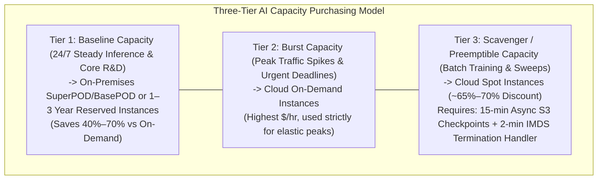

# 9.13 Sizing and capacity-planning exercises

| | |
|---|---|
| **Status** | Drafted (`capacity_planning_lab.py`: 25 checks pass; sizing and TCO exercises verified in Python) |
| **Level** | Advanced |
| **Priority tier** | 1b |
| **Lab venue** | none (design / reading) + self-checking Python model (`code/part09/capacity_planning_lab.py`) |
| **Part** | Part 9: NVIDIA systems and reference architectures |
| **Sources used** | `volume-08/01-architecture-design-masterclass.md`; `volume-08/02-capacity-tco-masterclass.md`; `nvidia-devops` V19 (Ch. 3, Ch. 6); `nvidia-devops` V21 (Ch. 11, Ch. 12, Lab 04); *AI Systems Performance Engineering* Ch. 2 |

## Why this matters for AI infrastructure

When a data science lead walks into a budget meeting and says *"Our Kubernetes GPU allocation is at 98%—we need $5 million to buy 16 more HGX H100 servers immediately,"* or a startup CFO asks *"How many GPUs do we need to buy over the next 36 months, and when will we run out of data center power?"*, a Senior Solutions Architect does not guess.

Capacity planning for AI factories is unforgiving for three physical and financial reasons:
1. **Supply-chain lead times (`3 to 9+ months`):** You cannot treat 1,000 bare-metal GPUs or 1.2 MW liquid-cooled racks like elastic cloud VMs. If you wait until your cluster is 90% utilized to place an order, your business will starve for six months waiting on delivery; if you panic and buy 100% of a 3-year projection on Day 1, millions of dollars of silicon will sit idle.
2. **The Allocation versus Utilization illusion ("The Empty Hotel"):** Kubernetes `nvidia.com/gpu` allocation measures how many rooms are *booked*, not how many GPUs are *executing math*. Without `MIG` partitioning, job bin-packing, and automated FinOps reaper bots driven by `DCGM_FI_PROF_SM_ACTIVE`, clusters routinely report 98% allocation while sitting at **12% physical silicon utilization**.
3. **Facility power ceilings and exponential forecasting traps:** Extrapolating 15%–20% monthly growth for 36 months blindly asks for 11,000+ GPUs while blowing through a 150 kW (`~117-GPU`) data center power wall in Month 10.

:::info Corpus scope note
This chapter synthesizes the architecture methodology, falsifiable PoC design, FinOps reclamation, multi-year TCO, and 36-month capacity-planning exercises from `volume-08` (Chapters 1 and 2), `nvidia-devops` Volume 19 (Chapters 3 and 6), Volume 21 (Chapters 11 and 12 and Lab 04), and *AI Systems Performance Engineering* Chapter 2. Operational runbooks for Kubernetes upgrades, incident game-days, and multi-region serving from Volumes 19 and 21 are covered in Parts 11, 15, 16, and 17 per `planning/MIGRATION_MAP.md`.
:::

## Prerequisites and outcomes

**Prerequisites:**
- Chapters `9.1`, `9.6`, `9.10`, and `9.11` (workload VRAM sizing, Scalable Units, BasePODs, and facility power/cooling envelopes).

**Outcomes:** After completing this chapter, you will be able to:
1. Apply the **Six-Stage Solutions Architecture Methodology** (`Discover → Model → Compare → Recommend → Validate → Adopt`), map the **six critical system paths**, and design **falsifiable Proofs of Concept (PoCs)** with strict numeric pass/fail gates.
2. Distinguish **Kubernetes Allocation** from **DCGM Silicon Utilization**, calculate **Effective Capacity** and **Cost per Million Tokens**, pack jobs onto 8-GPU nodes (`87.5%` allocation), and build an automated **FinOps Reaper Bot** (`SM_ACTIVE < 5%` for `≥ 4 hours`) and **3-tier capacity strategy (`Reserved/On-Prem + On-Demand + Spot`)**.
3. Execute worked **multi-year hardware refresh and TCO exercises** (`464 → 624 GPU` ramp across `1,612 GPU-years = $17.9K/GPU-yr`; `1,200-GPU` `$70.2M` 3-year TCO = `$19.5K/GPU-yr` and `$19.7K/PFLOP-yr`; and the `100 H100 → 50 B200` upgrade ROI).
4. Solve the **36-Month Capacity Planning & Facility-Wall Exercise** (identifying the exact month a `150 kW` / `~117-GPU` power ceiling is breached and replacing unrealistic exponential tails with a saturating logistic S-curve + Spot offload).

---

## Concepts: basics → intermediate → advanced

## 1. The Solutions Architecture methodology and falsifiable Proof of Concept (PoC) design

Never start a sizing exercise by opening a hardware catalog. When a stakeholder asks for *"64 GPUs on Kubernetes in three months,"* they are handing you a proposed solution disguised as a requirement.

### 1.1 The six-stage architecture framework and five core definitions

Every defensible AI infrastructure design follows six sequential stages (`volume-08/01-architecture-design-masterclass.md`):

| Stage | Core Question | Concrete Deliverable |
|---|---|---|
| **1. Discover** | What is the actual workload, and what are the unyielding constraints? | Clarified requirements specification + explicit list of unknowns. |
| **2. Model** | Which data, control, trust, state, failure, and observability paths matter? | Six-path architecture diagram (`Data/Request`, `Control`, `Trust/Identity`, `Persistent State`, `Failure Domains`, `Observability`). |
| **3. Compare** | Which feasible options differ on the criteria that matter most? | Quantitative trade-off matrix (e.g., separate Slurm + K8s pools vs unified K8s with Run:ai/Volcano). |
| **4. Recommend** | Which option best fits the business today, and under what conditions? | Architecture Decision Record (`ADR`) with explicit assumptions. |
| **5. Validate** | Which uncertain claims must be proved before committing production CAPEX? | **Falsifiable Proof of Concept (`PoC`)** acceptance test plan. |
| **6. Adopt** | How will teams migrate, operate, monitor, and govern the cluster on Day 2? | Staged rollout schedule, CMDB inventory, and on-call runbooks. |

Keep five terms distinct in every architecture review:
- **Requirement:** A measurable outcome the system must achieve (`"P99 TTFT ≤ 500 ms at 200 concurrent users"`).
- **Assumption:** An unverified belief that must be tested (`"We assume our existing 100G NAS can absorb 1 TB checkpoint bursts"`).
- **Constraint:** A hard boundary you cannot negotiate away (`"Data cannot leave the EU"` or `"Max rack power in Room B is 150 kW"`).
- **Trade-off:** Intentionally sacrificing one property to gain another (`"Accepting lower GPU utilization via physical node isolation to guarantee strict multi-tenant security"`).
- **Failure Domain:** The set of components that go offline together when one dependency fails (`"All 8 GPUs on an HGX baseboard share one NVSwitch domain; all nodes on PDU-A share one branch breaker"`).

### 1.2 The Unfalsifiable-PoC Test and the 8 PoC failure modes

A **Demo** proves that software can turn on. A **Proof of Concept (`PoC`)** is a scientific experiment designed to test a specific, falsifiable hypothesis to unblock a production purchasing decision (`volume-08/02-capacity-tco-masterclass.md`).

**The Golden Rule of PoCs (The Unfalsifiable-PoC Test):** *If you cannot state, in advance, a specific numeric measurement that will cause the PoC to be declared a **FAIL**, it is not a PoC—it is a demo.*

```mermaid
flowchart LR
    H["1. Hypothesis<br/>(Trap: 'Let's try it')"] --> E["2. Test Env<br/>(Trap: Unrepresentative lab)"]
    E --> W["3. Workload Gen<br/>(Trap: Steady synthetic load)"]
    W --> M["4. Metrics & SLOs<br/>(Trap: Averages instead of P95/P99)"]
    M --> B["5. Baseline<br/>(Trap: No current comparison)"]
    B --> X["6. Experiment Matrix<br/>(Trap: 50 shallow features vs 2 deep)"]
    X --> P["7. Pass/Fail Gate<br/>(Trap: Moving goalposts after test)"]
    P --> D["8. Decision Record<br/>(Trap: Hiding residual risks)"]
```



When a customer asks for a **"2-week PoC of everything"** (testing distributed training, MIG inference, air-gapped GPU Operator upgrades, and storage all at once), refuse the kitchen-sink scope. Isolate the top **one or two** technical risks and write strict, separated operational and performance pass/fail gates:
- **Example Hypothesis A (Operational Risk — Air-Gapped GPU Operator Upgrade):**
  - *Hypothesis:* The NVIDIA GPU Operator can upgrade drivers across a 20-node pool with zero unplanned inference downtime inside a 4-hour maintenance window.
  - *Pass Gate:* Total duration `≤ 4.0 hours`; unplanned pod evictions = `0`; rollback to prior driver `≤ 30 minutes` (versus a `14-hour` manual baseline).
- **Example Hypothesis B (Performance Risk — LLM P95 TTFT under Burst Load):**
  - *Hypothesis:* Model X on Triton / TensorRT-LLM sustains `200` concurrent requests with **P95 TTFT `< 1.0 second`** (never use *average* latency, which hides P95/P99 tail spikes caused by KV-cache swapping.).
  - *Pass Gate:* P95 TTFT `< 1.0 s` at `200` sustained concurrent users (versus a `40-user / 2.3 s` baseline).

:::tip In one minute
- Unpack every "buy `N` GPUs" request with the **6-stage methodology (`Discover → Model → Compare → Recommend → Validate → Adopt`)** and map all **6 system paths** (`Data`, `Control`, `Trust`, `State`, `Failure Domains`, `Observability`).
- **The Unfalsifiable-PoC Test:** Every PoC must define a pre-agreed numeric **FAIL** threshold, test 1–2 high-risk hypotheses deeply rather than 50 shallowly, and measure **P95/P99 tail latency** under bursty load rather than averages.
:::

---

## 2. The "Empty Hotel" crisis: Allocation vs Utilization, Effective Capacity, and FinOps Reapers

### 2.1 Why 98% Kubernetes Allocation can hide 12% Silicon Utilization

Imagine managing a luxury hotel where the reservation computer says **98% of the rooms are booked**, and a department asks you to spend $5 million building a new wing (`nvidia-devops` Volume 19 Chapter 3). Before signing the construction contract, you walk down the hallway and open the doors: **88% of the booked rooms are completely empty**—guests checked in, dropped a suitcase on the floor, and left for the weekend.

That exact failure happens every day in Kubernetes GPU clusters:
1. **Kubernetes `Allocation` (`nvidia.com/gpu` requests):** When a pod requests `nvidia.com/gpu: 1`, the kubelet locks that physical GPU exclusively for that pod. Even if the Python process inside the pod finishes after 5 minutes, sits idle in a Jupyter notebook over a 64-hour weekend, or gets stuck in a `CrashLoopBackOff` loop, **Kubernetes reports `100%` GPU allocation**.
2. **Physical Silicon `Utilization` (`DCGM_FI_PROF_SM_ACTIVE`):** Measures the fraction of Streaming Multiprocessors actually executing instructions on the silicon.
3. **The `$5M` Rejection & `7×` MIG Reclamation Exercise:** In our Volume 19 customer scenario, an AI team demands **$5M for 16 new HGX H100 servers (`128 GPUs`)** because Datadog shows `98%` Kubernetes GPU allocation. Inspecting Prometheus `DCGM_FI_PROF_SM_ACTIVE` over 30 days reveals an average silicon utilization of **only `12%`** because developers are locking full 80 GB GPUs for 5 GB staging/notebook tasks. By configuring **MIG `1g.10gb` profiles (up to `7` hardware-isolated instances per 80 GB GPU = `16 × 8 × 7 = 896` logical GPU instances across a 16-node pool)** and **Time-Slicing** for dev notebooks, you reclaim enough capacity for the next 12 months at **$0 hardware CAPEX**.

### 2.2 The Automated FinOps Reaper Bot and Utilization-Based Chargeback

To stop GPU hoarding permanently, implement two automated FinOps controls (`nvidia-devops` Volume 19 Chapters 3 and 6):
1. **The Automated FinOps Reaper Operator (`evaluate_finops_zombie_reaper()` in `code/part09/capacity_planning.py`):**
   - Continuously queries Prometheus for pods holding an allocated GPU (`nvidia.com/gpu > 0`).
   - **Reaper eviction rule:** If **`DCGM_FI_PROF_SM_ACTIVE < 5%` continuously for `≥ 4 hours`**, the operator automatically deletes/evicts the zombie pod, returns the $30,000 GPU to the cluster scheduler, and sends a Slack notification to the pod owner with a link to their checkpoint directory.
2. **Utilization-Weighted Chargeback:**
   - Tag `DCGM_FI_PROF_SM_ACTIVE` and `DCGM_FI_DEV_MEM_COPY_UTIL` with the Kubernetes `namespace` label in `dcgm-exporter`.
   - Show department leads both their **Allocated GPU-hours** (what they locked) and their **Utilized GPU-hours** (`Allocated × SM_ACTIVE`); revoke quota from namespaces that hoard GPUs below `20%` SM activity.

### 2.3 The mathematics of Effective Capacity, Batching Economies, and Context-Window Diseconomies

When comparing a cheaper on-premises cluster against cloud instances, never assume nominal peak throughput equals delivered work. Compute **Effective Capacity** (`volume-08/02-capacity-tco-masterclass.md`):

```text
Effective_Capacity = Nominal_Capacity × Expected_Utilization × Availability_Factor
Cost_per_1M_Tokens = Total_Hourly_Cost / (Effective_Tokens_per_Hour / 1,000,000)
```

For example, if a cluster has a nominal capacity of `100,000 tokens/sec`, but storage bottlenecks hold `Expected_Utilization` to `40%` (`0.40`) and driver/network incidents reduce `Availability_Factor` to `80%` (`0.80`), its **`Effective_Capacity` is only `100,000 × 0.40 × 0.80 = 32,000 tokens/sec` (`115.2M tokens/hour`)**—more than tripling its real cost per million tokens.

Also beware of **the Fallacy of Linear Forecasting** (`nvidia-devops` Volume 19 Chapter 3):
- **Sub-linear scaling (Economies of Scale via Dynamic Batching):** Doubling inference traffic from `10 QPS` to `20 QPS` rarely requires 2× the GPUs; continuous/dynamic batching packs the extra requests into existing weight reads, raising GPU utilization from `40%` to `55%` on the *same* hardware.
- **Super-linear scaling (Diseconomies of Scale via Context Windows):** Conversely, if user count stays flat (`0%` user growth), but product management increases maximum PDF upload length from **1 page to 100 pages**, dynamic **KV-cache VRAM scales linearly with sequence length**, causing immediate Out-Of-Memory (`OOM`) crashes and requiring a massive VRAM expansion (`H200` / `B200`) despite zero new users.

:::tip In one minute
- Never approve GPU purchases from **Kubernetes Allocation (`nvidia.com/gpu`)** alone; audit **`DCGM_FI_PROF_SM_ACTIVE`** first, slice staging/small inference GPUs into **up to 7 `MIG` instances**, and run an automated **FinOps Reaper Bot** that evicts pods with **`SM_ACTIVE < 5%` for `≥ 4 hours`**.
- Size economics using **`Effective_Capacity = Nominal × Utilization × Availability`**, and model **sequence-length / KV-cache jumps** separately from user QPS growth.
:::

---

## 3. Workload optimization levers: Bin-Packing, Preemption Tiers, and the Three-Tier Cloud/Spot Model

### 3.1 Job bin-packing (`87.5%` vs `70%`) and `P0 / P1 / P2` preemption

How a scheduler places jobs across 8-GPU nodes directly determines how many whole nodes remain free for large distributed training (`nvidia-devops` Volume 21 Chapter 12 Part 1.1):
- **Job Bin-Packing (`bin_pack_gpu_jobs()` in `code/part09/capacity_planning.py`):** Suppose five jobs request **`[8, 4, 4, 8, 4]` GPUs** (`28 GPUs` total). Spreading those 5 jobs across 5 separate 8-GPU nodes consumes **5 nodes (`40 GPUs`, `70.0%` allocation)** and leaves zero whole 8-GPU nodes free. Packing the two 4-GPU jobs together onto `Node B` (`Node A: 8`, `Node B: 4+4`, `Node C: 8`, `Node D: 4`) uses only **4 nodes (`32 GPUs`, `28 / 32 = 87.5%` allocation)**, saving an entire 8-GPU server for a multi-node job.
- **Three-Tier Preemption (`P0 / P1 / P2`):**
  - **`P0` (Production Inference):** Highest priority; never preempted.
  - **`P1` (Critical Scheduled Training):** Can preempt `P2` jobs.
  - **`P2` (Opportunistic Research / Hyperparameter Sweeps):** Runs at a discount on otherwise idle GPUs and is automatically preempted (resuming later from its last checkpoint) whenever `P0` or `P1` demand arrives.

### 3.2 The Three-Tier Capacity Purchasing Model (`Reserved/On-Prem` + `On-Demand` + `Spot`)

To cut a runaway cloud GPU bill in half within 30 days (`nvidia-devops` Volume 19 Chapters 3 & 6 and Volume 21 Chapter 12 Part 2), align each workload tier with its matching financial contract:



1. **Tier 1 — Baseline (`On-Premises` or `1–3 Year Reserved Instances`):** Covers 24/7 minimum inference traffic and steady R&D, cutting hourly hardware cost by **40% to 70%** compared to On-Demand.
2. **Tier 2 — Burst (`Cloud On-Demand`):** Used strictly for unpredictable daily/seasonal inference peaks above the baseline.
3. **Tier 3 — Scavenger (`Cloud Spot / Preemptible Instances`):**
   - **The economics (`Volume 21 Chapter 12 Part 2.1`):** An illustrative 8×H100 cloud instance (`p5.48xlarge`) at **`$60/hour` On-Demand (`$7.50/GPU/hr`)** costs **`$180/GPU/day`** or **`$54,000/GPU/year`** (over 300 operating days). At a **~65% Spot discount (`$21/hour` = `$2.63/GPU/hr`)**, the same GPU costs **`$63/GPU/day`** or **`$18,936 (~$18.9K)/GPU/year`**—saving **`~$35.1K per GPU per year`**.
   - **How to survive 2-minute Spot evictions:** Poll the cloud metadata service (such as AWS IMDSv2 `http://169.254.169.254/latest/meta-data/spot/instance-action` every 5 seconds via a background daemon thread or the AWS Node Termination Handler) alongside **15-minute asynchronous sharded S3 checkpoints**. When the 2-minute eviction notice arrives, set `interruption_signal = True`, flush an immediate checkpoint at the end of the current step, and exit cleanly (`0` corrupted state, `< 15 minutes` of work lost).

:::tip In one minute
- **Bin-packing** jobs (`[8, 4, 4, 8, 4]` onto 4 nodes at **`87.5%` allocation** instead of 5 nodes) plus **`P0 / P1 / P2` preemption** keeps measured SM activity above `80%`.
- Combine **Reserved/On-Prem** for 24/7 baseline inference (`40%–70%` off), **On-Demand** for peaks, and **Spot Instances** (`$2.63/GPU/hr` vs `$7.50/GPU/hr` = **`~$35.1K/GPU/yr` / `65%` savings**) paired with a **2-minute termination handler** and **15-minute async checkpoints** for training.
:::

---

## 4. Worked TCO and hardware refresh exercises (`408`, `624`, and `1,200` GPUs)

### 4.1 Exercise 1: Cost per Million Tokens on a 408-GPU (`2,000 QPS`) Inference Fleet

From `nvidia-devops` Volume 21 Chapter 12 Part 1.2, calculate the exact daily cost and **Cost per Million Tokens** for a **408-GPU H100 inference cluster** serving a constant **2,000 QPS** (`150 tokens/response` average):
1. **Daily token output:**
   - `Responses per day = 2,000 QPS × 86,400 seconds = 172,800,000 (172.8M) responses/day`.
   - `Tokens per day = 172.8M × 150 tokens = 25,920,000,000 (25.92B) tokens/day` (`25,920 million tokens/day`, or `300,000 tokens/second`).
2. **Daily TCO breakdown:**
   - **3-Year Hardware Amortization:** `(408 GPUs × $30,000) / 1,095 days = $11,178/day (~$11.2K/day)`
   - **Electricity (`231 kW` facility draw at `$0.12/kWh`):** `231 kW × 24 hours × $0.12 = $665.28/day (~$665/day)`
   - **Operations (`15 FTEs` at `$150,000/yr`):** `(15 × $150,000) / 365 days = $6,164/day (~$6.2K/day)`
   - **Total Daily Cost:** `$11,178 + $665 + $6,164 = $18,007/day (~$18.1K/day, or ~$750.50/hour)`.
3. **Cost per Million Tokens:**
   - **At 100% constant 2,000 QPS load:** `$18,007 / 25,920 million tokens = $0.695 (~$0.70) per 1M tokens`.
   - **At 40% average diurnal load (`800 QPS` average):** Because hardware amortization (`$11.2K/day`) and FTE salaries (`$6.2K/day`) are fixed, a `2.5×` drop in average utilization drives the real cost per 1M tokens up by **`~2.5×` to `~$1.74 / 1M tokens`**.

### 4.2 Exercise 2: 3-Year Staged Hardware Refresh (`464 → 524 → 624 GPUs`, `1,612 GPU-Years`)

When a fleet grows each year, how do you amortize CAPEX and OPEX across hardware bought in different years (`nvidia-devops` Volume 21 Chapter 11 Part 1.2, `calculate_multiyear_fleet_tco()` in `code/part09/capacity_planning.py`)? Count **active GPU-years in service**:
- **Year 1 Fleet (`464 H100 GPUs`):** `50` inference nodes (`400 GPUs`) + `8` training nodes (`64 GPUs`) = `464 GPUs × $30K = $13.9M CAPEX`. These 464 GPUs run for all **3 years** = **`464 × 3 = 1,392 GPU-years`**.
- **Year 2 Expansion (`+60 H200 GPUs` for larger models):** `60 × $40K = $2.4M CAPEX`. These 60 GPUs run for **2 years** (Years 2 and 3) = **`60 × 2 = 120 GPU-years`**.
- **Year 3 Expansion (`+100 H200 GPUs` for new continent region at volume price):** `100 × $35K = $3.5M CAPEX`. These 100 GPUs run for **1 year** (Year 3) = **`100 × 1 = 100 GPU-years`**.
- **3-Year TCO & GPU-Year Amortization:**
  - **Total CAPEX:** `$13.9M + $2.4M + $3.5M = $19.8M`.
  - **Total 3-Year OPEX (`$3.0M/year` electricity + personnel):** `3 × $3.0M = $9.0M`.
  - **Total 3-Year TCO:** `$19.8M + $9.0M = $28.8M`.
  - **Total Active GPU-Years:** `1,392 + 120 + 100 = 1,612 GPU-years`.
  - **Amortized Cost per GPU-Year:** **`$28.8M / 1,612 GPU-years = $17,866 (~$17.9K) per GPU-year`**.

### 4.3 Exercise 3: 1,200-GPU AI Factory 3-Year TCO (`$70.2M`) and the `100 H100 → 50 B200` Upgrade ROI

1. **The 1,200-GPU H100 3-Year TCO Breakdown (`Volume 21 Chapter 12 Part 3`):**
   - **CAPEX (`$44.0M`):** `1,200 GPUs × $30K = $36.0M` + `$1.5M` IB/Ethernet + `$2.0M` Storage + `$1.5M` Cooling/Power + `$2.0M` Chassis/Rails + `$1.0M` Labor = **`$44.0M`**.
   - **3-Year OPEX (`~$26.2M`):** Electricity (`1,200 × 0.7 kW × 60% avg × 1.35 PUE ≈ 680 kW → ~$0.72M/yr × 3 = $2.15M`) + Personnel (`30 FTE × $150K = $4.5M/yr × 3 = $13.5M`) + Maintenance (`$2.0M/yr × 3 = $6.0M`) + WAN/CDN (`$1.0M/yr × 3 = $3.0M`) + Software (`$0.5M/yr × 3 = $1.5M`) = **`$26.15M (~$26.2M)`**.
   - **Total 3-Year TCO:** **`$44.0M + $26.2M = $70.2M`** (`$23.4M/year` across `3,600 GPU-years`):
     - **Cost per GPU-year:** `$70.2M / 3,600 = $19.5K/GPU/year` (`$10.0K` GPU HW + `$7.3K` OPEX + `$2.2K` infra).
     - **Cost per 1K QPS capacity (`1,200 × 7.6 ≈ 9,100 QPS`):** `$23.4M / 9.1 = ~$2.6M/year per 1,000 QPS`.
     - **Cost per BF16 PFLOP-year (`1,200 × 0.989 = 1,186.8 PFLOPS`):** `$23.4M / 1,186.8 = ~$19.7K per PFLOP-year`.
2. **Generational Upgrade ROI (`100 H100s → 50 Blackwell B200s`, *AI Systems Performance Engineering* Ch. 2):**
   - Because each Blackwell GPU delivers `> 2×` the training throughput (and even more in FP8/FP4) of an H100, **50 Blackwell GPUs can replace 100 H100 GPUs** for the same workload while dropping GPU power from **`70 kW` (`100 × 700W`) down to `50 kW` (`50 × 1,000W`)—saving `20 kW` continuously** plus halving server chassis, CPU, RAM, and NIC port overhead (`1–2 year` payback).

:::tip In one minute
- On a **408-GPU (`2,000 QPS`)** fleet (`$18.1K/day` TCO producing `25.9B tokens/day`), **Cost per 1M Tokens is `$0.70` at 100% load** and **`$1.74` at 40% load**.
- Amortize staggered fleet growth using **active GPU-years** (`464×3 + 60×2 + 100×1 = 1,612 GPU-years` → **`$17.9K/GPU-yr`** on `$28.8M` TCO; **`$19.5K/GPU-yr`** and **`$19.7K/PFLOP-yr`** on a 1,200-GPU `$70.2M` deployment).
:::

---

## 5. Demand forecasting, lead times, and the 36-month `150 kW` facility-wall exercise

### 5.1 Seasonal demand forecasting, the hybrid `70%` reorder trigger, and the 36-month Lab 04 exercise

Because enterprise GPU orders have **3-to-9-month procurement lead times**, you must forecast demand months ahead and set an explicit reorder trigger:

1. **Seasonal Month-over-Month Forecasting (`Volume 21 Chapter 11 Part 1.1`):**
   ```text
   QPS[t] = QPS_base × (1 + growth_rate)^(t - t0) × (1 + seasonality × sin(2π × (t mod 12) / 12))
   GPUs_Needed[t] = QPS[t] / 7.6 QPS_per_GPU     (at ~15.2 QPS per 2-GPU Llama-70B replica)
   ```
   Starting from `286 QPS` after 12 months of history with `growth_rate = 10%/mo` and `seasonality = 0.15`:
   - `Month +0`: **`286 QPS` → `38 GPUs`**
   - `Month +6`: **`507 QPS` (`+77%`) → `67 GPUs`**
   - `Month +11`: **`755 QPS` (`+164%`) → `99 GPUs`**
2. **Upfront vs Incremental vs Hybrid Procurement (`Volume 21 Chapter 11 Part 2.1`):**
   To grow from `400 QPS` (`53 GPUs`) to a year-end target of `1,000 QPS` (`132 GPUs`):
   - **Option A — Buy all 132 GPUs upfront (`$3.96M`):** Zero stock-out risk, but Year-1 initial utilization is only `40%` (`~$2M` of idle silicon).
   - **Option B — Buy `+79 GPUs` in 4 quarterly tranches (`+20, +20, +20, +19 = $2.37M`):** Minimizes idle silicon, but 3–9 month lead times create severe stock-out risk if growth accelerates.
   - **Recommended Hybrid Strategy:** Add **`+40 GPUs` immediately (`$1.2M` → `93 GPUs ≈ 707 QPS` capacity)**, and **trigger the next purchase order whenever forecasted demand at `(Today + Lead_Time)` reaches `70%` of installed capacity**.
3. **The 36-Month Capacity Planning & `150 kW` Facility-Wall Exercise (`Volume 21 Lab 04`):**
   Walk through the exact numbers of `Lab 04` (`forecast_36month_capacity_exercise()` in `code/part09/capacity_planning.py`):
   - **Inputs:** Initial inference = `100 QPS` (`+15%/month` growth, `7.6 QPS/GPU`); initial training = `50 jobs/month` (`+20%/month` growth, `8 GPUs / 30 days = 0.2667 GPUs/job`); single data center capped at **`150 kW` max power (`150 kW / ~1.3 kW/GPU ≈ 115–117 GPUs` physical ceiling)**.
   - **Computed monthly GPU demand:**
     - `Month 0`: `13.2 (inf) + 13.3 (train) = 26.5 (~26) GPUs`
     - `Month 6`: `30.4 (inf) + 39.8 (train) = 70.3 (~70) GPUs`
     - `Month 8`: `40.3 (inf) + 57.3 (train) = 97.6 (~98) GPUs`
     - `Month 9`: **`46.3 (inf) + 68.8 (train) = 115.1 (~115) GPUs`** *(Reaches the `~115–117 GPU` / `150 kW` facility wall.)*
     - `Month 10`: **`53.2 (inf) + 82.6 (train) = 135.8 (~136) GPUs`** *(Exceeds the `150 kW` facility ceiling.)*
     - `Month 36`: Unconstrained `15%–20%` monthly compounding asks for **`> 11,400 GPUs`** (`15,315 QPS` + `35,440 training jobs/month`).
   - **Two architectural takeaways from Lab 04:**
     1. **Hard facility wall at Month 9–10:** You cannot plug a 118th GPU into a 150 kW room. Before Month 9 arrives, you must either **offload interruptible training demand onto Cloud Spot instances** (`$2.50–$2.63/GPU/hr`), **upgrade to denser/more efficient GPUs** (`H200` / `B200`), or **procure a second data hall/region 12 months in advance**.
     2. **Replace unconstrained exponential tails with a saturating Logistic S-Curve (`forecast_saturating_scurve_gpus()`, **my inference** implementing the saturating model recommended in Lab 04 line 10):** Real product adoption follows an S-curve (`G(t) = K / (1 + ((K - G0)/G0) × e^(-r·t))`) bounded by market saturation or facility carrying capacity `K`.

:::tip In one minute
- Trigger hardware purchase orders using the **Hybrid `70%` Rule**: order the next tranche when forecasted demand at **`Today + Supplier_Lead_Time (3–9 months)` reaches `70%` of installed capacity**.
- In the **36-month Lab 04 exercise** (`100 QPS @ +15%/mo` + `50 jobs @ +20%/mo`), GPU demand grows from **`26` (`M0`) → `70` (`M6`) → `98` (`M8`) → `115` (`M9`) → `136` (`M10`)**, breaching the **`150 kW` (`~115–117 GPU`) facility wall at Month 9–10**.
- Never extrapolate `15%–20%` monthly growth for 36 months without a **saturating S-curve** and **Cloud Spot training burst** above the on-prem power ceiling.
:::

---

## Commands and configurations that matter

### 1. Run the 25-check Sizing and Capacity-Planning verification lab

```bash
python3 -B code/part09/capacity_planning_lab.py
```

### 2. Prometheus PromQL queries for the FinOps Zombie Reaper and Utilization Chargeback

```promql
# 1. Identify Zombie GPU Pods: allocated in K8s but maximum SM activity < 5% (0.05) over the past 4 hours
max_over_time(DCGM_FI_PROF_SM_ACTIVE{pod!=""}[4h]) < 0.05

# 2. Compute Namespace-Level Effective SM Utilization Ratio for FinOps Chargeback
avg by (namespace) (DCGM_FI_PROF_SM_ACTIVE{pod!=""})
```

---

## How it fails

| Failure mode | Symptom | Root cause | Diagnosis & fix |
|---|---|---|---|
| **1. Approving `$5M` of new GPUs at `98%` K8s Allocation and `12%` SM Utilization** | Finance buys 16 new HGX servers because `kubectl describe nodes` shows `98%` of `nvidia.com/gpu` allocated; after installation, cluster throughput barely increases. | Confusing **Kubernetes Allocation** with **DCGM Silicon Utilization**. Developers locked whole 80 GB GPUs for idle Jupyter notebooks and 5 GB staging pods. | Query `DCGM_FI_PROF_SM_ACTIVE` over 30 days first. Partition dev/staging GPUs into **`1g.10gb` MIG slices (`7×` instances/GPU)** or Time-Slicing, and deploy the **FinOps Reaper Bot** (`SM_ACTIVE < 5%` for `≥ 4h`). |
| **2. Unfalsifiable "Kitchen-Sink" PoC declaring success before a production outage** | A 2-week PoC tests 20 features superficially, reports *"everything works, average latency is 50 ms,"* and crashes in production when P99 latency hits 5 seconds under burst load. | The PoC had **no pre-agreed numeric FAIL criterion**, used synthetic steady load instead of bursty traffic, and measured **average latency** instead of **P95/P99 tail latency**. | Scope PoCs to **1–2 high-risk hypotheses** with strict pre-stated pass/fail gates (e.g., `P95 TTFT < 1.0 s at 200 concurrent users` or `Air-gapped upgrade ≤ 4h with 0 unplanned evictions`). |
| **3. Context-window expansion (`1 page → 100 pages`) crashing a cluster at `0%` user growth** | Capacity planners forecast `0%` new user growth and buy zero GPUs; product launches 100-page PDF uploads and the inference fleet crashes with `CUDA out of memory`. | **The Fallacy of Linear Forecasting:** KV-cache VRAM scales linearly with **sequence length**, creating a massive memory diseconomy of scale even when user QPS is flat. | Model **average and P99 sequence length (`L_seq`)** as an explicit multiplier in your VRAM capacity forecast alongside QPS. |
| **4. Hitting the `150 kW` (`~117-GPU`) data center power wall at Month 9** | A startup orders GPUs for Month 10–12 demand (`136+ GPUs`), and facilities refuses to energize the racks because the room is capped at `150 kW`. | The capacity plan tracked dollar budget (`$5M–$7M/yr`) and QPS growth (`+15%/mo`), but forgot to divide the facility power ceiling (`150 kW`) by per-GPU node power (`~1.3 kW/GPU = ~115–117 GPUs max`). | Plot **facility power ceiling (`kW`)** as a hard horizontal line on every GPU forecast chart, offload training above the ceiling to **Cloud Spot instances**, and initiate facility/region expansion **12 months before** the curve crosses the line. |
| **5. Losing 3 days of training work on a Cloud Spot instance eviction** | A team moves a 70B training run to 65%-discounted Spot instances to save money, gets evicted on Day 3, and loses 72 hours of compute because no checkpoint was flushed. | Running on Spot instances without **frequent asynchronous S3 checkpoints** and an **IMDSv2 2-minute termination notice handler**. | Save sharded checkpoints every **15 minutes** and run a background thread polling `http://169.254.169.254/latest/meta-data/spot/instance-action` every 5 seconds to trigger a final graceful checkpoint before termination. |

---

## Hands-on lab

This chapter's self-checking Python model (`code/part09/capacity_planning.py`) and lab script (`code/part09/capacity_planning_lab.py`) implement:
1. The **Effective Capacity & Cost per 1M Tokens Calculator** (`Nominal × Utilization × Availability`, reproducing `$0.70/1M tokens` at 100% load vs `$1.74/1M` at 40% load on the 408-GPU fleet).
2. The **FinOps Zombie Reaper Bot Evaluator** (`k8s_gpu_allocated=True`, `DCGM_FI_PROF_SM_ACTIVE < 5%`, `idle_duration_hours ≥ 4.0`) and **`1g.10gb` MIG `7×` (`896-instance`) Reclamation Check**.
3. The **First-Fit Decreasing GPU Job Bin-Packer** (`[8, 4, 4, 8, 4]` = `28 GPUs` into `4 nodes` at `87.5%` allocation vs `5 nodes` unpacked) and **Spot vs On-Demand Savings Calculator** (`$35.1K/GPU/yr` saved).
4. The **Multi-Year Fleet TCO & GPU-Year Amortizer** (`464 → 524 → 624 GPUs` = `1,612 GPU-years` at `$17.9K/GPU-yr` on `$28.8M` TCO; `1,200 GPUs` = `3,600 GPU-years` at `$19.5K/GPU-yr`, `$19.7K/PFLOP-yr`, and `$2.6M/yr per 1K QPS`).
5. The **Seasonal (`286 → 507 → 755 QPS`) and 36-Month Lab 04 Demand Forecaster** (`26 → 70 → 98 → 115 → 136 GPUs`, detecting the Month 9–10 `150 kW` / `~117-GPU` facility wall and comparing against the saturating logistic S-curve).

Run the lab from the repository root:

```bash
python3 -B code/part09/capacity_planning_lab.py
```

Expected output (verified in this repository):

```text
=== Chapter 9.13 Lab: Sizing and Capacity-Planning Exercises ===
  [PASS] V21 Ch12: 408-GPU fleet (300k tok/s) at $750.5/hr ($18.01K/day) costs $0.695 (~$0.70) per 1M tokens
  [PASS] V21 Ch12: At 40% utilization, cost per 1M tokens rises 2.5x to $1.7373
  [PASS] VL8 Ch2: Effective capacity (100k * 0.40 * 0.80) == 32,000 tok/s (115.2M tok/hr)
  [PASS] Rejects utilization > 1.0
  [PASS] V19 Ch3: Allocated GPU with SM_ACTIVE=1.2% (<5%) for 4.5h (>=4h) is evicted as zombie pod
  ...
  [PASS] V21 Ch12 Part 3: 1,200 H100s = 1,186.8 BF16 PFLOPS; at $23.4M/yr, cost per PFLOP-year == $19.7K
  [PASS] V21 Ch12 Part 3: 1,200 H100s = ~9,120 QPS; at $23.4M/yr, cost per 1K QPS capacity == $2.57M (~$2.6M)/yr
  [PASS] ASP Ch2 chunk 8 ROI case study: Replacing 100 H100s (70 kW) with 50 B200s (50 kW) saves 20 kW continuously
  [PASS] Rejects non-positive year1_gpus in TCO calculator
  [PASS] Rejects negative initial_qps in 36-month forecaster

Summary: 25 passed, 0 failed (total 25)
```

---

## Exercises

1. Run `python3 -B code/part09/capacity_planning_lab.py`. Redo the 408-GPU cost per million tokens at 60% average load instead of 40%. Show that the fixed costs make it fall between $0.70 and $1.74.
2. Pack the jobs `[8, 8, 4, 2, 2, 4, 8, 1]` GPUs onto 8-GPU nodes by hand with first-fit decreasing. How many nodes do you need and what is the allocation percentage?
3. A team has 90% Kubernetes allocation and 18% SM activity over 30 days. Write the one-page reply to a manager who asks for 8 more nodes. Include the two queries you ran and two changes you propose first.
4. Write a falsifiable PoC for "can we serve a 70B model at 100 concurrent users". Give the hypothesis, the test, the numeric pass gate and the numeric fail gate.
5. A room is capped at 120 kW and each GPU needs about 1.3 kW. Use the Lab 04 growth rates to find the first month demand passes the cap. Then describe two ways to avoid the wall.
6. Compute the cost per GPU-year for a fleet that buys 200 GPUs in Year 1 ($6M), 100 in Year 2 ($3.2M) and 100 in Year 3 ($3.0M) with $1.4M of OPEX a year.

## Checkpoint questions (20)

<details>
<summary><strong>1. What is the difference between a Constraint and a Trade-off, and what is the "Unfalsifiable-PoC Test"?</strong></summary>

- **Constraint vs Trade-off:** A **Constraint** is a hard boundary you cannot change (such as a `150 kW` room power limit or EU data residency law). A **Trade-off** is a deliberate architectural choice to sacrifice one property (such as GPU utilization) to gain another (such as strict physical tenant isolation).
- **The Unfalsifiable-PoC Test:** If you cannot specify, in advance, a numeric measurement that would cause the Proof of Concept to be declared a **FAIL**, it is a demo, not a PoC.
</details>

<details>
<summary><strong>2. Why does a FinOps Reaper Bot query `DCGM_FI_PROF_SM_ACTIVE` instead of Kubernetes pod status or `nvidia.com/gpu` allocation, and what threshold does it use?</strong></summary>

To Kubernetes, an idle Jupyter notebook pod that locked `nvidia.com/gpu: 1` three weeks ago is `Running` and `100% Allocated`. Only hardware telemetry from `dcgm-exporter` (**`DCGM_FI_PROF_SM_ACTIVE`**) reveals whether the GPU silicon is actually executing math. If a pod holds a GPU with **`DCGM_FI_PROF_SM_ACTIVE < 5%` continuously for `≥ 4 hours`**, the FinOps Reaper evicts the pod and notifies the user on Slack.
</details>

<details>
<summary><strong>3. Give one example of an Economy of Scale (sub-linear GPU growth) and one example of a Diseconomy of Scale (super-linear GPU growth) in LLM inference forecasting.</strong></summary>

- **Economy of Scale (Dynamic Batching):** Doubling user QPS from 10 to 20 QPS rarely doubles GPU count because continuous/dynamic batching groups the additional requests into existing weight reads, raising GPU utilization from `40%` to `55%`.
- **Diseconomy of Scale (Context Window Expansion):** Expanding input prompts from 1-page PDFs to 100-page PDFs causes **KV-cache VRAM** to explode linearly with sequence length, triggering OOM crashes and requiring far more GPUs even at `0%` user growth.
</details>

<details>
<summary><strong>4. How many 8-GPU nodes are required to schedule five jobs requesting `[8, 4, 4, 8, 4]` GPUs (`28 GPUs` total) with bin-packing versus without bin-packing, and what is the resulting node allocation percentage?</strong></summary>

- **Without bin-packing (1 job per node):** Requires **5 nodes (`40 GPUs`, `70.0%` allocation)**.
- **With bin-packing (`Node A: 8`, `Node B: 4+4`, `Node C: 8`, `Node D: 4`):** Requires only **4 nodes (`32 GPUs`, `28 / 32 = 87.5%` allocation)**, leaving the 5th 8-GPU node completely free for a full-node job.
</details>

<details>
<summary><strong>5. Calculate the total active GPU-years and amortized cost per GPU-year for a 3-year deployment that starts with `464` GPUs in Year 1 (`$13.9M`), adds `+60` GPUs in Year 2 (`$2.4M`), and adds `+100` GPUs in Year 3 (`$3.5M`), with `$3.0M/year` in OPEX.</strong></summary>

- **Total CAPEX:** `$13.9M + $2.4M + $3.5M = $19.8M`.
- **Total 3-Year OPEX:** `3 × $3.0M = $9.0M` → **Total 3-Year TCO = `$28.8M`**.
- **Active GPU-Years:** `(464 × 3) + (60 × 2) + (100 × 1) = 1,392 + 120 + 100 = 1,612 GPU-years`.
- **Amortized Cost per GPU-Year:** `$28.8M / 1,612 = $17,866 (~$17.9K) per GPU-year`.
</details>

<details>
<summary><strong>6. Walk through the daily cost and Cost per Million Tokens of a 408-GPU inference fleet serving 2,000 QPS (`150 tokens/response`) with `$11.2K/day` hardware amortization, `$665/day` electricity, and `$6.2K/day` operations. What happens to the cost per 1M tokens if average traffic is 40% of peak?</strong></summary>

- **Daily tokens:** `2,000 QPS × 86,400 s × 150 tokens = 25,920 million tokens/day`.
- **Daily total cost:** `$11.2K + $0.665K + $6.2K ≈ $18.1K/day`.
- **Cost per 1M tokens at 100% load:** `$18.1K / 25,920M ≈ $0.70 per 1M tokens`.
- **At 40% average load:** Because hardware amortization and FTE salaries dominate electricity (`$17.4K/day` vs `$0.665K/day`), a `2.5×` drop in utilization raises the cost per 1M tokens by **`~2.5×` to `~$1.74 per 1M tokens`**.
</details>

<details>
<summary><strong>7. In the 36-month Lab 04 capacity-planning exercise (`100 QPS @ +15%/mo`, `50 training jobs @ +20%/mo`, `150 kW` max facility power at `~1.3 kW/GPU`), in which month does demand breach the facility power ceiling, and how do you solve it?</strong></summary>

Total GPU demand reaches **`26` (`Month 0`), `70` (`Month 6`), `98` (`Month 8`), `115` (`Month 9`), and `136` (`Month 10`)**, breaching the **`150 kW / ~1.3 kW/GPU ≈ 115–117 GPU` facility ceiling between Month 9 and Month 10**. To solve it within a single 150 kW data hall, cap on-premises purchases at `~115 GPUs` (reserved for latency-critical inference), offload excess batch training onto **Cloud Spot instances**, and replace unconstrained 36-month exponential extrapolation (`>11,000 GPUs`) with a saturating S-curve.
</details>

<details>
<summary><strong>8. What is the Hybrid `70%` Reorder Trigger Rule for managing 3-to-9-month GPU hardware procurement lead times?</strong></summary>

Instead of buying 100% of year-end capacity upfront (which leaves silicon idle) or buying strictly just-in-time (which causes stock-outs during 3–9 month delivery waits), deploy an initial buffer to cover near-term growth and **place the next purchase order as soon as forecasted demand at `(Today + Supplier_Lead_Time)` reaches `70%` of installed capacity**.
</details>

<details>
<summary><strong>9. What are the six stages of the architecture method and the six paths to model?</strong></summary>

Discover, Model, Compare, Recommend, Validate, Adopt. The paths are data/request, control, trust/identity, persistent state, failure domains and observability.
</details>

<details>
<summary><strong>10. What is the difference between a requirement, an assumption, a constraint, a trade-off and a failure domain?</strong></summary>

A requirement is a measurable outcome. An assumption is an untested belief. A constraint is a hard limit. A trade-off gives up one property to gain another. A failure domain is the set of parts that fail together.
</details>

<details>
<summary><strong>11. What makes a PoC "falsifiable"?</strong></summary>

You write, before the test, a numeric result that would make it a failure. Otherwise it is a demo.
</details>

<details>
<summary><strong>12. Why measure P95 or P99 latency in a PoC and not the average?</strong></summary>

Averages hide tail spikes, such as from KV-cache swapping, that users feel. Use tail latency and bursty load.
</details>

<details>
<summary><strong>13. Why refuse a "2-week PoC of everything"?</strong></summary>

Many shallow tests prove little. Pick one or two top risks and give each its own pass and fail gate.
</details>

<details>
<summary><strong>14. What is the "Empty Hotel" problem?</strong></summary>

Kubernetes shows GPUs as allocated (rooms booked) even when the GPUs do little work. Measure real SM activity before buying more.
</details>

<details>
<summary><strong>15. What are the numbers for the FinOps reaper and the chargeback rule?</strong></summary>

Evict a pod whose SM activity is under 5% for at least 4 hours. For chargeback, show allocated and utilized GPU-hours and revoke quota from namespaces below 20% SM activity.
</details>

<details>
<summary><strong>16. What does effective capacity mean and what is the example?</strong></summary>

Nominal capacity × expected utilization × availability. 100,000 tokens/s at 40% and 80% is 32,000 tokens/s.
</details>

<details>
<summary><strong>17. What is the three-tier capacity model?</strong></summary>

Baseline (on-prem or reserved) for steady load, on-demand cloud for peaks, and spot or preemptible capacity for batch work that can restart from checkpoints.
</details>

<details>
<summary><strong>18. What must a training job do to survive Spot eviction?</strong></summary>

Save sharded checkpoints about every 15 minutes, poll the metadata service for the 2-minute notice, and write a last checkpoint when the notice arrives.
</details>

<details>
<summary><strong>19. Why can lead times make just-in-time buying dangerous?</strong></summary>

Orders take 3–9 months. Order when forecast demand at today plus lead time reaches 70% of installed capacity.
</details>

<details>
<summary><strong>20. What is the point of the saturating S-curve in the 36-month exercise?</strong></summary>

Unlimited 15–20% monthly growth for 36 months asks for over 11,000 GPUs. Real growth levels off at a market or facility limit, so the model should have a ceiling.
</details>

---

## Sources and review notes

### Sources read in full for this chapter
1. **`volume-08/01-architecture-design-masterclass.md` (1,361 words) & `volume-08/02-capacity-tco-masterclass.md` (1,118 words):**
   - Six-stage architecture framework (`Discover, Model, Compare, Recommend, Validate, Adopt`), 5 essential definitions, 6 modeled paths, Slurm vs K8s trade-off scenario, workload-to-sharing table, `Effective_Capacity = Nominal × Utilization × Availability`, and the Unfalsifiable-PoC Test (`Hypothesis A` 4h upgrade / 0 evictions / 30m rollback; `Hypothesis B` P95 TTFT `< 1.0s` at 200 concurrency).
2. **`nvidia-devops` Volume 19 Chapter 3 (`chapter-03-capacity-planning-and-forecasting.md`, 1,400 words) and Chapter 6 (`chapter-06-cost-optimization-and-resource-efficiency.md`, 1,089 words):**
   - "The Empty Hotel" (`98%` K8s Allocation vs `12%` `DCGM_FI_PROF_SM_ACTIVE`, rejecting `$5M` for 16 HGX nodes via `1g.10gb` MIG 7× slicing + Time-Slicing), the Automated FinOps Reaper Bot (`SM_ACTIVE < 5%` for `≥ 4 hours`), Economies of Scale (Dynamic Batching) vs Diseconomies of Scale (100-page PDF context-window KV-cache OOM), the 3-tier capacity model (`Reserved/On-Prem` + `On-Demand` + `Spot`), utilization-based namespace chargeback, and the `$500K/mo` AWS startup cost-halving plan.
3. **`nvidia-devops` Volume 21 Chapter 11 (`chapter-11-capacity-planning-and-forecasting.md`, 1,204 words), Chapter 12 (`chapter-12-cost-optimization-and-resource-efficiency.md`, 1,486 words), and Lab 04 (`labs/lab-04-capacity-planning-exercise.md`, 1,782 words):**
   - Seasonal QPS forecasting (`286 → 507 → 755 QPS` / `38 → 67 → 99 GPUs`), 3-year hardware refresh (`464 → 524 → 624 GPUs`, `$28.8M` TCO / `1,612 GPU-years = $17.9K/GPU-yr`), Upfront (`$3.96M`) vs Incremental (`$2.37M`) vs Hybrid (`70%` minus lead time) procurement, `[8, 4, 4, 8, 4]` bin-packing (`87.5%`), `P0/P1/P2` preemption, `408-GPU` (`2,000 QPS`) `$0.70/1M tokens` math, Spot (`$2.63/hr` vs `$7.50/hr` = `$35.1K/yr` saved) + IMDSv2 2-min termination handler, `1,200-GPU` `$70.2M` 3-year TCO (`$19.5K/GPU-yr`, `$2.6M/yr per 1K QPS`, `$19.7K/PFLOP-yr`), and the 36-month `150 kW` (`~117 GPU` at Month 9–10) Lab 04 exercise.
4. **Chris Fregly, *AI Systems Performance Engineering* (`ai-systems-performance-engineering`), Chapter 2 (chunk 8):**
   - Generational upgrade ROI case study replacing 100 H100 GPUs (`70 kW`) with 50 Blackwell GPUs (`50 kW`, saving `20 kW` with 1–2 year payback).

### Run here
- `python3 -B code/part09/capacity_planning_lab.py` — **25 passed, 0 failed**.

### My own choices and inferences, labelled in the text
1. **Explicit logistic S-curve formula (`K / (1 + ((K - G0)/G0) × e^(-r·t))` in `forecast_saturating_scurve_gpus` in `code/part09/capacity_planning.py` and Section 5.1):** Implementing a standard logistic carrying-capacity curve to replace the unconstrained 36-month exponential tail (`> 11,000 GPUs`) as advised by the note on line 10 of Volume 21 Lab 04 (*"replace it with a saturating curve"*) is **my inference**.

### Not verified on live hardware
- Prometheus FinOps Reaper queries and AWS IMDSv2 spot-termination polling scripts were not executed against a live cluster in this authoring environment.

