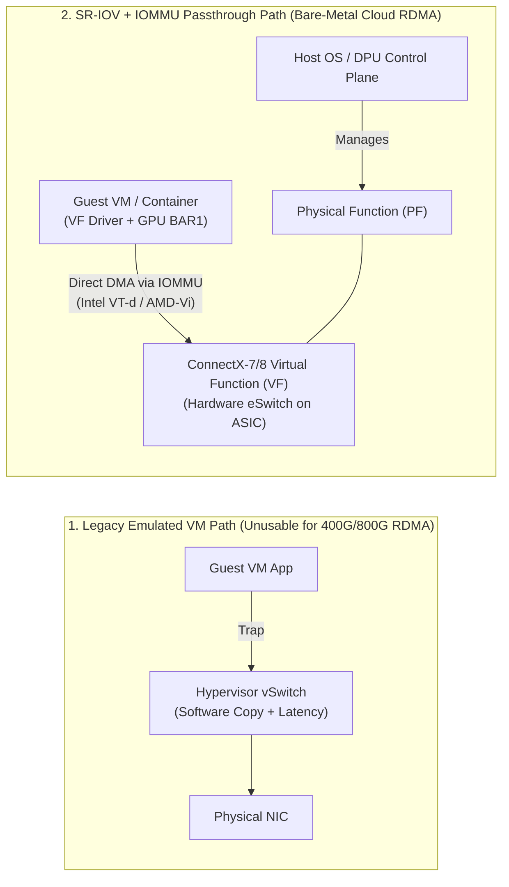
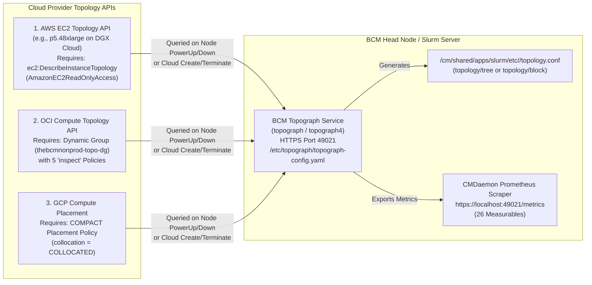
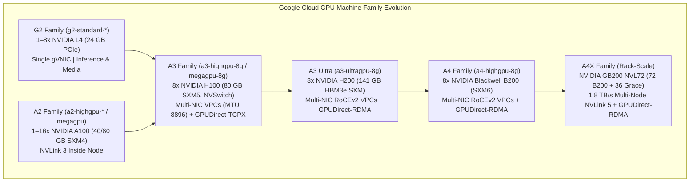

# 9.14 Cloud GPU platforms: DGX Cloud, CoreWeave, Nebius and GCP A3 and A4

| | |
|---|---|
| **Status** | Drafted (`cloud_gpu_platforms_lab.py`: 25 checks pass; cloud commands **untested** on live cloud accounts) |
| **Level** | Intermediate |
| **Priority tier** | 1b |
| **Lab venue** | none (design / reading) + self-checking Python model (`code/part09/cloud_gpu_platforms_lab.py`) |
| **Part** | Part 9: NVIDIA systems and reference architectures |
| **Sources used** | *NVIDIA Base Command Manager 11 Administrator Manual* (`bcm11-admin`) §7.5 (pp. 408–420); Handbook Chapter `4.24`; `nvidia-devops` V1 Ch. 8 (§4 & §6); `nvidia-devops-legacy-v09` (`02 - K8s & Virtualization Gauntlet` Q2); *Generative AI on Kubernetes* Ch. 3 & Ch. 7 |

## Why this matters for AI infrastructure

Securing 1.2 to 19.2 megawatts of data center utility power, waiting 6 months for liquid-cooled racks, and hiring dedicated InfiniBand physical-layer technicians is not feasible for every enterprise—or even for AI labs that already own on-premises SuperPODs when they need elastic burst capacity. Consequently, most AI infrastructure engineers operate across a hybrid landscape of **cloud GPU platforms**.

However, "renting GPUs in the cloud" is not like renting generic CPU virtual machines. If a cloud provider hides the physical leaf-spine switch topology from your job scheduler, or routes 400 Gbps RDMA traffic through a hypervisor virtual switch (`vSwitch`), multi-node training performance collapses by 50% to 80%. Understanding how the three major cloud GPU platform archetypes—**Managed Turnkey SuperPOD-as-a-Service (`NVIDIA DGX Cloud`)**, **GPU-Native Neoclouds (`CoreWeave` and `Nebius AI Cloud`)**, and **Hyperscaler AI Supercomputers (`Google Cloud GCP G2, A2, A3, A3 Ultra, A4, and A4X`)**—expose bare-metal performance (`SR-IOV` + `IOMMU`), discover physical switch topology (**BCM `Topograph`** across AWS, OCI, and GCP), and wire multi-NIC RDMA fabrics (`InfiniBand`, `GPUDirect-TCPX`, and `GPUDirect-RDMA RoCEv2`) is essential for designing and operating cloud AI factories.

:::info Corpus scope note
Live vendor pricing pages and provider-specific API reference manuals for `DGX Cloud`, `CoreWeave`, `Nebius AI Cloud`, and `Google Cloud Compute Engine` are external to the offline book corpus. In this chapter, the BCM `Topograph` cloud topology service rules (for AWS `p5.48xlarge` / DGX Cloud, OCI dynamic groups, and GCP `COMPACT` placement) are drawn directly from the *NVIDIA Base Command Manager 11 Administrator Manual* (`bcm11-admin`, Section 7.5, pp. 408–420), `SR-IOV` / `IOMMU` and `DGX Cloud` concepts from `nvidia-devops` Volume 01 Chapter 8 and Volume 09, and the `GCP A2/G2/A3/A3 Ultra/A4/A4X`, `Nebius`, and `CoreWeave` resource models from Chapter `4.24` of this handbook. Always verify exact machine-type and provider attribute names against current cloud provider documentation before applying in production.
:::

## Prerequisites and outcomes

**Prerequisites:**
- Chapters `4.24` (Terraform on GCP and Nebius), `8.8` / `8.16` (BCM Slurm WLM and Mission Control / DGX Cloud concepts), and `9.1` to `9.9` (DGX/HGX/NVL72 systems and SuperPOD fabrics).

**Outcomes:** After completing this chapter, you will be able to:
1. Explain how cloud GPU platforms eliminate hypervisor I/O overhead using **Single Root I/O Virtualization (`SR-IOV` Physical and Virtual Functions)** and **`IOMMU` (`Intel VT-d` / `AMD-Vi`)** direct memory translation, and contrast the three cloud GPU platform archetypes (**`DGX Cloud`**, **`CoreWeave` / `Nebius`**, and **`GCP A2–A4X`**).
2. Configure the **BCM `Topograph` service** (`topograph` vs `topograph4` on TCP port `49021`, `topology/tree` vs `topology/block`) to auto-discover physical switch topology and generate Slurm `topology.conf` across **AWS (`p5.48xlarge` / DGX Cloud)**, **Oracle Cloud (`OCI`)**, and **Google Cloud (`GCP`)**.
3. Architect multi-node training clusters on **GPU-Native Neoclouds (`Nebius AI Cloud` and `CoreWeave`)**—enforcing explicit InfiniBand `gpu_cluster` fabric membership on Nebius and topology-aware Kubernetes/Slurm scheduling (`Kueue`, `Volcano`, `KAI Scheduler`, `SUNK` / `Soperator`) on CoreWeave and Nebius.
4. Select and configure **Google Cloud (`GCP`) GPU machine families** (`G2` L4, `A2` A100, `A3` H100 with `GPUDirect-TCPX`, `A3 Ultra` H200 and `A4` B200 with `GPUDirect-RDMA RoCEv2`, and `A4X` GB200 NVL72) with `on_host_maintenance = "TERMINATE"`, `COMPACT` collocation, jumbo `MTU 8896`, `DWS` (Flex-Start / Calendar mode), and GKE `max_surge = 0` upgrade guardrails.

---

## Concepts: basics → intermediate → advanced

## 1. Cloud GPU virtualization physics (`SR-IOV` + `IOMMU`) and the three cloud platform archetypes

### 1.1 Why traditional VM networking ruins AI training—and how `SR-IOV` + `IOMMU` fix it

In a legacy cloud virtual machine, whenever a guest OS sends a network packet or disk read, the operation traverses a **hypervisor trap-and-emulate (`vSwitch`) path**: the guest writes to a virtual NIC driver (`virtio`), the hypervisor intercepts the trap, translates the memory address in software, and copies the packet out the physical NIC. At 1 Gbps web traffic, that CPU overhead is barely noticeable; at **8 × 400 Gbps (3.2 Tbps)** of synchronous `NCCL AllReduce` traffic, hypervisor software emulation adds tens of microseconds of latency, saturates host CPU cores, and breaks **GPUDirect RDMA**.

Cloud GPU providers achieve bare-metal GPU and RDMA performance inside multi-tenant clouds by combining **bare-metal nodes** (or 1-VM-per-8-GPU-host allocations) with **Single Root I/O Virtualization (`SR-IOV`)** and the **Input-Output Memory Management Unit (`IOMMU`)**:



1. **Physical Function (`PF`) vs Virtual Function (`VF`):** `SR-IOV` is a PCI Express standard that allows a single physical PCIe device (such as an NVIDIA ConnectX-7/8 NIC or BlueField-3 DPU) to partition itself in hardware into one **Physical Function (`PF`)** (owned by the cloud host hypervisor or DPU control plane for configuration and security) and multiple lightweight **Virtual Functions (`VFs`)** (each containing dedicated hardware transmit/receive queues for direct data movement).
2. **`IOMMU` (`Intel VT-d` / `AMD-Vi`) Direct Memory Translation:** Each `VF` (and each passed-through SXM GPU) is mapped directly into the guest VM's address space via **PCIe passthrough**. The hardware **`IOMMU`** translates guest virtual/physical DMA addresses to host physical addresses at wire speed while strictly isolating memory so a buggy or malicious VM can never DMA into another tenant's host RAM. The result: **zero hypervisor vSwitch overhead** and full **GPUDirect RDMA** between the guest GPU and the physical fabric.

### 1.2 The three cloud GPU platform archetypes

We can group modern cloud GPU offerings into three architectural models (**my inference**, synthesizing `nvidia-devops` Volume 01 Chapter 8, Chapter `4.24`, and `bcm11-admin` Section 7.5):

| Attribute | 1. Managed SuperPOD-as-a-Service (`NVIDIA DGX Cloud`) | 2. GPU-Native Neoclouds (`CoreWeave`, `Nebius AI Cloud`) | 3. Hyperscaler AI Supercomputers (`GCP G2, A2, A3, A3 Ultra, A4, A4X`) |
|---|---|---|---|
| **Core Value Proposition** | Turnkey, NVIDIA-operated multi-node SuperPOD hosted inside major CSPs (AWS, Azure, GCP, OCI) | Purpose-built bare-metal/K8s GPU clouds with native InfiniBand fabrics, parallel storage, and fast provisioning | Deep integration with hyperscaler IAM, global VPCs, GKE, BigQuery/GCS data lakes, and enterprise commitments |
| **Control Plane & Scheduler** | **NVIDIA Base Command / Mission Control**, **Run:ai**, and **Slurm** (with **BCM `Topograph`** topology discovery) | **CoreWeave:** K8s-native (`Kueue`, `Volcano`, `KAI`, `Run:ai`, `SUNK` Slurm-on-K8s)<br/>**Nebius:** Managed K8s, `Soperator` Slurm-on-K8s, or VM Slurm | **GKE** (`Dataplane V2`, `Kueue` + `DWS ProvisioningRequest`), or **Cluster Toolkit** Slurm on Compute Engine VMs |
| **Scale-Out GPU Interconnect** | Cloud-hosted **InfiniBand / RoCE / EFA** (`p5.48xlarge`, OCI BM, GCP A3/A4) mapped into Slurm via `Topograph` | **Lossless InfiniBand RDMA** (`Quantum-2 400G NDR` / `Quantum-X800 800G XDR`) exposed via `gpu_cluster` or K8s node labels | **Multi-NIC VPCs (`MTU 8896`):** `GPUDirect-TCPX` (`A3` H100) and **`GPUDirect-RDMA` over RoCEv2 VPCs** (`A3 Ultra` H200, `A4` B200, `A4X` NVL72) |

:::tip In one minute
- Cloud GPU instances achieve bare-metal RDMA performance by bypassing hypervisor `vSwitches` via **`SR-IOV` (`PF` + `VF`)** and hardware **`IOMMU` (`VT-d` / `AMD-Vi`)** PCIe passthrough.
- Choose between **Managed SuperPOD-as-a-Service (`DGX Cloud`)**, **InfiniBand/Kubernetes-native Neoclouds (`CoreWeave`, `Nebius`)**, and **Hyperscaler GPU families (`GCP G2/A2/A3/A3 Ultra/A4/A4X`)** based on whether you want a turnkey NVIDIA-managed platform, raw InfiniBand + K8s/Slurm agility, or deep hyperscaler data-lake/IAM integration.
:::

---

## 2. NVIDIA DGX Cloud and the BCM `Topograph` cloud topology engine (`AWS`, `OCI`, `GCP`)

### 2.1 How `DGX Cloud` delivers serverless SuperPODs across cloud providers

In **NVIDIA DGX Cloud** (`nvidia-devops` Volume 01 Chapter 8 Section 6), NVIDIA co-designs and hosts multi-node DGX SuperPOD clusters inside major cloud service providers—including **AWS** (where `bcm11-admin` notes that DGX Cloud currently uses `p5.48xlarge` 8×H100 instances), **Microsoft Azure**, **Google Cloud (`GCP`)**, and **Oracle Cloud Infrastructure (`OCI`)**. Instead of waiting months to build a data hall, enterprises rent dedicated multi-node clusters pre-loaded with **Base Command Manager (`BCM`)**, **NVIDIA Mission Control**, **NVIDIA Run:ai**, and **NVIDIA AI Enterprise (`NVAIE`)**.

### 2.2 The cloud topology problem—and how BCM `Topograph` solves it (`bcm11-admin` §7.5)

When you run a Slurm cluster on bare metal in your own data center, you know which physical leaf switch (`switch01..08`) every server is plugged into. When you run a BCM-managed Slurm cluster in **AWS, OCI, or GCP** (or burst to the cloud), the cloud provider allocates virtual or bare-metal instances from a massive pool—and **if Slurm does not know which cloud instances sit on the same physical leaf/rail switch, it schedules multi-node jobs across distant switches.**

To solve this, Base Command Manager includes the **`Topograph` system service** (`bcm11-admin` Section 7.5, pp. 408–420, validated by `validate_bcm_topograph_cloud_config()` in `code/part09/cloud_gpu_platforms.py`):



1. **How `Topograph` works (`topographsettings` in `cmsh`):**
   - Runs as a systemd service (`topograph`) listening on **HTTPS TCP port `49021`** (`HttpPort = 49021`, `HttpSSL = true`, `Fetch timeout = 20s`, `Fetch attempts = 12`, `Fetch wait time = 15s`, `RequestAggregationDelay = 15s`, `PageSize = 100`), configured via `/etc/topograph/topograph-config.yaml` and managed by `CMDaemon` (exporting **26 Prometheus measurables** at `https://localhost:49021/metrics`).
   - Supports Slurm's **`topology/tree`** (`SwitchName=...`) and **`topology/block`** (`BlockName=...`, `Block entity = NodeGroup | Rack`, `Block sizes = 2 4`) plugins.
   - Automatically regenerates `/cm/shared/apps/slurm/etc/<slurmcluster>/topology.conf` whenever a Slurm compute node is powered on/off, created/terminated in the cloud, or modified in BCM.
   - **What happens if a cloud node is stopped or its topology cannot be fetched?** The cloud nodes **must exist (be running)** during topology generation; if Topograph cannot fetch topology for a node, it places that node under a **special fake switch** (in `tree` mode) or **fake block** (in `block` mode).
   - **Separate Topograph node rule:** If Topograph runs on a node different from the `slurmserver` node, all SSL certificates (`/etc/topograph/ssl/{server-cert,server-key,ca-cert}.pem`, generated by `/cm/local/apps/cmd/scripts/topograph.certs.sh`) must be placed on shared storage (`/cm/shared`) and **`UPDATE_TOPOLOGY_TOKEN`** must be added to the node profile.
2. **Upgrading from Topograph 3 (`topograph`) to Topograph 4 (`topograph4` in `BCM 11.34+`):**
   - The `topograph` (3.x default) and `topograph4` packages **conflict and cannot coexist**.
   - **Both steps are mandatory:** (1) remove `topograph` and install `topograph4` (`apt remove topograph && apt install topograph4` on Ubuntu, or `yum install --allowerasing topograph4` on RHEL) on every node/image running Topograph, followed by **`systemctl daemon-reload`** and service restart; **AND** (2) set **`set -e version4 true`** in `cmsh` `wlm -> topologysettings -> topographsettings`. Doing only one of the two steps causes the Topograph service to **fail**. (Also note that legacy `FakeNodes` and `FakeNodesPool` settings are ignored in Topograph 4.)
3. **Cloud-provider-specific prerequisites for `Topograph`:**
   - **AWS (including `p5.48xlarge` used by DGX Cloud):** Compute nodes must be running (`exist`) on an instance flavor supporting the **AWS EC2 Instance Topology API**, and the IAM identity must have **`ec2:DescribeInstanceTopology`** permission (provided by the AWS-managed policy **`AmazonEC2ReadOnlyAccess`**). If `Pass cloud credentials = yes` in BCM, BCM passes credentials on each fetch; if `Pass cloud credentials = no`, the EC2 instance running Topograph must have an **EC2 Instance Profile Role** (via IMDS) with `AmazonEC2ReadOnlyAccess` attached.
   - **Oracle Cloud Infrastructure (`OCI`):** Nodes must exist in OCI. Either set `Pass cloud credentials = yes`, or set `Pass cloud credentials = no` and configure **OCI Dynamic Group policies** (including the special BCM `thebcmnonprod-topo-dg` dynamic group) granting **`inspect` permissions on all five OCI topology resource types**:
     ```text
     Allow dynamic-group <dynamic_group_name> to inspect compute-capacity-topologies in tenancy
     Allow dynamic-group <dynamic_group_name> to inspect compute-bare-metal-hosts in tenancy
     Allow dynamic-group <dynamic_group_name> to inspect compute-hpc-islands in tenancy
     Allow dynamic-group <dynamic_group_name> to inspect compute-network-blocks in tenancy
     Allow dynamic-group <dynamic_group_name> to inspect compute-local-blocks in tenancy
     ```
   - **Google Cloud (`GCP`):** The VM placement policy must be set to **`COMPACT`**.

:::tip In one minute
- **NVIDIA DGX Cloud** provides turnkey, NVIDIA-managed multi-node SuperPODs hosted inside AWS (`p5.48xlarge`), Azure, GCP, and OCI.
- BCM's **`Topograph` service** (`HTTPS :49021`) queries cloud topology APIs to auto-generate Slurm's `topology.conf` (`tree` or `block`): requiring **`ec2:DescribeInstanceTopology` (`AmazonEC2ReadOnlyAccess`)** on AWS, **5 dynamic-group `inspect` policies** on OCI, and **`COMPACT` placement** on GCP.
- Upgrading to **`topograph4` (`BCM 11.34+`)** requires **both** replacing the `topograph` package (`+ systemctl daemon-reload`) **and** setting `version4 = true` in `topographsettings`.
:::

---

## 3. GPU-native neoclouds: `Nebius AI Cloud` and `CoreWeave`

While general-purpose hyperscalers evolved from web and enterprise VM hosting, **GPU-native neoclouds**—such as **CoreWeave** and **Nebius AI Cloud**—were engineered specifically around bare-metal HGX/DGX/NVL72 clusters, rail-optimized InfiniBand fabrics, and high-throughput shared filesystems (see Chapter `4.24` Section 7).

### 3.1 The `Nebius AI Cloud` resource model and InfiniBand `gpu_cluster` membership

In **Nebius AI Cloud** (used as the GPU lab venue across later parts of this handbook), infrastructure resources are organized around an explicit **InfiniBand fabric membership** construct:
1. **Tenancy & IAM:** `Tenant → Project` (where each project is bound to a specific geographic region, such as `eu-north1`), authenticated via service accounts with authorized keys or workload federation (never hard-coded keys in repositories).
2. **Explicit Multi-Node InfiniBand Fabric (`nebius_compute_v1_gpu_cluster`):**
   - Unlike a generic cloud VM that only gets an Ethernet VPC interface, multi-node GPU instances on Nebius explicitly join a **`gpu_cluster` resource** tied to a physical **`infiniband_fabric`** (for example, `infiniband_fabric = "fabric-3"`).
   - **The Golden Rule on Nebius:** Every GPU instance (`nebius_compute_v1_instance`, using platforms like `gpu-h100-sxm`, `gpu-h200-sxm`, or `gpu-b200-sxm` and presets like `8gpu-128vcpu-1600gb`) that participates in a multi-node distributed training job **must belong to the exact same `gpu_cluster` (`infiniband_fabric`)** so `NCCL` collectives traverse lossless InfiniBand RDMA (`mlx5_*`) rather than falling back to the VPC Ethernet interface. Because changing fabric membership can require instance recreation, size and define your `gpu_cluster` before launching nodes.
3. **Storage & Orchestration Options on Nebius:**
   - **Storage:** High-throughput **shared filesystems** mounted across all instances in the project (for shared datasets and scripts) plus **S3-compatible object storage** (for durable checkpoint archives).
   - **Orchestration:** Either **Managed Kubernetes** with GPU node groups (and InfiniBand fabric attachment), **Slurm-on-Kubernetes (`Soperator`-style)** where Slurm controllers and workers run as Kubernetes pods with full InfiniBand RDMA access, or traditional VM-based Slurm clusters provisioned via Terraform + Ansible.

### 3.2 The `CoreWeave` Kubernetes-native bare-metal model

**CoreWeave** pioneered the **Kubernetes-native GPU cloud** model:
- Instead of wrapping 8-GPU HGX nodes inside heavy traditional VM hypervisors, physical bare-metal nodes join a **managed Kubernetes control plane** directly (or use bare-metal-speed `SR-IOV` + `IOMMU` passthrough where virtualized).
- **Topology-aware scheduling via Kubernetes node labels:** Physical GPU SKU, NVLink domain, and InfiniBand leaf/rail switch topology are exposed directly as **Kubernetes node labels** on every worker node.
- **Workloads and schedulers:** Users interact through standard Kubernetes APIs (managed via Terraform `kubernetes` and `helm` providers for namespaces, RBAC, quotas, and network policies), scheduling training and inference workloads via **Kueue**, **Volcano**, **KAI Scheduler** / **NVIDIA Run:ai**, or **SUNK (Slurm on Kubernetes)**.

:::tip In one minute
- On **Nebius AI Cloud**, every multi-node GPU instance (`gpu-h100-sxm` / `gpu-h200-sxm` / `gpu-b200-sxm`) must join the **same `nebius_compute_v1_gpu_cluster` (`infiniband_fabric`)** so `NCCL` runs over lossless InfiniBand RDMA.
- **CoreWeave** exposes bare-metal GPU nodes and InfiniBand rail/leaf topology directly through **Kubernetes node labels**, allowing **Kueue**, **Volcano**, **KAI Scheduler / Run:ai**, and **Slurm-on-Kubernetes (`SUNK` / `Soperator`)** to place gang-scheduled jobs with leaf-switch locality.
:::

---

## 4. Google Cloud (`GCP`) GPU machine families: `G2`, `A2`, `A3`, `A3 Ultra`, `A4`, and `A4X`

Google Cloud integrates NVIDIA accelerators into Compute Engine and Google Kubernetes Engine (`GKE`) through purpose-built machine families that bundle GPUs, host CPUs, local NVMe SSDs, and multi-NIC high-speed networking into fixed shapes (Chapter `4.24` Sections 2–6):



### 4.1 Complete comparison of GCP GPU machine families and network transports

| GCP Machine Family | Example Machine Type | Bundled NVIDIA Accelerator | Intra-Node Fabric | Inter-Node GPU Network Transport | Multi-NIC GPU VPCs & Jumbo MTU (`8244 / 8896`) Required? |
|---|---|---|---|---|---|
| **`G2`** | `g2-standard-8` (`1x L4`) to `g2-standard-96` (`8x L4`) | **NVIDIA L4** (`24 GB GDDR6`, PCIe, `72W`) | PCIe Gen4 (no NVLink) | Standard `gVNIC` TCP/UDP | **No** (single VPC NIC sufficient; ideal for inference & low-cost labs) |
| **`A2`** | `a2-highgpu-8g`, `a2-ultragpu-8g` | **NVIDIA A100** (`40 GB` HBM2 or `80 GB` HBM2e SXM4) | NVLink 3 (`600 GB/s`) via NVSwitch | Standard `gVNIC` | Optional jumbo `MTU 8896` |
| **`A3`** | `a3-highgpu-8g`, `a3-megagpu-8g` | **8x NVIDIA H100** (`80 GB` HBM3 SXM5) | NVLink 4 (`900 GB/s`) via 4x NVSwitch | **GPUDirect-TCPX** (zero-copy GPU-to-NIC payload split with NCCL TCPX plugin) | **Yes:** 1 primary NIC + multiple dedicated GPU NICs, each in its own VPC with **jumbo `MTU 8244 / 8896`** |
| **`A3 Ultra`** | `a3-ultragpu-8g` | **8x NVIDIA H200** (`141 GB` HBM3e SXM) | NVLink 4 (`900 GB/s`) via 4x NVSwitch | **GPUDirect-RDMA over RoCEv2 VPCs** | **Yes:** Dedicated multi-NIC RoCEv2 GPU VPCs + jumbo `MTU 8896` |
| **`A4`** | `a4-highgpu-8g` | **8x NVIDIA Blackwell B200** (`180–192 GB` HBM3e SXM6) | NVLink 5 (`1.8 TB/s`) via NVSwitch | **GPUDirect-RDMA over RoCEv2 VPCs** | **Yes:** Dedicated multi-NIC RoCEv2 GPU VPCs + jumbo `MTU 8896` |
| **`A4X`** | `a4x-*` (NVL72 rack) | **72x Blackwell B200 + 36x Grace CPUs** (`GB200 NVL72`) | **Multi-Node NVLink 5 (`1.8 TB/s` per GPU, `130 TB/s`/rack)** | Intra-rack NVLink 5 + inter-rack **GPUDirect-RDMA** | **Yes:** Rack-scale NVLink domain + RoCEv2 scale-out VPCs |

### 4.2 Five non-negotiable GCP / GKE operational rules for GPU clusters

When provisioning `A3`, `A3 Ultra`, `A4`, or `G2` fleets on GCP via Terraform or GKE (`audit_cloud_gpu_cluster_spec()` in `code/part09/cloud_gpu_platforms.py`), enforce five platform rules from Chapter `4.24`:
1. **`on_host_maintenance = "TERMINATE"`:** Compute Engine VMs with attached GPUs **cannot live-migrate** during host hardware maintenance. Attempting to create a GPU VM with `on_host_maintenance = "MIGRATE"` fails validation; you must set `TERMINATE` (and handle restarts via your scheduler and checkpoints).
2. **`COMPACT` Collocation Placement Policy (`collocation = "COLLOCATED"`):** For multi-node training (and for BCM `Topograph` on GCP.), attach a `google_compute_resource_policy` with `collocation = "COLLOCATED"` so VMs are physically placed on adjacent switches for minimum collective latency.
3. **Capacity Acquisition (`Reservations`, `DWS Flex-Start / Calendar`, `Spot`):**
   - Use **`google_compute_reservation`** (`SPECIFIC_RESERVATION` affinity) for guaranteed 24/7 capacity.
   - Use **Dynamic Workload Scheduler (`DWS`)** (integrated with **Kueue `ProvisioningRequest`** on GKE) in **Flex-Start** or **Calendar mode** to acquire all `N` nodes of a multi-node job atomically when capacity becomes available rather than paying for partial idle nodes.
4. **GKE Node Pool Upgrade Guardrail (`max_surge = 0, max_unavailable = 1`, `auto_upgrade = false`):**
   - By default, GKE node pool surge upgrades (`max_surge = 1`) attempt to spin up an *extra* GPU node before draining an old one. When your GPU quota or `google_compute_reservation` has **zero spare GPUs**, a surge upgrade hangs indefinitely. Always set **`max_surge = 0` and `max_unavailable = 1`** (and `auto_upgrade = false` on training pools) so upgrades drain and replace nodes in place during scheduled windows.
5. **Single Driver Manager Rule:** Either let GKE install the NVIDIA driver (`gpu_driver_installation_config { gpu_driver_version = "LATEST" }`, setting `driver.enabled=false` if you also deploy the NVIDIA GPU Operator), **or** disable GKE's installer and let the GPU Operator's Driver Container manage `nvidia.ko`. **Never enable both driver managers simultaneously on the same node pool.**

:::tip In one minute
- On **GCP**, `G2` (`L4`) serves PCIe inference/labs, `A3` (`8×H100`) uses multi-NIC **`GPUDirect-TCPX`**, `A3 Ultra` (`8×H200`) and `A4` (`8×B200`) use multi-NIC **`GPUDirect-RDMA` over RoCEv2 VPCs** (`MTU 8896`), and `A4X` exposes **72-GPU `GB200 NVL72`** racks.
- Always set **`on_host_maintenance = "TERMINATE"`**, **`COLLOCATED` compact placement**, GKE **`max_surge = 0, max_unavailable = 1`**, and a **single driver manager**, and use **Kueue + `DWS` (`ProvisioningRequest`)** for atomic multi-node capacity allocation.
:::

---

## Commands and configurations that matter

### 1. Configure BCM `Topograph 4` for cloud-hosted Slurm clusters (`AWS / DGX Cloud`, `OCI`, `GCP`)

From the *NVIDIA Base Command Manager 11 Administrator Manual* (Section 7.5, pp. 416–419, **untested** on a live BCM cloud head node in this authoring environment; rules verified in `code/part09/cloud_gpu_platforms_lab.py`):

```bash
# Step 1 (BCM 11.34+): Replace 'topograph' (v3) with 'topograph4' on the head node(s) and reload systemd
sudo apt remove -y topograph && sudo apt install -y topograph4
# (On RHEL: sudo yum install --allowerasing -y topograph4)
sudo systemctl daemon-reload
```

```text
# Step 2: Enable version4=true, select topologyplugin (tree or block), and test topology generation in cmsh
[root@basecm11 ~]# cmsh
[basecm11]% wlm use slurm
[basecm11->wlm[slurm]]% topologysettings
[basecm11->wlm[slurm]->topologysettings]% set topologyplugin tree
[basecm11->wlm*[slurm*]->topologysettings*]% set topologysource topograph
[basecm11->wlm*[slurm*]->topologysettings*]% topographsettings
[basecm11->wlm*[slurm*]->topologysettings*->topographsettings]% set -e version4 true
[basecm11->wlm*[slurm*]->topologysettings*->topographsettings*]% set passcloudcredentials yes
[basecm11->wlm*[slurm*]->topologysettings*->topographsettings*]% commit

# Step 3: Trigger background update or synchronous print (note: 'topology print' blocks for 10-15s)
[basecm11->wlm[slurm]]% topology update
[basecm11->wlm[slurm]]% topology print
SwitchName=nn-468b60a0020d2b170 Switches=nn-7a2f7858c1f7d5cd1
SwitchName=nn-7a2f7858c1f7d5cd1 Switches=nn-73d157eb3d683970e,nn-400810bf9f5e465d6
SwitchName=nn-400810bf9f5e465d6 Nodes=cnode001
SwitchName=nn-73d157eb3d683970e Nodes=cnode002
```

### 2. Verify end-to-end Jumbo MTU (`8896`) and RDMA/InfiniBand health after cloud provisioning

```bash
# 1. Verify Jumbo MTU (8896 bytes -> 8896 - 28 IP/ICMP header = 8868 payload bytes with DF bit set)
ping -M do -s 8868 -c 3 <peer_gpu_nic_ip>

# 2. Verify InfiniBand / RoCEv2 RDMA link state on Nebius, CoreWeave, or GCP A3 Ultra / A4
ibstat | grep -E "CA '|State:|Physical state:|Rate:"
rdma link show
```

### 3. Run the 25-check Cloud GPU Platforms verification lab

```bash
python3 -B code/part09/cloud_gpu_platforms_lab.py
```

---

## How it fails

| Failure mode | Symptom | Root cause | Diagnosis & fix |
|---|---|---|---|
| **1. `Topograph` service fails to start after installing `topograph4` (`BCM 11.34+`)** | `systemctl status topograph` shows failed, or `topology print` returns empty/stale `topology.conf` after upgrading to Topograph 4. | The admin installed the `topograph4` package without setting `version4 = true` in `cmsh` `topographsettings` (or set `version4 = true` while `topograph` v3 was still installed), or forgot to run `systemctl daemon-reload` after the package replaced the systemd unit. | Complete **both** steps on every head node running Topograph: (1) remove `topograph` and install `topograph4` + run `sudo systemctl daemon-reload`, and (2) set `set -e version4 true` in `cmsh` `topographsettings` and restart the service. |
| **2. Cloud nodes placed under a `fake switch` or `fake block` in `topology.conf`** | Multi-node Slurm jobs on AWS (`p5.48xlarge`), OCI, or GCP suffer high cross-switch latency, and `/cm/shared/apps/slurm/etc/<cluster>/topology.conf` lists nodes under a generic fake switch/block. | Either the cloud instances were **stopped** when Topograph ran, or the cloud provider topology API check failed (missing `ec2:DescribeInstanceTopology` / `AmazonEC2ReadOnlyAccess` on AWS, missing the 5 dynamic-group `inspect` policies on OCI, or missing a `COMPACT` placement policy on GCP). | Ensure cloud compute nodes are **running** during topology generation, attach `AmazonEC2ReadOnlyAccess` (AWS) or the 5 `inspect` dynamic-group policies (OCI) or `COMPACT` placement (GCP), and run `cmsh -c "wlm use slurm; topology update"` while watching `journalctl -u topograph -f`. |
| **3. Nebius multi-node `nccl-tests` running at 10–25 Gbps TCP speed instead of 400G/800G IB** | `nvidia-smi` shows 8 healthy SXM GPUs on each Nebius VM, but multi-node `all_reduce_perf` crawls at `< 5 GB/s` bus bandwidth. | The `nebius_compute_v1_instance` resources were created without attaching them to a shared **`nebius_compute_v1_gpu_cluster` (`infiniband_fabric`)** (or were placed in different `gpu_cluster` IDs), forcing NCCL to fall back to the VPC Ethernet interface. | Define a single `nebius_compute_v1_gpu_cluster` resource on the target `infiniband_fabric` and pass `gpu_cluster = { id = nebius_compute_v1_gpu_cluster.fabric.id }` to every instance in the training pool. |
| **4. GKE GPU node pool upgrade hangs forever (`Quota exceeded` / `Reservation exhausted`)** | Triggering a node image upgrade on a GKE `A3` or `A4` node pool leaves the upgrade stuck at 0% for hours. | The node pool used the default `max_surge = 1` upgrade strategy, which tries to provision an *extra* 8-GPU VM before draining an existing node—failing when your GPU quota or `google_compute_reservation` has zero spare capacity. | Set `auto_upgrade = false` and configure `upgrade_settings { strategy = "SURGE", max_surge = 0, max_unavailable = 1 }` so GKE drains and upgrades 1 existing node at a time within your fixed reservation. |
| **5. `A3` / `A4` multi-node training achieves only 15% of expected network throughput on GCP** | An 8-node `a3-highgpu-8g` or `a4-highgpu-8g` job boots cleanly, but inter-node `AllReduce` is bottlenecked on `eth0`. | The VMs were launched with only the single default VPC network interface (`MTU 1460`), omitting the **additional GPU NIC VPC networks**, **jumbo `MTU 8244 / 8896`**, **`COLLOCATED` compact placement policy**, or the required **GPUDirect-TCPX / GPUDirect-RDMA** daemonset/plugin. | Provision all dedicated GPU NIC VPCs with `mtu = 8896`, attach the `COLLOCATED` compact `resource_policies`, deploy the matching `GPUDirect-TCPX` (`A3`) or `GPUDirect-RDMA RoCE` (`A3 Ultra` / `A4`) plugin, and verify jumbo frames with `ping -M do -s 8868`. |

---

## Hands-on lab

This chapter's self-checking Python model (`code/part09/cloud_gpu_platforms.py`) and lab script (`code/part09/cloud_gpu_platforms_lab.py`) implement:
1. The **BCM `Topograph` Cloud Topology Validator** (`HTTPS :49021`, `tree` vs `block` plugins, `topograph` vs `topograph4` + `version4=true` + `systemctl daemon-reload` lockstep check, `/cm/shared` certs + `UPDATE_TOPOLOGY_TOKEN` check for separate nodes, running-node check, AWS `ec2:DescribeInstanceTopology` + IMDS check, OCI 5-resource dynamic-group check, and GCP `COMPACT` placement check).
2. The **GCP GPU Machine Family Catalog** (`G2` L4, `A2` A100, `A3` H100 `GPUDirect-TCPX`, `A3-Ultra` H200 `GPUDirect-RDMA RoCEv2`, `A4` B200 `GPUDirect-RDMA RoCEv2`, and `A4X` 72-GPU `GB200 NVL72`).
3. The **Multi-Cloud GPU Cluster Specification Auditor** (verifying GCP `on_host_maintenance = "TERMINATE"`, `COLLOCATED` compact placement, multi-NIC `MTU 8896`, GKE `max_surge = 0`, single driver manager, Nebius `gpu_cluster` InfiniBand fabric membership, and CoreWeave bare-metal / `SR-IOV` + `IOMMU` RDMA passthrough).

Run the lab from the repository root:

```bash
python3 -B code/part09/cloud_gpu_platforms_lab.py
```

Expected output (verified in this repository):

```text
=== Chapter 9.14 Lab: Cloud GPU Platforms (DGX Cloud, CoreWeave, Nebius, GCP A3/A4) ===
  [PASS] BCM 11 pp.414-418: Valid AWS (DGX Cloud p5.48xlarge) Topograph 4 config passes on port 49021
  [PASS] BCM 11 p.418: AWS Topograph with Pass cloud credentials=no passes when EC2 IMDS profile role is attached
  [PASS] BCM 11 p.417: Flags missing ec2:DescribeInstanceTopology (AmazonEC2ReadOnlyAccess) on AWS
  [PASS] BCM 11 p.417: Flags Topograph 4 mismatch if package and version4=true setting do not match
  [PASS] BCM 11 p.417: Flags missing systemctl daemon-reload after installing topograph4
  [PASS] BCM 11 p.414: Flags separate Topograph node missing /cm/shared certs and UPDATE_TOPOLOGY_TOKEN
  ...
  [PASS] Ch 4.24 §7: Nebius multi-node training passes when all instances join the same gpu_cluster IB fabric and fails otherwise
  [PASS] V09 Q2: CoreWeave/cloud RDMA passes with bare-metal or SR-IOV + IOMMU and flags emulated vSwitch NICs
  [PASS] Rejects unsupported cloud provider in Topograph validator
  [PASS] Rejects unknown GCP machine family
  [PASS] Rejects unsupported cloud platform in cluster auditor

Summary: 25 passed, 0 failed (total 25)
```

---

## Exercises

1. Run `python3 -B code/part09/cloud_gpu_platforms_lab.py`. Pick the Topograph checks for AWS, OCI and GCP and write, for each, the one permission or setting that must be present.
2. Write the two-step plan to move a BCM 11.34 cloud cluster from `topograph` to `topograph4`. Say what you check afterwards (`topology print`, service status) and what failure you expect if you skip a step.
3. Sketch the SR-IOV path of a ConnectX VF into a guest VM. Mark the PF, the VFs, the IOMMU, and what a legacy `virtio` path would add.
4. A Nebius training job runs at under 5 GB/s bus bandwidth. List the three checks you would make and the Terraform change that fixes the most likely cause.
5. Choose a GCP machine family for each of these: a 7B inference service, a 70B training run on H100, a 70B training run on B200, a rack-scale NVL72 run. Name the network transport for each.
6. Write the GKE node pool upgrade settings for a pool that has no spare GPUs in its reservation, and explain each value.

## Checkpoint questions (20)

<details>
<summary><strong>1. How do `SR-IOV` (Physical Functions and Virtual Functions) and the `IOMMU` (`Intel VT-d` / `AMD-Vi`) allow a cloud VM to achieve bare-metal RDMA performance without compromising multi-tenant security?</strong></summary>

`SR-IOV` partitions a physical ConnectX NIC or BlueField DPU in hardware into one **Physical Function (`PF`)** (managed by the host/DPU) and multiple lightweight **Virtual Functions (`VFs`)** mapped directly into the guest VM via PCIe passthrough. The hardware **`IOMMU`** translates guest DMA addresses to physical addresses at line rate while isolating memory boundaries so a VM can perform zero-copy **GPUDirect RDMA** without touching a hypervisor software `vSwitch` or accessing another tenant's memory.
</details>

<details>
<summary><strong>2. What is the BCM `Topograph` service (and what TCP port does it use by default), and what happens in `topology.conf` if a cloud GPU node is powered off when Topograph runs?</strong></summary>

`Topograph` is a BCM system service (`HTTPS TCP port 49021`, configured via `/etc/topograph/topograph-config.yaml`) that queries cloud provider topology APIs to generate Slurm's `/cm/shared/apps/slurm/etc/<cluster>/topology.conf` for the `topology/tree` or `topology/block` plugin. Cloud nodes **must exist (be running)** during topology generation; if a node's topology cannot be fetched, Topograph places it under a **special fake switch** (in `tree` mode) or **fake block** (in `block` mode).
</details>

<details>
<summary><strong>3. State the exact cloud-provider requirements for BCM `Topograph` on AWS (`p5.48xlarge` / DGX Cloud), Oracle Cloud (`OCI`), and Google Cloud (`GCP`).</strong></summary>

1. **AWS (`p5.48xlarge` used by DGX Cloud):** Nodes must be running on a supported topology flavor, and the IAM identity requires **`ec2:DescribeInstanceTopology`** (via `AmazonEC2ReadOnlyAccess`), supplied either via `Pass cloud credentials = yes` or an EC2 IMDS Instance Profile Role (`Pass cloud credentials = no`).
2. **OCI:** Nodes must exist, and if `Pass cloud credentials = no`, dynamic group policies (`thebcmnonprod-topo-dg`) must grant **`inspect`** permissions on five resources: `compute-capacity-topologies`, `compute-bare-metal-hosts`, `compute-hpc-islands`, `compute-network-blocks`, and `compute-local-blocks`.
3. **GCP:** The VM placement policy must be set to **`COMPACT`**.
</details>

<details>
<summary><strong>4. Why does upgrading from Topograph 3 (`topograph`) to Topograph 4 (`topograph4` in `BCM 11.34+`) fail if you only install the `topograph4` RPM/DEB package?</strong></summary>

The `topograph` and `topograph4` packages conflict, and Topograph 4 requires **two lockstep steps**: (1) removing `topograph` and installing `topograph4` on all Topograph nodes/images (followed by `systemctl daemon-reload` because the systemd unit file changes) **AND** (2) setting **`set -e version4 true`** in `cmsh` `wlm -> topologysettings -> topographsettings`. Doing only one of the two steps causes the service to fail.
</details>

<details>
<summary><strong>5. On `Nebius AI Cloud`, which Terraform resource links multiple `gpu-h100-sxm` or `gpu-b200-sxm` instances onto the same InfiniBand fabric, and what happens if instances omit it?</strong></summary>

Every multi-node GPU instance (`nebius_compute_v1_instance`) must reference the same **`nebius_compute_v1_gpu_cluster`** resource (which binds to a specific `infiniband_fabric`, such as `"fabric-3"`). If omitted or mismatched across instances, `NCCL` cannot form an InfiniBand RDMA ring and falls back to slower VPC Ethernet.
</details>

<details>
<summary><strong>6. Contrast the GPU hardware and inter-node GPU network transport across Google Cloud's `G2`, `A2`, `A3`, `A3 Ultra`, `A4`, and `A4X` machine families.</strong></summary>

- **`G2`:** 1–8x **NVIDIA L4** (24 GB PCIe), standard single `gVNIC`.
- **`A2`:** 1–16x **NVIDIA A100** (40/80 GB SXM4), standard `gVNIC`.
- **`A3` (`a3-highgpu-8g` / `megagpu-8g`):** 8x **NVIDIA H100** (80 GB SXM5), multi-NIC VPCs (`MTU 8896`) with **GPUDirect-TCPX**.
- **`A3 Ultra` (`a3-ultragpu-8g`):** 8x **NVIDIA H200** (141 GB HBM3e SXM), multi-NIC RoCEv2 VPCs (`MTU 8896`) with **GPUDirect-RDMA**.
- **`A4` (`a4-highgpu-8g`):** 8x **NVIDIA Blackwell B200** (SXM6), multi-NIC RoCEv2 VPCs (`MTU 8896`) with **GPUDirect-RDMA**.
- **`A4X`:** **NVIDIA GB200 NVL72** (`72 B200 GPUs + 36 Grace CPUs`), **1.8 TB/s Multi-Node NVLink 5** intra-rack + **GPUDirect-RDMA** inter-rack.
</details>

<details>
<summary><strong>7. Why must GCP GPU VMs set `on_host_maintenance = "TERMINATE"`, and why should GKE GPU node pools set `max_surge = 0, max_unavailable = 1`?</strong></summary>

- **`on_host_maintenance = "TERMINATE"`:** Compute Engine VMs with attached GPUs cannot be live-migrated across physical hosts during maintenance events.
- **`max_surge = 0, max_unavailable = 1`:** A surge upgrade (`max_surge >= 1`) tries to allocate an extra GPU node before draining an existing one; when GPU quota or a specific reservation is 100% full, the upgrade hangs indefinitely waiting for a non-existent extra GPU node.
</details>

<details>
<summary><strong>8. What is GCP's Dynamic Workload Scheduler (`DWS`), and how does it work with Kueue on GKE?</strong></summary>

**Dynamic Workload Scheduler (`DWS`)** (operating in **Flex-Start** mode for opportunistic queueing or **Calendar mode** for future-booked windows) integrates with **Kueue's `ProvisioningRequest` API** on GKE so that a multi-node GPU job requests and acquires all `N` GPU nodes **atomically at once** when capacity becomes available, preventing partial-cluster idle spend.
</details>

<details>
<summary><strong>9. What are the three cloud archetypes in this chapter?</strong></summary>

Managed SuperPOD-as-a-service (DGX Cloud), GPU-native neoclouds (CoreWeave and Nebius), and hyperscaler AI machine families (Google Cloud G2 to A4X). The grouping is the author's own.
</details>

<details>
<summary><strong>10. Why does a normal VM network path hurt multi-node training?</strong></summary>

Every packet goes through the hypervisor's software switch. At 8 × 400 Gbps this adds latency and CPU load and prevents GPUDirect RDMA.
</details>

<details>
<summary><strong>11. What do PF and VF mean in SR-IOV?</strong></summary>

The PF (physical function) is the full device managed by the host or DPU. VFs (virtual functions) are light copies with their own queues, handed to guests for direct data movement.
</details>

<details>
<summary><strong>12. What does the IOMMU do?</strong></summary>

It translates the guest's DMA addresses to host addresses in hardware and keeps one tenant from reaching another tenant's memory.
</details>

<details>
<summary><strong>13. What does Topograph do and on which port does it listen?</strong></summary>

It asks the cloud provider for the physical topology and writes Slurm's `topology.conf` (tree or block). It listens on HTTPS port 49021.
</details>

<details>
<summary><strong>14. What happens when a cloud node is stopped while Topograph runs?</strong></summary>

The topology cannot be fetched, so the node goes under a fake switch (tree mode) or a fake block (block mode). Jobs may then be placed across distant switches.
</details>

<details>
<summary><strong>15. What does Topograph need when it runs on a node other than the Slurm server?</strong></summary>

The SSL certificates must be on shared storage (`/cm/shared`) and `UPDATE_TOPOLOGY_TOKEN` must be added to the node profile.
</details>

<details>
<summary><strong>16. What is the CoreWeave model in one sentence?</strong></summary>

Bare-metal GPU nodes join a managed Kubernetes cluster, and GPU type, NVLink domain and InfiniBand leaf/rail are shown as node labels so schedulers like Kueue, Volcano and KAI can place jobs with locality.
</details>

<details>
<summary><strong>17. Which Nebius resource must all nodes of one training job share?</strong></summary>

The same `gpu_cluster` resource on one InfiniBand fabric. Without it NCCL falls back to Ethernet.
</details>

<details>
<summary><strong>18. Why can GCP GPU VMs not use live migration?</strong></summary>

They cannot be migrated during host maintenance, so set `on_host_maintenance = TERMINATE` and rely on checkpoints and the scheduler to restart.
</details>

<details>
<summary><strong>19. What is the single-driver rule on GKE?</strong></summary>

Use either GKE's driver installer or the GPU Operator's driver container, not both on the same node pool.
</details>

<details>
<summary><strong>20. How do you check that jumbo frames work end to end?</strong></summary>

Ping with the don't-fragment flag and a payload of 8868 bytes for an 8896 MTU (`ping -M do -s 8868`). A failure means a link in the path has a smaller MTU.
</details>

---

## Sources and review notes

### Sources read in full for this chapter
1. ***NVIDIA Base Command Manager 11 Administrator Manual* (`bcm11-admin`), Chapter 7 Section 7.5 (*Slurm Topology & Topograph*, pp. 408–420):**
   - `topology/tree` vs `topology/block` (`Block entity = NodeGroup | Rack`, `Block sizes`), `Topograph` service (`HttpPort = 49021`, `HttpSSL = true`, `Fetch timeout = 20s`, `Fetch attempts = 12`, `Fetch wait time = 15s`, `RequestAggregationDelay = 15s`, `PageSize = 100`, 26 Prometheus measurables), `UPDATE_TOPOLOGY_TOKEN`, `topograph` (v3) vs `topograph4` (v4 in BCM 11.34+) conflict and two-step activation rule, AWS (`p5.48xlarge` / DGX Cloud) `ec2:DescribeInstanceTopology` / `AmazonEC2ReadOnlyAccess` and IMDS role rules, OCI dynamic group (`thebcmnonprod-topo-dg`) 5 `inspect` policies, GCP `COMPACT` placement requirement, and `topology update` vs `topology print`.
2. **Handbook Chapter `4.24` (`docs/part-04-automation/24-terraform-on-gcp-and-nebius-networks-gpu-vms-and-gke.md`, 4,211 words):**
   - GCP landing zone, jumbo `MTU 8896`, multi-NIC GPU VPCs (`GPUDirect-TCPX` on `A3`, `GPUDirect-RDMA` RoCE on `A3 Ultra` / `A4`), `G2`/`A2`/`A3`/`A3 Ultra`/`A4`/`A4X` machine families, `on_host_maintenance = "TERMINATE"`, `COMPACT` (`COLLOCATED`) resource policy, `Reservations` / `DWS` / `Spot`, GKE `max_surge = 0, max_unavailable = 1`, single driver manager rule, `Cluster Toolkit` for Slurm, **Nebius AI Cloud** (`nebius_compute_v1_gpu_cluster` `infiniband_fabric`, shared filesystems, `Soperator` Slurm-on-K8s), and **CoreWeave** Kubernetes-native topology labels.
3. **`nvidia-devops` Volume 01 Chapter 8 (`05-enterprise-ai-platforms.md`, §§4 & 6), Volume 09 (`02 - K8s & Virtualization Gauntlet` Q2), and *Generative AI on Kubernetes* (Chapters 3 & 7):**
   - `DGX Cloud` serverless SuperPOD overview, `MIG` vs `vGPU`, `SR-IOV` (`PF` + `VF`) + `IOMMU` (`VT-d` / `AMD-Vi`) direct DMA passthrough, and `Kueue` + `Volcano` / `KAI Scheduler` topology-aware scheduling.

### Not in the corpus (flagged for verification before publishing)
- Live cloud provider API schemas, regional availability tables, and current machine-type / Terraform attribute names for `DGX Cloud`, `CoreWeave`, `Nebius AI Cloud`, and `GCP A3/A3 Ultra/A4/A4X` evolve rapidly and must be verified against current provider documentation before production use.

### Run here
- `python3 -B code/part09/cloud_gpu_platforms_lab.py` — **25 passed, 0 failed**.

### My own choices and inferences, labelled in the text
1. **Three-archetype cloud GPU classification (`Managed SuperPOD-as-a-Service DGX Cloud`, `GPU-Native Neoclouds CoreWeave/Nebius`, and `Hyperscaler AI Supercomputers GCP G2–A4X` in Section 1.2):** Grouping the four named platforms in the chapter title into those three architectural models is **my inference** synthesizing `nvidia-devops` Volume 01 Chapter 8, Chapter `4.24`, and `bcm11-admin` Section 7.5.

### Not verified on live hardware
- `cmsh` `topographsettings` / `topology print`, `ping -M do -s 8868`, and live cloud Terraform plans on AWS, OCI, GCP, Nebius, and CoreWeave were not executed against live cloud accounts in this authoring environment.

