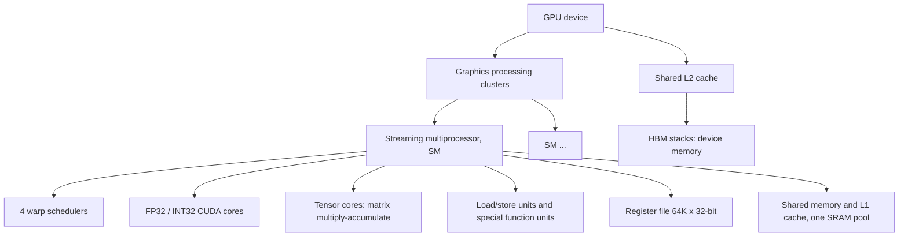

# 7.1 GPU Architecture for Infrastructure Engineers

**Level:** basics → intermediate → advanced · **Lab venue:** Nebius GPU VM (any NVIDIA GPU works) · **Status:** drafted, labs untested

## Why this matters for AI infrastructure

You will not write many CUDA kernels as an infrastructure engineer, but you will be asked daily questions that only a mental model of the GPU can answer. Why is this job using 40 percent of the GPU while the node looks busy? Why does token generation get *slower per token* when the batch is small but the GPU looks idle? Why does the same model run at half speed on two seemingly identical servers? Why did the scheduler place two GPUs on different CPU sockets and ruin throughput? Every one of those answers goes through four ideas: parallel execution units, a deep memory hierarchy, limited memory bandwidth, and the links between chips. This chapter builds those ideas from first principles, then ties them to the commands and failure modes you will meet in production.

## Prerequisites and outcomes

You need the Linux and performance basics from Part 1 (especially CPU and memory ideas in 1.9). After this chapter you will be able to:

- explain, in plain terms, the difference between a CPU and a GPU and how a GPU hides latency;
- describe the GPU's execution hierarchy (thread, warp, block, grid, SM) and its memory hierarchy with approximate sizes and speeds;
- use the roofline idea to decide whether a workload is limited by compute or by memory bandwidth, and why LLM inference decode is usually memory-bound;
- compare GPU generations and form factors (PCIe versus SXM, NVLink, NVSwitch, Grace superchips) well enough to size and place workloads;
- read `nvidia-smi`, `nvidia-smi topo -m` and throttle reasons, and diagnose six common production failures.

## Concepts

### 1. Basics: what a GPU is for

A CPU is built to finish **one** thread of work as fast as possible. It spends most of its silicon on large caches, branch prediction and out-of-order machinery so that a single, irregular instruction stream runs with minimal delay. A GPU makes the opposite trade: it spends silicon on **thousands of simple arithmetic units** and accepts that any single operation may be slow, as long as there is always some other operation ready to run. This is called a *throughput-oriented* design.

The work that suits this design is data-parallel: do the same arithmetic over millions of elements. Deep learning is exactly that. A neural network layer is mostly a large matrix multiplication, and a matrix multiplication is millions of independent multiply-accumulate operations. This is why a GPU runs such workloads orders of magnitude faster than a CPU, and why a GPU is *poor* at branchy, serial code.

Think of two kitchens. A CPU is one master chef who can make any dish quickly but only one at a time. A GPU is a large hall of line cooks, each slower and less skilled, all chopping the same vegetables in lockstep. For a banquet of identical dishes, the hall wins by a wide margin.

### 2. Basics: the execution hierarchy

A GPU is organised in layers. Learn the names because every profiler, error message and tuning guide uses them.



- **Streaming multiprocessor (SM):** the basic compute building block, roughly analogous to a CPU core but built for throughput. A modern data-centre GPU has on the order of 100 to 150+ SMs. A100 has 108 and H100 (SXM) has 132; check the datasheet for the part you are buying.
- **Thread:** one lane of execution running the *kernel* (the GPU function).
- **Warp:** a group of **32 threads** that execute the same instruction in lockstep. This is the single-instruction-multiple-thread (SIMT) model. The warp, not the thread, is the unit the hardware schedules.
- **Thread block (CTA):** a group of warps, up to 1,024 threads, scheduled on one SM and able to share fast on-chip memory and synchronise with each other.
- **Grid:** all the blocks of one kernel launch, distributed across the SMs.

Each SM has four warp schedulers, so up to four warps can issue an instruction in the same cycle, and the SM can track up to 64 resident warps (2,048 threads) at once on recent architectures. Having many warps resident is the whole point. When one warp stalls waiting for a memory load that takes hundreds of cycles, the scheduler simply switches to another warp that is ready. This **latency hiding** replaces the CPU's caches and prediction: instead of avoiding the wait, the GPU *overlaps* it with useful work from other threads.

The consequence is a central performance idea called **occupancy**: the fraction of an SM's warp slots that are actually filled. Occupancy is limited by whichever resource runs out first: registers per thread, shared memory per block, or block size. A kernel using too many registers per thread fits fewer warps and loses its ability to hide latency. You do not tune this by hand as an infrastructure engineer, but you will read it in profiler output and need to know what it means.

**Warp divergence** is the other thing to know. If threads inside one warp take different branches of an `if`, the hardware runs both paths one after another with some lanes switched off, so efficiency drops. Data-parallel code with uniform control flow is the happy path.

### 3. Intermediate: tensor cores and numerical precision

Ordinary CUDA cores do one scalar floating-point operation per lane per cycle. **Tensor cores** are fixed-function matrix engines: each instruction multiplies small matrix tiles and accumulates the result, delivering many times the throughput of the scalar units for the one operation neural networks need most.

Tensor cores became the centre of the GPU as precision shrank. The usual precisions, from widest to narrowest, are FP32, TF32 (a 19-bit format used internally with FP32 range), FP16 and BF16 (16 bits; BF16 keeps FP32's exponent range, which makes training stable), FP8 (two variants) and FP4. Each halving of width roughly doubles tensor-core throughput *and* halves memory per parameter and the bytes moved. That second effect matters as much as the first: a model in FP8 occupies half the memory of FP16 and streams through memory twice as fast per parameter.

Consequences for infrastructure:

- The headline "peak TFLOPS" for a GPU depends enormously on the precision (and on whether structured sparsity is assumed). A figure quoted for FP4 with sparsity can be many times the FP16 dense figure. When comparing parts or checking a benchmark, always fix the precision, and always check whether the number is dense or sparse.
- Frameworks reach tensor cores through libraries (cuBLAS, cuDNN, and frameworks' *mixed precision* modes). A job accidentally running in FP32 can leave most of the hardware's capability unused with no error message. Checking the actual dtype is one of the first steps in a "why is training slow" investigation.
- Newer architectures add dedicated hardware to feed the tensor cores (asynchronous copy engines, tensor memory accelerators) and software such as the Transformer Engine, which chooses FP8 or higher precision per layer. You see these as library versions and driver requirements rather than settings you flip.

### 4. Intermediate: the memory hierarchy

Compute is only half the story. Data must reach the arithmetic units, and the memory system is usually the real bottleneck. From fastest and smallest to slowest and largest:

| Level | Scope | Approx. size (recent data-centre GPU) | Speed/latency character |
|---|---|---|---|
| Registers | per thread | 64K 32-bit registers per SM (256 KB) | immediate, effectively free |
| Shared memory / L1 | per SM, programmer-managed (shared) | about 256 KB per SM combined, up to roughly 228 KB configurable as shared | tens of cycles, very high bandwidth |
| L2 cache | whole GPU | tens of MB (varies by chip) | hundreds of cycles |
| Device memory (HBM) | whole GPU | 80 to 192 GB depending on part | hundreds of cycles, TB/s of bandwidth |
| Host memory (via PCIe or NVLink-C2C) | CPU side | hundreds of GB to TB | far slower unless on a coherent link |

Numbers vary by generation, so treat the table as the *shape* to remember: each level down is roughly 10x larger and an order of magnitude slower. **Shared memory** deserves attention because it is the fast scratchpad that high-performance kernels (and libraries like FlashAttention) use to avoid trips to HBM.

**HBM (high-bandwidth memory)** is DRAM stacked in layers and placed on the same package as the GPU die, connected by a very wide interface. That gives memory bandwidth in the **terabytes per second**: roughly 2 TB/s on an A100 80 GB, about 3.35 TB/s on H100 SXM, about 4.8 TB/s on H200 (which also raises capacity from 80 GB to 141 GB), and higher again on Blackwell parts. Compare a server CPU's main-memory bandwidth of a few hundred GB/s to see why GPUs dominate memory-intensive math.

Memory capacity and bandwidth are different resources and both can limit you. Capacity decides what *fits*: weights, optimiser state, activations and the key-value cache during inference. Bandwidth decides how *fast* it can be used.

### 5. Intermediate: compute-bound versus memory-bound, and the roofline

Because arithmetic is so fast and memory is comparatively slow, many GPU workloads are limited by data movement, not by maths. The tool for reasoning about this is the **roofline model**.

Define **arithmetic intensity** as the number of floating-point operations a kernel performs per byte it moves to or from device memory (FLOP per byte). A GPU has a peak compute rate (FLOP/s) and a peak memory bandwidth (bytes/s). Their ratio is the **ridge point**: the arithmetic intensity at which the two limits meet.

- Intensity *below* the ridge: the kernel waits on memory. It is **memory-bound**. Making the arithmetic faster does nothing.
- Intensity *above* the ridge: the kernel waits on compute. It is **compute-bound**.

Worked example with round numbers: an H100 SXM delivers roughly 1,000 TFLOPS of dense BF16 tensor throughput and about 3.35 TB/s of memory bandwidth. The ridge point is about 1,000e12 / 3.35e12, close to 300 FLOP per byte. Anything below that is memory-bound.

Now apply it to LLM serving, because this is the most important practical consequence in this chapter:

- **Training and the prefill phase of inference** process many tokens at once. The matrix multiplications are large (high intensity), so the GPU is mostly **compute-bound** and tensor cores can run near peak.
- **The decode phase of inference** generates one token at a time per sequence. For each new token the GPU must read *all the model weights* from HBM (and the growing key-value cache) but performs only a small amount of arithmetic with them. Intensity is low, far below the ridge, so decode is **memory-bandwidth-bound**.

This explains observations that confuse newcomers. Token-generation speed scales with memory bandwidth, not with TFLOPS, which is why an H200 can serve noticeably faster than an H100 for decode even though the compute is identical. It explains why batching many requests together raises throughput: the weights are read once per step and reused across all sequences in the batch, raising arithmetic intensity. And it explains why quantising weights to 8-bit or 4-bit speeds up decoding almost in proportion: fewer bytes to move. You will see these ideas again in Chapter 9.7 and 9.8.

### 6. Intermediate: connecting GPUs, CPUs and each other

A GPU rarely works alone. How chips are connected determines how well a multi-GPU job scales.

**PCIe.** The standard expansion bus. PCIe Gen5 x16 gives about 64 GB/s per direction and Gen6 x16 about 128 GB/s per direction. That is more than an order of magnitude below HBM bandwidth, so any design that shuttles data between host and GPU on every step is bottlenecked by PCIe. PCIe-card GPUs rely on it for all communication.

**NVLink.** NVIDIA's high-speed GPU-to-GPU interconnect. Per-GPU bandwidth (aggregate, both directions) has grown with each generation: about 600 GB/s on A100 (NVLink 3), 900 GB/s on H100 (NVLink 4), and about 1.8 TB/s on Blackwell (NVLink 5). SXM-form-factor GPUs on HGX and DGX baseboards use it.

**NVSwitch.** A switch chip that connects many NVLink ports, so that in an eight-GPU HGX/DGX node **every GPU can talk to every other at full NVLink speed** (all-to-all) rather than only to neighbours. Rack-scale systems extend this: an NVL72 rack joins 72 Blackwell GPUs into a single NVLink domain, so collective operations across all 72 run at NVLink speed instead of falling back to the network fabric. The size of the NVLink domain is one of the most important sizing parameters for model parallelism, because tensor parallelism is communication-heavy and needs the fastest links.

**Grace superchips and NVLink-C2C.** Starting with Hopper, NVIDIA packages an Arm-based **Grace** CPU with one or more GPUs on a single module (GH200: one Grace and one Hopper; GB200: one Grace and two Blackwell GPUs), joined by a cache-coherent chip-to-chip link of about 900 GB/s. The CPU's large LPDDR memory and the GPU's HBM then behave as one unified address space, so a GPU can reach CPU-attached memory directly, which is useful for capacity-hungry cases such as very large key-value caches or embeddings.

**Inside the server: topology and NUMA.** Where each GPU and NIC attaches to the CPU sockets matters. A GPU talking to a NIC on the *same* PCIe switch or CPU socket is fast; across sockets it traverses the inter-socket link and loses bandwidth and adds latency. This is the "NUMA" problem from chapter 1.9, now with GPUs and NICs added. The tool that reveals it is `nvidia-smi topo -m`, explained below.

### 7. Advanced: reading a GPU node like an expert

Four commands give you most of what you need.

```bash
nvidia-smi                         # utilisation, memory, temperature, power, processes
nvidia-smi topo -m                 # connectivity matrix and CPU/NUMA affinity
nvidia-smi -q -d PERFORMANCE,CLOCK # clock throttle reasons and current clocks
nvidia-smi dmon -s pucvmet         # rolling per-second metrics (power, utilisation, clocks, memory, ecc, throttling)
```

**`nvidia-smi` utilisation is a coarse signal.** "GPU-Util" is the percentage of time during the sample window in which *at least one kernel was running*. It says nothing about how many SMs were busy or how efficient the kernel was. A GPU can show 100 percent utilisation while using a fraction of its capability. For real efficiency data, use DCGM profiling metrics (SM activity, tensor-pipe activity, DRAM activity) in chapter 7.7, and compare the achieved throughput to a known-good baseline.

**Reading `nvidia-smi topo -m`.** The matrix shows the connection type between each pair of devices:

| Code | Meaning |
|---|---|
| `X` | the device itself |
| `NV#` | connected by NVLink with `#` links (higher is better; full NVSwitch nodes show the same number for every pair) |
| `PIX` | PCIe, traversing at most a single PCIe bridge |
| `PXB` | PCIe, traversing multiple bridges (but not the host bridge) |
| `PHB` | PCIe through the CPU's host bridge |
| `NODE` | across PCIe host bridges within one NUMA node |
| `SYS` | across the inter-socket link between NUMA nodes (slowest) |

Healthy eight-GPU SXM node: every GPU pair shows the same `NV#`. Where GPU and NIC pairs show `PIX` or `PXB` the NIC sits close to the GPU, which is what you want for GPUDirect RDMA; `SYS` between a GPU and its NIC means the traffic crosses sockets. The affinity columns show which CPU cores and NUMA node belong to each GPU, which you use when pinning processes.

**Throttle reasons.** GPUs reduce clocks to stay within power, thermal and reliability limits. `nvidia-smi -q -d PERFORMANCE` lists active reasons: software power cap, hardware slowdown, thermal slowdown, sync boost, and others. A GPU that is persistently power- or thermally throttled delivers less than its nameplate performance and is a classic cause of one slow node dragging a multi-node job.

**ECC and memory health.** Data-centre GPUs have error-correcting memory. Single-bit errors are corrected silently and counted; uncorrectable (double-bit) errors can kill a job and, over time, degrade a GPU. Modern parts remap failing rows (row remapping) and, if remapping is exhausted or pending, require a GPU reset or replacement. `nvidia-smi -q -d ECC,ROW_REMAPPER` shows the counts and whether a reset is pending. Treat rising error counts as a hardware lifecycle signal and feed them into your node health checks and scheduler drain logic (chapters 7.7 and 11.2).

**Xid errors.** The driver reports hardware and driver faults to the kernel log as numbered "Xid" events (`dmesg | grep -i xid`). A short field guide: Xid 79 means the GPU has fallen off the PCIe bus (a hard failure, often needing a power cycle); Xid 48 is an uncorrectable ECC error; Xid 63 and 64 relate to row remapping; Xid 74 points at NVLink errors; Xid 31 is a GPU memory page fault, usually triggered by application bugs. Treat this list as a starting map and consult NVIDIA's Xid catalogue for the exact meaning on your driver version.

## Commands that matter

| Question | Command |
|---|---|
| What GPUs, driver and CUDA version? | `nvidia-smi` (header lines); `nvidia-smi -L` |
| Utilisation, power, temperature over time | `nvidia-smi dmon -s pucvmet -d 1` |
| Are links fast and local? | `nvidia-smi topo -m`; `nvidia-smi nvlink -s` |
| PCIe link generation and width actually negotiated | `nvidia-smi -q -d PCIE` (current vs maximum link) |
| Why is the GPU slow? | `nvidia-smi -q -d PERFORMANCE`, throttle reasons |
| Memory errors and remapping | `nvidia-smi -q -d ECC,ROW_REMAPPER` |
| Hardware faults | `dmesg -T | grep -i xid`; `journalctl -k | grep -i nvrm` |
| Processes using the GPU | `nvidia-smi --query-compute-apps=pid,used_memory --format=csv` |
| Enable persistence (avoids slow driver re-init) | `nvidia-smi -pm 1` (or `nvidia-persistenced`) |
| Power cap | `nvidia-smi -pl <watts>` (admin; use with care) |

## How it fails

### 1. GPU shows high utilisation but throughput is poor
**Symptom:** `nvidia-smi` reports 95 to 100 percent utilisation, yet tokens per second or samples per second are far below the vendor reference. **Diagnose:** utilisation only means a kernel was running. Check DCGM profiling fields (SM active, tensor active, DRAM active), the actual dtype (FP32 versus BF16), batch size, and whether the job is memory-bound (low batch decode). **Fix:** correct the precision or batch settings, enable fused/optimised kernels, and compare to a baseline measured with the lab in this chapter.

### 2. Performance halves on some nodes: PCIe link downtraining
**Symptom:** host-to-device copies or GPUDirect transfers on one node are about half the speed of its siblings. **Diagnose:** `nvidia-smi -q -d PCIE` and compare *current* with *maximum* link generation and width; look for Gen3 or x8 where Gen5 x16 is expected. Causes include a poorly seated card or riser, a bad cable or retimer, or a BIOS setting. **Fix:** reseat or replace the hardware; force and verify link speed in BIOS; drain the node until fixed.

### 3. One slow GPU drags a whole multi-GPU job: throttling
**Symptom:** a data-parallel or tensor-parallel job runs at the speed of its slowest rank. **Diagnose:** `nvidia-smi -q -d PERFORMANCE` and `dmon` across all GPUs: look for one GPU with thermal slowdown or a low power cap, clock far below its peers. **Fix:** check airflow and fan or liquid-cooling health, reset power limits to the intended value, and replace faulty hardware. Add a pre-job health check that compares clocks across GPUs.

### 4. Out of memory despite free-looking memory: fragmentation and reserved memory
**Symptom:** `CUDA out of memory` while `nvidia-smi` shows several GB free. **Diagnose:** the framework's caching allocator holds memory and may fragment it; large allocations then fail even though the total free amount suffices. Inspect `torch.cuda.memory_summary()`. **Fix:** reduce peak allocations, use allocator settings that limit fragmentation (for example expandable segments), shorten sequence lengths or batch sizes, and avoid mixing very different allocation sizes in long-running servers.

### 5. Cross-socket traffic: wrong NUMA placement
**Symptom:** a node with healthy GPUs and NICs gets low all-reduce or data-loading throughput; `topo -m` shows `SYS` between a GPU and its assigned NIC or CPU cores. **Diagnose:** check the affinity columns and where the launcher pinned the processes. **Fix:** bind each rank to the CPU cores and NIC local to its GPU (launcher options, Slurm `--cpu-bind`, Kubernetes Topology Manager), and set NCCL's interface and HCA selection accordingly.

### 6. GPU disappears or jobs crash with Xid errors
**Symptom:** a job dies with `CUDA error: unspecified launch failure` or the GPU vanishes from `nvidia-smi`. **Diagnose:** `dmesg -T | grep -i xid`: Xid 79 (fell off the bus), Xid 48 (uncorrectable ECC), Xid 74 (NVLink). Check the PCIe link, power rails and ECC counters. **Fix:** drain the node from the scheduler, reset or power-cycle the GPU, file a hardware case if errors recur, and automate this decision in your node health tooling rather than letting jobs fail repeatedly.

## Hands-on lab (Nebius GPU VM; untested)

**Setup.** Start a Nebius VM with one or more NVIDIA GPUs and a recent driver. Confirm with `nvidia-smi`. Install PyTorch with CUDA support in a virtual environment (`python3 -m venv venv && . venv/bin/activate && pip install torch`).

### Part A: inventory the machine

```bash
nvidia-smi
nvidia-smi topo -m
nvidia-smi -q -d PCIE | egrep -i 'generation|width'
nvidia-smi -q -d PERFORMANCE | egrep -i 'throttle|slowdown|cap'
lscpu | egrep -i 'model name|socket|numa'
```

Record: the GPU model, memory size, driver and CUDA version, PCIe link current versus maximum, and whether any throttle reason is active. If the VM has several GPUs, write down the `topo -m` matrix and identify NVLink versus PCIe pairs.

### Part B: measure memory bandwidth

```python
import torch

n = 1 << 30                       # 1 GiB
x = torch.empty(n, dtype=torch.uint8, device="cuda")
y = torch.empty_like(x)
for _ in range(3):
    y.copy_(x)                    # warm-up
start = torch.cuda.Event(enable_timing=True)
end = torch.cuda.Event(enable_timing=True)
start.record()
for _ in range(20):
    y.copy_(x)
end.record()
torch.cuda.synchronize()
ms = start.elapsed_time(end) / 20
print(f"device copy: {2 * n / ms / 1e6:.0f} GB/s")   # read + write counted
```

**Expected:** a value within roughly 70 to 90 percent of the datasheet bandwidth (for example 2.4 to 3.0 TB/s on an H100 SXM). Realistic copy kernels do not reach the theoretical peak.

### Part C: measure compute at several precisions and sizes

```python
import torch

def tflops(n, dtype, iters=20):
    a = torch.randn(n, n, device="cuda", dtype=dtype)
    b = torch.randn(n, n, device="cuda", dtype=dtype)
    for _ in range(3):
        a @ b
    torch.cuda.synchronize()
    s, e = torch.cuda.Event(enable_timing=True), torch.cuda.Event(enable_timing=True)
    s.record()
    for _ in range(iters):
        a @ b
    e.record()
    torch.cuda.synchronize()
    ms = s.elapsed_time(e) / iters
    return 2 * n**3 / ms / 1e9          # TFLOPS

torch.backends.cuda.matmul.allow_tf32 = False
for dtype in (torch.float32, torch.bfloat16, torch.float16):
    for n in (512, 2048, 8192):
        print(dtype, n, f"{tflops(n, dtype):.0f} TFLOPS")
torch.backends.cuda.matmul.allow_tf32 = True
print("fp32 with TF32 enabled:", f"{tflops(8192, torch.float32):.0f} TFLOPS")
```

**Expected pattern:** small matrices (512) achieve a small fraction of peak because they are too small to fill the GPU; large matrices approach hardware limits; BF16 and FP16 far exceed FP32; enabling TF32 lifts FP32 matmul markedly. Explain each effect with the concepts above (occupancy, tensor cores, intensity).

### Part D: see the memory-bound regime

Time a matrix-vector product (decode-like) against a matrix-matrix product (training-like) with the same weight matrix, and compute achieved FLOP/s and bytes/s for each. A matrix-vector multiply of a 16384 by 16384 BF16 matrix moves about 512 MB and performs about 0.5 GFLOP: compute its intensity, compare with the ridge point you calculated, and check that the achieved bandwidth is near the copy result from Part B while TFLOPS is tiny.

### Part E: induce and observe throttling (optional, admin)

On a test VM only: lower the power limit (`sudo nvidia-smi -pl <lower value within allowed range>`), rerun Part C, and watch `nvidia-smi dmon -s pucvmet` and `nvidia-smi -q -d PERFORMANCE`. Restore the original limit afterwards. Record the performance difference and the throttle reason displayed.

## Checkpoint questions

1. Why does a GPU tolerate slow individual memory accesses better than a CPU?
2. What is a warp, and what happens when threads in one warp take different branches?
3. What limits occupancy, and why does low occupancy hurt latency hiding?
4. Why is "GPU-Util 100 percent" not proof that the GPU is working efficiently?
5. Define arithmetic intensity and the ridge point. Calculate the approximate ridge point for a GPU with 1,000 TFLOPS and 3.35 TB/s.
6. Why is LLM decode memory-bound while training is compute-bound? Why does batching help decode throughput?
7. Why does an H200 serve decode faster than an H100 even though their compute is the same?
8. Compare PCIe Gen5 x16, NVLink on H100, and HBM bandwidth. What does each ratio imply about where data should live?
9. What does `SYS` between a GPU and a NIC in `nvidia-smi topo -m` tell you, and what do you do about it?
10. A GPU has Xid 79 in `dmesg`. What does it mean, and what are the first three actions?

### Answers

1. It hides latency by keeping many warps resident and switching to a ready one while another waits, instead of relying on large caches and prediction to avoid the wait.
2. A warp is 32 threads executing the same instruction in lockstep. If they branch differently, the hardware executes each path serially with inactive lanes masked, so efficiency drops (divergence).
3. Registers per thread, shared memory per block, and block size, whichever is exhausted first. Fewer resident warps leave fewer alternatives to switch to during stalls.
4. It only reports the fraction of time any kernel ran. It says nothing about SM or tensor-core activity, memory efficiency or precision, so a poor kernel can show 100 percent.
5. Arithmetic intensity is FLOP per byte moved to or from device memory; the ridge point is peak FLOP/s divided by peak bytes/s, where compute and memory limits meet. 1,000e12 / 3.35e12 is about 300 FLOP/byte.
6. Training and prefill process many tokens at once (large matrices, high intensity). Decode reads all weights for each new token but does little arithmetic with them, so intensity is low. Batching reuses each weight read across many sequences, raising intensity.
7. Decode is limited by memory bandwidth, which is higher on the H200 (about 4.8 versus 3.35 TB/s), and its larger memory fits bigger models or caches.
8. PCIe Gen5 x16 is about 64 GB/s per direction, NVLink on H100 about 900 GB/s aggregate, HBM several TB/s: each step up is an order of magnitude. Keep hot data in HBM, communicate between GPUs over NVLink, and avoid host-device transfers in inner loops.
9. Traffic between that GPU and NIC crosses the inter-socket link, hurting bandwidth and latency. Fix by choosing a NIC local to the GPU, pinning processes and cores to the local NUMA node, and configuring NCCL's NIC selection.
10. The GPU has fallen off the PCIe bus. Drain the node from the scheduler, inspect the PCIe link, power and temperature history, then reset or power-cycle and file a hardware case if it recurs.

## Sources and further reading

- Chris Fregly, *AI Systems Performance Engineering*, ch. 2 (hardware overview: superchips, NVLink-C2C, precision, SMs and warps) and ch. 6 (SIMT model, register and shared-memory sizes, warp schedulers, memory hierarchy).
- Fuheng Wu, *Distributed AI Systems*, ch. 2 (GPU generations, NVLink bandwidth by generation, reading `nvidia-smi topo -m`).
- Brendan Gregg, *Systems Performance*, 2nd ed., ch. 2 and 6 for the methodology (utilisation, saturation, errors) used throughout.
- NVIDIA public documentation: H100/H200/B200 datasheets and architecture whitepapers, CUDA C++ Programming Guide, DCGM documentation, Xid error catalogue.

*Flags for verification:* the exact SM counts, HBM capacity and bandwidth, and peak TFLOPS quoted here are vendor-datasheet values recalled for illustration and must be re-checked against the datasheet of the specific part (and SXM versus PCIe variant) before you rely on them. The ridge-point calculation uses rounded numbers by design. Xid meanings are driver-version dependent. All lab commands are **untested** and need to be run on a Nebius GPU VM before this chapter is marked reviewed.
