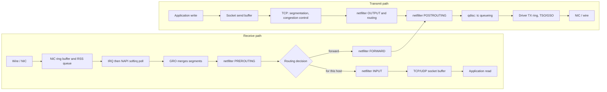
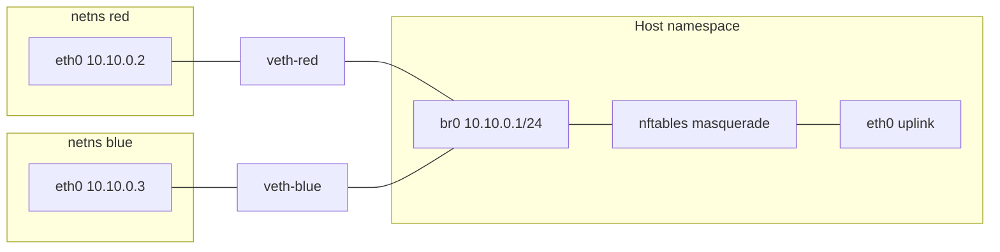

# 2.5 The Linux Networking Toolbox

**Level:** basics → intermediate → advanced · **Lab venue:** GCP Linux VM (a Mac cannot create Linux network namespaces natively) · **Status:** drafted, labs untested

## Why this matters for AI infrastructure

A GPU cluster has two networks living side by side. The *fabric* (InfiniBand or RoCE Ethernet) carries gradient and activation traffic by RDMA, and the kernel's TCP/IP stack is mostly bypassed. Everything else still rides the ordinary Linux stack: SSH and out-of-band management, Slurm and Kubernetes control traffic, container image pulls, NFS or object-store reads of training data, NCCL's bootstrap handshake, metrics scraping, and every Kubernetes Service and Pod connection. When a 512-GPU job hangs at startup or a checkpoint upload crawls, the cause is very often a plain Linux networking misconfiguration: a reverse-path filter dropping packets on a multi-NIC node, a full connection-tracking table, an MTU mismatch, or a bond that sends all traffic down one wire.

This chapter gives you a working mental model of the Linux network path and the toolbox to inspect and change it. It is the foundation for container networking (chapter 5.4), the AI-fabric chapters in Part 8, and the troubleshooting playbooks in Part 11.

## Prerequisites and outcomes

You should know what an IP address, subnet, default gateway, TCP and UDP are (chapter 2.1 and 2.2 refresh these). After this chapter you will be able to:

- read a host's network state quickly and correctly with `ip`, `ss`, `ethtool`, `nstat`;
- explain the path a packet takes through the kernel and name where each tool hooks in;
- configure policy routing, bonding, firewalling with nftables, and traffic shaping with `tc`;
- tune a NIC and the socket buffers for high-throughput hosts;
- build a multi-host topology on one machine with network namespaces and use it to reproduce failures safely;
- diagnose the six failure modes at the end of the chapter.

## Concepts

### 1. Basics: the state of a host in five commands

Old `ifconfig`, `route`, `arp` and `netstat` are deprecated; the `iproute2` suite (`ip`, `ss`, `tc`, `bridge`) replaces them and exposes features the old tools never could. Five commands answer most first-minute questions.

```bash
ip -br addr            # one line per interface: state and addresses
ip -br link            # L2 view: MAC addresses, state, MTU with -d
ip route               # main routing table
ip neigh               # ARP / IPv6 neighbour cache (who is reachable at L2)
ss -tulpn              # listening TCP/UDP sockets and the owning process
```

Read them in layers, bottom up. `ip -br link` tells you whether the interface is `UP` and has carrier (`LOWER_UP`); if not, nothing above it matters. `ip -br addr` tells you what addresses are configured. `ip route` answers *where* a packet goes; to ask about a single destination use the kernel's own decision:

```bash
ip route get 10.20.0.15
# 10.20.0.15 dev eth1 src 10.20.0.4 uid 1000
#     cache
```

`ip route get` is the most underused debugging command in Linux. It reports the egress interface, the **source address the kernel will pick**, and the gateway, and it takes policy routing rules into account. If a connection leaves from the wrong NIC or with an unexpected source IP, this tells you immediately.

`ip neigh` shows the neighbour table. An entry stuck in `FAILED` or `INCOMPLETE` means ARP (or IPv6 neighbour discovery) got no answer: a cabling, VLAN or firewall problem on the local segment, not a routing problem.

`ss` replaces `netstat`. Useful forms:

```bash
ss -s                           # socket totals by state; spot TIME-WAIT or SYN-RECV floods
ss -tn state established '( dport = :443 )'
ss -tiepm dst 10.20.0.15        # per-connection TCP internals: rtt, cwnd, retrans, send/recv queues
ss -ltn                         # for LISTEN sockets, Send-Q is the backlog limit, Recv-Q the current queue
```

Two details repay memorising. For *established* connections, `Recv-Q` is bytes the application has not yet read and `Send-Q` is bytes not yet acknowledged; a persistently large Recv-Q means a slow reader, a large Send-Q means the network or the peer is the bottleneck. For *listening* sockets the meaning flips: Recv-Q is the current accept-queue length and Send-Q is its limit. A listener whose Recv-Q equals Send-Q is dropping new connections.

### 2. Intermediate: the path of a packet through Linux

Every tool in this chapter attaches to some point on the path below. Keep the picture in your head.



Walk both directions once.

**Receive.** The NIC DMAs frames into a ring buffer in host memory. Modern NICs have several receive queues; *RSS* hashes each flow's headers to pick a queue, and each queue raises an interrupt on its own CPU. The interrupt only schedules a softirq; the real work happens in NAPI polling, where the kernel drains the ring in batches. *GRO* coalesces consecutive segments of the same flow into one large buffer so the upper layers handle fewer, larger packets. The packet then passes netfilter's PREROUTING hook, the routing decision (local delivery or forwarding), the INPUT hook, and lands in the receiving socket's buffer where the application reads it.

**Transmit.** The application's `write` fills the socket send buffer. TCP builds segments, applies congestion control and, thanks to segmentation offload (TSO/GSO), hands large buffers downward and lets the NIC cut them to MTU-sized frames. The packet passes OUTPUT and POSTROUTING hooks, then enters the **queueing discipline (qdisc)** of the egress interface, which is where `tc` operates, and finally the driver's transmit ring.

Where drops happen is the most useful thing this diagram teaches, because each place has a different counter:

| Where | Typical cause | Where to look |
|---|---|---|
| NIC RX ring | ring too small or CPU not polling fast enough | `ethtool -S` (`rx_dropped`, `rx_missed`, `rx_no_buffer`), `ip -s link` |
| softirq backlog | one CPU saturated draining a single queue | `/proc/net/softnet_stat` (2nd col drops, 3rd col time squeezes), `mpstat -P ALL` for `%soft` |
| netfilter | firewall rule or conntrack table full | `nft list ruleset`, `conntrack -S`, `dmesg` |
| Routing | reverse-path filter, no route | `nstat -az \| grep -i IpReversePathFilter`, `ip route get` |
| Socket buffer | slow application | `ss -ti`, `nstat` (`TcpExtTCPRcvQDrop`) |
| qdisc | queue full or shaper | `tc -s qdisc show dev eth0` (`dropped`, `overlimits`) |
| TX ring / peer | congestion, remote end slow | `ethtool -S`, switch counters |

### 3. Intermediate: counters and the habit of diffing them

Kernel counters are cumulative since boot, so a single reading says little. The skill is *diffing*: read, reproduce the problem, read again, and see which counters moved.

```bash
ip -s -s link show dev eth0        # -s twice adds detailed error classes
ethtool -S eth0 | egrep -i 'drop|err|miss|pause|discard|nodesc'
nstat -z | egrep 'Retrans|Drop|Reset|Overflow'    # kernel SNMP-style counters; nstat resets on read unless -s
nstat -sz > /tmp/before; sleep 30; nstat -sz > /tmp/after   # or just run nstat twice: the 2nd run shows deltas
cat /proc/net/softnet_stat          # one row per CPU, hex values
```

Three counter families are worth knowing by name. `TcpRetransSegs` against `TcpOutSegs` gives a retransmit ratio; anything persistently above roughly 0.5 to 1 percent on a data-centre network deserves investigation, because retransmits are how TCP signals loss. `TcpExtListenOverflows` and `ListenDrops` show accept-queue overflows (the application too slow to `accept`, or `somaxconn` too small). `TcpExtTCPRcvQDrop` and `TCPBacklogDrop` show receive-side drops caused by the socket not being drained.

Monitoring systems should record, per interface, bytes and packets in and out, errors and drops, plus TCP retransmits, resets and connection rate. Record per-interface, not just per-host, because the failure you will most often chase is *one* of several NICs misbehaving.

### 4. Intermediate: netfilter, nftables and connection tracking

Netfilter is the framework of hooks in the packet path shown above. **nftables** is the modern rule language on top of it, replacing `iptables` (on current distributions the `iptables` command is often a compatibility layer that writes nftables rules; check with `iptables --version`, which shows `(nf_tables)`). Kubernetes kube-proxy, Docker and many CNIs still use it, so you will meet it in every cluster.

Structure: a **table** contains **chains**; a chain is attached to a hook (`prerouting`, `input`, `forward`, `output`, `postrouting`) with a priority and holds ordered **rules**. A minimal host firewall:

```bash
nft add table inet filter
nft 'add chain inet filter input { type filter hook input priority 0; policy drop; }'
nft add rule inet filter input ct state established,related accept
nft add rule inet filter input iif lo accept
nft add rule inet filter input tcp dport 22 accept
nft list ruleset
```

Notice the first rule after the chain: it accepts anything belonging to an already-tracked connection. That rule depends on **conntrack**, the kernel's connection-tracking subsystem, which records every flow (5-tuple, state, timeout) it sees. Conntrack is what makes stateful filtering and NAT possible: NAT must remember how it rewrote the first packet to rewrite the reply consistently. The cost is a table with a fixed maximum size.

```bash
sysctl net.netfilter.nf_conntrack_max          # table capacity
cat /proc/sys/net/netfilter/nf_conntrack_count # entries currently in use
conntrack -S                                    # per-CPU stats: insert_failed, drop, early_drop
conntrack -L | head                             # inspect entries
```

When `nf_conntrack_count` reaches `nf_conntrack_max`, the kernel logs `nf_conntrack: table full, dropping packet` and **new** connections fail while existing ones keep working, an infuriating partial outage. Busy Kubernetes nodes, NAT gateways and hosts doing many short connections hit this. Remedies: raise `nf_conntrack_max` (and the hash size) in proportion to RAM, shorten timeouts for connections you do not care about, or exclude traffic from tracking with a `notrack` rule where no NAT or stateful filtering is needed. Raise the limit first as the quick fix, then find out who is opening so many connections.

NAT is configured in `nat` tables. Masquerading all traffic from a private subnet out of a gateway looks like:

```bash
sysctl -w net.ipv4.ip_forward=1
nft add table ip nat
nft 'add chain ip nat postrouting { type nat hook postrouting priority 100; }'
nft add rule ip nat postrouting ip saddr 10.10.0.0/24 oifname "eth0" masquerade
```

### 5. Intermediate: routing beyond the default gateway

A single routing table with one default route is enough for a simple server and wrong for a GPU node, which usually has several NICs: a management NIC, one or more NICs for storage or the compute fabric, and possibly a front-end NIC. Two kernel features matter.

**Policy routing.** The kernel consults an ordered list of *rules* (`ip rule`), each selecting a routing *table*. This lets traffic that arrives on, or originates from, a given interface also leave through it:

```bash
echo "100 storage" >> /etc/iproute2/rt_tables
ip route add 10.30.0.0/24 dev eth2 src 10.30.0.4 table storage
ip route add default via 10.30.0.1 dev eth2 table storage
ip rule add from 10.30.0.4/32 table storage priority 100
ip rule show
```

**Reverse-path filtering.** With `net.ipv4.conf.<if>.rp_filter=1` (strict mode) the kernel drops an incoming packet if the route back to its *source address* would not leave through the interface it arrived on. On a single-homed host this is a sensible anti-spoofing measure. On a multi-NIC node with asymmetric routing it silently discards legitimate traffic, which shows up as a connection that works from one peer and not another with no error anywhere except a counter. Mode 2 (loose) only requires that *some* route back exists. Remember the kernel uses the **maximum** of the `all` and `<interface>` settings, so set both.

A related multi-NIC trap is **ARP flux**: by default Linux answers an ARP request for any of its local addresses on any interface, so a switch may learn that an address lives behind the wrong port. For nodes with several NICs on separate subnets, the usual setting is `arp_ignore=1` (answer only if the address is on the receiving interface) and `arp_announce=2` (use the best local address when asking), set on `all` and `default`.

### 6. Intermediate: bonding and link aggregation

A **bond** merges several physical links into one logical interface for redundancy and aggregate bandwidth. The two modes you will actually use are:

- `active-backup` (mode 1): one link carries traffic, another waits. No switch configuration needed; the right choice for management networks.
- `802.3ad` (mode 4, LACP): all links active; both ends negotiate the group, so the switch ports must be configured as an LACP port-channel (or an MLAG pair across two switches for switch redundancy).

```bash
ip link add bond0 type bond mode 802.3ad miimon 100 lacp_rate fast xmit_hash_policy layer3+4
ip link set eth1 down; ip link set eth1 master bond0
ip link set eth2 down; ip link set eth2 master bond0
ip link set bond0 up
cat /proc/net/bonding/bond0      # check partner MAC, aggregator ID, link states
```

The key concept is that bonding does **not** make one connection faster. The transmit hash maps each *flow* to a single member link (policy `layer2` hashes MACs only, `layer2+3` adds IPs, `layer3+4` adds ports). A single large TCP stream between two hosts therefore never exceeds one link's speed, and with a poor hash policy many flows can still collide on one member. Choose `layer3+4` when you have many flows, and remember the *switch* chooses its own hash for the reverse direction. This property reappears in Part 8: AI fabrics avoid it by designing for *flow entropy* and, on RoCE and InfiniBand, by adaptive or per-packet load balancing.

### 7. Advanced: tuning the NIC and the stack for throughput

Defaults are chosen for modest hosts. High-speed NICs (25 to 400 Gbps) on storage and data-loading paths need deliberate tuning, always **measured**, never copied from a blog.

**Ring buffers.** `ethtool -g eth0` shows current and maximum RX/TX ring sizes. Drops that show in `rx_missed_errors`-type counters while CPUs are not saturated suggest the ring is too small to absorb bursts: `ethtool -G eth0 rx 4096 tx 4096`. Larger rings cost memory and add latency under load (bufferbloat), so raise them only to cure observed drops.

**Offloads.** `ethtool -k eth0` lists features: TSO and GSO (segmentation), GRO and LRO (receive coalescing), checksum offload, and others. Leave them on for throughput. Turn one off only as a diagnostic step, for example when a packet capture shows impossibly large frames (that is just GRO/TSO and is normal) or a driver bug is suspected.

**Queues and interrupts.** `ethtool -l eth0` shows the number of channels (queues). Set it close to the number of cores local to the NIC's NUMA node: `ethtool -L eth0 combined 16`. Pin interrupts with the NIC vendor's `set_irq_affinity` script or `irqbalance` settings, and check `/proc/interrupts` that queues are spread out. A node where a single CPU shows 100 percent `%soft` while others idle is a one-queue (or one-hot-flow) problem. On NUMA servers keep the NIC's interrupts and the application on the **same socket** as the NIC (`cat /sys/class/net/eth0/device/numa_node`); crossing the socket interconnect costs bandwidth and latency. The same rule governs GPU-to-NIC affinity in chapter 7.9.

**MTU.** Jumbo frames (MTU 9000) cut per-packet overhead and CPU use on storage and training networks, but only work if **every** device on the path agrees. Verify end to end with the do-not-fragment ping:

```bash
ping -M do -s 8972 10.30.0.9     # 8972 + 8 ICMP + 20 IP = 9000
```

**Socket buffers and congestion control.** Throughput on a long fat path is bounded by window size, which is bounded by the buffers. Relevant sysctls: `net.core.rmem_max`, `net.core.wmem_max`, `net.ipv4.tcp_rmem` and `tcp_wmem` (min, default, max triples), `net.core.netdev_max_backlog`, `net.core.somaxconn`. For data-centre hosts the pairing of `net.core.default_qdisc=fq` with `net.ipv4.tcp_congestion_control=bbr` is common for wide-area transfers (checkpoint upload to object storage), while inside a fabric with ECN the default CUBIC or DCTCP-style settings are typical. Test with `iperf3` before and after, with several parallel streams (`-P 8`) because one stream rarely fills a fast link.

**Busy polling and kernel bypass.** For latency-critical paths there are `SO_BUSY_POLL`, XDP/AF_XDP and, for AI traffic, RDMA, which bypasses the kernel stack entirely. This is why the Linux tuning above matters for the *control and storage* plane, and why the AI fabric needs its own tooling (Part 8).

### 8. Advanced: traffic control with tc, and netem for testing

`tc` manages **qdiscs**, the queues between the IP layer and the driver. `tc -s qdisc show dev eth0` is a diagnostic in its own right: look at `dropped`, `overlimits` and `backlog`. Modern defaults (`fq_codel` or `fq`) are fair-queueing and rarely need replacement. Where `tc` shines for an infrastructure engineer is **`netem`**, which injects delay, jitter, loss, duplication and reordering on an interface, so you can rehearse failures deterministically:

```bash
tc qdisc add dev eth0 root netem delay 20ms 5ms loss 0.5%
tc qdisc change dev eth0 root netem delay 100ms loss 2%
tc qdisc del dev eth0 root
```

Use it to answer questions like "does our training launcher tolerate 1 percent packet loss on the management network?" before production answers for you.

### 9. Advanced: network namespaces, veth and bridges, the container foundation

A **network namespace** is an isolated copy of the network stack: its own interfaces, routing tables, neighbour table, netfilter rules and sockets. Containers are processes placed in their own namespace. A **veth pair** is a virtual cable whose two ends can sit in different namespaces, and a **bridge** is a virtual L2 switch. With these three objects you can build any small topology on one machine, and you can see exactly what a container runtime or a CNI plugin does when it wires up a Pod.



When you later read how Kubernetes assigns a Pod IP (chapter 5.4), this is the mechanism underneath: one namespace per Pod, a veth into the node, and either a bridge or direct routes on the other side.

## Commands that matter: a quick reference

| Question | Command |
|---|---|
| Is the link up, what MTU? | `ip -d -br link` ; `ethtool eth0` (speed, duplex, link detected) |
| Which driver and firmware? | `ethtool -i eth0` |
| Where will this packet go? | `ip route get <dst>` |
| Who is listening on a port? | `ss -ltnp 'sport = :8080'` |
| Is TCP healthy for this peer? | `ss -ti dst <ip>` (rtt, cwnd, retrans) |
| Which counters moved during the problem? | `nstat` twice, `ethtool -S` diff |
| Is conntrack saturated? | `conntrack -S`, `nf_conntrack_count` vs `nf_conntrack_max` |
| What is the firewall doing? | `nft list ruleset`; trace with `nft monitor trace` |
| Is the bond healthy? | `cat /proc/net/bonding/bond0` |
| Capture a few packets safely | `tcpdump -nn -i eth0 -c 200 -s 96 'host 10.0.0.5 and tcp port 443' -w /tmp/c.pcap` |
| Throughput and loss test | `iperf3 -c <host> -P 8 -t 30` |
| Path MTU | `ping -M do -s 8972 <host>`; `tracepath <host>` |

On packet capture: it costs CPU and disk, so keep captures short and filtered, limit the snapshot length (`-s 96` keeps headers only), and prefer counters and `ss -ti` for first-pass diagnosis. Capture when you need to see the *sequence* of events: handshake failures, retransmission patterns, the exact reset that ended a connection. Analyse the file offline in Wireshark or `tshark`.

## How it fails

### 1. "New connections fail, existing ones work": conntrack table full

**Symptom:** intermittent connection timeouts on a node, `dmesg` shows `nf_conntrack: table full, dropping packet`. **Diagnose:** compare `nf_conntrack_count` with `nf_conntrack_max`; inspect `conntrack -L` for the dominant source or destination. **Fix:** raise `nf_conntrack_max` (and `nf_conntrack_buckets`), lower timeouts for short-lived flows, or add `notrack` rules where tracking is unnecessary; then address the connection storm itself (missing connection pooling, a misbehaving client).

### 2. Multi-NIC node where only some peers can reach it: reverse-path filter

**Symptom:** a service answers from the management network but not from the storage network; no firewall rule explains it. **Diagnose:** `sysctl net.ipv4.conf.all.rp_filter net.ipv4.conf.eth2.rp_filter`; check the counter `nstat -az TcpExtIPReversePathFilter` and `ip route get <peer-ip> from <peer-ip> iif eth2`. **Fix:** make routing symmetric with policy routing (preferred), or use loose mode (2) on the affected interfaces, remembering to set both `all` and the interface.

### 3. Small packets work, large transfers stall: MTU mismatch or PMTUD blackhole

**Symptom:** ping and SSH login work, but `scp` of a big file or an HTTPS handshake with a large certificate hangs. **Diagnose:** `ping -M do -s <size>` stepping up to find the largest passing size; `tracepath`; a capture showing full-size segments with no acks and no ICMP "fragmentation needed" returning (because something filters ICMP). **Fix:** set a consistent MTU on every hop, allow ICMP type 3 code 4 (and the IPv6 equivalent), or clamp TCP MSS on the gateway as a workaround.

### 4. Bond configured, but one link saturated and one idle: hash polarisation

**Symptom:** 2 x 100 Gbps bond delivers 100 Gbps total, one member's counters rise while the other's barely move. **Diagnose:** compare `ethtool -S` per member; check `xmit_hash_policy`; count distinct flows (`ss -tn | wc -l`). With few flows (or one) this is expected behaviour. **Fix:** use `layer3+4` hashing, increase flow count (several parallel streams, multiple NCCL channels), and verify the switch's hash for the return direction.

### 5. One CPU pinned in softirq, packets dropped while the rest idle: queue and IRQ imbalance

**Symptom:** throughput capped well below line rate, `mpstat -P ALL 1` shows one core at near 100 percent `%soft`, `/proc/net/softnet_stat` third column (time_squeeze) rising. **Diagnose:** `ethtool -l` (only one channel?), `cat /proc/interrupts | grep eth0` (all on one CPU?), check whether the traffic is a single flow (RSS cannot split one flow). **Fix:** raise channels, spread IRQ affinity within the NIC's NUMA node, use multiple flows, and consider RPS/RFS where hardware queues are limited.

### 6. Wrong source address or traffic out of the wrong NIC: missing policy routing and ARP flux

**Symptom:** replies from a multi-homed server come from an unexpected IP or interface; switches show the server's MAC on the wrong port. **Diagnose:** `ip route get <client>`, `ip rule`, `ip neigh` on the peers, and the `arp_ignore`/`arp_announce` values. **Fix:** per-NIC routing tables with `ip rule from`, set `arp_ignore=1` and `arp_announce=2`, bind services to specific addresses where needed.

## Hands-on lab (GCP VM; untested)

**Setup.** Create a small Debian or Ubuntu VM (e2-standard-2 is enough) with root access. Install tools: `apt-get update && apt-get install -y iproute2 nftables conntrack iperf3 tcpdump ethtool`.

### Part A: build the topology

```bash
sudo ip netns add red
sudo ip netns add blue
sudo ip link add br0 type bridge
sudo ip addr add 10.10.0.1/24 dev br0
sudo ip link set br0 up

for ns in red blue; do
  sudo ip link add veth-$ns type veth peer name eth0 netns $ns
  sudo ip link set veth-$ns master br0
  sudo ip link set veth-$ns up
  sudo ip -n $ns link set lo up
  sudo ip -n $ns link set eth0 up
done
sudo ip -n red  addr add 10.10.0.2/24 dev eth0
sudo ip -n blue addr add 10.10.0.3/24 dev eth0
sudo ip -n red  route add default via 10.10.0.1
sudo ip -n blue route add default via 10.10.0.1

sudo ip netns exec red ping -c 3 10.10.0.3
```

**Expected:** 3 replies with sub-millisecond latency. If ping fails, check that both veth ends are up and `bridge link` shows both veths attached to `br0`. Also note that bridged traffic can be filtered by `br_netfilter` if that module is loaded; `sysctl net.bridge.bridge-nf-call-iptables` helps identify it.

### Part B: give the namespaces internet access through NAT

```bash
sudo sysctl -w net.ipv4.ip_forward=1
IFACE=$(ip route show default | awk '{print $5; exit}')
sudo nft add table ip nat
sudo nft 'add chain ip nat postrouting { type nat hook postrouting priority 100; }'
sudo nft add rule ip nat postrouting ip saddr 10.10.0.0/24 oifname "$IFACE" masquerade

sudo ip netns exec red ping -c 2 8.8.8.8
sudo conntrack -L | grep 10.10.0.2
```

**Expected:** replies from 8.8.8.8 and a conntrack entry showing the original source `10.10.0.2` and the translated reply tuple. Write down in your own words what each field in that entry means.

### Part C: measure, then degrade the network with netem

```bash
sudo ip netns exec blue iperf3 -s -D
sudo ip netns exec red iperf3 -c 10.10.0.3 -t 10            # baseline throughput
sudo ip netns exec red tc qdisc add dev eth0 root netem delay 20ms 5ms loss 1%
sudo ip netns exec red ping -c 10 10.10.0.3                 # RTT near 20 ms
sudo ip netns exec red iperf3 -c 10.10.0.3 -t 10            # throughput collapses
sudo ip netns exec red ss -ti dst 10.10.0.3                 # see retrans / cwnd while running
sudo ip netns exec red nstat -z | grep -i retrans
```

**Expected:** a large throughput drop with only 1 percent loss. Explain why a loss rate that sounds small hurts TCP so much (hint: congestion window halving and the Mathis relationship between loss rate, RTT and throughput).

### Part D: reproduce two failures on purpose

1. **conntrack full:** `sudo sysctl -w net.netfilter.nf_conntrack_max=256`, then open several hundred connections from `red` (for example with `for i in $(seq 1 500); do (nc -z -w1 8.8.8.8 53 &) ; done`) and watch `dmesg | tail` and `conntrack -S`. Restore with a large value and reverse the tracking limit.
2. **MTU blackhole:** `sudo ip -n blue link set eth0 mtu 1400`, then from `red` run `ping -M do -s 1472 10.10.0.3` (fails) versus `-s 1300` (works). Identify which tool shows the discrepancy and how `tracepath` reports it.

### Part E: cleanup

```bash
sudo ip netns del red; sudo ip netns del blue; sudo ip link del br0
sudo nft flush ruleset; sudo sysctl -w net.ipv4.ip_forward=0
```

## Checkpoint questions

1. Which command shows the source address the kernel will use to reach 10.20.0.15, and why is it more reliable than reading `ip route`?
2. Explain what `Recv-Q` and `Send-Q` mean for a LISTEN socket versus an ESTABLISHED socket.
3. Name four places a packet can be dropped on the receive path and the counter or tool that reveals each.
4. Why does conntrack exhaustion break *new* connections while leaving established ones working?
5. A node has two NICs on different subnets. Explain how reverse-path filtering can silently drop traffic, and give two ways to fix it.
6. Why can a bonded pair of 100 Gbps links fail to give a single TCP stream more than 100 Gbps? What would you change to use both links?
7. What is the arithmetic behind `ping -M do -s 8972` for a 9000-byte MTU?
8. A host shows one CPU at 100 percent softirq and the others idle while the NIC is far below line rate. List three checks and a fix for each.
9. What does a veth pair do, and how does a container runtime use veth, a bridge and a namespace to connect a container?
10. When is it worth capturing packets, and how do you keep the cost low?

### Answers

1. `ip route get 10.20.0.15`. It runs the kernel's real lookup, including policy-routing rules and the source-address selection, rather than showing only one table.
2. For LISTEN sockets, Recv-Q is the number of connections waiting in the accept queue and Send-Q is its maximum; equal values mean overflow. For ESTABLISHED, Recv-Q is unread received bytes (slow application) and Send-Q is unacknowledged sent bytes (network or peer slow).
3. NIC ring (`ethtool -S` drop/missed counters); softirq backlog (`/proc/net/softnet_stat`); netfilter or conntrack (`nft` counters, `conntrack -S`, `dmesg`); routing/reverse path (`nstat` IP counters, `ip route get`); socket buffer (`nstat TcpExtTCPRcvQDrop`, `ss`). Any four with the right tool.
4. A new connection requires inserting an entry into the table; if it is full the packet is dropped. Packets of existing connections match entries already present, so they pass.
5. Strict `rp_filter` drops packets whose source is not reachable via the arrival interface, which happens with asymmetric routing. Fix with policy routing (per-NIC tables and `ip rule`) so replies leave via the arrival NIC, or set loose mode (2) on both `all` and the interface.
6. The hash assigns each flow to one member link, so one flow is limited to one link's speed. Use several parallel flows (or NCCL channels), a `layer3+4` hash policy, and check the switch's return-path hash.
7. 9000 minus 20 bytes IP header minus 8 bytes ICMP header equals 8972 bytes of payload; with the DF bit set, any hop with smaller MTU makes the ping fail.
8. Check number of channels (`ethtool -l`) and raise; check IRQ affinity (`/proc/interrupts`) and spread within the NIC's NUMA node; check whether it is a single flow (RSS cannot split it) and use more flows or RPS/RFS.
9. A veth pair is a virtual cable whose ends can live in different namespaces. The runtime creates a namespace for the container, a veth pair, puts one end inside as the container's `eth0`, attaches the other to a bridge (or routes it) on the host, and assigns addresses and routes.
10. When you need the packet sequence: handshake failures, retransmission patterns, unexpected resets, MTU problems. Keep it cheap with a tight filter, limited snapshot length, short duration and ideally a mirror port or counters first.

## Sources and further reading

- Brendan Gregg, *Systems Performance*, 2nd ed., ch. 10 Network (tools, counters, capture): used to cross-check counter names and the recommended workflow.
- Cloud Native Networking authors, *Networking and Kubernetes*, ch. 2 Linux Networking and ch. 3 Container Networking Basics (namespaces, veth, bridges, netfilter): used for the namespace and netfilter sections.
- Chris Fregly, *AI Systems Performance Engineering*, ch. 4 (NIC and multi-NIC pitfalls, NCCL socket-transport settings): used for the AI-node implications.
- Brian Ward, *How Linux Works*, 3rd ed., ch. 9–10 and Russ White and Ethan Banks, *Computer Networking Problems and Solutions*, ch. 7 and 9: used for background and bonding/bridging concepts.
- Man pages: `ip(8)`, `ss(8)`, `tc(8)`, `nft(8)`, `ethtool(8)`, `conntrack(8)`; kernel documentation `Documentation/networking/ip-sysctl.rst` and `bonding.rst`.

*Single-source flags:* the 0.5 to 1 percent retransmit rule of thumb is a practitioner heuristic, not a standard; verify against your own baseline. Commands in the lab are **untested** and need a run on the GCP VM before this chapter is marked reviewed.
